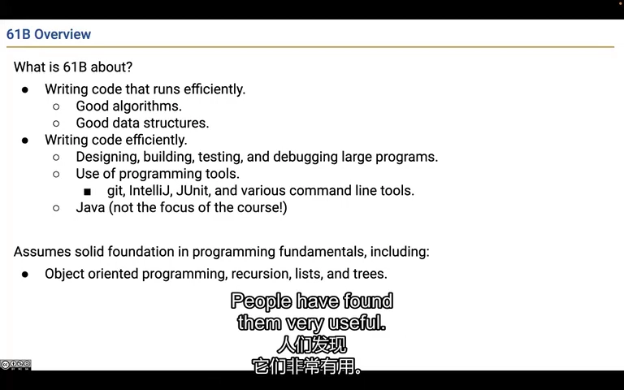
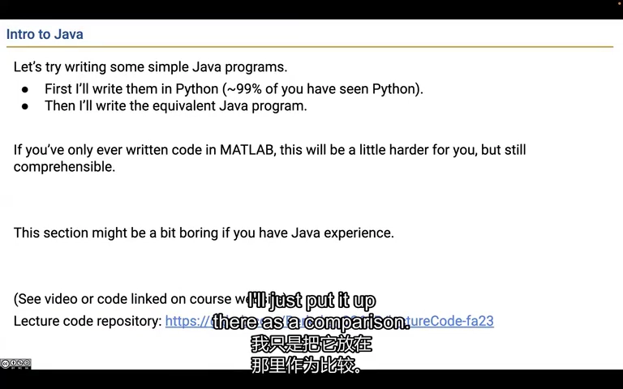
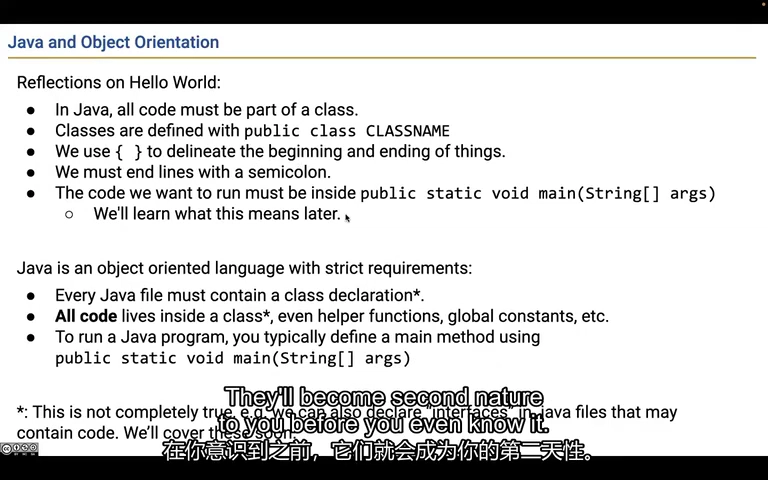
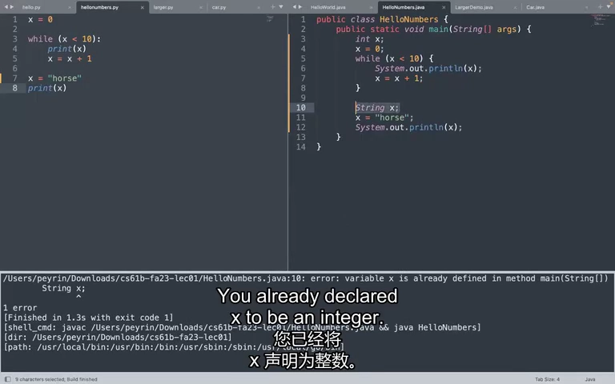
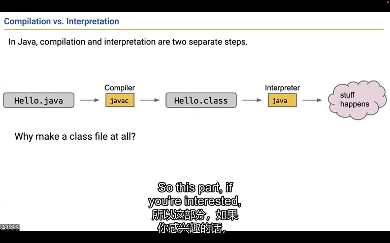
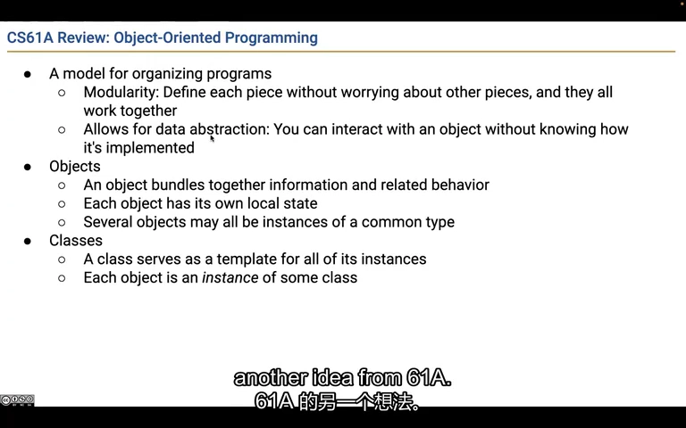
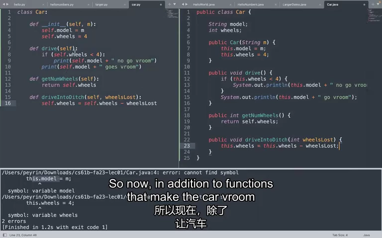
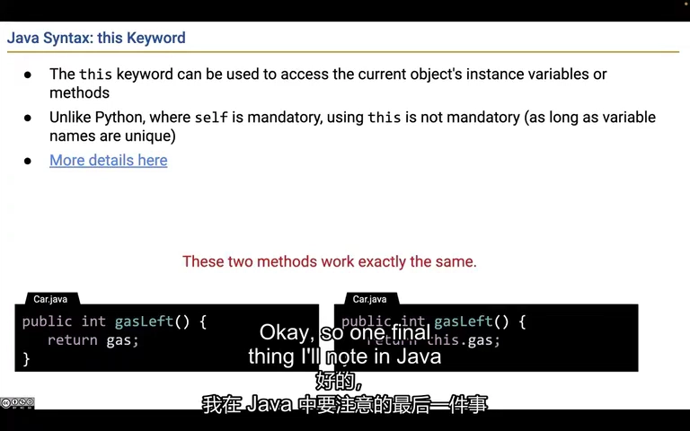

# Lecture 1：让 Java 程序跑起来，再认识类和对象

这节课先带你写一个能打印文字的小程序，再用两辆汽车解释：程序怎样记住每辆车自己的信息，以及怎样修改这些信息。你不需要一开始就背会所有英文名词，先看清每段代码在做什么。

来源：CS61B Spring 2024，B 站 P1（不是第 1 讲）。整理日期：2026-11-01。

[录像](https://www.bilibili.com/video/BV1QP4y1u7jv/?p=1) · [官方幻灯片](../slides/Lecture01.pdf) · [画面与原始字幕](../transcripts/Lecture01_画面字幕对照.md) · [课程索引](../README.md)

以下是结合字幕与画面重写的中文学习笔记，不是逐字译稿。代码为课堂思路的教学整理；额外边界说明单独标注。

## 1. 这门课要你既写得出来，也写得明白

假设你写了一个找商品的程序：商品只有 10 件时很好用，变成 100 万件就卡住了；或者程序能跑，但隔一周你自己都看不懂。CS61B 想帮你解决这两类问题：数据多了仍然跑得动，代码变多了仍然改得明白。后面会把它们分别叫作运行效率和开发效率。

**再看技术解释：**

课程分成 Java 与程序组织、数据结构、算法等阶段。前者帮助你写出较大的程序，后者帮助你判断程序在数据变多时会不会变慢。Java 是练习载体；Git、IntelliJ、测试和调试工具也是课程的一部分。

课程假设你已经接触变量、条件、循环、函数，并初步见过对象、递归、列表。若这些还不熟，遇到一个语法问题就写一个最小程序验证，比只反复看录像有效。

前半段还有选课背景、评分、作业节奏和延期说明。这些是 **2024 年当期规则**，不能直接作为今天的报名或提交说明。对自学者最有用的信息是：及时做练习，避免只积累“听懂了”的感觉。



*课堂画面：[回看 02:00](https://www.bilibili.com/video/BV1QP4y1u7jv/?p=1&t=120)。课程把运行效率和开发效率并列为目标。*

## 2. 先让电脑打印一句 Hello

你现在只想让电脑说一句 Hello。Java 要求你先搭好一个固定的外壳，再把“打印”这件事放进去。下面这段可以先照着写；眼下只要知道，电脑会从 main 开始执行，println 负责把文字显示出来。其他关键字后面逐个学。

**再看技术解释：**

Python 可以直接写 `print("Hello")`；本课程采用的 Java 17 写法需要把入口放进类：

```java
public class Hello {
    public static void main(String[] args) {
        System.out.println("Hello");
    }
}
```

保存为 `Hello.java`。`class` 声明类，花括号确定代码块，语句通常用分号结束。`main` 是程序入口，`void` 表示不返回结果，`String[] args` 接收命令行参数。先把它当作可以运行实验的外壳；后续再逐步理解 `public` 和 `static`。

Java 与 JavaScript 是不同语言；不要因为名字接近就套用同一套类型和对象规则。



*课堂画面：[回看 17:00](https://www.bilibili.com/video/BV1QP4y1u7jv/?p=1&t=1020)。课堂从 Python 程序转向等价的 Java 程序。*

## 3. 把“打印一次”改成“重复打印十次”

现在把目标换成依次打印 0 到 9。做法是先把 x 设为 0，打印它，再加 1；只要 x 还不到 10，就重复这几步。读循环时，可以用手指按这个顺序走一遍：判断 → 打印 → 加一 → 再判断。

**再看技术解释：**

下面把重复打印写进入口：

```java
public class HelloNumbers {
    public static void main(String[] args) {
        int x = 0;
        while (x < 10) {
            System.out.println(x);
            x = x + 1;
        }
    }
}
```

这里依次输出 0 到 9。`while` 每轮先判断条件，然后执行花括号中的语句；`x` 更新后回到条件处。缩进帮助人阅读，真正决定代码块的是花括号。

课堂用“代码放进类”介绍 Java 的程序结构。这是当前课程写法的规则；先学会读清类、方法、语句三层，不必把入口模板误当作所有 Java 版本、所有文件类型的完整语法定义。



*课堂画面：[回看 20:00](https://www.bilibili.com/video/BV1QP4y1u7jv/?p=1&t=1200)。类和方法为代码提供明确的组织结构。*

## 4. 告诉 Java 存的是整数，就不能中途塞进一句话

写 int x = 5，相当于约定“x 用来记一个整数”。以后从 5 改成 8 没问题，但改成 horse 这段文字就不行。Java 会在程序开始运行前拦住这种不合约定的写法，这就是“静态类型”想解决的一部分问题。

**再看技术解释：**

`int x = 5` 声明一个保存整数的变量。之后可以写 `x = 8`，但不能写 `x = "horse"`。已经声明的局部变量，也不能在同一作用域用 `String x` 重新定义成另一种类型。

静态类型让编译器在运行前发现一部分错误，也让读者知道参数和返回值的大致含义。代价是写法较明确、较啰嗦，表达通用代码时需要后面的接口和泛型。

不要把所有涉及不同类型的运算都判为错误。例如 Java 中 `"horse" + 5` 会进行字符串拼接，得到 `"horse5"`。应区分“把字符串赋给整数变量”和“使用字符串拼接运算”。



*课堂画面：[回看 23:00](https://www.bilibili.com/video/BV1QP4y1u7jv/?p=1&t=1380)。现场演示在同一作用域重新声明变量时的编译错误。*

## 5. 先检查写法，再真正执行程序

你可以把这两步分开看：第一步检查代码写得是否合法，并生成可供 Java 执行的文件；第二步才按你的指令做事。所以“检查没报错”和“算出了正确答案”是两回事。下面的 javac 负责前一步，java 负责后一步。

**再看技术解释：**

可以先编译再运行：

```sh
javac Hello.java
java Hello
```

`javac` 将源码转换为字节码，并检查语法、类型等约束；`java` 启动 JVM 执行程序。编译成功不意味着逻辑正确，例如循环条件写错仍可能输出错误结果。

课堂还把 Python 的比较函数改写成 Java 方法：

```java
public static int larger(int x, int y) {
    if (x > y) {
        return x;
    }
    return y;
}
```

它必须放在类内部；参数和返回值都标出类型。调用 `larger(3, 7)` 得到 7，调用 `larger(3.5, 7)` 则不能直接匹配这两个 `int` 参数。补充：JVM 可以解释执行并使用即时编译，幻灯片的流程是入门简图。



*课堂画面：[回看 29:00](https://www.bilibili.com/video/BV1QP4y1u7jv/?p=1&t=1740)。源码、字节码、执行结果是不同阶段的产物。*

## 6. 一份汽车设计，可以造出两辆各不相同的车

你想在程序里记录两辆车。它们都有车型和轮子数，也都能执行“驾驶”这个动作，但第一辆坏了两个轮子，不应该让第二辆也跟着坏。Java 用 class 写共同的定义，用 new 按这个定义创建一辆具体的车；每辆具体的车就是一个对象。

**再看技术解释：**

类是创建对象的模板，对象是模板的一次具体实例。两辆汽车都属于 `Car`，但车型和轮子数可以不同。字段保存状态，实例方法描述对象能执行的操作。

这样组织程序的意义是模块化：使用者可以调用“驾驶”“查询轮子数”，而不必每次重新理解所有内部存储方式。这个想法会在链表、数组列表和接口中反复出现。

```java
Car a = new Car("A");
Car b = new Car("B");
```

两个 `new` 创建两个不同对象。不要把“同一个类”理解成“所有实例共享同一份字段”。实例字段独立；下一讲才会引入类级别的 `static` 字段。



*课堂画面：[回看 32:00](https://www.bilibili.com/video/BV1QP4y1u7jv/?p=1&t=1920)。面向对象把局部状态、行为和模块边界结合起来。*

## 7. 创建一辆车时，先把它的信息填好

新建一辆车时，程序需要知道它叫什么，并先给它记上 4 个轮子。这些“刚创建时要做的事”放在构造函数里。之后调用 driveIntoDitch(2)，就是把这辆车的轮子数减 2；再调用 drive，程序就会根据剩下几个轮子决定输出什么。

**再看技术解释：**

课堂的汽车示例可以整理为：

```java
public class Car {
    String model;
    int wheels;

    public Car(String m) {
        model = m;
        wheels = 4;
    }
    public void drive() {
        if (wheels < 4) {
            System.out.println(model + " cannot drive");
            return;
        }
        System.out.println(model + " goes vroom");
    }
    public int getNumWheels() { return wheels; }
    public void driveIntoDitch(int lost) { wheels -= lost; }
}
```

构造函数与类同名，没有返回类型。`new Car("A")` 创建对象并执行初始化。`a.driveIntoDitch(2)` 改变 a 的状态，再调用 `a.drive()` 就会走到不能驾驶的分支；b 的轮子仍然是 4。

这是解释状态变化的课堂模型，没有完整的输入校验。不要把它当作实际汽车业务规则。



*课堂画面：[回看 41:00](https://www.bilibili.com/video/BV1QP4y1u7jv/?p=1&t=2460)。Car 用字段保存状态，再由方法查询或修改状态。*

## 8. this 的意思是“正在操作的这一辆”

如果 a 和 b 是两辆不同的车，a.drive() 就是在操作 a，b.drive() 就是在操作 b。方法里面的 this 指的就是当前这一辆。遇到 this.model = model 时，可以读成：“把传进来的 model，记到这辆车的 model 字段里。”

**再看技术解释：**

在实例方法中，`this` 表示接收本次调用的对象。例如调用 `a.getNumWheels()` 时，该方法内的 `this` 就是 a 指向的那辆车。

当名字没有冲突时，`return wheels;` 与 `return this.wheels;` 等价。如果构造函数参数也叫 `model`，则要明确区分：

```java
public Car(String model) {
    this.model = model;
    this.wheels = 4;
}
```

左侧是对象字段，右侧是参数。只写 `model = model` 会把参数赋给它自己，字段不会得到想要的值。这类错误不一定产生编译错误，正是后续需要测试与调试的原因。



*课堂画面：[回看 47:00](https://www.bilibili.com/video/BV1QP4y1u7jv/?p=1&t=2820)。this 是当前实例；不发生遮蔽时可以省略。*

## 跑一个完整例子：两辆车，各记各的轮子数

这是为本笔记补充的可运行代码。创建两辆车，只让第一辆损坏两个轮子。运行后第一辆剩 2 个轮子，第二辆仍有 4 个。

```java
public class CarDemo {
    static class Car {
        String name;
        int wheels = 4; // 每次 new Car，都有它自己的一份 wheels。

        Car(String name) {
            this.name = name; // 左边是这辆车的名字，右边是传进来的名字。
        }

        void damage(int count) {
            wheels -= count; // 只修改当前这辆车。
        }
    }

    public static void main(String[] args) {
        Car first = new Car("小红");
        Car second = new Car("小蓝");
        first.damage(2);
        System.out.println(first.name + "剩余轮子：" + first.wheels);
        System.out.println(second.name + "剩余轮子：" + second.wheels);
    }
}
```

两个 `new Car(...)` 创建两个对象，所以它们各有一份 `wheels`。`first.damage(2)` 只修改 first 指向的车。这里 Car 前的 `static` 让这个内部类可以单独创建，不代表所有车共用轮子数。

**运行方式：**在 CS61B 目录执行 `java examples/lecture01/CarDemo.java`。首次运行可先看[环境说明](../examples/README.md)。

预期输出：

```text
小红剩余轮子：2
小蓝剩余轮子：4
```

**改一处试试：**在打印前加上 `second.damage(1)`。先预测两行输出，再运行。

[打开完整 Java 文件](../examples/lecture01/CarDemo.java) · [单独阅读这个例子](../examples/lecture01/README.md)

## 自己动手试一试

1. 手写并运行 Hello，再故意删掉一个分号，区分编译错误与输出错误。
2. 创建两辆 Car，只修改其中一辆，先预测两次 `getNumWheels()` 的结果。
3. 解释 `int x = "horse"` 与 `"horse" + 5` 为什么不同。
4. 接着做 [Lab 01](../labs/lab01/README.md)，把编辑、运行、测试的流程走通。

## 继续阅读

- [官方教材 1](https://cs61b-2.gitbook.io/cs61b-textbook/1.-introduction)
- [实验索引](../labs/README.md)
- [本讲完整原始字幕](../subtitles/Lecture01.srt)
