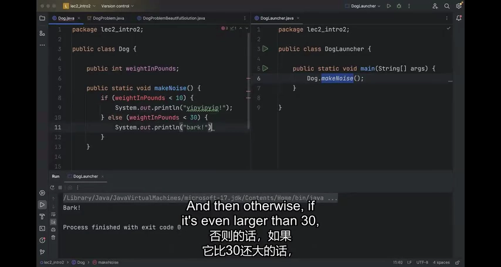
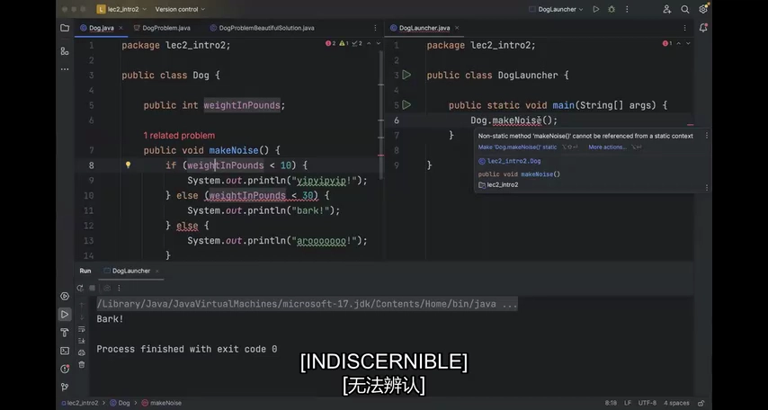
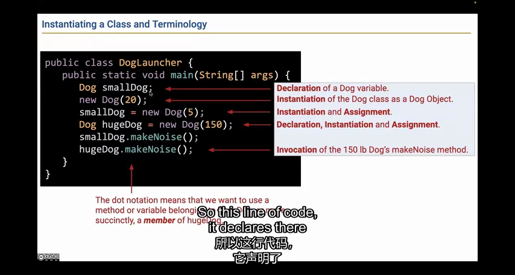
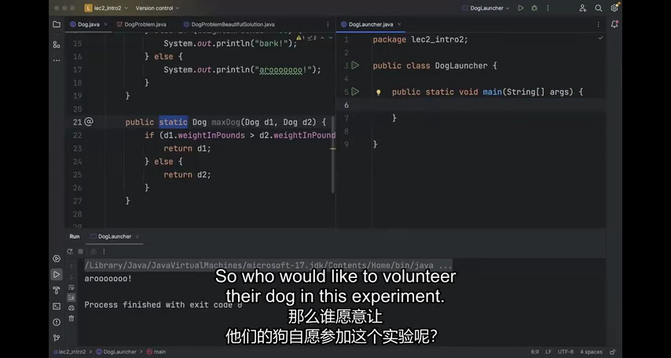
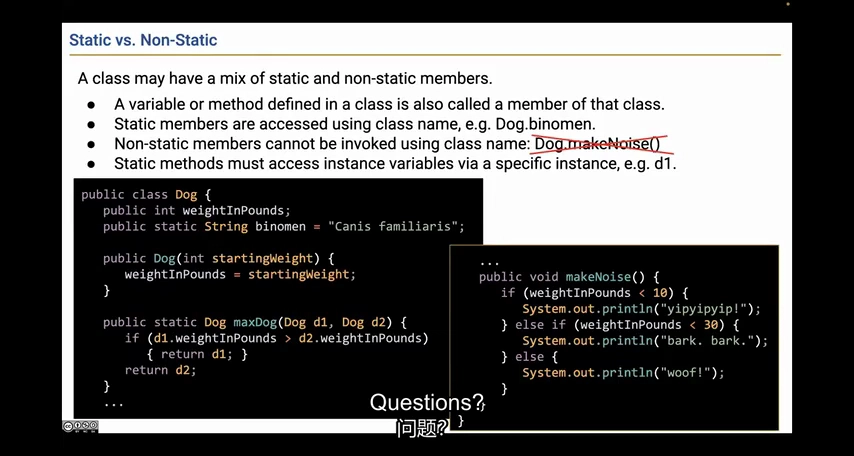
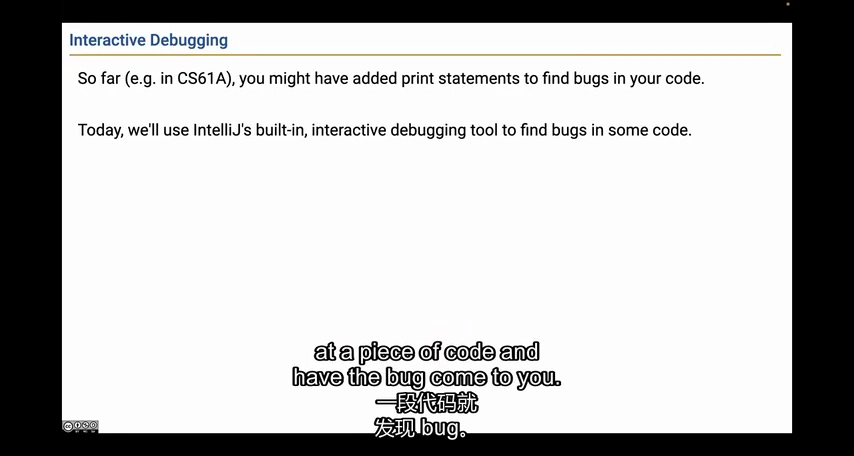
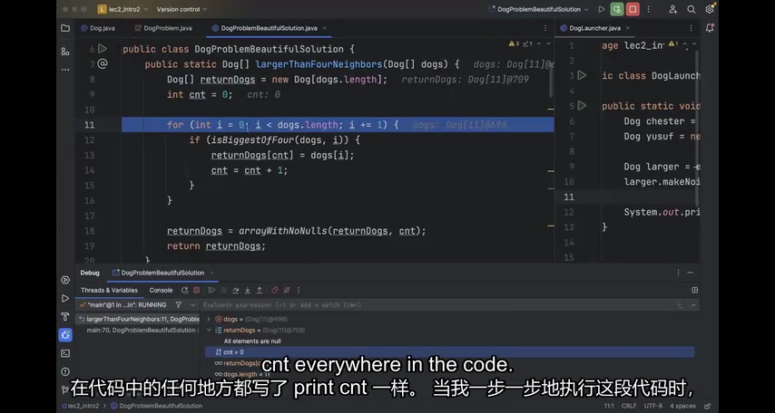
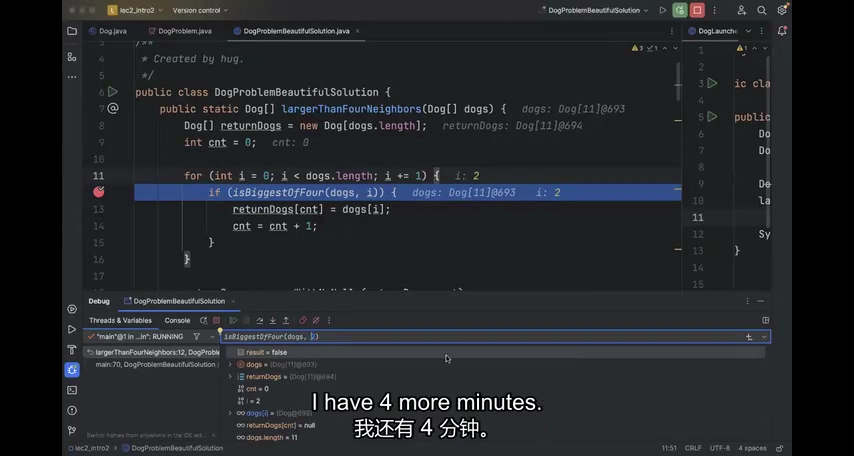

# Lecture 2：类实例与交互式调试

**类定义共同的结构，实例保存各自的数据；调试器让你观察这份数据如何随执行改变。** 本讲先把一只“只会统一叫声”的 Dog 改成按体重发声的对象，再通过邻居比较程序学习定位错误。

来源：CS61B Spring 2024，B 站 P6（不是第 6 讲）。整理日期：2026-11-01。

[录像](https://www.bilibili.com/video/BV1QP4y1u7jv/?p=6) · [官方幻灯片](../slides/Lecture02.pdf) · [画面与原始字幕](../transcripts/Lecture02_画面字幕对照.md) · [课程索引](../README.md)

以下是结合字幕与画面重写的中文学习笔记，不是逐字译稿。代码为课堂思路的教学整理；额外边界说明单独标注。

## 1. 对象差异应该成为字段，而不是复制出很多类

如果所有狗都发出同一种声音，静态 `Dog.makeNoise()` 很容易写。但当叫声取决于体重时，程序需要知道“是哪一只狗”。为每只狗复制一个类会造成重复，新增狗还得新增代码。

因此把体重作为实例字段 `weightInPounds`，在实例方法里读取它。课堂用 `< 10`、`< 30` 和其他情况划分叫声；关键不是阈值本身，而是同一段行为代码对不同实例状态产生不同结果。



*课堂画面：[回看 08:00](https://www.bilibili.com/video/BV1QP4y1u7jv/?p=6&t=480)。体重相关行为需要读取每只狗各自的字段。*

## 2. static 方法没有隐含的当前实例

下面的结构明确给每只狗初始化体重：

```java
public class Dog {
    public int weightInPounds;
    public Dog(int w) { weightInPounds = w; }
    public void makeNoise() {
        if (weightInPounds < 10) System.out.println("yap");
        else if (weightInPounds < 30) System.out.println("bark");
        else System.out.println("awoo");
    }
}
```

`new Dog(5).makeNoise()` 与 `new Dog(100).makeNoise()` 可以不同。若把 `makeNoise` 改成静态方法，又直接访问实例字段，编译器会问：你要读取哪只狗的体重？

静态方法并非绝对不能访问对象字段，而是需要一个明确的对象，例如传入 `Dog d` 后读取 `d.weightInPounds`。



*课堂画面：[回看 11:00](https://www.bilibili.com/video/BV1QP4y1u7jv/?p=6&t=660)。移除 static 后，还必须通过具体 Dog 实例调用 makeNoise。*

## 3. 声明、创建对象和赋值是三个动作

拆开一行代码，就能避免“声明变量等于创建对象”的误解：

```java
Dog small;             // 声明引用变量
small = new Dog(5);     // 创建对象，并把引用赋给变量
small.makeNoise();      // 通过引用访问该实例
```

`Dog small = new Dog(5)` 把前两步合在一起。单独写 `new Dog(20)` 也会创建对象，但若没有保存引用，后续通常无法再访问它。补充：对象不可达后可以被垃圾回收，不等于该行执行完马上被销毁。

`DogLauncher` 则可以只负责 `main` 和调用流程。一个类不必有自己的 `main` 才能参与程序；被其他类创建、调用也是正常用法。



*课堂画面：[回看 17:00](https://www.bilibili.com/video/BV1QP4y1u7jv/?p=6&t=1020)。变量声明、实例化、赋值和方法调用应分别理解。*

## 4. 工具方法与实例方法都能比较狗，调用方式不同

静态版本显式收到两只狗：

```java
public static Dog maxDog(Dog a, Dog b) {
    return a.weightInPounds > b.weightInPounds ? a : b;
}
```

调用 `Dog.maxDog(a, b)`。实例版本把第一只狗藏在接收者里：

```java
public Dog maxDog(Dog other) {
    return weightInPounds > other.weightInPounds ? this : other;
}
```

调用 `a.maxDog(b)`。两者都返回已有对象的引用，不需要再 `new Dog`。若放在同一类中，它们参数列表不同，构成重载。理解调用时到底提供了哪些对象，比单纯背诵 static 的定义更有用。



*课堂画面：[回看 23:00](https://www.bilibili.com/video/BV1QP4y1u7jv/?p=6&t=1380)。静态 maxDog 通过两个参数明确比较对象。*

## 5. static 字段属于类，但不自动成为常量

例如 `static String binomen = "Canis familiaris"` 表示类级共享信息，适合通过 `Dog.binomen` 读取。每只狗自己的体重则继续放在实例字段里。

| 成员 | 通常怎样访问 | 是否需要具体实例 |
|---|---|---|
| 实例字段 weightInPounds | `d.weightInPounds` | 需要 |
| 实例方法 makeNoise | `d.makeNoise()` | 需要 |
| 静态工具 maxDog | `Dog.maxDog(a, b)` | 调用本身不需要接收者 |
| 静态字段 binomen | `Dog.binomen` | 不需要 |

`static` 说的是归属，不是“以后不能改”。限制变量重新赋值需要 `final`；这两个关键字解决不同问题。



*课堂画面：[回看 29:00](https://www.bilibili.com/video/BV1QP4y1u7jv/?p=6&t=1740)。同一个类可以同时包含实例成员和静态成员。*

## 6. 先写出期望行为，再打开调试器

后半讲的任务是从狗数组中选出比左右各两个邻居都大的狗；超出数组边界的邻居不参与。课堂示例应选出体重 20 和 22 的狗，实际却没有选出结果。

不要直接猜某行代码错了。先明确：哪些输入应产生什么输出？再检查实现第一次偏离预期的位置。断点让程序在某行执行**之前**暂停，可查看局部变量、数组内容、字段和调用栈。

这比临时加入大量 `println` 更适合观察复杂对象；断点本身也不需要修改业务源码。



*课堂画面：[回看 32:00](https://www.bilibili.com/video/BV1QP4y1u7jv/?p=6&t=1920)。调试器用于观察执行状态，不能替代对期望行为的定义。*

## 7. Step Into 与 Step Over 用来控制观察粒度

Step Over 执行当前语句，包括其中的方法调用，但通常不进入被调方法逐行停留。Step Into 进入方法内部；Step Out 执行到当前方法返回；Resume 继续到下一个断点或结束。

课堂先观察数组是否正确，再观察返回数组和计数器。到第一个本应被选中的候选狗时，辅助函数仍返回 false，这才把注意力移进邻居判断。

普通调试通常不能直接“倒着走回上一行”。走过关键位置后，可以重新运行并调整断点；循环很长时用条件断点会更省时，详见 Lab 02。



*课堂画面：[回看 41:00](https://www.bilibili.com/video/BV1QP4y1u7jv/?p=6&t=2460)。先看外层循环，再进入决定候选狗是否合格的辅助函数。*

## 8. 找到最早的错误判断，通常比检查最后结果更有效

比较邻居时遍历偏移 `-2` 到 `2`，若不跳过 0，就把候选狗自己也当成邻居。它当然不可能严格大于自己：遇到“大于等于候选体重”的判断时，自己就把自己淘汰了。

因此需要排除自身，然后再按要求检查合法邻居。这个错误不会导致编译失败或崩溃，只会使所有候选都被拒绝。

修复后重新运行完整案例，并思考最短数组、边界位置、相等体重等输入。断点的目的不是看完每一行，而是提出一个可验证的假设，再用运行状态缩小范围。



*课堂画面：[回看 47:00](https://www.bilibili.com/video/BV1QP4y1u7jv/?p=6&t=2820)。候选体重 20 本应被保留，辅助函数的结果却首次偏离预期。*

## 动手检查理解

1. 用一句话解释 `Dog.maxDog(a,b)` 与 `a.maxDog(b)` 各自从哪里获得两只狗。
2. 在纸上跟踪偏移 -2、-1、0、1、2，说明为什么必须跳过 0。
3. 完成 [Lab 02](../labs/lab02/README.md) 的三个阶段，练习断点、对象可视化和条件断点。

## 继续阅读

- [官方教材 1](https://cs61b-2.gitbook.io/cs61b-textbook/2.-defining-and-using-classes)
- [实验索引](../labs/README.md)
- [本讲完整原始字幕](../subtitles/Lecture02.srt)
