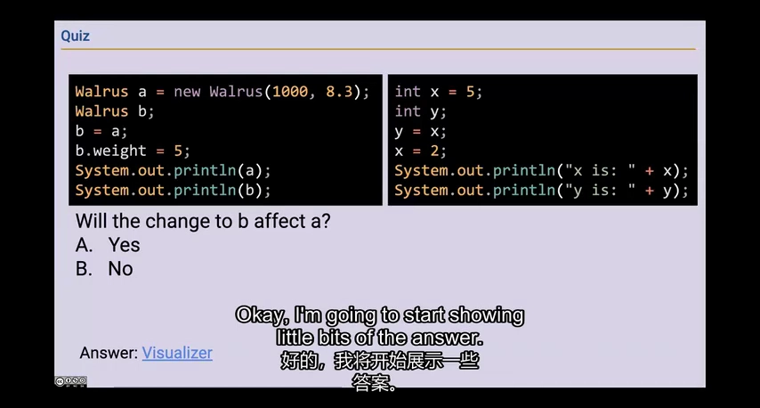
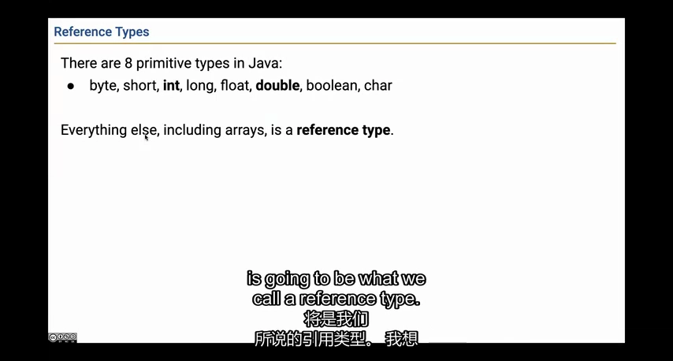
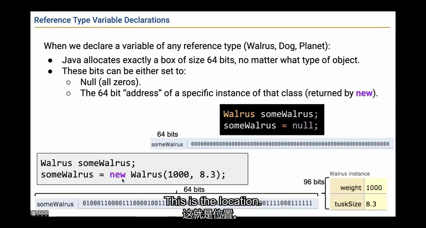
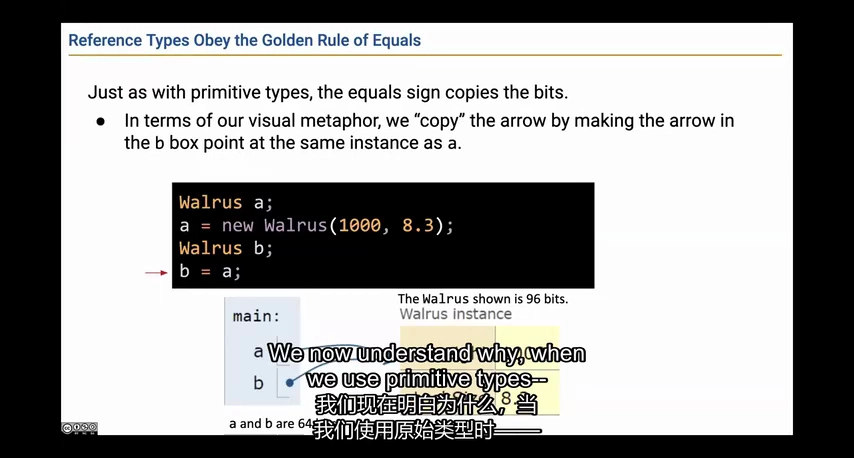
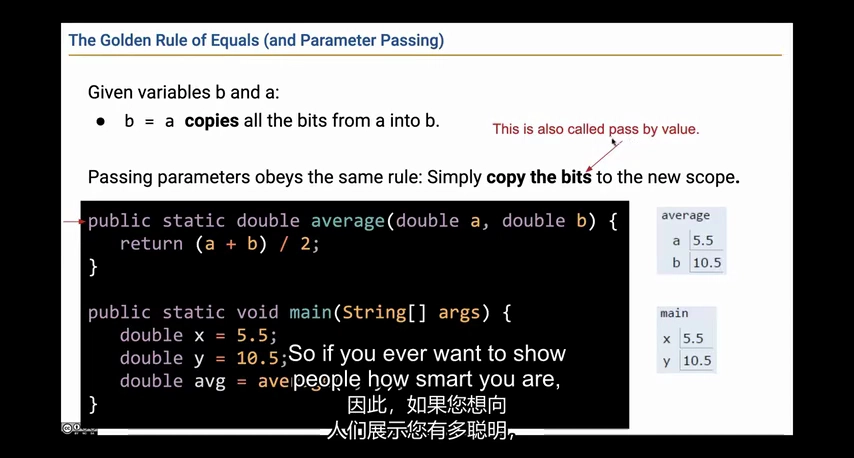
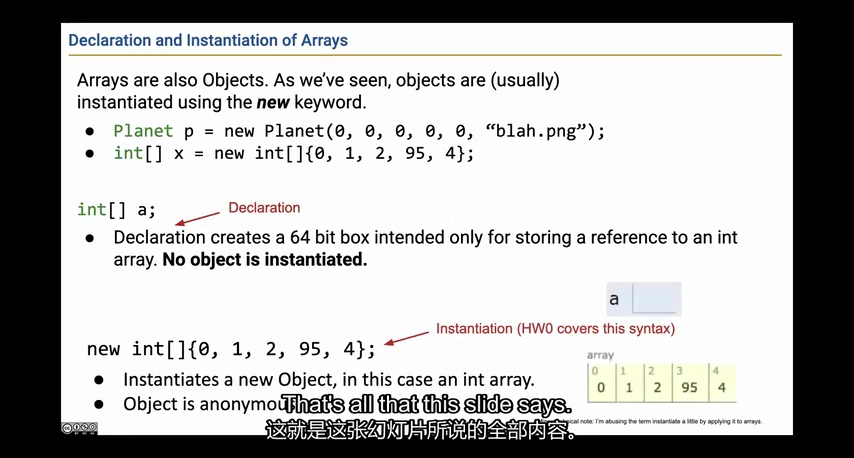
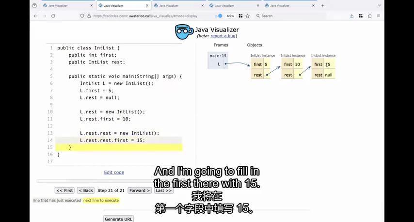
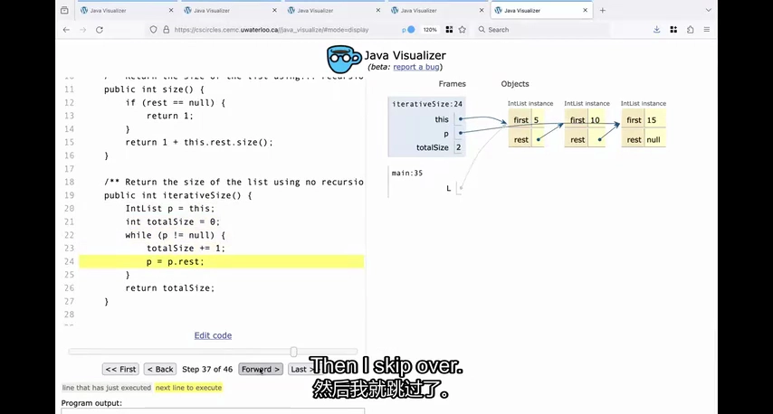

# Lecture 3：为什么改了 b，a 有时也会跟着变

这节课先解决一个很容易困惑的问题：写 b = a，到底复制了什么？如果复制的是一个数字，之后各改各的；如果复制的是“到哪里找同一个对象”的线索，两边就可能改到同一个东西。想清楚这个区别，再看数组和链表会轻松很多。

来源：CS61B Spring 2024，B 站 P12（不是第 12 讲）。整理日期：2026-11-01。

[录像](https://www.bilibili.com/video/BV1QP4y1u7jv/?p=12) · [官方幻灯片](../slides/Lecture03.pdf) · [画面与原始字幕](../transcripts/Lecture03_画面字幕对照.md) · [课程索引](../README.md)

以下是结合字幕与画面重写的中文学习笔记，不是逐字译稿。代码为课堂思路的教学整理；额外边界说明单独标注。

## 1. 抄一份数字，和两个人操作同一个东西，结果不同

先想两张纸：你把第一张纸上的 5 抄到第二张，再把第一张改成 2，第二张仍是 5。再想两个人打开同一份在线文档：一个人改了内容，另一个人也会看到变化。下面整数变量类似前一种情况，对象引用类似后一种；b = a 不一定会复制出一个新对象。

**再看技术解释：**

先比较两个小例子：

```java
int x = 5;
int y = x;
x = 2;                   // y 仍是 5

Walrus a = new Walrus(1000, 8.3);
Walrus b = a;
b.weight = 5;            // a 和 b 看到同一对象的新 weight
```

第一段复制整数 5，x 与 y 随后独立。第二段复制一个对象引用，于是两条引用通往同一只海象。通过 b 修改字段，会被通过 a 的读取看见。这里没有“赋值运算符对对象使用了另外一种规则”。



*课堂画面：[回看 02:00](https://www.bilibili.com/video/BV1QP4y1u7jv/?p=12&t=120)。海象和整数谜题的区别在于复制的是数值还是引用。*

## 2. 变量有的直接记数值，有的记“去哪里找对象”

看变量时先问：这里存的是数据本身，还是用来找到另一个对象的引用？int x = 5 直接记整数；Dog d 则用来找到一只狗。在图上，前者在格子里写 5，后者画一条指向对象的箭头。这两类在 Java 里叫基本类型和引用类型。

**再看技术解释：**

Java 的八种基本类型是 `byte`、`short`、`int`、`long`、`float`、`double`、`boolean`、`char`。类类型和数组类型属于引用类型；`String`、`Integer`、`int[]` 都不等于基本类型 `int`。

为了画图，可以把变量画成盒子：整数盒子里写数字，引用盒子里画箭头。对象本身画在盒子外，内部再有字段。`int` 的值域与位数是语言规定的一部分；引用具体占多少内存则取决于 JVM 表示。

局部变量使用前必须确定已赋值；对象字段和数组元素则有默认值。不要把“局部变量不能未初始化就读”扩展为“所有变量初始都没有值”。



*课堂画面：[回看 11:00](https://www.bilibili.com/video/BV1QP4y1u7jv/?p=12&t=660)。基本类型和引用类型对应不同的盒子内容。*

## 3. 写下一个名字，并不会自动创建对象

你可以先写“准备记录一只狗”，但这不等于已经有狗了。Java 中，声明变量与 new 创建对象也是两步。null 表示目前没有指向任何对象；如果这时还要读取它的体重，就没有东西可读，程序会报空指针异常。

**再看技术解释：**

`Walrus w;` 只声明变量，`w = new Walrus(...)` 才创建对象并保存引用，`w = null` 则把引用改为“没有对象”。执行 `w.weight` 之前必须有实际对象，否则会出现空指针异常。

课堂把引用比作地址，这有助于理解“保存通往对象的线索”。但 Java 程序不能把一般对象引用当成整数地址任意做加减。图上的箭头是理解工具，不是可直接操作的裸内存地址。

还要分清 `w`、w 指向的对象和对象的字段。一次赋值到底修改哪个盒子，是后续所有图解题的核心。



*课堂画面：[回看 17:00](https://www.bilibili.com/video/BV1QP4y1u7jv/?p=12&t=1020)。声明引用变量不等于创建了一个 Walrus 对象。*

## 4. 修改共同的对象，会互相看见；换掉自己的引用，不会

假设 a 和 b 都指向同一只狗。通过 b 把狗的体重改成 5，a 再去看，也会看到 5。但如果让 b 改为指向另一只新狗，a 仍然指向原来那只。前一个动作是改对象里的内容，后一个动作是改 b 指向哪里。读代码时把这两种动作分开。

**再看技术解释：**

执行 `b = a` 后，a 和 b 是同一对象的两个别名。接下来有两种完全不同的操作：

```java
b.weight = 5;                 // 沿箭头走过去，修改对象内部
b = new Walrus(2000, 9.0);     // 修改 b 自己的箭头
```

第二行后，a 仍指向原对象，b 指向新对象。给 b 重新赋值不会“顺便把 a 也改过去”。画图时先画新对象，再擦掉 b 的旧箭头，最后画 b 的新箭头，就不会混淆。

反过来，如果对象内部还有引用字段，修改该字段会改变共享对象的一部分；所以分析链表时要把每个字段也当作独立盒子。



*课堂画面：[回看 23:00](https://www.bilibili.com/video/BV1QP4y1u7jv/?p=12&t=1380)。两条引用可以指向一个对象，但变量本身仍是两份存储位置。*

## 5. 把数组传给方法，方法可以改内容，但不能替你换变量

你把一个数组交给 change，让它处理。change 可以把数组里的第一个数改成 9，因为双方找的是同一个数组。但 change 把自己的参数改为指向新数组，不会让外面的 x 也自动改过去。下面例子最后 x[0] 是 9，不是 7，正好把这两件事分开。

**再看技术解释：**

下面是依据课堂规则补充的小例子：

```java
static void change(int[] a) {
    a[0] = 9;
    a = new int[] {7};
}
// 调用端：
int[] x = {1};
change(x);              // 返回后 x[0] 是 9
```

进入方法时，参数 a 收到 x 中引用值的副本，因此 `a[0] = 9` 修改的是共同指向的数组。随后 `a = ...` 仅改了方法内的参数变量，调用端 x 的箭头没有改变。

所以 Java 仍然是**按值传递**。说“对象按引用传递”容易让人误以为能在方法里替换调用者的变量；更准确的说法是“按值传递一个对象引用”。



*课堂画面：[回看 26:00](https://www.bilibili.com/video/BV1QP4y1u7jv/?p=12&t=1560)。赋值与参数传递遵守同一条复制值规则。*

## 6. 写 b = a，并没有多出一份数组

数组也遵守刚才的规则。如果 a 指向 [1,2,3]，再写 b = a，两边仍然是在看同一个数组。要得到一份能独立修改的新数组，需要先另外创建空间，再把元素复制进去。如果元素本身又是对象引用，还得继续想清楚：复制的是引用，还是对象本身？

**再看技术解释：**

`int[] a = new int[] {0,1,2,95,4}` 分配一个数组对象，并把引用赋给 a。`int[] b = a` 不复制数组元素，只复制引用。

若想得到独立数组，需要另外分配空间并复制元素。即使做了数组复制，元素若是对象引用，也不自动复制所指向的对象；这就是后面“浅拷贝”的来源。

数组的长度属于数组对象；数组变量可以改指向另一个长度的数组。这个区别会在第 7 讲的扩容中成为关键。



*课堂画面：[回看 29:00](https://www.bilibili.com/video/BV1QP4y1u7jv/?p=12&t=1740)。数组的声明与数组对象的实例化同样是两个步骤。*

## 7. 链表就是：记住一个数，再记住下一个数在哪里

想保存 5、10、15，可以让第一个小对象记“值是 5，下一站在那里”，第二个记“值是 10，下一站在那里”，最后一个记“值是 15，后面没有了”。这些小对象叫节点，连接起来就是链表。IntList 的 first 保存数值，rest 指向下一个节点。

**再看技术解释：**

最小的 IntList 可以这样定义：

```java
public class IntList {
    public int first;
    public IntList rest;
    public IntList(int f, IntList r) {
        first = f;
        rest = r;
    }
}
```

链表 5 → 10 → 15 → null 的第一个节点保存 5，rest 指向保存 10 的节点。最后节点的 rest 为 null。rest 保存的是引用，不会把一个完整列表直接塞进另一个对象导致无限大的对象。

从尾部向前构造尤其自然：

```java
IntList L = new IntList(15, null);
L = new IntList(10, L);
L = new IntList(5, L);
```

每一步先用旧 L 作为新节点的 rest，再把 L 改为新节点的引用。



*课堂画面：[回看 35:00](https://www.bilibili.com/video/BV1QP4y1u7jv/?p=12&t=2100)。每个 IntList 节点都保存 first 和指向后续节点的 rest。*

## 8. 数链表有多长，可以一路数过去，也可以分给后面继续数

一种方法是从第一个节点走到最后一个，每经过一个就加 1。另一种是：当前节点算 1，让后面的列表先算出自己的长度，再加回来。它们分别对应循环和递归。两种方法都得经过整条链；递归还要记住每层等着返回的计算。

**再看技术解释：**

对非空、无环列表，递归长度可以写为：

```java
public int size() {
    if (rest == null) return 1;
    return 1 + rest.size();
}
public int get(int i) {       // 前提：0 <= i < size()
    if (i == 0) return first;
    return rest.get(i - 1);
}
```

`size` 把当前节点的 1 加到剩余列表长度上；`get` 每走一个节点，目标位置减 1。迭代版本则用游标 `p = this`，反复计数并执行 `p = p.rest`，直到 p 为 null。

两种长度算法都要访问所有节点，时间随节点数增长。补充：递归还消耗调用栈，长链可能栈溢出；迭代的游标只需固定额外空间。当前裸链表并未优雅地统一“空列表”，这是下一讲引入包装类和哨兵的动机。



*课堂画面：[回看 44:00](https://www.bilibili.com/video/BV1QP4y1u7jv/?p=12&t=2640)。迭代版本移动游标，原来的链表起点保持不变。*

## 跑一个完整例子：改数组里的数，和改为指向另一个数组

这是为本笔记补充的可运行代码。运行后 a 与 b 都显示 [9, 2]，但方法内部最后打印 [7, 8]。这不是矛盾：方法换掉的是自己的参数引用。

```java
import java.util.Arrays;

public class ReferenceDemo {
    static void change(int[] numbers) {
        numbers[0] = 9; // 改的是双方都能找到的那个数组。
        numbers = new int[] {7, 8}; // 现在只让参数指向新数组。
        System.out.println("方法里面：" + Arrays.toString(numbers));
    }

    public static void main(String[] args) {
        int[] a = {1, 2};
        int[] b = a; // 复制引用，没有创建第二个数组。
        change(b);
        System.out.println("a：" + Arrays.toString(a));
        System.out.println("b：" + Arrays.toString(b));
        System.out.println("同一个数组：" + (a == b));
    }
}
```

调用前 a、b 都找到 `[1,2]`。调用时参数 numbers 收到同一引用的副本，改 `numbers[0]` 就改到了共享数组。随后 `numbers = new ...` 只改变参数指向哪里，没有给外面的 a、b 重新赋值。这就是 Java 按值传递在引用类型上的表现。

**运行方式：**在 CS61B 目录执行 `java examples/lecture03/ReferenceDemo.java`。首次运行可先看[环境说明](../examples/README.md)。

预期输出：

```text
方法里面：[7, 8]
a：[9, 2]
b：[9, 2]
同一个数组：true
```

**改一处试试：**把 `numbers[0] = 9` 移到 `numbers = new int[] {7,8}` 后面。外面的 a、b 还会变吗？

[打开完整 Java 文件](../examples/lecture03/ReferenceDemo.java) · [单独阅读这个例子](../examples/lecture03/README.md)

## 自己动手试一试

1. 不运行代码，画出 a、b 共享对象后，字段赋值与变量重新赋值的两种结果。
2. 解释上面的 `change` 为什么最后得到 9 而不是 7。
3. 手算链表 5 → 10 → 15 的 `size()` 调用与返回过程，再算 `get(2)`。
4. 在 [Lab 02](../labs/lab02/README.md) 的 Java Visualizer 中对照自己的图。

## 口语与字幕校正

字幕中的“休息”通常对应 `rest`，“名单”有时对应 list。幻灯片将引用画为 64 位是简化模型，不是所有 JVM 的统一内存承诺。Java 标准库本来就有 List；课堂自行实现 IntList 是为了学习数据结构。

## 继续阅读

- [官方教材 1](https://cs61b-2.gitbook.io/cs61b-textbook/3.-references-recursion-and-lists)
- [实验索引](../labs/README.md)
- [本讲完整原始字幕](../subtitles/Lecture03.srt)
