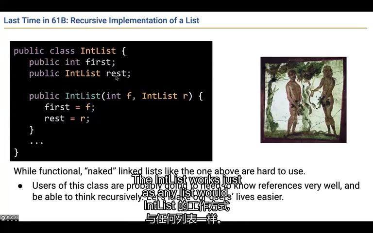
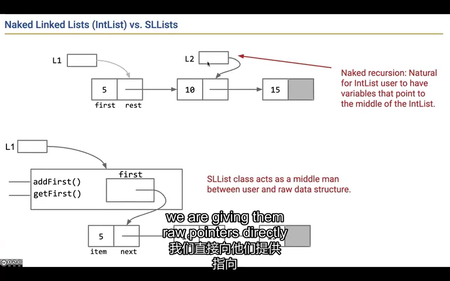
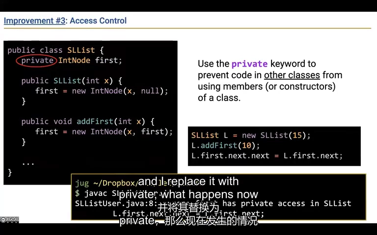
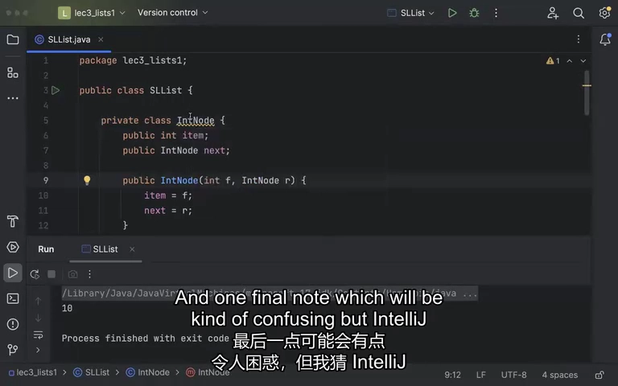
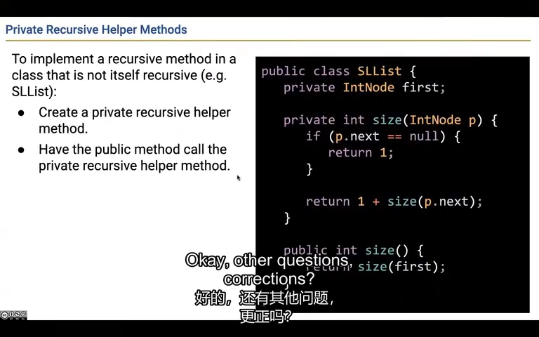
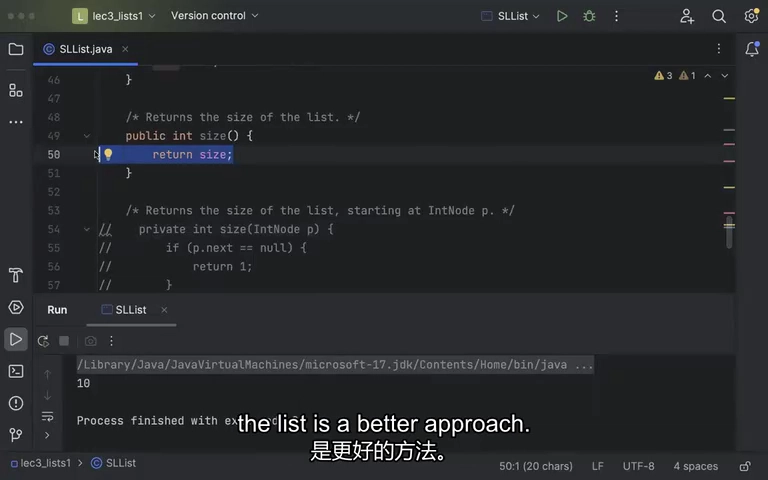
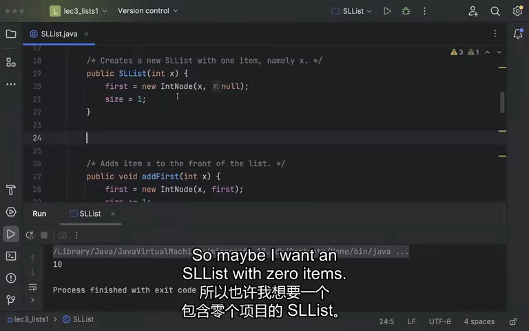
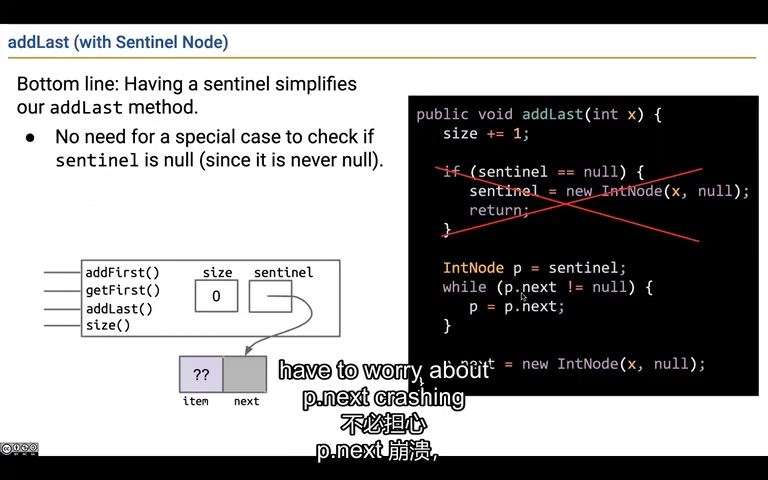

# Lecture 4：把链表包装好，让它更容易使用

上一讲的链表能存东西，但使用者还得亲自处理“下一个节点接在哪里”。这一讲会一步步把这些细节收进去，让调用者只管添加、读取和查询长度。最后加一个始终存在的起点，让空列表也更好处理。

来源：CS61B Spring 2024，B 站 P15（不是第 15 讲）。整理日期：2026-11-01。

[录像](https://www.bilibili.com/video/BV1QP4y1u7jv/?p=15) · [官方幻灯片](../slides/Lecture04.pdf) · [画面与原始字幕](../transcripts/Lecture04_画面字幕对照.md) · [课程索引](../README.md)

以下是结合字幕与画面重写的中文学习笔记，不是逐字译稿。代码为课堂思路的教学整理；额外边界说明单独标注。

## 1. 使用链表的人，不该每次都亲自接线

你只是想把 10 加到列表开头，却要先找到节点，再改 next，最后重新记住开头在哪里。每次都让使用者干这些事，很容易接错，甚至把链表接成一个永远走不出去的圈。我们可以把这些操作写好，让使用者直接说“加到开头”。

**再看技术解释：**

IntList 要求使用者知道 first、rest 和 null，还允许外部直接修改链接。想添加一个元素时，调用者需要操作引用；一旦把节点连回自己，就会让遍历永远无法结束。

第一步把真正节点改名为 `IntNode`，字段改为 `item`、`next`，再增加 `SLList` 作为面向用户的列表对象。改名本身不改变算法，但明确了角色：节点是内部材料，SLList 是对外使用的数据结构。



*课堂画面：[回看 02:00](https://www.bilibili.com/video/BV1QP4y1u7jv/?p=15&t=120)。IntList 的裸递归表示把节点结构直接暴露给使用者。*

## 2. 让列表对象替使用者管理里面的节点

现在增加一个专门管理节点的 SLList。外面的人拿着 SLList，调用 addFirst(10)；它在内部完成创建节点和连接的操作。以后第一节点换了，使用者仍然拿着原来那个列表对象，不需要自己追着新开头跑。

**再看技术解释：**

最初的包装形式可理解为：

```java
public class SLList {
    private IntNode first;
    public SLList(int x) { first = new IntNode(x, null); }
    public void addFirst(int x) { first = new IntNode(x, first); }
    public int getFirst() { return first.item; }
}
```

这是尚未加入哨兵的中间版本，假设 IntNode 已定义。调用端可以写 `L.addFirst(10)`，不必亲自重接节点。L 指向的 SLList 包装对象不变，内部 first 可以随着操作改变。

因此“列表本身的引用”和“第一个节点的引用”成为两个层次。这也是之后缓存 size、替换实现的基础。



*课堂画面：[回看 11:00](https://www.bilibili.com/video/BV1QP4y1u7jv/?p=15&t=660)。SLList 在使用者与节点之间增加一层稳定接口。*

## 3. 把不该随便动的部分藏起来

如果任何人都能改链表内部的 next，列表就很难保证不会被接坏。把 first 设为 private，相当于规定：外部只能通过公开的添加、删除等方法来修改列表。这样实现者能集中检查修改是否正确，使用者也少了许多必须理解的细节。

**再看技术解释：**

把 first 设为 private，外部就不能随意写 `L.first.next = ...`。添加、删除等操作通过公开方法完成，结构约束集中由 SLList 维护。

好处有两个：使用者要理解的东西减少；实现者以后可以改变内部存储方式，只要公开操作仍然满足原先约定。课堂用方向盘和油路类比：驾驶者需要操作方向盘，不需要直接改变油路。

private 是语言层面的访问控制，不代表字段从对象或字节码中消失，也不是抵御所有反射等机制的安全边界。这里关心的是正常程序设计中的封装。



*课堂画面：[回看 14:00](https://www.bilibili.com/video/BV1QP4y1u7jv/?p=15&t=840)。公开接口与私有表示帮助维护抽象边界。*

## 4. 只给链表内部用的小类型，放在链表内部定义

IntNode 只负责当链表节点，其他代码没有必要直接使用它。把它定义在 SLList 里面，读者就容易知道这是谁的内部零件。这里的 static 也不是说“所有节点共用一份数据”，而是说节点不需要额外记住它属于哪个外层 SLList 对象。

**再看技术解释：**

IntNode 若只用于 SLList，就可以嵌套在 SLList 内部：

```java
private static class IntNode {
    int item;
    IntNode next;
    IntNode(int i, IntNode n) { item = i; next = n; }
}
```

`private` 表示这是内部辅助类型；`static` 嵌套类不需要隐含持有某个外层 SLList 实例。它仍能创建很多不同节点，每个节点都有自己的 item 和 next。

不要把静态嵌套类误解为“全世界只有一个节点”，也不要把它与 static 方法混为一谈。是否需要访问外层实例，是这里判断 static 的主要依据。



*课堂画面：[回看 23:00](https://www.bilibili.com/video/BV1QP4y1u7jv/?p=15&t=1380)。IntNode 嵌套进 SLList，使节点表示保持在实现内部。*

## 5. 对外只提供 size，内部怎么数由列表自己决定

使用者只问“这个列表有几个元素”，不需要知道从哪个节点开始数。于是公开的 size() 负责回答问题，内部的辅助方法负责沿节点计算。添加到末尾也一样：要改的是尾节点的 next；只让临时变量 p 指向新节点，并没有把新节点接进列表。

**再看技术解释：**

SLList 自己不再是递归节点，不能直接写原先的 `rest.size()`。可以让公开 `size()` 委托给接收节点的私有辅助方法，由辅助方法沿 next 递归。

`size()` 与 `size(IntNode p)` 参数列表不同，属于重载。公开方法决定从哪里开始，内部方法负责怎样计算。为兼容空表，辅助方法可把 `p == null` 作为返回 0 的基例；这比仅处理“最后节点”的写法更一般。

末尾添加也遵循类似过程：游标一直移动到尾节点，然后修改 `p.next`。只写 `p = new IntNode(...)` 改的是局部游标，并没有把新节点接入链表。



*课堂画面：[回看 32:00](https://www.bilibili.com/video/BV1QP4y1u7jv/?p=15&t=1920)。公开 size 可以委托给接收节点的私有递归辅助方法。*

## 6. 与其每次重新数，不如增删时顺手记一下总数

如果你总是问列表有多长，每次从头数一遍就很浪费。可以另外保存一个 size：成功加一个元素就加 1，删一个就减 1，查询时直接读它。但多保存了一份数字，就要保证它一直与实际元素数一致。这个“每次操作后都必须成立的规则”叫不变量。

**再看技术解释：**

每次查询都遍历一遍链表，在频繁查询时很浪费。增加一个整数 size，在添加时递增、删除时递减，查询就只返回字段。

这里增加了一条必须长期维护的不变量：**size 等于真实元素数**。不变量是每个公开操作完成后都应成立的约束。缓存并不是免费的优化：忘记在某个修改分支更新计数，会得到结构正确但长度错误的状态。

`getFirst`、`size` 这类只读操作不应改变计数。修改操作应在实际修改成功时同步更新，而不是随意在入口处加减。



*课堂画面：[回看 35:00](https://www.bilibili.com/video/BV1QP4y1u7jv/?p=15&t=2100)。缓存长度以后，size 查询不再扫描节点。*

## 7. 以前一直有第一个节点，现在空列表没有了

原来的代码会先找到第一个节点，再看它后面还有没有节点。空列表连第一个节点都没有，一开始读 p.next 就会出错。可以为这种情况单写一个分支，但如果很多操作都有空表分支，代码会越来越绕。接下来要换一种更统一的表示方法。

**再看技术解释：**

用 `first = null, size = 0` 表示空表很自然，但原来的 addLast 一开始就读取 `p.next`；当 p 为 null 时直接异常。可以专门写空表分支，然而每个操作都可能不断积累类似判断。

此时要问的不是“还能再加几个 if”，而是“能否改变表示，让更多情况共享一条路径”。哨兵节点就是为这个目标服务：始终保留一个不代表用户元素的节点。



*课堂画面：[回看 38:00](https://www.bilibili.com/video/BV1QP4y1u7jv/?p=15&t=2280)。支持零元素列表后，必须重新检查原先依赖 first 非空的代码。*

## 8. 留一个不算元素的起点，空表也能从这里开始

无论列表里有没有内容，都先放一个固定的起点节点。它不代表用户放进去的数字，只负责指向真正的第一个元素。空表时它后面没人，有内容时从它往后走。这样“找到末尾再接一个节点”的步骤，两种情况都能用。这个固定起点就叫哨兵。

**再看技术解释：**

最终表示为：`sentinel → 第一个真实节点 → ... → null`。空表是 `sentinel.next == null`，sentinel 自己始终存在，item 的值不参与列表内容。

```java
public void addFirst(int x) {
    sentinel.next = new IntNode(x, sentinel.next);
    size++;
}
public void addLast(int x) {
    IntNode p = sentinel;
    while (p.next != null) p = p.next;
    p.next = new IntNode(x, null);
    size++;
}
```

空表时循环直接结束，把新节点接在哨兵后即可；非空时同样找到尾节点再接上。需保持三条不变量：哨兵存在；首个真实元素在 sentinel.next；size 不计入哨兵。

但空表 `getFirst()` 仍然没有可返回的真实元素。补充：应明确抛异常或其他约定，不能把哨兵的假值当成正常结果。



*课堂画面：[回看 47:00](https://www.bilibili.com/video/BV1QP4y1u7jv/?p=15&t=2820)。从永不为空的哨兵出发，addLast 不再需要单独处理空表。*

## 跑一个完整例子：空列表也有一个固定的起点

这是为本笔记补充的可运行代码。程序先打印空列表，再向末尾加 20、向开头加 10。你会看到哨兵一直存在，但不计入元素数量。

```java
public class SentinelListDemo {
    private static class Node {
        int value;
        Node next;
        Node(int value, Node next) { this.value = value; this.next = next; }
    }

    private final Node sentinel = new Node(0, null); // 0 只是占位值，不是列表元素。
    private int size;

    void addFirst(int value) {
        sentinel.next = new Node(value, sentinel.next);
        size++;
    }

    void addLast(int value) {
        Node p = sentinel; // 空表也能从这里开始。
        while (p.next != null) {
            p = p.next;
        }
        p.next = new Node(value, null); // 改尾节点的连接，才真正接上了新节点。
        size++;
    }

    String values() {
        StringBuilder out = new StringBuilder("[");
        for (Node p = sentinel.next; p != null; p = p.next) {
            if (p != sentinel.next) { out.append(", "); }
            out.append(p.value);
        }
        return out.append("]").toString();
    }

    public static void main(String[] args) {
        SentinelListDemo list = new SentinelListDemo();
        System.out.println(list.values() + "，size=" + list.size);
        list.addLast(20);
        list.addFirst(10);
        System.out.println(list.values() + "，size=" + list.size);
    }
}
```

`sentinel.next` 指向第一个真正元素；空表时它是 null。`addLast` 从哨兵向后走，空表和非空表都能走到“下一站为空”的位置。`values()` 只负责把节点内容拼成可读文字，`StringBuilder` 可以理解为逐段拼接文字的工具。这份简单实现的尾部添加仍需遍历，耗时 O(N)。

**运行方式：**在 CS61B 目录执行 `java examples/lecture04/SentinelListDemo.java`。首次运行可先看[环境说明](../examples/README.md)。

预期输出：

```text
[]，size=0
[10, 20]，size=2
```

**改一处试试：**只执行 `addLast(0)`，观察列表打印 `[0]`、size 为 1。为什么这个 0 算元素，哨兵里的 0 却不算？

[打开完整 Java 文件](../examples/lecture04/SentinelListDemo.java) · [单独阅读这个例子](../examples/lecture04/README.md)

## 自己动手试一试

1. 画出空表、一个元素、两个元素三种哨兵结构。
2. 说明 `p = new IntNode(...)` 与 `p.next = new IntNode(...)` 为什么不同。
3. 连续进行空表 addLast、addFirst、size 查询，逐步检查三个不变量。
4. 继续看第 5 讲，思考为什么仅加 last 引用仍不能快速删除尾节点。

## 继续阅读

- [官方教材 1](https://cs61b-2.gitbook.io/cs61b-textbook/4.-sllists)
- [实验索引](../labs/README.md)
- [本讲完整原始字幕](../subtitles/Lecture04.srt)
