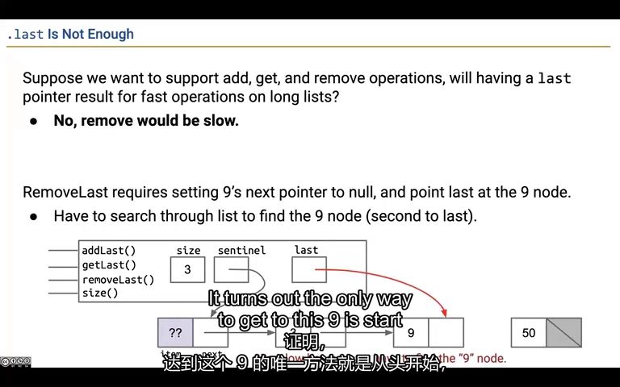
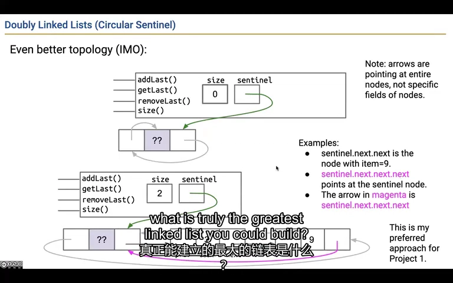
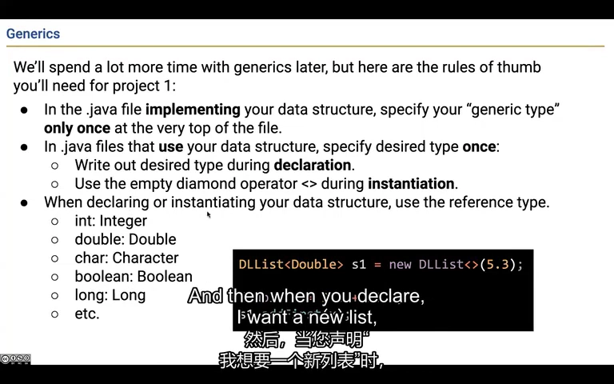
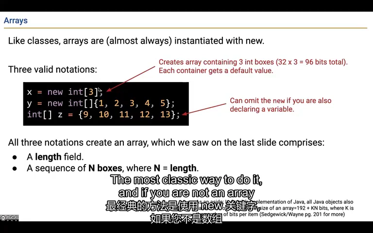
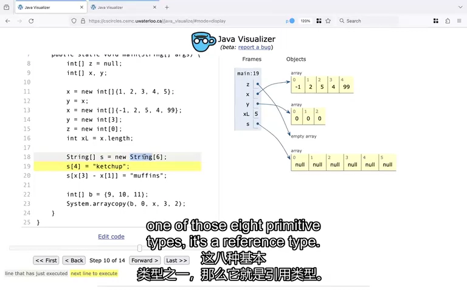
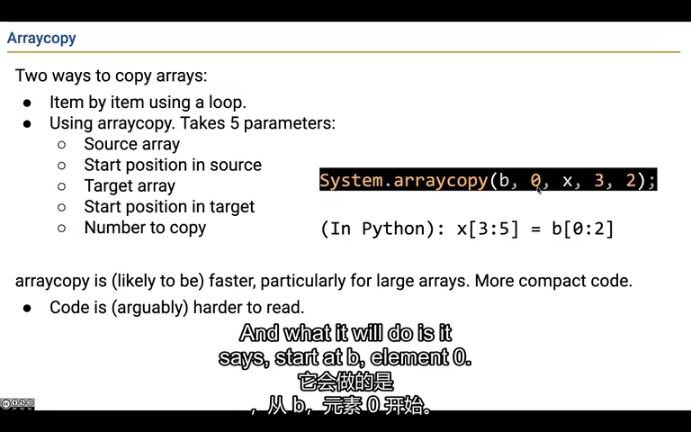
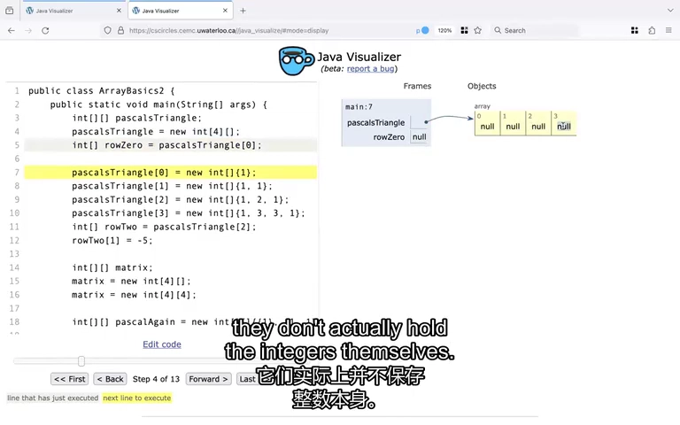
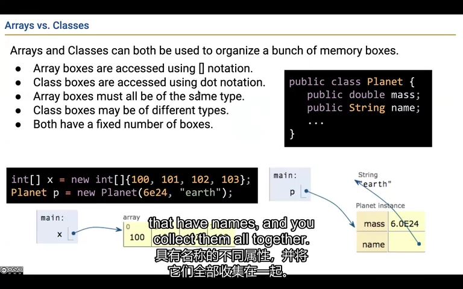

# Lecture 5：让链表能往回走，再认识泛型和数组

这节课处理三个实际问题：怎样快速找到前一个节点，怎样用同一套列表代码保存不同类型的数据，以及怎样按编号直接访问一个位置。它们分别引出双向链表、泛型和数组。

来源：CS61B Spring 2024，B 站 P18（不是第 18 讲）。整理日期：2026-11-01。

[录像](https://www.bilibili.com/video/BV1QP4y1u7jv/?p=18) · [官方幻灯片](../slides/Lecture05.pdf) · [画面与原始字幕](../transcripts/Lecture05_画面字幕对照.md) · [课程索引](../README.md)

以下是结合字幕与画面重写的中文学习笔记，不是逐字译稿。代码为课堂思路的教学整理；额外边界说明单独标注。

## 1. 知道最后一个在哪里，还不够删掉最后一个

假设链表是 5 → 9 → 50。你直接找到了 50，但要删掉它，还得让 9 的 next 不再指向 50。如果节点只记下一站，不记上一站，就还是得从头走来找到 9。所以只保存一个 last，并没有解决删除末尾的全部问题。

**再看技术解释：**

给单链表增加 last，可以直接找到尾节点，从而快速读取末尾或追加。但删除末尾还必须找到倒数第二个节点，把它的 next 改掉。

从尾节点没有办法沿 next 倒走；只再保存一个 secondLast 也不够，因为下一次删除又会需要倒数第三个。因此问题不是多记一个特例，而是每个节点都需要能访问前驱。



*课堂画面：[回看 05:00](https://www.bilibili.com/video/BV1QP4y1u7jv/?p=18&t=300)。last 解决了找到尾节点，却没有解决找到尾节点的前驱。*

## 2. 每个节点都记前后两站，就能往两个方向走

给节点再加一条 prev，记住前一个节点在哪里。插入或删除时，要把左右两边都接好；只接一边，会出现向前走和向后走看到的顺序对不上的情况。如果首尾还通过一个哨兵连成圈，空表和普通列表就可以使用很相近的连接步骤。

**再看技术解释：**

双向节点增加 prev 与 next。可以放首尾两个哨兵，也可以用一个循环哨兵：空表时 sentinel.next 和 sentinel.prev 都指向 sentinel；非空时分别指向首、尾真实节点。

对相邻节点 a、b，应满足 `a.next == b` 且 `b.prev == a`。把 x 插入二者之间，需要同时连接 `x.prev=a`、`x.next=b`、`a.next=x`、`b.prev=x`。只改一边会让正向和反向遍历不一致。

两端插入、读取和删除可以是常数时间，因为不再寻找前驱。但按任意索引 get(i) 仍需遍历。循环链表的结束条件是回到哨兵，不是等到 null；空表删除也要先检查 size。



*课堂画面：[回看 11:00](https://www.bilibili.com/video/BV1QP4y1u7jv/?p=18&t=660)。单个循环哨兵在空表时自指，非空时连接首尾。*

## 3. 同一套列表代码，应该既能存名字，也能存数字

你已经写好了添加、删除和数长度，没必要为了存字符串再复制一整套。可以把“元素是什么类型”留成一个参数，使用时再填 String 或 Integer。这种把类型当作参数的写法叫泛型；下面的 E 就是那个待填写的位置。

**再看技术解释：**

`SLList<E>` 中的 E 代表元素类型。实现里把原先保存元素的 int、接收元素的参数和返回元素的位置改为 E；size 仍然是 int，因为它表示数量。

```java
SLList<String> words = new SLList<>();
SLList<Integer> numbers = new SLList<>();
```

类型参数使用引用类型，不能写 `SLList<int>`；`Integer` 是 int 的包装类型，自动装箱允许许多场景下直接加入整数。构造函数名仍写 `SLList(...)`，不在构造函数名称后再重复 `<E>`。

课堂使用 Pineapple 等任意名字提醒你：类型参数名不是魔法，角色才重要。把它想成占位符有助于入门，但 Java 并不是为每种 E 简单复制一份源码。



*课堂画面：[回看 23:00](https://www.bilibili.com/video/BV1QP4y1u7jv/?p=18&t=1380)。泛型让同一套列表实现服务于不同的引用类型。*

## 4. 数组像一排编号位置，创建时就定好了有多少个

new int[3] 给你 3 个位置，编号是 0、1、2。以后可以修改里面的数，但不能让这个数组自己突然多出第 4 个位置。你也可以另外创建长度为 10 的数组，再让变量改为指向它；这相当于换了一个数组，而不是把原数组拉长。

**再看技术解释：**

三种常见初始化写法：

```java
int[] a = new int[3];       // 元素均为 0
int[] b = new int[] {1, 2, 3};
int[] c = {9, 10, 11};      // 声明时可省略 new int[]
```

每个数组有固定长度，可用 `a.length` 读取，不能直接把同一个数组对象“拉长”。`a = new int[10]` 则是让变量 a 改指向另一个数组。

合法下标为 0 到 length-1，零长度数组也是合法对象。数组用方括号按编号取值，例如 a[2]；对象用字段名取某项信息，例如 planet.mass。



*课堂画面：[回看 29:00](https://www.bilibili.com/video/BV1QP4y1u7jv/?p=18&t=1740)。三种初始化方式都创建固定长度的数组对象。*

## 5. 创建 String 数组，不会顺便创建一堆字符串

new String[6] 只是准备 6 个能保存字符串引用的位置，它们起初都是 null。可以理解为先留了 6 个“这里以后放什么”的位置，具体放哪个字符串还没填。数组变量之间互相赋值时，也只会共享这个数组，不会自动多复制出一排。

**再看技术解释：**

`new String[6]` 创建六个引用位置，默认均为 null；它不会自动创建六个空字符串。把某个位置设为字符串，是给该位置保存相应引用。

同样，`int[] y = x` 只让两个变量指向同一数组。改 x 的某个元素会通过 y 被看见；把 x 改指向新数组则不改变 y。

当所有可达引用都不再通向某个对象时，该对象才可能被回收。课堂借数组重新赋值回顾这个过程，为后面的扩容与“删除后清空引用”作准备。



*课堂画面：[回看 38:00](https://www.bilibili.com/video/BV1QP4y1u7jv/?p=18&t=2280)。String 数组创建的是引用位置，未赋值的位置为 null。*

## 6. 复制数组后，要看里面装的是数值还是引用

把 [9,10,11] 中前两个数复制到另一个数组，是把数字抄过去。如果复制的是 Dog[]，抄过去的却是“找到哪只狗”的引用，新旧数组仍可能找到同一只狗。System.arraycopy 能批量复制格子里的值，但不会替你把每只狗也复制一遍。

**再看技术解释：**

`System.arraycopy` 的五个参数依次是来源数组、来源起点、目标数组、目标起点、复制数量：

```java
int[] src = {9, 10, 11};
int[] dst = {0, 0, 0, 0, 0};
System.arraycopy(src, 0, dst, 3, 2);
// dst 变成 {0, 0, 0, 9, 10}
```

下标与数量必须落在有效范围，目标数组必须事先存在。对基本类型数组，复制对应值；对对象数组，复制对应引用，两个数组仍可能引用同一个对象。这叫浅拷贝。

循环逐项赋值也能完成相同任务；库方法的优势在于简洁、成熟，而不是改变了赋值规则。



*课堂画面：[回看 41:00](https://www.bilibili.com/video/BV1QP4y1u7jv/?p=18&t=2460)。arraycopy 明确指定来源、目标、起点和复制长度。*

## 7. 二维数组可以每一行长度都不同

把二维数组先看成一个“行列表”：第一个位置指向第一行，第二个指向第二行。每行是单独创建的数组，所以可以一行 1 个数，下一行 2 个，再下一行 3 个。只创建外层数组时，各行还没创建；这时直接访问行内元素就会出错。

**再看技术解释：**

`int[][] rows = new int[4][]` 先创建四个行引用，默认都为 null。随后可以分别创建长度不同的行，例如：

```java
rows[0] = new int[] {1};
rows[1] = new int[] {1, 1};
rows[2] = new int[] {1, 2, 1};
rows[3] = new int[] {1, 3, 3, 1};
```

这正适合杨辉三角等不等长结构。`new int[4][4]` 则创建一个外层数组和四个行数组，共五个数组对象；并非所有二维数组都一定有五个对象。

如果令 `int[] r = rows[2]`，r 与第三行互为别名。修改 `r[0]` 会影响 `rows[2][0]`；替换 r 本身则不会自动替换 rows[2]。



*课堂画面：[回看 44:00](https://www.bilibili.com/video/BV1QP4y1u7jv/?p=18&t=2640)。外层数组存行引用，行长可以各不相同。*

## 8. 数组按编号找，对象按字段名找

取数组第三个数，写 a[2]；取一颗星球的质量，写 planet.mass。前一种是“第几个”，后一种是“哪项信息”。数组中每个位置的声明类型相同；普通类则可以把质量、名字等不同类型信息放到同一个对象里。

**再看技术解释：**

数组用运行时计算的索引读取：`a[index]`。普通 Java 对象则用源代码中的字段名读取：`planet.mass`。不能把字符串变量写在点后就让 Java 动态选择同名字段，也不能一般性地对普通对象写 `planet[index]`。

数组元素具有统一的声明类型；类可以把质量、名字等不同类型字段组织成一个对象。两者都能表达“若干存储位置”，但访问约定不同。

本讲尚未把数组变成可增长列表。固定长度与可增长需求的冲突，会在下一次列表课中通过分配新数组和复制来解决。



*课堂画面：[回看 47:00](https://www.bilibili.com/video/BV1QP4y1u7jv/?p=18&t=2820)。数组按索引访问，普通对象按字段名访问。*

## 跑一个完整例子：复制了一排位置，为什么里面的对象还会一起变

这是为本笔记补充的可运行代码。程序会显示两份不同数组中的小盒子都变成 9；随后替换其中一份数组的盒子，另一份仍是 9。最后打印每行长度不同的二维数组。

```java
import java.util.Arrays;

public class ArrayCopyDemo {
    static class Box {
        int value;
        Box(int value) { this.value = value; }
    }

    public static void main(String[] args) {
        Box[] original = {new Box(1)};
        Box[] copy = new Box[1];
        System.arraycopy(original, 0, copy, 0, 1);
        // 数组是两份，但第一格都指向同一个 Box。
        copy[0].value = 9;
        System.out.println("修改盒子：" + original[0].value + " / " + copy[0].value);
        copy[0] = new Box(7); // 只替换 copy 中的引用。
        System.out.println("换个盒子：" + original[0].value + " / " + copy[0].value);

        int[][] rows = new int[2][]; // 只创建外层，暂时还没有各行。
        System.out.println("第一行还没创建：" + (rows[0] == null));
        rows[0] = new int[] {1};
        rows[1] = new int[] {2, 3};
        System.out.println("不等长的两行：" + Arrays.deepToString(rows));
    }
}
```

`arraycopy` 复制的是数组格子里的值。这里格子装的是 Box 的引用，所以复制后仍共享盒子，这叫浅拷贝。`new Box(7)` 才创建了新盒子。二维数组同样是引用关系：外层每个位置指向一行，行可以分别创建、长度不同。

**运行方式：**在 CS61B 目录执行 `java examples/lecture05/ArrayCopyDemo.java`。首次运行可先看[环境说明](../examples/README.md)。

预期输出：

```text
修改盒子：9 / 9
换个盒子：9 / 7
第一行还没创建：true
不等长的两行：[[1], [2, 3]]
```

**改一处试试：**在 `copy[0] = new Box(7)` 后，再写 `copy[0].value = 5`。original 还会跟着变吗？

[打开完整 Java 文件](../examples/lecture05/ArrayCopyDemo.java) · [单独阅读这个例子](../examples/lecture05/README.md)

## 自己动手试一试

1. 用空循环哨兵执行第一次插入，检查四条链接是否仍双向一致。
2. 画出 `new int[3][]`，再只初始化第二行；说明哪些表达式会空指针异常。
3. 复制一个 Dog[] 后只改某只狗的字段，预测原数组能否看到变化。
4. 将 `a.length`、`s.length()`、`list.size()` 分别对应到数组、字符串和列表。

## 口语与字幕校正

课堂关于“数组没有方法”的口语不能理解为 Java 数组完全没有方法；数组也是对象，有继承自 Object 的方法。需要记住的是长度使用字段 `.length`。引用位数和对象内存布局图也属于教学简化。

## 继续阅读

- [官方教材 1](https://cs61b-2.gitbook.io/cs61b-textbook/5.-dllists)
- [官方教材 2](https://cs61b-2.gitbook.io/cs61b-textbook/6.-arrays)
- [实验索引](../labs/README.md)
- [本讲完整原始字幕](../subtitles/Lecture05.srt)
