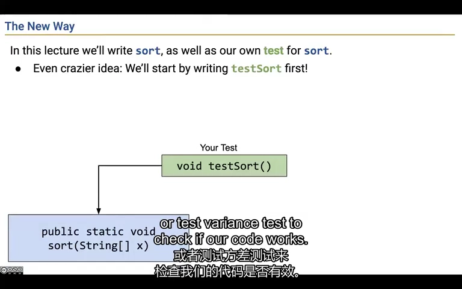
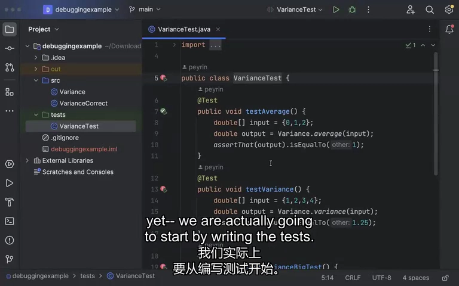
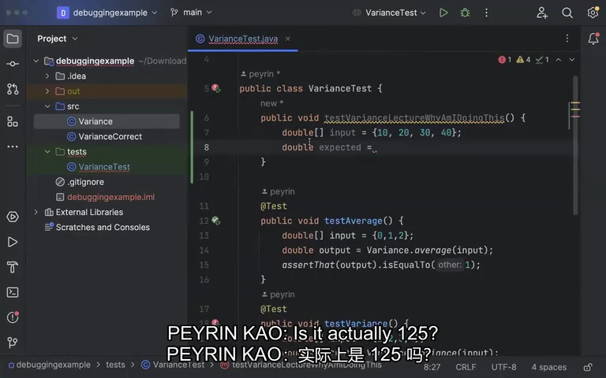
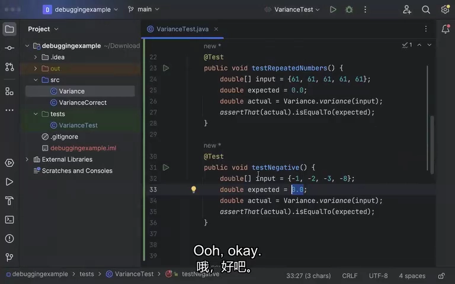
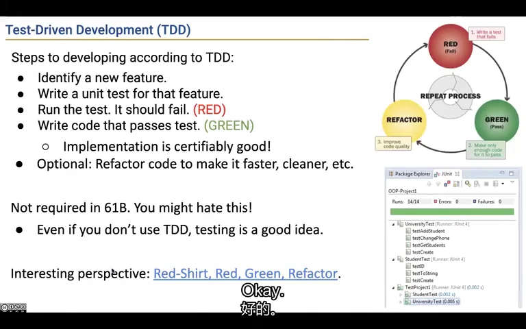
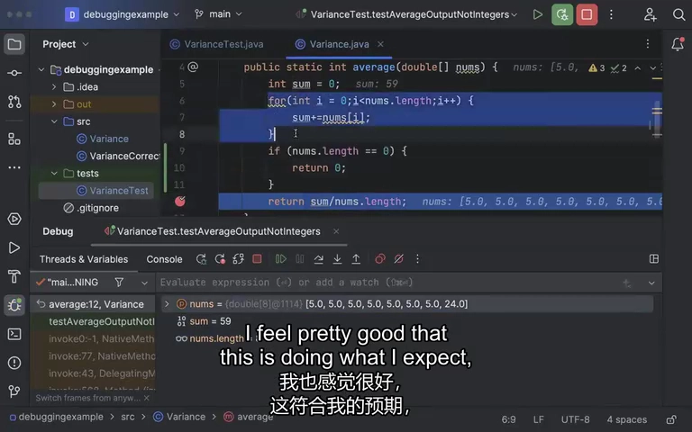
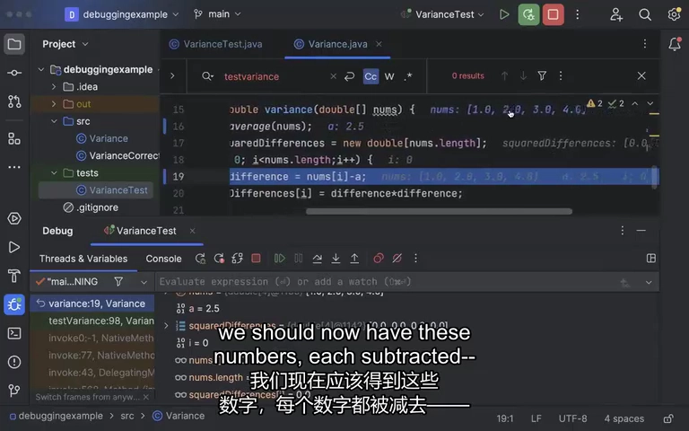
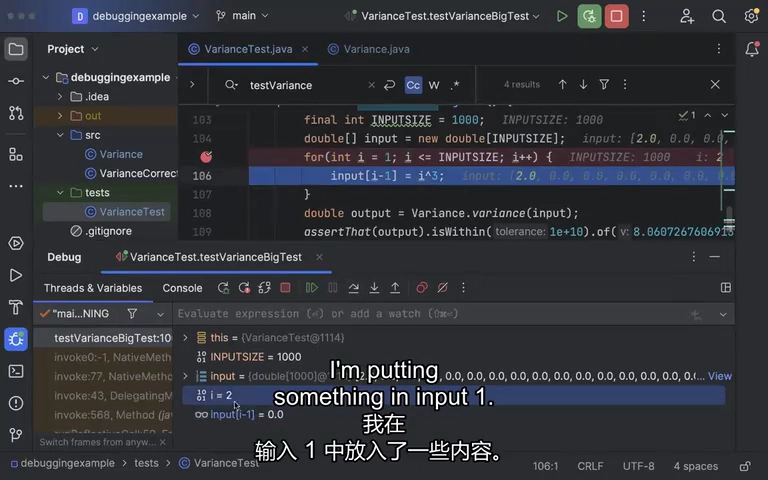

# Lecture 6：测试驱动开发与方差调试

**先独立定义正确结果，再用测试与调试器定位实际执行第一次偏离预期的位置。** 本讲不是背测试框架语法，而是完整展示从需求、测试设计到逐个修复错误的过程。现场主例是方差；部分沿用幻灯片仍写 sort，应以录像中的 Variance 演示为准。

来源：CS61B Spring 2024，B 站 P9（不是第 9 讲）。整理日期：2026-11-01。

[录像](https://www.bilibili.com/video/BV1QP4y1u7jv/?p=9) · [官方幻灯片](../slides/Lecture06.pdf) · [画面与原始字幕](../transcripts/Lecture06_画面字幕对照.md) · [课程索引](../README.md)

以下是结合字幕与画面重写的中文学习笔记，不是逐字译稿。代码为课堂思路的教学整理；额外边界说明单独标注。

## 1. 测试提供正确性的证据，不能替你定义正确性

过去作业由自动评分器告诉你是否通过；现实项目常常需要自己承担这个判断。有限测试通常不能证明程序对所有输入都正确，但能给出具体、可重复的证据。

写测试前先读规格，确定方法接收什么、返回什么、特殊输入如何处理。若连空输入应返回 0 还是抛异常都没定，测试框架无法替你决定。

手写循环比较结果、拼错误信息很重复，所以课程使用 JUnit 组织测试，用 Google Truth 编写断言。它们分别负责“哪些测试运行”和“实际值是否满足预期”。



*课堂画面：[回看 05:00](https://www.bilibili.com/video/BV1QP4y1u7jv/?p=9&t=300)。幻灯片用排序解释先写测试，现场随后换成方差案例。*

## 2. 把方差公式变成可以手算的输入输出

课堂计算的是除以 N 的方差：

$$
\mu=\frac{1}{N}\sum_i x_i,\qquad
\operatorname{Var}(x)=\frac{1}{N}\sum_i(x_i-\mu)^2.
$$

对 `[1,2,3,4]`，均值是 2.5，偏差是 -1.5、-0.5、0.5、1.5，平方为 2.25、0.25、0.25、2.25，平均为 **1.25**。将全部输入放大十倍为 `[10,20,30,40]`，方差应为 **125**。

这里不是使用 N-1 的样本方差估计。使用在线计算器检查预期结果时，也要选对公式，否则会把正确实现误判为错误。

方差自然可拆成求均值、求平方偏差、再求均值。辅助方法的契约与测试也值得单独设计。



*课堂画面：[回看 08:00](https://www.bilibili.com/video/BV1QP4y1u7jv/?p=9&t=480)。现有测试提供了均值与方差的可手算小例子。*

## 3. 一个测试应明确输入、预期值和实际值

整理后的 JUnit 5 + Truth 写法如下，假设 Variance 类已经提供被测方法：

```java
import org.junit.jupiter.api.Test;
import static com.google.common.truth.Truth.assertThat;

public class VarianceTest {
    @Test
    public void varianceOfFourNumbers() {
        double[] input = {1, 2, 3, 4};
        double expected = 1.25;
        double actual = Variance.variance(input);
        assertThat(actual).isWithin(1e-9).of(expected);
    }
}
```

`@Test` 让运行器识别测试；断言失败会显示比较信息。浮点计算可以使用合理容差，不能为了让错误实现通过而随意放大容差。

预期值应来自题意、手算或独立可信依据，不能调用同一个待验证实现再把结果当答案。课堂有 JUnit 4 的写法，实验则混合 JUnit 4/5；本例明确采用 JUnit 5。



*课堂画面：[回看 11:00](https://www.bilibili.com/video/BV1QP4y1u7jv/?p=9&t=660)。先写 input 和 expected，再调用实现得到 actual。*

## 4. 用边界与不同数值形态挑战实现

课堂逐步补充了不同测试：空数组、全重复数字、负数、均值不是整数、输入本身有小数。每组都有独立价值。

| 情况 | 能揭示什么 |
|---|---|
| 空数组 | 是否按规格处理零长度，是否发生除零 |
| 所有元素相同 | 方差是否为 0 |
| 负数 | 是否错误假设输入均为正 |
| 均值含小数 | 是否发生整数除法截断 |
| 元素本身有小数 | 累加器或类型转换是否丢精度 |

课堂约定空数组的方差为 0；这是题目契约，并非“空集合均值在数学上天然等于 0”。辅助 average 对空数组的行为也应明确，不能只靠猜测。



*课堂画面：[回看 17:00](https://www.bilibili.com/video/BV1QP4y1u7jv/?p=9&t=1020)。重复数字和负数测试让不同错误更容易暴露。*

## 5. 先看测试失败，再用小步修改让它通过

测试驱动开发常概括为 Red → Green → Refactor：先写能失败的测试，再补实现让测试通过，最后整理代码并保持结果不变。课堂先设计测试，再打开预先准备的错误实现来演示修复。

看到很多失败时，不必一次解决所有问题。先挑容易理解的最小案例；若高层函数依赖 average，就先让 average 的测试可靠。修复底层错误可能同时使多条上层测试通过。

TDD 在本课程里是推荐方法，不是唯一允许的方法。更普遍的原则是及早测试、分段验证，不要直到写完全部代码才第一次运行。



*课堂画面：[回看 23:00](https://www.bilibili.com/video/BV1QP4y1u7jv/?p=9&t=1380)。红、绿、重构循环让每一步都有可检查的目标。*

## 6. 调试器帮助区分数值错误与控制流程错误

空输入先暴露除零。读异常与调用栈，能从 variance 追到 average 的除法处；加断点后确认数组长度确实为 0，再按契约修复。

下一例中 sum 是 59，数组长度是 8，但结果是 7 而不是 7.375。这说明前面的累加和长度读取基本符合预期，错误范围已缩到除法与类型。

Java 的整数除法先产生整数结果；把结果事后放进 double 也恢复不了被截断的小数。均值函数应使用适当的 double 累加器与返回类型，并在除法之前让运算按浮点进行。另一个易漏点是 `int sum; sum += doubleValue` 会发生隐式窄化，可能逐步丢失小数。

先检查事实再修改：如果 sum 已正确，就不要因为怀疑 for 循环而盲目重写它。



*课堂画面：[回看 32:00](https://www.bilibili.com/video/BV1QP4y1u7jv/?p=9&t=1920)。59 除以 8 得到 7，说明需要检查整数除法与声明类型。*

## 7. 把公式拆成中间值，就能定位加减号错误

average 通过后，课堂再跟踪 `[1,2,3,4]` 的方差。均值 2.5 正确，新数组长度 4 也正确，但第一个 difference 得到 3.5，预期应是 -1.5。

观察发现实现把 `nums[i] - average` 写成了加法。修改后逐轮核对 -1.5、-0.5、0.5、1.5，再检查平方与最终平均。

这展示了很实用的顺序：原始输入 → 辅助结果 → 每轮中间值 → 最终输出。沿这条路径找到第一个不对的位置，比只盯着最终的错误数字更容易理解原因。



*课堂画面：[回看 38:00](https://www.bilibili.com/video/BV1QP4y1u7jv/?p=9&t=2280)。偏差必须是数值减均值，不能把二者相加。*

## 8. 测试也可能有错，必须检查它真正生成的输入

最后剩下的大测试要生成前 1000 个正整数的立方，但输入开头不是 1、8、27。问题出在测试写了 `i ^ 3`：Java 的 `^` 是按位异或，不是乘方。

修复时可以使用 `Math.pow(i, 3)`，再检查头几个生成值，确认测试输入真正符合题意。错误不在被测函数时，不应为了迎合坏测试而改坏函数。

补充：若改成整数连乘，还要留意大数溢出和参与运算的类型。测试与生产代码一样需要理解语言语义。修好当前失败后应重跑整套测试，检查是否引入回归；自动评分器可以做最终检查，但不能替代本地诊断。



*课堂画面：[回看 44:00](https://www.bilibili.com/video/BV1QP4y1u7jv/?p=9&t=2640)。输入生成器使用异或而非乘方，导致测试自身错误。*

## 动手检查理解

1. 给均值方法设计一个能区分整数除法和浮点除法的最小输入。
2. 用同一个方差实现分别测全相同数字、含小数数字和空数组，并写明各自契约。
3. 在调试器中先预测 difference，再单步执行，记录第一个偏差。
4. 配合 [Lab 03](../labs/lab03/README.md) 练习栈追踪、最小修复和抽象边界。

## 口语与字幕校正

字幕中的“自动平地机”指 autograder，“真相图书馆”指 Google Truth，“变异”常指 variance。这里按实际代码含义改写。测试全部通过只说明这些测试通过，不是对所有输入的形式化证明。

## 继续阅读

- [官方教材 1](https://cs61b-2.gitbook.io/cs61b-textbook/7.-testing)
- [实验索引](../labs/README.md)
- [本讲完整原始字幕](../subtitles/Lecture06.srt)
