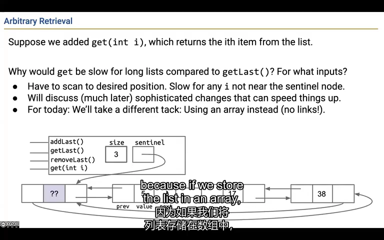
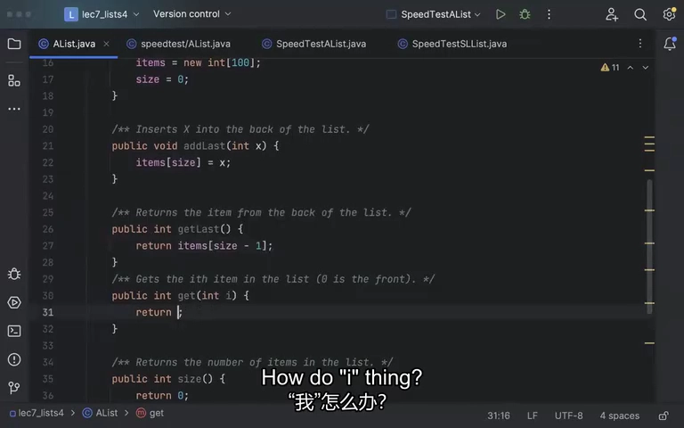
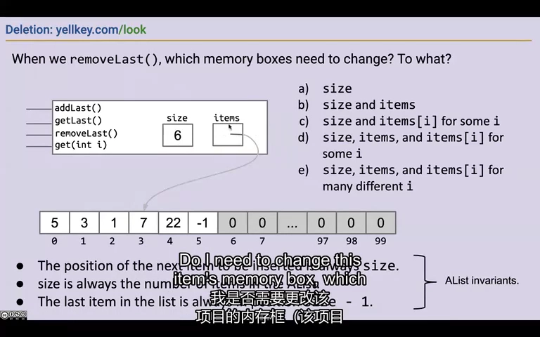
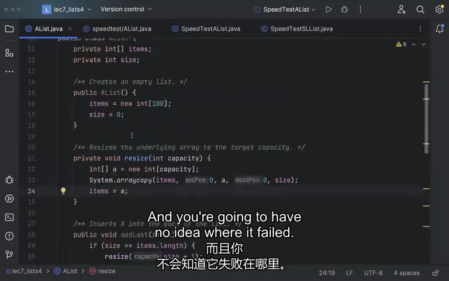
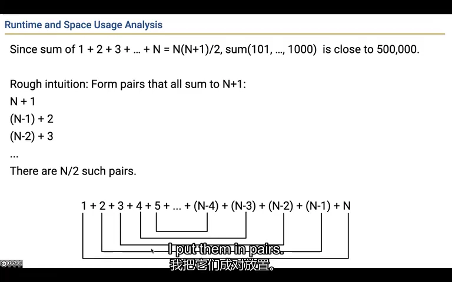
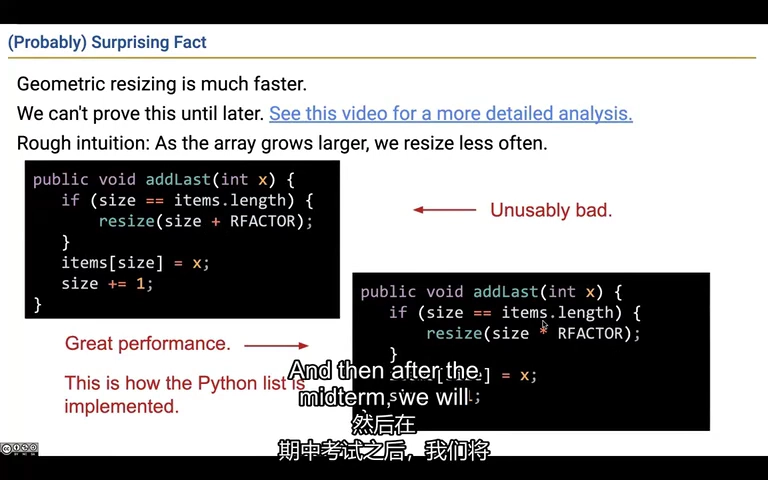
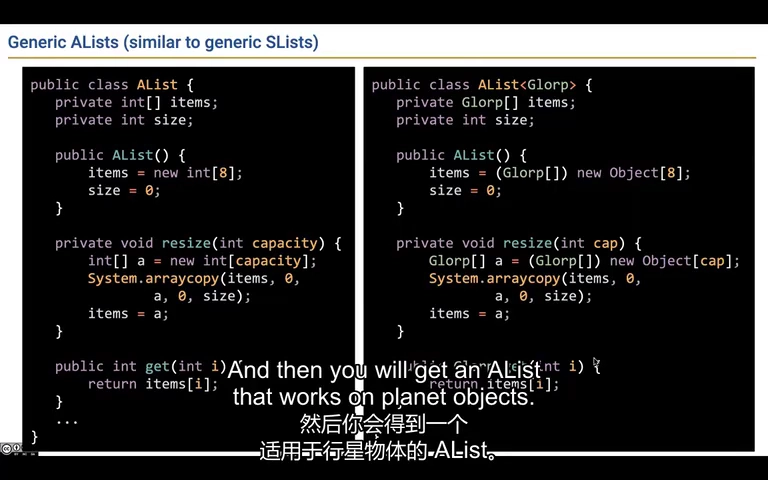
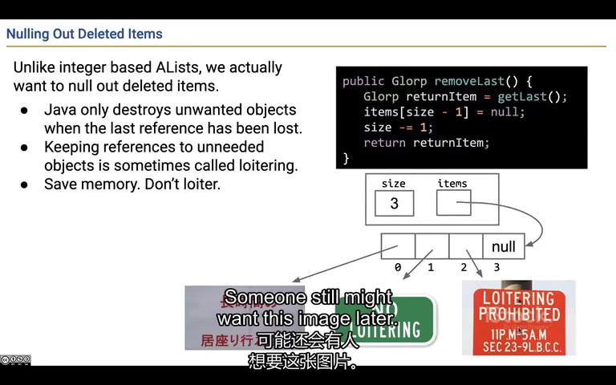

# Lecture 7：数组装满以后，列表怎样继续加东西

数组创建时长度就定了，但我们平时用的列表可以不断添加内容。这节课拆开看它怎么做到：另找一个更大的数组，把已有内容搬过去，再继续添加。你会看到“每次多搬一点”和“空间翻倍”为什么差很多。

来源：CS61B Spring 2024，B 站 P21（不是第 21 讲）。整理日期：2026-11-01。

[录像](https://www.bilibili.com/video/BV1QP4y1u7jv/?p=21) · [官方幻灯片](../slides/Lecture07.pdf) · [画面与原始字幕](../transcripts/Lecture07_画面字幕对照.md) · [课程索引](../README.md)

以下是结合字幕与画面重写的中文学习笔记，不是逐字译稿。代码为课堂思路的教学整理；额外边界说明单独标注。

## 1. 想直接拿到第十个元素，数组更方便

链表像一串路标：找第十个，就要沿着前面的路标走过去。数组把位置编了号，可以直接访问第十个位置。所以可以保持列表的用法不变，把里面保存数据的方式换成数组；这就是课程中的 AList。

**再看技术解释：**

双向链表可以快速访问两端，但查询第 50 万个元素仍可能走过大量链接。数组则能通过下标直接定位相应位置，在本课程的成本模型中，索引访问为常数时间。

因此 AList 想保留 addLast、getLast、removeLast、get、size 等公开操作，把内部节点换成数组。用户仍在操作列表，实现者改变的是底层表示。

这里的“常数时间”是分析模型，不是说真实机器上每次访问绝对等时；缓存、内存等硬件细节不在本讲展开。



*课堂画面：[回看 02:00](https://www.bilibili.com/video/BV1QP4y1u7jv/?p=21&t=120)。链表访问中间元素要沿链接走，数组可以按索引读取。*

## 2. 准备了十个位置，不等于已经放了十个东西

想象一排 10 个座位，只坐了 3 个人。“座位总数”是容量，“实际人数”是 size。数组里的默认 0 只是空位置原本的值，不代表你添加了 0。读写时一定要分清：下一个元素放在 size，最后一个已有元素在 size - 1。

**再看技术解释：**

需要记住的数据是 `items` 数组与整数 size。假设数组容量 100，刚创建的空列表 size 为 0；数组里的默认 0 不等于“列表已经有 100 个元素”。

三个不变量决定操作位置：有效元素占下标 `[0,size)`；下一次追加放在 `items[size]`；非空时最后元素位于 `items[size-1]`。

```java
// 假设有剩余空间
items[size] = x;
size++;
// 获取末尾时读取 items[size - 1]
```

先画几次追加的状态，再从图归纳规律，比试着猜 `size+1` 还是 `size-1` 更可靠。公开 get 也必须检查列表真正包含的下标范围，而不只看底层数组有没有这个格子。



*课堂画面：[回看 11:00](https://www.bilibili.com/video/BV1QP4y1u7jv/?p=21&t=660)。有效区域、末尾位置和下一次追加位置由 size 决定。*

## 3. 删掉末尾，可以先让列表不再把它算进去

列表 [5,3,1] 删掉末尾后，只需对外承认前两个元素，长度改成 2。底层第三格暂时还写着 1 也没关系，只要读取操作不允许再读到它。这里先讨论整数；如果格子里存的是对象引用，后面还有一步清理要做。

**再看技术解释：**

用户把 `[5,3,1,7,22,-1]` 删除末尾后，期望看到 `[5,3,1,7,22]`。对 int 数组版本，只需先保存末尾值，再把 size 减 1；旧的 -1 可以暂时留在有效区外。

原因是所有公开读取都遵守 `[0,size)`，下一次追加还会覆盖原位置。课堂借洞穴寓言解释这个区别：使用者只看到列表有哪些元素，不直接看底层数组；内部怎样保存都可以，但每个公开操作的结果必须符合列表的约定。

但这是在边界检查正确的前提下。若 get 允许读到 size 之外，旧值就会泄露为错误结果。空表删除同样需要明确定义行为。后面泛型版本还会遇到资源保留问题。



*课堂画面：[回看 17:00](https://www.bilibili.com/video/BV1QP4y1u7jv/?p=21&t=1020)。removeLast 改变逻辑长度，不必为 int 元素立即清空格子。*

## 4. 旧数组不能拉长，就换个更大的再搬过去

原来只有 3 个位置，现在要放第 4 个。做法是创建更大数组，把原来的 3 个数复制过去，再让 items 指向新数组。元素个数没变，只是多了空位。下面的 resize 就负责这一整套搬家动作。

**再看技术解释：**

当 size 等于 items.length 时，再写入就会越界。Java 数组对象不能原地变长，可以创建新数组，然后替换内部引用：

```java
private void resize(int capacity) {
    int[] next = new int[capacity];
    System.arraycopy(items, 0, next, 0, size);
    items = next;
}
```

只复制有效元素，size 不变，变化的是容量和 items 指向的数组。旧数组若没有其他可达引用，随后可以被回收。

把 resize 抽为辅助方法，使“增加空间”与“追加元素”各自更清楚。课堂为了演示连续写了较多代码，但明确提醒实际开发要边写边测，不要到最后才排查整段程序。



*课堂画面：[回看 29:00](https://www.bilibili.com/video/BV1QP4y1u7jv/?p=21&t=1740)。resize 把数据搬进新数组，再让 items 指向它。*

## 5. 每次只加一个空位，就会一直在搬家

3 个位置满了换成 4 个，4 个满了又换成 5 个。每加一个元素，就得把之前所有元素再搬一遍。数据少时还不明显，越往后一次要搬得越多，所以总工作量增长得比元素个数快得多。

**再看技术解释：**

从满容量 100 开始追加两次，若每次只扩 1，就依次创建大小 101 和 102 的数组；课堂按“创建并填充格子”口径合计 203。这个累计工作量不同于操作结束后只剩的 102 个格子。

一直追加到 1000，需要处理的总量为：

$$
101+102+\cdots+1000=495450.
$$

一般地，1 到 N 的和为 N(N+1)/2，所以累计成本按 N² 增长。把扩容量从 +1 改成 +10，能减少常数倍开销，却没有改变这种增长趋势。

比较计时图时还要检查坐标尺度。课堂的具体秒数依赖机器和环境，不能当成你的电脑应该达到的基准。



*课堂画面：[回看 35:00](https://www.bilibili.com/video/BV1QP4y1u7jv/?p=21&t=2100)。等差增长导致复制总量接近三角形数，随 N 平方增长。*

## 6. 一次把空间翻倍，接下来就能休息好一阵

容量从 4 变成 8 后，中间有好几次添加不用搬家；从 8 变成 16 后，能连续添加的次数更多。某一次搬家仍然很慢，但把总工作量分摊到这一长串添加上，平均每次只要固定数量级的工作。这叫摊还常数时间。

**再看技术解释：**

改成容量不足时翻倍：

```java
if (size == items.length) {
    resize(Math.max(1, items.length * 2));
}
items[size] = x;
size++;
```

`Math.max(1,...)` 是补充的零容量保护。课堂强调的直觉是：数组越大，两次扩容之间能完成的普通追加越多。

补充推导：翻倍时复制数量为 1+2+4+…，直到与 N 同量级，总和仍是 O(N)。所以 N 次追加总成本 O(N)，平均到一次是**摊还 O(1)**。单次触发扩容仍可能是 O(N)，不能写成“每次追加都 O(1)”。

大量删除后，容量可能远大于 size，可考虑缩容。补充：扩、缩阈值应留间隔，避免在边界附近反复搬运；课程本讲只介绍思路，未完成严格摊还证明。



*课堂画面：[回看 41:00](https://www.bilibili.com/video/BV1QP4y1u7jv/?p=21&t=2460)。几何扩容让代价大的复制越来越稀疏。*

## 7. 想让列表存各种类型，数组创建处要多做一点处理

把列表从只存整数改成存 E，添加和读取的思路没变，但 Java 不允许直接写 new E[10]。课程先建 Object 数组，再在列表内部按 E[] 使用。这个转换需要自己保证：只放入符合 E 的元素，也不把底层数组直接交给外面。

**再看技术解释：**

把 AList 改为 `AList<E>` 后，可以声明 `E[] items`，但不能直接 `new E[capacity]`。课程使用 `(E[]) new Object[capacity]` 的模式，会有 unchecked 警告。

```java
@SuppressWarnings("unchecked")
private void resize(int capacity) {
    E[] next = (E[]) new Object[capacity];
    System.arraycopy(items, 0, next, 0, size);
    items = next;
}
```

这是课程中用于内部存储的受控写法，要求外部只能按 E 存入元素，不能把底层 Object[] 当成真正的某种具体数组暴露出去。补充：`SuppressWarnings` 只是隐藏编译警告，不会自动证明类型安全。声明泛型数组与创建泛型数组是不同的问题。



*课堂画面：[回看 44:00](https://www.bilibili.com/video/BV1QP4y1u7jv/?p=21&t=2640)。泛型版本需要在数组创建处处理类型擦除带来的限制。*

## 8. 删掉一张图片后，列表也要松开对它的引用

你删掉一张图片，size 减了，但数组旧位置仍指向图片；电脑就仍把这张图片看作“可能还会用到”。把那个位置改成 null，才算撤掉列表对它的引用。其他地方若还在用这张图片，它当然仍然会保留。

**再看技术解释：**

当数组存的不是 int 而是图片等对象引用，仅减 size 会留下仍然可达的引用。用户已经删除图片，但底层数组还“抓住它”，垃圾回收器不能根据逻辑 size 猜测这个引用已经无用。

```java
E old = items[size - 1];
items[size - 1] = null;
size--;
return old;
```

这叫避免 loitering：数据结构无意保留本应释放的对象。清空该位置不保证对象立即回收，因为返回值或其他地方也可能仍持有它；只是撤掉了列表的这条多余引用。

int 格子里保存数字本身，不会通过数字把一张大图片留住。这就是 int 版本和泛型引用版本处理不同的原因。



*课堂画面：[回看 47:00](https://www.bilibili.com/video/BV1QP4y1u7jv/?p=21&t=2820)。清空已删除位置，撤掉数据结构对对象的无用引用。*

## 跑一个完整例子：亲眼看见元素数量和容量分别怎么变

这是为本笔记补充的可运行代码。开始只有两个空位，添加第 3 个数时容量变成 4，但 size 只变成 3。删掉末尾后，再访问这个下标会被拒绝。

```java
import java.util.Arrays;

public class ResizableListDemo {
    private int[] items = new int[2];
    private int size;

    void addLast(int value) {
        if (size == items.length) {
            items = Arrays.copyOf(items, Math.max(1, items.length * 2));
            System.out.println("扩容到：" + items.length);
        }
        items[size] = value;
        size++;
    }

    int get(int index) {
        // 有这个数组格子，不代表它属于列表的有效内容。
        if (index < 0 || index >= size) {
            throw new IndexOutOfBoundsException("下标 " + index + "，size=" + size);
        }
        return items[index];
    }

    int removeLast() {
        if (size == 0) { throw new IllegalStateException("空列表不能删除"); }
        size--;
        return items[size]; // int 旧值留在有效范围以外，之后添加会覆盖。
    }

    public static void main(String[] args) {
        ResizableListDemo list = new ResizableListDemo();
        for (int value : new int[] {10, 20, 30}) {
            list.addLast(value);
            System.out.println("size=" + list.size + "，容量=" + list.items.length);
        }
        System.out.println("第二个数：" + list.get(1));
        System.out.println("删除末尾：" + list.removeLast());
        try {
            list.get(2);
        } catch (IndexOutOfBoundsException error) {
            System.out.println("读取被拒绝：" + error.getMessage());
        }
        list.removeLast();
        list.removeLast();
        try {
            list.removeLast();
        } catch (IllegalStateException error) {
            System.out.println(error.getMessage());
        }
    }
}
```

`Arrays.copyOf` 新建数组并复制旧内容，赋值后 items 才指向更大的数组。size 只统计用户添加的有效元素。`try/catch` 让例子展示越界和空表删除的报错后还能继续运行，并不是把这些操作变成合法操作。这里为便于观察打印扩容信息，只演示整数列表，不含缩容。

**运行方式：**在 CS61B 目录执行 `java examples/lecture07/ResizableListDemo.java`。首次运行可先看[环境说明](../examples/README.md)。

预期输出：

```text
size=1，容量=2
size=2，容量=2
扩容到：4
size=3，容量=4
第二个数：20
删除末尾：30
读取被拒绝：下标 2，size=2
空列表不能删除
```

**改一处试试：**把输入改成 `{10,20,30,40,50}`，预测扩容发生在哪两次添加。再试 `get(-1)`，确认负下标同样被拦住。

[打开完整 Java 文件](../examples/lecture07/ResizableListDemo.java) · [单独阅读这个例子](../examples/lecture07/README.md)

## 自己动手试一试

1. 画出容量 4、size 3 的 AList，依次追加两次、删除一次，写出每步 size 和容量。
2. 分别计算 +1 扩容与 ×2 扩容到 16 的累计搬运量。
3. 用一句话区别“最坏单次时间”“摊还时间”和“当前占用空间”。
4. 设计只调用公开操作、却能跨过扩容边界的测试。

## 口语与字幕校正

课堂中的 AList 是自建教学类，不是直接使用 java.util.ArrayList。幻灯片把几何扩容与 Python list 类比，并不意味着 Python 必定采用倍数 2 或与 Java 相同的内部实现。

## 继续阅读

- [官方教材 1](https://cs61b-2.gitbook.io/cs61b-textbook/8.-arraylist)
- [实验索引](../labs/README.md)
- [本讲完整原始字幕](../subtitles/Lecture07.srt)
