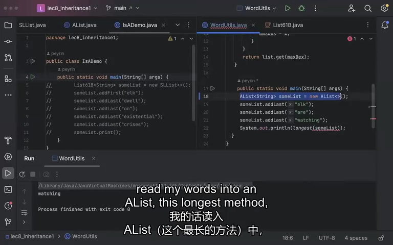
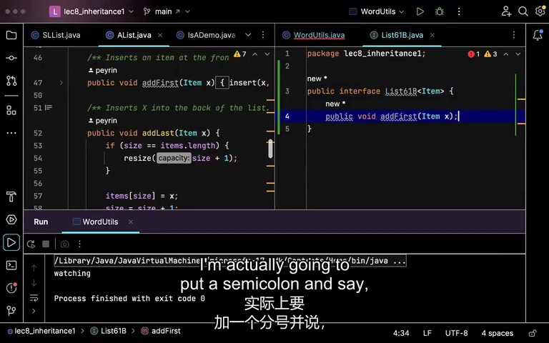
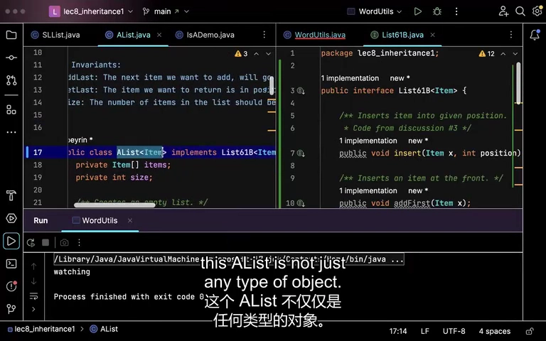
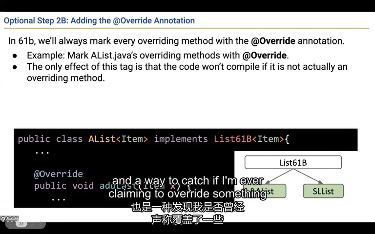
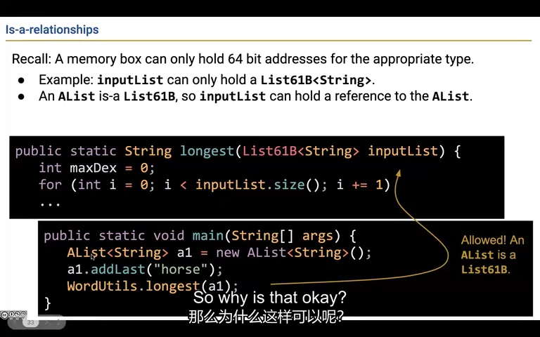
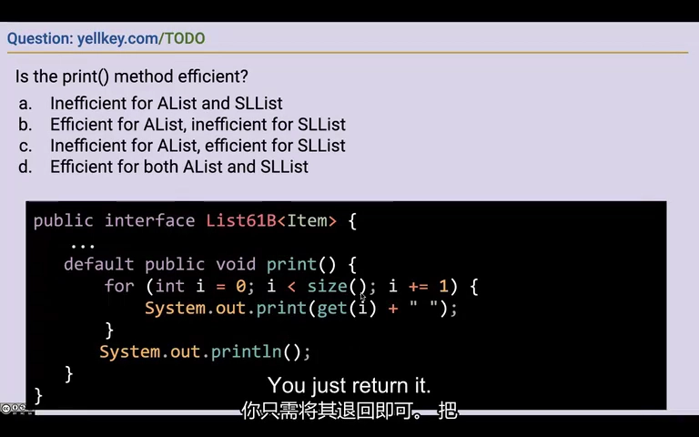
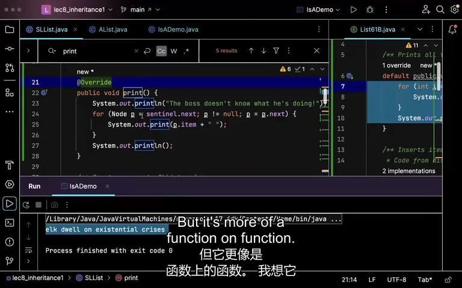
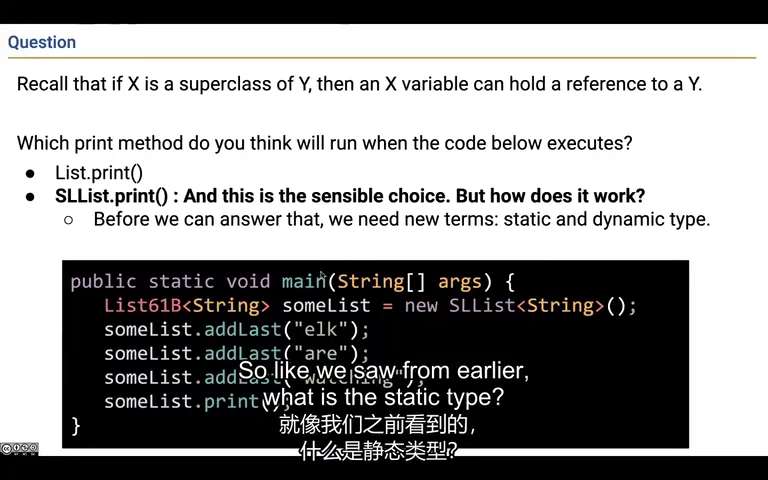

# Lecture 8：接口继承与动态方法选择

**接口让算法依赖共同能力，实现类决定怎样完成这些能力。** 本讲从“最长单词”代码重复出发，建立 List61B 接口，再用默认打印方法展示实现复用、性能差异和动态方法选择。

来源：CS61B Spring 2024，B 站 P25（不是第 25 讲）。整理日期：2026-11-01。

[录像](https://www.bilibili.com/video/BV1QP4y1u7jv/?p=25) · [官方幻灯片](../slides/Lecture08.pdf) · [画面与原始字幕](../transcripts/Lecture08_画面字幕对照.md) · [课程索引](../README.md)

以下是结合字幕与画面重写的中文学习笔记，不是逐字译稿。代码为课堂思路的教学整理；额外边界说明单独标注。

## 1. 参数绑定具体实现会让同一算法反复复制

一个 `longest(SLList<String> words)` 可以遍历单词，返回最长者。换成 AList 后，即使同样有 size 和 get，Java 也不会仅凭“方法看起来一样”就接受它作为 SLList 参数。

为 AList 再写一个重载当然能编译，但方法体几乎完全重复。以后新增 DLList 或修复一个算法错误，就要修改多处。

真正共同的需求只是“能报告长度、能按索引读取单词”。把这组能力提取成一个类型，就能让算法依赖它，而不是依赖某一种内部表示。



*课堂画面：[回看 02:00](https://www.bilibili.com/video/BV1QP4y1u7jv/?p=25&t=120)。同一个最长单词算法不应因为列表实现不同而不断复制。*

## 2. 接口声明能做什么，省略内部存储方式

课程建立泛型接口 List61B。下面是理解本例所需的节选，并非完整接口：

```java
public interface List61B<E> {
    void addLast(E x);
    E get(int i);
    int size();
}
```

这些抽象方法以分号结束，未提供方法体。接口不应该把某种实现专用的 items 数组、sentinel 节点、resize 辅助方法复制进来。

它表达的是对调用者的承诺：你可以用这些操作与列表交互。AList 可以用数组，SLList 可以用节点；只要满足同一操作契约，调用方不必知道差别。



*课堂画面：[回看 11:00](https://www.bilibili.com/video/BV1QP4y1u7jv/?p=25&t=660)。接口保留公开操作的签名，不照搬数组或链表内部表示。*

## 3. implements 使具体类成为接口类型的一种实现

类声明写成 `class AList<E> implements List61B<E>`，就告诉 Java：AList 是一种 List61B。SLList 也能作同样声明。

非抽象实现类必须为需要实现的抽象方法提供有效实现，也可以通过继承得到实现。仅仅写 implements，并不会自动产生 addLast 的算法。实现接口方法时不能降低它们的访问权限，通常明确写 public。

现在最长单词方法只需接收 `List61B<String>`。传进 AList、SLList，乃至将来新增的实现都可以；这就是“面向接口”带来的扩展空间。接口只表达操作契约，不能凭名字保证所有实现的性能相同。



*课堂画面：[回看 14:00](https://www.bilibili.com/video/BV1QP4y1u7jv/?p=25&t=840)。implements 告诉编译器 AList 满足 List61B 的类型关系。*

## 4. 重写和重载不同，Override 帮你检查意图

重写 overriding 是子类型为已有实例方法提供实现；重载 overloading 是同名方法有不同参数列表，例如 `makeNoise()` 与 `makeNoise(Dog other)` 并存。

```java
@Override
public void addLast(E x) {
    // 当前数据结构的追加实现
}
```

`@Override` 不是启动重写的开关。即使不写，只要满足规则仍会重写；写上后，拼错方法名或参数不匹配时，编译器会提醒“这并没有重写”。

同一个类不能用同样签名写两个不同方法体让 Java 随机选择；也不能只靠返回类型差异来重载。课程优先掌握常规重写，不鼓励把复杂的重载选择边缘题当成全部学习重点。



*课堂画面：[回看 23:00](https://www.bilibili.com/video/BV1QP4y1u7jv/?p=25&t=1380)。Override 注解让编译器检查你是否真的重写了方法。*

## 5. 接口类型的变量可以保存具体实现的引用

可以写：

```java
List61B<String> words = new SLList<>();
```

这没有违反赋值规则。右侧创建 SLList 对象，左侧保存引用；因为 SLList 是 List61B，类型是兼容的。

反方向却不自动成立：一个 List61B 可能是 AList，也可能是 SLList，不能无条件赋给 SLList 变量。参数传递同理，仍是复制引用值，而不是复制或转换整个对象。

这一点将“引用复制”的内存模型与“接口代表一组合法实现”的类型模型连接起来。



*课堂画面：[回看 29:00](https://www.bilibili.com/video/BV1QP4y1u7jv/?p=25&t=1740)。算法接收 List61B 时，可以接收任何符合接口的具体列表。*

## 6. default 方法只靠接口承诺就能写出通用实现

接口也可以提供带方法体的默认实现：

```java
default void print() {
    for (int i = 0; i < size(); i++) {
        System.out.print(get(i) + " ");
    }
    System.out.println();
}
```

它不知道内部是数组还是节点，但知道每个实现都有 size 和 get，因此能够使用它们。实现类若不重写 print，就能继承这段行为。

这是实现继承：不仅继承“要做什么”的方法签名，还继承“如何做”的代码。写默认实现时仍应考虑所调用方法的成本；代码只有一层显式循环，不等于总成本一定线性。



*课堂画面：[回看 35:00](https://www.bilibili.com/video/BV1QP4y1u7jv/?p=25&t=2100)。默认 print 可以仅利用 size 和 get 完成通用打印。*

## 7. 相同默认方法可能在不同实现上有不同复杂度

AList 的 get(i) 为常数时间，打印 N 项总成本 O(N)。SLList 的 get(i) 每次从头走到 i，总访问量约为 0+1+…+(N-1)，打印变成 O(N²)。

SLList 知道自己的节点结构，可以重写 print：从 sentinel.next 开始，沿 next 前进，每个节点只访问一次。这样恢复为 O(N)，同时对外仍是同一个 print 操作。

这说明抽象复用与实现优化可以共存。不要因为接口给了默认实现，就默认它对所有底层结构都是最有效的。



*课堂画面：[回看 41:00](https://www.bilibili.com/video/BV1QP4y1u7jv/?p=25&t=2460)。SLList 重写 print，单次遍历节点以避免重复从头扫描。*

## 8. 先通过静态类型检查，再按对象类型选择重写实现

对 `List61B<String> words = new SLList<>()`，变量 words 的静态类型是 List61B，当前对象的运行时类型是 SLList。编译时先检查 List61B 是否允许 print；运行时再使用 SLList 对该实例方法的重写。

重新赋值可以让 words 指向其他合法实现，但声明的静态类型没有改变。对象自身也不会因为你换了一个变量去引用它，就改变所属类。

这个规则适用于这里的可重写实例方法，不应推广为“所有成员访问都只看动态类型”；字段、静态方法和重载选择有不同规则。空引用没有可调用的实际对象，也不是另一个实现类型。



*课堂画面：[回看 47:00](https://www.bilibili.com/video/BV1QP4y1u7jv/?p=25&t=2820)。words 虽声明为接口类型，调用时仍会选择 SLList 的重写实现。*

## 动手检查理解

1. 分别指出 List61B、SLList、words 在上述例子中的角色。
2. 把 print 故意拼成 prnt 并保留 Override，观察编译器检查的是什么。
3. 用 4 个节点数一数默认 print 的总遍历步数，再与单游标打印比较。
4. 解释为什么 `List61B x = new SLList()` 的方向合法，反方向需要进一步判断。

## 口语与字幕校正

录像中把接口默认方法说成“被删除”是一种不严格的比喻。补充：满足 Java 规则时，直接实现该接口的类可用 `List61B.super.print()` 调用该默认实现；重写并不意味着源实现从语言中消失。

## 继续阅读

- [官方教材 1](https://cs61b-2.gitbook.io/cs61b-textbook/9.-inheritance-i-interface-and-implementation-inheritance)
- [实验索引](../labs/README.md)
- [本讲完整原始字幕](../subtitles/Lecture08.srt)
