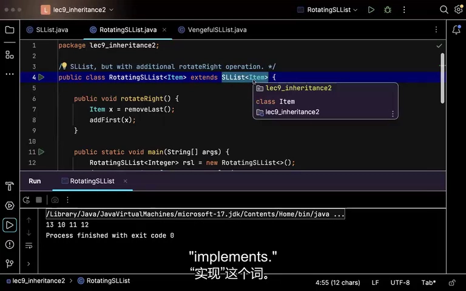
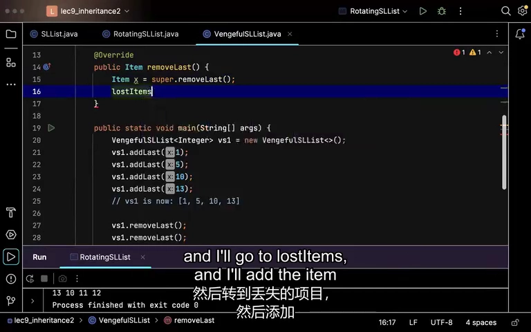
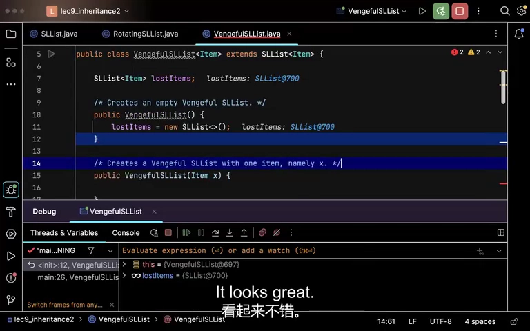
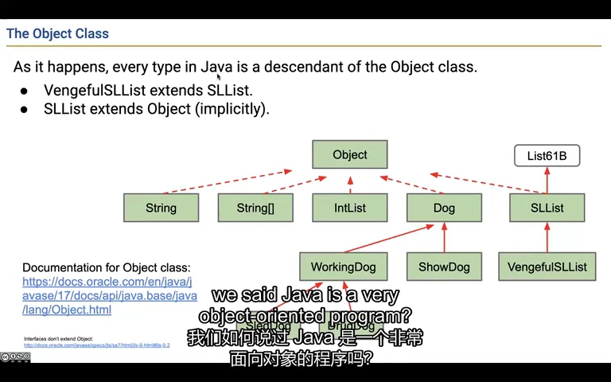
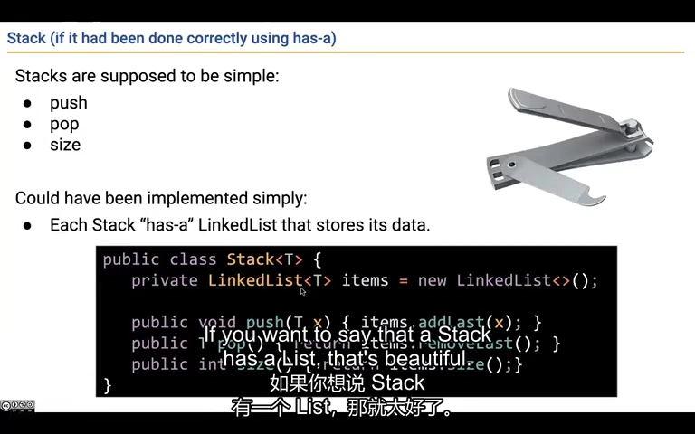
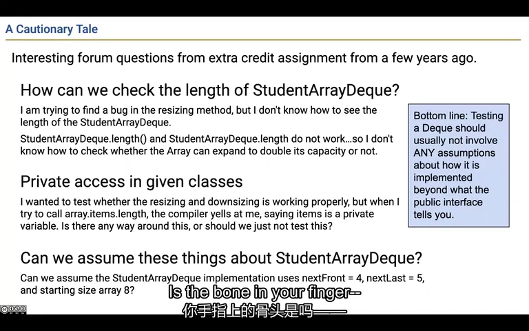
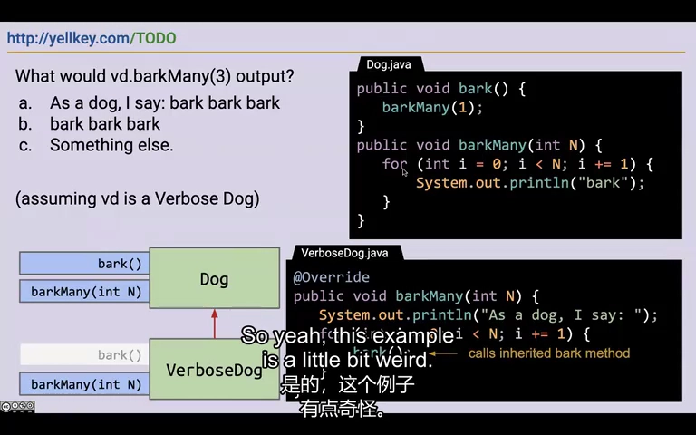
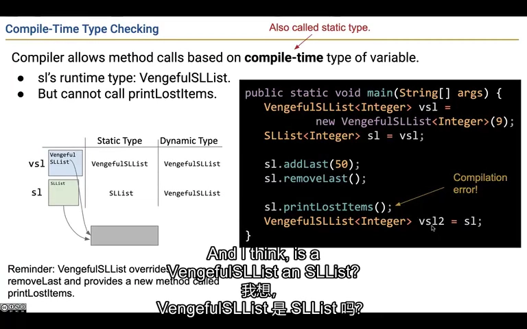
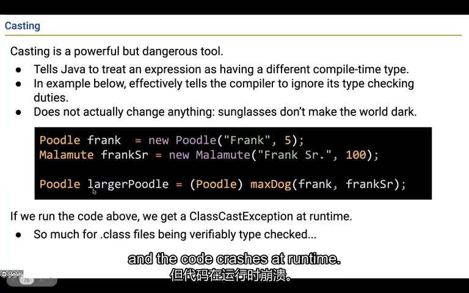

# Lecture 9：给已有的类增加能力，以及继承容易踩的坑

已经有一个列表，怎样加上“把最后一个移到最前面”或“记住删过哪些元素”？继承能复用已有代码，但也会带来相互影响。本节最后解释强制类型转换：它能让编译器按另一种类型检查表达式，却不能把对象变成另一种东西。录像到这里结束，高阶函数是下一讲内容。

来源：CS61B Spring 2024，B 站 P28（不是第 28 讲）。整理日期：2026-11-01。

[录像](https://www.bilibili.com/video/BV1QP4y1u7jv/?p=28) · [官方幻灯片](../slides/Lecture09.pdf) · [画面与原始字幕](../transcripts/Lecture09_画面字幕对照.md) · [课程索引](../README.md)

以下是结合字幕与画面重写的中文学习笔记，不是逐字译稿。代码为课堂思路的教学整理；额外边界说明单独标注。

## 1. 已有列表会增删，就用它们拼出右旋

把 [5,9,15,22] 变成 [22,5,9,15]，只要先拿走最后的 22，再把它加到开头。新的列表类可以继承已有 SLList，再多写一个 rotateRight。要注意“拿走”和“看一眼”不同：只用 getLast，原来的 22 还在，列表就多了一项。

**再看技术解释：**

`RotatingSLList<E> extends SLList<E>` 表示一种能右旋的 SLList。右旋把 `[5,9,15,22]` 变成 `[22,5,9,15]`，可以复用已有公开方法：

```java
public void rotateRight() {
    if (size() <= 1) return;     // 补充：空表与单元素保护
    E last = removeLast();
    addFirst(last);
}
```

课堂最初误用了 getLast，导致只复制末尾到开头，原末尾没有删掉。修复为 removeLast 才真正保持元素总数。

rotateRight 是新方法，不是对父类方法的重写，因此不加 Override。继承复用了操作，但不会自动提高它们的复杂度：若父类 removeLast 需要遍历，旋转仍可能是 O(N)。



*课堂画面：[回看 08:00](https://www.bilibili.com/video/BV1QP4y1u7jv/?p=28&t=480)。右旋需要取出并删除原末尾，再插入开头。*

## 2. 想多记一份删除记录，先照常删除，再记下来

新列表不仅要删掉末尾，还想记住删了什么。可以调用 super.removeLast() 使用父类已有的删除做法，拿到返回值，再放进历史列表。super 不是另一只对象；它是在当前对象上，明确选择父类提供的那份实现。

**再看技术解释：**

VengefulSLList 要记住被删除的元素。它新增 lostItems 列表，并重写 removeLast：

```java
@Override
public E removeLast() {
    E removed = super.removeLast();
    lostItems.addLast(removed);
    return removed;
}
```

`super.removeLast()` 选择父类的实现，操作的仍是当前对象的父类部分；并没有创建另一个独立的“父对象”。随后记录返回的元素，再保持原接口返回值。

直接复制父类删除代码会碰到 private 字段访问限制，也造成维护重复。通过父类公开方法复用更清晰。继承关系让对象具有父类那部分状态，但不代表子类源码可以直接访问父类所有私有成员。



*课堂画面：[回看 14:00](https://www.bilibili.com/video/BV1QP4y1u7jv/?p=28&t=840)。通过 super 完成原来的删除，再将删除值加入历史记录。*

## 3. 创建子类对象时，两部分都得准备好

会记录删除历史的列表，需要准备普通列表的数据，也需要准备历史列表。只写一个 lostItems 变量还没有真正创建历史列表，要用 new 初始化。若希望一开始就放入 x，也必须明确调用 super(x)，Java 不会自动替你把 x 传过去。

**再看技术解释：**

只声明 `SLList<E> lostItems` 并不会创建列表对象。课堂因此遇到 NullPointerException，随后在构造函数中加入 `new SLList<>()`。

```java
public VengefulSLList() {
    super();
    lostItems = new SLList<>();
}
public VengefulSLList(E x) {
    super(x);
    lostItems = new SLList<>();
}
```

在课程采用的 Java 17 规则下，构造函数先调用父构造器或同类另一构造器。没有显式调用时会尝试插入 `super()`，不会自动把你的参数 x 转交给 `super(x)`。父类没有可访问的无参构造器时，还会导致编译错误。

构造函数本身并不被子类继承。要支持不同初始化方式，应在子类里明确写出相应构造器。



*课堂画面：[回看 20:00](https://www.bilibili.com/video/BV1QP4y1u7jv/?p=28&t=1200)。有参数的子构造函数不会自动选择有参数的父构造函数。*

## 4. 为什么自己没写，也能调用 toString

Java 的普通类最后都能沿继承关系找到 Object，它提供了 toString、equals、hashCode 等共同方法。你的类可以直接用其中的默认实现，也可以按需求重写。不过 int、double 这些基本类型不是 Object 的子类，不要把“普通类”误读成“所有类型”。

**再看技术解释：**

Java 中普通类最终都继承 Object；例如 VengefulSLList → SLList → Object。即使未显式写 extends Object，也存在这层基础关系。

所以对象具有 toString、equals、hashCode 等通用方法。后续课程会分别讨论它们的意义；这里先建立“这些方法为什么存在”的认识。

幻灯片“每种类型都是 Object 后代”的字面说法过宽：int、double 等基本类型不是 Object 子类。类只能直接 extends 一个类，但可以实现多个接口；接口继承接口使用 extends，是对前一讲关键词规则的补充。



*课堂画面：[回看 23:00](https://www.bilibili.com/video/BV1QP4y1u7jv/?p=28&t=1380)。类层次最终连到 Object，因此获得通用对象行为。*

## 5. 内部用到列表，不代表自己应该是一种列表

栈像一摞盘子，只允许从顶部放入、拿走。它可以在内部用列表保存盘子，但没必要让外面的人按任意位置插入和删除。把列表作为自己的私有字段，只提供 push、pop 等操作，这叫组合；继承则表达“它本身是一种父类”。

**再看技术解释：**

集合可以**内部用列表存储**，却不一定应当继承列表。若 Set 继承 SLList，就把按位置 get 等本来不属于集合约定的操作一起暴露出去，还可能破坏去重约束。

栈也是同样的例子。栈强调后进先出，用 push、pop 和 size 即可。组合写法把列表作为私有字段，只对外开放需要的操作：

```java
private java.util.LinkedList<E> items = new java.util.LinkedList<>();
public void push(E x) { items.addLast(x); }
public E pop() { return items.removeLast(); }
```

这些方法片段放在泛型栈类中。课堂批评 Java 历史上的 Stack 继承设计；准确地说，`java.util.Stack` 继承 Vector，从而暴露许多不属于简洁栈抽象的操作。



*课堂画面：[回看 29:00](https://www.bilibili.com/video/BV1QP4y1u7jv/?p=28&t=1740)。组合把列表作为内部工具，避免把所有列表操作暴露成栈接口。*

## 6. 检查列表好不好用，先从使用者能做的事开始

你想知道扩容有没有丢数据，可以多加几个数，再逐个取出来看。通常不需要翻进私有数组，要求它的容量一定是多少。这样即使作者换了内部存法，只要使用效果没变，你的检查仍然有效。有明确内部要求的题目，再额外检查这些要求。

**再看技术解释：**

“怎么读取 ArrayDeque 的私有数组长度”“能否假设初始下标为 4”这类问题，这些检查把用户不需要知道的内部细节也当成了要求。

如果要验证扩容后功能仍正确，可以连续插入足够多元素，再通过 size、get 或删除顺序验证数据保留；不必要求所有实现都使用某个具体容量或字段名。

把内部细节藏起来，使用者就不用操心，实现者以后也方便更换做法。补充：白盒测试并非永远不合法；当规格明确要求某种内部结构或性能时可以针对它检查。核心是知道自己验证的是公开约定，还是额外实现约束。



*课堂画面：[回看 35:00](https://www.bilibili.com/video/BV1QP4y1u7jv/?p=28&t=2100)。公开接口测试不应无故假设私有数组的容量和下标布局。*

## 7. 父类改了内部调用，子类可能突然陷入死循环

父类说“叫一声，就是调用叫 N 声并传 1”，子类又把“叫 N 声”写成循环调用“叫一声”。两边互相叫来叫去，就永远停不下来。即使父类单独看起来没问题，也可能因为调用了子类重写的方法而出错。下面把调用顺序画出来看。

**再看技术解释：**

课堂的 Dog 原先让 bark 直接输出，让 barkMany(N) 循环调用 bark。VerboseDog 重写 barkMany，先打印说明，再循环调用 bark。

后来父类作者把 Dog 改成 bark 调用 barkMany(1)，barkMany 自己循环输出。对普通 Dog，看上去效果相同；对 VerboseDog，却出现：

```text
VerboseDog.barkMany
  → 继承的 Dog.bark
    → 当前对象重写的 VerboseDog.barkMany
      → Dog.bark → ...
```

父类内部的实例方法调用仍会运行时选择重写方法，所以不断递归，最终可能栈溢出。这个例子说明子类可能依赖父类内部调用结构，“父类看似保持行为的重构”未必对所有子类透明。

实现继承需要谨慎设计，不是看到几行可复用代码就建立父子关系。



*课堂画面：[回看 41:00](https://www.bilibili.com/video/BV1QP4y1u7jv/?p=28&t=2460)。父类 bark 改为调用 barkMany 后，子类重写形成递归循环。*

## 8. 变量只承诺它是普通列表，就只能先用普通列表的方法

实际对象也许会打印删除历史，但变量声明只是 SLList。编译器按 SLList 提供的方法检查，所以允许 removeLast，却不允许直接调用只有子类才有的 printLostItems。先过这一关，才轮到运行时决定用哪份重写实现。

**再看技术解释：**

假设：

```java
SLList<Integer> s = new VengefulSLList<>();
s.removeLast();        // SLList 声明了这个操作
// s.printLostItems(); // 编译错误：SLList 没有这个方法
```

运行时对象确实是 VengefulSLList，但编译器检查方法调用时使用表达式的静态类型。不能跳过这个阶段直接说“反正对象有这个方法”。

同理，一个方法若声明返回 Dog，即使传进去的恰好都是 Poodle，调用表达式的静态类型仍是 Dog。编译器不会为了通过类型检查而实际执行该方法，猜它最后返回哪只狗。



*课堂画面：[回看 44:00](https://www.bilibili.com/video/BV1QP4y1u7jv/?p=28&t=2640)。变量的静态类型限制可调用方法，即使实际对象拥有更多能力。*

## 9. 强制转换是确认它本来是什么，不是把它改造成什么

你拿着一个 Dog 引用，想把它当 Poodle 使用。写 (Poodle) 后，运行时会核实它本来是不是贵宾犬；如果实际是雪橇犬，就报 ClassCastException。这个动作不会改变狗的品种，也不会创建一只新狗。拿不准时可以先用 instanceof 判断。

**再看技术解释：**

可以用 `(Poodle) maxDog(a,b)` 告诉编译器按 Poodle 看待这个表达式，但运行时会检查实际对象。如果返回的是更重的 Malamute，就会抛 ClassCastException。

因此 cast 不是“把雪橇犬改造成贵宾犬”。它没有复制对象，也没有改变对象的实际类。合法的向下转换仍然要求对象本来就属于目标类型。

补充：不能对任意不相关类型都强转，编译时也有是否允许转换的限制。转换空引用本身可以得到 null，但随后调用者法仍会空指针异常。实际代码应优先通过合适的参数类型和接口表达需求；确实需要下转时，再利用 instanceof 等判断。

本段到这里结束，高阶函数在下次讲解。



*课堂画面：[回看 50:00](https://www.bilibili.com/video/BV1QP4y1u7jv/?p=28&t=3000)。强转可以通过编译，却因实际对象不匹配在运行时失败。*

## 跑一个完整例子：复用父类方法，并试一次成功和失败的转换

这是为本笔记补充的可运行代码。贵宾犬先用父类的 bark 叫一声，再追加自己的动作。把实际为贵宾犬的 Dog 引用转回 Poodle 会成功；普通 Dog 转成 Poodle 会报错。

```java
public class InheritanceDemo {
    static class Dog {
        private final String name;
        Dog(String name) { this.name = name; }
        void bark() { System.out.println(name + "：汪"); }
    }

    static class Poodle extends Dog {
        Poodle(String name) { super(name); }
        @Override
        void bark() {
            super.bark(); // 在这只狗上使用父类实现，没有创建另一只狗。
            System.out.println("然后摇尾巴");
        }
        void groom() { System.out.println("给贵宾犬梳毛"); }
    }

    public static void main(String[] args) {
        Dog dog = new Poodle("豆豆");
        dog.bark(); // 实际对象是 Poodle，因此运行 Poodle 的重写。
        // dog.groom(); // 若取消注释，编译失败：Dog 没声明 groom。
        Poodle poodle = (Poodle) dog;
        poodle.groom();
        System.out.println("转换后仍是同一只狗：" + (dog == poodle));
        Dog ordinary = new Dog("小黄");
        System.out.println("小黄是贵宾犬吗：" + (ordinary instanceof Poodle));
        try {
            Poodle wrong = (Poodle) ordinary; // 故意演示不匹配的转换。
            wrong.groom();
        } catch (ClassCastException error) {
            System.out.println("转换失败：普通 Dog 不能当作 Poodle");
        }
    }
}
```

`super(name)` 初始化当前对象中父类负责的名字。`dog.bark()` 使用子类重写的方法，其中 `super.bark()` 再明确调用父类版本。强转后用 `==` 可看到引用仍指向同一个对象。最后一次转换是故意制造的失败，实际业务可先用 instanceof 判断，而不是靠报错判断品种。

**运行方式：**在 CS61B 目录执行 `java examples/lecture09/InheritanceDemo.java`。首次运行可先看[环境说明](../examples/README.md)。

预期输出：

```text
豆豆：汪
然后摇尾巴
给贵宾犬梳毛
转换后仍是同一只狗：true
小黄是贵宾犬吗：false
转换失败：普通 Dog 不能当作 Poodle
```

**改一处试试：**取消 `dog.groom()` 的注释，先看编译器为何拒绝。恢复后，把 ordinary 也改成 `new Poodle("小黄")`，再看哪些输出发生变化。

[打开完整 Java 文件](../examples/lecture09/InheritanceDemo.java) · [单独阅读这个例子](../examples/lecture09/README.md)

## 自己动手试一试

1. 解释为什么右旋用 getLast 会改变长度，而 removeLast 不会。
2. 把 `super(x)` 改成不显式调用，预测初始列表内容，再解释原因。
3. 判断“汽车有发动机”与“电动车是汽车”哪种更适合组合、哪种可能适合继承。
4. 沿 VerboseDog 的调用图画三轮，说明动态派发发生在哪里。
5. 为“父类型引用指向子对象”分别标出编译期允许的方法与运行期选择的实现。

## 继续阅读

- [官方教材 1](https://cs61b-2.gitbook.io/cs61b-textbook/10.-inheritance-ii-extends-casting-higher-order-functions)
- [实验索引](../labs/README.md)
- [本讲完整原始字幕](../subtitles/Lecture09.srt)
