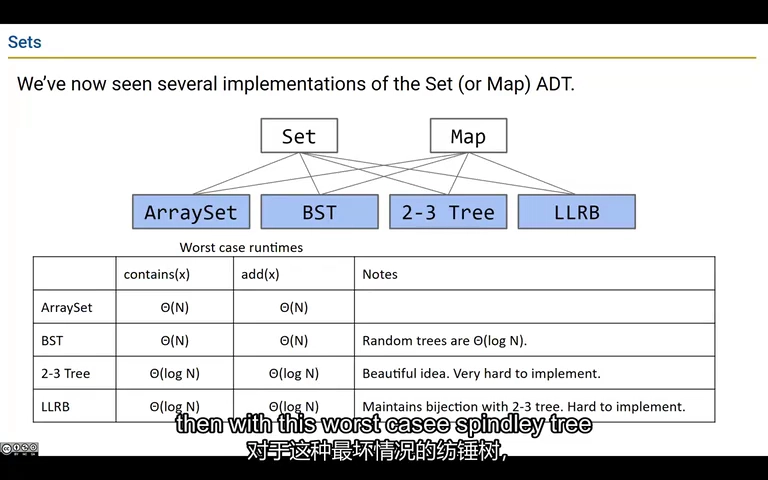
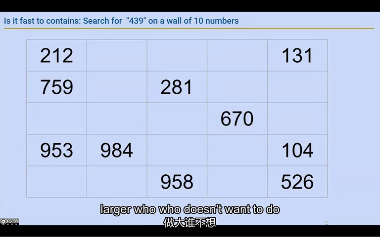
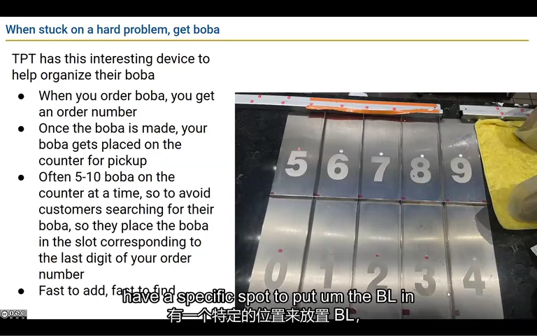
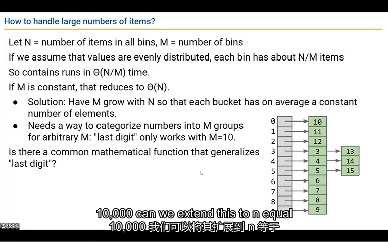
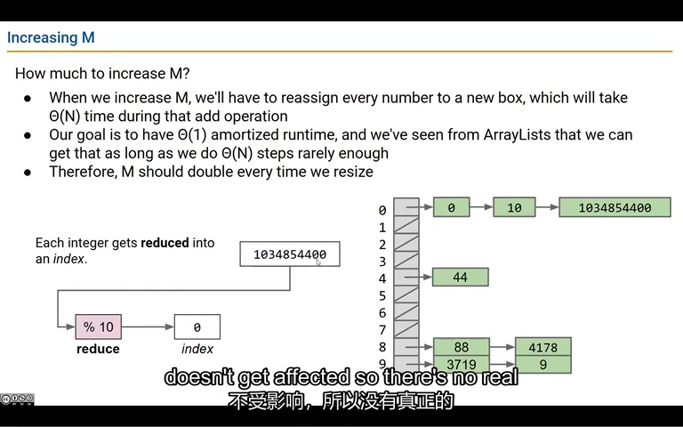
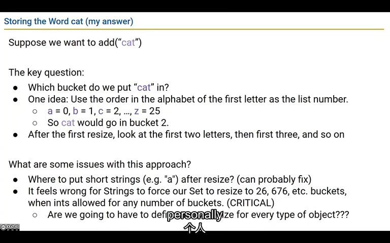
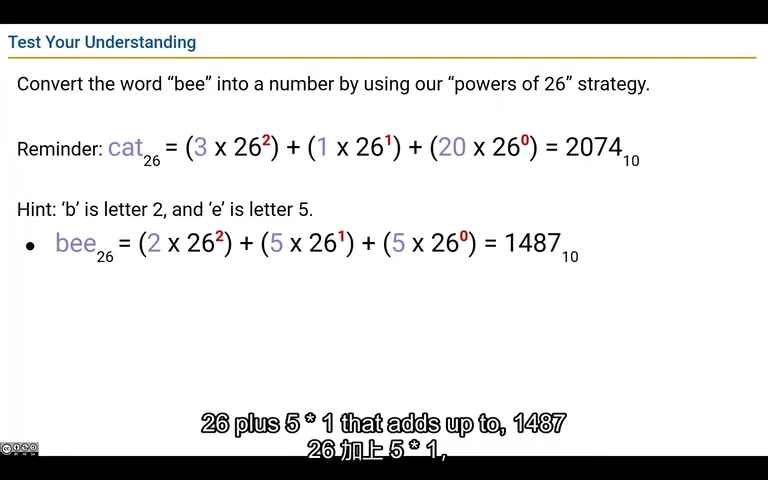
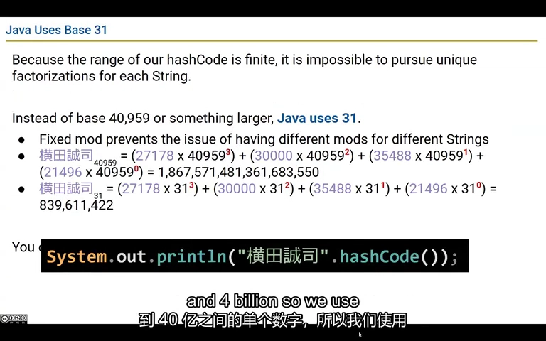
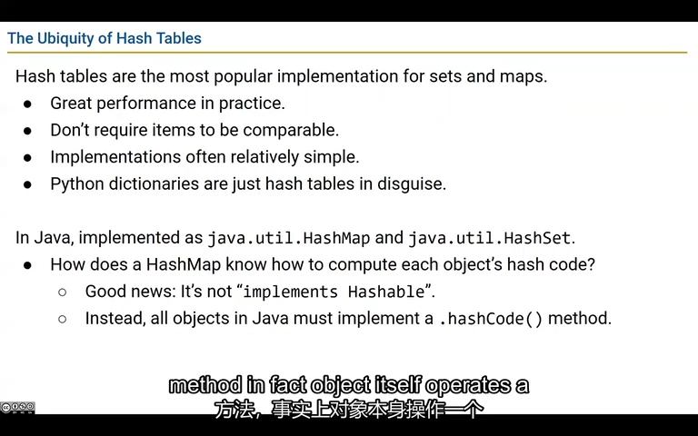
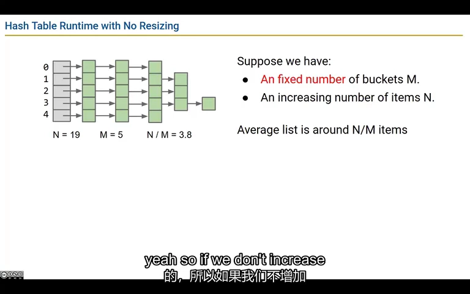

# Lecture 19：哈希表为什么能很快找到你要的东西

先想一个奶茶取餐架：杯子随便放，你只能一杯杯找；按订单尾号放进不同格子，就能先去对应格子，再核对订单号。哈希表也这样缩小查找范围。这节课接着解释：格子不够时怎么办，文字怎样算出位置，以及为什么同一个位置可能有多个订单。

来源：CS61B Spring 2024，B 站 P59（不是第 59 讲）。整理日期：2026-11-01。

[录像](https://www.bilibili.com/video/BV1QP4y1u7jv/?p=59) · [官方幻灯片](../slides/Lecture19.pdf) · [画面与原始字幕](../transcripts/Lecture19_画面字幕对照.md) · [课程索引](../README.md)

以下是结合字幕与画面重写的中文学习笔记，不是逐字译稿。代码为课堂思路的教学整理；额外边界说明单独标注。

## 1. 只是想找东西，不一定需要先把所有东西排好序

查“这个用户名注册了吗”，或者查“这个用户名对应哪个账号”，通常不需要先把用户名排好序。前一种类似 Set 的查重，后一种类似 Map 的按键找值。哈希表尝试利用待查的用户名直接算出一个查找位置，少走一些逐个比较的步骤。

**再看技术解释：**

Set 表示不重复元素的集合，常用操作是 add 和 contains；Map 保存键到值的映射，可以把每个键当成需要定位的元素。若需求只是判断存在或按键找值，并不一定需要有序遍历。

数组实现的集合，contains 通常要扫描；add 为避免重复也要检查已有元素。普通二叉搜索树在坏形状下可能退化到线性；平衡树通常把查找限制到对数级。

本讲探索能否利用更直接的定位方法。这里比较的是完成同一个任务时，不同数据结构要做多少工作：集合不能重复，所以分析 add 的耗时时，也要算上查重的时间。



*课堂画面：[回看 02:00](https://www.bilibili.com/video/BV1QP4y1u7jv/?p=59&t=120)。不同集合实现有不同查找成本，哈希表试图进一步减少定位工作。*

## 2. 随手放进去很容易，下次找回来就麻烦了

把号码随便写到墙上，写一个很快；等你要找 193，却可能看完整面墙。数据少时不觉得慢，变成几千条就很明显。我们想给放入和查找约定同一个规则：下次从号码出发，还能算出应该去哪里找。

**再看技术解释：**

课堂让人把数字随意写在墙上，再寻找某个数字；后来换成大量字符，问题更加明显。若假设输入尚未出现，随手写入很快，但没有组织信息时，查询仍可能看遍整面墙。

这个例子区分了“插入动作”和“查询定位”的差别。数据量小的时候，人可能觉得扫描也很容易；一旦从十个变成上千个，缺少组织方式的成本就显现出来。

目标不是记住所有位置，而是定义一条从待查元素出发就能重新算出候选位置的规则。



*课堂画面：[回看 08:00](https://www.bilibili.com/video/BV1QP4y1u7jv/?p=59&t=480)。无组织地摆放元素，使查找只能逐个检查。*

## 3. 先按尾号找格子，再核对完整订单号

193 和 203 都放进尾号为 3 的格子。拿 193 的顾客先去 3 号格，再逐个核对订单；不能看见同一格里有杯奶茶就拿走。同一位置放了多个不同元素叫冲突，哈希表必须能处理它。

**再看技术解释：**

奶茶店把订单放到 0–9 的取餐格：193 放到 3，100 放到 0。顾客根据自己订单号，直接到一个桶寻找，不必看全部订单。

插入和查询必须使用相同规则。多个不同订单可能进同一个桶，这叫冲突；分桶并不意味着桶里只有一个元素。到达桶后仍要比较订单号，才能确认是不是目标。

若订单均匀分布，十个桶大致把扫描量降低到原来的十分之一。但 N/10 仍随 N 线性增长，不能由“快了十倍”推出“已经是常数时间”。



*课堂画面：[回看 14:00](https://www.bilibili.com/video/BV1QP4y1u7jv/?p=59&t=840)。订单末位给出稳定的桶位置，但同桶仍可容纳多个订单。*

## 4. 每格越来越挤时，就得增加格子数

100 杯奶茶分到 10 格，平均一格 10 杯；1000 杯仍用 10 格，平均就要放 100 杯，查找又慢起来了。元素数除以格子数，叫负载因子。它衡量平均有多挤，但不保证每格都一样多；分得不均，仍可能有一格特别拥挤。

**再看技术解释：**

为每个桶预留很多固定位置会浪费空间，可以改为一个桶引用指向一条链，按需要增加节点。这是 separate chaining，通常译作分离链接或拉链法。

令 N 为元素数，M 为桶数，负载因子为：

$$
\alpha=N/M.
$$

在分布足够均匀的假设下，平均桶长度约为 α，查询成本约为 O(1+α)。若 M 固定，α 随 N 增长，仍是线性；若让 M 与 N 同阶增长，就能把平均桶长度控制在常数量级。

平均长度小不代表每个桶都短。哈希分布很差时，大量键仍可能集中到同一桶。



*课堂画面：[回看 20:00](https://www.bilibili.com/video/BV1QP4y1u7jv/?p=59&t=1200)。用 N/M 描述平均桶长度，并据此决定桶数增长策略。*

## 5. 格子数量变了，原来的东西也得重新找位置

原来按除以 4 的余数分格子，20 放在 0 号格；改成除以 8 的余数后，20 应该去 4 号格。所以扩容时不只是多摆几个空格子，还要按新规则把已有元素重新分配。搬一次很费事，通常会一次多增加一些空间。

**再看技术解释：**

当桶数不再是 10，末位规则推广为取模：非负整数键可用 `key % M`。M 改变后，原有键的下标也可能改变，所以要重新计算并分配位置。

例如 M 从 4 变成 8：16 去桶 0，20 去桶 4，13 去桶 5，7 去桶 7，3 和 11 仍碰在桶 3。不能把原来四个桶原封不动搬到新数组后就结束。

一次重分桶要处理 N 个元素，成本 O(N)。采用翻倍等几何增长，可以让昂贵重排足够稀疏。固定增加桶数会越来越频繁地重排；增长过猛又浪费空间。

课堂用较宽松负载阈值演示思路，Lab 08 的默认阈值是 **0.75**。不要把讲解数字与实验要求混用。



*课堂画面：[回看 23:00](https://www.bilibili.com/video/BV1QP4y1u7jv/?p=59&t=1380)。桶数增长需要重新计算每个元素的压缩下标。*

## 6. 先把文字算成整数，再把整数分到现有格子

订单号本来是数字，但用户名可能是 cat。可以先用 hashCode 给 cat 算出一个整数，再根据当前有多少桶，把整数变成合法编号。这样“怎样给文字算哈希值”和“这张表有多少桶”就分开了；扩容只需要重算桶位置。

**再看技术解释：**

遇到字符串 cat，按首字母分桶似乎可行，但数据可能偏斜。扩容后再按前两个、前三个字母分类，又会遇到短字符串如何处理、为何强制使用 26 的幂个桶等问题。

更合理的职责分离是：

```text
对象 key ── hashCode ──> 整数 h
整数 h  ── 按当前容量压缩 ──> 桶下标 0..M-1
桶内    ── equals 比较 ──> 确定目标键
```

对象负责给出哈希值，表负责把它压缩进当前桶数。这样扩容不需要重新发明“字符串应该怎样编码”，自定义对象也能沿用同一张表的机制。



*课堂画面：[回看 29:00](https://www.bilibili.com/video/BV1QP4y1u7jv/?p=59&t=1740)。直接按字符串前缀分桶，会把对象编码与容量策略耦合起来。*

## 7. 字母的位置也要参与计算

只把字母编号相加，cat 和 act 会算出相同结果。可以让不同位置有不同权重，就像十进制的 123 中，1 代表一百、2 代表二十。下面按课堂的字母编号与权重手算 cat、bee，先理解顺序怎样影响结果。

**再看技术解释：**

只用字符串长度，同长度单词全部冲突；只把字母编号相加，cat 与 act 等重排也会得到一样的值。位置权重能保留顺序信息。

课堂令 a=1、b=2、…、z=26：

$$
\text{cat}=3\cdot26^2+1\cdot26+20=2074,
$$
$$
\text{bee}=2\cdot26^2+5\cdot26+5=1487.
$$

这展示了如何把一串字符累积成整数。注意这里使用 1–26 编号，与之前首字母桶示例的 0–25 编号不是同一个约定。

在无限精度整数模型下可以研究唯一编码，但 Java int 只有有限个取值，不能由这个小例子推出任意字符串都能得到唯一 int 哈希值。



*课堂画面：[回看 35:00](https://www.bilibili.com/video/BV1QP4y1u7jv/?p=59&t=2100)。cat 与 bee 的手算展示了字符位置参与整数编码。*

## 8. 两个词算出同一个整数，是正常现象

Java 的 int 只有有限个取值，而字符串可以有无数种，所以必然有不同字符串得到相同哈希值。现成例子是 Aa 和 BB：两者都算出 2112。因此哈希值只帮你缩小范围，最后仍要比较完整的键，才能确认是不是同一个。

**再看技术解释：**

Java 字符串哈希可用递推理解：

```java
int h = 0;
for (int i = 0; i < s.length(); i++) {
    h = 31 * h + s.charAt(i);
}
```

这是对字符串哈希规则的教学表达。int 只有 32 位，计算可能溢出；有限取值不可能唯一容纳所有字符串。乘数 31 是实用设计，不意味着密码学安全，也不保证任何输入集都均匀。

补充：Java `"Aa"` 与 `"BB"` 的 hashCode 都是 2112，是一个可手算的冲突例子。查找因此必须比较键是否相等，不能只比较哈希值。

字符范围也不限于小写英语。ASCII 有 128 个编码位置；Java char 表示 UTF-16 代码单元，一个可见字符未必只占一个 char。



*课堂画面：[回看 41:00](https://www.bilibili.com/video/BV1QP4y1u7jv/?p=59&t=2460)。Java 使用有限整数哈希，因此不可能完全避免字符串冲突。*

## 9. hashCode 帮你找位置，equals 帮你认人

两把外形相同的钥匙不一定开同一扇门；同样，哈希值相同也不代表键相等。Java 用 equals 做最后的相等判断。另一方面，如果 equals 已经认定是同一个键，hashCode 就必须一致，否则同一个键可能被送到不同位置，查找就不可靠了。

**再看技术解释：**

Java 对象继承 Object 的 hashCode 方法，类可以重写；String 已定义自己的内容哈希。HashMap、HashSet 使用哈希思想，Python dict 也是相关实例，但具体内部实现不必相同。

补充必须遵守的约定：若 `a.equals(b)` 为 true，两者 hashCode 必须相同；反方向不成立。自定义键若按内容判断相等，通常需要成对重写 equals 与 hashCode。默认 Object.hashCode 也不能简单当作“保证等于内存地址”。

桶下标还要处理负数。在 Java 中 `-1 % 4` 为 -1，直接作数组下标会越界；可以使用 `Math.floorMod(h, M)`，正 M 时得到合法范围。也不要盲目写 `Math.abs(h) % M`，因为 Integer.MIN_VALUE 的绝对值仍会溢出。

Map 遇到已存在键应更新值，不应把键数量再加一；碰撞但不相等的键则应作为不同条目保留。



*课堂画面：[回看 44:00](https://www.bilibili.com/video/BV1QP4y1u7jv/?p=59&t=2640)。哈希集合和映射广泛使用，但仍需要正确的对象哈希与相等语义。*

## 10. “很快”有条件，也不代表每次操作都一样快

分布比较均匀、桶数跟得上元素数时，通常只需在短短一小组里找，所以查询的平均工作量不会随着总元素数不断增长。但扩容那一次仍要搬很多元素；如果大量键挤在同一桶，查找也会变慢。下面把这些情况分别列出，别把它们混成一个结论。

**再看技术解释：**

把不同分析口径分清：

| 条件或操作 | 成本结论 |
|---|---|
| 桶数固定，元素数持续增长 | 平均桶长度 N/M 增长，查询通常随 N 增长 |
| 分布合理、负载受控 | 查询期望 O(1) |
| 再加几何扩容 | 插入期望摊还 O(1) |
| 单次触发全表重排 | O(N) |
| 大量冲突进入同一条链 | 最坏查找可能 O(N) |

这里还假设单次哈希与键比较成本可以视为常数。补充：若键是很长的字符串，首次计算哈希、比较内容也可能随键长度增长。

实际写 Lab 08 时，先保证更新、冲突、计数、重分桶都正确，再运行速度测试。基准能观察你的实现，不是对所有输入的复杂度证明。下一讲继续 Hashing II，本笔记这里只整理当前这讲已经讲到的部分。



*课堂画面：[回看 47:00](https://www.bilibili.com/video/BV1QP4y1u7jv/?p=59&t=2820)。固定桶数会让平均链长持续增长，不能得到规模无关的查找成本。*

## 跑一个完整例子：Aa 和 BB 哈希值相同，为什么还能分别查出来

这是为本笔记补充的可运行代码。程序使用 Java 自带 HashMap 存两条记录。虽然两把键的 hashCode 都是 2112，它们仍分别保存；再次放入内容为 Aa 的新字符串，只更新原值。

```java
import java.util.HashMap;
import java.util.Map;

public class HashCollisionDemo {
    public static void main(String[] args) {
        String first = "Aa";
        String second = "BB";
        System.out.println("两个哈希值：" + first.hashCode() + " / " + second.hashCode());
        System.out.println("键是否相等：" + first.equals(second));
        Map<String, String> orders = new HashMap<>();
        orders.put(first, "奶茶");
        orders.put(second, "咖啡");
        System.out.println("分别查询：" + orders.get("Aa") + " / " + orders.get("BB"));
        orders.put(new String("Aa"), "少糖奶茶"); // 对象不同，但字符串内容相等。
        System.out.println("更新后：" + orders.get("Aa") + "，size=" + orders.size());
        System.out.println("缺失的键：" + orders.get("CC"));

        // 下面只演示教学哈希表的下标计算，不是复刻 HashMap 的内部算法。
        System.out.println("负数取余：" + (-1 % 4));
        System.out.println("合法桶下标：" + Math.floorMod(-1, 4));
        System.out.println("最小整数的绝对值：" + Math.abs(Integer.MIN_VALUE));
    }
}
```

哈希相同只是候选位置相同，还需要 equals 判断是不是原来的键。`new String("Aa")` 创建新对象，但内容仍等于原键，因此更新值后 size 仍为 2。`floorMod` 在桶数为正时可得到合法下标；不能一概用 abs 修复负哈希值，因为最小 int 的绝对值装不进 int。这里使用标准库观察行为，没有代写 Lab 08 的 MyHashMap。

**运行方式：**在 CS61B 目录执行 `java examples/lecture19/HashCollisionDemo.java`。首次运行可先看[环境说明](../examples/README.md)。

预期输出：

```text
两个哈希值：2112 / 2112
键是否相等：false
分别查询：奶茶 / 咖啡
更新后：少糖奶茶，size=2
缺失的键：null
负数取余：-1
合法桶下标：3
最小整数的绝对值：-2147483648
```

**改一处试试：**再插入 `orders.put("CC", "果汁")`，观察 size 和缺失键查询如何改变。然后试 `orders.put("CC", null)`：get 返回 null 时，怎样用 containsKey 区分“有这个键，值为空”和“没这个键”？

[打开完整 Java 文件](../examples/lecture19/HashCollisionDemo.java) · [单独阅读这个例子](../examples/lecture19/README.md)

## 自己动手试一试

1. 把 7、16、3、11、20、13 分别按模 4 和模 8 分桶，圈出位置改变的键。
2. 手算 cat、bee，再用递推计算 Aa 与 BB 的 Java 哈希值。
3. 解释 hashCode 相同为何还要调用 equals。
4. 比较“固定 10 桶”和“保持 α≤0.75”的长期增长行为。
5. 完成 [Lab 08：MyHashMap](../labs/lab08/README.md)，记录实际基准数据，不预填答案。

## 口语与字幕校正

自动字幕对 ASCII 数量、整数溢出和“唯一编码”的表述容易误导。本笔记区分无限精度数学模型、32 位 int 和桶下标，并把额外 Java 边界说明标为补充。

## 继续阅读

- [官方教材 1](https://cs61b-2.gitbook.io/cs61b-textbook/19.-hashing)
- [实验索引](../labs/README.md)
- [本讲完整原始字幕](../subtitles/Lecture19.srt)
