# 1. Intro：画面与字幕对照

来源：[B 站第 1 集](https://www.bilibili.com/video/BV1QP4y1u7jv/?p=1)；Spring 2024，整理日期 2026-11-01。

[原始字幕](../subtitles/Lecture01.srt)。字幕来自 Kedou 对指定分 P 的解析，可能含识别或翻译错误；原文保留以便核查，学习笔记对术语和推导另作修正。

## 中文阅读导引

下表是按内容整理的阅读路标，时间定位到相关课堂画面；详细中文解释见[学习笔记](../notes/Lecture01_Java入门与对象.md)。下面的原始字幕保留原貌，不能当作已校正的逐字稿。

| 时间 | 主要内容 |
|---|---|
| [02:00](https://www.bilibili.com/video/BV1QP4y1u7jv/?p=1&t=120) | 课程用 Java 训练数据结构和程序设计能力 |
| [17:00](https://www.bilibili.com/video/BV1QP4y1u7jv/?p=1&t=1020) | 从一个可运行的入口开始理解 Java |
| [20:00](https://www.bilibili.com/video/BV1QP4y1u7jv/?p=1&t=1200) | 方法属于类，循环也必须放在合法位置 |
| [23:00](https://www.bilibili.com/video/BV1QP4y1u7jv/?p=1&t=1380) | 静态类型会提前拒绝不兼容的赋值 |
| [29:00](https://www.bilibili.com/video/BV1QP4y1u7jv/?p=1&t=1740) | 编译检查与程序执行是两个阶段 |
| [32:00](https://www.bilibili.com/video/BV1QP4y1u7jv/?p=1&t=1920) | 对象把一份状态与操作这份状态的方法放在一起 |
| [41:00](https://www.bilibili.com/video/BV1QP4y1u7jv/?p=1&t=2460) | 构造函数负责建立对象的初始状态 |
| [47:00](https://www.bilibili.com/video/BV1QP4y1u7jv/?p=1&t=2820) | this 指向当前对象，帮助你区分字段与参数 |

## 原始字幕与画面对照

| 时间与原始字幕 | 画面 |
|---|---|
| [00:00](https://www.bilibili.com/video/BV1QP4y1u7jv/?p=1&t=0) 不幸的是，如果你是，不能让人们保持安全考虑如果你站在这个时候请离开等待你为什么要等你为什么打开你不应该你不应该打开这个哎呦那应该是是呀那应该是关闭的好啦对不起我们需要所有还没坐下的人你不能坐在过道上我们拿到了我们得走了好啦嗨各位欢迎来到六乙 | 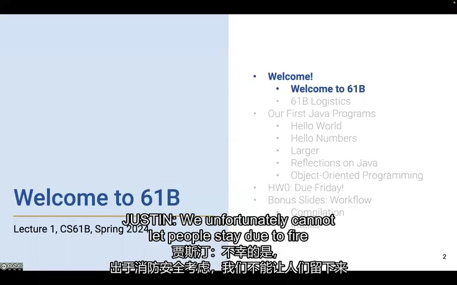 |
| [00:40](https://www.bilibili.com/video/BV1QP4y1u7jv/?p=1&t=40) （此区间无字幕） | 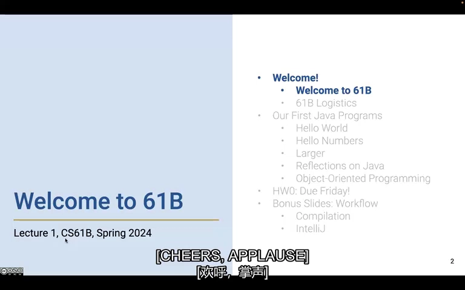 |
| [00:45](https://www.bilibili.com/video/BV1QP4y1u7jv/?p=1&t=45) 所以今天我们要快速概述一下6b是如何运行的我们将讨论一些后勤问题然后我们去付款去解释呃或者像Java一样在我开始之前，六十一八介绍嗨我是贾斯汀我是凯伦嗯我们是这里的讲师我猜你想说什么 | 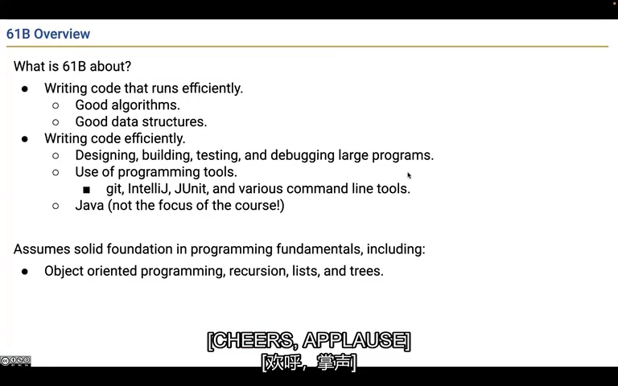 |
| [01:25](https://www.bilibili.com/video/BV1QP4y1u7jv/?p=1&t=85) 这门课总体上是关于什么的6b是一门课程这不仅仅是一门关于编程的课程六零A主要是教你你如何编程六乙将教你们你如何编写好程序所以这是一门工程学课在那里你给出了一系列你能做的事情你的目标不仅仅是做一些有用的东西但做一些有效的东西所以在这节课中，我们将介绍很多好的算法很多好的数据结构数据结构是类似的结构，碰巧非常有用很多问题都是通过只是用这个特殊的物体人们发现它们很有用所以我会谈谈那些我们还将讨论如何高效地编写代码 | 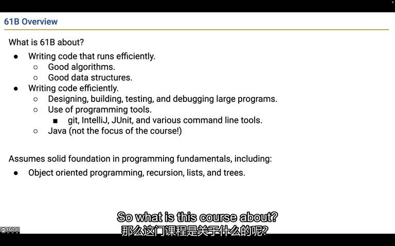 |
| [02:05](https://www.bilibili.com/video/BV1QP4y1u7jv/?p=1&t=125) 所以不仅仅是你能写出快速的代码但是你能快点写代码吗就像你花五年时间写一个简单的程序不管效率有多高当你最终写完它的时候，它可能已经没用了所以我们将使用这些新工具像设计代码测试代码调试代码所有这些工具都倾向于在现代工业环境中使用您将学习如何在现实生活中实际编写代码我们将用Java来报道事情呃这就是你在这门课上使用的编程语言主要是因为它是一种非常有用的语言但这不是课程的重点 | 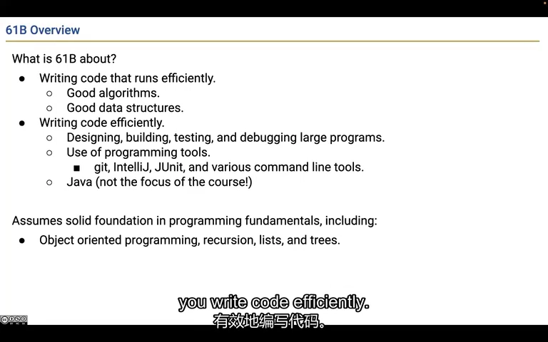 |
| [02:45](https://www.bilibili.com/video/BV1QP4y1u7jv/?p=1&t=165) 这不是Java编程课程这是一门用Java教授的编程课程我们假设这里的每个人都对一些编程基础知识有扎实的理解所以如果你拿了61 A，那么你应该很好但是在学习这门课之前，你至少应该有一个学期的编程经验Six和B的其他一些很棒的特性是我们涵盖了很多不同的东西所以首先B往往是任何工作面试中最有用的课程之一 | 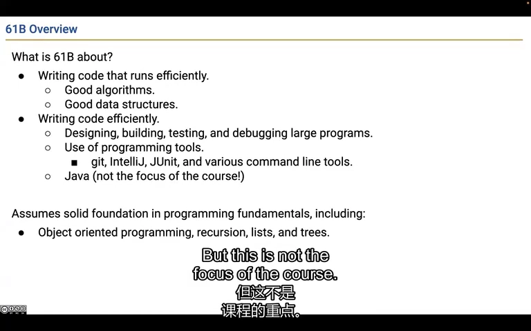 |
| [03:20](https://www.bilibili.com/video/BV1QP4y1u7jv/?p=1&t=200) 你会有如果你去面试任何CS实习你可能会被问到类似于我们在这节课中讨论的问题很多数据结构的东西与哈希表二分搜索树图Dijkstras你说出来你最终会学到很多很酷的东西我们还复习了很多很酷的数学嗯所以我们复习了像异位分析这样的东西看看程序运行得有多快我们将大量讨论如何调整数组的大小我们如何在一个近似恒定的时间内得到它两三棵树红黑树一开始看起来完全是两码事但后来我们证明它们实际上是一回事我们将讨论很多图论 | 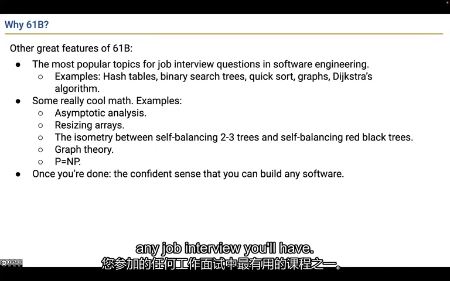 |
| [04:00](https://www.bilibili.com/video/BV1QP4y1u7jv/?p=1&t=240) 呃我们将以一些较轻的东西结束一些有趣的素材一些未解决的问题，如p等于NP我会做一些类似的事情我们的目标在本课程结束时你可以从头开始为自己编写程序所以现在在61 a你已经学会了如何在给定启动代码的情况下编写程序当你离开这节课的时候我希望每个人都能写一个程序只是为了好玩因为他们有些问题需要解决或者因为他们只是想浪费一个周末做一些事情 | 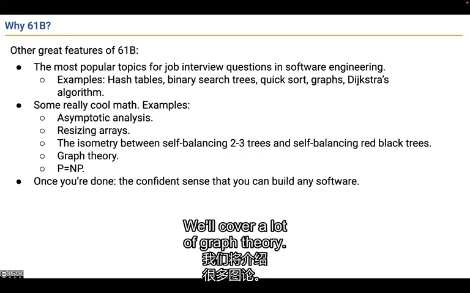 |
| [04:36](https://www.bilibili.com/video/BV1QP4y1u7jv/?p=1&t=276) 所以在我们开始之前我们有点喜欢这个就像对班级的调查只是想看看大家怎么样 | 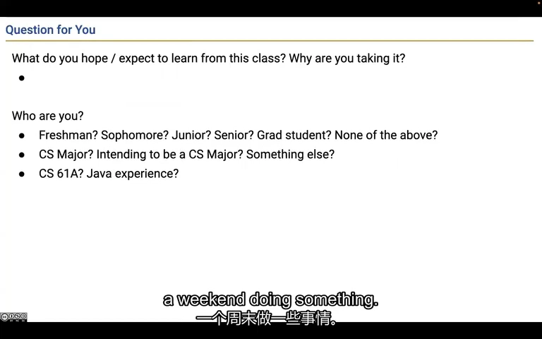 |
| [04:43](https://www.bilibili.com/video/BV1QP4y1u7jv/?p=1&t=283) 那么你们都希望得到什么从这个班你有买家吗工作是呀你想要一份工作那是个好主意还有什么别的吗？还有人反对这门课的内容吗？是啊，是啊希望最终能够高效地运行我的代码高效地运行代码是呀那太好了 | 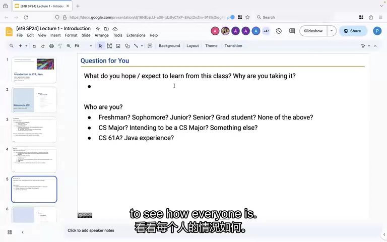 |
| [05:23](https://www.bilibili.com/video/BV1QP4y1u7jv/?p=1&t=323) 从头开始编码那是个好主意呃我在缩放上看到一些聊天更大的直觉我看到一个300人的变焦房变焦时我们没有空间了吗呃我们会想出办法的最终我不知道好吧 | 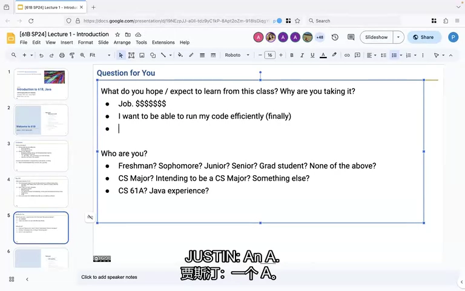 |
| [06:03](https://www.bilibili.com/video/BV1QP4y1u7jv/?p=1&t=363) 更多空间是呀好啦我们也想做一个调查所以在座的各位这里有多少人是新生？几乎所有人任何一个大二的学生 | 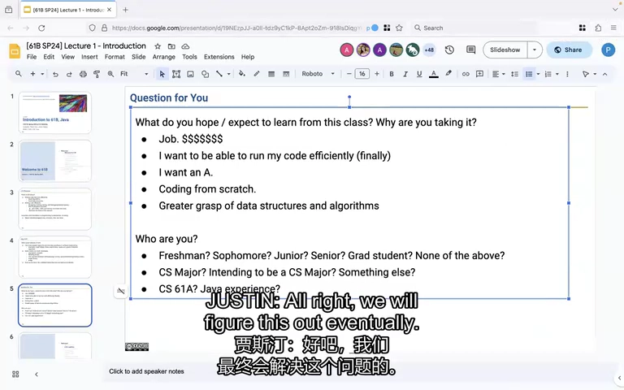 |
| [06:22](https://www.bilibili.com/video/BV1QP4y1u7jv/?p=1&t=382) 几个人任何低年级学生是呀有没有高年级的 | 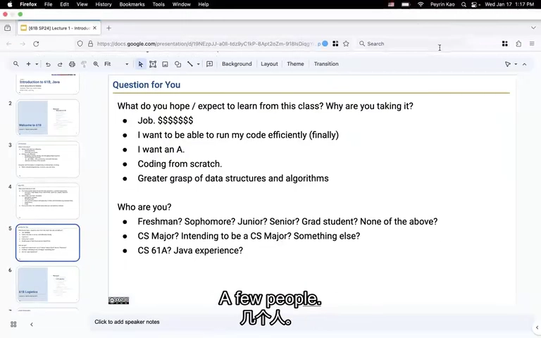 |
| [06:27](https://www.bilibili.com/video/BV1QP4y1u7jv/?p=1&t=387) 是呀几个高年级的有多少人是计算机专业的电子专业有多少人没有我想的那么多人既不是CS也不是E好吧大家都在干什么呃不不那不是那不是那不是那个意思我问你喜欢什么你读什么专业啊数据科学权我忘了数据科学有多少人数据科学好啦这就解释了其他主修数学的学生是呀我本科时也学过数学 | 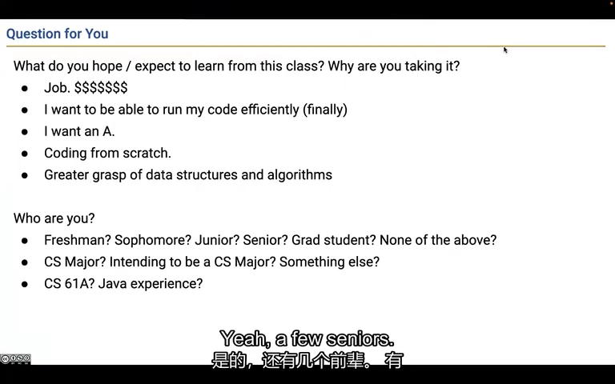 |
| [07:07](https://www.bilibili.com/video/BV1QP4y1u7jv/?p=1&t=427) 非常好玩物理学我带了多少人61个几乎所有人有多少人没有拿六十一但另一个地方的类似班级你们中很少有人任何其他编程类是呀什么课还有六十一 | 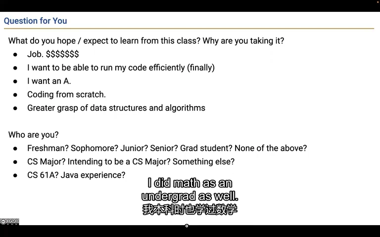 |
| [07:47](https://www.bilibili.com/video/BV1QP4y1u7jv/?p=1&t=467) B好啦你现在在说明书里喜欢好吧有多少人学习过python编程C尖C加加好啦好啦任何其他大型语言Matlab no那不算语言科特林哦哦那是我有一阵子没听过那个了 | 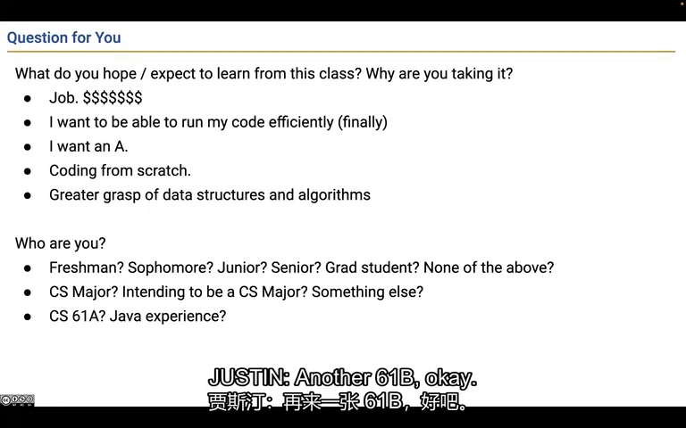 |
| [08:27](https://www.bilibili.com/video/BV1QP4y1u7jv/?p=1&t=507) 你可以从这形形色色的人群中看出你们中的许多人来自完全不同的背景所以我想问一下，有多少人已经认识这个班上的人了你们大多数人都有你们都有项目伙伴你认识那些将成为你项目合作伙伴的人吗我建议你去学学呃今天你认识了一个人如果可能的话大家都到齐了这是一个伟大的时代 | 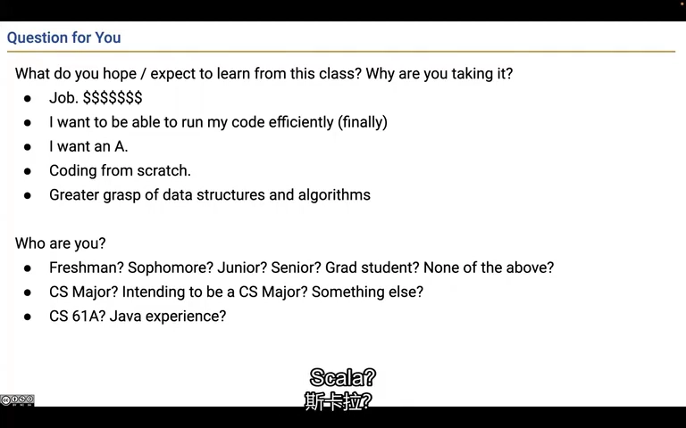 |
| [09:07](https://www.bilibili.com/video/BV1QP4y1u7jv/?p=1&t=547) 你知道的认识一个人哈哈哈 | 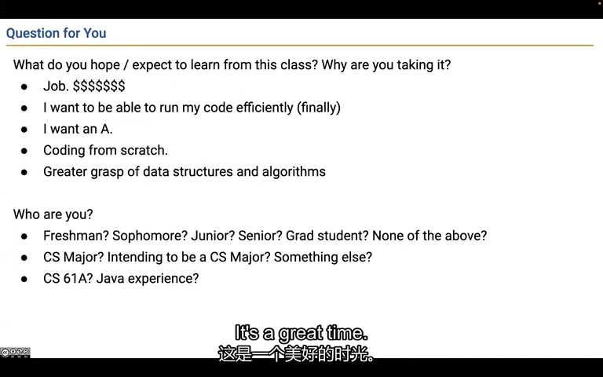 |
| [09:19](https://www.bilibili.com/video/BV1QP4y1u7jv/?p=1&t=559) 我们现在能不能宣布一下是啊，是啊呃我呃在我们继续之前我能问一下吗我们不封锁入口在那里我们不能呃由于消防安全规定，我们不能离开这个区域我们要请你搬出去你拿到了所以说 | 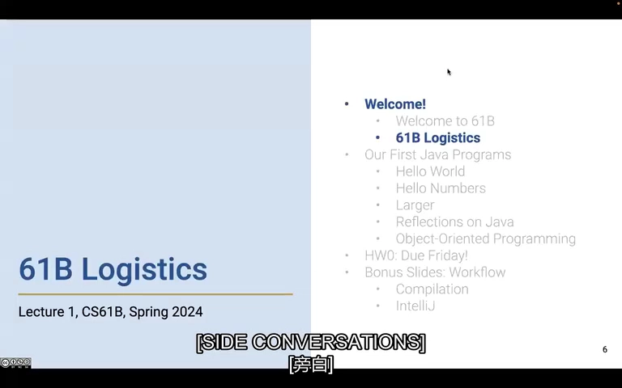 |
| [09:50](https://www.bilibili.com/video/BV1QP4y1u7jv/?p=1&t=590) 让我们谈谈物流在这门课里，我们要有多个组成部分吗？你们要做的大部分是通过家庭作业或讨论所以我们会有讲座参加讲座是可选的你不一定要来这里我个人从来没有从讲座中学到很好的东西所以我大部分时间都没有去听讲座我上课的时候啊但是你知道如果你通过别人和你说话学得很好那太好了请出席讲座转到缩放我们将亲自或在线回答问题穿过那个一般来说通过编程你会学到很多东西不是什么你可以从理论中学习 | 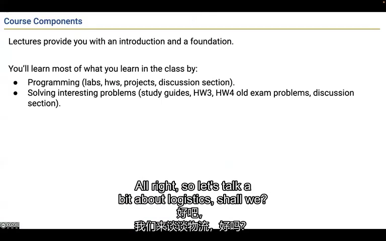 |
| [10:30](https://www.bilibili.com/video/BV1QP4y1u7jv/?p=1&t=630) 你得实际练习因此，您将获得大量的Java编程经验通过你的家庭作业你的实验室您的项目讨论不会做直接编程但是您将讨论如何有效地编写代码这学期你们会解决很多有趣的问题我们有一些很好的家庭作业我们尽量使考题有趣你会有很多时间来讨论 | 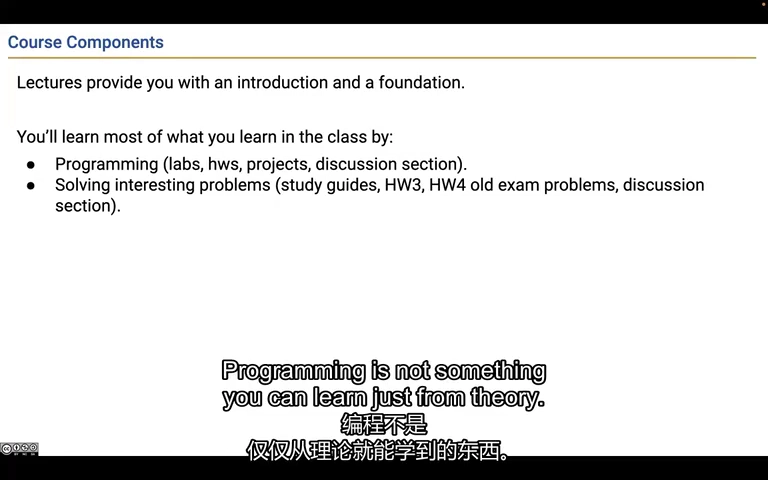 |
| [10:56](https://www.bilibili.com/video/BV1QP4y1u7jv/?p=1&t=656) 一般来说你应该期望通过四种不同的方式获得分数所以我们会把这些低努力点比如每周调查课程评价有人在变焦上问如果Zoom上的人有办法认识人是呀我们应该有一个伙伴关系的教育职位所以请在那里自我介绍一下这将是结识新朋友的好时机所以一般来说你应该期待得到这些课程评估或每周调查每个人都应该为家庭作业和实验室加分这些将是更高的努力虽然所以你会有更多的时间这是你会得到最多的学习考试的地方会有点棘手 | 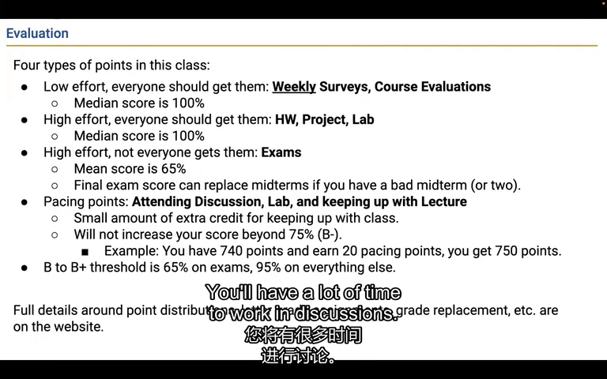 |
| [11:36](https://www.bilibili.com/video/BV1QP4y1u7jv/?p=1&t=696) 我们预计平均65%左右其实呢我们的政策运作方式是如果平均值低于65%会降低最高分所以是百分之六十五但如果分数在65分以上然后嗯你们的分数是一样的如果班上每个人都有名字太好了我们确实有一些节奏点就是跟上东西我们实际上并不它实际上不算什么如果你的目标是B或以上只是为了让你负主要的想法是，如果你没有通过讲座学好那你就不用去上课了没关系的但我们希望你能证明你实际上可以自己学习这些材料 | 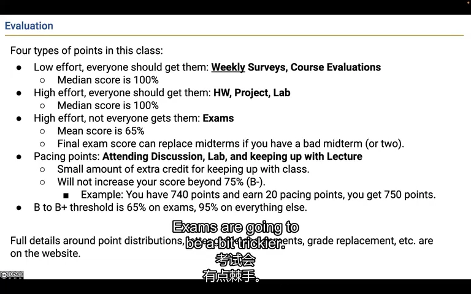 |
| [12:16](https://www.bilibili.com/video/BV1QP4y1u7jv/?p=1&t=736) 所以你至少需要一个B左右就像这不再相关我们把b 2 b加阈值设为考试六十五分，其他各方面九十五分所以这有点让你对我们成绩目标的认识这都是根据部门的要求他们生我们的气如果我们给的太少或太多好像每个人都考得很好会和部门打架什么的我不知道我们会想出办法的我们会得到这件事的全部细节都在我们的网站上所以请通读一下我们也有很多关于迟到政策的物流 | 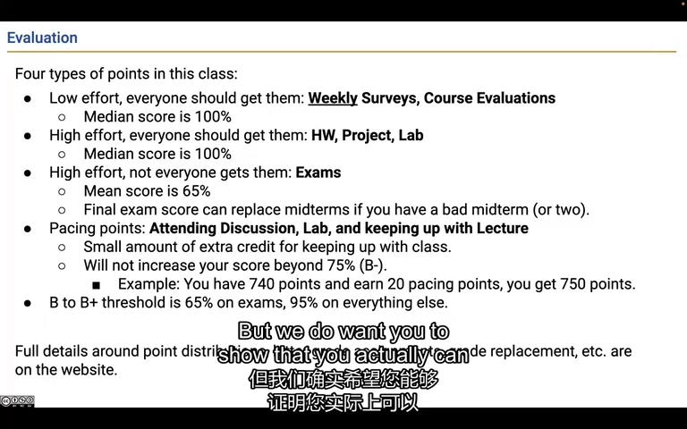 |
| [12:56](https://www.bilibili.com/video/BV1QP4y1u7jv/?p=1&t=776) 嗯请把这些都看一遍在我们开始剩下的课程之前我们得到了很多关于这个的问题关于人们显然没有读到而且是一点都不好玩有时候我们那里也有很多不当行为政策我们没有足够的时间去看但很可悲当我们不得不告诉一个学生他们的所作所为违反了我们的不当行为政策他们不知道不幸的是，我们必须执行规则所以请通读一遍，并尽你所能遵循它 | 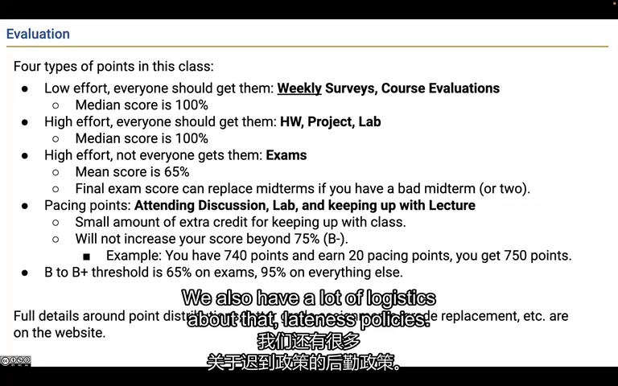 |
| [13:32](https://www.bilibili.com/video/BV1QP4y1u7jv/?p=1&t=812) 所以我们有迟到的规定对于迟交的作品，我们不提供任何部分学分但我们会允许你申请延期请在原定截止日期前申请延期我们一般延期不到一天不要依赖它因为我们不提供那么多的办公时间支持在那之后，我们通常还提供长达三天的支持如果嗯你有充分的理由如果你有紧急情况超过72小时请让我们知道我们是来帮你得到尽可能好的分数的我们不希望你采取任何卑鄙的行为 | 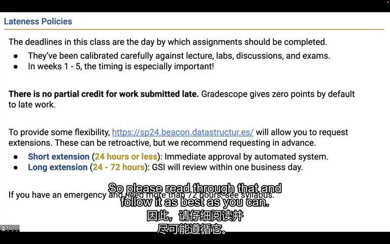 |
| [14:12](https://www.bilibili.com/video/BV1QP4y1u7jv/?p=1&t=852) 你不希望你诉诸于强调你其他课的成绩很差 | 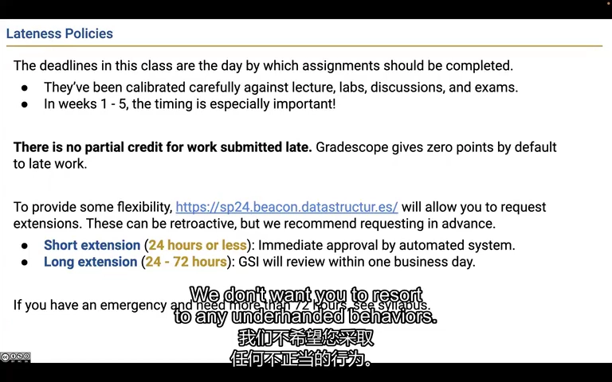 |
| [14:19](https://www.bilibili.com/video/BV1QP4y1u7jv/?p=1&t=859) 所以这里有一个关于这门课将如何进行的简要概述所以这门课的第一阶段将所以我们将把这堂课大致分为三个阶段第一阶段基本上是如何用Java编写代码这将是这门课节奏最快的部分它可以让您了解Java编程的工作原理Java和Python的所有区别你也知道如果您需要一些关于如何有效编程的一般想法我们的家庭作业是零两天后到期这就是我们对Java家庭作业的介绍所以我们开始跑步这是一门非常非常前置的课所以在那之后要做好准备 | 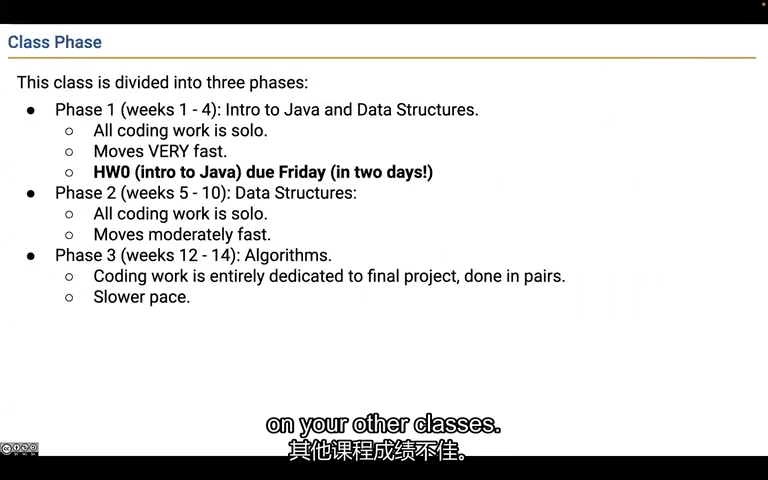 |
| [14:59](https://www.bilibili.com/video/BV1QP4y1u7jv/?p=1&t=899) 在五到十周内，我们将开始讨论第二阶段在这里我们可以切入主题数据结构所有这些都有点嗯所有的嗯就像我们发现作为计算机工程师有用的工具或技巧一样小这里会有很多代码它的移动速度会比较快你会比Java有更多的空闲时间但你还会学到很多新东西所以节奏会很快在第三阶段之前，所有这些工作都将是单独的第三阶段将进入算法在课程的这一部分实际上会慢下来很多在这一点上，很多讲座都是小事 | 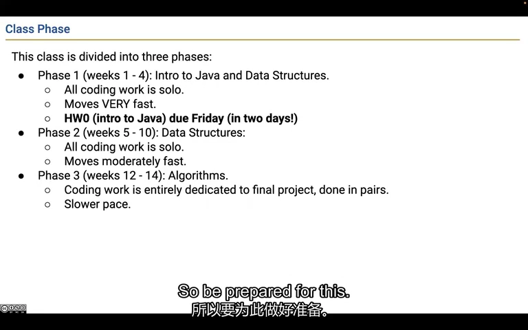 |
| [15:39](https://www.bilibili.com/video/BV1QP4y1u7jv/?p=1&t=939) 比如你如何有效地编程他们不会参加任何考试什么的但它们对发展你作为工程师的能力很有用最后一个项目将是一个合作伙伴项目您需要为此项目有一个合作伙伴因为你想我们想让你学会如何与别人合作所以如果你没有朋友到今天结束或本周末开始寻找会很有用的它将以较慢的速度进行但这并不意味着材料会变得不那么重要它可以说是最重要的东西因为这是我们会教的最容易转移的东西 | 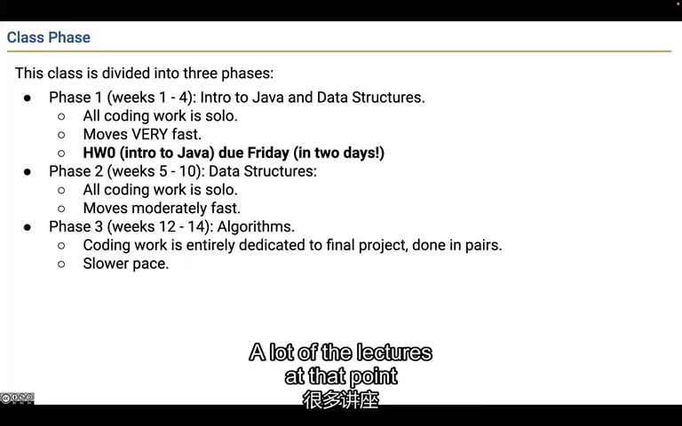 |
| [16:19](https://www.bilibili.com/video/BV1QP4y1u7jv/?p=1&t=979) 所以在我继续前进之前有什么问题吗？ | 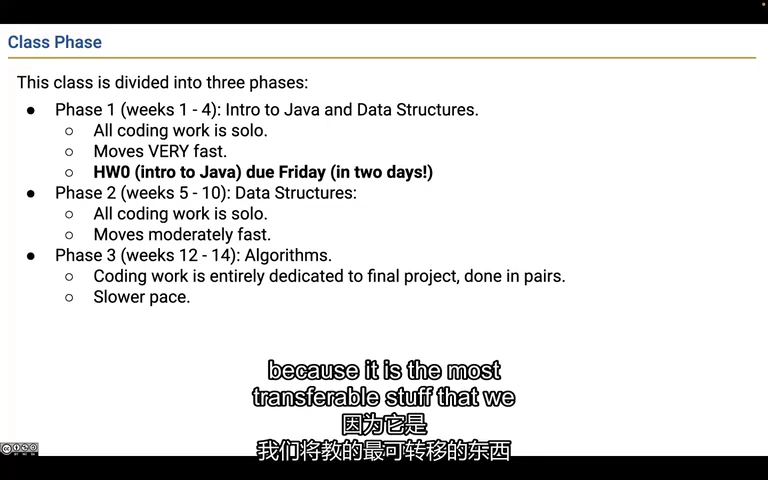 |
| [16:25](https://www.bilibili.com/video/BV1QP4y1u7jv/?p=1&t=985) 让我看看是呀我没有更多的幻灯片了在我们继续之前还有什么问题吗好啦哪个帕伦好啦好啦嗨，很高兴来到这里，祝贺你成功好啦好啦所以我要为你们写几个Java程序所以我们熟悉了Java语言而且是的让我们做吧 | 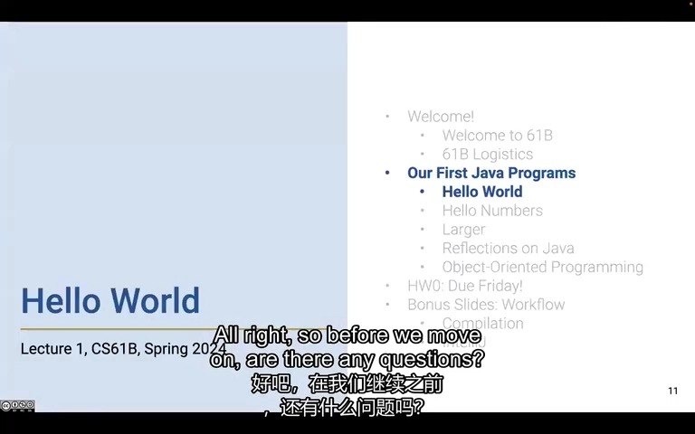 |
| [16:53](https://www.bilibili.com/video/BV1QP4y1u7jv/?p=1&t=1013) 好啦所以我将从用Python编写它们开始如果你以前从未见过Python完全没问题我只是把它放在那里作为比较如果你以前用Java编码过这可能有点无聊但希望你能学到新东西所以让我们试试看 | 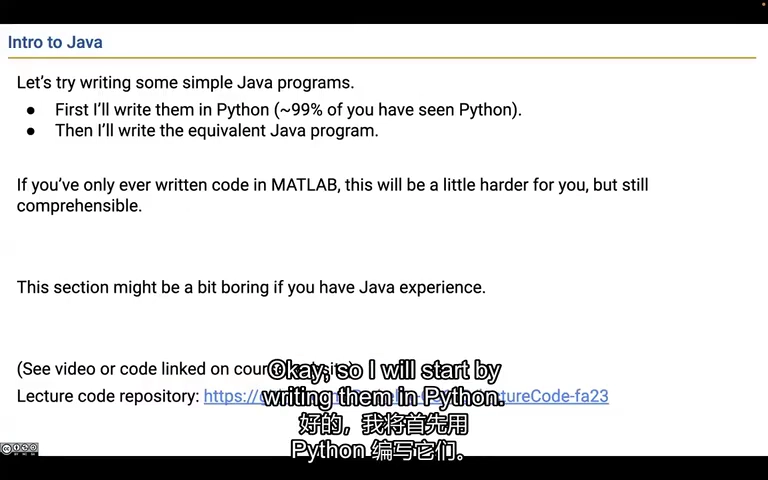 |
| [17:08](https://www.bilibili.com/video/BV1QP4y1u7jv/?p=1&t=1028) 好啦所以我在这里我要用python写一个hello world程序你准备好打印你好世界了吗所以现在就在那里我会试着写完全一样的东西好啦你很容易被打动好啦在Java中完全相同的事情所以我首先要做的是我要把这个程序复制粘贴到Java解释器中好吧，首先我想我应该运行Python程序现在很好我会试着运行Java程序希望我们得到一个错误并不太奇怪 | 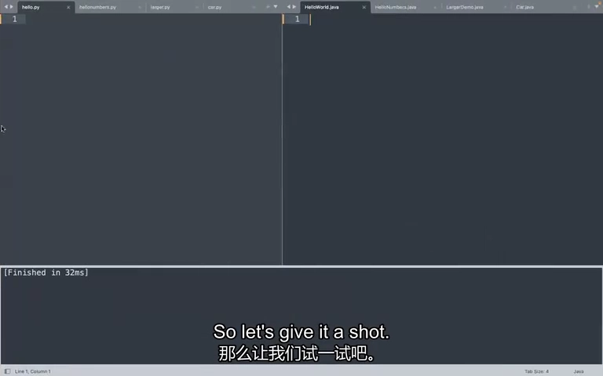 |
| [17:48](https://www.bilibili.com/video/BV1QP4y1u7jv/?p=1&t=1068) 我不能从一种语言上学习程序将它们复制粘贴到另一种语言中，并期望它工作所以具体来说，它所说的错误是类接口枚举或记录希望这样翻译一下Java在抱怨什么这段代码并不存在于类中所以Java是一种非常关心面向对象编程的语言它真的很关心您编写的所有代码都在一个类中所以让我们做一堂课所以我将用来定义类的神奇词汇是公共舱然后我要给我的班级取个名字我叫它你好世界但你可以叫它不同的东西然后现在我有一个空白的类 | 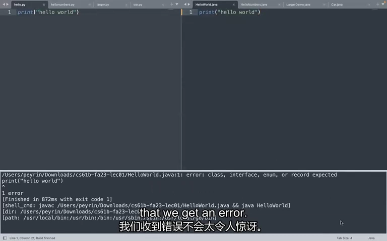 |
| [18:28](https://www.bilibili.com/video/BV1QP4y1u7jv/?p=1&t=1108) 所以让我们试着运行这个，看看会发生什么我又跑了但还是不管用好啦所以现在说找不到主要方法请将main方法定义为public static void主流弧线嗯这是错误消息历史上最有用的错误消息因为我所要做的就是把他们让我写的东西复制，粘贴在那里，好的至少这次成功了所以我在右边写的实际上相当于这个左边空白程序所以现在我有了空白程序我终于可以打印你好世界了所以我会写而不是打印Java中的神奇单词是系统点出来的 | 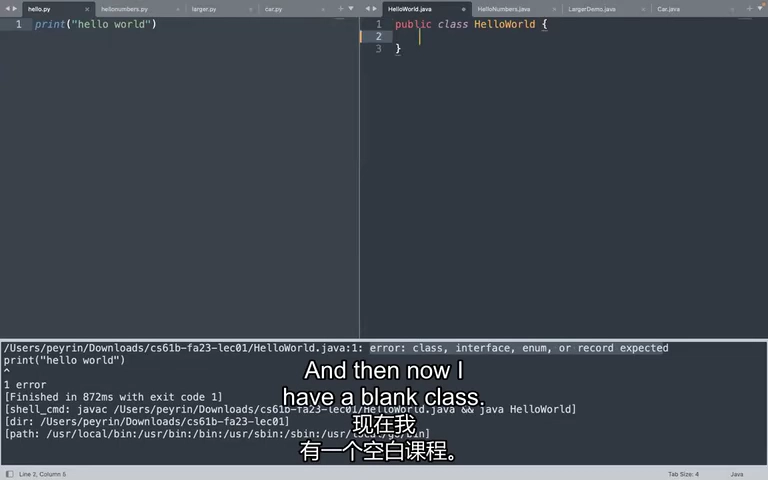 |
| [19:08](https://www.bilibili.com/video/BV1QP4y1u7jv/?p=1&t=1148) 点打印线那么好吧你好世界我会用分号结束它如果一切顺利我们得到了你好世界这么好我们已经编写了第一个Java程序好的如果你一直鼓掌我永远也弄不完我要盖的这些东西 | 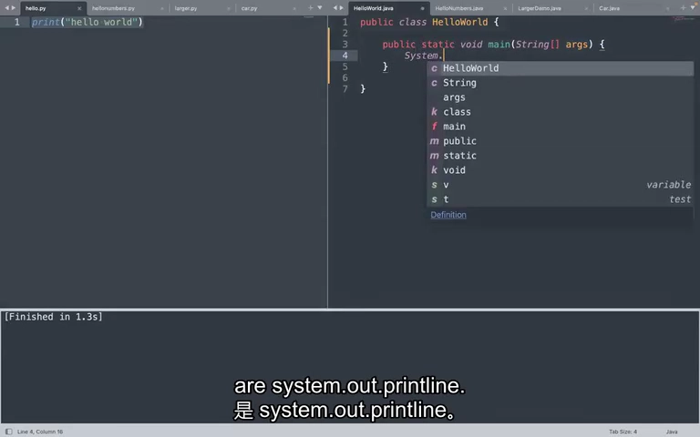 |
| [19:26](https://www.bilibili.com/video/BV1QP4y1u7jv/?p=1&t=1166) 所以让我们反思一下我们所学到的希望这不值得鼓掌 | 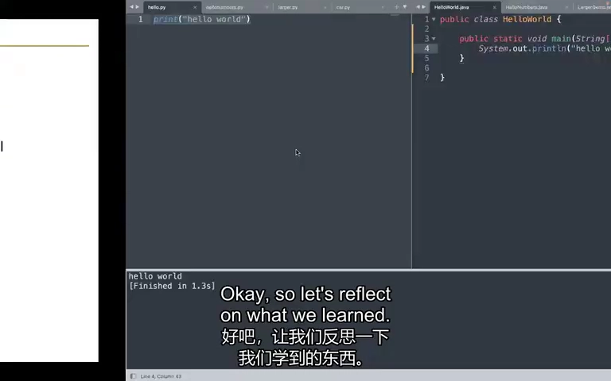 |
| [19:31](https://www.bilibili.com/video/BV1QP4y1u7jv/?p=1&t=1171) 我不知道好啦所以我们看到的是所有代码都必须是类的一部分Java非常关心面向对象这意味着你写的一切必须是一个类的一部分我们讨论了定义新类的语法你会注意到，它不是像缩进那样使用空白来表示事情开始和结束的地方我们用括号您还会注意到我们用分号结束了行这些都是一些小的语法，你会学到当您练习使用Java时所以不用担心记住它们在你不知不觉中，它们就会成为你的第二天性这是我对我们第一个Hello World节目的反思有什么问题吗？ | 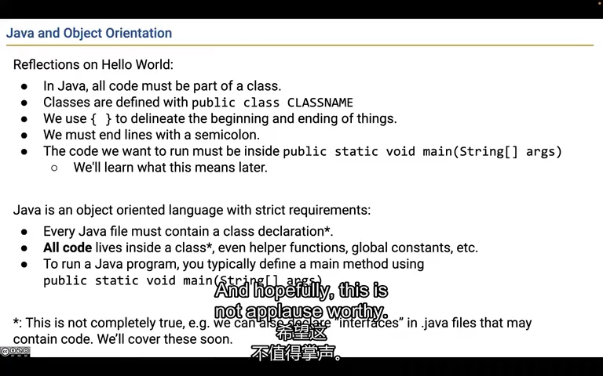 |
| [20:11](https://www.bilibili.com/video/BV1QP4y1u7jv/?p=1&t=1211) 没有掌声这次没事了好的，好的让我们再写一些程序所以这次我要写一个程序，叫做Hello Numbers这个会稍微复杂一点 | 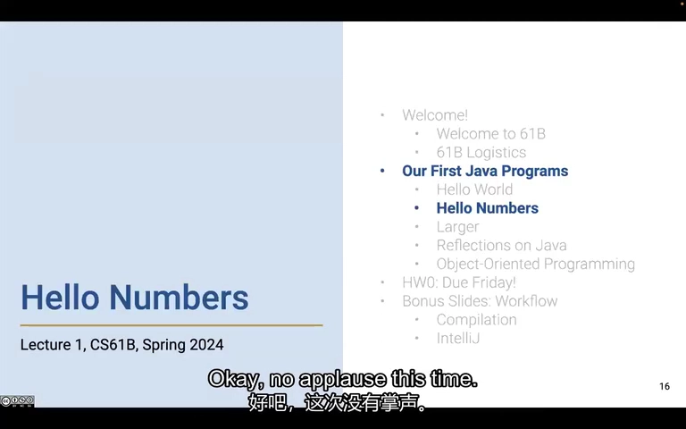 |
| [20:18](https://www.bilibili.com/video/BV1QP4y1u7jv/?p=1&t=1218) 所以这次我要试着打印出零到十之间的数字所以让我们先这样做我说x等于零不要鼓掌只是x等于零然后我会说当x小于10时我会打印出X然后我把x增加到b比之前大1希望这能给我一些0到10之间的数字所以从零到九现在呢让我们试着用Java来做这个所以我会来Java我已经提前为你写了相当于空白程序的东西我会试着接受这个节目并尽可能地把它翻译成Java所以我说x等于零当x小于10时，我就说 | 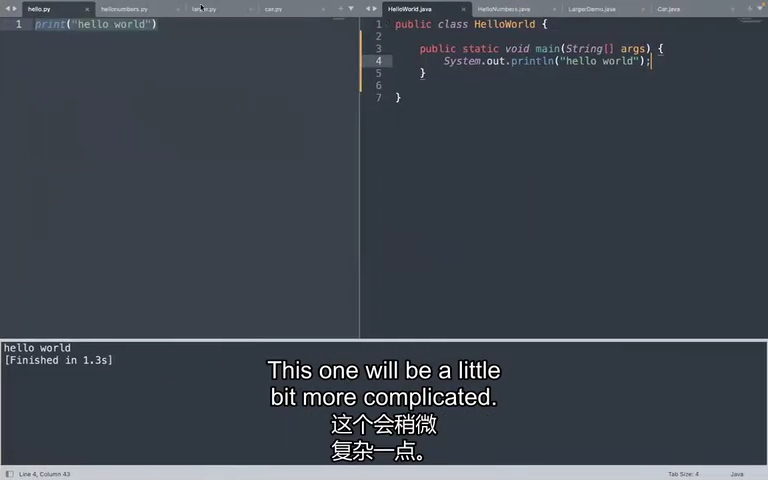 |
| [20:58](https://www.bilibili.com/video/BV1QP4y1u7jv/?p=1&t=1258) 我会做系统点出来点打印行X然后在x上加1所以我参加了这个节目我尽了最大努力让它适应Java并运行它它说错误找不到符号x所以它不知道x在哪里有点奇怪它不就在那儿吗？所以我不知道也许我们必须帮助Java找到它，然后像你知道它就在这里但我认为这也行不通所以也许可以试试好啦嗯爪哇似乎也不喜欢这样所以这里的问题是，在Java中，在使用变量之前你得先声明它存在 | 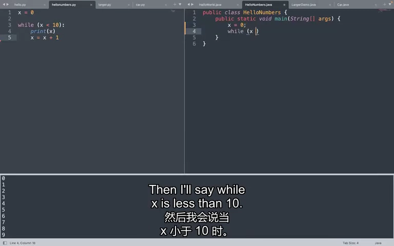 |
| [21:38](https://www.bilibili.com/video/BV1QP4y1u7jv/?p=1&t=1298) 所以Java首先期待的是你必须说i声明有一个变量叫做x它是整数类型的只有在我说X存在之后我真的能用吗所以现在我声明x存在，现在我可以使用它我打印出0到9这就是我的你好数字演示这似乎是一个微小的变化所以现在当我想使用变量时我必须声明它的存在还说是什么类型的这似乎是一个很小的变化但是当你开始在更复杂的程序中使用Java时原来仅仅是这个微小的变化就可以对如何编写程序产生巨大的影响例如在Python中 | 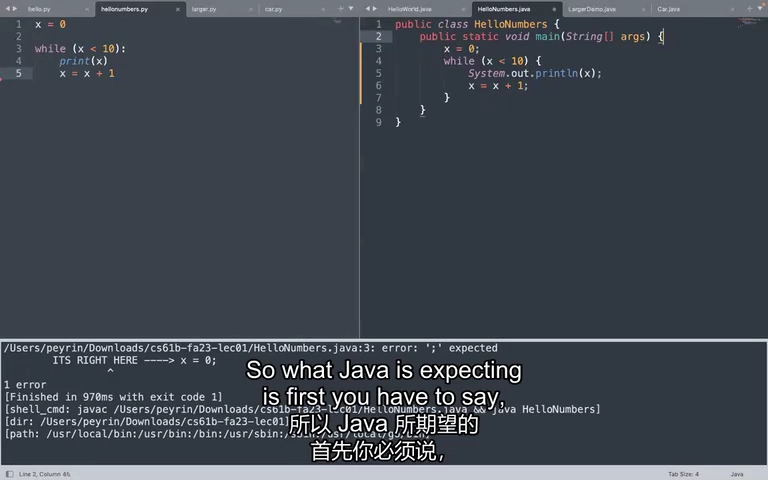 |
| [22:18](https://www.bilibili.com/video/BV1QP4y1u7jv/?p=1&t=1338) 我可以声明变量我想去哪里就去哪里我可以说实际上我认为X是马我可以打印X我买一二三四五六七八九马但如果我在Java中尝试同样的技巧我说我认为X现在应该是马我试着系统点出来点打印线X井爪哇会说你不能这么做你告诉我x是个整数你试着把它重新分配给马你不能那么做那是不相容的类型所以在Java中因为我们宣布我们是一个整数你不能把它重新分配给马即使你试图愚弄Java编译器像这样的小把戏它会说你不能那样做 | 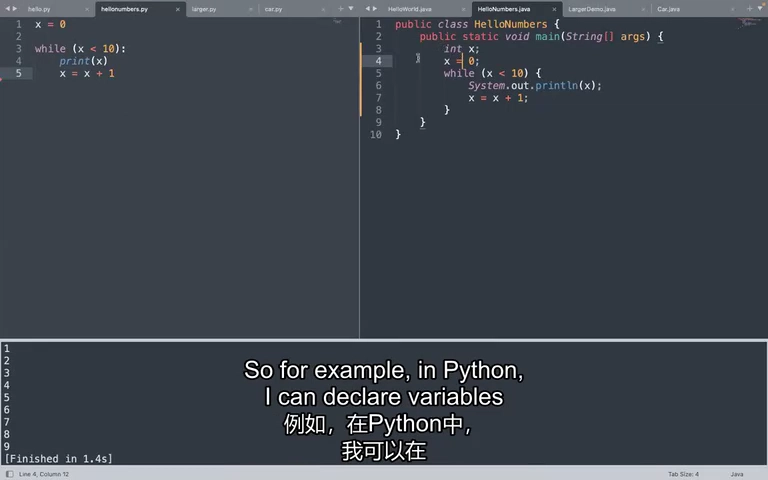 |
| [22:58](https://www.bilibili.com/video/BV1QP4y1u7jv/?p=1&t=1378) 您已经将x声明为整数你不能改变主意它已经是一个整数了好啦所以这似乎是一个微小的变化但对我们如何编写程序有很大的影响 | 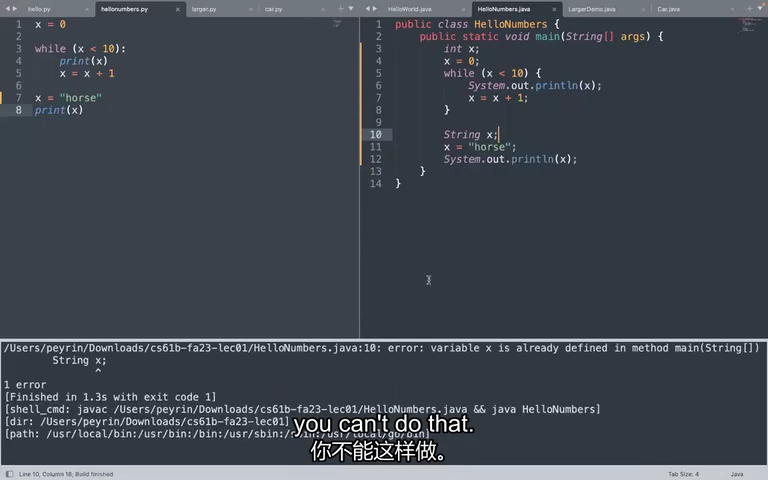 |
| [23:08](https://www.bilibili.com/video/BV1QP4y1u7jv/?p=1&t=1388) 让我们再反思一下所以在使用变量之前 | 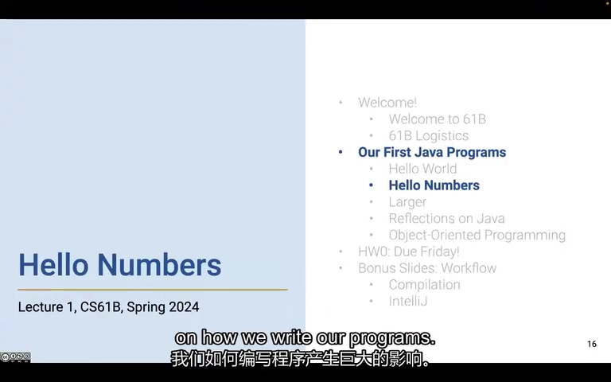 |
| [23:13](https://www.bilibili.com/video/BV1QP4y1u7jv/?p=1&t=1393) 你得声明它的存在当您声明变量时你必须在整数中说出它是什么类型是绳子吗是什么样的变量一旦你宣布永远不会改变所以我们可以在这里做的另一个有趣的观察是 | 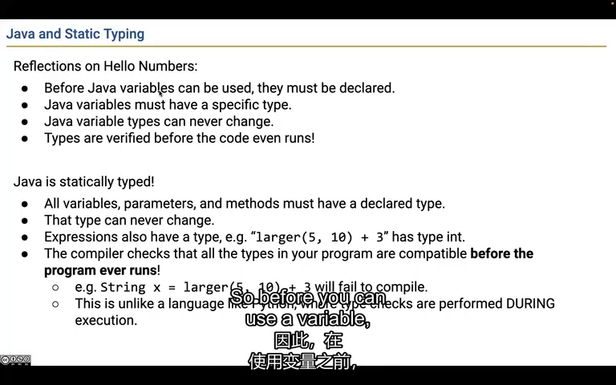 |
| [23:31](https://www.bilibili.com/video/BV1QP4y1u7jv/?p=1&t=1411) 这并不是说类型错误是Java独有的所以是的在这里，马的事情没有汇编 | 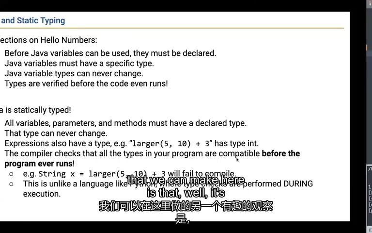 |
| [23:36](https://www.bilibili.com/video/BV1QP4y1u7jv/?p=1&t=1416) 这只是在Java中但是有些东西也不能用Python编译例如如果我试着在蟒蛇里做马加五Python也不会喜欢的上面写着一，二，三，四，五，六，七，八九你不能把马和五相加好啦谢谢你Python在这一边，我也可以试着写马加五你有没有注意到什么有趣的事情这次我还是得到了同样的错误你不能把马和五加在一起但这次代码甚至没有运行所以我甚至看不到零到九在本例中，Java编译器查看代码分析了一下，说我拒绝运行这个代码你有一只紧熊你得先把它修好 | 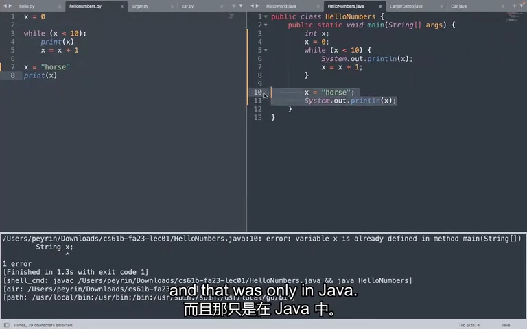 |
| [24:16](https://www.bilibili.com/video/BV1QP4y1u7jv/?p=1&t=1456) 所以这里有一种令人震惊的观察是，程序会检查 | 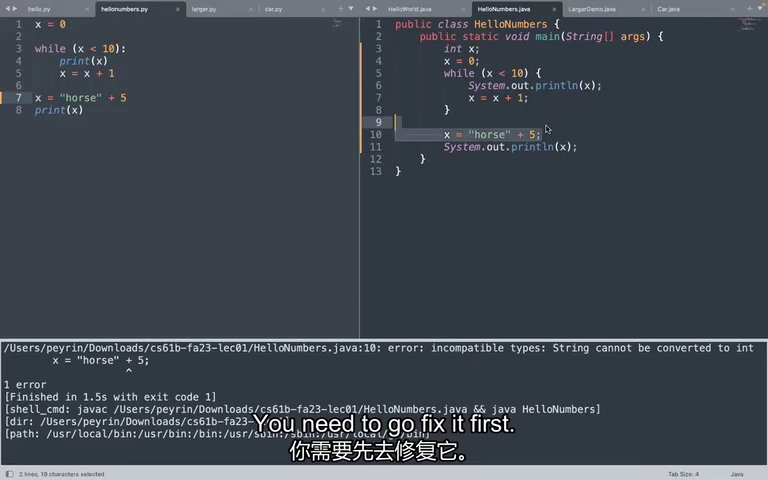 |
| [24:21](https://www.bilibili.com/video/BV1QP4y1u7jv/?p=1&t=1461) 所有的类型都是好的他们在程序运行前就检查出来了这与Python形成鲜明对比在那里你可以运行程序只有当它遇到类型错误时它会崩溃并告诉你出了问题吗这就是Java和Python的区别Java有静态类型您必须声明变量并给它们类型Java会检查它们好啦你不再印象深刻了我要开始玩杂耍了 |  |
| [24:50](https://www.bilibili.com/video/BV1QP4y1u7jv/?p=1&t=1490) 或者是为了得到更多的掌声好啦现在让我们再写一个Python Java比较 |  |
| [24:58](https://www.bilibili.com/video/BV1QP4y1u7jv/?p=1&t=1498) 然后这次我们再做一些反射我要写一个函数所以我要去我的蟒蛇店 |  |
| [25:03](https://www.bilibili.com/video/BV1QP4y1u7jv/?p=1&t=1503) 对不起我的脑子一片空白我会写一个函数所以我会叫它大一点，我会用两个数字传递这将返回x和y中较大的一个所以希望我不会搞砸如果x大于y然后我应该返回x否则我会还你的好了，现在看起来不错让我们试着用它做点什么所以也许我会说我想知道什么较大的在负5到10之间如果我打印，我得到十个因为现在十个大了让我们试着用Java做同样的事情所以我又有了我的等价物空白程序一开始你可能会想在这里写一些更大的东西 |  |
| [25:43](https://www.bilibili.com/video/BV1QP4y1u7jv/?p=1&t=1543) 但你得小心点还记得我们说过所有代码都必须是类的一部分吗而这个在这里不是类的一部分所以如果我想写我的更大的函数它得住在班上我要用咒语我看这个节目而且看起来很好这些字是红色的所以也许我会复制它，希望有好的事情发生，好吗哎呀哎呀我绝对不是故意这么写的好啦所以我会写公共静态然后我会写一个更大的函数名我会通过x和y好啦幸运的是，没有一个助教注意到好啦所以我会写公共静态较大的x和y，然后我会说如果x大于y |  |
| [26:23](https://www.bilibili.com/video/BV1QP4y1u7jv/?p=1&t=1583) 我会还X的否则我会退货你看起来很不错所以，也许我会给它一个机会我会说让我们试着打印出负5和负10中较大的那个如果我编译它我得到了呃啊更多的错误它说得很好你还没告诉我什么是x型你也没告诉我Y型是什么实际上java也想知道较大的函数返回什么变量类型所以Java希望函数的参数有类型和函数的返回值所以我要说x你是个整数为什么你也是整数 |  |
| [27:03](https://www.bilibili.com/video/BV1QP4y1u7jv/?p=1&t=1623) 而且这个功能很好它返回什么它返回一个整数在我这么做之后现在它会告诉我负五和十中的大数是十这是我的第三个演示好啦我搞砸了所以不要鼓掌 |  |
| [27:16](https://www.bilibili.com/video/BV1QP4y1u7jv/?p=1&t=1636) 所以让我们反思一下这次发生了什么所以我们再次看到函数必须作为类的一部分声明 |  |
| [27:21](https://www.bilibili.com/video/BV1QP4y1u7jv/?p=1&t=1641) 因为在Java中一切都要生活在一个阶级里 |  |
| [27:26](https://www.bilibili.com/video/BV1QP4y1u7jv/?p=1&t=1646) 在Java中定义函数的OOPS我们用公共静态这个词 |  |
| [27:31](https://www.bilibili.com/video/BV1QP4y1u7jv/?p=1&t=1651) 我绝对没有拼错过稍后我们会看到不同的方法但这些是你今天可以用的神奇词汇你会注意到当我们定义函数的参数时，比如x和y他们必须有一个声明的类型我们还必须指定什么类型函数的返回值为即函数返回一个整数最后我想说的是Java中的函数只能返回一个值所以你不能尝试 |  |
| [27:56](https://www.bilibili.com/video/BV1QP4y1u7jv/?p=1&t=1676) 大家都在笑我是不是搞砸了什么好啦我的裤子掉下来了 |  |
| [28:01](https://www.bilibili.com/video/BV1QP4y1u7jv/?p=1&t=1681) 或者别的什么好吧很好最后我要注意的是，你只能返回一个值 |  |
| [28:06](https://www.bilibili.com/video/BV1QP4y1u7jv/?p=1&t=1686) 所以你不能像int和其他东西一样返回有什么好笑的我很困惑一点点啊变焦聊天越来越疯狂 |  |
| [28:17](https://www.bilibili.com/video/BV1QP4y1u7jv/?p=1&t=1697) 好啦明白了没有是呀你知道的留到下班后再说好啦好极了所以那是更大的好啦任何关于工作安全的问题好的太好了 |  |
| [28:31](https://www.bilibili.com/video/BV1QP4y1u7jv/?p=1&t=1711) 所以让我们反思一下我们所学到的好吧，我很高兴你们都玩得开心让我们谈谈对Java的反思 |  |
| [28:53](https://www.bilibili.com/video/BV1QP4y1u7jv/?p=1&t=1733) 好吧，你玩得太开心了我要让你有点厌烦关于编译器和解释器的一些东西所以啊这部分如果你有兴趣上面有一段更长的视频但总结是在你运行程序之前编译器将检查程序中的所有类型是否匹配只有在程序被检查后所有类型都吻合程序真的能运行吗那么让我们谈谈你对此有何感想 |  |
| [29:20](https://www.bilibili.com/video/BV1QP4y1u7jv/?p=1&t=1760) 你喜欢那样吗Java程序是静态类型的你不喜欢吗这里没有正确的答案有人喜欢有些人更喜欢Python版本在那里我可以做x相当于马什么的所以这是一个见仁见智的问题这里是我们在Java编程时的一些想法你会形成一些自己的观点你们中的一些人会喜欢的你们中的一些人会鄙视它渴望六十一的日子所以这是一个见仁见智的问题所以我喜欢静态打字的一些地方它捕捉某些类型的错误所以如果你试图给马分配xJava会提前帮你抓住的它使阅读代码变得更加容易因为如果你说x是个整数阅读您的代码的人知道它总是一个整数 |  |
| [30:00](https://www.bilibili.com/video/BV1QP4y1u7jv/?p=1&t=1800) 它还表明，通过静态键入代码，只需稍微快一点所以总的来说Java是一种更快的语言我们不喜欢它的什么地方嗯代码有点长 |  |
| [30:13](https://www.bilibili.com/video/BV1QP4y1u7jv/?p=1&t=1813) 所以你已经看到了你知道正确的你好世界写一个Hello World程序花了七行与Python中的一个相比 |  |
| [30:20](https://www.bilibili.com/video/BV1QP4y1u7jv/?p=1&t=1820) 所以代码往往有点长你必须说更多的话才能得到你想要发生的事情随着课程的进行，我们还将努力解决另一件事但现在可能有一个问题是代码不太通用例如 |  |
| [30:34](https://www.bilibili.com/video/BV1QP4y1u7jv/?p=1&t=1834) 如果我想用更大的函数来比较你知道的像5.5这样的小数节目不会喜欢的所以如果我写五点五程序会说你不能做消极的事情五点五不是整数 |  |
| [30:48](https://www.bilibili.com/video/BV1QP4y1u7jv/?p=1&t=1848) 我也意识到这张幻灯片的标题不见了有人要被解雇了好吧，那里开玩笑的啦 |  |
| [30:56](https://www.bilibili.com/video/BV1QP4y1u7jv/?p=1&t=1856) 好啦关于Java反射的问题还有别的吗？你想知道这件事有趣的部分来了所以这学期我们从零开始做的这部分根据上学期的一些反馈所以你们是历史上第一个看到这部分内容的人如果我们搞砸了我们会一起搞砸的好啦所以让我们来看看所以面向对象编程 |  |
| [31:18](https://www.bilibili.com/video/BV1QP4y1u7jv/?p=1&t=1878) 希望这都是60年代的回顾希望它会无聊到流泪但如果没有，我们再过一遍只是为了确保我们都在同一页上希望你以前见过面向对象编程是组织程序的模型它给了我们两个非常好的功能其中之一就是模块化我可以构建程序的一部分，而不用担心其余部分我可以建立我程序的另一部分而不用担心其余的到最后，他们都会以这种美丽的方式结合在一起这边请我不必同时担心整个计划我可以一次构建一些小块，然后把它们放在一起这将允许我建造非常大的复杂的东西它对数据抽象也很好 |  |
| [31:58](https://www.bilibili.com/video/BV1QP4y1u7jv/?p=1&t=1918) 希望这是另一个来自61年的想法这里的想法是你可以与一个物体交互在不知道其内部实现的情况下这是一个伟大的想法，我们会一遍又一遍地回到在这门课上那么什么是物体呢希望再次有点熟悉从61 A或CS 88一个对象将把信息和相关行为捆绑在一起我们的想法是这个物体可以跟踪一些信息您还可以通过调用对象上的方法来与对象交互我们如何很好地构建对象我们给一个班打分这就像是我们如何创造一个全新物体的蓝图然后我可以写代码来创建该类的实例 |  |
| [32:38](https://www.bilibili.com/video/BV1QP4y1u7jv/?p=1&t=1958) 所以我知道这一切听起来很抽象所以我会跳进去写演示如果你想知道为什么这一切听起来如此熟悉这是因为我完全剽窃了这张幻灯片所以谢谢你约翰，请不要举报我 |  |
| [32:51](https://www.bilibili.com/video/BV1QP4y1u7jv/?p=1&t=1971) 好啦现在呢让我们在编写代码时经常编写一些面向对象的代码 |  |
| [32:56](https://www.bilibili.com/video/BV1QP4y1u7jv/?p=1&t=1976) 我们想编写代码来建模现实世界的特征所以我将尝试编写一个类，为对象建模在现实世界中所以我选择了制造一辆车你可以选择做其他的东西我想在你的作业或其他东西里我要写一堂课给汽车做模型所以我会说是豪华车好啦我要写的第一件事是一个构造函数，听起来有点熟悉也许不是构造函数告诉我们如何从头开始创建一个全新的对象所以如果有人说我想要一辆新车嗯这辆车的特性是什么我如何设置汽车当有人第一次创造它时所以让我们写一些代码来第一次设置我的全新汽车 |  |
| [33:36](https://www.bilibili.com/video/BV1QP4y1u7jv/?p=1&t=2016) 所以在Java中Python中的魔法或抱歉创造一辆新车的神奇词汇是init方法这是构造函数构造函数可以接受其他参数如果你想所以说我要给它一个额外的论点现在我可以开始设置实例变量这辆车有所以当我第一次安装新车时它的性质是什么当汽车第一次启动时所以也许这辆车会有我不知道像一个模特那么今年是哪一年呢？这是什么车？这可能是用户作为论据提供的东西当他们第一次创造汽车时汽车还有什么我不知道你怎么样我觉得大多数车都有轮子所以也许我会说当你第一次做新车的时候 |  |
| [34:16](https://www.bilibili.com/video/BV1QP4y1u7jv/?p=1&t=2056) 它有四个轮子看起来是辆不错的车这就是我如何用Python建造一辆新车这只是蓝图所以我实际上没有做任何卡片我只是在为汽车类的未来用户写一个模板从零开始打造全新汽车好吧，现在让我们用Java来做所以在Java中我要写公共车厢我们知道这些是以前又一次的神奇话语我要写一个构造函数它告诉我如何从零开始创造一辆全新的汽车在这一点上，语法将变得有点混乱所以不要太担心每一个具体的单词和字母只要你对如何我在创建和处理对象 |  |
| [34:56](https://www.bilibili.com/video/BV1QP4y1u7jv/?p=1&t=2096) 那你应该都准备好了所以让我们来做一辆新车或者让我们为如何制造一辆新车写一个方法所以我会写公共汽车所以在这里我没有使用神奇的词我用的是同一个类的名字这是车再一次我可以给它一些像m这样的论点，我会说而不是说自我它是对这里正在创建的当前car对象的引用我要说的是它是被引用的当前对象的Java专用单词我会说好啦您的模型是用户指定的任何内容你有四个轮子所以盯着这个从你的你知道的二十分钟的Java在这里似乎有点不对劲有几件事不对 |  |
| [35:36](https://www.bilibili.com/video/BV1QP4y1u7jv/?p=1&t=2136) 一件事是，如果我声明有一个变量m我得告诉你是哪种类型它不像Python所以我不得不说我是一根弦事实上，如果我试着编译这个它会抱怨说其实呢我都不知道什么是轮子我不知道什么型号如果在Java中有实例变量这些也要申报你得说一辆车有什么一辆车有型号它是一根绳子汽车还有什么它有很多轮子那是四个所以我已经写了我的蓝图，有人将如何创造一辆全新的汽车在这个过程中，我还定义了实例变量，告诉我我的新车有什么特点 |  |
| [36:16](https://www.bilibili.com/video/BV1QP4y1u7jv/?p=1&t=2176) 你也可以在这里吃其他东西你本可以我不知道你知道颜色你可以有司机你想要什么都行但是今天模型和轮子对建造者的问题它是如何制造的 |  |
| [36:26](https://www.bilibili.com/video/BV1QP4y1u7jv/?p=1&t=2186) 好啦如果你离开我有一张幻灯片，上面写着我刚才说 |  |
| [36:31](https://www.bilibili.com/video/BV1QP4y1u7jv/?p=1&t=2191) 好啦我们继续走所以我造了我的新车或者写了一个方法或构造器告诉我如何创建一辆新车 |  |
| [36:36](https://www.bilibili.com/video/BV1QP4y1u7jv/?p=1&t=2196) 但我希望这辆车能做一些事情所以让我们让汽车做一些事情汽车做的一些事情是什么驱动好啦才华横溢让我们对这辆车有一个很好的驾驶方法汽车应该如何开好我会有点懒我要让车发出噪音表示它在开车所以也许我会说好车要开走了你花了几千块钱才来的听我说车去房间好的好啦看起来还不错但有一个问题很好 |  |
| [37:16](https://www.bilibili.com/video/BV1QP4y1u7jv/?p=1&t=2236) 我不知道你怎么样但我的理解是汽车只能如果他们有足够数量的轮子所以我要加一点如果声明说实际上如果现在的车所以说当我说自己的轮子我指的是当前被引用的汽车因为这是我想创造的所有汽车的蓝图如果少于四个轮子这辆车不应该开我应该让用户知道所以说我该怎么说呢我该怎么说呢好的，我听到了很多建议谁给我一个 |  |
| [37:56](https://www.bilibili.com/video/BV1QP4y1u7jv/?p=1&t=2276) 看起来不错我喜欢好吧所以这是我的有我的功能了我会试着用Java写同样的东西所以下次我会再讲一些神奇的词汇来定义一个函数这次我说开车，它不接受任何争论如果这个轮子少于4个这意味着这辆车不能去房间所以我们会告诉用户这辆车没有空间好啦不，去吧，太好了否则，这辆车的车轮数量是正确的所以我们可以让它开车所以我们会让它去房间哎呀，这个点模型去房间好啦看起来很不错 |  |
| [38:36](https://www.bilibili.com/video/BV1QP4y1u7jv/?p=1&t=2316) 所以这是我的模型，或者又是我的驱动功能我们必须解决一件小事在Java中还记得当我写一个函数时我得告诉你那个函数返回什么在本例中，驱动器函数没有返回任何内容它为用户打印东西但它实际上没有返回值我要指出的是那就是用神奇的词虚空这意味着什么都不会归还这是我的驱动功能看起来很不错所以让我们想想汽车还能做得很好在构建类时，您可能需要做的一件事也许我希望用户能够告诉我或者我希望用户能够请求这辆车有几个轮子也许他们应该知道 |  |
| [39:16](https://www.bilibili.com/video/BV1QP4y1u7jv/?p=1&t=2356) 也许我会写一个函数就像告诉我这辆车有几个轮子好啦有功能它该怎么办它应该告诉我车上有多少个轮子让我们用Java公共语言再写一次我得说函数在这里返回什么它将返回一个整数因为轮子的数量是一个整数我会说得到num车轮好吧，它会返回车轮的数量好啦看起来还不错所以这一切看起来都很好我的车好像你知道起作用了它在开车它在发出声音这是房间但也许我们可以用物体做的另一件事是我们可以操纵他们的状态所以当人们调用对象上的函数或方法时 |  |
| [39:56](https://www.bilibili.com/video/BV1QP4y1u7jv/?p=1&t=2396) 您还可以更改对象的行为方式或者您可以更改对象的状态所以这里有一些我不建议做的事情但这是你可以用你的车做的事情你可以做的一件事就是你可以把它开进沟里，我不建议这么做但如果你把它开进沟里你会失去一些轮子所以不是个好主意但这是你可以做的也许当你这么做的时候你的车会掉几个轮子所以我会说自我点轮子减去不管有多少轮子用户说你又开进这条沟里输了我可以用Java写同样的东西我可以说公众很好此函数实际上并不返回任何内容所以我会说void表示低返回值 |  |
| [40:36](https://www.bilibili.com/video/BV1QP4y1u7jv/?p=1&t=2436) 它要开进沟里去了它将再次损失车轮的数量我必须说int，因为我必须指定什么类型好啦当我把车开进沟里时会发生什么当轮子的数量减少不管有多少轮子用户告诉我他们输了好的看起来不错所以现在除了使汽车的功能你知道房间和东西，制造噪音汽车也可以修改其实例变量例如当你开进沟里的时候看起来很不错在我开始用车之前还有什么问题吗好啦问题一 |  |
| [41:16](https://www.bilibili.com/video/BV1QP4y1u7jv/?p=1&t=2476) 是呀这是个好问题我应该写另一个声明吗我可以我也可以在这里放一张退货单让它早点结束这是一个很好的观点因为如果车停了它不应该通过好啦其他问题再来一个我说的是自我吗代替这个啊这就是用两种语言编程的特点立刻你应该找个时间试试不是很好玩好啦你必须公开的其他问题一个公共的，在字符串和int的左侧哎呦这是一个很好的观点所以如果你愿意，你可以当我们谈论更多的课程时，我们会讨论这个问题但它更多的是一种句法上的怪癖，而不是对象的基础 |  |
| [41:56](https://www.bilibili.com/video/BV1QP4y1u7jv/?p=1&t=2516) 接得好虽然其他渔获物好啦我再拿一个其他人都在变焦我不太明白这个问题你能再说一遍吗但声音更大哎呦你在问发生了什么如果我不把这个这有点超出了今天的范围所以也许之后来问我们但是今天两者都可以好问题虽然所以我又做了我的车这是一张汽车应该如何运行的蓝图 |  |
| [42:36](https://www.bilibili.com/video/BV1QP4y1u7jv/?p=1&t=2556) 告诉我开车的事告诉我车的属性现在终于到了用车的时候了所以我要出去买一辆新车在想象中好啦所以我说c1等于我要做一辆新车我去叫工程车现在我不得不通过一场争论这辆车希望我告诉这辆新车是什么型号所以我不是汽车专家所以得有人告诉我我们的新款CS 601B是什么型号的？我做对了什么公民型R好啦我相信你的话，好吗？ |  |
| [43:16](https://www.bilibili.com/video/BV1QP4y1u7jv/?p=1&t=2596) 好啦但我今天感觉很慷慨我就像61年的奥普拉所以你得到了第二张卡那么你的第二辆车是什么所以你走到摄像机前好啦我给你一辆车你却开了两辆非常豪华的车好啦好啦我们做了两辆车他们看起来很不错所以现在我们可以开始使用它们所以也许我们可以开着我们的思域R出去兜兜风好啦挺好的也许你知道我们有点笨拙我们把我们的公民型酒吧开进沟里它失去了几个轮子呃哦然后我以后再试着开一次好的看起来很不错 |  |
| [43:56](https://www.bilibili.com/video/BV1QP4y1u7jv/?p=1&t=2636) 最后我要补充一点，也许我很好奇在我把我的思域型酒吧开进沟里后丰田卡斯蒂尔还有轮子吗所以我会把它打印出来看看它有多少个轮子我敢肯定人们在缩放聊天中进行了精彩的讨论好的很好这是我的演示我会运行它，只是为了确保它的工作上面写着市民酒吧因为是我开的然后因为我把它开进了沟里第二次不行但有一件事你会注意到，我创造的第二张牌丰田凯美瑞只有或仍然有四个轮子因为我从没把它开进沟里所以这些物体正在更新它们的内部状态 |  |
| [44:36](https://www.bilibili.com/video/BV1QP4y1u7jv/?p=1&t=2676) 当我对它们调用函数时挺酷的好啦我想用Java再写一个既然你们都坐立不安然后我们就收工了所以在Java中我想把代码写在这里但我不能那样做，因为这是在课外所以在Java中这段代码就像类之外的我不能把它放在课外所以它必须住在缅因州我没时间了吗人们越来越坐立不安不过时请不要啊我还没过时啊哈我把你囚禁了几分钟牛逼好啦没关系的他们对他们对汽车不感兴趣好啦 |  |
| [45:16](https://www.bilibili.com/video/BV1QP4y1u7jv/?p=1&t=2716) 我要写我要写汽车的方法好啦所以我会说C1等于今天太吵了好的很好所以好吧我的第一辆车好的很好没有车离开的人没有车好啦那个认识的人实际上会把车送人但现在不是了好吧，好吧，我会写汽车我要第一辆就像以前一样不是很有趣我要让第一辆再开进沟里然后我们看看之后它还会不会干就像以前一样只是为了确保改变第一个不会改变第二个我去看看第二辆车有多少 |  |
| [45:56](https://www.bilibili.com/video/BV1QP4y1u7jv/?p=1&t=2756) 以防万一这几乎是正确的我得解决两个句法上的小怪癖其中之一是当我想使用C1和C2变量时我该怎么办我必须声明他们的存在所以我不得不说我声明有一个变量叫做cone，我可以容纳一辆车还有一个可变的C2可以容纳一辆车只有在我写完之后，我才能使用这两个变量Java中的最后一件小事如果您正在创建一个新对象Java需要知道您正在创建一个新对象所以你给它一个新的关键字再说一遍，这些都是句法上的小怪癖你会习惯的当您编写更多Java时但笑点是 |  |
| [46:36](https://www.bilibili.com/video/BV1QP4y1u7jv/?p=1&t=2796) 我用java和java写的我的城市型Argo房间然后在没有空间的地方四点钟等一下等一下我还有一样东西要给你看 |  |
| [46:44](https://www.bilibili.com/video/BV1QP4y1u7jv/?p=1&t=2804) 你这么坐立不安好吧，我们讨论了方法方法是对象的花哨名称 |  |
| [46:49](https://www.bilibili.com/video/BV1QP4y1u7jv/?p=1&t=2809) 住在一个班级里你来到这里如果你想被允许我们应该早点把你踢出去 |  |
| [46:57](https://www.bilibili.com/video/BV1QP4y1u7jv/?p=1&t=2817) 好的，在Java中我要注意的最后一件事是您可能会被this关键字混淆因为在Java中事实证明Java是一种相当聪明的语言 |  |
| [47:06](https://www.bilibili.com/video/BV1QP4y1u7jv/?p=1&t=2826) 事实上，如果你真的去掉这个点你只是说Wheels Java很聪明它意识到在这个班上只有一种东西叫轮子就在那儿所以这也会很好所以说除非在特殊情况下，您有多个具有相同名称或其他东西的变量混淆this点语法 |  |
| [47:30](https://www.bilibili.com/video/BV1QP4y1u7jv/?p=1&t=2850) 其实有点可有可无人们总是被它迷惑这是你的幻灯片完全清楚 |  |
| [47:35](https://www.bilibili.com/video/BV1QP4y1u7jv/?p=1&t=2855) 好啦我想我在最初的演示中使用了气体这一次是轮子脱落哦好吧 |  |
| [47:40](https://www.bilibili.com/video/BV1QP4y1u7jv/?p=1&t=2860) 好啦我们讨论了如何创建一个对象X有代码我想我也选了本田思域 |  |
| [47:45](https://www.bilibili.com/video/BV1QP4y1u7jv/?p=1&t=2865) 所以我们都是你知道的一起用我们的扶贫车我们讨论了如何使用点表示法访问对象所以你可以说c就是那辆车然后是一个点然后访问方法 |  |
| [47:58](https://www.bilibili.com/video/BV1QP4y1u7jv/?p=1&t=2878) 好的你们走之前的最后一件事你看过我写了很多Java我也不指望你出去开始给汽车编程就因为你看了我的节目所以为了习惯Java |  |
| [48:09](https://www.bilibili.com/video/BV1QP4y1u7jv/?p=1&t=2889) 你得自己写一些所以你今天的第一件事就是回家写一些Java我们星期五再来我们会再写一些Java好的再见因为这个原因 |  |
| [48:29](https://www.bilibili.com/video/BV1QP4y1u7jv/?p=1&t=2909) 有什么问题那么为什么我们不需要声明一个静态变量呢因为我们已经宣布 |  |
| [48:49](https://www.bilibili.com/video/BV1QP4y1u7jv/?p=1&t=2929) （此区间无字幕） |  |
