# 2. Defining and Using Classes：画面与字幕对照

来源：[B 站第 6 集](https://www.bilibili.com/video/BV1QP4y1u7jv/?p=6)；Spring 2024，整理日期 2026-11-01。

[原始字幕](../subtitles/Lecture02.srt)。字幕来自 Kedou 对指定分 P 的解析，可能含识别或翻译错误；原文保留以便核查，学习笔记对术语和推导另作修正。

## 中文阅读导引

下表是按内容整理的阅读路标，时间定位到相关课堂画面；详细中文解释见[学习笔记](../notes/Lecture02_类实例与交互式调试.md)。下面的原始字幕保留原貌，不能当作已校正的逐字稿。

| 时间 | 主要内容 |
|---|---|
| [08:00](https://www.bilibili.com/video/BV1QP4y1u7jv/?p=6&t=480) | 对象差异应该成为字段，而不是复制出很多类 |
| [11:00](https://www.bilibili.com/video/BV1QP4y1u7jv/?p=6&t=660) | static 方法没有隐含的当前实例 |
| [17:00](https://www.bilibili.com/video/BV1QP4y1u7jv/?p=6&t=1020) | 声明、创建对象和赋值是三个动作 |
| [23:00](https://www.bilibili.com/video/BV1QP4y1u7jv/?p=6&t=1380) | 工具方法与实例方法都能比较狗，调用方式不同 |
| [29:00](https://www.bilibili.com/video/BV1QP4y1u7jv/?p=6&t=1740) | static 字段属于类，但不自动成为常量 |
| [32:00](https://www.bilibili.com/video/BV1QP4y1u7jv/?p=6&t=1920) | 先写出期望行为，再打开调试器 |
| [41:00](https://www.bilibili.com/video/BV1QP4y1u7jv/?p=6&t=2460) | Step Into 与 Step Over 用来控制观察粒度 |
| [47:00](https://www.bilibili.com/video/BV1QP4y1u7jv/?p=6&t=2820) | 找到最早的错误判断，通常比检查最后结果更有效 |

## 原始字幕与画面对照

| 时间与原始字幕 | 画面 |
|---|---|
| [00:00](https://www.bilibili.com/video/BV1QP4y1u7jv/?p=6&t=0) 好啦哈喽欢迎回来很抱歉上次弄得这么乱希望今天不会那么混乱呃如果你刚进来这边有更多的座位所以请走吧穿过另一个入口呃举起手来如果你旁边有座位那是开着的那边的座位怎么样这边没有座位显然人们会喜欢那个入口尤其是好啦我们开始吧欢迎回来 | 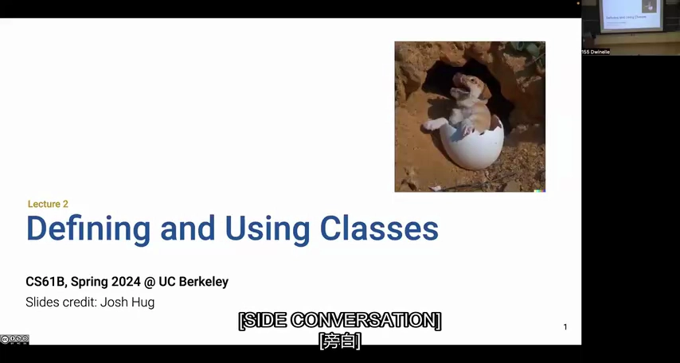 |
| [00:32](https://www.bilibili.com/video/BV1QP4y1u7jv/?p=6&t=32) 所以今天我们要讨论定义和使用类我希望你很兴奋所以让我们直接进入情报 | 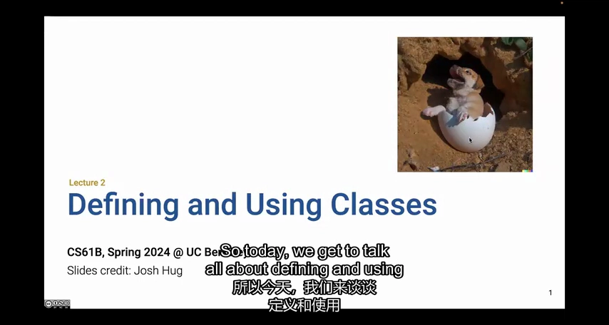 |
| [00:37](https://www.bilibili.com/video/BV1QP4y1u7jv/?p=6&t=37) 哪个是我们选择的编程平台 | 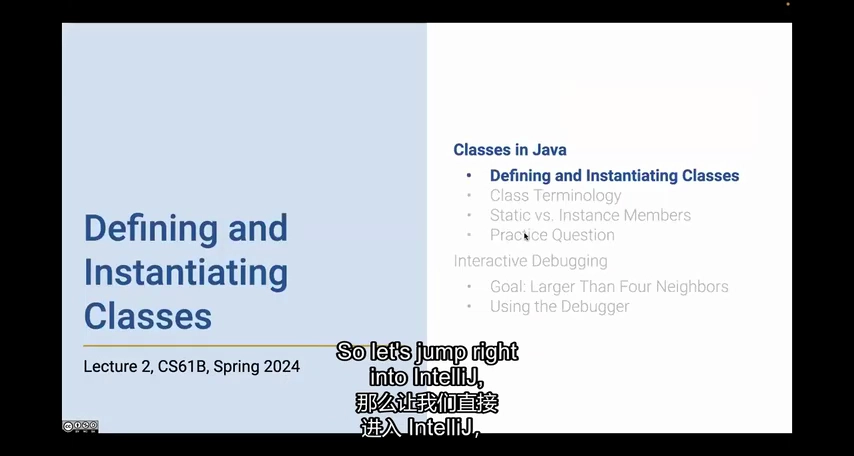 |
| [00:42](https://www.bilibili.com/video/BV1QP4y1u7jv/?p=6&t=42) 希望你能把它安置在一号实验室所以我们将从为狗定义一个方法开始所以我会说公共静态哎呀哎呀制造噪音我会让它说这次发生了什么我忘了写返回值所以制造噪音什么都不回上面说狗叫现在如果我想让狗真的说吠好呢我可以说公共静态虚空主我们知道代码就在那里因为所有代码都必须存在于一个类中现在我可以说制造噪音希望当我跑的时候会发生什么 | 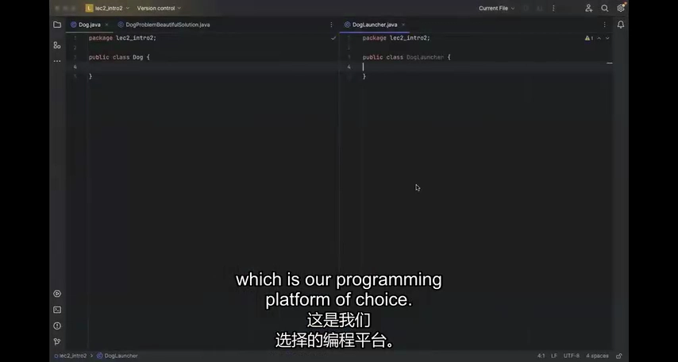 |
| [01:22](https://www.bilibili.com/video/BV1QP4y1u7jv/?p=6&t=82) 这是我的狗会去如果有人进来找座位啊哈好啦这是意料之外的好啦就是这个东西你要在一号实验室完成我肯定不像我很明显如果你修好了我再试一次我会让我的狗随时为你吠叫真的没事我忘了评论了对不起忙碌的一天我还得为今天的讲座设置一个全新的部分只为你 | 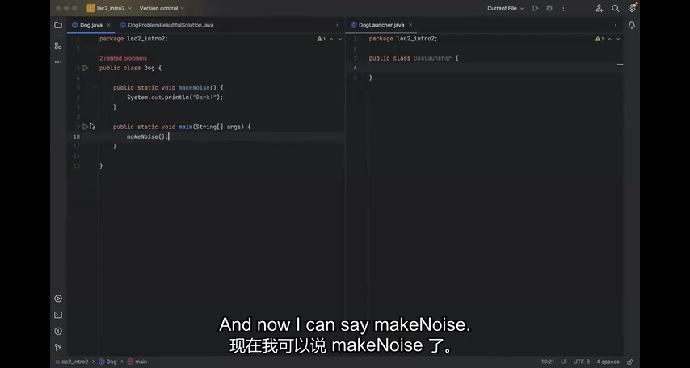 |
| [02:02](https://www.bilibili.com/video/BV1QP4y1u7jv/?p=6&t=122) 它还想要什么好啦再试一次我们可以稍后在帖子中编辑出来对呀这样人们就看不到了好啦举起手来如果你旁边有座位还是没事你看，就在这里他刚刚离开了右边没关系好啦所以好吧我们的狗在设置问题后去了公园我们的狗开始叫了那太好了好啦但有时我们可能想让另一个班的狗叫所以在这里，不是让狗在狗课上吠叫我可以创建一个不同的类叫做狗发射器所以每只狗都应该被推出在我的狗发射器课上我可以有一个主要的方法这就是我在函数之外的代码所在的地方而不是在这里说制造噪音 | 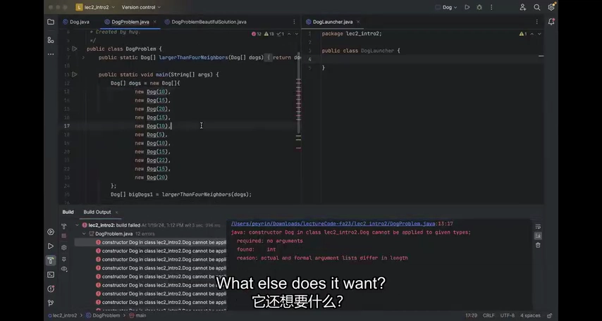 |
| [02:42](https://www.bilibili.com/video/BV1QP4y1u7jv/?p=6&t=162) 我实际上要写狗的噪音我之所以说狗不制造噪音是因为制造噪音法它不属于狗发射器类它生活在狗类所以我说去上狗课找到make noise方法并调用make noise方法让我们知道如果我运行这个我又被树皮咬了但这次我是从另一个班叫的这真的很好因为能够把我复杂的代码分成不同的类我将如何能够采取真正复杂的程序把它们分解成小块 | 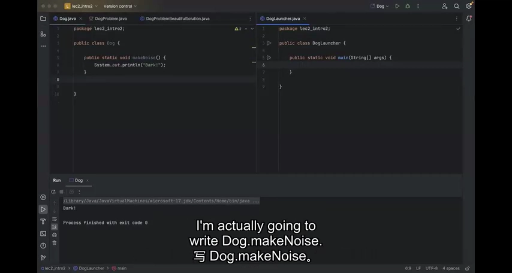 |
| [03:16](https://www.bilibili.com/video/BV1QP4y1u7jv/?p=6&t=196) 所以让我们反思一下刚刚发生的事情就像我们上次看到的每个方法都必须在一个类中 | 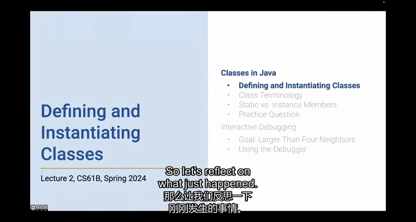 |
| [03:21](https://www.bilibili.com/video/BV1QP4y1u7jv/?p=6&t=201) 所有代码都必须在一个类中如果我想运行一个程序我得有一个主要的方法当我运行那个程序时主要方法是执行什么你会注意到的是 | 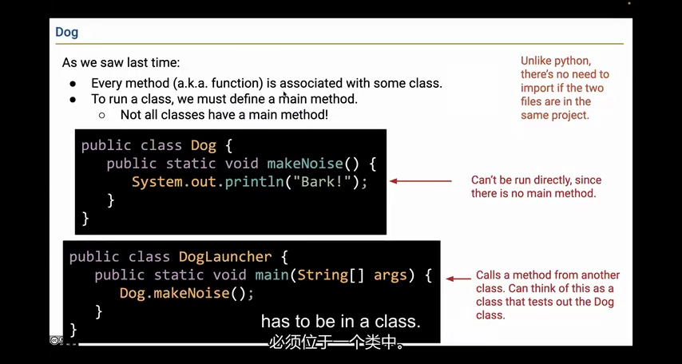 |
| [03:33](https://www.bilibili.com/video/BV1QP4y1u7jv/?p=6&t=213) 当我把狗的主要方法拿出来放进狗发射器时现在这个狗类不再有一个main方法我不能运行它你看智能环境就像没有绿色箭头你不能再运行这个程序了因为没有更多的雨不过没关系我还可以运行狗发射器中的主要方法 | 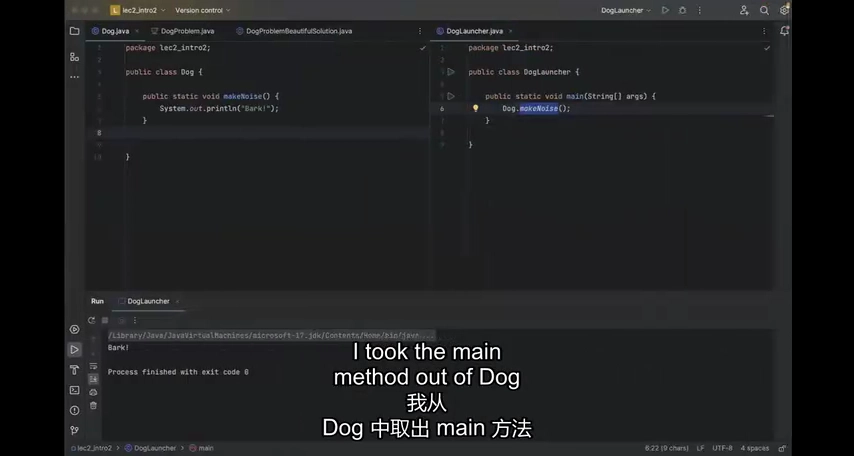 |
| [03:50](https://www.bilibili.com/video/BV1QP4y1u7jv/?p=6&t=230) 我今天的第一个演示但到目前为止还有什么问题刚才有个破碎的问题你必须喜欢哪里咄咄逼人地向左挥手嗨是呀有没有一个哦是的 | 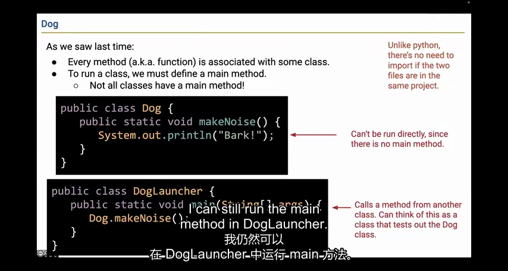 |
| [04:07](https://www.bilibili.com/video/BV1QP4y1u7jv/?p=6&t=247) 放大那是一个伟大的这是一个很好的观点让我们做它的观点我希望它在这里 | 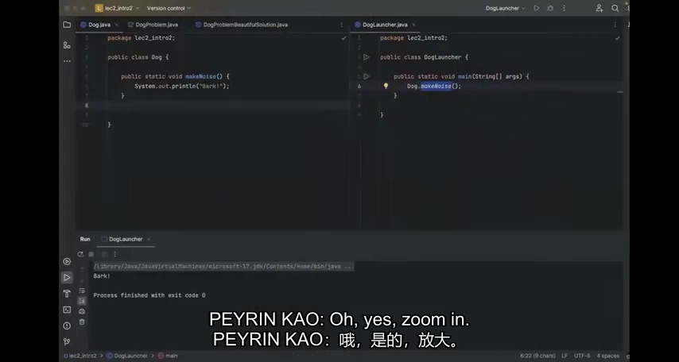 |
| [04:12](https://www.bilibili.com/video/BV1QP4y1u7jv/?p=6&t=252) 贾斯汀如何放大不在视野中啊哈增加字体大小好啦我增加 | 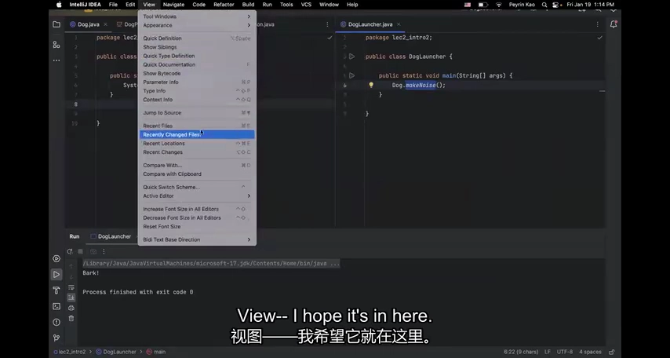 |
| [04:20](https://www.bilibili.com/video/BV1QP4y1u7jv/?p=6&t=260) 我增加告诉我当我增加我增加我们好吗我们有曲棍球好吧好吧没关系 | 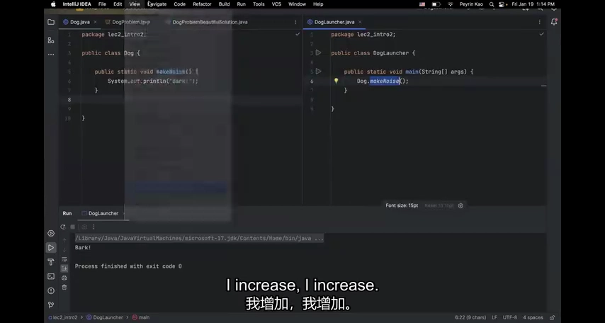 |
| [04:29](https://www.bilibili.com/video/BV1QP4y1u7jv/?p=6&t=269) 是什么再来一次哦好吧什么是曲棍球是控制换档 | 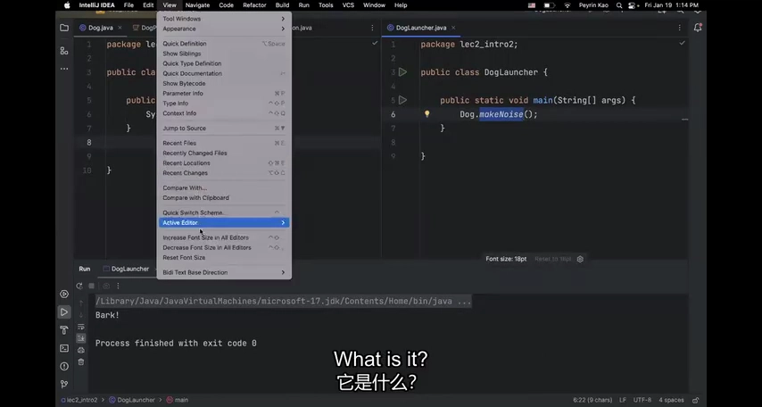 |
| [04:37](https://www.bilibili.com/video/BV1QP4y1u7jv/?p=6&t=277) 好啦你还想要多少怎么样？我认为那很好好啦是啊，是啊我不认为我们能把它做得更大好啦美丽好啦所以我们做了我们的狗演示 | 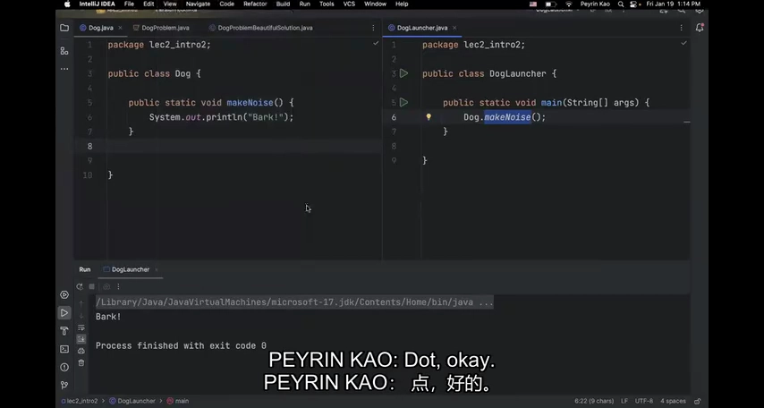 |
| [04:49](https://www.bilibili.com/video/BV1QP4y1u7jv/?p=6&t=289) 我们回去了我们把文本放大了各种好东西好啦但是有一个问题 | 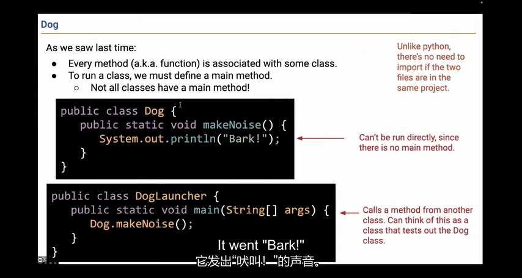 |
| [04:54](https://www.bilibili.com/video/BV1QP4y1u7jv/?p=6&t=294) 不是所有的狗都生来平等所以说例如我希望这个音频能用 | 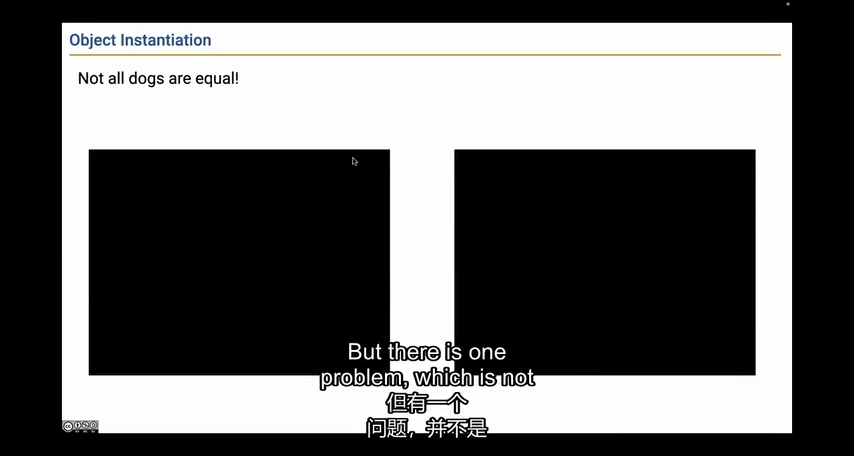 |
| [04:59](https://www.bilibili.com/video/BV1QP4y1u7jv/?p=6&t=299) 左边有一只狗哦不 | 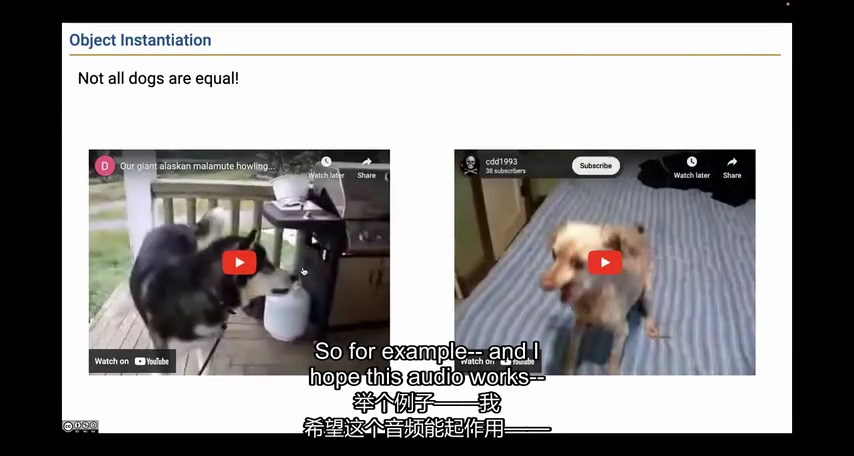 |
| [05:04](https://www.bilibili.com/video/BV1QP4y1u7jv/?p=6&t=304) 没有声音贾斯汀我的音频呢让我们看看它要去一个好啦我再试一次没有声音否有音频它只是在网上发给每个人那么我如何亲自把它交给人们呢我想让人们亲耳听到据说我们被告知把麦克风放在好的旁边这听起来不是很令人兴奋，以确保你把它关掉因为我们不小心忘了关掉音频，没有注意到音频在哪里我告诉过你我们应该这么做我们以前做的方式声音不好一点都不好玩我想听听这部分 | 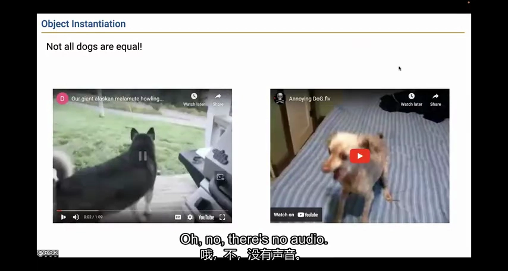 |
| [05:44](https://www.bilibili.com/video/BV1QP4y1u7jv/?p=6&t=344) 好啦我来弹贾斯汀今天将为我们做音频好啦所以不是所有的狗都是平等的例如这只巨大的阿拉斯加雪橇犬发出这种声音 | 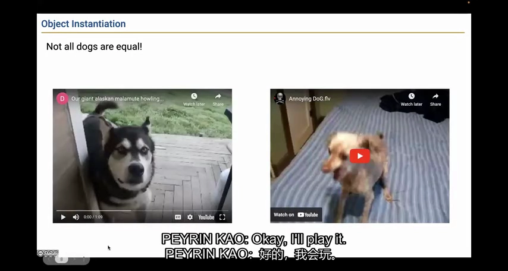 |
| [05:54](https://www.bilibili.com/video/BV1QP4y1u7jv/?p=6&t=354) 哦该死好啦谢谢。贾斯汀·美丽 | 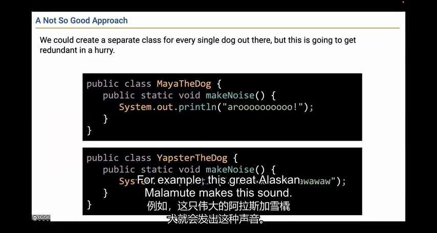 |
| [05:59](https://www.bilibili.com/video/BV1QP4y1u7jv/?p=6&t=359) 好啦 | 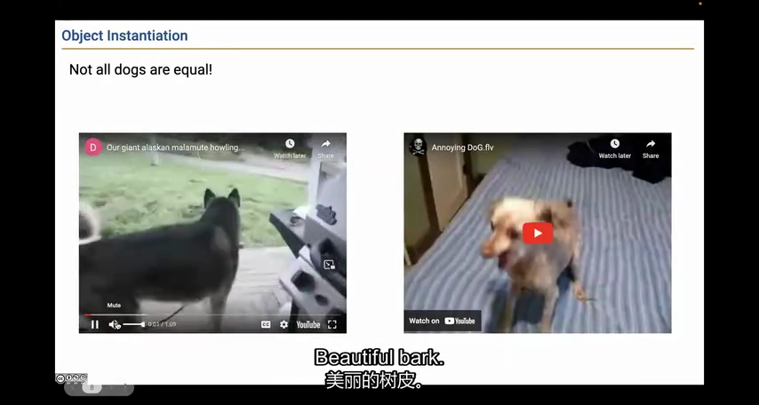 |
| [06:04](https://www.bilibili.com/video/BV1QP4y1u7jv/?p=6&t=364) 右边是狗吗它发出这种声音 | 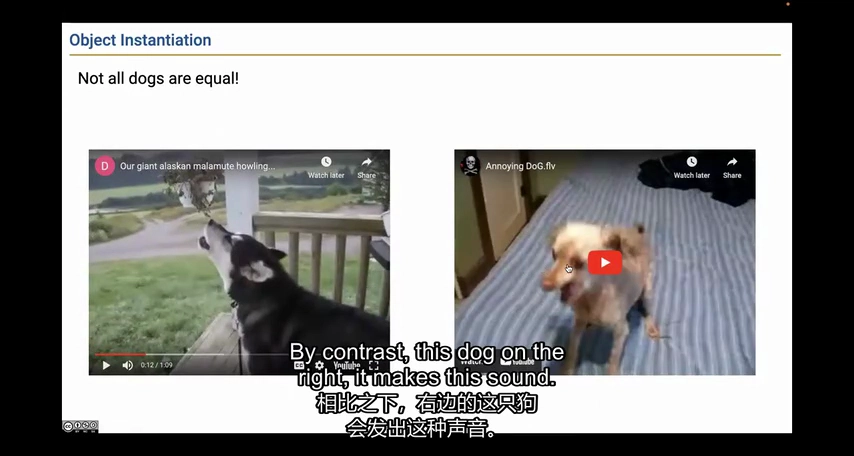 |
| [06:09](https://www.bilibili.com/video/BV1QP4y1u7jv/?p=6&t=369) 好啦谢谢。贾斯汀好啦所以说 | 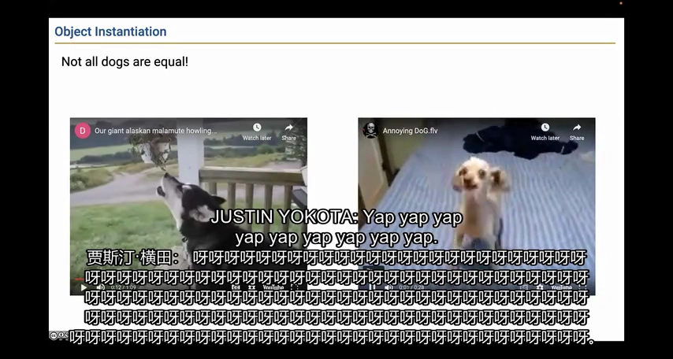 |
| [06:14](https://www.bilibili.com/video/BV1QP4y1u7jv/?p=6&t=374) 所有这些都是说不同的狗发出不同的声音所以当我们编写方法和类时我们经常想模拟现实世界的特征所以也许我们希望不同的狗叫得不同 | 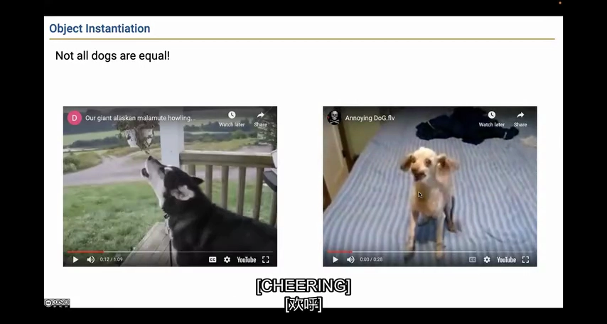 |
| [06:33](https://www.bilibili.com/video/BV1QP4y1u7jv/?p=6&t=393) 例如，我可以建模的一种方式这是说嗯有些狗像玛雅狗他们会发出声音的但是其他的狗比如雅斯特狗我不知道那只狗的名字但我们会叫它yapster它在右边发出这种可怕的声音这样我就可以为每只狗做一个不同的类但这很快就会变得多余所以我想找到一个更好的解决办法更好的解决方案是我们上次看到的但这次我们会说得很清楚类不仅可以包含代码但也有数据 | 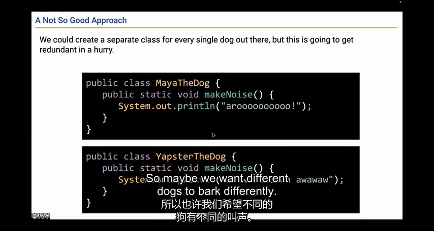 |
| [07:07](https://www.bilibili.com/video/BV1QP4y1u7jv/?p=6&t=427) 那么我这么说是什么意思让我们在这里，让我们给狗一个实例变量所以现在狗的每个实例都可以有一个不同的值作为它的实例变量我要选择的变量是一个叫做Oops的整数重量（磅）这将告诉我我创造的每只狗有多重当我创造不同的狗它们可以有不同的重量和磅以磅计所以现在我能做的就是我可以说你知道吗不是所有的狗都会叫事实上狗回去的方式取决于它的体重所以我可以说如果以磅为单位的重量小于10磅它是一只非常小的狗所以也许我会让它说你知道的叶 | 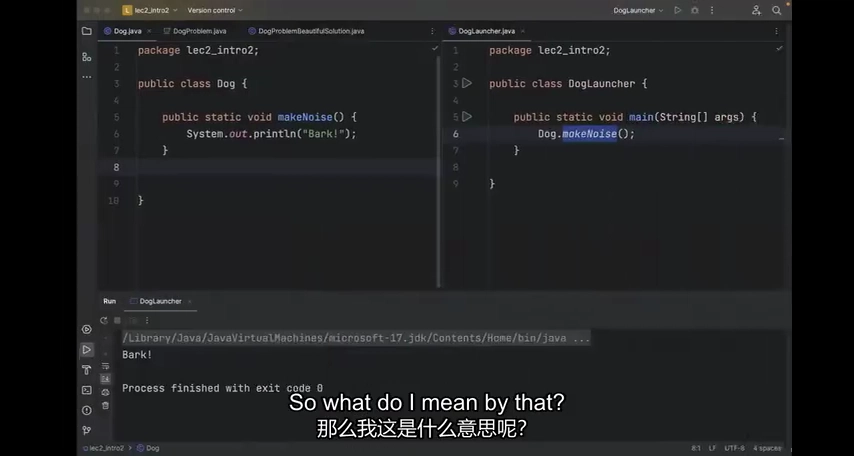 |
| [07:47](https://www.bilibili.com/video/BV1QP4y1u7jv/?p=6&t=467) 是的，是的是的，是的好啦所以它是非常小的狗但如果狗稍微大一点呢如果以磅为单位的重量小于三十岁吧好啦也许它就像一只中等大小的狗，所有的东西都在叫否则，如果它甚至大于30好大一只狗它会有早些时候那种雄伟的声音所以现在我有这个制造噪音的方法做一些不同的事情取决于我路过的狗或者叫制造噪音法的狗但是有个小问题它在抱怨Java Intellij有所有这些红色符号它说非静态字段不能从静态上下文引用有点神秘所以解决办法并不是说它立即显而易见 | 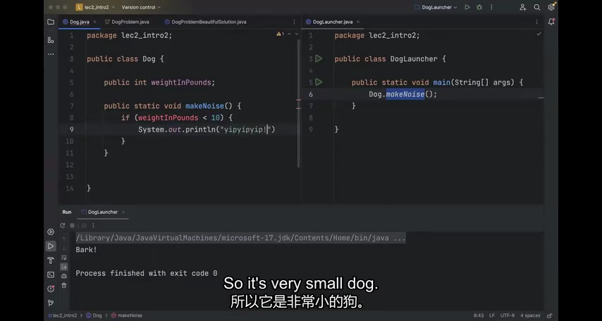 |
| [08:27](https://www.bilibili.com/video/BV1QP4y1u7jv/?p=6&t=507) 但我们要使用的修复方法是我们要删除静态这个词，然后突然是啊，是啊好啦这里的人可以这样变焦吗有一点回声 | 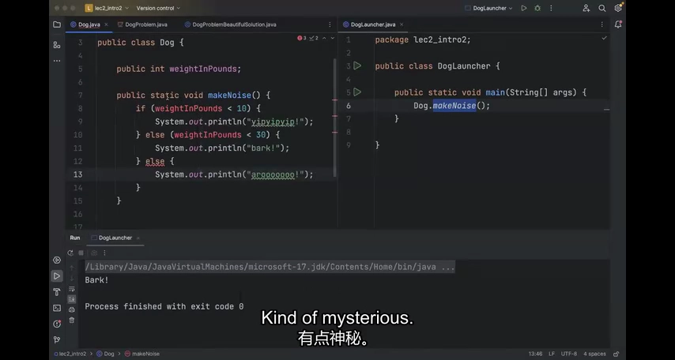 |
| [09:07](https://www.bilibili.com/video/BV1QP4y1u7jv/?p=6&t=547) 有点尴尬为什么会有回声如果有蓝色那不是有意的喜欢是下次的工作我们不再使用缩放基础设施了太复杂了好啦好啦每个人都要超级沉默这样变焦的人就可以在没有静电的情况下听到好啦当我移除静电时，我可以回到吗显然没事当我移除静电时，我会回到所以我添加了静态这个词为什么我在回声里听到自己我不知道我是说哦等一下等一下 | 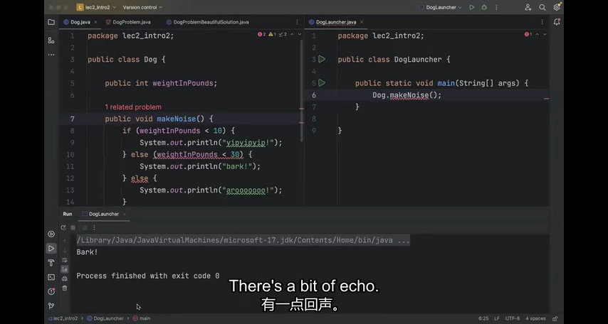 |
| [09:47](https://www.bilibili.com/video/BV1QP4y1u7jv/?p=6&t=587) 麦克风怎么样你关掉麦克风了吗你什么意思我关掉麦克风了吗你关掉麦克风哦，我明白了，你想让我把这东西完全关掉是呀好啦好啦现在怎么样我听不到自己的声音是呀好了好了我想是又不是完全死了好啦是啊，是啊没人告诉我好啦每个人都必须非常安静所以变焦的人真的能听到我后面的人真的能听到我好啦我会喜欢等待为什么为什么我听不到自己的声音你什么意思好啦也许不是很好好啦我们试试看我们看看会发生什么我还是觉得但我能听到自己的声音除非我产生幻觉否好啦我就这样吧我们继续走所以我有静态这个词 | 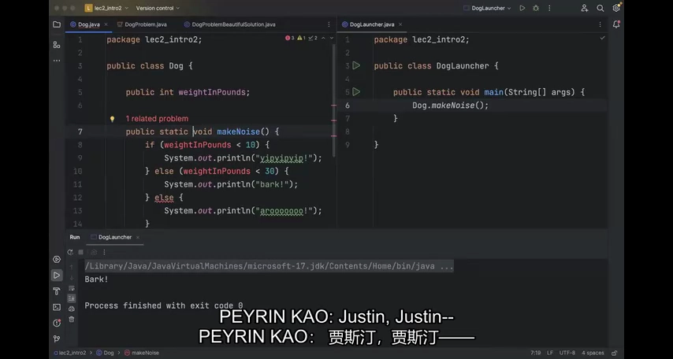 |
| [10:27](https://www.bilibili.com/video/BV1QP4y1u7jv/?p=6&t=627) 我把它处理掉了狗狗班现在很开心好啦不过这边还是有问题那就是我仍然觉得我听到了自己贾斯汀本人没有自负不能上网但有足够的东西我想我得继续说下去，我得喜欢听听我自己 | 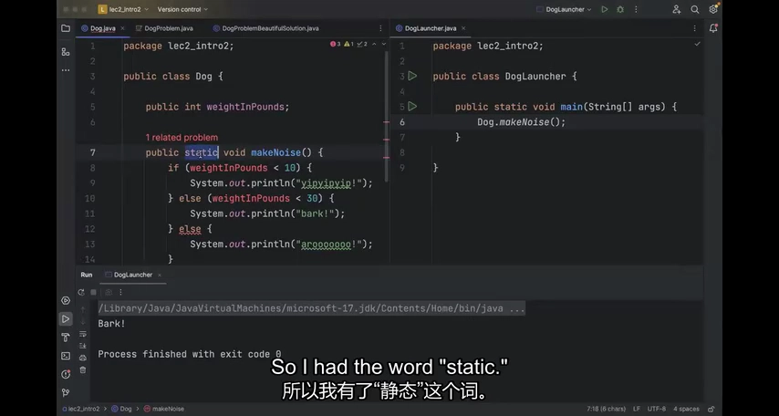 |
| [11:07](https://www.bilibili.com/video/BV1QP4y1u7jv/?p=6&t=667) 有点有点迷糊但希望我们能忍受然后贾斯汀会在我们等待的时候做一些技术支持好啦是啊，是啊我想没问题第三天上课，我已经疯了好吧，就像我之前说的，我被如此粗鲁地打断了我们有静态这个词爪哇在抱怨修复并不非常明显但我删除了静态这个词至少博士课现在没问题了然而，在狗发射器方面仍然有一个问题特别是在狗发射器方面上面写着哎呀哎呀忘了这个词如果狗发射器那边上面写着不不能从静态上下文引用静态方法您可能会再次试图删除静态这个词 | 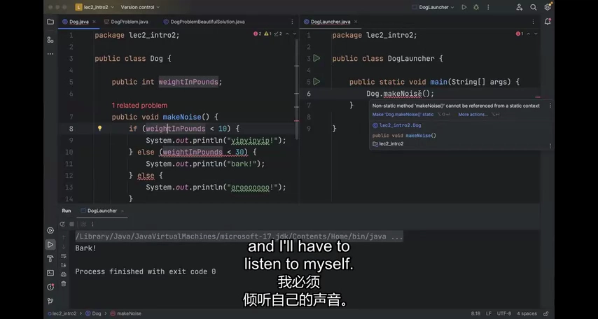 |
| [11:47](https://www.bilibili.com/video/BV1QP4y1u7jv/?p=6&t=707) 事实证明这不是这里的解决办法这里的解决方案是我们实际上需要一个特定的医生来制造噪音所以这行代码说的是狗是如何发出噪音的这是一个关于所有狗的通用问题但你可以在这里看到制造噪声法它预计一个特定的码头会发出噪音因为它询问的是特定狗的体重（以磅为单位）所以要解决这个问题我实际上要创建一个狗的实例这是我们上次看到的新语法所以我会说狗d等于新的狗，我会说它创造了一只全新的狗那我就说这只新来的狗有磅重 | 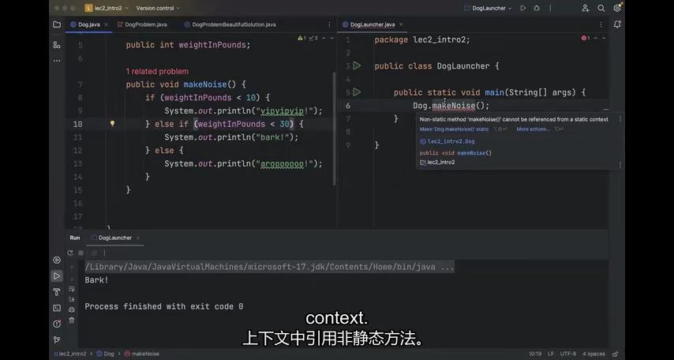 |
| [12:27](https://www.bilibili.com/video/BV1QP4y1u7jv/?p=6&t=747) 就20英镑吧然后现在代替狗不要发出声音上面说所有的狗是怎么发出噪音的我要说别制造噪音这是如此微妙的区别但这将会有很大的不同你知道我们是怎么写代码的所以现在因为我没有制造噪音代码正在编译当我运行狗发射器时我会让我20磅重的狗狂吠上面写着树皮如果我把它改成你知道，就像一百英镑非常大的狗顺便说一句，它应该会给我整个阿鲁的声音我们能把投影中的设置拿出来吗贾斯汀技术支持好啦谢谢你好啦 | 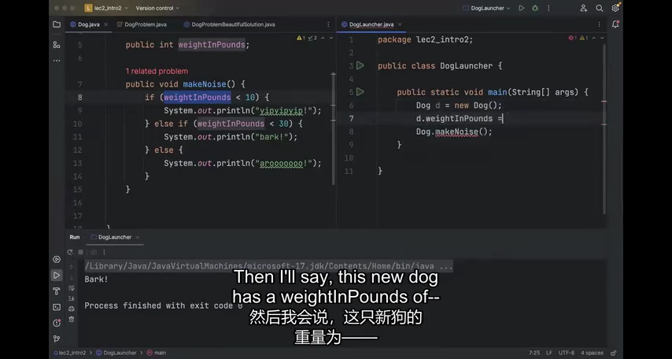 |
| [13:07](https://www.bilibili.com/video/BV1QP4y1u7jv/?p=6&t=787) 所以如果我把体重换成100磅我把之前漂亮的箭头拿下来所以主要的区别在于所有的狗是怎么发出噪音的我有个问题我有一只特别的狗它的磅重是一百磅它是怎么发出噪音的我要做的最后一个小修正是如果你熟悉面向对象编程您可能认识到，像这样设置实例变量并不常见事实上，更常见的方法是编写构造函数有点像我们上次看到的我们会说这个构造函数这是如何创造全新狗的蓝图它将接受一场争论然后我们把重量设为磅等于这个论点 | 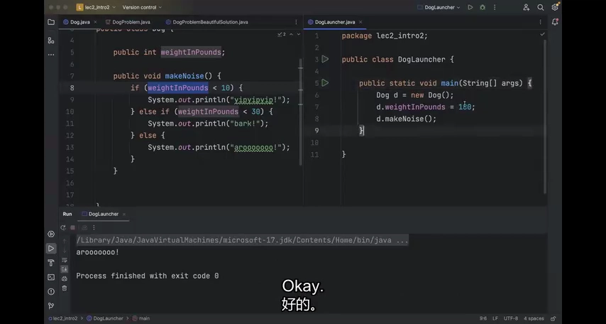 |
| [13:47](https://www.bilibili.com/video/BV1QP4y1u7jv/?p=6&t=827) 所以现在当我创造新的狗我可以直接进去它是一条100磅重的狗我让狗发出噪音它给了我之前美丽的诡计让我们反思一下发生了什么 | 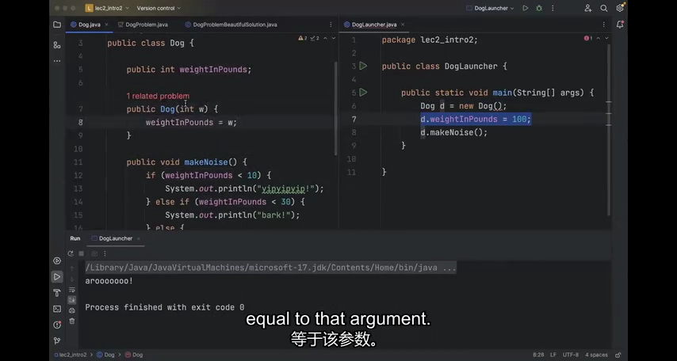 |
| [14:00](https://www.bilibili.com/video/BV1QP4y1u7jv/?p=6&t=840) 也许不是技术难度的部分但是Java部分好啦所以我们看到类不仅可以包含函数和方法 | 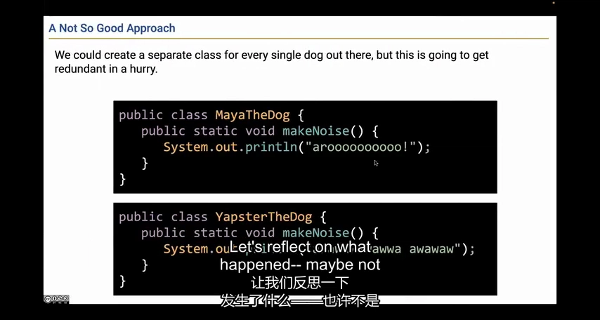 |
| [14:05](https://www.bilibili.com/video/BV1QP4y1u7jv/?p=6&t=845) 也是数据所以我们加入了体重和磅变量然后不只是叫狗，而是制造噪音我们创造了特定的狗然后我们让特定的狗发出声音 | 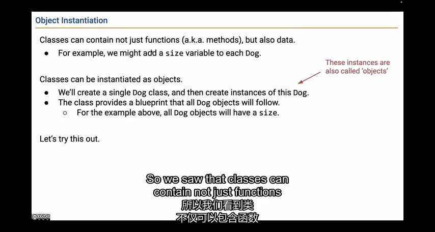 |
| [14:18](https://www.bilibili.com/video/BV1QP4y1u7jv/?p=6&t=858) 这是之前的代码如果您对Python版本感到好奇 | 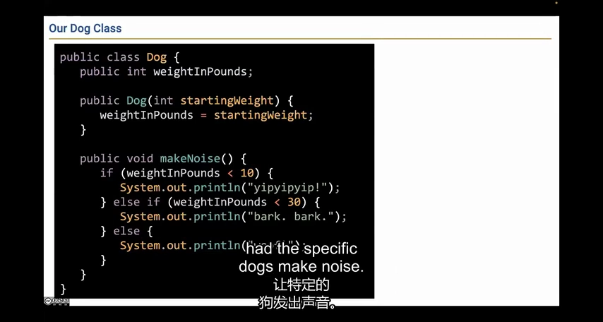 |
| [14:23](https://www.bilibili.com/video/BV1QP4y1u7jv/?p=6&t=863) 在幻灯片上好啦我刚刚经历了很多事情因此，让我们通过一些条款，以确保我们都可以谈论这一点 | 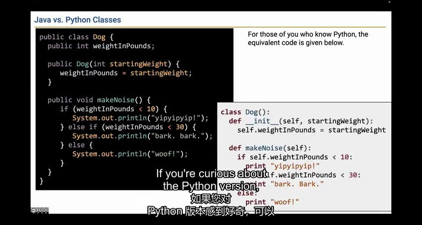 |
| [14:28](https://www.bilibili.com/video/BV1QP4y1u7jv/?p=6&t=868) 使用相同的语言我们刚才看到了什么 | 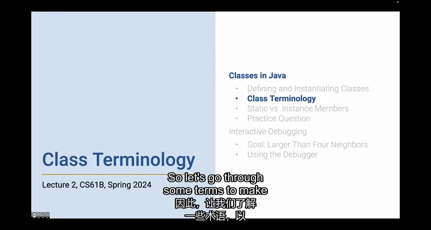 |
| [14:33](https://www.bilibili.com/video/BV1QP4y1u7jv/?p=6&t=873) 嗯我们看到我在dog类中创建了一个实例变量这就像所有狗的属性所以我可以说我创造的每只狗都有自己的体重好啦但后来我们看到我写了一个构造函数这就像是如何创造新的狗的蓝图这是我可以写的一种特殊方法与类同名这就是我如何在这里创造全新的狗当我创造一只全新的狗我所要做的就是把它的重量以磅为单位但你也可以用其他方式设置狗如果你的狗有其他属性所以也许你的狗也有一个身高它有你知道的腿数它有最喜欢的食物意大利最受欢迎的城市你想要什么都行狗也可以有其他实例变量 | 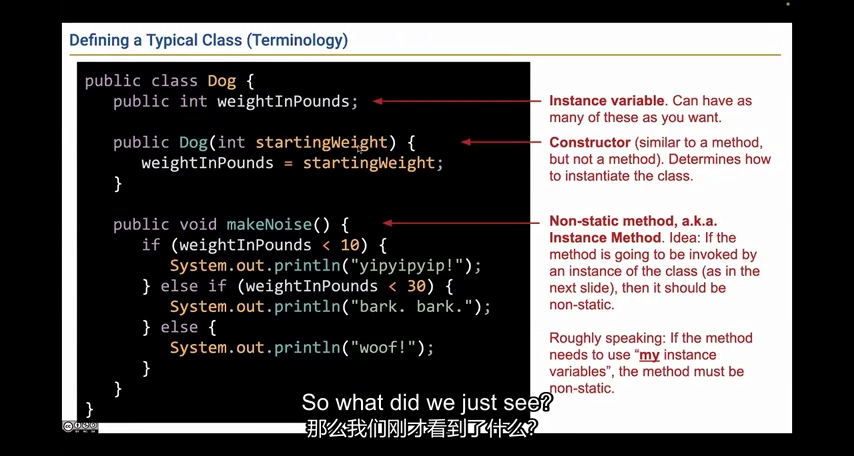 |
| [15:13](https://www.bilibili.com/video/BV1QP4y1u7jv/?p=6&t=913) 最后我们有了这个制造噪音的方法当我去掉静态这个词时发生的事情是，这个方法现在是一个实例方法所以与其问问题就像狗是怎么发出噪音的那是个问题那是所有狗的通用用途曾经我现在有一个方法可以说这只特定的狗玛雅狗让你吵闹还是胡说八道狗让你吵闹粗略地说如果这不是在某种程度上完全下沉你可以考虑一下这个制造噪音的方法当它是非静态的时候它必须参考我的体重有肉所以当我读到这个函数时我不得不说当我的体重在10磅以下然后是的是的是的，是的当我的体重低于30磅 | 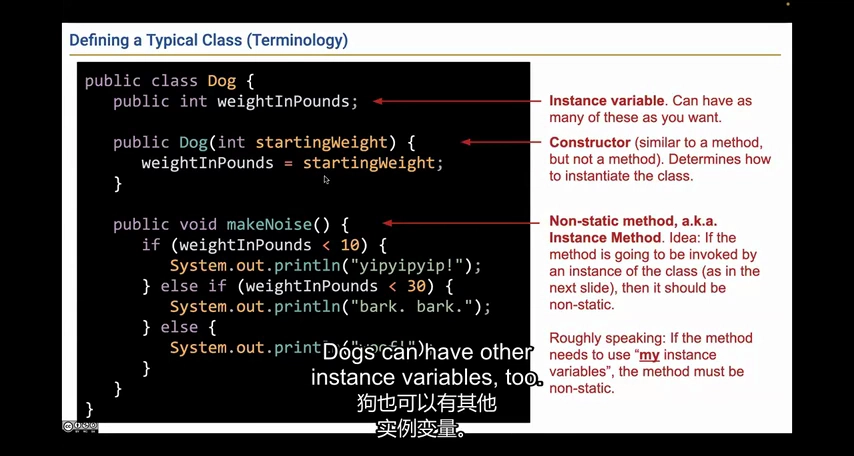 |
| [15:53](https://www.bilibili.com/video/BV1QP4y1u7jv/?p=6&t=953) 然后汪汪汪所以因为我必须引用一个我我必须创建dog变量的一个实例来使用它所以这个方法必须是非静态的所以这只是你可能会看到的一些词汇当我们通过课堂提问时我必须大声点或任何其他技术困难 | 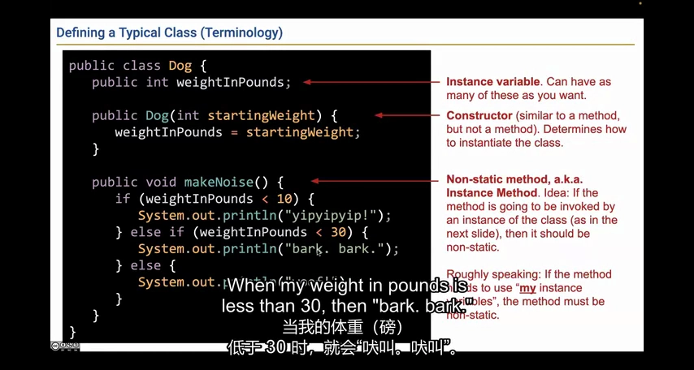 |
| [16:13](https://www.bilibili.com/video/BV1QP4y1u7jv/?p=6&t=973) 好极了所以这些都是我们以前见过的东西我们说过类可以实例化所以现在当我创建或者当我想调用这个制造噪音的方法时我必须创造一只全新的狗我得把它的重量定在磅上然后我可以让它发出很大的声音 | 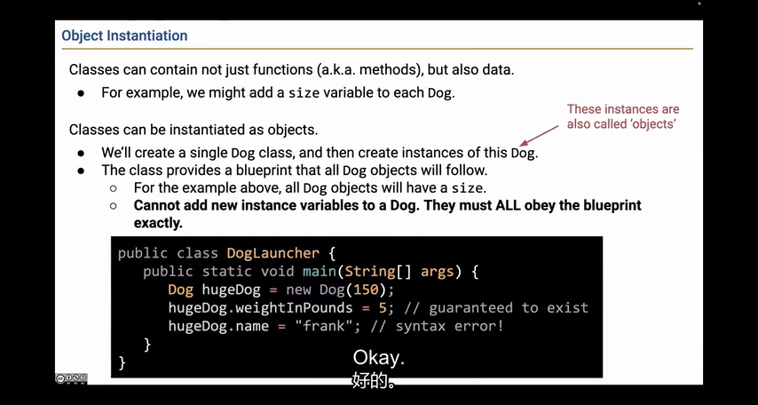 |
| [16:29](https://www.bilibili.com/video/BV1QP4y1u7jv/?p=6&t=989) 这里有更多的词汇然后我就完成了今天的词汇那么创造一只全新的狗的语法是什么让我们深入研究一下再来一点点所以我们看到当我创造一只新的狗时首先发生了几件事我必须声明有一个类型为小型狗的变量它是狗的类型所以变量的名字是小狗是狗的类型因为在Java中，在我使用变量之前我首先要声明变量存在所以这一行代码它宣称有一个变量叫小狗我做的另一件事是我写了这个特别的关键字new我们下次再见构造函数中的这个关键字 | 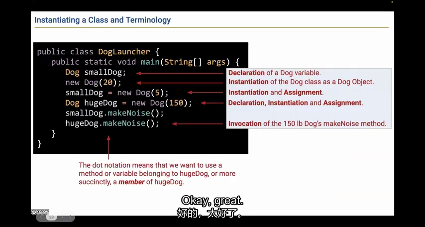 |
| [17:09](https://www.bilibili.com/video/BV1QP4y1u7jv/?p=6&t=1029) 这就是我如何实例化这是一种花哨的说法我从零开始创造了一只全新的狗所以以前没有狗当我说新来的狗从零开始创建了一个全新的狗对象但是第二行的问题我没有在任何地方救过这只狗它从来没有被分配给变量所以因为这只狗是被创造出来的但没有提到它它会被垃圾收集器毁掉的非常可怕的术语如果您实例化并创建一个dog对象，就会发生这种情况但你不把它赋值给任何变量相比之下如果你看下一行我在实例化和说让我从哪里创造一只全新的五号狗 | 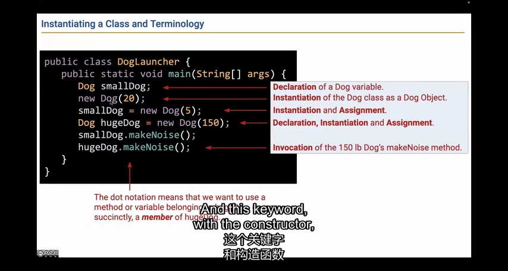 |
| [17:49](https://www.bilibili.com/video/BV1QP4y1u7jv/?p=6&t=1069) 但让我也把它分配给小狗变量所以现在这只狗可以用它的新名字来称呼了是小狗终于有时你们会一起做这一切这是我们之前的代码行它实际上在做三件事尽管它看起来不像是在做那么多事情那我在这里做什么我首先声明有一个变量叫做大狗狗巨狗然后我正在创建一个全新的狗对象说新狗150最后，我指派这只全新的狗我创造了一个叫做大狗的变量现在我做到了我的狗能发出噪音所以只要一点词汇当你看到这样一条线 | 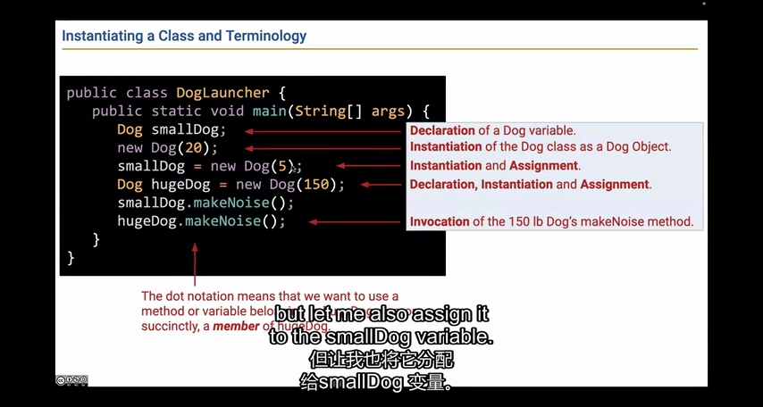 |
| [18:29](https://www.bilibili.com/video/BV1QP4y1u7jv/?p=6&t=1109) 您正在声明变量您正在创建新对象然后将新对象分配给变量你刚刚说听起来不错好啦 |  |
| [18:40](https://www.bilibili.com/video/BV1QP4y1u7jv/?p=6&t=1120) 有一个关于加薪的快速通知万一零号项目需要它但上面有录像我们可能落后很多因为我花了那么多时间产生幻觉 |  |
| [18:47](https://www.bilibili.com/video/BV1QP4y1u7jv/?p=6&t=1127) 所以我就跳过它就目前而言 |  |
| [18:52](https://www.bilibili.com/video/BV1QP4y1u7jv/?p=6&t=1132) 好极了所以让我们挖掘更多可以理解的是，静态的东西有点令人困惑所以我会再多说一点那么静态方法和非静态方法有什么区别呢这个词到底是什么意思所以我想的是当您的方法是静态的这个方法对所有的狗都是通用的这就像一个关于所有狗的问题所以如果我必须描述这个方法我要说的是狗是怎么发出噪音的这是一个关于所有狗的问题，而不是任何特定的狗为了使用静态方法我将使用类名调用它，就像我们之前看到的那样所以我会说狗课狗的蓝图请告诉我狗是怎么发出声音的 |  |
| [19:32](https://www.bilibili.com/video/BV1QP4y1u7jv/?p=6&t=1172) 相比之下如果我有一个非静态方法非静态方法是特定于一只狗的所以这可能是玛雅你怎么发出噪音或叫声或狗你怎么制造噪音这是狗特有的因为您会注意到它引用了自己的实例变量所以在这里我们不得不说如果我的体重在10磅以下我玛雅如果我的体重在10磅以下然后一叶叶是的，是的我如何使用这个非静态方法我不能再说狗是如何发出噪音的因为我在问一只特定的狗所以我不得不说有一只全新的狗叫玛雅玛雅发出你的声音在这种情况下，玛雅会去汪汪 |  |
| [20:12](https://www.bilibili.com/video/BV1QP4y1u7jv/?p=6&t=1212) 所以当我添加静态这个词时它对所有的狗都是通用的当我没有静态这个词的时候那么它是特定于一只狗的如果我试着把这个方法放在正确的静态上如果我试着在这里添加静态这个词我们之前看到的是行不通的它会抱怨和说好这不可能是静态的因为它指的是一只特定的狗如果方法是静态的然后它在想所有的狗这就是静态和非静态的关键区别这是你通过练习会更适应的事情之一但这是一种高层次的概述 |  |
| [20:45](https://www.bilibili.com/video/BV1QP4y1u7jv/?p=6&t=1245) 那么静态方法首先有什么意义呢似乎非静态方法更强大 |  |
| [20:50](https://www.bilibili.com/video/BV1QP4y1u7jv/?p=6&t=1250) 因为在非静态方法中，我可以使用以磅为单位的比重但是在静态方法中，我不能用磅为单位的重量因为一般用途的狗它们没有具体的磅重那么静态方法有什么意义呢 |  |
| [21:03](https://www.bilibili.com/video/BV1QP4y1u7jv/?p=6&t=1263) 嗯，有时有些类根本没有实例化例如Java中有一门课叫数学如果我想在数学课上使用方法说像数学课这样的东西要好得多数学的蓝图有一种叫做圆的方法所以我可以说数学请大约五点六这比说像这样的事情更有意义让我们创造一个新的数学不管那是什么意思然后问具体的数学到五点六左右创建特定的地图意味着什么更合理的说法是让我们来了解一下第五轮第六轮的数学概论这就是为什么您可能希望使用静态方法的原因之一 |  |
| [21:43](https://www.bilibili.com/video/BV1QP4y1u7jv/?p=6&t=1303) 就像我们现在看到的在同一个类中也可以有静态和非静态方法所以让我们再来看看情报 |  |
| [21:50](https://www.bilibili.com/video/BV1QP4y1u7jv/?p=6&t=1310) 让我们编写一些静态和非静态的方法以确保我们知道发生了什么好啦所以我要做的是我要写一个方法来比较两只狗我要用两种不同的方式来写我要写静态版本然后我要写非静态版本所以首先我要写一个静态版本，比较两只狗所以这将是一个静态函数它对所有的狗都是通用的所以你可以把它想象成狗的蓝图有一套关于如何比较两只狗的小说明所以我会说啊一只狗两只狗所以它把两只狗作为论据我可以说如果第一只狗比第二只狗重 |  |
| [22:30](https://www.bilibili.com/video/BV1QP4y1u7jv/?p=6&t=1350) 那我就把第一条狗还给你否则我就把第二只狗还给你这是一个静态方法这意味着什么呢？当它是静态方法时这意味着当我调用这个方法时我必须使用类名调用它所以这不是一只特定的狗评判狗只是狗的想法还是狗比狗的蓝图好的，好的为了做到这一点我需要一些狗来测试我的最大狗功能，并做一些实验那么谁愿意自愿让他们的狗参加这个实验呢是呀请告诉我你的狗的名字切斯特好啦我不知道这样问是否合适或者别的什么你的狗有多重？ |  |
| [23:10](https://www.bilibili.com/video/BV1QP4y1u7jv/?p=6&t=1390) 如果你需要17英镑，你可以编一个数字好啦看起来不错我忘了新这个词好啦但我们需要第二只狗所以还有谁愿意把他们的狗当志愿者你的狗是什么一个名字Yusuf我拼对了吗好啦我们就用它，用多少称一十五好啦是个很大的男孩好啦好的很好我们现在养了两只狗我想调用最大狗函数我怎么叫它好最大狗函数是静态的 |  |
| [23:50](https://www.bilibili.com/video/BV1QP4y1u7jv/?p=6&t=1430) 所以我不会让一只特定的狗来评判我要说狗课狗的想法一只狗的蓝图请调用您的最大狗功能请告诉我切斯特和优素福之间的事哪个是更大的狗也许我会把它赋给某个变量称为更大然后我让那只大狗弄出点声音来好啦所以我要做这个实验希望如果一切顺利然后我们会听到狗发出的美妙的叫声大一点的狗Yusuf好啦所以有阿鲁的声音这只优素福狗通常会说“哦”吗或者这不是什么他们不回答好啦没关系 |  |
| [24:30](https://www.bilibili.com/video/BV1QP4y1u7jv/?p=6&t=1470) 好啦我们假装狗的汁液走了路线好了，看起来不错好啦如果我想在这个方法中作为非静态方法编写这个函数怎么办虽然现在没有了一般的狗蓝图告诉我如何比较狗如果我想要一只特定的狗怎么办做评判麦克斯狗这一次静态这个词消失了怎么不见了因为我不想对狗有一个大致的概念做评判我想让一只特定的狗为我做评判所以这是一个方法，它将被称为心里想着一只特定的狗所以我会让这只狗把自己和其他狗比较现在我要说的是如果我的体重 |  |
| [25:10](https://www.bilibili.com/video/BV1QP4y1u7jv/?p=6&t=1510) 我可以用磅来计算体重的原因因为这是一个非静态方法它是特定于一只狗的也不是所有的狗都有通用的所以我可以说如果我的体重（以磅为单位）大于另一只狗的体重（以磅为单位）我一定会回来的如何返回对自己的引用我们将在Java中使用上次的那个特殊关键字这个另一只狗比较大所以我会把另一只狗还给你所以现在的区别是我一般不会让狗来评判我要让一只特定的狗来评判 |  |
| [25:50](https://www.bilibili.com/video/BV1QP4y1u7jv/?p=6&t=1550) 所以我要用这个静态的方法我现在要用非静态来称呼它所以我希望切斯特是一只非常聪明的狗就像外面的笨狗一样聪明的狗好吧好吧切斯特现在有了一个新把戏是切斯特知道如何把自己和其他狗比较多么神奇的把戏所以我们要说切斯特多马克斯狗现在不同的是我用一只特定的狗来做评判它会把自己比作优素福和优素福可能就像坐在狗身上什么的但它会更大可能会发生什么大一点的狗又会发出声音所以我们又吵架了主要的区别是现在我叫麦克斯狗使用Max Dog的非静态版本 |  |
| [26:30](https://www.bilibili.com/video/BV1QP4y1u7jv/?p=6&t=1590) 那么哪一个是正确的呢哪一个比较好这是一个与你自己的狗有关的偏好的问题所以你喜欢狗把自己和其他狗比较的想法吗就像我们在这里做的那样你认为狗拿自己和其他狗比较合适吗还是你认为最好有一个公正的观察者对狗的静态方法然后呢啊我回来了然后告诉我哪个大好啦我又大声了显然也不使用这个意味着他们 |  |
| [27:10](https://www.bilibili.com/video/BV1QP4y1u7jv/?p=6&t=1630) 啊发生了什么事好啦我们是在脖子后面吗我们走吧好啦好啦所以就像我们说的你喜欢哪一个由你自己决定你喜欢有一个公正的观察者或者你喜欢让特定的狗做把戏，把自己和其他狗比较 |  |
| [27:33](https://www.bilibili.com/video/BV1QP4y1u7jv/?p=6&t=1653) 你喜欢哪一个这有点取决于你 |  |
| [27:38](https://www.bilibili.com/video/BV1QP4y1u7jv/?p=6&t=1658) 所以这里我们有你之前看到的静态版本非静态版本最后我要指出的是，这里我们认为有实例变量 |  |
| [27:43](https://www.bilibili.com/video/BV1QP4y1u7jv/?p=6&t=1663) 但也可以有静态变量所以我意识到我们已经达到了极限你大脑中一次能容纳的东西的数量所以我只想简单提一下如果你想您也可以有静态变量这些变量对于整个犬类都是通用的例如所有的狗都有相同的学名原来如此我想我塑造得很好所以这是所有狗的学名这不是某只狗的学名在所有的狗中所以现在在狗发射器类中我可以问这样的问题我怎么用这个我不应该问特定的狗它的学名是什么 |  |
| [28:23](https://www.bilibili.com/video/BV1QP4y1u7jv/?p=6&t=1703) 我可以问这样一个问题请告诉我所有狗的学名是什么当我这么做的时候当我运行它的时候它应该告诉我所有的狗都有学名那里的犬科动物就是这样如果我想使用静态变量我能做到但这对全班同学来说是普遍的也不是科学或变量不是学名 |  |
| [28:46](https://www.bilibili.com/video/BV1QP4y1u7jv/?p=6&t=1726) 是一只狗特有的所以这是我创造的每一只狗的常数 |  |
| [28:51](https://www.bilibili.com/video/BV1QP4y1u7jv/?p=6&t=1731) 它们都将有相同的学名如果你愿意，还有更多关于它的阅读 |  |
| [28:57](https://www.bilibili.com/video/BV1QP4y1u7jv/?p=6&t=1737) 我们之前看到的方法好的问题我知道在我继续前进之前，你的大脑里有很多东西要适应 |  |
| [29:02](https://www.bilibili.com/video/BV1QP4y1u7jv/?p=6&t=1742) 大家好 |  |
| [29:07](https://www.bilibili.com/video/BV1QP4y1u7jv/?p=6&t=1747) 好啦哦，再来一次我要一个就像对不起你能说大声点吗是呀所以当他们我肯定觉得会是静态的事情 |  |
| [29:24](https://www.bilibili.com/video/BV1QP4y1u7jv/?p=6&t=1764) 所以问题是当我混合变量时或者当我把方法弄混的时候这是一个静态的方法然后这是非静态的方法我不知道这是否有帮助所以我写了两个方法一个是静态的一个是非静态的类可以有哦该死好多人啊好啦我买两瓶那我就得继续下去因为所有让我们慢下来的技术好的问题啊如果你想如果我把切斯特所以我想Jonava对此没意见但我认为这是一种糟糕的风格 |  |
| [30:04](https://www.bilibili.com/video/BV1QP4y1u7jv/?p=6&t=1804) 甚至爪哇抱怨说嘿那有点丑所以你知道最好说出所有狗的学名但我想如果你想要一只特定的狗学名算出来了虽然有点丑好问题虽然还好我再拍一张然后我得让它继续下去是啊，是啊这是个很好的问题这就是我如何访问这两个即使它们被称为同一件事我们将在以后的课上进一步讨论这个问题但事实是我超载了这个方法Java查看参数的数量来计算打哪一个这是简短的回答伟大的问题我相信还有更重要的问题 |  |
| [30:38](https://www.bilibili.com/video/BV1QP4y1u7jv/?p=6&t=1838) 我会让它继续下去我晚点再来如果我有时间好啦有一道练习题 |  |
| [30:43](https://www.bilibili.com/video/BV1QP4y1u7jv/?p=6&t=1843) 但你很幸运因为我们没有时间如果你愿意有它的录像所以我鼓励你去看看 |  |
| [30:48](https://www.bilibili.com/video/BV1QP4y1u7jv/?p=6&t=1848) 如果这一切感觉有点不稳定 |  |
| [30:53](https://www.bilibili.com/video/BV1QP4y1u7jv/?p=6&t=1853) 今天的第二部分来了所以今天如此混乱的原因因为我还得从头开始设置这个这是一种新的就像它可能整件事中可能会有一些类似的扭结但希望能有所帮助所以我们拭目以待从CSX或CS8888或数据8到目前为止当某件事不起作用时你怎么调试它我们的策略是什么嗯除了马上问工作人员比如我们的调试策略是什么是呀我们是伪代码这是一个伟大的如果您已经编写了代码而且有点不对劲它不做什么你期待任何想法是啊，是啊就像Python可视化器是一个很好的有没有人在里面塞了一堆打印声明 |  |
| [31:33](https://www.bilibili.com/video/BV1QP4y1u7jv/?p=6&t=1893) 所以这些都是我们所做的事情但今天我要向你们展示一个全新的工具它将允许您交互式地调试程序真的很酷我喜欢它它在这门课上救了我的命希望它对你也是如此 |  |
| [31:47](https://www.bilibili.com/video/BV1QP4y1u7jv/?p=6&t=1907) 好啦到目前为止，您可能一直在使用打印语句您可能只是非常努力地盯着代码，希望您知道的bug我来找你但在61b中，程序更大仅仅盯着一段代码是不可能的让虫子来找你因此，我们将使用智能内部的调试工具真的很厉害它有很多功能其中一些我甚至不知道我们将用它来尝试找到代码中的bug |  |
| [32:12](https://www.bilibili.com/video/BV1QP4y1u7jv/?p=6&t=1932) 所以要做到这一点我得有一些代码来调试所以让我们编写一些代码来调试然后让我们用调试器来修复它大家都在窃窃私语我又做错什么了吗如果我做得好就告诉我 |  |
| [32:22](https://www.bilibili.com/video/BV1QP4y1u7jv/?p=6&t=1942) 下面是我要尝试调试的方法它被称为大于四个邻居接下来要做的是我要收留一群狗它将归还每只狗那比他左边的两条狗和右边的两条狗都大例如这是我的狗阵列这只三十岁的狗它比它左边的两只狗还大右边的两只狗这个博士四十它比它左边的两只狗和右边的两个点大如果没有狗我们可以忽略它但像这样二十个就不是回报了因为它并不比它左右的所有码头都大右边有只狗稍微大一点这就是我们将要一起编写和调试的函数 |  |
| [33:02](https://www.bilibili.com/video/BV1QP4y1u7jv/?p=6&t=1982) 你们都盯着我看好笑让我们确保您理解这个函数及其功能 |  |
| [33:07](https://www.bilibili.com/video/BV1QP4y1u7jv/?p=6&t=1987) 所以这里是另一个狗阵列告诉我，试着思考，思考答案是什么哪些狗得到归还如果我在这个特定数组上调用大于四个邻居所以记住我检查的方式是你知道的这只20号的狗它比左边的两个邻居都大吗右边的两个邻居是呀所以我应该还那二十块钱呃这十个它并不比它左右的所有邻居都大所以我不退货这二十二比它左边和右边的所有文档都大所以我会把这两个还给你 |  |
| [33:39](https://www.bilibili.com/video/BV1QP4y1u7jv/?p=6&t=2019) 所以希望我们都清楚这些狗应该被归还让我们去写一些代码 |  |
| [33:45](https://www.bilibili.com/video/BV1QP4y1u7jv/?p=6&t=2025) 所以我要在这个演示中快进一点让我们假装有其他人来过 |  |
| [33:50](https://www.bilibili.com/video/BV1QP4y1u7jv/?p=6&t=2030) 啊是乔希拥抱以前教这门课的人他过来给了我这个他写的很棒的代码他称之为美丽的解决方案 |  |
| [33:59](https://www.bilibili.com/video/BV1QP4y1u7jv/?p=6&t=2039) 因为它太美了好啦如此未加评论这是我美丽的大于四邻居的解决方案都是为我写的让我们看看它是否有效这是之前的数组 |  |
| [34:10](https://www.bilibili.com/video/BV1QP4y1u7jv/?p=6&t=2050) 和你刚才在幻灯片上看到的一样记住，这两只狗比它所有的邻居都大向左向右二十二岁如此美丽的溶液激活给我看看那二十块和那二十二块好啦嗯那不是很好我没看到二十块和二十二块所以这个代码坏了，我们得一起修复它所以让我们尝试使用调试器试着潜进去看看发生了什么为什么这个密码被打破了让我们试着弄清楚那么我该怎么做好呢我要做的第一件事是我会意识到到目前为止，我一直在按这个播放按钮我知道它有点小但播放按钮是我如何运行智能程序 |  |
| [34:50](https://www.bilibili.com/video/BV1QP4y1u7jv/?p=6&t=2090) 但是如果我想调试程序然后我可以使用这个调试按钮这将启动神奇的调试器也许如果我点击神奇的调试器按钮它只会给我正确的答案，解决我所有的问题为我调试激活没关系的还是没有打印任何东西所以看起来我们还有一些问题那么我实际上如何很好地使用调试器呢调试器的好处是它会让我在任何时间点暂停程序我如此想要如果我赚了这个节目通常我会做的也许是我插入一些打印报表，看看它在做什么但相反，我实际上可以迫使程序在某个地方暂停然后我可以检查程序内部发生了什么 |  |
| [35:30](https://www.bilibili.com/video/BV1QP4y1u7jv/?p=6&t=2130) 真的很酷所以我要告诉情报的方式在哪里暂停程序我要设置一个叫做断点的东西我要开始教你一些词汇你不用背下来这只是我们一起谈论这些事情的方式但我要确定一行代码，我希望程序在哪里停止那么我应该把它放在哪里呢这个问题没有正确的答案调试更像是一门艺术而不是一门科学所以不一定有正确的答案这有点像探索，看看发生了什么你的代码有什么问题所以既然我不知道在哪里设置这个断点我不知道我想在哪里暂停代码我不知道密码在哪里被破解有这么多不同的方法我将在程序开始时设置断点 |  |
| [36:10](https://www.bilibili.com/video/BV1QP4y1u7jv/?p=6&t=2170) 那总是一个很好的开始但你不必如果你自己这么做你可以把它放在别的地方所以我要在一开始就设置断点我该怎么做我点击行号旁边的右键所以我开始了好啦断点创造惊人音效不是可有可无的你也得在家做所以现在当我设置断点时当我运行程序时它将开始执行然后它会暂停在这一点上，我检查里面发生了什么所以我要再次单击调试按钮它会建造然后好吧，就是这样停在了第一行太神奇了好啦所以现在发生的事情是程序在蓝色的这条线上暂停 |  |
| [36:50](https://www.bilibili.com/video/BV1QP4y1u7jv/?p=6&t=2210) 它还没有执行该行但现在程序暂停了我可以开始探索节目中发生了什么挺酷的我在节目的一开始所以还没有什么有趣的事情发生所以我想去下一条线下一行怎么走嗯也许我应该设置另一个断点，然后重新开始但实际上调试器有一个按钮让我进入下一行代码这样我就可以一行一行地执行代码，看看发生了什么那么我该怎么做呢有一个小按钮上面写着跨过去我要点击它它会把我带到下一条线所以我开始了我点击它下一行代码好吧太棒了 |  |
| [37:30](https://www.bilibili.com/video/BV1QP4y1u7jv/?p=6&t=2250) 那么当我执行这行代码时发生了什么它分成了几行但事实是我知道它有点小我不知道怎么把它做大但它创造了一系列全新的狗如果我查看调试器真正酷的是什么调试器会显示所有变量的状态当我一行一行地运行这个程序时所以我刚刚创造的这一系列狗就在那儿看，那是一群狗如果我打开它们我看得很清楚指数为零的狗体重为十就像我预料的那样体重1的狗有指数1的狗有15号下一个是20所以我创造的狗它们现在在调试控制台中 |  |
| [38:10](https://www.bilibili.com/video/BV1QP4y1u7jv/?p=6&t=2290) 它告诉我所有变量的状态挺酷的好啦你们看起来都不太满意所以我得拿出更多的把戏来所以我们开始了我要继续走下去所以我把它叫做比四只邻居狗还大的所以它将被分配给大狗一号所以我要一步然后好吧我创造了一个大狗但是等一下有点小很难看到我不知道怎么把它做大但它说的是大狗一长等于零好像我应该养两只狗记住你应该得到狗二十二和狗二十二但当我打电话给四个以上的邻居时 |  |
| [38:50](https://www.bilibili.com/video/BV1QP4y1u7jv/?p=6&t=2330) 大狗一号出现了零道问题我们找到了所以问题就在这个大于四个邻居的代码中的某个地方所以我们需要深入到这个代码中，看看发生了什么那么我们怎样才能做好呢调试器的一个烦人之处是不能后退我希望你能但是调试器不够聪明，无法做到这一点所以我会重新开始调试器所以我会从头开始重播在我设置的断点处重新开始我跨过现在我在这条线上我打电话给比四个邻居更大的地方但我不想跨过这一步继续前进因为我知道问题住在四个以上的邻居就是在那里断的它应该归还两只狗 |  |
| [39:30](https://www.bilibili.com/video/BV1QP4y1u7jv/?p=6&t=2370) 但它返回零所以现在是时候深入这个方法了看看发生了什么事那么我该怎么做好呢有一个按钮叫踏入跨过和踏入之间的对比是当我叫跨过时当我按下那个按钮发生了什么事我去了下一条线我跳过了这个函数Java在没有向我展示发生了什么的情况下执行了这个函数但我知道里面的问题我想进去所以当我打电话的时候我会喜欢潜入此函数我可以看到发生了什么所以我走进现在我在大于四个邻居函数中哦啊好啦所以现在我在这里，我可以看到发生了什么所以我要开始逐行检查 |  |
| [40:10](https://www.bilibili.com/video/BV1QP4y1u7jv/?p=6&t=2410) 没关系的如果您以前没有见过这个代码因为我是第一次给你看所以当我们经历我们必须通过拼图这是干什么我希望代码做什么代码实际上在做什么我如何知道代码实际上做得很好我可以用同样的策略来遍历这个代码一行一行所以我在开始的时候我的狗阵列还在这里所以我的十一只狗他们都还在这里带着他们所有的体重坐在那里等我比较他们很棒所以我跨过我创建一个返回狗数组完全是空的好啦我可以初始化整数吗数到零看，就在那里计数等于零 |  |
| [40:50](https://www.bilibili.com/video/BV1QP4y1u7jv/?p=6&t=2450) 当我一步通过这个代码计数将得到更新基于你知道代码在做什么这会让我就好像我写了打印数代码中的每一个地方它让我知道伯爵是怎么回事当我逐步执行此代码时一个一个伟大现在我进入了for循环Java中的for循环语法有点有趣但这就是它所说的就是我想从我等于零一直到狗点的长度也就是数组的长度我每次都会加一个所以我开始了我跨过现在我有什么我有我等于零太好了它告诉我在这个for循环中我目前正在进行第0次迭代 |  |
| [41:30](https://www.bilibili.com/video/BV1QP4y1u7jv/?p=6&t=2490) 其中i等于零好啦现在发生了什么似乎我调用这个函数是四个函数中最大的一个乔希·哈格多年前写给我的这个函数应该返回true如果那只狗比较大然后是四个邻居好的很好所以这个函数应该返回true如果第零条狗比它的四个邻居大所以我回到这里如果我很好奇狗是什么它们在我的调试器里第0条狗的体重是10磅它的邻居是十五和二十岁四个中最大的也是所以我想我就像这东西该还什么呢如果是真的如果是假的我们认为像四个一样大的是什么，这应该是真的在零号狗身上 |  |
| [42:10](https://www.bilibili.com/video/BV1QP4y1u7jv/?p=6&t=2530) 假手换假手哇塞我们的手是假的所以我认为这应该是假的好啦所以让我们看看会发生什么当我跨过它如果这是真的那我就站在这条线上如果是假的我要跳回for循环所以让我们看看会发生什么悬念所以我点击跨过去它把我传送回for循环为什么因为条件是假的这两行代码没有执行那很好那正是我们所期望的我们再来一次太好玩了我想再做一次所以现在我要在我等于1的时候做我怎么知道我等于一口井如果我查看调试器内部它告诉我我等于一它告诉我在调试过程中的位置 |  |
| [42:50](https://www.bilibili.com/video/BV1QP4y1u7jv/?p=6&t=2570) 我再一次打电话是四个中最大的在同一个狗的阵列上我等于一这将告诉我第一只15号的狗你比你所有的邻居都大吗嗯，那里有十五个但它的邻居是二十岁那更大所以这只狗不是它邻居中最大的所以当我跨过我应该期待看到假的我跨过它跳过了这两条线好的，到目前为止一切都按预期进行有时调试会变得有点乏味，就像这样但我向你保证激动人心的事情即将发生因为现在我正看着我等于二所以我一步我现在等于二我想知道 |  |
| [43:30](https://www.bilibili.com/video/BV1QP4y1u7jv/?p=6&t=2610) 二号狗20号的那个你比你的两个邻居都大吗向左向右也大于十五和十所以这只和前者一样大的狗这次回来了希望是真的所以当我跨过我会实现吗我跨过如果这是真的我应该开始执行里面的东西if语句我跨过去啊这是假的有趣所以这告诉我当我打电话给他四只中最大的第二只狗时它应该给我真实的但它给了我假的那是期望和现实的区别 |  |
| [44:10](https://www.bilibili.com/video/BV1QP4y1u7jv/?p=6&t=2650) 所以我才知道出事了所以现在我想回去看看他最大的四个有什么问题所以我得重新开始因为我不能在调试器中倒退有点烦人但你能做什么好的，好的我教你几招虽然所以我能做的一件事就是我知道问题出在哪里了问题就在这条线上我打电话给一个四号大的所以我不会浪费时间一次次踏步我只想说这个断点我要把它送走所以我要再点击一次它去了任何地方然后我要在这里设置另一个断点所以现在程序将在这里暂停它会一直跑到这条线，然后停在这里这样好一点因为现在我不用一路走过去 |  |
| [44:50](https://www.bilibili.com/video/BV1QP4y1u7jv/?p=6&t=2690) 我知道的东西是好的还是不完全相关的所以我调试它把我传送到这一行代码但现在i等于零但我想看看我什么时候等于2所以我需要多走一步所以有几件事我可以做我可以开始捣碎台阶就像一步一步一步另一个更快的方法是有一个小按钮它看起来像一个播放按钮上面写着简历程序它的作用是它将运行这个程序，直到它遇到下一个断点有点酷所以如果我打简历从这里开始它将执行每一行代码即使有几千行代码，停在下一行代码突出显示为断点的 |  |
| [45:30](https://www.bilibili.com/video/BV1QP4y1u7jv/?p=6&t=2730) 所以我点击简历它把我传送回我唯一的破发点但这次有点小但如果你斜视我现在等于一个哦，然后如果我再继续这个程序它要跑了一直跑，直到它再次撞上这个点现在i等于2我不想太开心，开始捣碎这个按钮因为我记得当我等于2的时候就在那时，事情开始偏离轨道，事情变得不对劲好啦我再向你展示一个小功能因为我有一点时间，而你还在这里嗯我真正喜欢的一件事是如果你想知道密码里发生了什么但你要的东西不在密码里这里还有一个小盒子，你可以在里面键入代码行 |  |
| [46:10](https://www.bilibili.com/video/BV1QP4y1u7jv/?p=6&t=2770) 它会告诉你现在代码行的值是多少这真的很酷如果我不确定呢四个中最大的是真的还是假的现在我怎么能问Java不管是最大的一种力量是真的还是假的嗯我可以添加打印声明我可以走进来然后说我要打印出来你知道是四个中最大的我可以这么做然后查看打印语句并重新运行程序或者我可以走进这个盒子我可以打字是四只狗的客人我对狗的二号姿势很好奇所以我打了2如果你准备好了我按了回车键我的天啊结果是假的这告诉我他最大的表演变成了假的 |  |
| [46:50](https://www.bilibili.com/video/BV1QP4y1u7jv/?p=6&t=2810) 挺酷的所以如果你想您也可以在这里键入代码行它会告诉你我其实对狗有点好奇等等是156我还有四分钟好啦所以我可以说十号狗怎么样，我可以进入它告诉我狗十号也是假的狗五号也是假的所以对运行代码行非常好奇你可以在这里做是啊，伙计们你还没看到窃听器你们都很想去你得先看看窃听器在哪里好啦所以我们知道它有四个那么大所以我们进去吧我只有三分钟去找窃听器所以让我们一起做吧我在这里我的脚步是最大的 |  |
| [47:30](https://www.bilibili.com/video/BV1QP4y1u7jv/?p=6&t=2850) 等于真我们知道这很重要它应该总是等于真因为这只狗比它的两个邻居都伟大所以我从这里开始J等于负2而且是的我知道调试有点乏味但我们可以看着它通过好的很好所以我会跳过几个步骤因为你也反对所以我现在通过我在看15号的狗我怎么知道，因为调试器正在向我显示它所以我继续前进OK最大还是等于真我怎么知道，因为它就在那里好吧那我过来也许你已经看到将要发生的事了好啦所以现在我看起来现在我在比较20号的狗 |  |
| [48:10](https://www.bilibili.com/video/BV1QP4y1u7jv/?p=6&t=2890) 对抗20号的狗我一步我问那只20号的狗大于或等于20号的狗是的，这意味着当我进入下一行代码时会被设置为假我不想那样所以这就是期望和现实的分歧这就是我的问题所在那么有什么问题呢？问题是当我运行这个for循环时我对比的是负2一直到两个我在比较我左边和右边的所有文件我也在拿狗和我自己比较对吧然后这行代码说得很好你总是比自己伟大或等于自己最大的也是总是让我们虚伪 |  |
| [48:50](https://www.bilibili.com/video/BV1QP4y1u7jv/?p=6&t=2930) 啊哈到了所以我又跳过了一些步骤重要的不是这段特定的代码但是能够适应这个调试器的想法如果你好奇的话你们都在喃喃自语我敢肯定你们都在谈论如何解决这个问题修复它的方法是添加类似Well的东西如果比较x等于零我在和自己比较我不想那样做所以也许我现在就跳到for循环的下一个迭代如果我运行它希望我能得到20分和22分我所希望的坚持住我还有一样东西要给你看 |  |
| [49:21](https://www.bilibili.com/video/BV1QP4y1u7jv/?p=6&t=2961) 好啦所有这些都是在说没关系的如果您不完全知道如何使用调试器 |  |
| [49:26](https://www.bilibili.com/video/BV1QP4y1u7jv/?p=6&t=2966) 然而，重要的不是细节但只是你能更熟悉它我会说这就是我认为重要的一点就像全新的调试器我想说能够使用调试器把一个小时和十个小时花在任务上所以这才是你真正想要适应的 |  |
| [49:44](https://www.bilibili.com/video/BV1QP4y1u7jv/?p=6&t=2984) 希望这会吓到你使用它如果你想，这里有一些幻灯片但你们都想回家这样你就可以回家了星期一见好的再见 |  |
| [50:24](https://www.bilibili.com/video/BV1QP4y1u7jv/?p=6&t=3024) （此区间无字幕） |  |
| [50:46](https://www.bilibili.com/video/BV1QP4y1u7jv/?p=6&t=3046) （此区间无字幕） |  |
| [50:51](https://www.bilibili.com/video/BV1QP4y1u7jv/?p=6&t=3051) （此区间无字幕） |  |
| [51:13](https://www.bilibili.com/video/BV1QP4y1u7jv/?p=6&t=3073) （此区间无字幕） |  |
