# 3. Lists I: References, Recursion, and Lists：画面与字幕对照

来源：[B 站第 12 集](https://www.bilibili.com/video/BV1QP4y1u7jv/?p=12)；Spring 2024，整理日期 2026-11-01。

[原始字幕](../subtitles/Lecture03.srt)。字幕来自 Kedou 对指定分 P 的解析，可能含识别或翻译错误；原文保留以便核查，学习笔记对术语和推导另作修正。

## 中文阅读导引

下表是按内容整理的阅读路标，时间定位到相关课堂画面；详细中文解释见[学习笔记](../notes/Lecture03_引用按值传递与IntList.md)。下面的原始字幕保留原貌，不能当作已校正的逐字稿。

| 时间 | 主要内容 |
|---|---|
| [02:00](https://www.bilibili.com/video/BV1QP4y1u7jv/?p=12&t=120) | 同样是 b 等于 a，复制的内容取决于变量类型 |
| [11:00](https://www.bilibili.com/video/BV1QP4y1u7jv/?p=12&t=660) | 基本类型直接表示值，引用类型指向对象 |
| [17:00](https://www.bilibili.com/video/BV1QP4y1u7jv/?p=12&t=1020) | new 创建对象，null 表示没有对象可访问 |
| [23:00](https://www.bilibili.com/video/BV1QP4y1u7jv/?p=12&t=1380) | 别名共享对象，重新赋值只改变自己的箭头 |
| [26:00](https://www.bilibili.com/video/BV1QP4y1u7jv/?p=12&t=1560) | 方法参数也只是收到值的副本 |
| [29:00](https://www.bilibili.com/video/BV1QP4y1u7jv/?p=12&t=1740) | 数组也是对象，数组变量也会形成别名 |
| [35:00](https://www.bilibili.com/video/BV1QP4y1u7jv/?p=12&t=2100) | 链表节点把一个值与剩余列表的引用放在一起 |
| [44:00](https://www.bilibili.com/video/BV1QP4y1u7jv/?p=12&t=2640) | 递归和迭代都在沿 rest 访问同一条链 |

## 原始字幕与画面对照

| 时间与原始字幕 | 画面 |
|---|---|
| [00:00](https://www.bilibili.com/video/BV1QP4y1u7jv/?p=12&t=0) 那不是完全混乱但我想我们会知道的希望这是今天最后一点混乱贾斯汀会试着弄清楚如何摆脱聊天因为是艾德要求的所以祝你好运好吧酷欢迎回来 | 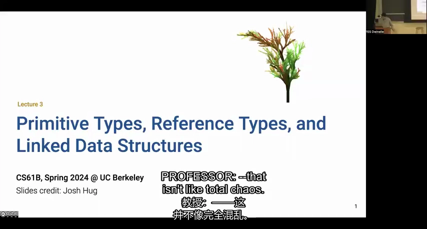 |
| [00:15](https://www.bilibili.com/video/BV1QP4y1u7jv/?p=12&t=15) 好啦希望不会再有一整天的混乱所以我一会儿再来讨论这个问题但今天它从一个谜题开始 | 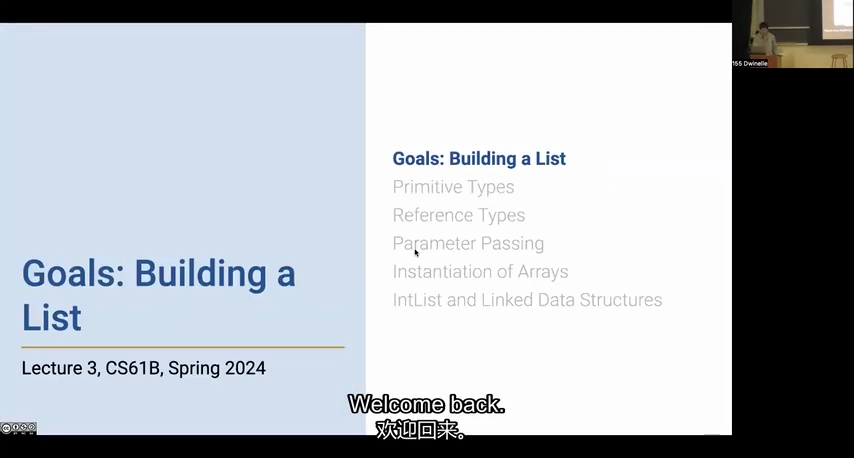 |
| [00:21](https://www.bilibili.com/video/BV1QP4y1u7jv/?p=12&t=21) 今天我将从海象之谜开始啊，那么海象的奥秘是什么呢 | 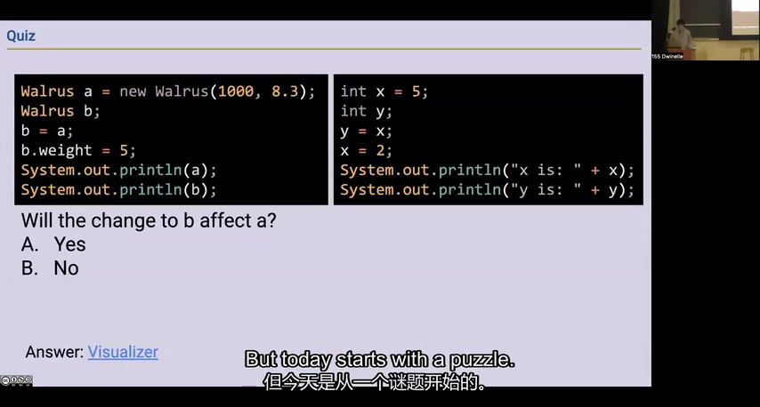 |
| [00:28](https://www.bilibili.com/video/BV1QP4y1u7jv/?p=12&t=28) 嗯海象之谜是这样的所以看看左边的代码发生的事情是我创造了一个新的海象我给它一个重量和象牙大小这些数字具体意味着什么并不重要然后我声明还有另一个海象变量b然后我说b等于a所以你们的问题是如果我现在设置b的权重等于5会改变海象的体重吗A它是呀不是吗你可能没有所有的工具你需要解决这个问题是呀所以我想试探一下你认为答案是什么如果你要猜然后我们一起努力好啦海象之谜的第二部分 | 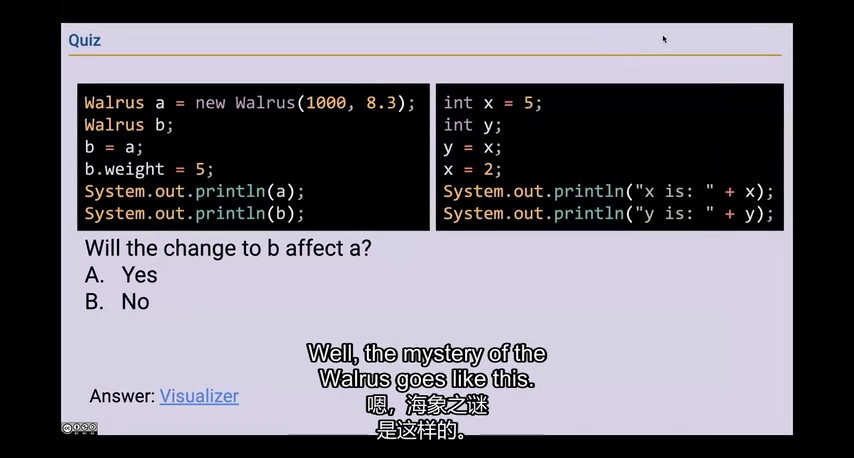 |
| [01:08](https://www.bilibili.com/video/BV1QP4y1u7jv/?p=12&t=68) 我希望你们都在谈论海象好啦海象之谜的第二部分是这样的所以右边的代码x等于5然后我声明另一个整数y然后我让y等于x现在的问题是如果i使x等于2对x的改变会影响y吗是或否是不是每个人都在谈论海象还是我错过了什么我很快就会破坏答案好啦好啦我不知道你是在说海象如果你需要更多的时间如果你想看答案如果你只想回家 | 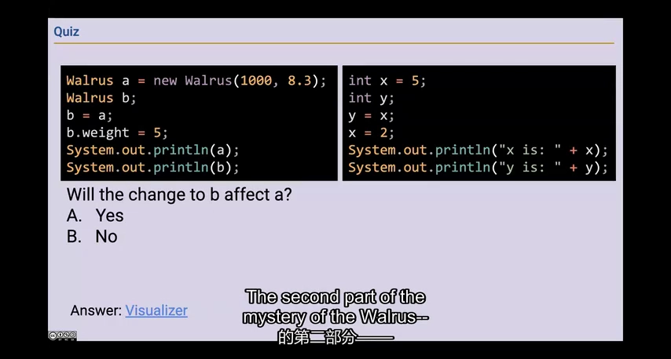 |
| [01:48](https://www.bilibili.com/video/BV1QP4y1u7jv/?p=12&t=108) 我们在做什么我们在做什么好啦我将开始展示一些答案所以大家都结束了你们的谈话所以我们可以继续谈论令人兴奋的沃尔 | 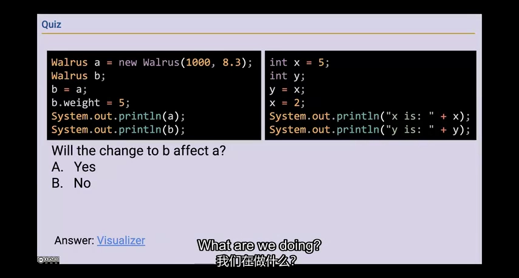 |
| [02:06](https://www.bilibili.com/video/BV1QP4y1u7jv/?p=12&t=126) 这是我们以前得到的代码我已经把它塞到Java可视化器中了现在我们在Java可视化器中我还没告诉你这东西的工作原理但我们可以试着看看视觉化器告诉我们关于海象的什么好啦你得非常安静奥斯不喜欢当你大声的时候好啦所以发生的事情是我设置海象A在那里，它是那是我美丽的海象它有重量有象牙大小然后出于某种原因，我们还没有完全弄清楚当我说b等于a时这幅画向我展示了同一只海象身上有两支箭那么现在你觉得怎么样如果我看着这张照片同一只海象有两支箭 | 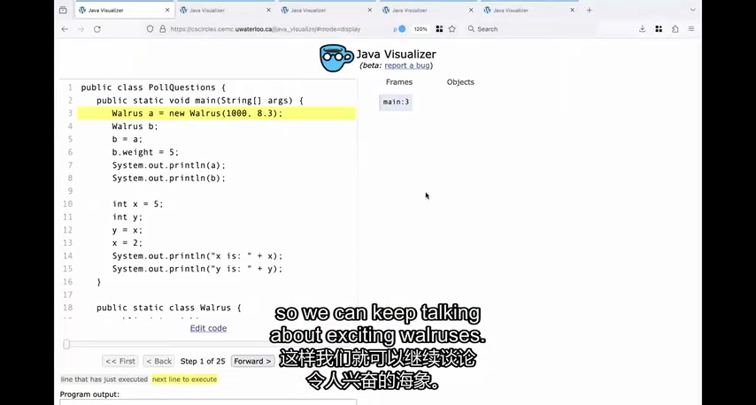 |
| [02:46](https://www.bilibili.com/video/BV1QP4y1u7jv/?p=12&t=166) 所以希望这并不太令人惊讶如果我改变我唯一的海象的体重这只海象瘦了不少它现在重5磅到a的变化也影响到b，这并不奇怪因为只有一只海象是同一个人好啦所以如果我们有海象这是第二部分这就是它真正的神秘之处也就是我让x等于5然后我声明y等于x嗯这次有两个五所以它不像海象只有一个那么这是怎么回事为什么我说x等于2这一次对x的改变实际上并不影响y五个人还在那里所以这就是海象之谜 | 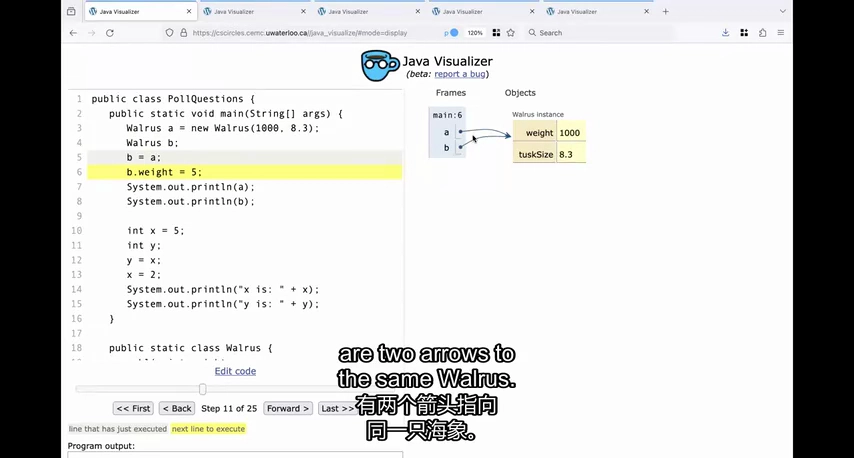 |
| [03:26](https://www.bilibili.com/video/BV1QP4y1u7jv/?p=12&t=206) 那就是我们要去的地方把今天的前半段时间花在挑逗它真的很有趣，你会用它 | 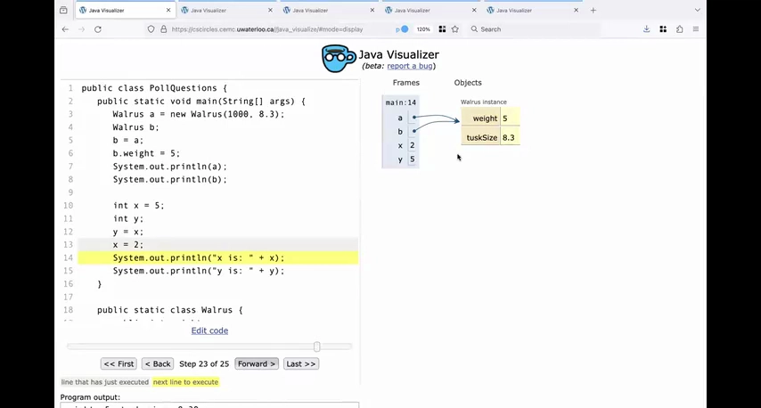 |
| [03:32](https://www.bilibili.com/video/BV1QP4y1u7jv/?p=12&t=212) 可能你以后的政务司司长生涯好啦所以当你改变b时，我们看到了 | 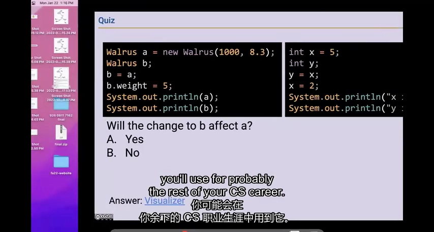 |
| [03:37](https://www.bilibili.com/video/BV1QP4y1u7jv/?p=12&t=217) 它确实会影响一个只有一只海象那么为什么会这样呢？为什么它对整数的工作方式不一样呢？ | 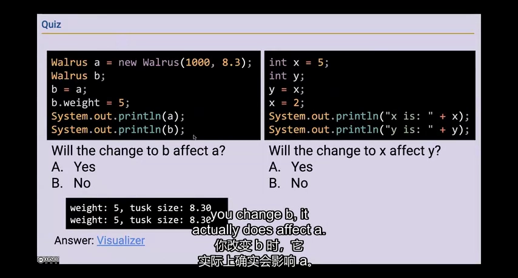 |
| [03:44](https://www.bilibili.com/video/BV1QP4y1u7jv/?p=12&t=224) 所以为了弄清楚这是如何工作的我要去挖一点点在61 C的东西那是下一节课所以再忍耐一下这有点像预演所以发生的事情就在你的电脑上如果你一直深入到尽可能低的抽象层你会发现一堆1和0所以在你电脑深处的某个地方用一堆花哨的电路或者我不明白的事情在一个大字符串中有一堆1和0很多1和0这就是你的电脑存储数据的方式我们看到的数据必须被编码作为存储在内存中的1和0序列因为这就是记忆是一堆1和0 | 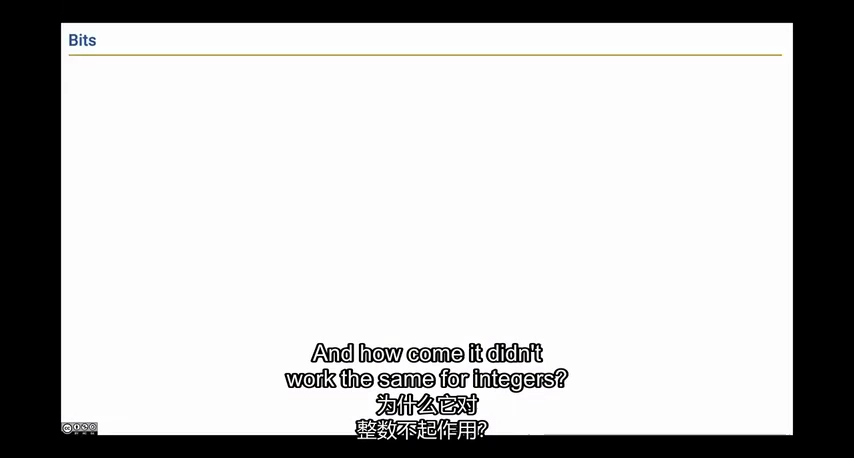 |
| [04:24](https://www.bilibili.com/video/BV1QP4y1u7jv/?p=12&t=264) 例如数字七十二常被存储为零一零一零一零为什么61 C会告诉你为什么现在你可以相信我的话二百零五点七十五好吗？这通常存储为你不必记住这些我不会用这个测试你它是它是啊编码为零一零零零好啦我不打算读因为我没时间了下面是一些其他的例子字母h存储为这个字符串恰好是数字72的1和0然后布尔值true通常存储为一堆零紧随其后的是一个这是人们选择使用的惯例所有的电脑都同意这就是我们得到的 | 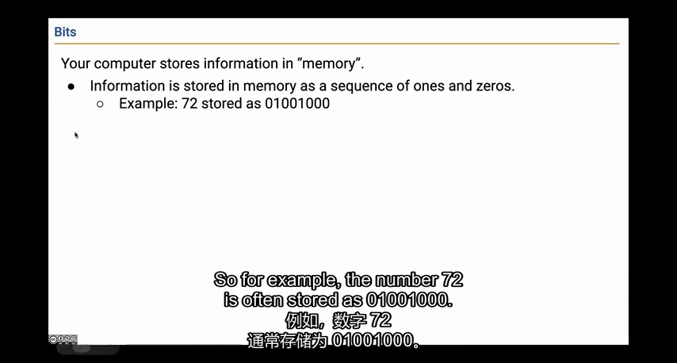 |
| [05:04](https://www.bilibili.com/video/BV1QP4y1u7jv/?p=12&t=304) 所以你马上就会注意到坚持住七十二h被存储为相同的1和0序列那我怎么知道如果我的电脑显示的是是哪一个好电脑会计算出哪一个它是通过观察变量的类型所以记住在Java中我们有与每个变量相关联的类型事实上有八种类型有两个是大胆的你一定要知道其中一些会涵盖一些我们不会但它们是字节短而长的浮点数双布尔字符所以当你开始用Java编程时，你会看到这些这是八种原始类型稍后我们将讨论原语的含义 | 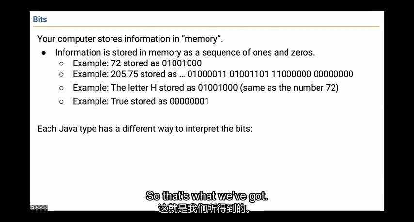 |
| [05:44](https://www.bilibili.com/video/BV1QP4y1u7jv/?p=12&t=344) 所以再一次60和c如果你有兴趣 | 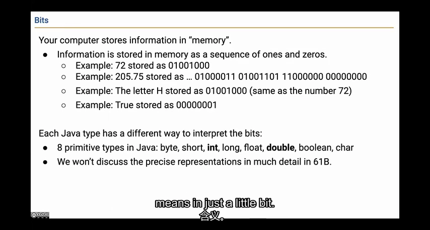 |
| [05:50](https://www.bilibili.com/video/BV1QP4y1u7jv/?p=12&t=350) 那么当我写一个变量的声明时，实际上会发生什么我们从上周就已经看到了如果你想使用变量x你得先说我声明变量x存在所以当我做得很好的时候会发生什么你的电脑会在1和0的巨大序列中挖掘它会找到一些1和0的序列说这是我的X要住的地方例如如果我声明int x会发生什么我的电脑会挖掘内存它会找到足够的1和0来存储整数 | 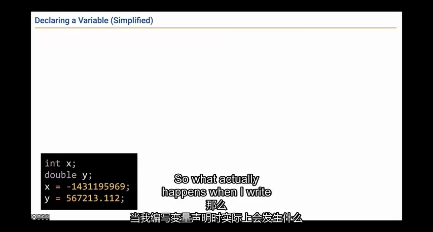 |
| [06:21](https://www.bilibili.com/video/BV1QP4y1u7jv/?p=12&t=381) 然后就这样了不管这部分记忆中的1和0是什么那就是x，我们给这一系列的位取了个名字然后对Y也是同样的事情所以如果我说我声明有一个双y然后我将创建一个比特盒，这个比特盒对应于y在未来，如果我说像x等于不管Java编译器会看到什么哦好吧我知道那是什么这就是你给这个位序列命名的东西这就是Java编译器如何知道在哪里找到x或y好啦所以我想基本上又是这张幻灯片上的有问题就叫我所以当你声明一个变量我们做这个盒子 | 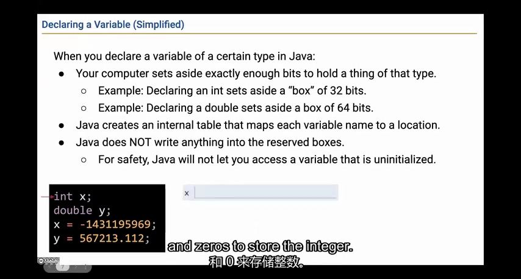 |
| [07:01](https://www.bilibili.com/video/BV1QP4y1u7jv/?p=12&t=421) 然后在这个盒子里我们将保留与该变量相对应的1和0Java会保留一些查找表，上面写着如果你提到x，请到这里如果你曾经说过为什么看这里好啦所以当你宣布但当我分配所以在这里我们可以看到如果我说x等于这个大的旧数字接下来会发生什么我必须计算出这个数字它是什么和1和0显然是这个，然后我会把它塞进去对应于x的1和0然后不管这是什么，所有的东西都在Y里这就是当你给一个变量赋值时发生的事情我想你我都同意这有点难读 | 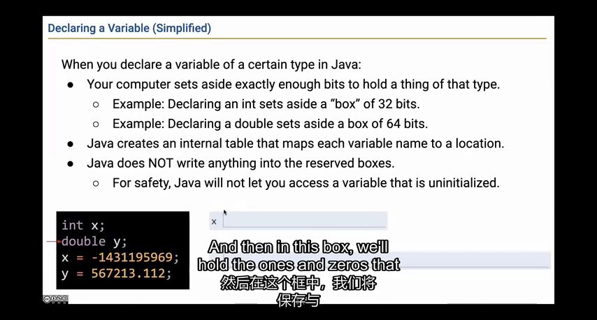 |
| [07:41](https://www.bilibili.com/video/BV1QP4y1u7jv/?p=12&t=461) 当我看着这些1和0我的大脑开始融化我不知道这是什么只是为了让我们的生活轻松一点我们将介绍一种叫做简化方框表示法的东西 | 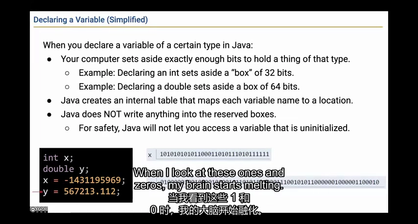 |
| [07:49](https://www.bilibili.com/video/BV1QP4y1u7jv/?p=12&t=469) 所有这些都不是说好话老实说，内存中的这个数字是这个1和0的序列 | 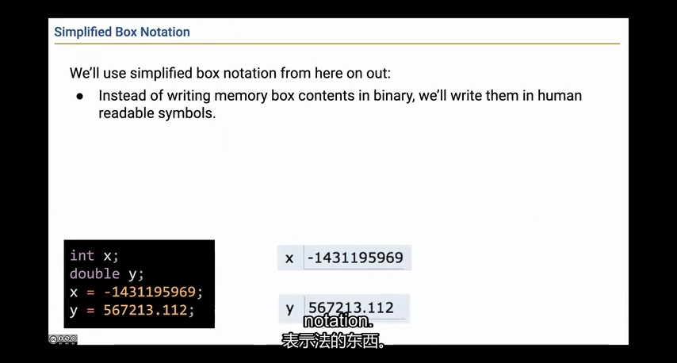 |
| [07:56](https://www.bilibili.com/video/BV1QP4y1u7jv/?p=12&t=476) 但我看不懂你不能读那个可能是除非观众席上有机器人 | 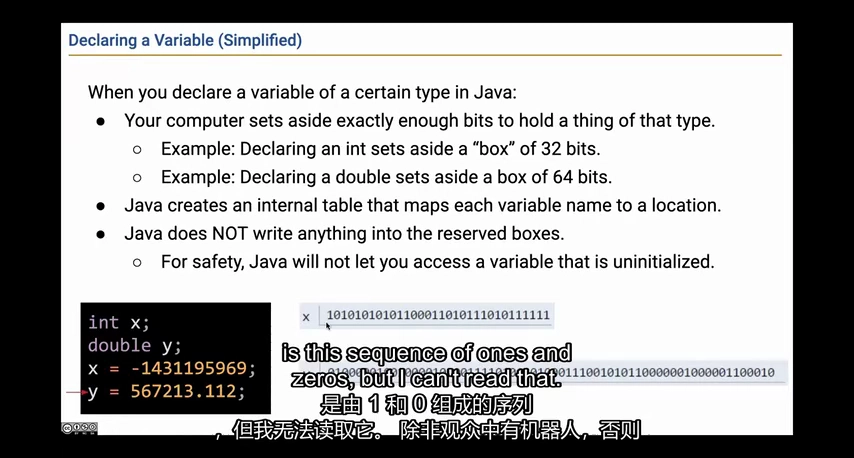 |
| [08:02](https://www.bilibili.com/video/BV1QP4y1u7jv/?p=12&t=482) 所以我们要写人类可读的表示这对我们的目的来说已经足够好了有一个简化的方格符号 | 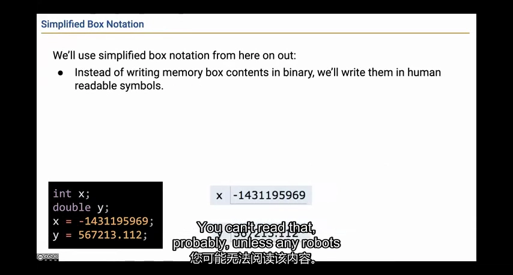 |
| [08:13](https://www.bilibili.com/video/BV1QP4y1u7jv/?p=12&t=493) 很快就会有更多关于它的信息所以接下来我们要弄清楚的是我们知道当你声明一个变量时会发生什么你在记忆中腾出一些空间你说这是x去的地方所以说当我分配一个变量来回答这个问题时我们得谈谈我所说的平等的黄金法则我不知道这是不是别人所说的但这就是我们所说的所以平等的黄金法则说如果你有像y=x这样的语句等号所做的就是它取x中的所有位对应于您命名为x的内存部分的1和0我们只是把所有的东西都复制到你身上就是这样没有别的幻想发生你取所有对应于x的位 | 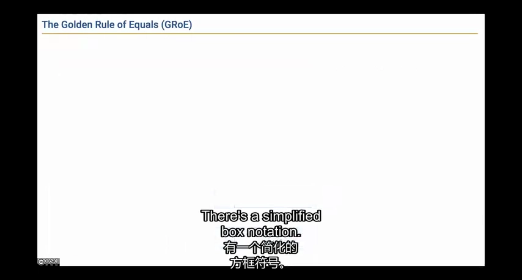 |
| [08:53](https://www.bilibili.com/video/BV1QP4y1u7jv/?p=12&t=533) 把它们复制到所以我们不做任何额外的新对象的创建也许这开始进入谜团了但你现在要知道的是如果你说y等于x你从x中取出所有的位，然后把它们复制到y中好啦所以希望既然我已经谈到了平等的黄金法则 | 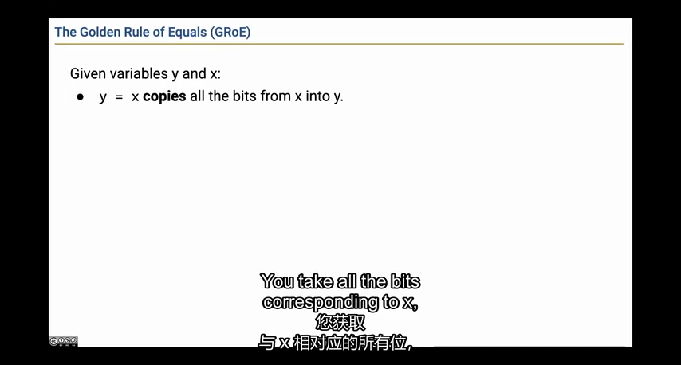 |
| [09:11](https://www.bilibili.com/video/BV1QP4y1u7jv/?p=12&t=551) 以及变量声明的方式这个谜题的第二部分并不令人惊讶当我说我声明有一个整数x然后我创建了一个盒子 | 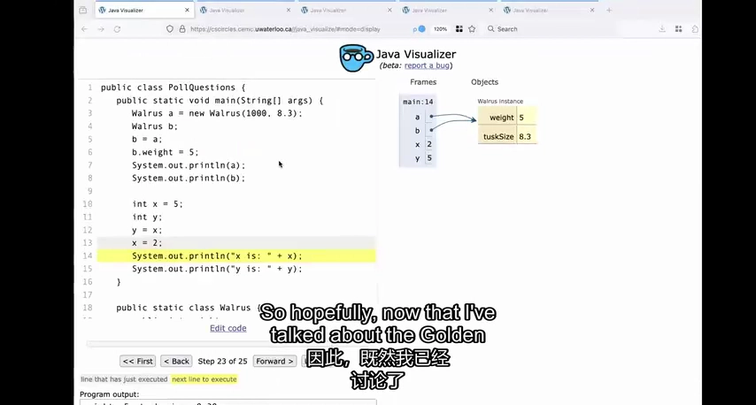 |
| [09:21](https://www.bilibili.com/video/BV1QP4y1u7jv/?p=12&t=561) 那个由1和0组成的盒子对应于名字x然后我把它设置为5因为平等的黄金法则说我把右边的部分任何与五相对应的东西然后我把它复制到X而不是写1和0因为我看不懂我只写数字五然后同样的事情是为什么我声明了一个不同的盒子这个盒子对应于我命名为Y的所有1和0这里当我说y等于x我该怎么办我复制了一些片段我取x中的所有位恰好与数字5相对应我复制了这些片段，然后把它们重写成Y这就是为什么我有两份5号的副本那么当我说x等于2时我把2的所有部分复制到X中 | 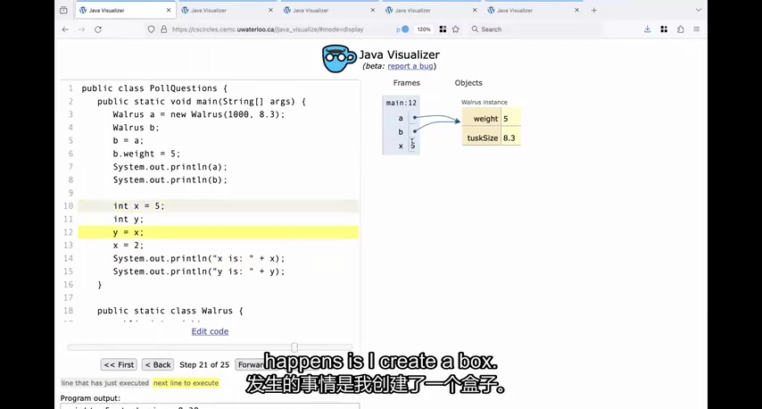 |
| [10:01](https://www.bilibili.com/video/BV1QP4y1u7jv/?p=12&t=601) 这就是我如何得到x等于2Y等于5那么为什么这个决心 | 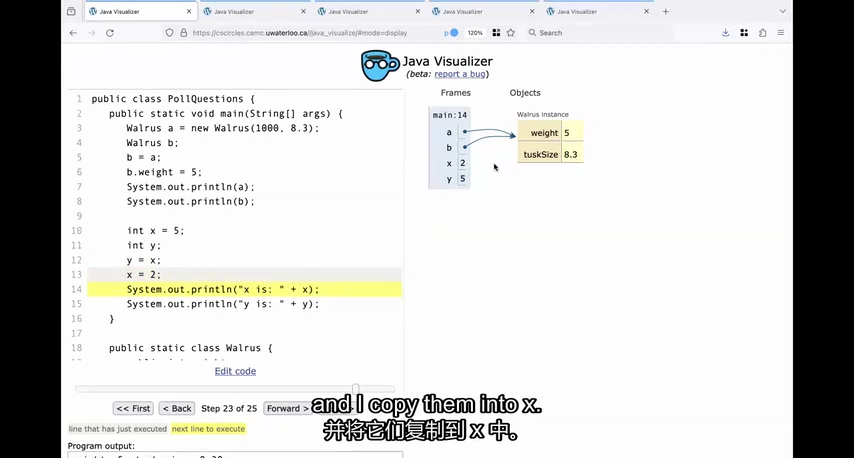 |
| [10:08](https://www.bilibili.com/video/BV1QP4y1u7jv/?p=12&t=608) 就是这样这是因为平等的黄金法则在那里我只是复制所有的位很好，到目前为止，我们讨论了声明变量谈到了分配1和0说要复制所有的比特 | 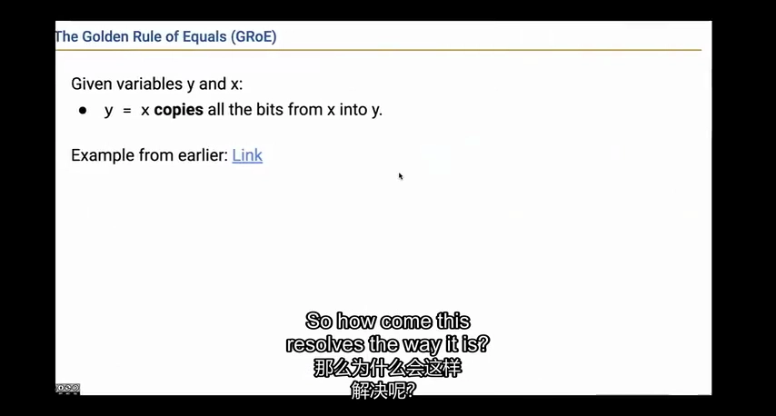 |
| [10:21](https://www.bilibili.com/video/BV1QP4y1u7jv/?p=12&t=621) 好啦这就解开了海象之谜的第一部分现在我们知道整数是如何表现的但它还没有解决第二部分这就是海象的行为 | 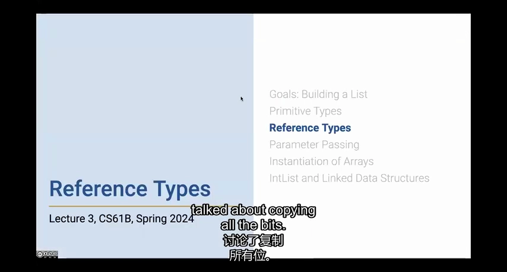 |
| [10:29](https://www.bilibili.com/video/BV1QP4y1u7jv/?p=12&t=629) 所以要弄清楚这一点我们得看看这个类型列表我们看到字节短国际长浮点数双布尔图没有海象爪哇没有海象型的内置好啦也许是下次的改进点但是Java中没有海象类型所以如果你有其他类型的那不是这八个中的一个包括海象项目中的瓷砖上次没有狗我不知道行星不管别的什么这八种类型中没有一种是我们所说的引用类型我们将在这张幻灯片中深入探讨这意味着什么 | 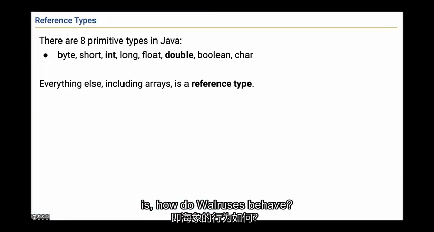 |
| [11:02](https://www.bilibili.com/video/BV1QP4y1u7jv/?p=12&t=662) 我猜好的，好的所以任何不是我们列出的八种原始类型之一的东西它被称为引用类型当你实例化一个对象时会发生什么创建对该对象的引用那么这意味着什么呢有点奇怪、模糊和抽象所以让我们深入研究一下当我写这一行代码时会发生什么在我调用构造函数之前，您已经看到了这一行代码记住，建造者创造了一个全新的海象所以新海象诞生了然后回到我们身边那么这实际上是如何工作的呢它看起来像什么当我创造一个全新的海象并让它回来那么当我想创造一只新的海象时会发生什么是Java编译器还是解释器 | 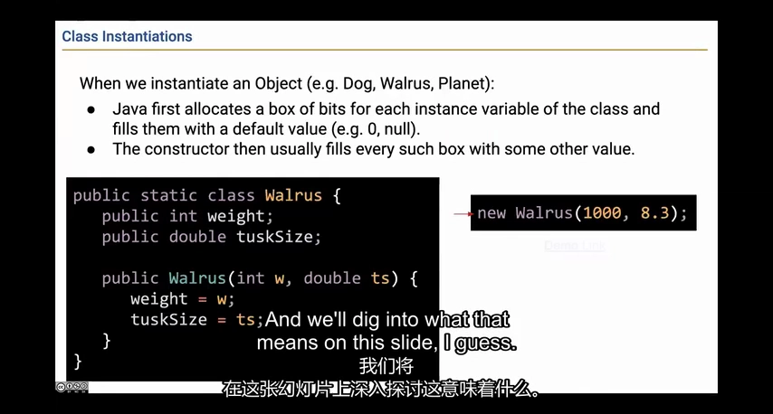 |
| [11:42](https://www.bilibili.com/video/BV1QP4y1u7jv/?p=12&t=702) 它需要挖掘记忆并说好啦你想要一只全新的海象海象很大事实上，他们需要储存重量它们需要储存象牙大小所以他们是他们是相当大的生物你需要储存他们的两件事所以Java将通过挖掘所有的1和0为我的新海象找个家在这里说这是我的神奇海象将生活的地方所以让我们看看它的行动所以在这里我在记忆中挖掘然后我在记忆中找到了一个位置我可以把海象的重量在那里，我可以把海象象牙大小好了，没事了我不知道这是不是一个现实的象牙大小 | 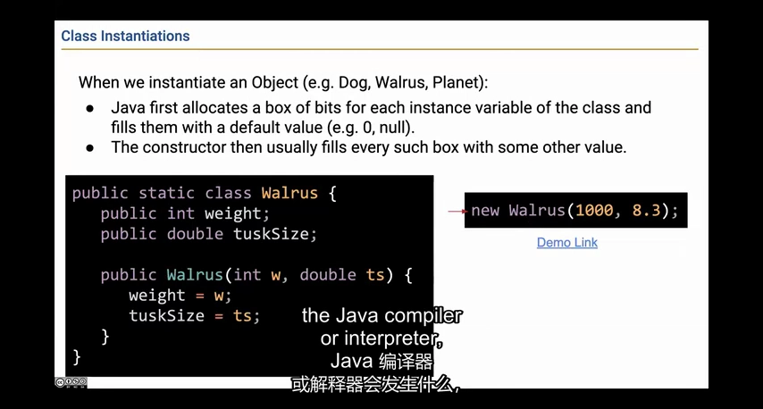 |
| [12:18](https://www.bilibili.com/video/BV1QP4y1u7jv/?p=12&t=738) 但我得拿幻灯片原来如此好啦这又是它的另一张照片你电脑里的记忆只是一串巨大的就像几十亿个1和0发生的事情是Java解释器通过内存它挖了进去，找到了这个位置它说你知道这看起来像一个海象的好地方它的作用是它将其中一些位设置为与重量相对应所以每当你提到这只海象重量就在那里任何时候你问墙壁和象牙的大小它就在那里所以它挖掘记忆，为海象找到了这个家这一切都很好但现在我们有一个问题这就是我怎么知道在哪里可以找到这只海象我们可以在这里看到 | 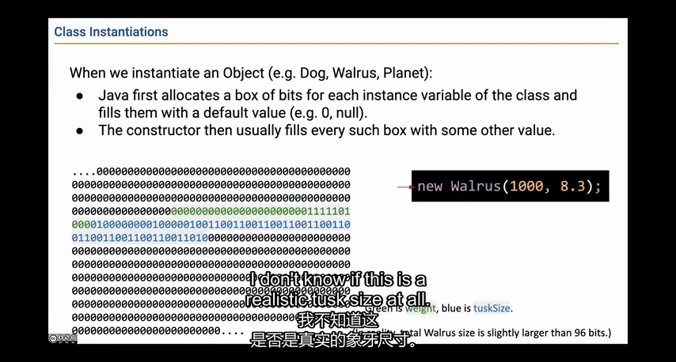 |
| [12:58](https://www.bilibili.com/video/BV1QP4y1u7jv/?p=12&t=778) 记忆有点大我把这些海象放在这里就像把宝藏埋在田野里如果我去田里埋了一个宝藏我也不把它写在哪里会发生什么我将永远失去宝藏海象说它们是非常珍贵的物品我不想失去他们那么我能做什么呢接下来会发生的是当我创造海象的时候使用构造函数Java进入内存它创造了这只美丽的海象你看它太美了然后问题是我们得弄清楚海象在哪里？海象在哪里我以后想去看看 | 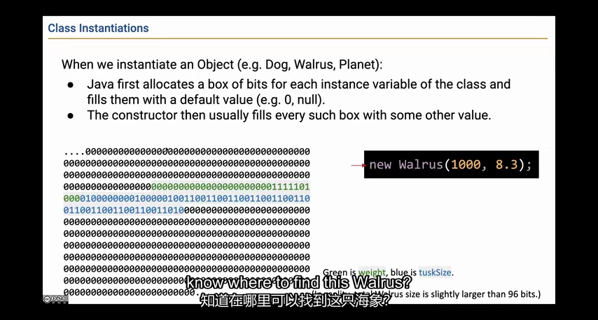 |
| [13:31](https://www.bilibili.com/video/BV1QP4y1u7jv/?p=12&t=811) 那么我怎么找到它所以说Java下一步要做的是你可以想到的一种方式这个新关键字会对着天堂大喊告诉大家这只新海象的位置就像我把宝藏埋在田里一样我要知道去哪里找当我创造我的全新海象我得把我放海象的地方写下来这样我就可以回去看望它，给它改变体重，以后再喂它食物那我怎么才能做好呢Java要做什么这个新关键字要做什么它会把所有这些碎片你可以把它想象成因为我可以在每一个上面加上一个数字我可以像那是第一个这是第二个这是第三个那是第四个也许这只海象住在 | 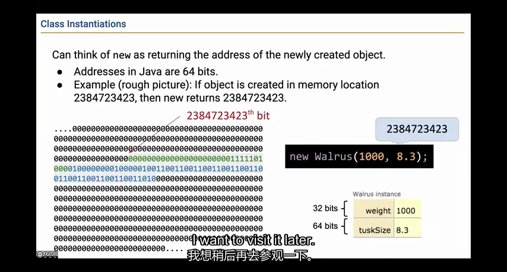 |
| [14:11](https://www.bilibili.com/video/BV1QP4y1u7jv/?p=12&t=851) 我不知道这是什么七二三四二三的记忆好啦那么新关键字将做什么它会向天堂大喊告诉所有人这只海象你刚刚让它活在位号上不管那个数字是什么，这就是新关键字返回的所以你几乎可以把new关键字看作是返回一个数字它返回什么号码它返回这个数字为什么呢因为那是我可爱的海象生活的数字位所以这个新的海象构造器做了两件事第一批它分配了记忆，并说这是海象的家但如果我不写下来我要失去它了所以新的关键字 | 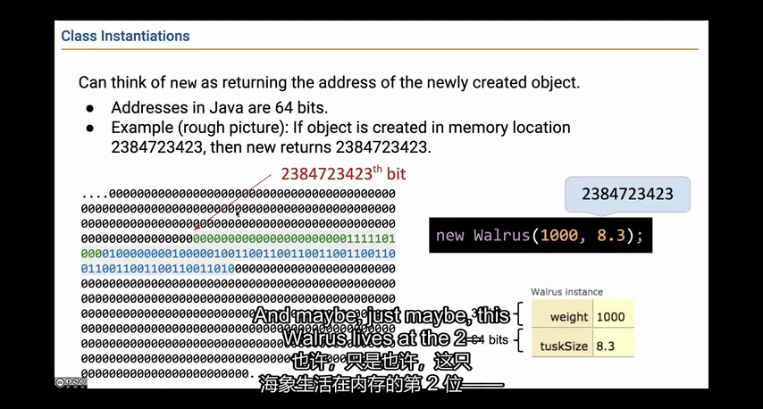 |
| [14:51](https://www.bilibili.com/video/BV1QP4y1u7jv/?p=12&t=891) 它很有帮助地说那是它住的地方这个号码如果你去记忆中的那个数字位你会找到你的海象 | 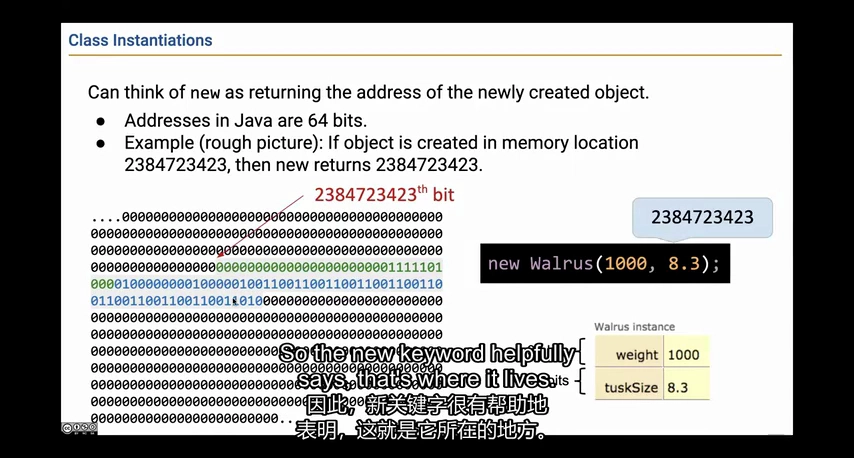 |
| [15:00](https://www.bilibili.com/video/BV1QP4y1u7jv/?p=12&t=900) 那太好了这告诉我当我创造一个新的海象时会发生什么但就像我们说的如果我不写下这个号码 | 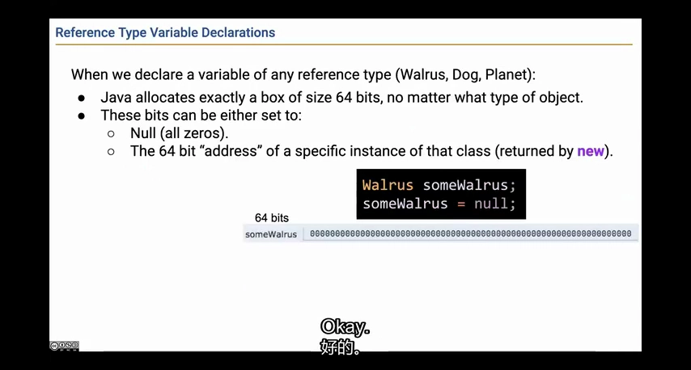 |
| [15:05](https://www.bilibili.com/video/BV1QP4y1u7jv/?p=12&t=905) 我将永远失去我的海象我不想永远失去我的海象 |  |
| [15:10](https://www.bilibili.com/video/BV1QP4y1u7jv/?p=12&t=910) 所以接下来发生的是我需要一个地方把我刚刚写下的位置那么我把它放在哪里这就是这条线的用武之地所以当我说海象一些海象我宣布有一个海象类型的变量但请记住，只有八种原始类型的海象不是Java中的内置类型所以当你宣布海象一些海象你在这里得到的如果所有这些对你来说都是胡言乱语这是你完全理解奥秘所需要的一件事当我宣布有海象Samoir这里有空位吗？这六十四位1和0那其实不是海象我知道它看起来像海象这看起来有点像海象但实际上不是海象 | 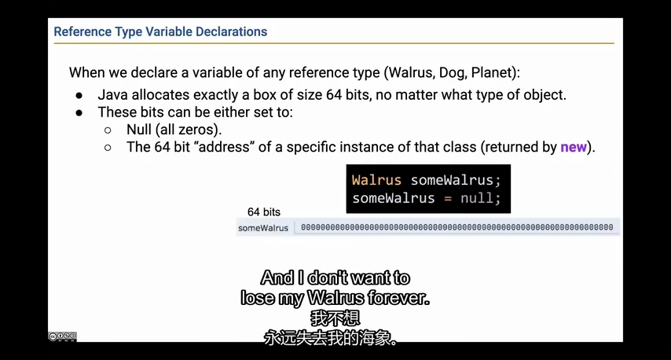 |
| [15:50](https://www.bilibili.com/video/BV1QP4y1u7jv/?p=12&t=950) 这个位置将存储海象的实际位置我再说一次因为它是如此重要当我宣布有一些海象这个记忆盒实际上并不包含海象不合身记住水真的很大它的象牙大小以磅为单位这不适合海象这个空间只是告诉我在哪里可以找到海象就像给我自己的一张小纸条如果你想去看你的你的海象你得过来好了，这里我把它赋值为空一堆零这表明没有海象那种令人沮丧的所以说让我们做一只海象所以当我说新海象废话废话废话发生的一切都很好 | 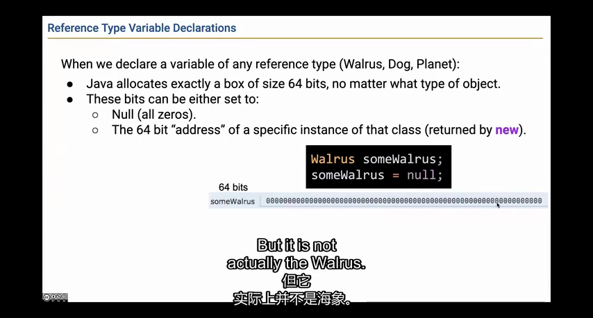 |
| [16:30](https://www.bilibili.com/video/BV1QP4y1u7jv/?p=12&t=990) 一千八百三海象构造函数它挖掘记忆它为海象找到了光荣的地方然后新关键词向世界呼喊你的海象就在这段记忆中然后这里有一个等号等号我们对等号了解多少平等的黄金法则说我复制了右边的片段我把他们分配到左边右边的部分是什么好吧，我们知道新的关键词是向世界呼喊它在告诉大家你的新海象它就在记忆中这是位置所以我把那些告诉我海象住在哪里的碎片然后我把这些片段复制到一些海象身上现在一些海象这个变量它实际上并不能容纳海象 | 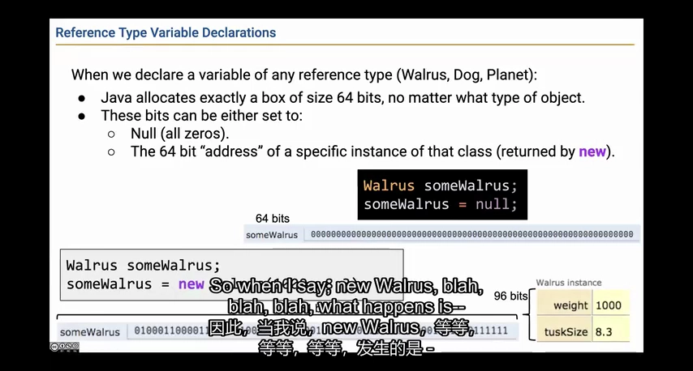 |
| [17:10](https://www.bilibili.com/video/BV1QP4y1u7jv/?p=12&t=1030) 不合身海象太胖了取而代之的是空间，它保存着我的海象在记忆中实际生活的位置所以这个1和0的序列我知道它看起来像海象那不是真正的海象这告诉我如果我去记忆中的这个位置我会在那里找到我要找的海象它是它有它的重量和大小它坐在那里做海象的事情我真的不知道海象在空闲时间做什么好啦也许他们读 | 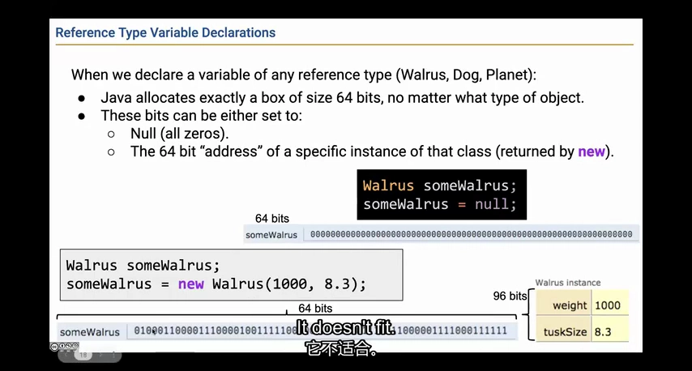 |
| [17:37](https://www.bilibili.com/video/BV1QP4y1u7jv/?p=12&t=1057) 我不知道好的很好这就是平等的黄金法则当我指派一只新的海象我把它放在这个里面 | 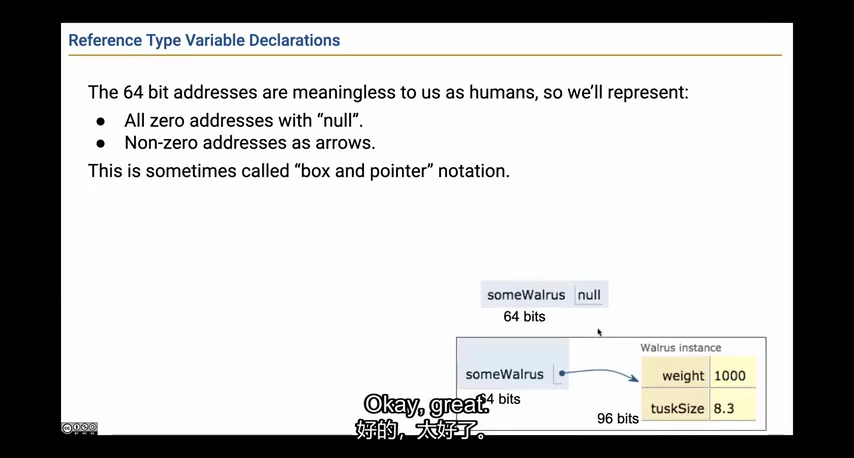 |
| [17:42](https://www.bilibili.com/video/BV1QP4y1u7jv/?p=12&t=1062) 一些海象变量再说一遍，我怎么说都不够它不储存真正的海象它存储了一个引用或者我的墙的位置如果我想去参观它问题思考这可能是最重要的幻灯片所以如果你一定要去睡觉一定要拍到这个 | 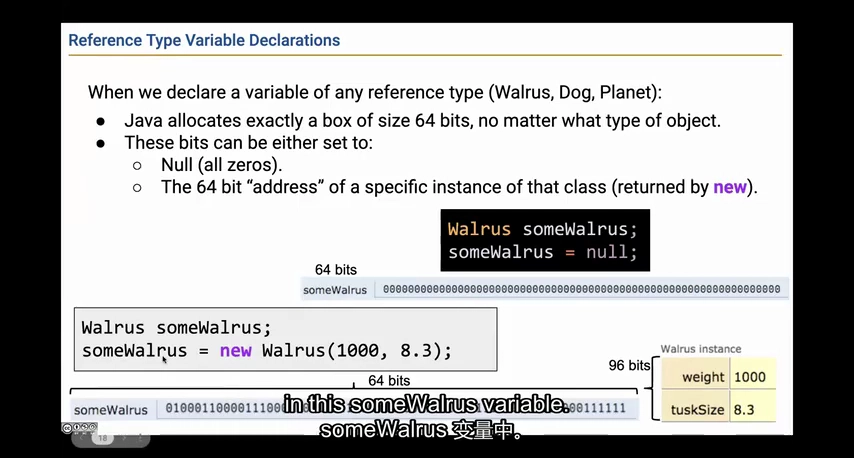 |
| [18:01](https://www.bilibili.com/video/BV1QP4y1u7jv/?p=12&t=1081) 好啦好极了所以再一次这有点难读 | 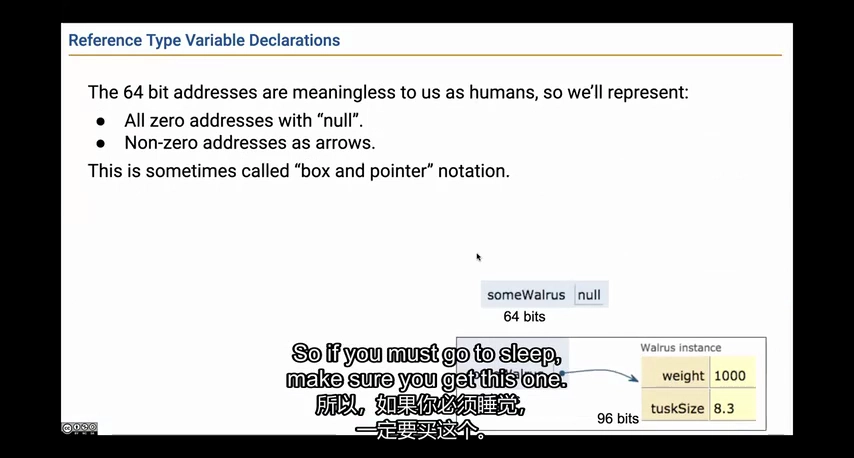 |
| [18:06](https://www.bilibili.com/video/BV1QP4y1u7jv/?p=12&t=1086) 我不想画图表我得写很多很多的0和1所以为了让我的生活轻松一点 | 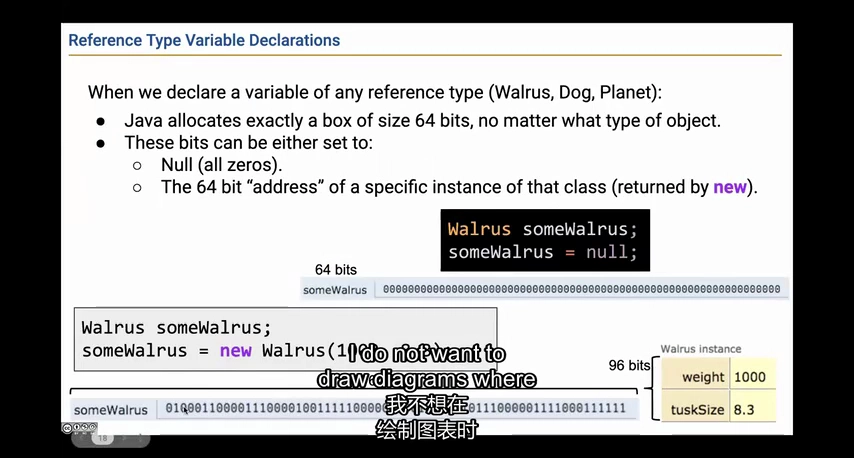 |
| [18:11](https://www.bilibili.com/video/BV1QP4y1u7jv/?p=12&t=1091) 我将使用一种叫做方框和指针表示法的方法所以与其写这样的东西 | 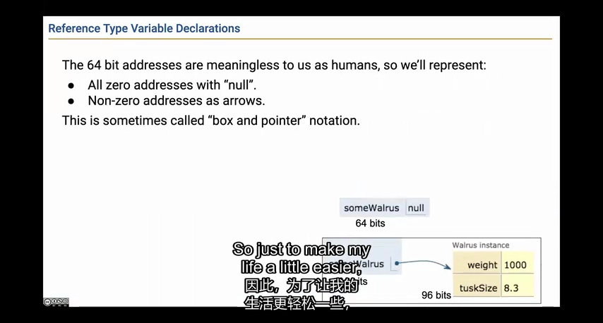 |
| [18:16](https://www.bilibili.com/video/BV1QP4y1u7jv/?p=12&t=1096) 就像这是1和0的序列海象生活的地方然后在1和0的序列中我把象牙大小的女人扔出去那太难读了 | 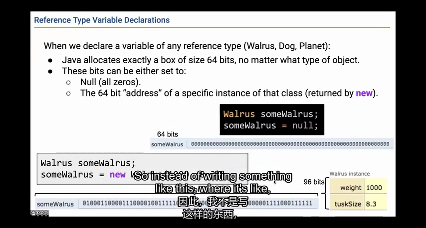 |
| [18:26](https://www.bilibili.com/video/BV1QP4y1u7jv/?p=12&t=1106) 所以我要画一个箭头这个箭头说的是在这个记忆盒里就在这里，看起来不像但那里有一个实际的数字这个数字对应于什么它对应于内存中的一个位置如果我去那个地方就像到田野里去挖掘我的宝藏我去那个地方我发现海象我想我们只是不住在第三区但我会去那个地方我会找到我要找的海象这就是箭头所对应的它说这个海象记忆盒实际上没有海象它只包含了海象的位置这就是所谓的方框和指针表示法这就是你刚才看到的 | 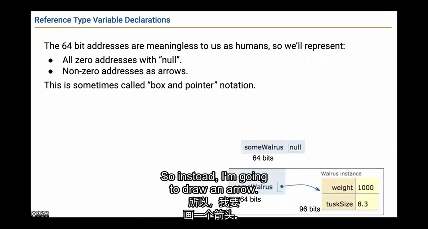 |
| [19:05](https://www.bilibili.com/video/BV1QP4y1u7jv/?p=12&t=1145) 好极了所以在这一点上希望这不再令人惊讶鉴于我们对引用类型的了解鉴于我们对平等的黄金法则的了解希望现在我们能把所有的碎片拼凑在一起我们终于可以解开海象之谜了神秘说得很好我创造了一个新的海象或者我宣布一个新的海象变量一次又一次这是如此关键我怎么说都不够如果我看到这个记忆盒它不能容纳海象海象不适合在那里太小了所以这个记忆盒只能保存海象在哪里的参考有时人们称之为海象的地址像海象一样生活在某个地方我把它住的地址写下来有时人们会称之为海象的位置 | 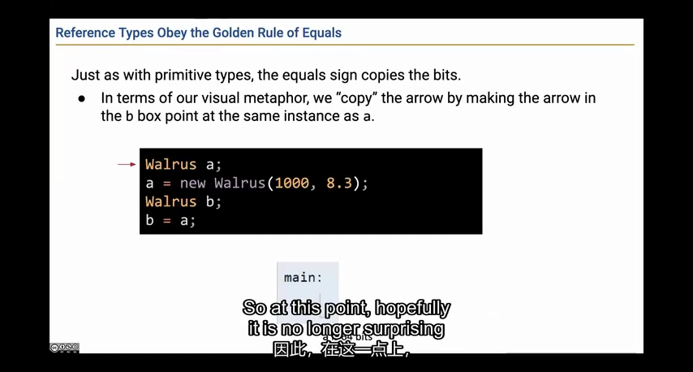 |
| [19:45](https://www.bilibili.com/video/BV1QP4y1u7jv/?p=12&t=1185) 你可以听到人们说它是指向海象的指针所以它给你指明了正确的方向所以你可以叫它很多不同的东西但重要的是这是一个记忆盒是指海象这不是真的所以当我说我声明有一个海象变量叫做我实际上并没有创造一个新的一只新海象现在世界上没有海象我刚刚创造了一个地方我可以写下海象的位置如果我有一张小小的纸条我会做X，我想我早些时候忘了做如果你没有给这里的任何东西分配A盒子里什么都没有它仍然会有东西它会有一些1和0可能是上次留下的 |  |
| [20:25](https://www.bilibili.com/video/BV1QP4y1u7jv/?p=12&t=1225) 但是Java不会让你访问它们因为你还没有让他们做任何事所以说出来万一有人好奇好啦现在我们来到下一行下一张幻灯片有一堆它正在做的事情让我们过一遍一个一个来我调用构造函数构造函数做什么它挖掘记忆它看穿了所有的1和0它说是的这是我美丽的新海象的地方上面说这些碎片对应于海象这个象牙大小这些与它的重量相对应在那里，它是好的但我不想失去它那么新关键字要做什么是新关键词会高呼上天说好战争是它就住在这里它以两百万的价格生活三百八十随便啦 |  |
| [21:05](https://www.bilibili.com/video/BV1QP4y1u7jv/?p=12&t=1265) 那是海象住的地方新关键词就是这么喊的那么平等的黄金法则需要什么不管新关键词在喊什么我的新海象就在那里它把它复制到变量a中就是这里的比特序列所以当我运行这个时，发生了一堆不同的事情新海象诞生了现在呢它活在记忆中某处它向世界呼喊的新钥匙它生活的地方然后相等的黄金法则将海象的位置复制到一个接下来会发生什么现在我要宣布另一只海象B当我声明walrus b变量时我不是在创造一个新的海象 |  |
| [21:45](https://www.bilibili.com/video/BV1QP4y1u7jv/?p=12&t=1305) 只有new关键字才能做到这一点和构造函数所以当我宣布有一只海象B我所做的一切我在创建这个记忆盒它承载着什么它装不下海象海象不适合它只会引用真实的真正的海象就像我们之前说的现在不管是1还是0你不能访问它爪哇不会让你这么做的谁知道里面有什么好了，现在笑点来了B等于A我们该怎么办我们复制比特没有花哨的海象恶作剧在继续当我说b等于a时我所要做的就是我看着一个井里的1和0是什么一、零和一个他们告诉我在哪里可以找到我的神奇海象 |  |
| [22:25](https://www.bilibili.com/video/BV1QP4y1u7jv/?p=12&t=1345) 如果我想参观它所以我把这些碎片我把它们复制到B中现在b拥有相同的1和0序列是同一只海象的所在地所以它就像两张纸他们都有海象的相同位置所以如果我用A去拜访海象或者如果我用B去拜访海象我会去找同样的海象我们一直在谈论的唯一一只海象它是它就坐在那里，它的巨大的旧重量好的很好 |  |
| [22:56](https://www.bilibili.com/video/BV1QP4y1u7jv/?p=12&t=1376) 所以现在我们算是解开了海象之谜我们现在明白了为什么当我们使用原语类型时 |  |
| [23:01](https://www.bilibili.com/video/BV1QP4y1u7jv/?p=12&t=1381) 所以如果是字节短长int双不管那八种然后这些类型你可以直接把它们放在内存盒里还记得以前的事吗？我们去找吧 |  |
| [23:10](https://www.bilibili.com/video/BV1QP4y1u7jv/?p=12&t=1390) x和y是整数我可以直接把整数放在内存盒里 |  |
| [23:15](https://www.bilibili.com/video/BV1QP4y1u7jv/?p=12&t=1395) 因为它们是原始类型任何不属于这八种类型的东西像海象瓷砖那些是引用类型所以不要把真正的海象放在盒子里，因为它放不下我们要把海象的实际位置然后从那开始等式的黄金法则告诉我们，当我把a或b等于a时或者y等于x我把所有的片段都复制了一遍我们解开了海象之谜有人对这个谜有疑问吗为什么会这样解决引用类型的原始类型有什么刺激的吗？正在变焦吨无数令人兴奋的事情在变焦中发生好啦 |  |
| [23:55](https://www.bilibili.com/video/BV1QP4y1u7jv/?p=12&t=1435) 我就不多问了好啦还有别的吗？好吧酷 |  |
| [24:00](https://www.bilibili.com/video/BV1QP4y1u7jv/?p=12&t=1440) 那是今天的前半段我想在我们继续之前，我要注意的最后一件事是 |  |
| [24:05](https://www.bilibili.com/video/BV1QP4y1u7jv/?p=12&t=1445) 平等的黄金法则也有效当你们吵架的时候所以这里有一小段代码不是很有趣它需要两个数字的平均值这里发生的最有趣的事情是当我调用x和y的平均值时会发生什么数字怎么五点五和十点五被发送到平均函数好吧，又来了你在这里并没有明确地看到等式但平等的黄金法则是它仍然成立它说当我把参数x代入平均值我要做的是我要宣布有一个新的替身叫A然后我会把x的所有位复制到内存盒中 |  |
| [24:45](https://www.bilibili.com/video/BV1QP4y1u7jv/?p=12&t=1485) 对于B的同样的事情我宣布有一个叫B的双数因为我把这一系列的比特称为平均值我把10.5抄成B所以不管他们是替身海象行星还是狗每当我有一个函数的参数我将把这些片段复制到那个论点中所以当我传入参数时它遵循与海象之谜相同的规则我复制了那边的片段x和a之间不是显式的等号吗但你还在复制这些片段只是想快点注意一下好啦所以我们在这里看到它有一个X消失了有，有，有也许会有一个A和一个B他们在那里 |  |
| [25:25](https://www.bilibili.com/video/BV1QP4y1u7jv/?p=12&t=1525) 所以位从x复制到它们从y复制到b在这种情况下，替身是那些原始类型之一这是我们之前看到的八个中的一个所以这些比特实际上被复制了如果xYa和B是海象如果我试图平均海象不管这意味着什么，而不是复制五点五以上我会复制我的一只海象的位置会有两支箭X和A都指向同一只海象酷那是参数传递那是争论有时你会看到这叫做按值传递就像一个小词汇术语所以如果你想向人们展示你有多聪明您可以称之为按值传递但在这里注意到它 |  |
| [26:05](https://www.bilibili.com/video/BV1QP4y1u7jv/?p=12&t=1565) 不是重要的细节好吧，总结一下今天的前半段我们谈到了平等的黄金法则我们说在Java中有九种类型的变量我不需要你背但是八种原始类型都是字节短的英特朗浮动双布尔字符在那里如果你的变量是这八种类型中的一种它们可以直接装在内存盒里如果不是这八种中的一种像海象然后是引用类型和引用类型说你不能把这个东西放进盒子里你要写一份推荐信指向我的对象真正居住的地方的箭头如果没有目标如果我宣布有海象怎么办b和i将其设置为NULL我也可以在这个盒子里装满零 |  |
| [26:45](https://www.bilibili.com/video/BV1QP4y1u7jv/?p=12&t=1605) 这表明没有海象这意味着那里没有海象所以如果你有引用类型您还可以将其设置为空表示没有对象我现在没有提到任何事情下面是框和指针表示法你会一遍又一遍地看到它我们画它的方式就是每个变量都有自己的方框如果你有推荐信你要用箭头所以不要把1和0写出来因为我看不懂你不能读那个所以我们就画箭头只是为了让事情看起来更好平等的黄金法则是什么当你说b等于a你复制这些片段复制这些比特可能是被复制的数字5可能是被复制的箭头 |  |
| [27:25](https://www.bilibili.com/video/BV1QP4y1u7jv/?p=12&t=1645) 但你总是复制就是这样平等的黄金法则 |  |
| [27:30](https://www.bilibili.com/video/BV1QP4y1u7jv/?p=12&t=1650) 海象之谜有一个小测验不过，既然我们出发晚了你可以在家做如果你想有答案的链接如果你好奇的话 |  |
| [27:39](https://www.bilibili.com/video/BV1QP4y1u7jv/?p=12&t=1659) 你说对了这是个好问题问题是资本呢 |  |
| [27:51](https://www.bilibili.com/video/BV1QP4y1u7jv/?p=12&t=1671) I整数你可能在零号家庭作业中见过我现在不打算谈太多以后再问我上面有一段视频 |  |
| [27:56](https://www.bilibili.com/video/BV1QP4y1u7jv/?p=12&t=1676) 就像十分钟但如果你用资本I integer是整数的对象版本回答如此简短的原始类型 |  |
| [28:06](https://www.bilibili.com/video/BV1QP4y1u7jv/?p=12&t=1686) 但它的行为与整数类型大致相同出于所有意图和目的至少在家庭作业零的时候 |  |
| [28:11](https://www.bilibili.com/video/BV1QP4y1u7jv/?p=12&t=1691) 好啦坚持住我有更多，所以先别走所以我要谈谈数组 |  |
| [28:16](https://www.bilibili.com/video/BV1QP4y1u7jv/?p=12&t=1696) 然后我们继续今天的后半段我们会很快建立一个名单我们将在几节课中更详细地讨论数组但是很快因为你可能已经看过了当您要声明数组时数组不是基元类型之一我回头看了看原始类型 |  |
| [28:32](https://www.bilibili.com/video/BV1QP4y1u7jv/?p=12&t=1712) 看没有数组所以如果我想做一个新的数组 |  |
| [28:37](https://www.bilibili.com/video/BV1QP4y1u7jv/?p=12&t=1717) 我得用新关键字我必须实例化数组就像我对待任何其他物体一样数组的行为也类似于引用类型所以这张幻灯片说的是如果创建新数组就像我声明的那样，有一个名为a的数组数组将不适合这只适合一个参考我的数组在内存中的地址这张幻灯片就是这么说的所以当我使用new关键字时，我声明有一个a它实际上创建数组并喊出位置然后如果我分配它然后我得到这个箭头指向我的奇妙数组 |  |
| [29:14](https://www.bilibili.com/video/BV1QP4y1u7jv/?p=12&t=1754) 问题是你做什么如果尝试在不使用此new和语法的情况下创建数组怎么办我猜你会得到一个语法错误但是有一些奇怪的方法来创建数组所以我现在不能保证如果要创建数组做那个问题括号这只是创建数组的一些Java语法把这些东西装满所以更多的语法琐事我不会讲得太详细不是你必须记住的东西最后一个问题是啊，是啊这是个很好的问题这个问题将深刻地考验你对神秘的理解 |  |
| [29:54](https://www.bilibili.com/video/BV1QP4y1u7jv/?p=12&t=1794) 这就是如果我有一个字符串数组嗯接下来会发生的是这些盒子中的每一个他们不会牵线的因为字符串不是基元类型它们将保存每个字符串的地址因为字符串不是基元类型之一是啊，是啊这是个好问题好啦我知道你有更多的好问题但我会继续讲第二部分 |  |
| [30:15](https://www.bilibili.com/video/BV1QP4y1u7jv/?p=12&t=1815) 好啦每个人的谈话都结束了你必须非常安静因为我想少说点他们超级令人兴奋好啦所以这是平等的黄金法则的第一部分所以我想快速回到我之前跳过的第一张幻灯片 |  |
| [30:29](https://www.bilibili.com/video/BV1QP4y1u7jv/?p=12&t=1829) 今天下半场的目标事实上，在接下来的时间里四到五堂课我们要建立一个名单我们为什么要建立一个列表主要原因是因为在Java中数组有固定的大小当我声明有一个大小为5的新数组时它将永远是5号的我永远不能在我的数组中添加超过五个东西如果我想用Python列出呢在那里我可以添加五件以上的东西我的列表可以随着我有更多的数据添加到其中而增长我得建立一个名单Java中没有内置列表所以我们得自己建所以让我们进行一次三堂课的旅程，让我们一起建立一些列表好的，好的 |  |
| [31:09](https://www.bilibili.com/video/BV1QP4y1u7jv/?p=12&t=1869) 所以我们今天要讨论的是第一种类型的列表然后我们会继续前进如果你下次再来，我们会建立更多的名单 |  |
| [31:14](https://www.bilibili.com/video/BV1QP4y1u7jv/?p=12&t=1874) 好啦我要跳入情报希望一切都很好，可读 |  |
| [31:19](https://www.bilibili.com/video/BV1QP4y1u7jv/?p=12&t=1879) 是呀不，我应该把它弄成亮粉色什么的好啦我认为它是可读的所以我正在创建一个名为list的新类不会一目了然我首先要做的是也许如果你拿了61你对事情的发展很有见解但是我要说我的int list对象有两个实例变量所以我创建的每个无穷无尽都有两个属性或实例变量他们来了我要先调用一个整数然后我要有这就是海象的奥秘我将引用列表中的另一个我称之为休息所以这个变量实际上可以保存列表本身否它可以容纳一个参考 |  |
| [31:59](https://www.bilibili.com/video/BV1QP4y1u7jv/?p=12&t=1919) 地址我在哪里可以找到我的其他名单所以我可以去看看它，喂它等等我想你不能在列表中进食我觉得可以无论如何，这是我的最终清单好像有点奇怪但信不信由你我们结束了，这是正确的名单但这并不意味着你可以回家所以呆在你们的座位上为什么这是我们的endlist所需要的一切让我们一起开始建立一个列表所以我们开始了我要为你写公共静态虚主小把戏我们要开始建立一个名单所以我宣布有一个无穷变量叫做l它不能容纳实际的列表但它可以保存对列表的引用所以我将声明我将实例化一个全新的列表 |  |
| [32:39](https://www.bilibili.com/video/BV1QP4y1u7jv/?p=12&t=1959) 我把它分配给我好的嗯这不是一个超级有趣的列表我要把东西放进去所以我要说我很好你得休息你得了第一名所以我要把你的第一个等于5为什么我不知道我喜欢五个好啦你被捕的事呢嗯，我现在没有别的要补充的了所以我把它设为空好极了我列了张单子里面有五号没别的了好啦我看你不满意所以我会在列表中添加更多的东西所以这次我要说我不休息你知道我不喜欢什么是空的我想在我的清单上有更多的东西所以我设置l rest等于另一个列表中的对象 |  |
| [33:19](https://www.bilibili.com/video/BV1QP4y1u7jv/?p=12&t=1999) 所以我创建了我的第二个和列表对象我会说我不休息我休息得很好你是列表中的对象，你有第一个，你有逮捕所以我想说你的第一次是10次，你的逮捕是不现在我有一个有两个项目的列表五和十但我想要更多所以我要说我不休息不休息你是一个全新的名单太好了我不休息不休息好啦你的第一件是十五件哎呀哎呀然后你的休息就无效了好啦我看着这个，我开始头疼了我不知道你怎么样所以我不知道发生了什么所以我要跳转到我的有用的Java可视化工具 |  |
| [33:57](https://www.bilibili.com/video/BV1QP4y1u7jv/?p=12&t=2037) 告诉我发生了什么这是前面的代码只是明亮多了 |  |
| [34:02](https://www.bilibili.com/video/BV1QP4y1u7jv/?p=12&t=2042) 我要用图片来看看发生了什么所以我开始了我将在那里创建我的新列表它是美丽的L点在列表上它的默认值为first，默认值为null好啦然后我先让l点等于5l点静止等于零太棒了这是我的单品清单但我想要更多所以我要说我不休息其实呢你知道吗我不认为它应该是空的我想它应该是指另一个无尽的这告诉我在哪里可以找到列表中的下一项下一项是十项中的第一项逮捕比尔看起来不错但我想要更多所以我要说我不休息不休息 |  |
| [34:42](https://www.bilibili.com/video/BV1QP4y1u7jv/?p=12&t=2082) 所以我跟着箭头走就是这个属性把我带到这个休息的地方你知道我想要什么吗？这个内存盒目前是空的我想让它指向一个全新的它在那里，它在那里我要用15个填满第一个好啦看起来很棒清单上有我的三项它有五十分十五 |  |
| [35:06](https://www.bilibili.com/video/BV1QP4y1u7jv/?p=12&t=2106) 好啦让我们来看看我的幻灯片在哪里好啦所以我不知道 |  |
| [35:11](https://www.bilibili.com/video/BV1QP4y1u7jv/?p=12&t=2111) 也许你喜欢那样也许你不喜欢那样对我有点丑也许你喜欢这样对我编程我想如果我想和你知道，就像50个项目一样，玩得很开心所以我要稍微清理一下我会试着把名单倒过来看看它是否更干净所以让我们倒回去我要说公开和列出我要做一个新的构造函数这是如何在列表中创建新对象的蓝图我会说这需要两个论点我将用这两个参数来设置第一个和其余的我先说f等于零，剩下的等于零如果我想创建一个新列表我可以使用已经提供的这个构造函数所以让我们试着用这个我把名单倒过来这一次的原因很快就会变得清楚 |  |
| [35:51](https://www.bilibili.com/video/BV1QP4y1u7jv/?p=12&t=2151) 别担心所以我会列一个新的清单接受两个论点所以我给它一个15号这次是因为我在向后建造我会说剩下的都是空的我现在没有别的了这是一个项目清单它有十五个我看着这个我说你知道我改变主意了吗我其实想让我成为一个有两个项目的无尽的人所以我将l设为一个新的in列表这次第一件是十件剩下的呢其他一切都好吗？其他的都是我列出的十五个就在那儿所以我会说一切都很好很好我想要更多所以我想说实际上我又改变主意了我想让我成为一个新的名单的参考 |  |
| [36:31](https://www.bilibili.com/video/BV1QP4y1u7jv/?p=12&t=2191) 前面的项目是五个，其余的清单上的其他内容是什么？不管我指的是什么哪个字母“我很好”所以效果很好也可能看起来有点混乱 |  |
| [36:47](https://www.bilibili.com/video/BV1QP4y1u7jv/?p=12&t=2207) 所以我会跳入我们永远忠实的Java可视化器去看看那里发生了什么又是这样我在那里声明并创建这个新列表是十五零然后我说你知道我改变主意了吗我想要我指向一个新的结束列表前面是十第一项，其余的是L什么是l l是对这个已经存在的东西的引用所以说如果我通过好吧，首先休息最终我变得如此这是关键的一步就在这里好吧，我被重新分配到一个新的名单上就在这里那是刚刚创建的第一个是十个什么是休息休息是十五以前我就是这么说的 |  |
| [37:27](https://www.bilibili.com/video/BV1QP4y1u7jv/?p=12&t=2247) 好啦我再做一次只是为了咯咯笑那么又发生了什么这一次我创造了第一个休息然后是关键的一步我说嗯我习惯用手指着我再也不喜欢那样了我要给你指出新的结束列表它有五个中的第一个其他的都是我以前指的所以这是我倒着建立列表我仍然得到了同样的清单 |  |
| [37:54](https://www.bilibili.com/video/BV1QP4y1u7jv/?p=12&t=2274) 看起来很好的问题思想所以这个列表工作得很好 |  |
| [37:59](https://www.bilibili.com/video/BV1QP4y1u7jv/?p=12&t=2279) 如果你愿意，你可以出去在世界上使用这份名单但我要说的是，这份名单有点毫无特色因为想象一下，如果我把这个代码放在这里，我把它给外面的世界我们说好吧这就是你要用在你的名单上的这是Java内置列表嗯如果用户想计算列表的大小，该怎么办如果用户想要列表中的第十项怎么办如果用户想添加项怎么办删除项目他们将不得不自己解决这一切因为我向世界发布的这门课它没有任何这些功能所以就由用户自己计算了对于列表的大小向列表添加内容 |  |
| [38:39](https://www.bilibili.com/video/BV1QP4y1u7jv/?p=12&t=2319) 我不喜欢那样我想让我的用户的生活变得轻松所以我将添加更多的方法只是为了帮助我的用户能够使用此列表所以让我们继续做吧当然可以我不希望我的用户必须自己计算列表的大小所以让我们给用户一个大小方法它将返回一个整数好啦太好了，我会写个评论提醒自己这是怎么回事所以我将使用递归返回列表的大小为什么是递归，因为我想一起练习所以让我们做一些递归所以请记住递归是如何工作的嗯首先我得想想我的基本情况 |  |
| [39:19](https://www.bilibili.com/video/BV1QP4y1u7jv/?p=12&t=2359) 基本情况是最简单的列表我能想到，我可以叫大小很好我不知道你怎么样但我觉得这是一个非常简单的列表将是一个列表，其中其余部分为空如果其余部分为空是一个很小的列表清单有多大如果其余部分为空观众参与名单有多大好吧太棒了所以如果其余的都不是，我就退一个否则我的清单上不止一件事那么我怎么知道名单有多大呢我想使用递归所以我希望能够在我的列表的其余部分再次调用size那么我该怎么做好呢我可以说好 |  |
| [39:59](https://www.bilibili.com/video/BV1QP4y1u7jv/?p=12&t=2399) 我剩下的单子有多大我不知道但是看那里我可以在列表的其余部分调用大小我要说我名单上剩下的我不知道你有多大但我要给你打个电话你要告诉我你有多大我是不是有一件事因为不管有多大我清单的其余部分是总清单有多大这是一个更大的因为我得计算我的东西加上其他人的尺寸所以我会还一个再加上不管多大的尺寸其他人我名单的其余部分是如此这是我的一个递归大小方法就像我们上次说的如果你觉得说像这样的点更舒服，休息点的大小你可以这样做但这个是可选的 |  |
| [40:39](https://www.bilibili.com/video/BV1QP4y1u7jv/?p=12&t=2439) 但更多的是Java和短信好啦所以这个幻灯片的方法看起来很棒 |  |
| [40:44](https://www.bilibili.com/video/BV1QP4y1u7jv/?p=12&t=2444) 我要进入可视化器所以我们可以一起见证所以我要创建我的列表好啦那是很多滚动我要创建我的列表最终它将被创建好啦现在是时候调用大小了所以这里我叫尺寸嗯会发生什么我从最前面开始我说我的休息是空的我看有一支箭绝对不是空的所以我会跳过这个案子我将返回一加不管有多大我兄弟太我去找我兄弟我会说你有多大，朋友会说我不知道让我们打电话给尺寸来了解一下伙计认为是我真正的不好啦所以我得问我右边的朋友十五你有多大所以我走到这里 |  |
| [41:24](https://www.bilibili.com/video/BV1QP4y1u7jv/?p=12&t=2484) 你看我是怎么一遍又一遍地叫幻灯片的现在我调用箭头上的大小告诉我它列表中的节点它有十五个中的第一个它看着自己的休息说是啊，是啊我的休息是无效的我是一个小名单我没有更多的项目了所以我的尺码是1所以它返回一个是对世界的呐喊它告诉他的朋友嘿嘿我是一号的小伙伴说好啦嗯你是一个我还有一件一加一就是啊是两个好啦精彩的60V知识一加一等于二所以这个项目返回两个然后我回到我最初的第一个IT列表它说得很好我的朋友说有两个，我有一个额外的项目 |  |
| [42:04](https://www.bilibili.com/video/BV1QP4y1u7jv/?p=12&t=2524) 所以这给了我总共这是我的递归大小方法 |  |
| [42:09](https://www.bilibili.com/video/BV1QP4y1u7jv/?p=12&t=2529) 好的问题想法我还有两个功能要给大家看 |  |
| [42:14](https://www.bilibili.com/video/BV1QP4y1u7jv/?p=12&t=2534) 所以说先别回家好啦所以这个尺寸方法工作得很好现在呢用户不必编写自己的size方法他们可以用我提供给他们的挺好的只是想看看发生了什么如果我不想使用递归我要写一个不同的方法它仍然会返回大小但我会让它返回列表的大小不使用递归所以这次我想迭代一下只是想看看图案是什么样子那么这怎么行得通呢？我通常要做的是我将写或声明一个新的无尽指针这是不是创造了一个全新的没完没了，里面有一个数字否所有这些都适合是指向其中一个列表的箭头 |  |
| [42:54](https://www.bilibili.com/video/BV1QP4y1u7jv/?p=12&t=2574) 我要做的是用这个小指针就像我的小手指我数一二三 |  |
| [42:59](https://www.bilibili.com/video/BV1QP4y1u7jv/?p=12&t=2579) 所以我会用这个小指针扫描列表 |  |
| [43:04](https://www.bilibili.com/video/BV1QP4y1u7jv/?p=12&t=2584) 所以我要从当前的项目开始当前的项目是什么如何查找当前项目当前项是此当前项那我就说好吧当p不等于零时所以如果我一直扫描我要继续扫描，直到我从末端掉下来或者我的手指去列表的末尾我会说p等于p点静止那就是取这个p在列表中一直递增当我走的时候，我想跟踪我的尺寸所以我会说尺寸你从零开始每次我发现一个新的名单我要取总尺寸我要给它加一个然后当我做完我会退回总尺寸好啦由于时间的原因，看起来很棒 |  |
| [43:44](https://www.bilibili.com/video/BV1QP4y1u7jv/?p=12&t=2624) 我不打算详细演示有一个可视化链接如果你好奇的话但是你可以稍微玩一下你将看到的就是你将看到的如果你看P五点开始然后我们现在跳过它指向十那我现在跳过它指向十五这就是迭代大小 |  |
| [44:05](https://www.bilibili.com/video/BV1QP4y1u7jv/?p=12&t=2645) 也许你以前见过的东西但我们还是要编码只是为了完整好啦 |  |
| [44:10](https://www.bilibili.com/video/BV1QP4y1u7jv/?p=12&t=2650) 我们回家前的最后一件事这个有点挑战性所以我们会试着一起做如果我不能挺过去你可以在家里想得更好我想给我的用户的一件事是我想让他们能够从我的列表中获得项目我不希望用户写这样的东西我先休息一下有点烦人我希望能够给用户一种访问的方式你知道他们清单上的第五个元素所以我将编写一个名为get的方法 |  |
| [44:36](https://www.bilibili.com/video/BV1QP4y1u7jv/?p=12&t=2676) 好啦所以让我们编写名为get wait的方法等一下还不能回家我还没写信所以我要写得到 |  |
| [44:41](https://www.bilibili.com/video/BV1QP4y1u7jv/?p=12&t=2681) 我要写一点评论只是提醒自己这将返回列表中的第i项好啦我将递归地编写它如果要迭代编写你可以但我想一起练习一些递归所以让我们递归地编写getget的基本情况是什么给一个列表最容易得到的事情是什么好吧，我看我的名单最容易得到的东西可能是第一件事因为它就在那里因此，如果被请求的东西是带有项零索引的零我该回报什么我刚刚还了我自己的第一件东西我也可以先说这个点 |  |
| [45:21](https://www.bilibili.com/video/BV1QP4y1u7jv/?p=12&t=2721) 如果你想做同样的事情，否则这是有点棘手的部分所以你知道眨眼你会错过的那么现在我该怎么办如何递归调用get如果他们想要的项不是带有项的零所以一个思考的方法是 |  |
| [45:37](https://www.bilibili.com/video/BV1QP4y1u7jv/?p=12&t=2737) 如果我看我的名单我喜欢画画之类的我看着我说什么 |  |
| [45:42](https://www.bilibili.com/video/BV1QP4y1u7jv/?p=12&t=2742) 如果我想要第十项所以我就像我在这里我想要那东西我身后的十个人或我身后的十件物品嗯不管我身后是10如果我问我的朋友是不是比我朋友慢了十秒离我哥们有多远在他们后面九点钟所以我再说一次不管我身后是10在我兄弟后面有9件然后我的朋友会在他们的朋友后面有八个项目然后当这15问旁边的人在他们后面会有七个，以此类推 |  |
| [46:13](https://www.bilibili.com/video/BV1QP4y1u7jv/?p=12&t=2773) 所以笑点是如果我想递归调用get我要打电话进入名单的其余部分但我不能说嘿不管我后面有多少我兄弟你后面十是多少我应该问问我的朋友他们后面九个是什么？所以他们没有得到他们的物品我要得到他们的i减去一项所以让我们试一试看看能不能用如果不行的话你可以玩可视化器你知道熟悉它但我可以说清单上的第二项希望我能得到15分也许不是你也坐立不安如果我打电话，我没有得到一个然后我可以得到十个好啦现在是两点钟，你们都超级讨厌 |  |
| [46:49](https://www.bilibili.com/video/BV1QP4y1u7jv/?p=12&t=2809) 所以你们都可以走了如果你想多练习 |  |
| [46:54](https://www.bilibili.com/video/BV1QP4y1u7jv/?p=12&t=2814) 还有更多好啦拜拜 |  |
