# 4. Lists II: SLLists：画面与字幕对照

来源：[B 站第 15 集](https://www.bilibili.com/video/BV1QP4y1u7jv/?p=15)；Spring 2024，整理日期 2026-11-01。

[原始字幕](../subtitles/Lecture04.srt)。字幕来自 Kedou 对指定分 P 的解析，可能含识别或翻译错误；原文保留以便核查，学习笔记对术语和推导另作修正。

## 中文阅读导引

下表是按内容整理的阅读路标，时间定位到相关课堂画面；详细中文解释见[学习笔记](../notes/Lecture04_SLList封装与哨兵节点.md)。下面的原始字幕保留原貌，不能当作已校正的逐字稿。

| 时间 | 主要内容 |
|---|---|
| [02:00](https://www.bilibili.com/video/BV1QP4y1u7jv/?p=15&t=120) | 裸链表让使用者承担了过多内部细节 |
| [11:00](https://www.bilibili.com/video/BV1QP4y1u7jv/?p=15&t=660) | 包装类提供稳定的列表入口 |
| [14:00](https://www.bilibili.com/video/BV1QP4y1u7jv/?p=15&t=840) | private 限制外部代码破坏内部结构 |
| [23:00](https://www.bilibili.com/video/BV1QP4y1u7jv/?p=15&t=1380) | 嵌套节点类让实现细节留在使用它的地方 |
| [32:00](https://www.bilibili.com/video/BV1QP4y1u7jv/?p=15&t=1920) | 递归辅助方法把内部算法与公开接口分开 |
| [35:00](https://www.bilibili.com/video/BV1QP4y1u7jv/?p=15&t=2100) | 缓存 size 用更新成本换取常数时间查询 |
| [38:00](https://www.bilibili.com/video/BV1QP4y1u7jv/?p=15&t=2280) | 空列表暴露了原先代码的特殊情况 |
| [47:00](https://www.bilibili.com/video/BV1QP4y1u7jv/?p=15&t=2820) | 哨兵统一链接操作，但不替代空表的接口约定 |

## 原始字幕与画面对照

| 时间与原始字幕 | 画面 |
|---|---|
| [00:00](https://www.bilibili.com/video/BV1QP4y1u7jv/?p=15&t=0) 好啦在我们开始之前我应该快速记下在录音中观看的人 | 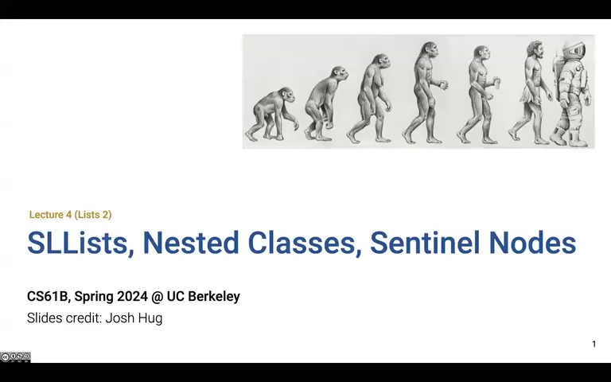 |
| [00:11](https://www.bilibili.com/video/BV1QP4y1u7jv/?p=15&t=11) 或者别的什么如果你好奇视频和录音有什么区别 | 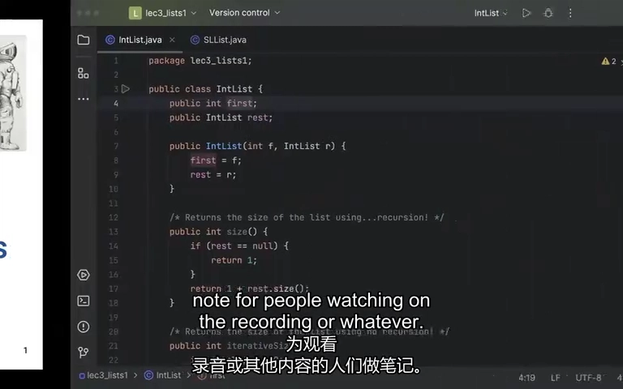 |
| [00:16](https://www.bilibili.com/video/BV1QP4y1u7jv/?p=15&t=16) 录像是乔希·哈格做的一堆预先录制的讲座我们以前教这个班仍然教导有时候录音就是这个直播讲座的录音但对于我们所讲的大多数课程来说，它们基本上是相同的所以万一你现在糊涂了你知道的 | 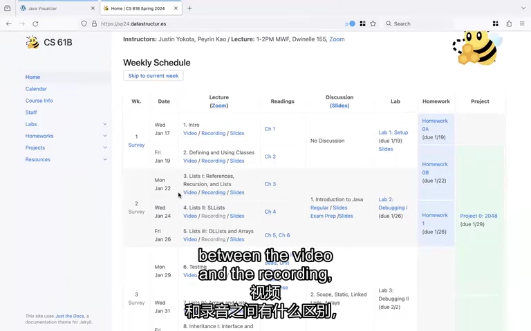 |
| [00:38](https://www.bilibili.com/video/BV1QP4y1u7jv/?p=15&t=38) 好啦是因为人们还在谈论 | 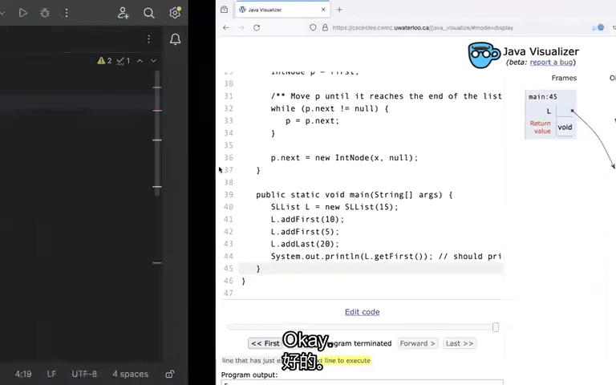 |
| [00:43](https://www.bilibili.com/video/BV1QP4y1u7jv/?p=15&t=43) 大家都准备好了吗你要对着麦克风尖叫吗我今天有很多掩护好啦我们开始吧是呀你拿到了好啦我今天有很多事要做所以我要走了 | 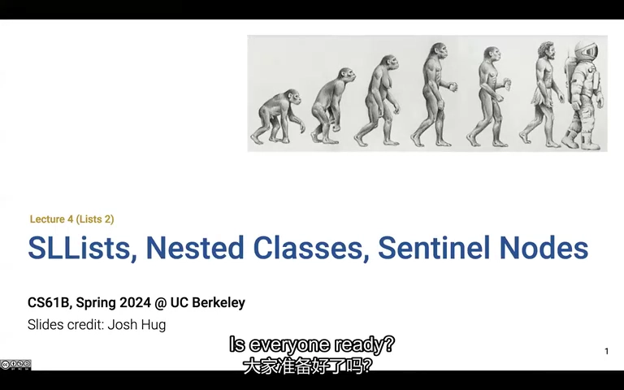 |
| [01:02](https://www.bilibili.com/video/BV1QP4y1u7jv/?p=15&t=62) 上次我们给你们看的是 | 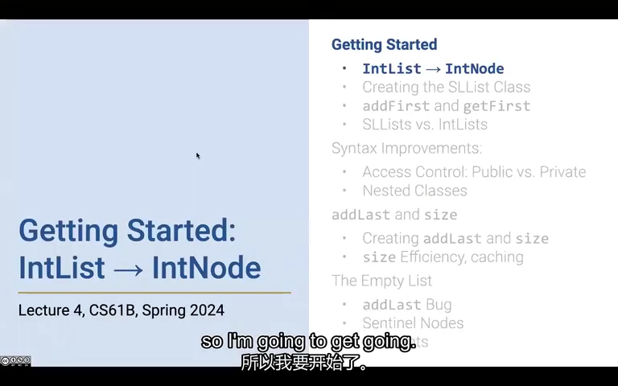 |
| [01:07](https://www.bilibili.com/video/BV1QP4y1u7jv/?p=15&t=67) 结束列表它作为一个功能完美的列表工作这是一系列的项目我能问一下中间似乎有很多座位就在那里每个人都能挤进去一点这样就有更多的空间给来做同样事情的人我想有一堆脚对呀旁边有几个人我们处理完交通了吗交通信号好啦这节课能准时开始吗？ | 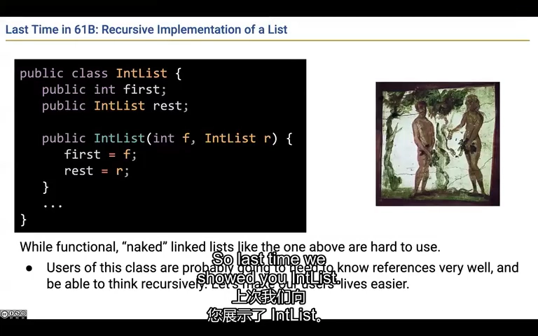 |
| [01:47](https://www.bilibili.com/video/BV1QP4y1u7jv/?p=15&t=107) 我们好吗是啊，是啊好啦就像我之前说的，我被粗鲁地打断了最后一堂课我们建立了名单无尽的工作就像任何名单一样所以在前面有一个项目后面有一件物品您可以将项目添加到前面将项目添加到后面你可以得到项目这是我们上次的名单但我们没看到的东西上次结果这个endlist就是我所说的裸递归数据结构当我们谈论它的时候，我们会更好地理解这意味着什么所以今天的课都是关于寻找衣服我们将努力改进名单 | 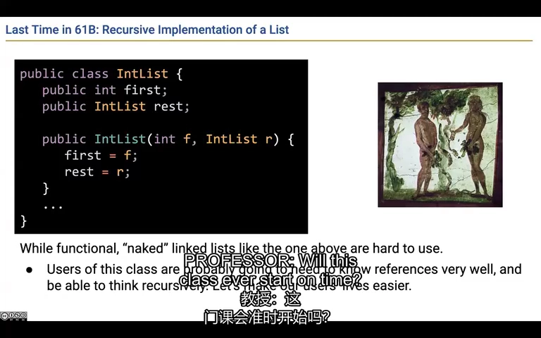 |
| [02:27](https://www.bilibili.com/video/BV1QP4y1u7jv/?p=15&t=147) 制作一些与Java程序员倾向于使用的更传统的东西我是说裸体什么的没什么不好你知道的这取决于你的文化在Java文化中，人们倾向于不编写这样的类是裸递归的所以今天我们要尝试写一个新版本的列表那对我们的用户来说更容易使用好啦 | 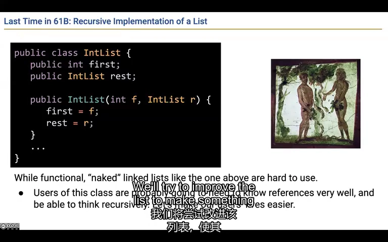 |
| [02:48](https://www.bilibili.com/video/BV1QP4y1u7jv/?p=15&t=168) 那是我们的目标所以我要跳到英特尔我写了很多代码所以这就是我们无尽的代码 | 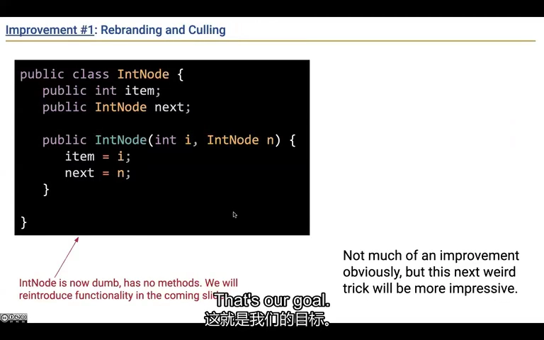 |
| [02:53](https://www.bilibili.com/video/BV1QP4y1u7jv/?p=15&t=173) 从上次开始，它有我们上次写的size方法，迭代size所有的好东西所以我要做的第一件事这似乎不是很明显的进步 | 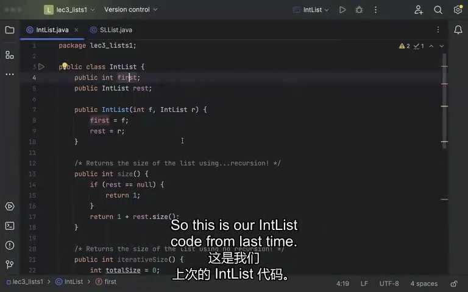 |
| [03:01](https://www.bilibili.com/video/BV1QP4y1u7jv/?p=15&t=181) 但最终会是的我实际上只是删除所有的方法 | 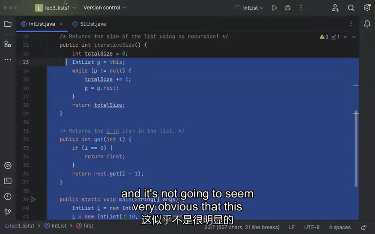 |
| [03:06](https://www.bilibili.com/video/BV1QP4y1u7jv/?p=15&t=186) 我们正在做一些重塑品牌的努力我们要把它弄得漂亮一点所以我们可以建立我们新的和改进的服装版本的名单所以我要重新命名一下所以我要选择你知道吗，我实际上不希望这件事被称为它的名单我想把它叫做节点所以我会这么做然后不是先叫这些然后休息完全没问题我要选择称它们为项目下一个为什么好我看过这个讲座我知道结局我认为这些都是好名字这绝对不是立即明显的好啦我得把文件改成int节点有用吗 | 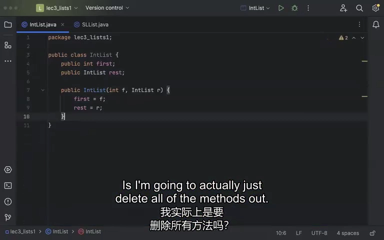 |
| [03:46](https://www.bilibili.com/video/BV1QP4y1u7jv/?p=15&t=226) 我想把它改成模式好啦我的名字呢？节点正常所以只是一点点重塑品牌的努力不要太狂野我们删除了一些方法我们把它改名为 | 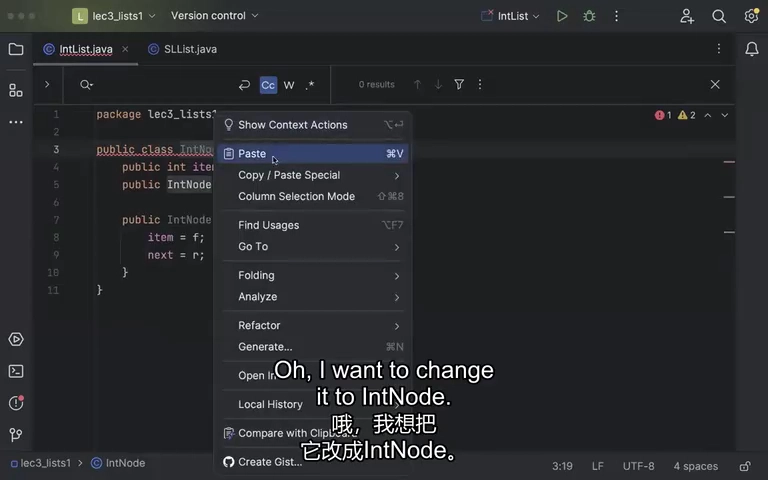 |
| [04:00](https://www.bilibili.com/video/BV1QP4y1u7jv/?p=15&t=240) 原来如此我们重新命名的方法我们删除了一些方法我向你保证一切都会好起来的 | 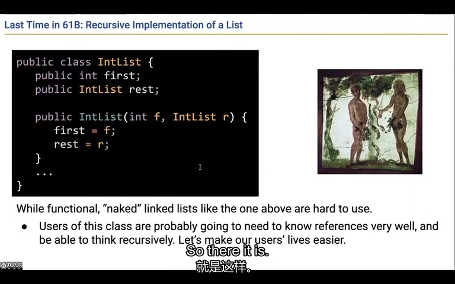 |
| [04:05](https://www.bilibili.com/video/BV1QP4y1u7jv/?p=15&t=245) 即使看起来我们刚刚毁了我们上次做的所有工作 | 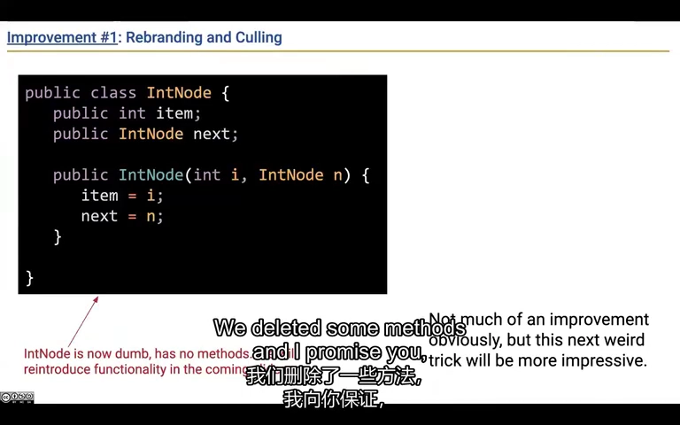 |
| [04:12](https://www.bilibili.com/video/BV1QP4y1u7jv/?p=15&t=252) 现在呢让我们去做一些更多的事情所以我们删除了一堆方法我们去把他们带回来但是没有把它们带回int节点类 | 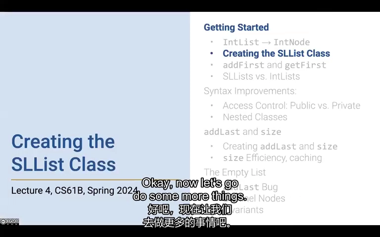 |
| [04:17](https://www.bilibili.com/video/BV1QP4y1u7jv/?p=15&t=257) 我实际上要开始一个新的类，叫做s list或sl list我向你保证你最终会明白这代表什么所以让我们开始写一些更容易让我们的用户使用的东西所以我将从添加一个int节点实例变量开始因此，所有的s列表都将有一个int节点实例变量我要先打电话给它现在我们将为我们的用户提供一种创建新s列表的方法所以用户想创建一个全新的列表他们应该如何做好这件事他们应该打电话给我的得心应手的花花公子建设者这将为他们建立一个新的名单事实上，我甚至读了一条评论只是为了确定因此，这将创建一个包含一项的新s列表 | 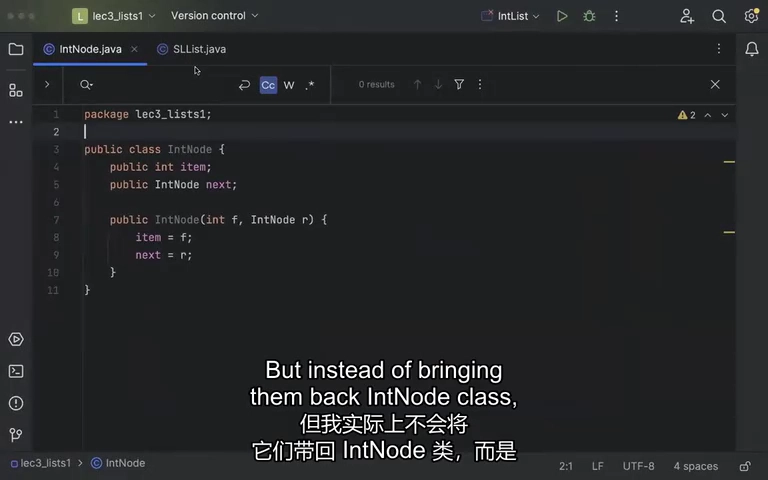 |
| [04:57](https://www.bilibili.com/video/BV1QP4y1u7jv/?p=15&t=297) 其中一项是用户提供的x所以说如何创建新的S列表嗯我记得上次所以你可以回到上次的无尽代码把它挖出来看看您可能还记得上次的代码是这样的我们会说我声明有一个新的int节点它的项是x这就是清单上的东西其余的都是空的因为没有其他东西这就是上次的代码好啦那么我实际上如何使用这个东西我创建了一个构造函数用户如何如果我把这个s list类公之于众他们会如何第一次创建一个全新的名单嗯可能是这样的 | 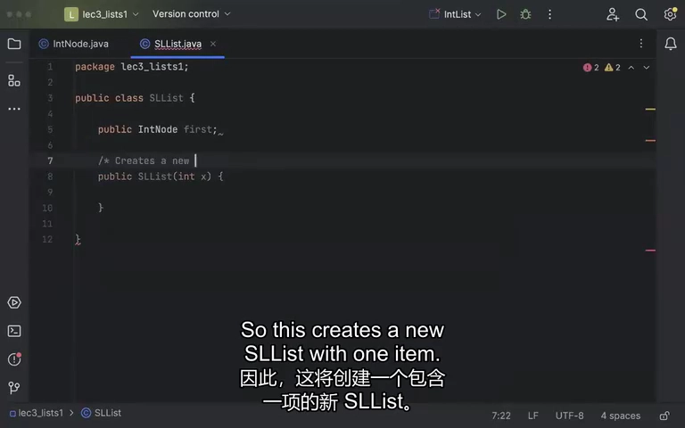 |
| [05:37](https://www.bilibili.com/video/BV1QP4y1u7jv/?p=15&t=337) 他们可能会说我想要一个新的名单我把它叫做他们会说我想要一个新的名单所以我会做构造函数他们可能会说我希望它有一个项目它是五个看起来很棒如果我运行它我会得到一份新的名单不是说你能在你知道终端但它最终会编译并告诉你有一个新的S名单有五个 | 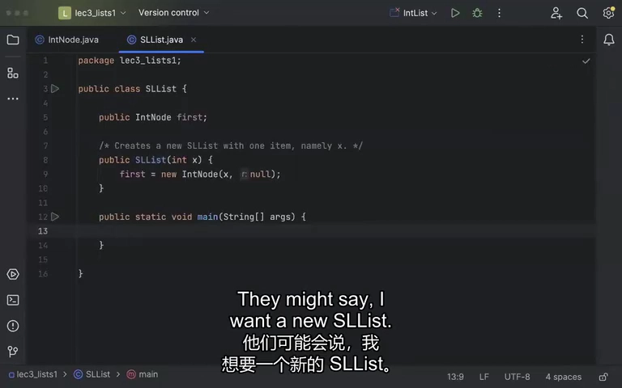 |
| [05:59](https://www.bilibili.com/video/BV1QP4y1u7jv/?p=15&t=359) 至少要编译好啦那么这一切的意义是什么呢好像我们什么都没做 | 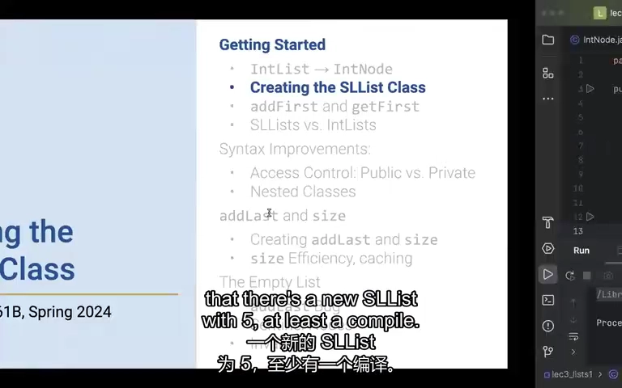 |
| [06:04](https://www.bilibili.com/video/BV1QP4y1u7jv/?p=15&t=364) 但是让我们仔细看看用户是如何使用it列表的以及用户将如何使用我们全新的s列表看看我们能不能开始弄清楚整个赤裸裸的递归数据结构隐喻是关于所以如果我看inlist如果用户想创建一个全新的in列表他们必须写这一行代码他们必须说inlist x等于new在列表中10个逗号空换句话说使用int列表的人他们必须对递归有相当深刻的理解因为递归就在那里就在裸递归数据结构的袖子上供用户思考因此当用户使用inlist时他们必须考虑递归 | 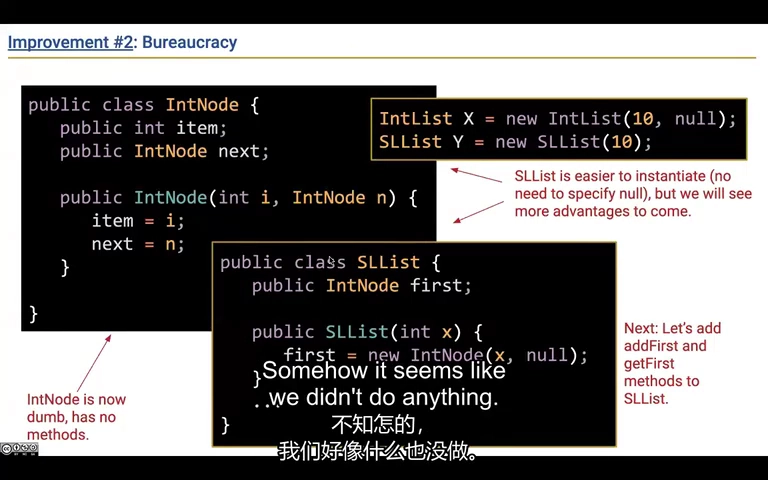 |
| [06:44](https://www.bilibili.com/video/BV1QP4y1u7jv/?p=15&t=404) 就在那儿他们必须为列表的其余部分指定NULL相比之下如果您使用的是s列表您不必指定NULL因为我们把它藏在构造器里所以如果我想要一个全新的名单我刚说了新的十项我已经完成了剩下的清单我们刚刚编写的代码将为我们处理所有奇怪的空递归数据结构的东西所以在某种程度上，s列表对某人来说会更容易使用因为他们不需要认真考虑所有正在进行的递归我们给了用户更容易使用的方法这就是我们今天的目标我们将在这个数据结构中添加服装这样用户就不必认真考虑裸体 | 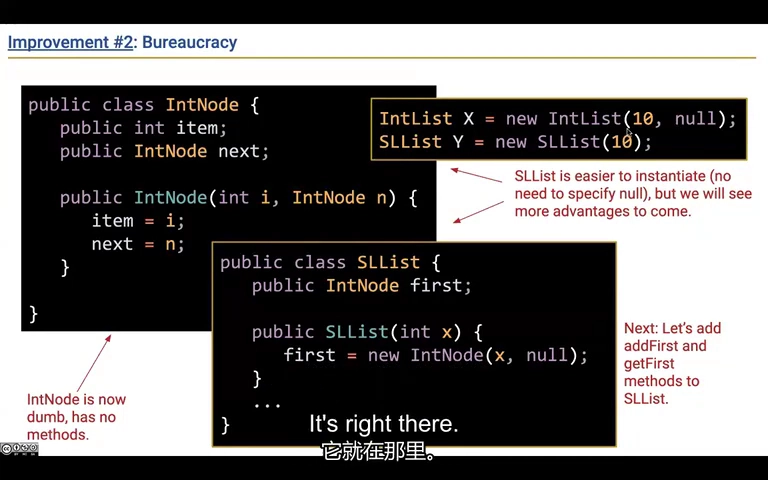 |
| [07:24](https://www.bilibili.com/video/BV1QP4y1u7jv/?p=15&t=444) 递归数据结构及其工作原理我们可以给他们所有这些更容易使用的好方法所以看起来不是很大的进步但这是我们正在做的事情的味道今天剩下的问题思想每个人都很熟悉裸体服装所有的好东西好啦我们继续走我拿走了一堆方法让我们开始把它们加回来所以上次我们有先来后到 |  |
| [07:52](https://www.bilibili.com/video/BV1QP4y1u7jv/?p=15&t=472) 我们去写那些吧所以我将编写一个方法，首先调用 | 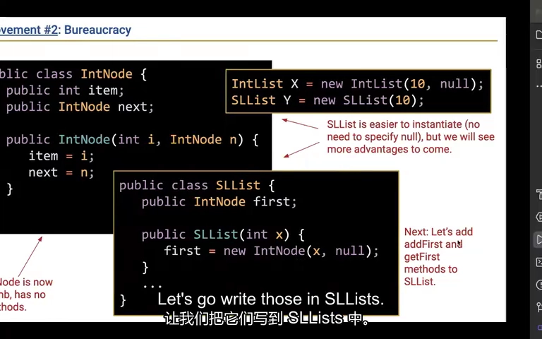 |
| [07:57](https://www.bilibili.com/video/BV1QP4y1u7jv/?p=15&t=477) 什么都不回所以我不得不说虚空和好它是做什么的它在列表的开头添加了一些东西事实上，对此有很多评论将项X添加到列表的前面好啦嗯我怎么再写好你可以试着好好想想但我要回到上次的列表代码因为我们上次写了这样的东西还记得上次吗我是如何在列表的前面添加一些东西的是这样的就像一开始等于新的int节点x逗号优先如果这看起来不熟悉上次我们花了更多的时间来想象这样我就可以回去看看了但事实证明，这将把项目X添加到列表的前面 | 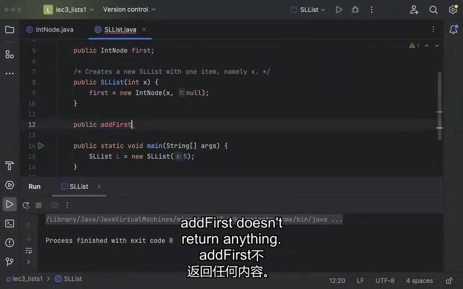 |
| [08:37](https://www.bilibili.com/video/BV1QP4y1u7jv/?p=15&t=517) 好的很好先打井怎么样这将得到列表中的第一项好啦公众优先也是如此为什么是int因为它会返回一个整数我不需要争论那么我该如何做好这件事呢第一件我不退因为第一个是int节点我想要第一个所以第一个节点所以我会退回第一件东西好的很好让我们看看它是否有效所以我只写一点演示所以一开始我会说也许我不喜欢也许我会在前面放十个因为我觉得然后我看看能不能把第一件东西拿出来所以我会做系统点出来点印，我们看看能不能把10分拿出来如果我们不这样做 | 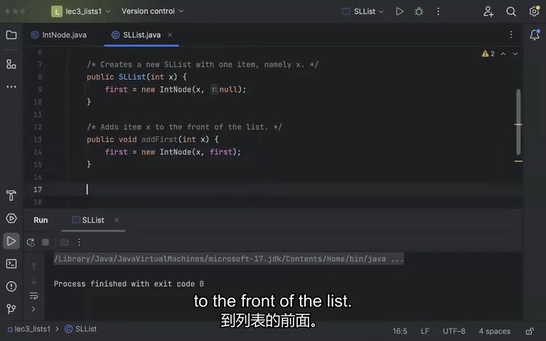 |
| [09:17](https://www.bilibili.com/video/BV1QP4y1u7jv/?p=15&t=557) 那就该恐慌了因为我希望得到十分好啦有十佳 | 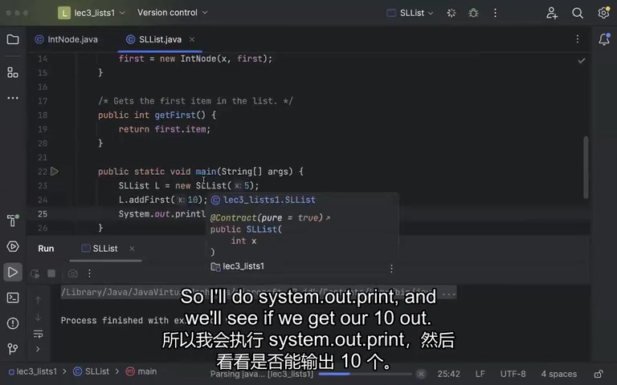 |
| [09:22](https://www.bilibili.com/video/BV1QP4y1u7jv/?p=15&t=562) 你想让我怎么做想让我放大甚至更多好啦 | 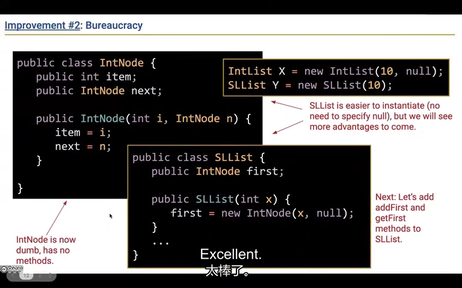 |
| [09:27](https://www.bilibili.com/video/BV1QP4y1u7jv/?p=15&t=567) 增加亮度我不知道怎么增加亮度我们会花三十分钟来增加亮度 | 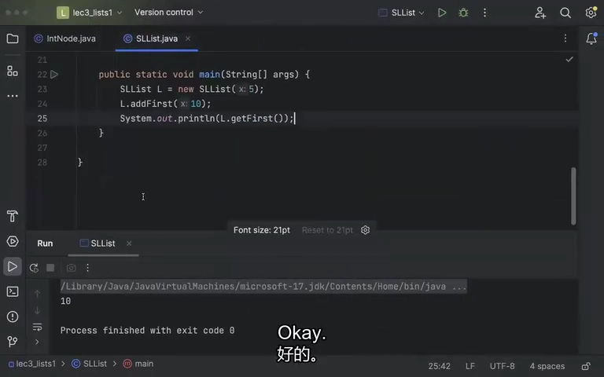 |
| [09:32](https://www.bilibili.com/video/BV1QP4y1u7jv/?p=15&t=572) 好啦但下次我们可以增加否则我会把它弄得像令人眼花缭乱的白色下次大家好 | 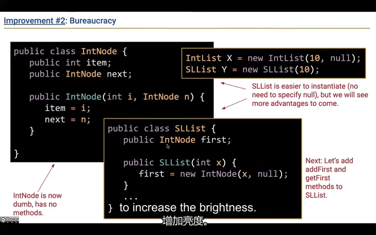 |
| [09:37](https://www.bilibili.com/video/BV1QP4y1u7jv/?p=15&t=577) 那是一开始，那是第一个所以现在我们的s列表有了一些新的方法 | 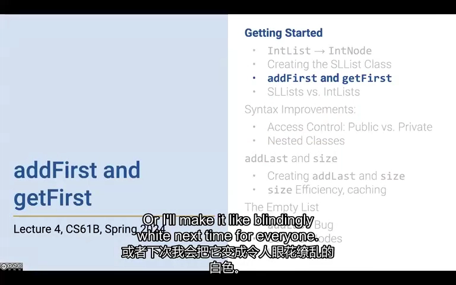 |
| [09:42](https://www.bilibili.com/video/BV1QP4y1u7jv/?p=15&t=582) 我们可以用这一小段代码来检查它们是否有效太好了，又来了 | 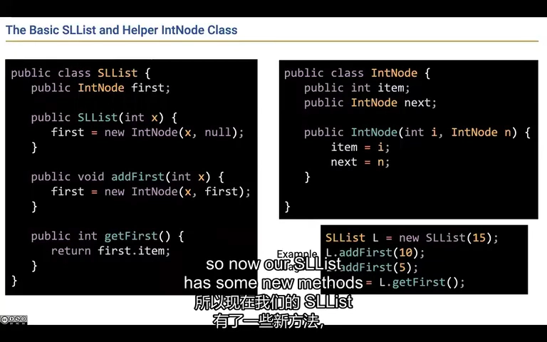 |
| [09:47](https://www.bilibili.com/video/BV1QP4y1u7jv/?p=15&t=587) 我们为什么能做好这件事如果我们看看你是如何使用列表的 | 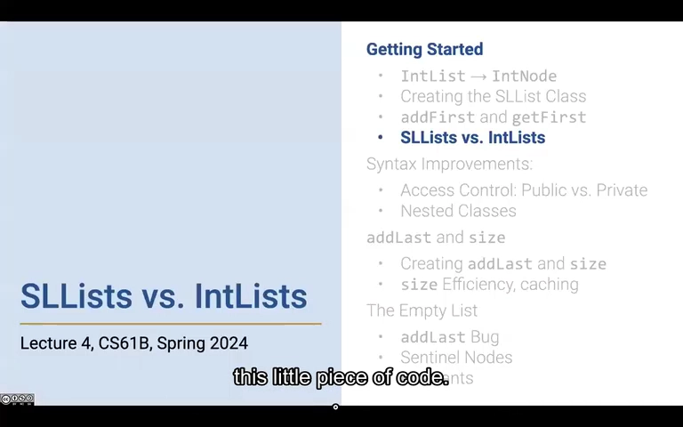 |
| [09:52](https://www.bilibili.com/video/BV1QP4y1u7jv/?p=15&t=592) 我们开始有线索了这个新的S列表对用户来说更容易所以如果我使用一个int列表，我想向它添加项目我得写这样的代码L在列表中的10个逗号中等于new如果你对递归有深刻的理解这可能没问题有些用户确实更喜欢这样做希望左边的代码在那里我可以说我在前10点我在前五个点不知何故，这对用户来说更自然一点他们不必考虑深度递归在数据结构的腹部一路进行这就是我们今天的目标而不是有看起来像右边代码的代码 | 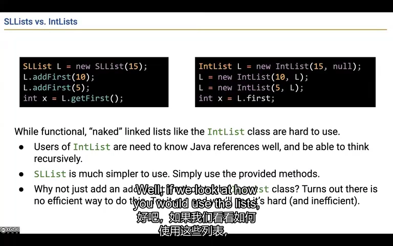 |
| [10:32](https://www.bilibili.com/video/BV1QP4y1u7jv/?p=15&t=632) 其中用户必须处理递归每次他们想使用数据结构我们将把递归隐藏在这个较少的数据结构后面现在用户不必考虑递归他们可以说我想加十个，我想加五个我想得到第一件事他们都准备好了 | 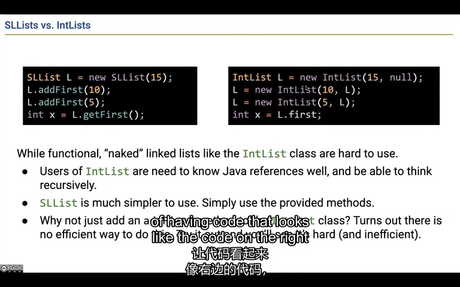 |
| [10:50](https://www.bilibili.com/video/BV1QP4y1u7jv/?p=15&t=650) 这是它的另一张照片所以在顶部我们有inlist这是裸递归数据结构当用户想要使用inlist时我们给他们直接进入递归数据结构的原始指针所以用户必须考虑第一个和其余的他们必须考虑所有节点之间的递归链接相比之下如果我看S列表这是较少的对象你可以把它想象成一个中间人是那个人，你走过去和我说话，你说嘿嘿我不想先考虑加法因为那真的很难你替我想想这个中间人会说当然我将为您深入到递归数据结构中我会做所有复杂的递归调用来添加第一个或获取第一个 | 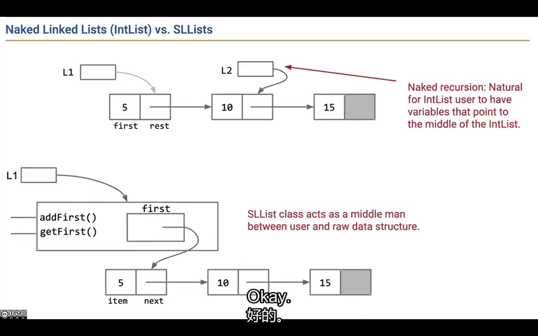 |
| [11:30](https://www.bilibili.com/video/BV1QP4y1u7jv/?p=15&t=690) 这个底部结构的好处是而不是自己处理递归链接你可以走到中间人面前，说你先做加法然后这个中间人会帮我们做好啦伟大的还有别的吗？你想知道我们到目前为止有什么吗？在我加入更多的方法之前 | 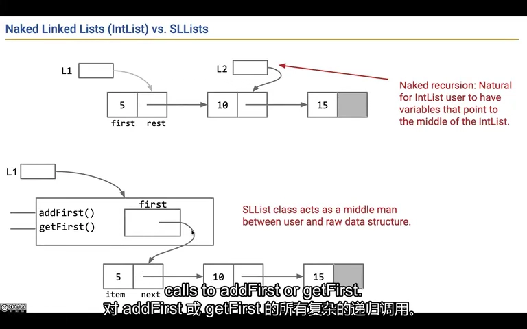 |
| [11:49](https://www.bilibili.com/video/BV1QP4y1u7jv/?p=15&t=709) 让我们再加点东西所以在这一点上，我们有几个改进 | 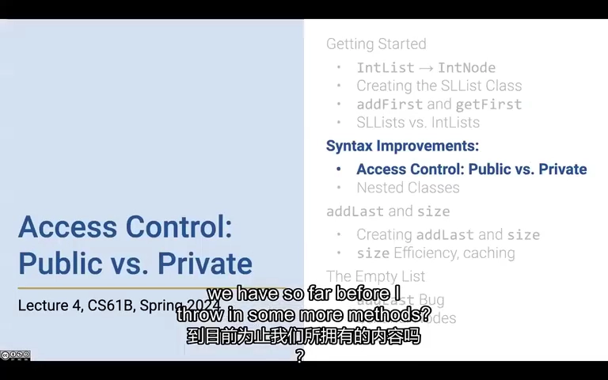 |
| [11:54](https://www.bilibili.com/video/BV1QP4y1u7jv/?p=15&t=714) 我们添加了at first和get first方法出了点小问题我们已经看到了这很好如果用户使用我们的方法所以不管我给谁S加2他们一开始可以打电话然后十个会出现在前面，这一切都很好但是如果用户不想使用我的方法怎么办也许用户想深入s列表数据结构本身他们想做自己的事所以也许有人走过来说你知道吗我不会用你的方法我要用我自己的想法我要先把手伸进l dot我会说我是第一个下一个等于l点先下所以他们直接进入数据结构并做一些修改 | 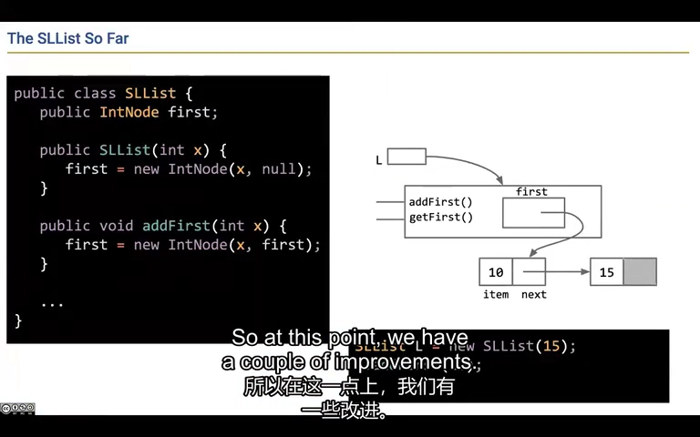 |
| [12:34](https://www.bilibili.com/video/BV1QP4y1u7jv/?p=15&t=754) 也许一些我们不想要的修改所以你可以试着思考思考这有什么用呢我们会说我第一个点，下一个点，下一个点哪个方块等于l点下一个点嗯，如果我，你知道第一步，看看会发生什么我们把名单给毁了因为这个列表现在有一个指向它自己的下一个这不是列表应该做的通过允许用户直接进入我的列表我们给了他们一个搞砸的机会我们创建的这个美丽的列表结构我不希望用户能够做到这一点我希望用户使用我提供的方法 | 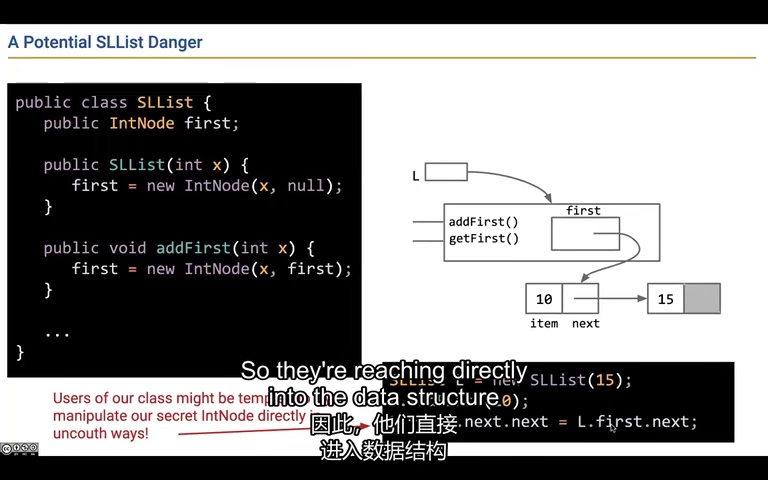 |
| [13:14](https://www.bilibili.com/video/BV1QP4y1u7jv/?p=15&t=794) 就像一开始我不想让他们进入我的名单试着一开始把一切都搞砸，创造出这个你知道完全崩溃的名单那么我如何告诉用户不要做得那么好呢 | 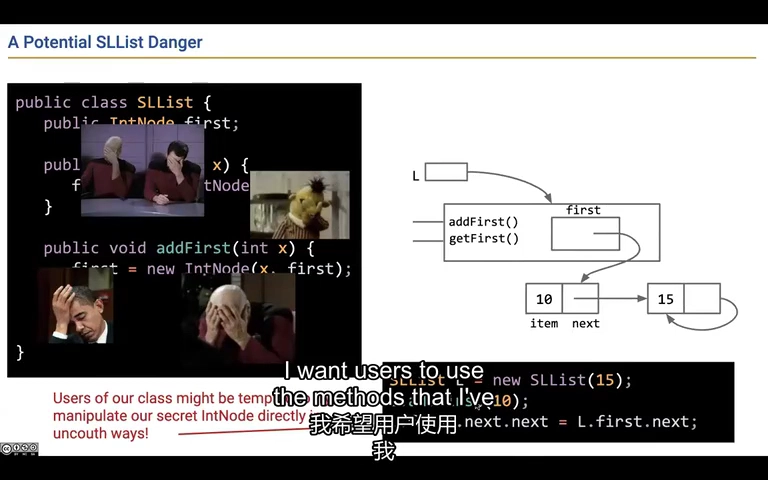 |
| [13:25](https://www.bilibili.com/video/BV1QP4y1u7jv/?p=15&t=805) 有几件事我可以这么做我能做的一件事就是我可以进来我可以写作亲爱的用户千万不要碰这个所以你可以这么做但您很可能知道用户不会阅读这篇文章他们仍然可能会搞砸你的第一次所以不是在代码中给用户写一封信我们实际上可以把这个词公之于众我们一直把它当作一个神奇的词我们实际上可以用私人的代替它 | 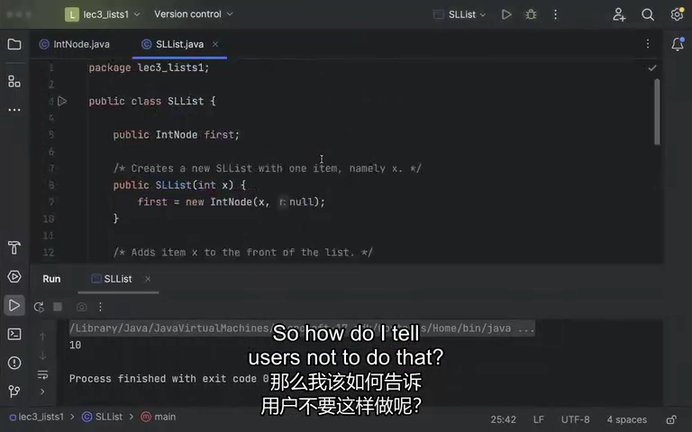 |
| [13:54](https://www.bilibili.com/video/BV1QP4y1u7jv/?p=15&t=834) 那么这样做有什么好处呢如果我用public关键字替换为private关键字 | 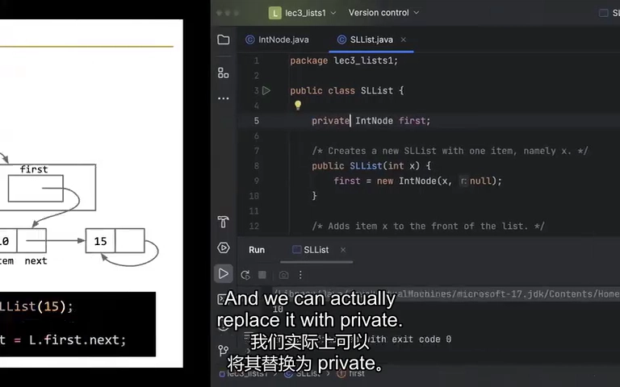 |
| [13:59](https://www.bilibili.com/video/BV1QP4y1u7jv/?p=15&t=839) 现在发生的情况是，s list类之外的用户所以如果我有另一个类使用s列表他们不会被允许先进入事实上，如果他们试图先进入所以如果s list类以外的人先写一些古怪的代码，比如l dot下一个点下一口井然后编译器会停下来说事实上，你不能先这样做，作为私人访问您不允许访问此因此，这段代码不仅自我记录了单词private，还提醒了您当你读代码的时候嘿嘿如果你不知道你在做什么别碰那个但编译器也会为您强制执行它会检查并确保你没有访问私人东西 | 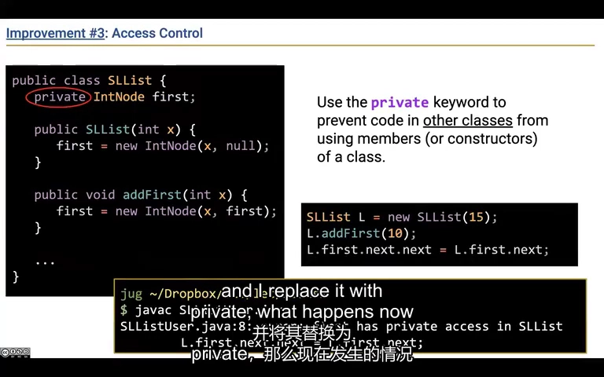 |
| [14:39](https://www.bilibili.com/video/BV1QP4y1u7jv/?p=15&t=879) 如果你真的访问了它编译器会对你大喊大叫说不你不能那么做所以这就是私人的好处 | 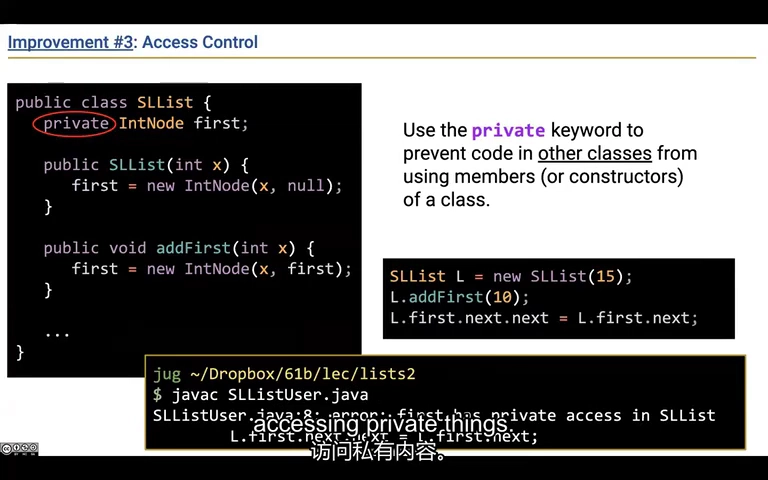 |
| [14:46](https://www.bilibili.com/video/BV1QP4y1u7jv/?p=15&t=886) 那么私人有什么意义呢除了到目前为止我为你画的这种故事 | 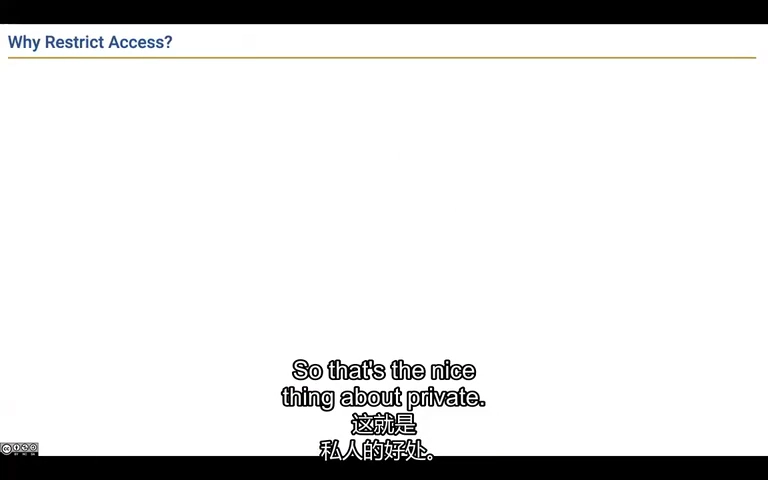 |
| [14:51](https://www.bilibili.com/video/BV1QP4y1u7jv/?p=15&t=891) 画故事当然可以那么私人有什么用呢除了到目前为止我给你讲的故事之外 | 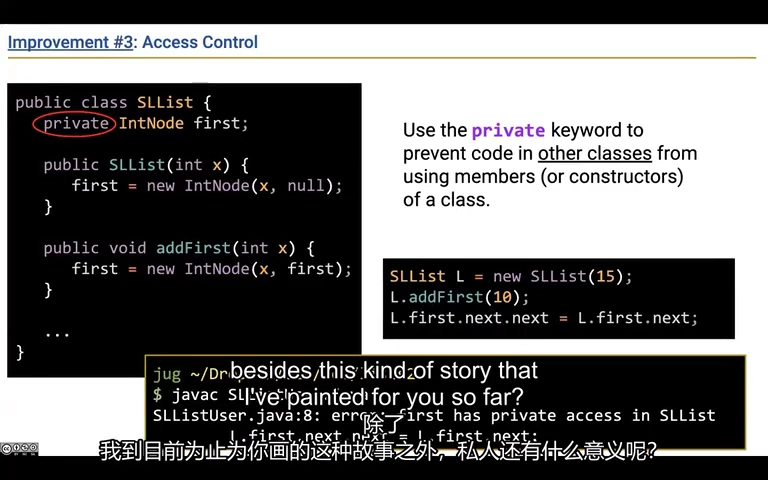 |
| [14:57](https://www.bilibili.com/video/BV1QP4y1u7jv/?p=15&t=897) 事实证明，这是我们将一遍又一遍地看到的事情同样是60和B的大主题之一这个想法是当我使用一个s less对象时我不一定要了解整个物体是如何工作的事实上计算机科学中最强大的想法之一，让你建立真正大的复杂程序就是当您能够对使用您的类或对象的人隐藏实现细节时为什么这个好因为现在使用S的人更少不必考虑第一个实例变量和递归数据结构他们没有太多的时间去想别的事情我们将看到的是您还可以更改私有方法 | 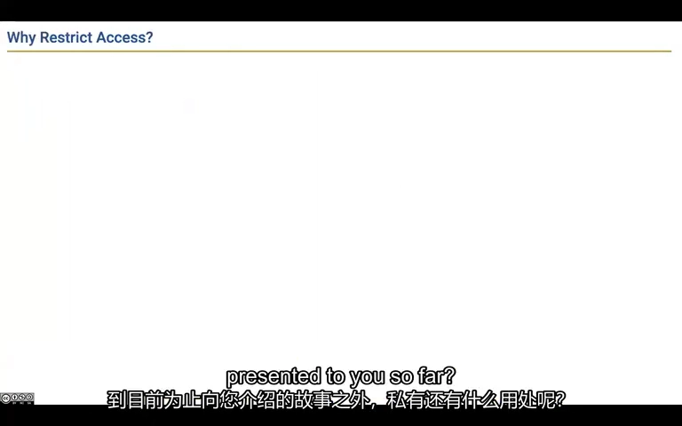 |
| [15:37](https://www.bilibili.com/video/BV1QP4y1u7jv/?p=15&t=937) 为什么换了就安全了哎呀哎呀为什么更改私有实例变量或私有方法是安全的 | 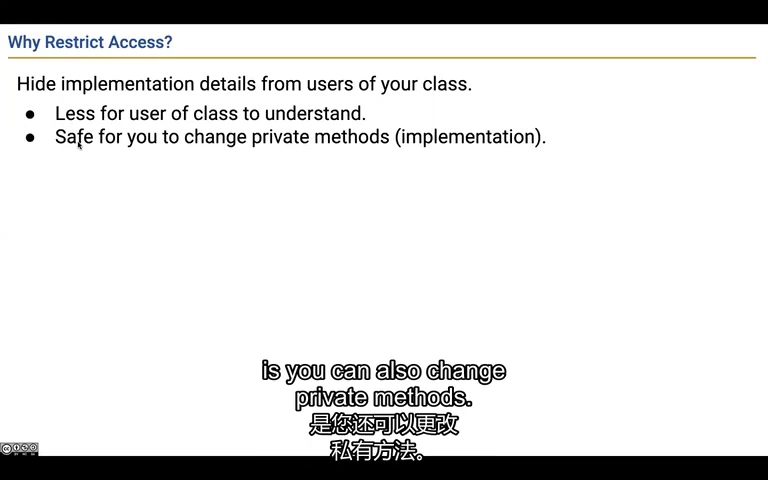 |
| [15:42](https://www.bilibili.com/video/BV1QP4y1u7jv/?p=15&t=942) 因为外面没人会用它们 | 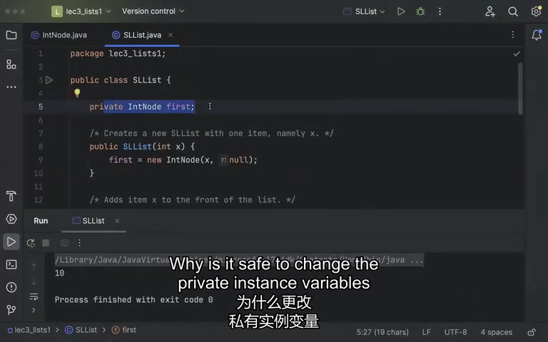 |
| [15:47](https://www.bilibili.com/video/BV1QP4y1u7jv/?p=15&t=947) 所以也许这听起来有点抽象所以我给你一个类比我想这是另一个汽车类比所以在车里有些部分是公开的这些都是汽车使用者必须使用的东西与汽车互动，让它做一些事情所以就像花瓣一样有一个是用来开快车的有一个是用来慢的有一个方向盘你把它转左钩车希望是左边你明白了吧但汽车的某些部分也是私人的这些不应该被汽车的用户访问例如，你的车可能有某种燃油管路或旋转阀我不知道你怎么样你知道当你开车的时候你可能没有好好思考燃油喷射呢我不认为人们认为当他们开车的时候所以汽车的这些私处 |  |
| [16:27](https://www.bilibili.com/video/BV1QP4y1u7jv/?p=15&t=987) 用户不必考虑他们因为他们在用车所以公共部分是有区别的这是用户用来与对象和私有部分交互的这些是真正让汽车行驶的东西但我们不必去想他们当我们和它互动的时候否则这车就很难开了我想其他一些小注释是关于私有变量的一些好的地方因为我们可以改变他们所以，也许你可以把你的车机械师机械师可以说你知道吗我要把你的油管拿走我要把它换成电池所以现在它是一辆电动汽车嗯没关系你还可以开车因为公共方法还在你仍然以同样的方式与汽车互动即使有人拿走了这些私人实现细节并将其交换出去 |  |
| [17:07](https://www.bilibili.com/video/BV1QP4y1u7jv/?p=15&t=1027) 从汽油车到电动车或者像仓鼠在轮子上奔跑我不知道事情是这样的，我想现在是这样了但是如果您有公共方法最后我要说的是您可能不想删除它们因为如果我把这辆车公之于众然后我把它拿给机械师机械师删除方向盘嗯突然间你可能不想再开车了也许他们把它给你就像一些操纵杆但我想你不会想开的所以这里的想法是如果您向世界发布代码，而其他人正在使用您的公共方法您可能不想删除或更改它们 |  |
| [17:47](https://www.bilibili.com/video/BV1QP4y1u7jv/?p=15&t=1067) 否则，您的公共方法的用户将很难调整所以这是一种类比这是我们会一遍又一遍地看到的事情实现细节是有区别的用户不必知道如何使用对象以及用户将要使用的与之交互的公共方法好啦我说了很多关于汽车或门禁的问题私有关键字很酷，变焦上的任何我应该知道的事情好的，好的最后一件事我要注意我想我已经说过了我已经说过了但最后我要指出的最后一件事是，即使我们有私人这个词这并不意味着用户不能访问它 |  |
| [18:27](https://www.bilibili.com/video/BV1QP4y1u7jv/?p=15&t=1107) 如果他们真的想所以说如果用户想要邪恶或恶意他们可能仍然可以挖掘您的代码并找到私有实例变量其实呢Java有一个有趣的库，称为反射库这是非常奇怪和怪异的这将允许您访问私有实例变量所以我们称之为隐私并不意味着这是一种安全措施它更多的是对使用您的代码的人的提醒你也许不该碰这个如果你不是想作恶把事情搞砸好吧，所以隐私并不意味着它可以抵御敌人这只是意味着用户不应该碰它如果他们不知道自己在做什么就像你开车你不知道你在做什么你可能不应该去碰燃油管路好的问题 |  |
| [19:07](https://www.bilibili.com/video/BV1QP4y1u7jv/?p=15&t=1147) 好啦当然，你把我转到后面的某个地方了他们改变了方向好啦哈喽是呀你有问题吗或者你会喜欢选我去别的地方好啦有什么问题我想把私人这个词改成什么 |  |
| [19:27](https://www.bilibili.com/video/BV1QP4y1u7jv/?p=15&t=1167) （此区间无字幕） |  |
| [19:32](https://www.bilibili.com/video/BV1QP4y1u7jv/?p=15&t=1172) 对呀所以这是另一个很好的观点如果有人给你一份图书馆的副本您当然可以进入库，只需将代码改为public现在你可以访问它所以这是一个很好的观点这再次表明，更多的私人并没有试图阻止攻击者它应该更像是一个提醒如果你不知道自己在做什么或者你不是想改变无尽的作品或s列表作品你可能不想碰这个关键词贾斯汀复活了你有话要说吗同时指出你可以对着麦克风说话就像和我说话一样好啦我还想指出，总的来说你实际上不能访问源代码大多数时候我们不发送源代码 |  |
| [20:12](https://www.bilibili.com/video/BV1QP4y1u7jv/?p=15&t=1212) 我们只是给您一个已经通过的代码的编译版本很多喜欢咀嚼，让它更有效率所以就像私人关键字实际上完全消失了你再也没有机会如果你不像原始源代码冷静的智慧 |  |
| [20:29](https://www.bilibili.com/video/BV1QP4y1u7jv/?p=15&t=1229) 好啦好极了好问题还有其他问题吗？ |  |
| [20:34](https://www.bilibili.com/video/BV1QP4y1u7jv/?p=15&t=1234) 好极了所以这是一个非常大的想法我们会一遍又一遍地看到好啦 |  |
| [20:39](https://www.bilibili.com/video/BV1QP4y1u7jv/?p=15&t=1239) 我再做一个小小的改进这个会感觉有点奇怪但事实证明它在Java中是完全有效的 |  |
| [20:44](https://www.bilibili.com/video/BV1QP4y1u7jv/?p=15&t=1244) 所以我要注意的一件事是，这个int节点类有点寂寞了这里面没有方法事实上，没有理由使用这个int节点类除非在s列表的上下文中所以如果你考虑尾注这并不是一个单独的项目用户将尝试与用户交互永远不会触及int节点您几乎可以把它节点看作是s list类的一个特性所以在这种情况下我在节点中有另一个类它并不是它自己的独立类这就像是s list类的一个特性我实际上可以把这个代码我可以抄也可以剪我可以把它粘贴到s list类中 |  |
| [21:24](https://www.bilibili.com/video/BV1QP4y1u7jv/?p=15&t=1284) 创建嵌套类这其实完全没问题即使一开始看起来有点奇怪 |  |
| [21:30](https://www.bilibili.com/video/BV1QP4y1u7jv/?p=15&t=1290) 所以我们所做的第二个改进是我们意识到你知道这个int节点类 |  |
| [21:35](https://www.bilibili.com/video/BV1QP4y1u7jv/?p=15&t=1295) 这不是它自己独立的东西用户自己永远不会尝试使用no类所以我可以把这个代码把它复制到这里结果一切都会一样它只是使我的代码更有条理而不是将s列表和in节点分发给我的用户我可以只给他们一个类，int节点已经捆绑在里面了所以这很好 |  |
| [22:01](https://www.bilibili.com/video/BV1QP4y1u7jv/?p=15&t=1321) 另一个小的改进所以在这一点上我们肯定会进入微小改进的杂草中我们可以做一个所以说如果你要退房的话我们在这一点上有点进入琐事但由于人们有时会要求更多的改进我可以让s list类之外的用户甚至不必知道它的笔记所以我可以把这门课私密化把这件事保密s列表之外的用户甚至不必访问或了解int节点这可能是你想要的或者如果你想公开也许我不知道你为什么这么做很奇怪但也许你想让外面的用户就像弄个IT节点什么的在这种情况下，你必须把它公之于众但是如果类之外的用户永远不必使用int节点 |  |
| [22:41](https://www.bilibili.com/video/BV1QP4y1u7jv/?p=15&t=1361) 私密一点没关系其他微小的琐事细节它们不是要记住的东西但仅仅因为人们总是好奇如果将此嵌套类设置为私有这些访问修饰符不再重要所以Java将把这些或多或少地视为私有它不会在乎这些的最后一个音符会让人有点困惑但情报部门坚持要我谈这件事我想我也可以让这个静态就像等一下在所有这些奇怪的地方都会出现静态这个词所以我不打算谈太多乔希·霍克有一段更详细的视频但基本上如果你让这个静态这意味着内部的实例变量无法访问外部类的元素 |  |
| [23:21](https://www.bilibili.com/video/BV1QP4y1u7jv/?p=15&t=1401) 所以现在在节点里面我不能再先访问了因为那是在外面如果你让它静态事情就是这样但绝对不是重要的细节如果你明白，我从IT节点获取代码，并将其复制到这里那么这部分你们都准备好了关于我的其他想法或问题 |  |
| [23:38](https://www.bilibili.com/video/BV1QP4y1u7jv/?p=15&t=1418) 将此代码复制到 |  |
| [23:44](https://www.bilibili.com/video/BV1QP4y1u7jv/?p=15&t=1424) 所以你想让我保密你想让我把课堂公之于众我不知道我喜欢转向贾斯汀因为我觉得你会知道发生了什么如果我将实例变量设置为私有但我保持课堂公开你就可以让它在外面结点您将无法访问下一个项目好啦嗯你听到了你听到了那个人所以在这个位置你可以读进去不能用它做任何事一旦你完成了激动人心好啦我不知道你为什么那样做但我想这是可能的我再拿一个 |  |
| [24:24](https://www.bilibili.com/video/BV1QP4y1u7jv/?p=15&t=1464) 是啊，是啊有一个很好的问题这就是如何在s列表之外创建一个int节点在这种情况下，你不会，因为它被标记为私人我想如果你真的想喜欢这个您可能会使用一些语法，比如节点中的s list dot或其他什么但是会有点奇怪我想在这种情况下，最自然的事情是保密外部类永远不会使用s或in节点好啦好问题虽然你就像 |  |
| [24:50](https://www.bilibili.com/video/BV1QP4y1u7jv/?p=15&t=1490) 你真的在用这些晦涩难懂的Java和文本注释来考验我 |  |
| [24:55](https://www.bilibili.com/video/BV1QP4y1u7jv/?p=15&t=1495) 希望我做到了好啦那么为什么嵌套类它们为什么有用他们很棒因为有时候类不是独立的在某些情况下，纸条例如，实际上只是s列表的一个子特性所以我们要把代码我们会把它复制到s列表中感觉还不错但如果你不喜欢你也可以把他们分开上课也是一样的所以这更多的是你的偏好问题比你必须一直遵循的东西 |  |
| [25:22](https://www.bilibili.com/video/BV1QP4y1u7jv/?p=15&t=1522) 这是关于静电的说明有很多字我不打算读它们如果你喜欢，有读数但在那里没事 |  |
| [25:28](https://www.bilibili.com/video/BV1QP4y1u7jv/?p=15&t=1528) 我们的名单看起来不错所以它在生长它有所有这些好方法我将添加更多的方法所以我的无尽增长更多的力量可以去这个世界，做任何清单上喜欢做的事情 |  |
| [25:39](https://www.bilibili.com/video/BV1QP4y1u7jv/?p=15&t=1539) 我再加两个方法我要加最后一个我要增加尺寸在这样做的时候我们会更好地了解我想给你看的其他一些东西所以我们就这么做吧所以我要写一个方法，用于ad last接受void或返回void因为阿特拉斯没有任何回报它会做什么它将在列表的末尾添加x我该怎么做您可以递归地执行我要反复做因为这就是我今天的感受就像我我今天是个迭代的人所以我会说int节点p所以我将从一个指针开始一开始要开始了然后我会扫描P直到它到达列表的末尾 |  |
| [26:19](https://www.bilibili.com/video/BV1QP4y1u7jv/?p=15&t=1579) 就像上次一样我要用我的小手指扫描一下直到它到达列表的末尾好的很好所以我会说，当P点接下来哎呀哎呀而p点Next不等于零好啦到目前为止看起来还不错接下来我会说p=p点所以我拿着这个指针我会全程扫描直到它指向最后一个东西一旦我指出最后一件事我可以说p等于新的int节点公共空这将在列表的末尾添加一些东西和我们上次写的广告有点相似，看起来不错我还可以添加一个名为size的方法所以我现在就去做这将返回列表的大小 |  |
| [26:59](https://www.bilibili.com/video/BV1QP4y1u7jv/?p=15&t=1619) 因此返回列表的大小好的，我将尝试递归地做这个但我想让你考虑一下试着想想，我记得上次我们递归地做了这个那么我该如何递归地做呢这一次，当它在一个s列表的上下文中时比如基本情况是什么什么是递归情况这会是什么样子我记得上次的基本情况是这样的你知道如果休息是空的那我就还你一个否则我就还你一个另外，对于递归情况，我会返回什么就像一个再加上你知道像休息点大小但就像这里没有休息一样或者我想下一个点的大小似乎不对 |  |
| [27:39](https://www.bilibili.com/video/BV1QP4y1u7jv/?p=15&t=1659) 所以你会有点卡住所以当你试图弄清楚嗯哼如何递归地写入size你知道吗，我接下来想问一下它的尺寸但Next没有尺寸所以你们遇到的问题是这里有两个类有一个int节点类，它是递归的然后是s list类，它不是递归的所以所有的递归数据结构里面发生的事情节点和s ates本身不是递归的所以我们遇到了一个小问题我们解决这个问题的方法当你编写代码时，你会看到很多这样的模式这些递归数据结构 |  |
| [28:19](https://www.bilibili.com/video/BV1QP4y1u7jv/?p=15&t=1699) 我们实际上要做一个第二尺寸的方法这次将是私人的因为外部用户不必知道这件事这个大小方法将说出众神的秘密递归语言所以这个用户的外部方法它不理解递归它只要求电流的大小s列表和s列表不是递归数据结构所以这个它不说递归但是这个私人助手方法我将通过给它一个参数p来使它说递归这一次看起来更像我们上次写的所以我会说返回列表的大小从int节点p开始现在这个方法这个说的是神的秘密语言 |  |
| [28:59](https://www.bilibili.com/video/BV1QP4y1u7jv/?p=15&t=1739) 因为这个方法接受了一个参数int节点这是一个递归的数据结构我们现在可以对它执行递归它看起来和上次有点相似所以我会说好这个int节点p有多大如果它的下一个为空这是一个相当小的名单只有一样东西否则我想退货所以体育有一个项目在里面再加上其他人的体型我如何得到其他人的尺寸接下来我可以问P点的大小所以这和我们上次做的有点相似这之所以有效是因为我写了一个不同版本的size它包含了这个额外的论点它说着神的秘密递归语言 |  |
| [29:39](https://www.bilibili.com/video/BV1QP4y1u7jv/?p=15&t=1779) 我就快做完了我仍然要为用户写大小所以当用户调用size时它们不应该指定int节点因为他们不知道节点是我们从他们那里找到了实现细节那么用户如何才能很好地实现尺寸呢我现在可以调用我的秘密递归帮助器方法我该怎么称呼它呢？我想要整个名单的大小那么如何获得整个列表的大小我可以先问一下它应该调用递归方法给我整个名单的大小 |  |
| [30:13](https://www.bilibili.com/video/BV1QP4y1u7jv/?p=15&t=1813) 让我们去反思一下这个是什么样子所以我们加了一堆东西我们添加了这个递归帮助器方法 |  |
| [30:18](https://www.bilibili.com/video/BV1QP4y1u7jv/?p=15&t=1818) 这里的想法是，这种面向用户的公共方法用户不知道它是什么节点是此方法不接受int节点此方法不是递归的它不知道什么是音符它不说神的秘密语言但是，我可以编写一个私有帮助器方法这就需要一个额外的论点在这个私有方法中它说的是神的秘密语言它理解它的节点，知道如何接收它们现在我可以写我的递归方法就像我上次做的那样然后我的外在方法我给用户的将秘密调用我的私有递归帮助器方法好啦你想盯着一些问题是啊，是啊 |  |
| [30:58](https://www.bilibili.com/video/BV1QP4y1u7jv/?p=15&t=1858) （此区间无字幕） |  |
| [31:06](https://www.bilibili.com/video/BV1QP4y1u7jv/?p=15&t=1866) 是啊，是啊这是个好问题这是我们能做的我可能不会这么做 |  |
| [31:11](https://www.bilibili.com/video/BV1QP4y1u7jv/?p=15&t=1871) 因为我没时间了但有人建议你也可以把尺寸写在这里我想它也会起作用所以这是一个很好的观点 |  |
| [31:17](https://www.bilibili.com/video/BV1QP4y1u7jv/?p=15&t=1877) 但我选择在外面做只是为了向你展示这个编程模式另一个问题 |  |
| [31:22](https://www.bilibili.com/video/BV1QP4y1u7jv/?p=15&t=1882) 所以在里面 |  |
| [31:27](https://www.bilibili.com/video/BV1QP4y1u7jv/?p=15&t=1887) 嗯哼P等于新的int节点，我把它搞砸了让我们看看p等于新的it节点我想我做得对除非我搞砸了什么那是什么建议的解决办法是什么啊你说的对下一个加速是啊，是啊伟大的召唤否则我会把最后一件东西换掉好啦我想我今天确实搞砸了一件事谢谢你接住它你以后可以来领奖没有奖品好啦 |  |
| [31:59](https://www.bilibili.com/video/BV1QP4y1u7jv/?p=15&t=1919) 现在没有奖品了 |  |
| [32:04](https://www.bilibili.com/video/BV1QP4y1u7jv/?p=15&t=1924) 没有人会纠正我好啦所以我们最后写了我们写了大小他们是完美的 |  |
| [32:09](https://www.bilibili.com/video/BV1QP4y1u7jv/?p=15&t=1929) 但是有一点问题，问题很好这两种方法都有点慢今天我们要关注的是尺寸慢这是我们之前写的方法我们还没有真正讨论过如何测量一个函数需要多长时间所以只要用你的直觉试着猜测如果我告诉你如果在大小为1000的列表中，大小需要两秒钟这个尺寸需要多长时间如果我的百万名单所以作为一个提示，你试着考虑一下作为暗示，你的回答是什么？一百万大小的列表是它的一千倍你觉得要花多久谁认为A会做参与 |  |
| [32:49](https://www.bilibili.com/video/BV1QP4y1u7jv/?p=15&t=1969) 我们会做谁认为B两秒钟有人认为两千秒好啦有人认为两百万秒好啦所以每个人都认为我也认为C |  |
| [32:58](https://www.bilibili.com/video/BV1QP4y1u7jv/?p=15&t=1978) 原因是如果我们考虑size方法在做什么它正在扫描列表中的每一项 |  |
| [33:03](https://www.bilibili.com/video/BV1QP4y1u7jv/?p=15&t=1983) 如果我的名单长一千倍然后我要花一千倍的时间来扫描整个列表两千秒那是很多秒这是一种非常慢的尺寸方法 |  |
| [33:14](https://www.bilibili.com/video/BV1QP4y1u7jv/?p=15&t=1994) 所以我们接下来要一起做的是尝试修改列表所以这个尺寸很快我不在乎如果我的清单上有十亿项我马上要尺寸那么我该怎么做呢 |  |
| [33:25](https://www.bilibili.com/video/BV1QP4y1u7jv/?p=15&t=2005) 所以我回到这里我开始意识到你知道这种尺寸方法它很慢我要检查每一个音符的大小 |  |
| [33:30](https://www.bilibili.com/video/BV1QP4y1u7jv/?p=15&t=2010) 扫描整个列表并全部清点所以每次用户问我尺寸我得数数如果不是让用户问我尺寸每次我都得从零开始数如果我真的跟踪尺寸呢当我走的时候我该怎么做呢我可能会说，我将保留一个变量，叫做大小所以我将它声明为一个实例变量所有的s列表都有一个大小我把这些方法叫做我会继续跟踪大小当用户修改列表时例如当用户创建新的我没打算那样做当用户创建新的s列表时s名单有多大首先，我用一个项目创建了一个列表 |  |
| [34:10](https://www.bilibili.com/video/BV1QP4y1u7jv/?p=15&t=2050) 如果用户添加到列表的前面会发生什么油井规模增长一个如果用户从列表中获取项会发生什么一个诡计问题大小不会改变什么如果用户在列表末尾询问嗯规模会增加一个所以现在不用做所有这些代码来扫描整个列表我所要做的如果用户想知道尺寸有多大他们可以只返回大小因为我一直在跟踪它现在我们花了这么多时间写的上帝密码的秘密语言原来我们今天不打算用它尽管这种编码模式将非常常见在这样构建的项目和其他数据结构中 |  |
| [34:50](https://www.bilibili.com/video/BV1QP4y1u7jv/?p=15&t=2090) 因为我们今天要把它评论出来不代表没用仍然是一个有用的编程模式但在这种情况下，我认为返回尺寸并跟踪它当您构建列表时，是一种更好的方法让我们去反思一下发生了什么 |  |
| [35:04](https://www.bilibili.com/video/BV1QP4y1u7jv/?p=15&t=2104) 所以发生的事情是我们添加了一个特殊的大小变量你可以说它在做什么 |  |
| [35:09](https://www.bilibili.com/video/BV1QP4y1u7jv/?p=15&t=2109) 您可以说它缓存列表的大小随着名单的增加和缩小，我们一直在跟踪它这样当有人问我要尺寸的时候我不必扫描整个名单从头开始清点每件物品我可以返回大小变量我一直在努力记录这段时间所以一个小问题是有一点折衷很好地换取了快速的尺寸我不得不用一点额外的记忆 |  |
| [35:35](https://www.bilibili.com/video/BV1QP4y1u7jv/?p=15&t=2135) 所以我以前没有大小变量其实呢像这样的尺寸变量是多余的如果没有这个变量，我可以计算出大小所以是多余的记忆这是一个额外的变量，我并不真正需要但作为交换，使用一点额外的内存我把我的尺寸方法做得更快了 |  |
| [35:53](https://www.bilibili.com/video/BV1QP4y1u7jv/?p=15&t=2153) 所以至少在我看来这是一个明显的胜利因为我用了一点额外的内存来存储一些多余的东西 |  |
| [35:58](https://www.bilibili.com/video/BV1QP4y1u7jv/?p=15&t=2158) 我的方法变得更快免费无效普鲁登我不知道那是什么意思有个家伙在吃面包形象不错好的问题 |  |
| [36:14](https://www.bilibili.com/video/BV1QP4y1u7jv/?p=15&t=2174) 好极了下面是到目前为止发生的事情的图片关于尺寸，我要注意的最后一件事是如果我们尝试在裸递归列表上做同样的操作记住没有中间人您直接进入int节点来操作它们上次这个原始方法的一个问题是就没有一个自然的地方来放置尺寸所以我看着上面的这张照片我在哪里跟踪尺寸如果我想缓存该变量，并在更新列表时更新它我想我可以把它放在第一个节点但是有点奇怪没有自然的地方可以放它我想我可以做另一个大小变量以某种方式将它绑定到x变量但是有点奇怪没有自然的地方可以放它 |  |
| [36:54](https://www.bilibili.com/video/BV1QP4y1u7jv/?p=15&t=2214) 相比之下，在这种列表方法中面向对象方法有一个非常自然的地方放尺寸因为我有个中间人就像接待处我走到中间人面前我可以问你关于我的名单的问题它会为我做所有的列表所以这个中间人对象创造了一个非常自然的地方来放置尺寸而裸递归列表没有合适的地方放尺寸你可以试试你会很难找到一个好地方放它相比之下，在s列表中我们只是把它插在中间的人身上每当我走到中间人面前问它的尺寸它可以给我号码任何时候我修改列表我可以修改这个数字，一切都很好 |  |
| [37:34](https://www.bilibili.com/video/BV1QP4y1u7jv/?p=15&t=2254) 这是关于尺寸的最后一件事在今天的最后冲刺之前还有别的事吗我知道这是很多实现的东西编码 |  |
| [37:39](https://www.bilibili.com/video/BV1QP4y1u7jv/?p=15&t=2259) （此区间无字幕） |  |
| [37:44](https://www.bilibili.com/video/BV1QP4y1u7jv/?p=15&t=2264) 所以我们的名单在增长它有所有这些奇妙的特征事实证明，我可以用我的清单做更神奇的事情所以接下来我要做的是我要说的是，你知道吗，现在我可以代表列表但是如果我想表示一个空列表呢所以也许我想要一个零项的S列表我能做好吗让我们大喊一声所以也许我会创建另一个构造函数它也被称为s列表所以它仍然是一个构造函数这个将创建一个空的s列表，里面没有项目那么我怎样才能做好呢我知道我必须把大小设为零因为这是一个空列表不如先虽然我把第一个等于什么我想很好我是说如果没有名单 |  |
| [38:24](https://www.bilibili.com/video/BV1QP4y1u7jv/?p=15&t=2304) 也许我可以把它设置成一件事我可以说你知道第一个是空的这表明没有清单，也没有项目如果我先走我看到null告诉我这个列表中还不存在项好啦所以我可以这么做这样我就可以创建一个零项的列表 |  |
| [38:38](https://www.bilibili.com/video/BV1QP4y1u7jv/?p=15&t=2318) 好啦所以我们看到了所有这些好处我们将尝试添加一个空列表功能 |  |
| [38:43](https://www.bilibili.com/video/BV1QP4y1u7jv/?p=15&t=2323) 现在我可以构造空列表但事实证明有一个非常微妙的bug |  |
| [38:51](https://www.bilibili.com/video/BV1QP4y1u7jv/?p=15&t=2331) 这是我不指望有人能抓住的东西只要盯着这个代码这只是我所知道的因为我看过别人做这个讲座很多次我看到他们找到了窃听器所以虫子很好如果我一开始有一个空列表好像一切都很好我有一个空名单我可以加到前面我可以拿回那十块钱但如果我不是加到前面如果我把我的空列表，我添加到最后，再一次这种情况是否会发生并不明显下次我们将更多地讨论测试您的代码但突然我们撞车了这真的很奇怪我想当我在这里的时候我将很快地告诉你如何阅读这篇文章所以如果你的程序崩溃了而不是立即惊慌失措地问我们，你真的可以读到这个这告诉你的是 |  |
| [39:31](https://www.bilibili.com/video/BV1QP4y1u7jv/?p=15&t=2371) 它给了你一个列表程序在哪里崩溃在这里它告诉我我的程序在4-6线崩溃了我甚至可以看我可以点击它就像一个链接它告诉我程序在这里崩溃了现在我可以停下来思考为什么程序会在这里崩溃它告诉我p是空的所以我想我意识到啊哈如果我的in列表或s列表为空这意味着第一个是空的那么这里发生了什么p等于空然后我问为什么p点接下来是空的但是p是空的我不能向空项请求它的下一个元素因为它是空的它缺少一个int节点 |  |
| [40:11](https://www.bilibili.com/video/BV1QP4y1u7jv/?p=15&t=2411) 所以这就是程序崩溃的地方如果p为空接下来P点将使程序崩溃我不能要求空项下一个这就是问题所在 |  |
| [40:21](https://www.bilibili.com/video/BV1QP4y1u7jv/?p=15&t=2421) 那么我们如何修复它所以这就是我们的问题添加最后一个会使程序崩溃 |  |
| [40:26](https://www.bilibili.com/video/BV1QP4y1u7jv/?p=15&t=2426) 我们怎么修复它才能摆脱它有几种方法可以做到这一点如果我们有时间你可以考虑一下 |  |
| [40:31](https://www.bilibili.com/video/BV1QP4y1u7jv/?p=15&t=2431) 也许我们没有我告诉你一个解决办法然后我们再谈你喜不喜欢所以一个解决方案是添加一个特例，然后说你知道吗如果第一个为空我公开写了什么我不知道如果第一个为空那我们就得做点特别的因为所有这些代码以后都不起作用了所以我们得做些特别的事我想我会把大小加等于1移到这里所以它总是跑所以我会说如果第一个等于空我们得做些特别的事我第一次添加到末尾我真的应该做一些像p等于新的int节点，p，x，逗号，null这将创建一个全新的列表与一个项目然后我会回来因为我不想让剩下的东西所以我可以那样做事实证明我还没有向你证明 |  |
| [41:11](https://www.bilibili.com/video/BV1QP4y1u7jv/?p=15&t=2471) 但事实证明，这种方法实际上会奏效 |  |
| [41:16](https://www.bilibili.com/video/BV1QP4y1u7jv/?p=15&t=2476) 看这个广告最后的方法是不是有点长了我看这个代码 |  |
| [41:21](https://www.bilibili.com/video/BV1QP4y1u7jv/?p=15&t=2481) 我就像有一个特殊的情况所以这里的问题是也许在这一小段代码上感觉并不是一个大问题但是当你写越来越复杂的代码时您将开始意识到带有特殊情况的代码是丑陋的代码这是复杂的代码更难调试作为人类，很难推理我们只能同时想这么多事情所以我们的代码越复杂写这个代码就越烦人调试和修复此代码运行这个代码，并有这些特殊的情况只是有点恶心事实上如果尝试向列表或s列表添加更多方法你得增加更多的特殊情况 |  |
| [42:01](https://www.bilibili.com/video/BV1QP4y1u7jv/?p=15&t=2521) 每次你都要好好的第一个等于NULI得做一件特别的事然后当第一个不等于零我要做一件平常的事你必须一遍又一遍地这样做对于您编写的每个方法事情很快就会变得复杂您的代码将比它可能的长得多因此，虽然这种方法有效我不太喜欢修复有点难看当您编写更复杂的数据结构时，我必须添加特殊情况你得增加更多的特殊情况所以我要找一些能避免特殊情况的东西 |  |
| [42:31](https://www.bilibili.com/video/BV1QP4y1u7jv/?p=15&t=2551) 找到这个东西可能有点棘手但不知何故，我想让我所有的s列表都表现得一样可能还不清楚什么是相同的但不知何故，我想避免案例一在大小写二的情况下，第一个为空第一个不是空的我不想把这两个案子分开我希望我的清单能和谐地工作我希望所有的案子都以完全相同的方式运作所以我不必写所有这些额外的特殊情况代码那么我这么说是什么意思 |  |
| [43:00](https://www.bilibili.com/video/BV1QP4y1u7jv/?p=15&t=2580) 一开始这个想法看起来有点疯狂但是当我们实施它的时候我希望你能欣赏它有多美所以现在的想法是我不想第一个是空的有时因为这会导致微妙的错误它引起特殊情况所以每当我创建一个列表我实际上要创建一个特殊的虚拟节点，它总是坐在那里此节点实际上并不包含我关心的项它只是坐在那里的纸条，以确保第一个永远不是空的我叫它前哨节点它站在那里守卫我们忠实的伙伴是确保第一个永远不会指向空所以如果我有前哨纸条总是排在名单的最前面我忠实的伙伴接下来发生的是 |  |
| [43:40](https://www.bilibili.com/video/BV1QP4y1u7jv/?p=15&t=2620) 我的零项目列表看起来像什么只是哨兵自己站在那里没有实际的项目如果我的清单上有三项会是前线的哨兵紧随其后的是五个十和十五这就是我想要的结构我们去执行吧 |  |
| [43:55](https://www.bilibili.com/video/BV1QP4y1u7jv/?p=15&t=2635) 然后我们就会知道它为何如此美丽所以我要做一点重命名而不是第一项现在我要叫它哨兵我要给自己留张纸条 |  |
| [44:03](https://www.bilibili.com/video/BV1QP4y1u7jv/?p=15&t=2643) 看着这张照片我要说如果有第一项它将不再是哨兵 |  |
| [44:08](https://www.bilibili.com/video/BV1QP4y1u7jv/?p=15&t=2648) 因为哨兵指的是我们忠实的同伴谁的东西不重要哨兵那是第一个项目真正存在的地方 |  |
| [44:16](https://www.bilibili.com/video/BV1QP4y1u7jv/?p=15&t=2656) 所以我给自己加了一个小纸条，上面写着第一项如果它存在，就在下一个哨兵点 |  |
| [44:21](https://www.bilibili.com/video/BV1QP4y1u7jv/?p=15&t=2661) 只是提醒我自己如果你想要第一件不要问哨兵 |  |
| [44:28](https://www.bilibili.com/video/BV1QP4y1u7jv/?p=15&t=2668) 哨兵是坐在那里的忠实伙伴我们不在乎它的意见我们关心哨兵后面的东西 |  |
| [44:33](https://www.bilibili.com/video/BV1QP4y1u7jv/?p=15&t=2673) 让我们来整理一下所以当我创建一个全新的S列表时 |  |
| [44:38](https://www.bilibili.com/video/BV1QP4y1u7jv/?p=15&t=2678) 我该怎么办我首先要创造我忠实的伴侣哨兵所以我要创造一个忠实的伴侣我真的不在乎价值是多少但我还是得指定一些东西放进那个盒子里所以我们就放一个随机数你喜欢哪个数字零好啦所以我们把零放在那里那是我们忠实的伴侣，我们不在乎它的价值现在如果我想在列表中添加一些东西我不打算在哨兵报添加它因为这是第一项我们忠实的伙伴我接下来要把它加到哨兵点上就在哨兵后面好的很好空名单怎么办NDS名单只是一个独立的哨兵等着别人排到它后面 |  |
| [45:18](https://www.bilibili.com/video/BV1QP4y1u7jv/?p=15&t=2718) 如果我一开始想添加一些东西怎么办你可能会想说好我要第一个然后呢我去跟御天敌换但这并不完全正确因为记住哨兵总是在名单的前面站岗 |  |
| [45:28](https://www.bilibili.com/video/BV1QP4y1u7jv/?p=15&t=2728) 排队等待物品排在后面 |  |
| [45:33](https://www.bilibili.com/video/BV1QP4y1u7jv/?p=15&t=2733) 所以如果我重新分配哨兵它不再指向我忠实的伴侣所以如果我想在前面添加一些东西接下来我要说的是哨兵点哨兵后面的物品我要在那里添加第一项所以哨兵点接下来等于新的int节点下一个哨兵点有人在哨兵后面排队我怎么得到第一件事不是哨兵我不想要哨兵的价值我不管它在想什么我想要哨兵的下一个项目这是第一项我会得到它的价值最后我们终于到了我们所有痛苦的根源我不喜欢的特例但这次如果我让p等于哨兵我实际上可以删除这个特殊情况 |  |
| [46:13](https://www.bilibili.com/video/BV1QP4y1u7jv/?p=15&t=2773) 现在我有了这本和谐的美丽地图集因为如果列表是空的他指着哨兵P和X将是空的右哨兵哨兵 |  |
| [46:23](https://www.bilibili.com/video/BV1QP4y1u7jv/?p=15&t=2783) 那么x在空列表中为NULL我就不用扫描任何地方 |  |
| [46:28](https://www.bilibili.com/video/BV1QP4y1u7jv/?p=15&t=2788) 我可以创建我的新节点相比之下如果我的清单上有我可以从哨兵开始扫描项目然后加到最后所以虽然我还没有向你证明这种广告最后的方法效果很好我们避免了特殊情况 |  |
| [46:42](https://www.bilibili.com/video/BV1QP4y1u7jv/?p=15&t=2802) 所以我们做了我们利用我们的特殊哨兵节点来避免特殊情况 |  |
| [46:47](https://www.bilibili.com/video/BV1QP4y1u7jv/?p=15&t=2807) 所以与其加上这个丑陋恶心的特殊情况我们现在可以在哨兵启动RP指针我们可以扫描整个列表即使列表是空的我不用担心P下一次崩溃因为忠实的伴侣总是坐在那里确保p永远不为空 |  |
| [47:06](https://www.bilibili.com/video/BV1QP4y1u7jv/?p=15&t=2826) 谢谢你哨兵好的关于哨兵的问题然后我还有一张幻灯片所以先别走 |  |
| [47:11](https://www.bilibili.com/video/BV1QP4y1u7jv/?p=15&t=2831) 有一个关于抽象数据类型的问题不是我们在课堂上讨论的但你可以事后问如果你好奇的话好啦坚持住我还有一张幻灯片你们都急着要去 |  |
| [47:25](https://www.bilibili.com/video/BV1QP4y1u7jv/?p=15&t=2845) 好啦我想说的最后一张幻灯片是你还记得吗当我进入代码，我写了这一行 |  |
| [47:30](https://www.bilibili.com/video/BV1QP4y1u7jv/?p=15&t=2850) 第一项如果它存在下一口井的哨兵点 |  |
| [47:36](https://www.bilibili.com/video/BV1QP4y1u7jv/?p=15&t=2856) 原来这条线有个花哨的名字它叫做不变量不变量是在代码执行时始终为真的东西 |  |
| [47:41](https://www.bilibili.com/video/BV1QP4y1u7jv/?p=15&t=2861) 所以我的清单例如会一直有这个真实的说法哪个是哨兵会一直指向前哨节点第一个音符总是在哨兵的后面如果它存在大小总是项目的总数有更多的不变量如果你想但是这些都是关于您的代码的正确的事情那么为什么不变性有用呢还记得我们给哨兵编码的时候吗 |  |
| [48:04](https://www.bilibili.com/video/BV1QP4y1u7jv/?p=15&t=2884) 我们会停下来好好想想嗯哼就像我想我想买第一件我首先想到的是我不知道如何得到第一件东西但后来我看了看我的不变量它告诉我第一个项目下一个在哨兵点所以我想好啦嗯第一项在哨兵点那我明年就写哨兵点 |  |
| [48:23](https://www.bilibili.com/video/BV1QP4y1u7jv/?p=15&t=2903) 所以不变量的好处是你可以用它们来解释你的代码你可以假设它们是真的 |  |
| [48:28](https://www.bilibili.com/video/BV1QP4y1u7jv/?p=15&t=2908) 有些人喜欢明确地写出不变性他们喜欢把它写出来像这样 |  |
| [48:33](https://www.bilibili.com/video/BV1QP4y1u7jv/?p=15&t=2913) 其他人更喜欢在脑子里想他们但我希望你觉得这个想法有用好啦 |  |
| [48:38](https://www.bilibili.com/video/BV1QP4y1u7jv/?p=15&t=2918) 既然你们都要出门今天就到这里我希望你喜欢探索哨兵的怪异世界 |  |
| [48:44](https://www.bilibili.com/video/BV1QP4y1u7jv/?p=15&t=2924) 我们会回来的，下次我们会把这个列表做得更好好的再见他输了 |  |
| [48:49](https://www.bilibili.com/video/BV1QP4y1u7jv/?p=15&t=2929) 好啦对于录音中的人来说如果你在混乱中还能听到我我想我还应该注意，因为我还有一分钟今天有很多编码像大多数讲座一样，编码并不那么重所以如果感觉很多你并不孤单我们会给你一个项目这将帮助你更深入地理解这些想法好啦今天就到这里拜拜 |  |
