# 5. Lists III: DLLists and Arrays：画面与字幕对照

来源：[B 站第 18 集](https://www.bilibili.com/video/BV1QP4y1u7jv/?p=18)；Spring 2024，整理日期 2026-11-01。

[原始字幕](../subtitles/Lecture05.srt)。字幕来自 Kedou 对指定分 P 的解析，可能含识别或翻译错误；原文保留以便核查，学习笔记对术语和推导另作修正。

## 中文阅读导引

下表是按内容整理的阅读路标，时间定位到相关课堂画面；详细中文解释见[学习笔记](../notes/Lecture05_双向链表泛型与数组.md)。下面的原始字幕保留原貌，不能当作已校正的逐字稿。

| 时间 | 主要内容 |
|---|---|
| [05:00](https://www.bilibili.com/video/BV1QP4y1u7jv/?p=18&t=300) | 只有 last 引用仍不能快速删除末尾 |
| [11:00](https://www.bilibili.com/video/BV1QP4y1u7jv/?p=18&t=660) | 循环双向哨兵把两端连接规则统一起来 |
| [23:00](https://www.bilibili.com/video/BV1QP4y1u7jv/?p=18&t=1380) | 泛型把元素类型变成可选择的参数 |
| [29:00](https://www.bilibili.com/video/BV1QP4y1u7jv/?p=18&t=1740) | 数组长度固定，但数组引用可以重新赋值 |
| [38:00](https://www.bilibili.com/video/BV1QP4y1u7jv/?p=18&t=2280) | 引用数组的格子保存引用，而不是把对象装进去 |
| [41:00](https://www.bilibili.com/video/BV1QP4y1u7jv/?p=18&t=2460) | arraycopy 复制元素，不自动深拷贝对象 |
| [44:00](https://www.bilibili.com/video/BV1QP4y1u7jv/?p=18&t=2640) | 二维数组其实是指向行数组的数组 |
| [47:00](https://www.bilibili.com/video/BV1QP4y1u7jv/?p=18&t=2820) | 数组与普通对象的选择方式不同 |

## 原始字幕与画面对照

| 时间与原始字幕 | 画面 |
|---|---|
| [00:00](https://www.bilibili.com/video/BV1QP4y1u7jv/?p=18&t=0) 好啦开始了我终于要准时出发了总有一天也许有点是一百一十五秒好啦好啦我要开始说话了人们可以结束他们的谈话 | 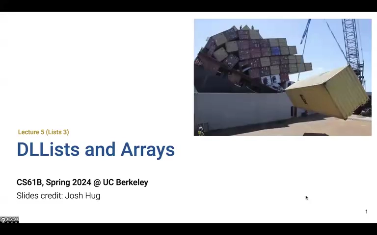 |
| [00:24](https://www.bilibili.com/video/BV1QP4y1u7jv/?p=18&t=24) 好啦这是上次发生的事然后我会开始谈论这次发生了什么 | 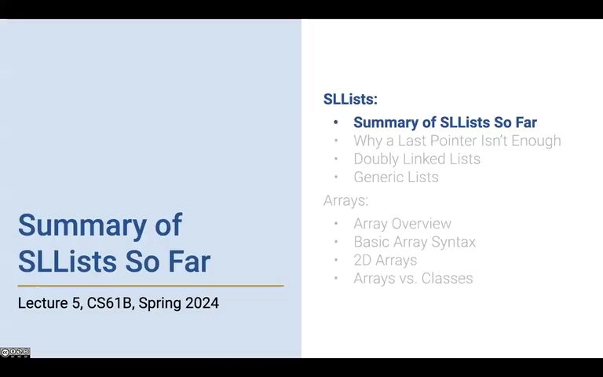 |
| [00:29](https://www.bilibili.com/video/BV1QP4y1u7jv/?p=18&t=29) 所以你必须开始听，所以上次当我们对我们的列表进行了这一系列的六个不明显的改进时所以我们从名单开始我们说这是一个裸递归数据结构这意味着您必须直接进入递归链表执行任何操作然后利用这六个改进我们构建了这个s list对象你可以把它想象成某种中间人这给了用户一些可以与之交互的东西因此，用户不必直接进入链表并自己更改链接用户可以走到中间人跟前说嘿你能帮我加上这个项目吗或者你能告诉我第一件商品是什么尺寸的吗？ | 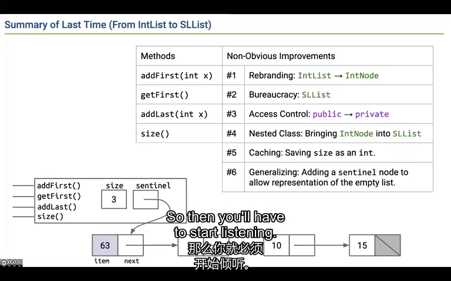 |
| [01:09](https://www.bilibili.com/video/BV1QP4y1u7jv/?p=18&t=69) 这个中间人会替你做这件事所以这是一个很好的小东西这就为用户提供了一个与这个列表对象交互的界面好啦 | 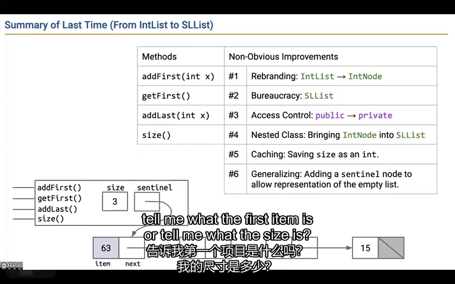 |
| [01:23](https://www.bilibili.com/video/BV1QP4y1u7jv/?p=18&t=83) 上次就是这样所以有一些问题我们上次做的所以我们今天要解决几个所以问题之一是结果是添加到链表或s列表的后面这是一种缓慢和良好的 | 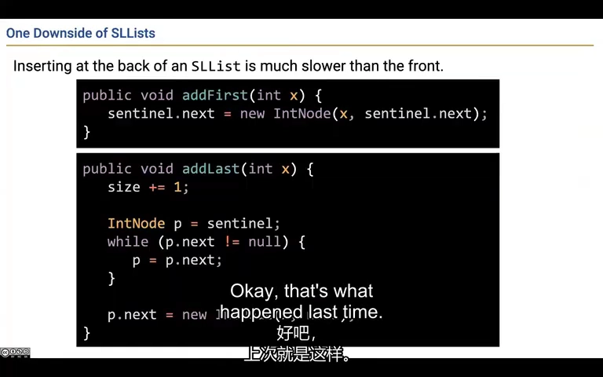 |
| [01:36](https://www.bilibili.com/video/BV1QP4y1u7jv/?p=18&t=96) 为什么慢嗯让我们看看当您想添加到列表末尾时会发生什么 | 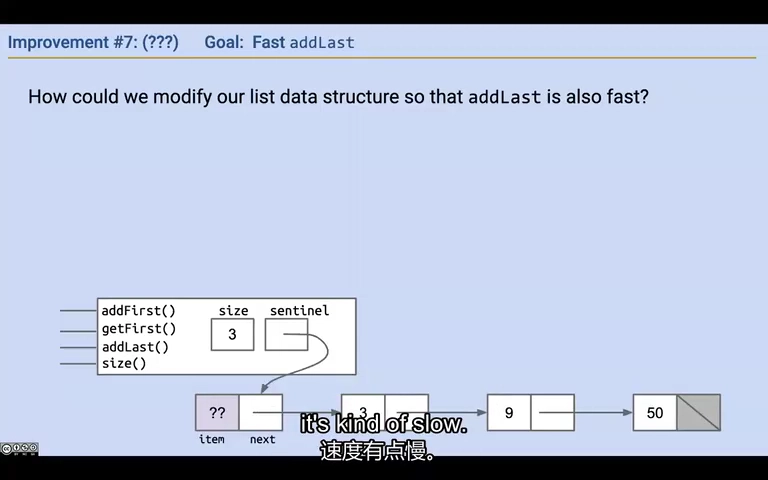 |
| [01:41](https://www.bilibili.com/video/BV1QP4y1u7jv/?p=18&t=101) 好吧，首先我得从哨兵开始哪个是忠实的伙伴节点始终站在队伍最前面然后我得扫描整个列表，直到找到最后一项只有这样，我才能在最后添加一些东西这个功能可能有点慢如果我的清单有十亿条长我要扫描十亿件物品每次我想添加一些东西 | 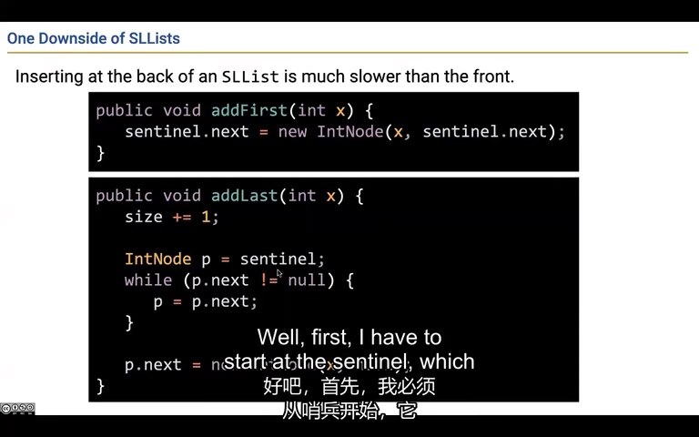 |
| [02:01](https://www.bilibili.com/video/BV1QP4y1u7jv/?p=18&t=121) 所以我们的下一个改进是我们现在该怎么做如果我想最后添加我得去找哨兵我得浏览整个列表，然后添加一些东西那么我如何让它更快我回想起来这有点熟悉，因为我们在尺寸上有同样的问题还记得我们写了神的递归秘密语言吗大小版本我们要做的就是数一数每次我们想让它计算大小那么我们如何很好地解决这个问题呢我们解决尺寸慢的方法是我们只是记录了每次尺寸更新我们只要改变这个变量当有人想要尺寸我们只要看看这个数字，给他们那个数字 | 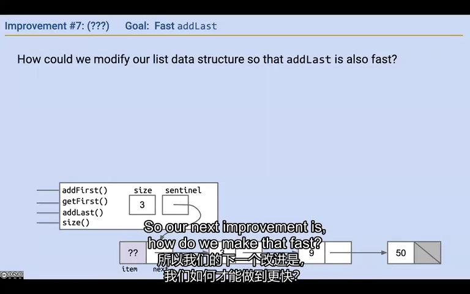 |
| [02:41](https://www.bilibili.com/video/BV1QP4y1u7jv/?p=18&t=161) 所以也许是受到这个想法的启发也许你明白这是怎么回事了 | 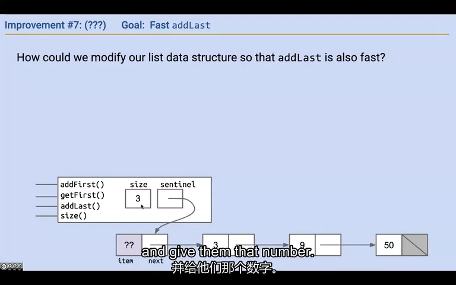 |
| [02:48](https://www.bilibili.com/video/BV1QP4y1u7jv/?p=18&t=168) 也许我会在末尾添加一个指针 | 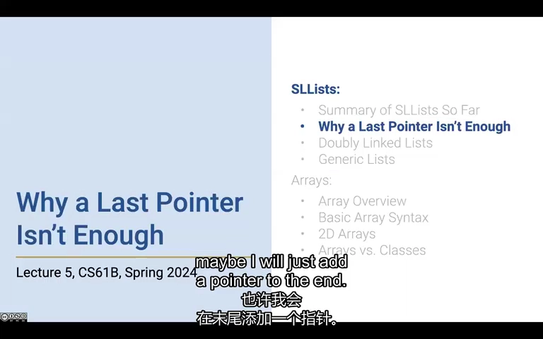 |
| [02:53](https://www.bilibili.com/video/BV1QP4y1u7jv/?p=18&t=173) 所以这边而不是从正面扫描一直到后面每次我想添加一些东西我可以缩放到最后如果我想补充什么我就直接加到这里所以你现在的问题是把它扔给你一切都是这就解决了我们的问题吗所以我们现在可以回家了吗是这样吗？我们所有的较小的操作现在都将非常快即使我的清单上有几十亿项所以我们完全没问题吗是添加会很慢会很慢只是移除会很慢所以你可以停下来思考我会把我想说的说出来我怎么解决这个问题你可以提前试着猜你的答案会是什么 | 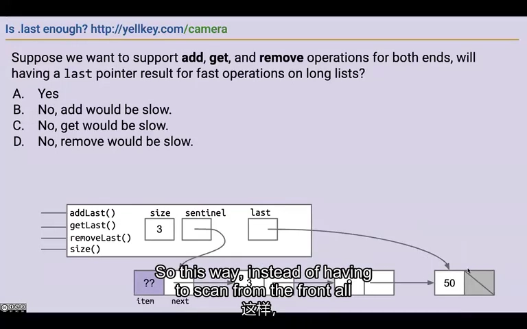 |
| [03:33](https://www.bilibili.com/video/BV1QP4y1u7jv/?p=18&t=213) 让我看看我们知道那个广告现在可能没问题因为我想说的是我只想跳到最后一个指针然后我会添加另一个项目所以看起来还可以我似乎不必再浏览整个名单了最后一个怎么样我怎么才能把最后的东西弄好我可以跟着最后一个指针跳到列表的末尾，抓住最后一件事尺寸呢井的大小仍然在那里是个数字这也不是答案选择之一这样铅就被去掉了你如何从这个列表中删除一些东西，而且仍然很快所以让我们深入探讨一下remove在做什么 | 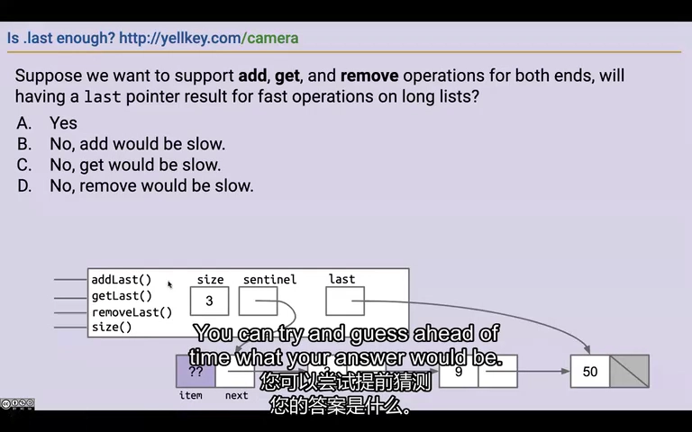 |
| [04:08](https://www.bilibili.com/video/BV1QP4y1u7jv/?p=18&t=248) 所以我们知道如果你一开始想移除一些东西可能看起来很好移除似乎很好因为我有一个指向最后一个元素的指针所以如果我想如果我想删除一些东西我把我的大删除死亡率我会指着最后一项我会去PW，一切都消失了那五十人就去了但这还不够因为一旦我拿了这50块，我就把它删除了那并不意味着我已经把最后一件东西拿掉了我仍然需要更新最后一个指针来告诉我新的最后一个项目在哪里所以仅仅拿着这50英镑你走了因为这样你的列表就不会有最后一个指针 | 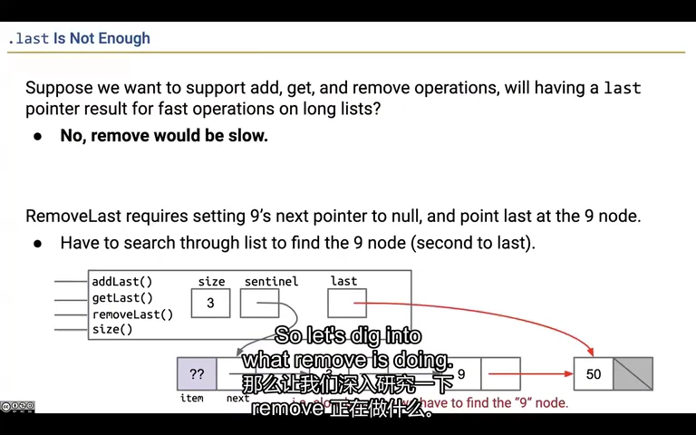 |
| [04:48](https://www.bilibili.com/video/BV1QP4y1u7jv/?p=18&t=288) 您还必须更新最后一个指针指出它面前的项目这里是九那么你怎样才能做好呢？首先它说好啦嗯我给你五十块但你怎么找到这九个结果唯一的办法就是从一开始，扫描你的数百万件物品直到你到达九原来移除还是很慢因为这还不够就为了用核武器消灭这50个人你得找到倒数第二项找到倒数第二个项目是很慢的你得从头到尾扫描一遍所以我知道你在想什么 | 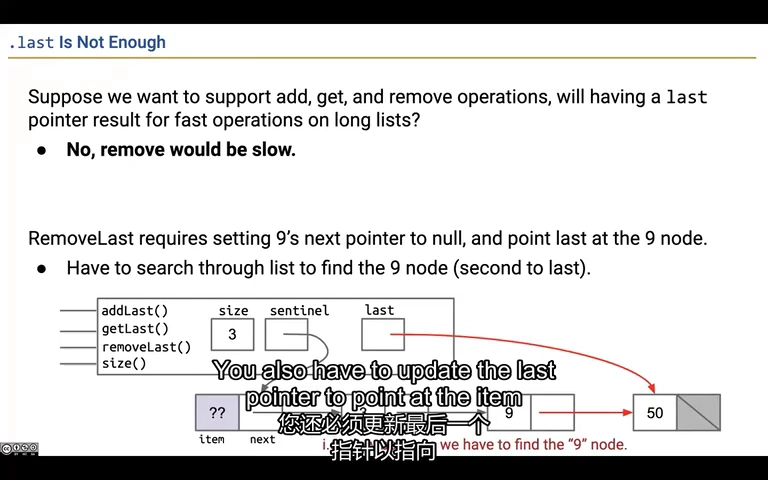 |
| [05:24](https://www.bilibili.com/video/BV1QP4y1u7jv/?p=18&t=324) 现在呢现在你想得很好如果我只是添加了一个倒数第二个指针所以我不仅要跟踪最后一件物品在哪里我也记录倒数第二个项目在哪里那你就有问题了因为一旦五十离开倒数第二个新项目是什么是三个你怎么找到这三个你得再扫描一遍所以如果你一遍又一遍地调查这个案子你会意识到最后一个指针是不够的如果您试图添加第二个到最后一个指针这还不够因为你还得更新它 | 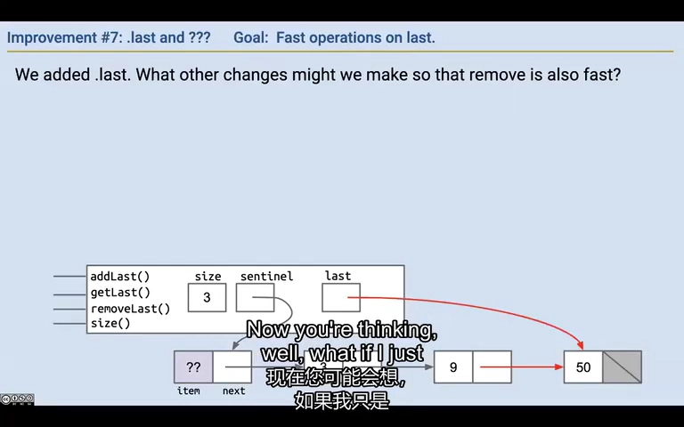 |
| [05:55](https://www.bilibili.com/video/BV1QP4y1u7jv/?p=18&t=355) 如果你有第三个到最后一个指针这仍然不够所以只要增加一个额外的值 | 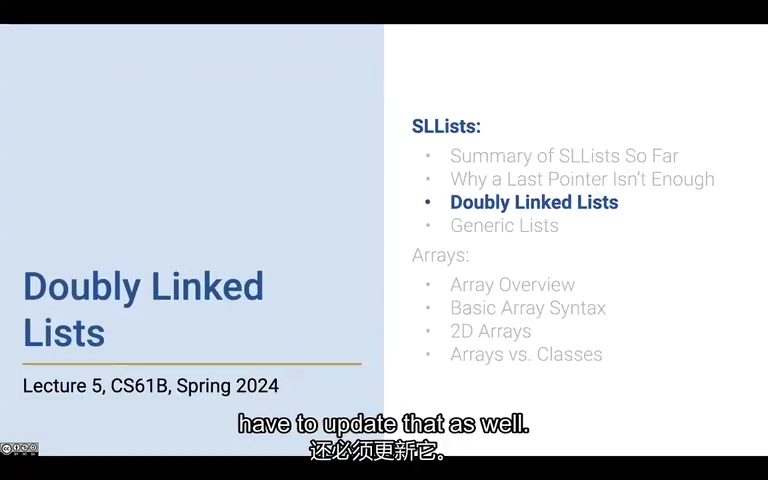 |
| [06:00](https://www.bilibili.com/video/BV1QP4y1u7jv/?p=18&t=360) 就像尺寸不适合我们一样我们都相信最后一个指针同时解决了我们的广告最后一个问题它会产生一个删除最后一个问题因为我得找到新的最后一个元素 | 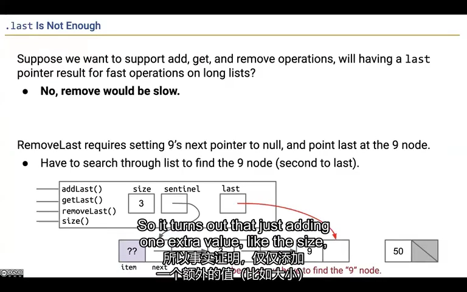 |
| [06:17](https://www.bilibili.com/video/BV1QP4y1u7jv/?p=18&t=377) 所以如果你们都相信我那么现在我们要做一个额外的改进来解决这个问题所以最后或最后的改进之一我们要处理我们的名单 | 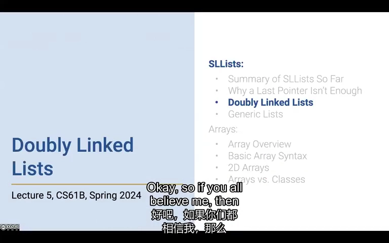 |
| [06:26](https://www.bilibili.com/video/BV1QP4y1u7jv/?p=18&t=386) 也就是说找到这三条真的很难找到那条线也很难 | 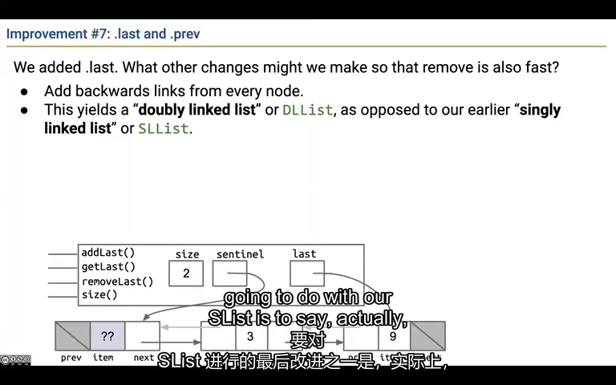 |
| [06:31](https://www.bilibili.com/video/BV1QP4y1u7jv/?p=18&t=391) 因为我必须从头开始扫描可能数以百万计的元素所以最关键的时刻是 | 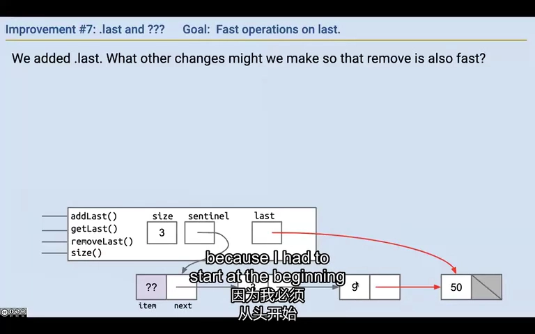 |
| [06:36](https://www.bilibili.com/video/BV1QP4y1u7jv/?p=18&t=396) 如果每个元素不仅指向它后面的人 | 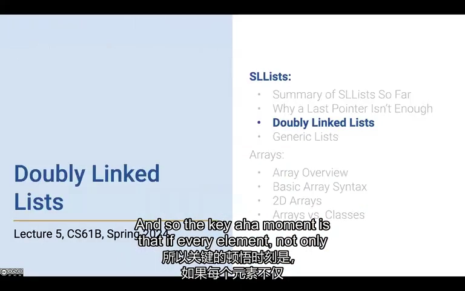 |
| [06:41](https://www.bilibili.com/video/BV1QP4y1u7jv/?p=18&t=401) 也是排在前面的人但突然间我不必从头开始了一路扫描到底我可以从末尾开始，也可以向后扫描如果我能做到突然间我有了这样的结构每个项目都有引用这是排在我前面的人这是排在我后面的人如果我这么做然后我得到一个叫做双链表的结构有时我们会把它重命名为D列表如果你想知道s表代表什么？SL代表单链dl代表双链现在呢你知道的这就是我们的下一个改进而不是让每个节点只指向谁是下一个 | 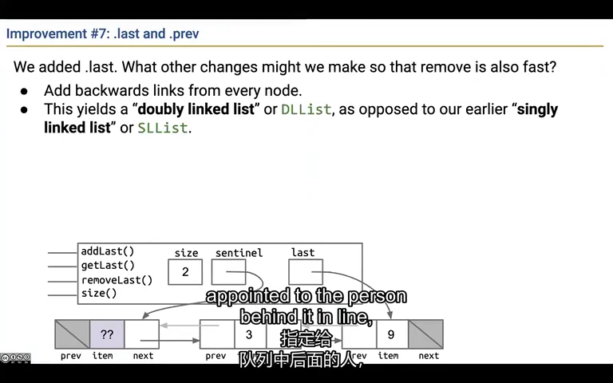 |
| [07:21](https://www.bilibili.com/video/BV1QP4y1u7jv/?p=18&t=441) 我们还将有每个节点引用在它之前的节点突然间我们的最后一个问题嗯我们还有最后一个指针一切都很好但这解决了最后一个问题在此之前，我们试图从前面扫描到第二个到最后一项很慢突然间这就不是问题了因为你可以从结尾开始问九个嘿谁在你面前，九眼上面写着啊在我面前的三个人你们都很好您不必扫描整个列表不错嘛这就是双链表如果你想从这里开始实施你完全可以实施它但有一个非常微妙的问题，你不会完全感觉到 | 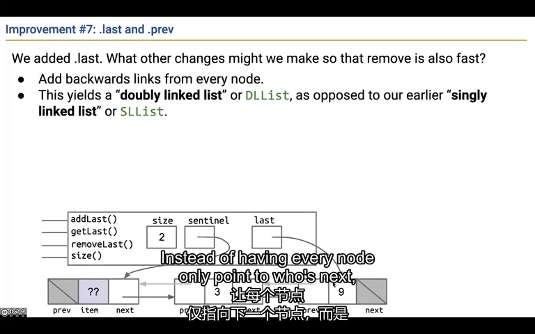 |
| [08:01](https://www.bilibili.com/video/BV1QP4y1u7jv/?p=18&t=481) 除非你真的开始编程所以我会告诉你但这绝对不是一个明显的事实不过，有一件事有点烦人你还记得上次那个特例吗我们说好的地方当您想添加到列表末尾时有时列表为空有时列表不是空的现在有两个不同的案子每当有两种不同的情况您将拥有复杂且有边缘情况的代码嗯事实证明，如果你试图编码这个你会遇到类似的问题最后一个属性有时它会指向哨兵记住它是一个虚拟值它是忠实的伴侣我们不在乎它的价值是什么它只是坐在那里，以确保列表永远不是空的 | 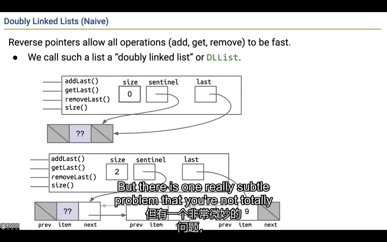 |
| [08:41](https://www.bilibili.com/video/BV1QP4y1u7jv/?p=18&t=521) 所以有时候哨兵的最后一点，我们并不关心它的价值当大小为零时就会发生这种情况但有时last会指出一个带有数据的实际节点，猜猜是什么这又把我们分成了两个案子如果你试着写一个像这样的双链表你的代码会有很多代码那就像如果哨兵的最后一点做这件特别的事否则，如果具有数据的实际节点上的最后一点做另一件事你的所有功能都将是因为你得为两个不同的案子写作这是一种烦人的代码这很复杂很难写很难调试我想要一个和谐统一的故事 | 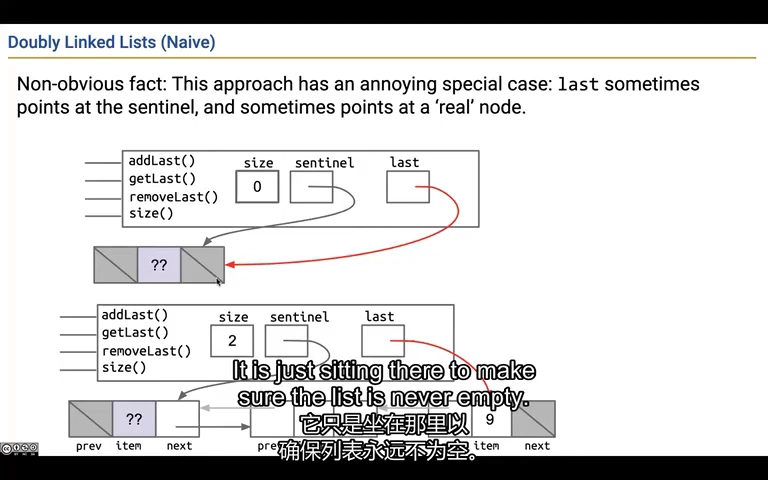 |
| [09:21](https://www.bilibili.com/video/BV1QP4y1u7jv/?p=18&t=561) 我现在可以说出最后一个指针指的是什么，我得说很好有时是前哨节点有时你会在那里发现一个真正的音符我不喜欢那样我想把这个统一成一些这是一个和谐的故事 | 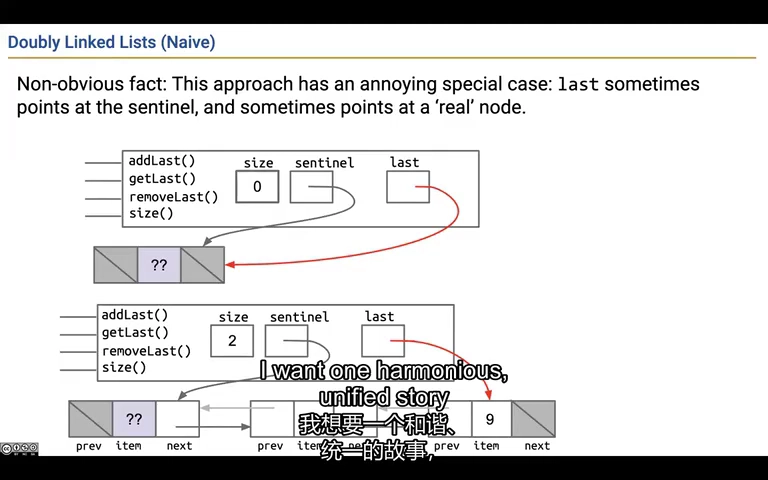 |
| [09:38](https://www.bilibili.com/video/BV1QP4y1u7jv/?p=18&t=578) 那么那个故事是什么呢实际上有几个选择所以这里有一个故事一个可能的故事是说好而不是只有一个哨兵我可以派两个哨兵因为现在我有了列表前面的引用以及列表后面的引用这样我就可以有一个忠实的同伴站在队伍的最前面以确保总是有人站在队伍的最前面列表从不为空我也可以让人站在队伍后面这样，最后一个被重命名的指针被发回这里那永远不会是真正的负担永远是这个忠实的伙伴站在队伍的后面任何时候你想添加一些东西你要把它们加在两个哨兵之间所以这是一个可行的结构 | 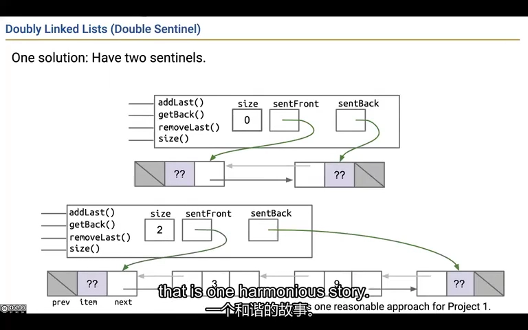 |
| [10:18](https://www.bilibili.com/video/BV1QP4y1u7jv/?p=18&t=618) 现在你有了一个非常和谐的故事不变量如果你还记得从上次开始我们可以使用的不变量是最后发回的或前哨反向参考它总是指出我们后面的第二个忠实伙伴所以如果你喜欢这个您可以在您的项目中这样做我为什么要提到这个项目因为你要建造这个好啦所以这是一个可能的选择但这里有另一个选择一开始会觉得很奇怪 | 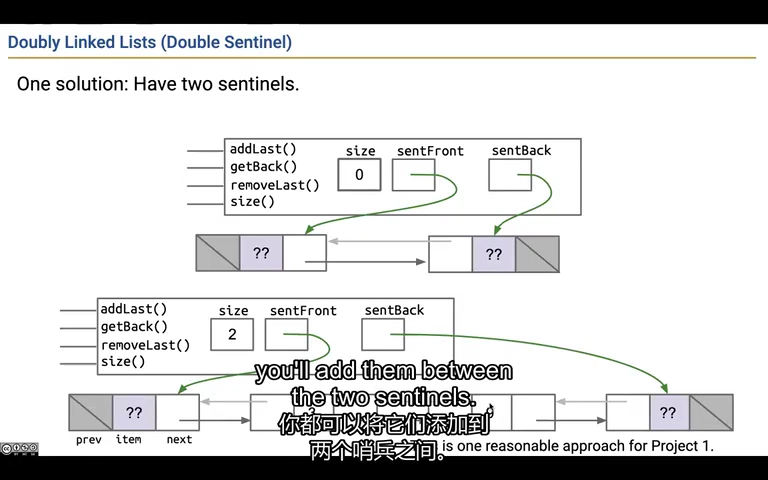 |
| [10:46](https://www.bilibili.com/video/BV1QP4y1u7jv/?p=18&t=646) 但事实证明，这可以说是最好的方法之一构建双链表所以这就是答案如果你去山顶你爬山去问链表和尚你问他们什么是真正伟大的链表你可以建造这就是和尚会给你的答案所以你得到的答案是其实我们只要一个哨兵这样我们将建立一个循环的链表突然你看着那个和尚说你在说什么？你什么意思循环链表所以和尚说如果列表为空那么哨兵的下一个项目就是哨兵本身哨兵的前一个项目是哨兵本身 | 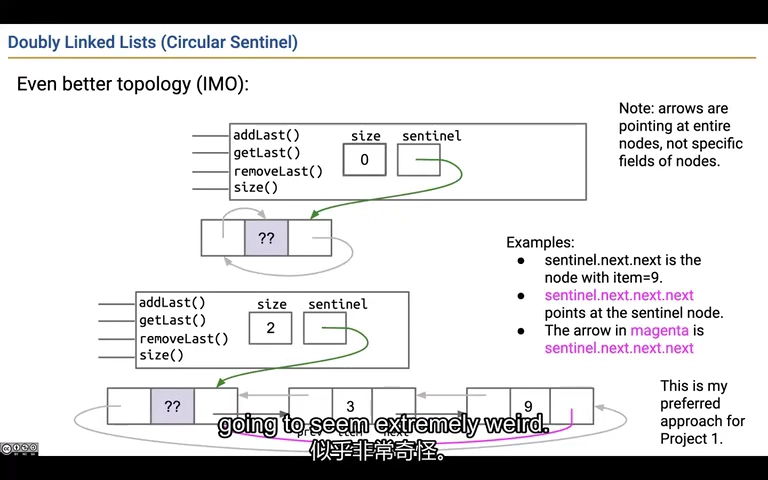 |
| [11:26](https://www.bilibili.com/video/BV1QP4y1u7jv/?p=18&t=686) 现在你生猴子的气了就像我一路爬到这里来和你谈论链表一样你还跟我说这些废话发生什么事了？所以这里发生的是如果您的列表不是空的然后我们从哨兵开始如果我们按照下一个指针我们讨论下一项也就是三个然后下一个项目是九然后之后的下一个项目因为这是单子上的最后一项它绕回到哨兵身边当你浏览这个列表时如果你绕到哨兵那里你就知道你已经走到了尽头所以这有点像世界在周围如果你从这里开始往东走你要走回这里我不知道几年什么的 | 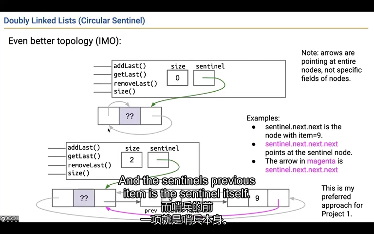 |
| [12:06](https://www.bilibili.com/video/BV1QP4y1u7jv/?p=18&t=726) 所以你可以想想因为它有点像世界是圆的如果我从这里开始，我继续遵循下一个指针我最终会回到唯一的哨兵同样的事情如果我启动哨兵然后倒退我最终也会在哨兵那里结束所以这种方法虽然一开始看起来真的很奇怪事实证明这是一个非常好的主意这样我们就可以用一个哨兵来表示整个链表所以对于项目一来说，这是相当漂亮的你知道这取决于你如果你不喜欢这个，你想做什么你总是可以有两个不同的哨兵但如果你真的想了解和尚的智慧找出最棒的链表是什么，这是你可以尝试问题的东西 | 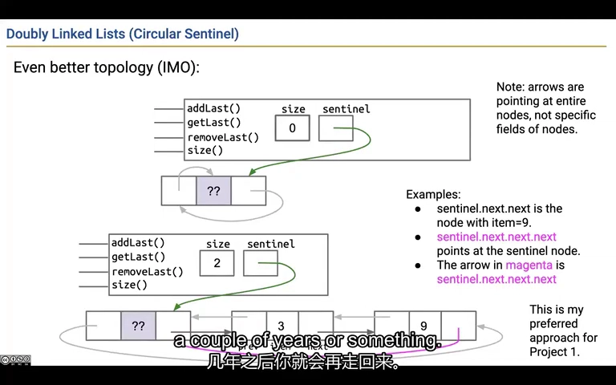 |
| [12:46](https://www.bilibili.com/video/BV1QP4y1u7jv/?p=18&t=766) 关于和尚智慧的思考好啦 | 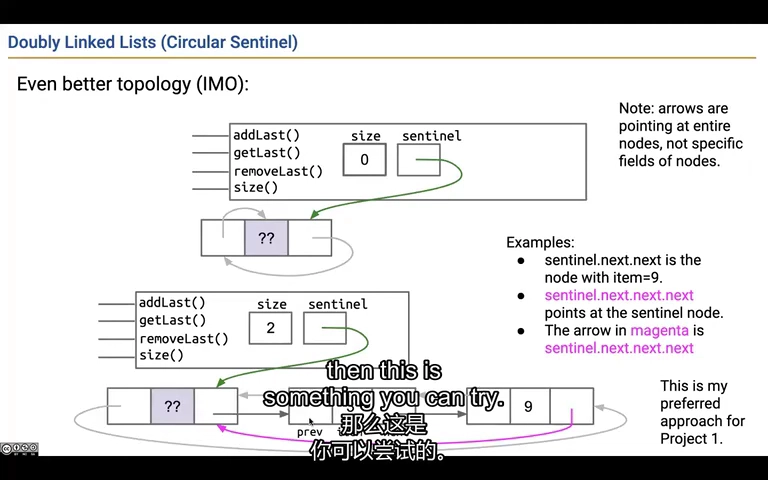 |
| [12:52](https://www.bilibili.com/video/BV1QP4y1u7jv/?p=18&t=772) 酷所以这是我们最后的改进所以我们提到的一件事是，如果你加上前面的指针使链接列表双联有很多特殊情况在背后放哨它可以指向一个真正的音符它可能指向一个讨厌的哨兵节点所以要解决它你可以做两个哨兵然后在它们出现时添加它们之间的项目或者您可以使链表循环所以有一个哨兵站岗就是说这是列表开始和结束的地方如果你想走名单你绕着圈走每当你回到起点然后你知道你扫描了整个列表挺酷的好啦 | 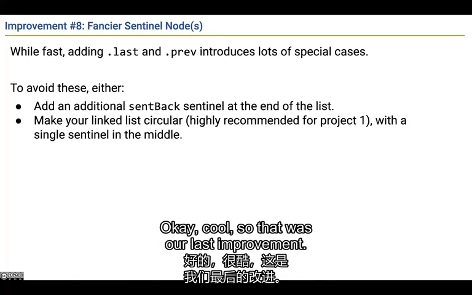 |
| [13:32](https://www.bilibili.com/video/BV1QP4y1u7jv/?p=18&t=812) 这是第八项改进所以我们还没有完全建立一个最先进的链表结构你可以出去走向世界不过，我们已经取得了一些不错的进展我们从我们的小名单开始我们做了这些改进上次的六个今天到目前为止有两个这给了我们双链表它有快速的操作来增加前面添加到后面从前面移到后面 | 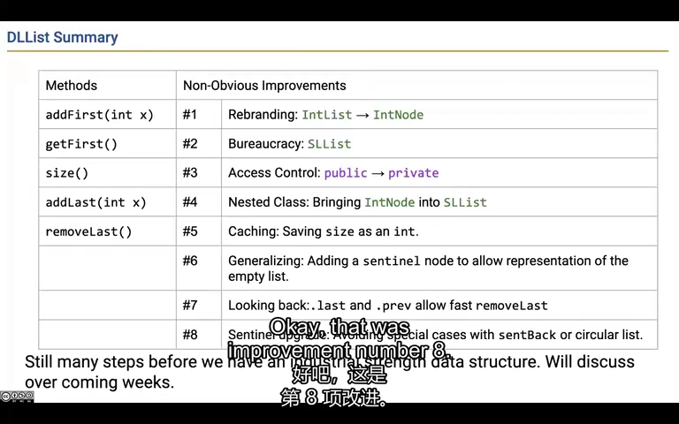 |
| [13:59](https://www.bilibili.com/video/BV1QP4y1u7jv/?p=18&t=839) 以后还会有更多但在我们继续之前，对这八项改进有任何问题或想法吗 | 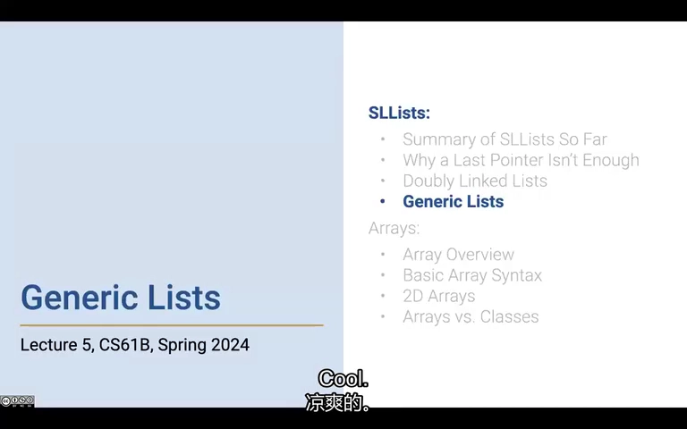 |
| [14:04](https://www.bilibili.com/video/BV1QP4y1u7jv/?p=18&t=844) 把他们记在心里很好因为你会在项目一中做哇塞好啦好啦 | 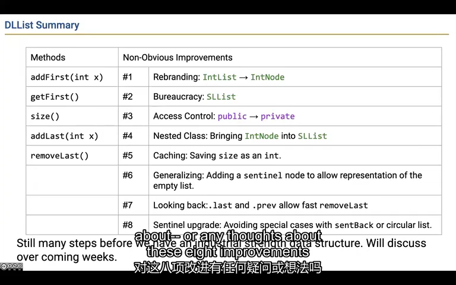 |
| [14:12](https://www.bilibili.com/video/BV1QP4y1u7jv/?p=18&t=852) 我做最后一个改进然后我们将永远抛弃s列表和列表最后一个问题是我们的列表只支持整数 | 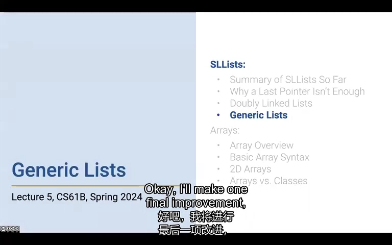 |
| [14:19](https://www.bilibili.com/video/BV1QP4y1u7jv/?p=18&t=859) 例如，我走到这里 | 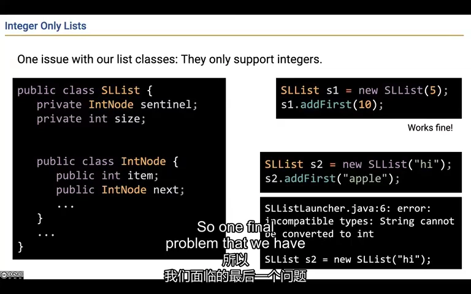 |
| [14:24](https://www.bilibili.com/video/BV1QP4y1u7jv/?p=18&t=864) 你知道这份清单很有用这是上次的我可以加数字我可以加十分我可以加十五我可以加一百一切都很顺利但在这里我会证明给你看一切都会顺利的因为我有一点时间好啦所以它会建造最终会告诉你这很好用如果我尝试添加字符串那就有麻烦了所以让我们列一个字符串列表有谁最喜欢的短语歌曲歌词标题你想要什么狗做了什么，我做对了吗好吧好吧我们一起玩我猜对了好啦所以我试着做狗在做的事情 | 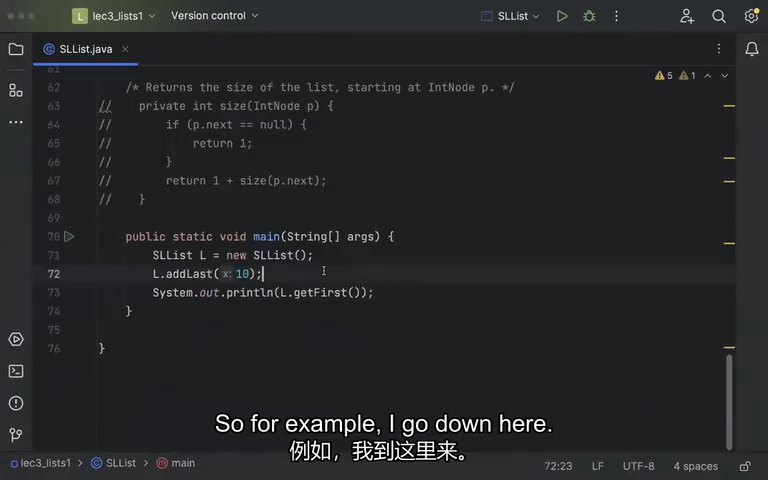 |
| [15:04](https://www.bilibili.com/video/BV1QP4y1u7jv/?p=18&t=904) 做在啊结尾没有g好吧，知道了，真的G在沉默中移动好的很好所以我们进展顺利突然出了点问题上面写着我以为你会给我一个整数因为add last方法函数签名说我想要一个整数但你给了我一根绳子你让我这么做我不接受我想要一个整数所以我们有一个问题我们如何修复这个列表似乎只支持整数但我想给它附加条件也可能是其他物体也许我想列出我所有的海象什么的一个我们希望大家都同意的解决方案 | 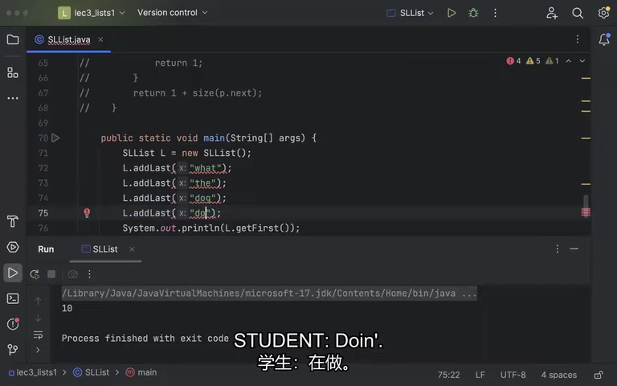 |
| [15:44](https://www.bilibili.com/video/BV1QP4y1u7jv/?p=18&t=944) 不是很好也不是很干净就是我可以把这个密码 | 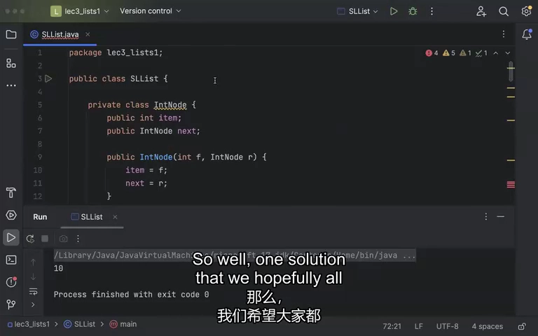 |
| [15:49](https://www.bilibili.com/video/BV1QP4y1u7jv/?p=18&t=949) 我可以复制粘贴然后我可以把所有的ins都改成一个字符串好啦技术上有效吗因为现在你有两个相同代码的副本是啊，是啊那有点烦人 | 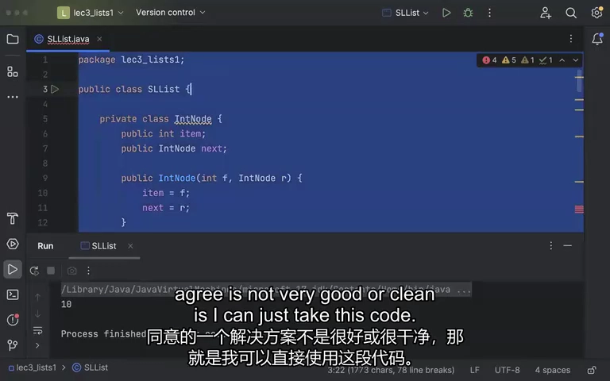 |
| [16:00](https://www.bilibili.com/video/BV1QP4y1u7jv/?p=18&t=960) 所以事实证明Java确实有办法让这变得更干净我们要进去 | 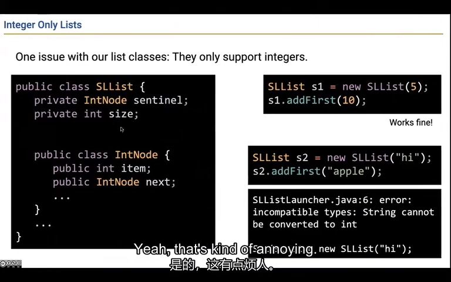 |
| [16:05](https://www.bilibili.com/video/BV1QP4y1u7jv/?p=18&t=965) 而不是使用整数我们要做一个叫做仿制的东西 | 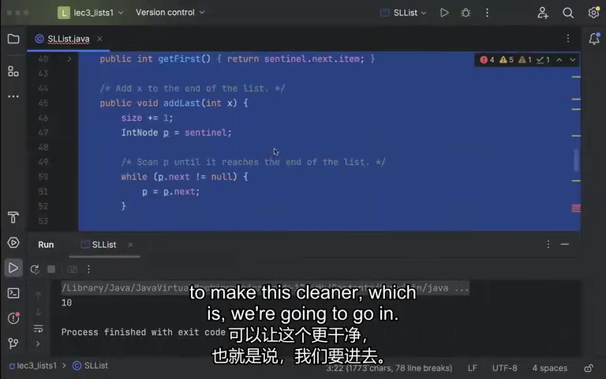 |
| [16:10](https://www.bilibili.com/video/BV1QP4y1u7jv/?p=18&t=970) 也就是我们稍后要推迟类型选择一开始，这似乎很神秘我将介绍一些全新的语法 | 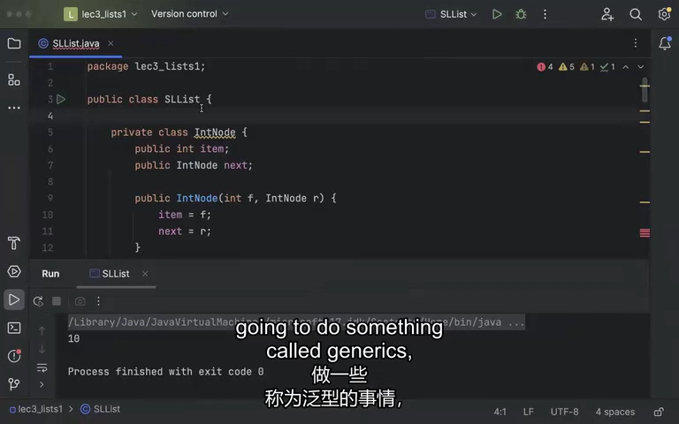 |
| [16:18](https://www.bilibili.com/video/BV1QP4y1u7jv/?p=18&t=978) 你可以在这里买到不过，别担心我们很快就会解释的 | 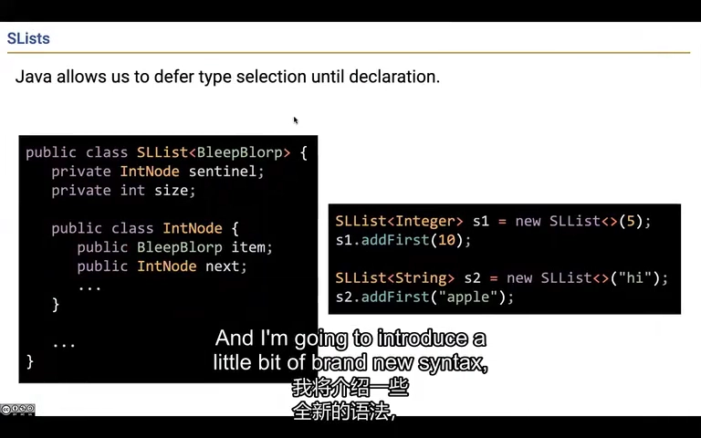 |
| [16:23](https://www.bilibili.com/video/BV1QP4y1u7jv/?p=18&t=983) 好啦所以不用整数我实际上要写这个清单不使用整数但是使用用户决定的类型当他们创建这个对象时所以我要添加一个占位符来表示我还不知道用户想要什么但无论用户想要什么我会弄明白的，然后用这个占位符代替它所以我要在这里加上这些尖括号我要加一个占位符单词这可能是任何对工作安全的东西那你想要什么一个字菠萝这很有趣有人说奶酪是因为他们上学期用了奶酪好啦 | 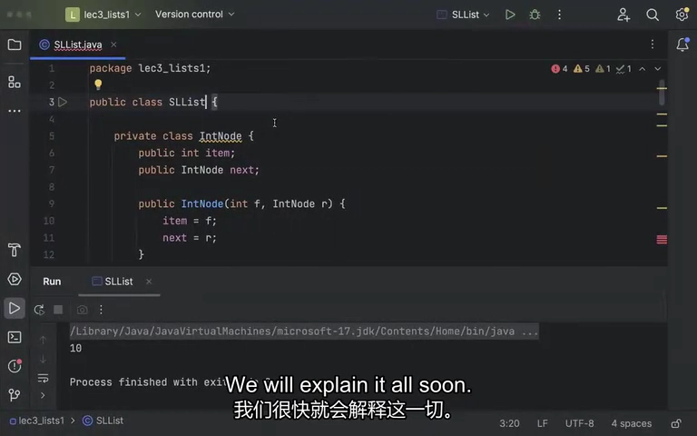 |
| [17:03](https://www.bilibili.com/video/BV1QP4y1u7jv/?p=18&t=1023) 所以我不知道为什么那如此令人兴奋但它确实做到了好啦因为它是奶酪你知道这是因为我们的关系我们没有奶酪了好啦没有贾斯汀与时俱进好啦所以说好啦反正所以我们加了一个占位符单词叫菠萝所以这里的想法是在这个班上在我们把事物定义为整数之前例如我们所有的节点都有一个int类型的项但那不再是真的因为用户可能会选择做菠萝其他的可能是一个整数可能是一根绳子可能是海象所以我要做的不是说公共项目我说公共菠萝 | 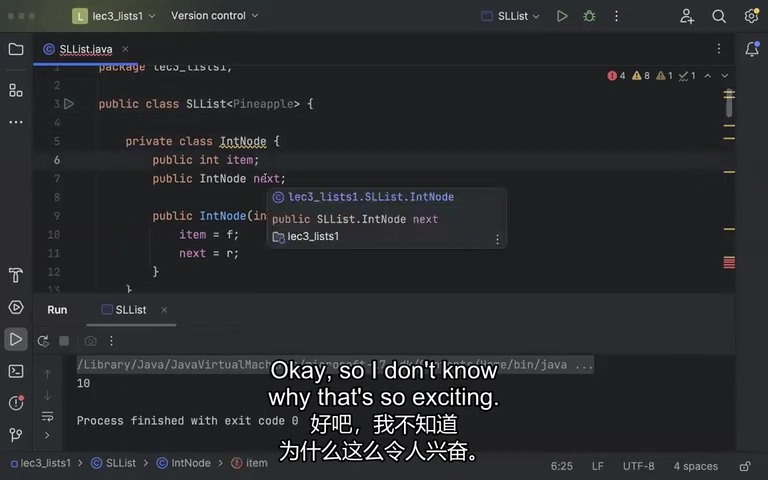 |
| [17:43](https://www.bilibili.com/video/BV1QP4y1u7jv/?p=18&t=1063) 这是一个占位符我可以继续前进所以说每当有人创建一个节点他们不会以整数通过他们会在一个菠萝里通过是个占位词我们一直这么大那仍然是一个数字尺寸仍然是数字不是菠萝当有人创建一个新的s列表时它有一个菠萝而不是整数好啦这次哨兵不可能是零因为我们不知道菠萝是什么类型的所以我只需要加上NULL来表示没有对象或者没有菠萝不管那是什么我希望你有我希望你玩得开心那么接下来会发生什么当我先加的时候我加了一个菠萝当我第一个我把菠萝还给你 | 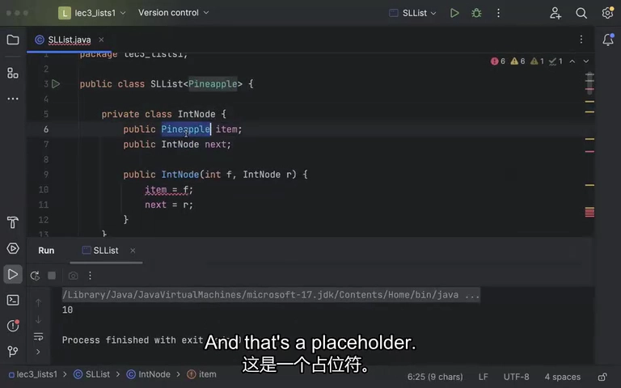 |
| [18:23](https://www.bilibili.com/video/BV1QP4y1u7jv/?p=18&t=1103) 当我加上最后一个带着菠萝太棒了尺寸呢还是和上次一样这次很好至少代码不再对我大喊大叫了它仍然有一些警告好像我在我的普通草莓里做了所以你要做的第一件事你用这些小花括号表示有角度的括号我想用这个占位符在任何地方，你都有一种你还不认识的类型这是用户告诉我的类型是整数吗是海象吗是行星吗我不知道所以我会把菠萝作为占位符然后我们来到这里这是用户实际使用最低的地方所以这次当用户使用列表时光说已经不够了 | 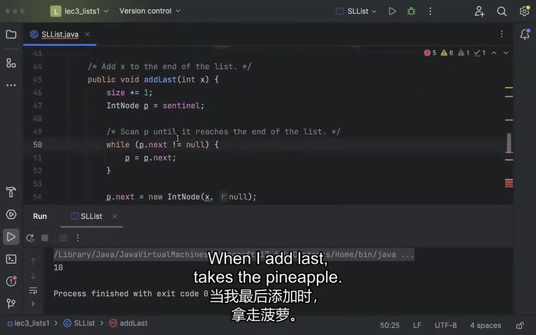 |
| [19:03](https://www.bilibili.com/video/BV1QP4y1u7jv/?p=18&t=1143) 我现在想建立一个s列表爪哇在抱怨上面写着一个更具体的清单告诉我菠萝是什么所以在本例中，我想建立字符串的s列表所以我会用同样的尖括号说我不只是想要任何清单我想要一个字符串的s列表然后右边同样的东西我不只是想要任何旧的清单我想要字符串列表现在发生的是你几乎可以想到这个有角度的支架就像一场花哨的争论因为工作现在要做的是它将把这个单词字符串到这里，然后用单词string替换菠萝的每一个实例这将给您一个支持字符串的s列表 |  |
| [19:43](https://www.bilibili.com/video/BV1QP4y1u7jv/?p=18&t=1183) 如果你不喜欢这个带字符串的列表嗯，你实际上可以做更多的s列表所以我会用你知道整数，那也没关系这样我就可以有两个S清单一个可以是整数，一个可以是字符串那完全没问题也是好吗它为什么在抱怨我不知道我以后再看哦，我两个好啦好啦关于仿制药的大问题他们如何工作思想哎呦有很多问题好啦提到双方都喜欢的是呀这是个好问题我相信答案是否定的我可以尝试一下问题是什么 |  |
| [20:23](https://www.bilibili.com/video/BV1QP4y1u7jv/?p=18&t=1223) 如果我不具体说明我可以放多种类型吗我想你不能你不能如果不指定项目但是您可以使用对象是啊，是啊所以也许下次我们谈论遗产的时候再来我们将讨论对象类但一般情况下不建议它创建了一种奇怪的Java代码好问题尽管其他人好啦再来一个我们使用的类型是呀这是个好问题不是什么我要讲得太详细了乔什有一段很长的视频好奇所以只要问我如果将原语类型int它会搞混的它想要整数的对象版本如果那没有意义 |  |
| [21:03](https://www.bilibili.com/video/BV1QP4y1u7jv/?p=18&t=1263) 别担心只要大写整数，一切都会好起来的是啊，是啊下课后好问题虽然好啦我再拿一个对于微型来说是啊，是啊这是个很好的问题也就是如何确保哨兵节点中的虚拟内容与提供的类型所以我选择使用NULL就像没有任何东西所以在这种情况下，null恰好与任何引用类型兼容因为记住Java中有九种类型任何不是第八个原语类型的东西都将是引用类型如果是引用类型我可以把它赋值为空这表明那里什么都不存在如果这没有意义的话也可以以后你可以来谈谈 |  |
| [21:43](https://www.bilibili.com/video/BV1QP4y1u7jv/?p=18&t=1303) 不像你必须知道的项目的关键事情但这仍然是一个很好的问题好的很好所以现在我有两个列表我可以用不同的类型我也不用复制粘贴我的代码在较新版本的Java中大获全胜你会看到LJ很有帮助地把这个打分了所以Java很聪明如果你省略了右手边的类型爪哇还知道你在说什么它仍然是好的所以如果你不在第二次中添加这个词Java很聪明它说你已经告诉我你想嵌套整数列表所以我就假设你是想把整型这个词放在这里但是你变懒了所以如果你想偷懒 |  |
| [22:23](https://www.bilibili.com/video/BV1QP4y1u7jv/?p=18&t=1343) 那个语法也完全没问题至少在较新版本的Java中 |  |
| [22:28](https://www.bilibili.com/video/BV1QP4y1u7jv/?p=18&t=1348) 好啦幻灯片使用哔哔声只是为了证明任何一个词都有效你上学期用的菠萝用奶酪 |  |
| [22:35](https://www.bilibili.com/video/BV1QP4y1u7jv/?p=18&t=1355) 所以什么都管用好啦这实际上回答了早些时候的一些问题所以如果你好奇在滑梯上所以我们以后会花更多的时间但基本上这个想法是最重要的用小尖括号说菠萝是我的金色占位符单词然后在代码中的任何地方告诉你S列表是如何工作的蓝图你要用菠萝作为占位符对于任何你现在不知道的类型然后当你宣布我想要一个新的名单然后你要用尖括号表示任何地方清单的实施者说菠萝请输入“双”字就会得到我的最佳双打名单 |  |
| [23:15](https://www.bilibili.com/video/BV1QP4y1u7jv/?p=18&t=1395) 很好今天的前半段关于上半场你还有什么想知道的吗你最后的机会否则我会说一大堆在这一点上，有时最好提高 |  |
| [23:26](https://www.bilibili.com/video/BV1QP4y1u7jv/?p=18&t=1406) 我想我要先谈谈动机到目前为止，我们花了一个半两节课我们从名单开始我们努力工作一直到接受不同类型的光荣D名单拥有所有这些你知道的花哨的小哨兵和所有的东西所以这是从头开始的一种方法并建立一个很好的功能列表，我们可以给用户但这不是唯一的办法所以从现在开始我们真的要把这一切都抹去从头开始，我们将建立一个全新类型的列表它仍然会有同样的操作它仍然是一个有正面和背面的项目序列我还可以添加项目 |  |
| [24:06](https://www.bilibili.com/video/BV1QP4y1u7jv/?p=18&t=1446) 我仍然可以得到项目但是不使用节点和链接作为底层数据结构我要用一个费率这是底层数据结构所以这就是我们下一个的目标一个半左右的讲座 |  |
| [24:19](https://www.bilibili.com/video/BV1QP4y1u7jv/?p=18&t=1459) 所以我想在我们这么做之前我应该先谈谈什么是数组无论如何就像我们一直在用它们但让我们花半个小时来确保我们都能深刻理解数组首先是什么所以第一部分是我们已经看到的东西当你声明一个变量你告诉爪哇我声明有一个整数叫做x或者我宣布有一只海象叫WJava将分配一个小盒子的内存，并说任何时候你想谈论X你说的是这个记忆盒里的1和0或者为W一个每次你说到女人的时候你说的是这个记忆盒 |  |
| [24:59](https://www.bilibili.com/video/BV1QP4y1u7jv/?p=18&t=1499) 记住第三课的中心思想或者其他数字是这些变量一号和二号这些引用类型他们实际上并不关押海象他们拿着什么他们有海象所在的地址如果你想去看海象然后在第二场比赛中有人留下了一张小纸条说你的海象住在这里你去那里，你会发现这只三十号的海象五点六一好啦事实证明，仅此而已回顾发现射线也有点像物体但这里唯一的区别是，它不是一系列命名的内存盒我们有一系列编号的盒子那是什么意思 |  |
| [25:39](https://www.bilibili.com/video/BV1QP4y1u7jv/?p=18&t=1539) 所以记住在海象海象有很多属性这些是我们制作的实例变量所以我可以问例如海象W二号换句话说如果我去西二区拜访友好的海象你有体重三十岁了所以这个数字就像一个与之相关的名字或者我可以问问这场战争的朋友你有象牙大小现在是五点六这是另一个与海象有关的数字这是一个有名字的数据，我称之为象牙大小我叫它等等相比之下在数组中我们所有的内存盒都没有任务大小和重量这样的名称但他们有号码例如我可以说数组 |  |
| [26:19](https://www.bilibili.com/video/BV1QP4y1u7jv/?p=18&t=1579) 这个数组我想要数组的第五项或者我想要数组的第十项或者我想要数组的第一项所以在这种情况下，不是用名称来指代特定的内存盒我要用数字我会用括号来表示我说的是数组代替点表示法这就是我问海象象牙大小的原因 |  |
| [26:37](https://www.bilibili.com/video/BV1QP4y1u7jv/?p=18&t=1597) 但最终数组就像一个对象所以如果你把这只海象想象成一个活在记忆中的物体 |  |
| [26:43](https://www.bilibili.com/video/BV1QP4y1u7jv/?p=18&t=1603) 有足够的空间写下象牙的大小有足够的空间写下来是因为重量还是什么 |  |
| [26:52](https://www.bilibili.com/video/BV1QP4y1u7jv/?p=18&t=1612) 数组是一样的也就是当您声明有一个数组然后Java为一堆变量分配一堆内存肩并肩所以如果你说我想要一个由五个整数组成的数组Java将什么做它会进入记忆它会四处挖掘，为五个并排的整数找到一个空间当你在这里讨论数组时，它就会说它是它是五个并排的整数在这一点上有时人们会停下来问那么建筑清单的全部意义是什么呢为什么不一直使用数组呢Java中的主要问题是数组有固定的长度所以只要我说这个数组的长度为5井Java已经经历了 |  |
| [27:32](https://www.bilibili.com/video/BV1QP4y1u7jv/?p=18&t=1652) 把5个整数的空间挖出来这永远不会改变它将永远坐在那里你不能像哦其实我改主意了我想要更多的记忆我想说我给了你五个整数如果你问不要要求我提供更多您创建的新数组它有五个整数，没有更多的整数任何时候你要求一个数组你会得到一堆相同类型的内存盒肩并肩你几乎可以把它想象成一个物体而不是像Tusk这样的命名实例尺寸和重量所有变量都是实例变量或者随便什么或者别的什么我应该说得更具体些数组的所有元素都按数字索引好啦 |  |
| [28:12](https://www.bilibili.com/video/BV1QP4y1u7jv/?p=18&t=1692) 所以也许这一切看起来有点模糊我们将在就像一两张幻灯片我想我还要注意一件事数组秘密地拥有一个实例变量所以不像上课在那里你可以拥有各种各样的东西就像你知道的你的瓷砖和零项目可以有一个位置或者别的什么x和y嗯数组确实有一个属性我们可以访问也就是它的长度但这是唯一的属性数组没有方法所以不像你的狗你可以称之为发出噪音它发出的声音很好数组他们没有任何方法所以不能要求数组发出噪声 |  |
| [28:47](https://www.bilibili.com/video/BV1QP4y1u7jv/?p=18&t=1727) 现在我要开始了只是对你说了一堆语法 |  |
| [28:52](https://www.bilibili.com/video/BV1QP4y1u7jv/?p=18&t=1732) 对不起有点多不过没关系我们一起渡过难关好啦那么如何创建数组最经典的做法如果你不是数组专家这是我推荐的方式始终是使用new关键字因为我们刚才说数组是对象就像海象行星瓦片所以如果你想要一个全新的阵列您可以使用new关键字为什么那口井让我们读这一行代码首先它说我想要一个有三个元素的整数数组换句话说，它是Java会留在记忆中挖掘空间让三个整数并存作为和睦的邻居然后新的关键字就像它一样最后一次它会向世界尖叫和呼喊 |  |
| [29:32](https://www.bilibili.com/video/BV1QP4y1u7jv/?p=18&t=1772) 你知道就像新的整数三重奏你刚刚创造了住在一起的邻居这是他们住的地方new关键字显示此整数数组所在的地址哪些部分将被复制这是一个地址，你可以在那里找到你的全新的闪亮整数数组我们把它复制到x中所以发生的事情是你得到新的数组这些整数中的每一个都用一些默认值填充然后我们把什么复制到x中，x没有空间来容纳数组因为数组不是这八种基本类型之一所以实际上赋给x的等式的黄金法则是什么 |  |
| [30:12](https://www.bilibili.com/video/BV1QP4y1u7jv/?p=18&t=1812) 不是实际数组把三个整数并排放在别的地方X有一个参照物，说如果你想去看你的整数去那里你可以拜访你的整数朋友所以对我来说第一个最有意义Java有几个快捷方式所以如果你像一个数组一个超级用户什么的然后您可以使用后两种语法中的一种我就不说得太详细了因为它们有点奇怪但基本上这里的想法是，如果你想您还可以用项预先填充数组所以在这里，我们用五个项预先填充一个长度为5A的数组我们又来了但我们正在走捷径 |  |
| [30:52](https://www.bilibili.com/video/BV1QP4y1u7jv/?p=18&t=1852) 所以我们完全省略了新这个词但它秘密地还在那里所以如果你不太适应我喜欢第一个但如果你想成为快捷方式用户我想你也可以用另一个 |  |
| [31:07](https://www.bilibili.com/video/BV1QP4y1u7jv/?p=18&t=1867) 那是一些语法这里有一些代码我们将从头到尾看看数组是如何工作的所以让我们做吧 |  |
| [31:12](https://www.bilibili.com/video/BV1QP4y1u7jv/?p=18&t=1872) 好啦对不起这有点反高潮我想不出还有什么可说的 |  |
| [31:17](https://www.bilibili.com/video/BV1QP4y1u7jv/?p=18&t=1877) 好啦所以让我们做吧这是数组基础类所以我们要从头开始一线说我声明有一个名为z的数组引用那么会发生什么我是不是要为一堆整数创造足够的空间电梯并排不因为我还没有调用New关键字如果我不调用new关键字我并不是在创造空间让一堆整数共存我只是在为一个整数的引用创建空间所以我想Java可视化工具没有向我展示它因为我现在把它分配给了中间这意味着我实际上没有创建任何整数数组这样就没事了然后这里下一步 |  |
| [31:57](https://www.bilibili.com/video/BV1QP4y1u7jv/?p=18&t=1917) 我声明有一个整数数组引用，叫做x，叫做y所以现在我有xY和Z还有所有这些内存盒他们拿着什么它们不包含实际的数组它们都保存对数组的引用第一条有趣的线路来了在那里发生了一些事情就是这条线这条线说在右手边我声明有一个新的整数数组对呀实例化具有元素一二的新整数数组三个四和五Java很聪明它可以数到五意识到啊您想要一个由五个元素组成的数组，并且只有五个元素所以Java挖掘内存它为这五个整数找到了一个奇妙的共存空间 |  |
| [32:37](https://www.bilibili.com/video/BV1QP4y1u7jv/?p=18&t=1957) 和谐地然后新关键词向世界呼喊这五个新的整数他们就住在这里然后等于的黄金法则将地址复制到x所以这条线之后我们看到了什么注意这五个数字我们没有把他们推进X它们不适合X的内存盒取而代之的是一个X实际上适合那里就像一支箭这是一个参考它告诉你如果你想参观你的五行去这个地址你会找到的好啦接下来会发生什么Y=X海象时刻的经典奥秘因为事实是我把x的所有位复制到y中x中的位是多少 |  |
| [33:17](https://www.bilibili.com/video/BV1QP4y1u7jv/?p=18&t=1997) 不是实际数组但是对数组的引用所以如果我说y等于x我拿着那支箭我把同样的箭头复制到Y上现在x和y他们有同样的音符就是去这个地方参观数组所以他们指的是同一个人好啦接下来会发生什么似乎现在写这代码的人改变了主意他们说你知道吗我不希望x指向这一系列的5个数字我想指着这个所以他们所做的是他们将创建一个由五个数组组成的全新序列或五个数组的序列一个全新的五个整数数组这次是这五个整数Java将再次挖掘内存为这五个整数找到新的栖身之地 |  |
| [33:57](https://www.bilibili.com/video/BV1QP4y1u7jv/?p=18&t=2037) 新关键字将向你找到它的世界呼喊然后等号将复制位它是这个新数组在x中的位置所以我们要覆盖x，它以前有这个箭头我们要删除那个箭头，给它这个全新的箭头到这个全新的阵列好吧，我能感觉到你越来越无聊了我知道整数数组不是最令人兴奋的事情但我们必须这么做所以在这一点上，有人又改变了主意他们说你知道我不喜欢什么为什么指着这个二三四五我去换衣服为什么所以它指向或者引用了一个长度为3的全新整数数组那么我在右手边要做什么 |  |
| [34:37](https://www.bilibili.com/video/BV1QP4y1u7jv/?p=18&t=2077) 创建长度为3的新整数数组挖掘记忆找到我的整数将去的三个地方新关键词将向世界喊话等号将复制引用不是实际的三个数字变成Y所以我们以前见过但是有趣的事情发生了如果你从这里到这里一二三四五你准备好了吗它不见了它不见了为什么进展顺利那是因为只剩下一个提到一二三四五的地方了如果我想知道在哪里可以找到这五个并排的数字只有一个办法那就是我必须去Y看看写的数字为什么要跟着指针 |  |
| [35:17](https://www.bilibili.com/video/BV1QP4y1u7jv/?p=18&t=2117) 去地址这是用户找到这个数组的唯一方法所以一旦我把这个值我写了下来我用别的东西代替它即指向这个全新数组的指针唯一剩下的参考一二三四五不见了这意味着一二三四五永远消失了你再也无法访问它了垃圾回收员会过来把它吃掉因为没有更多关于它的参考所以这有点像如果你有一张小纸条告诉你魔法宝藏埋在哪里你决定把报纸扔掉或者你的狗把你的报纸吃得很好突然间你就不知道宝藏在哪里了 |  |
| [35:57](https://www.bilibili.com/video/BV1QP4y1u7jv/?p=18&t=2157) 所以宝藏还不如不存在你不知道去哪里找你剩下的一张告诉你它在哪里的纸条不见了所以宝藏会被垃圾消耗到那里收集没有办法再得到它好啦我想数字是一二三四五我们是宝藏在这种情况下，好吧第15行几乎太傻了，不能谈论所以我不会他们想创建一个大小为零的新数组我不知道你为什么这么做但我想你可以有点奇怪虽然好啦这个有点意思就在这里我要问x点的长度换句话说我要去x引用的对象所以我要去找我的朋友五个整数我要问他们的长度在这张图上没有叫做长度的字段 |  |
| [36:37](https://www.bilibili.com/video/BV1QP4y1u7jv/?p=18&t=2197) 它不像海象上面写着象牙的大小但结果是一场比赛他们有一个秘密的实例变量这是最高机密你甚至在可视化器上都看不到这叫长度如果你访问它它告诉你数组的长度我该怎么办我把这些片段复制了一遍它是一个整数所以我只是复制整数5不是参考资料只是一个int我把它复制到这个变量中Excel结果是5的数字好啦有趣的部分来了也就是所有的整数现在我要用弦来做所以一开始看起来想法是一样的这是我创造的我找了个地方 |  |
| [37:17](https://www.bilibili.com/video/BV1QP4y1u7jv/?p=18&t=2237) 你知道的六个字符串对象不管怎样，这可能是新的关键字然后我把它赋给这个变量我宣布的是但是坚持住因为我回想我的八种原始类型他们就像什么咬了又长又短你知道从头开始的A原语类型吗你凭记忆知道a原语类型吗咬长咬短我错过了什么双布尔双浮子浮动好啦我们有七个那很好好啦传球果岭好吧查尔不错嘛好啦不错嘛好啦反正显然不是我们谈到的八个中的一个还有你不必记住那八个但值得注意的是，弦不是我们谈论的八个之一 |  |
| [37:57](https://www.bilibili.com/video/BV1QP4y1u7jv/?p=18&t=2277) 意味着如果不是那些原始类型这是一个参考类型如果是引用类型它不适合我们的记忆盒所以不是把一根真正的绳子塞进这个盒子里这个盒子里装的是什么它就像任何其他引用类型一样它自己不固定绳子它保存一个引用，指示您将在内存中找到实际字符串的位置所以让我们看看它的行动所以在第19行我说你的第四个元素是番茄酱但请记住，字符串不是八种原始类型之一所以当我来到这里我不能把绳子里面有番茄酱反而放不下我要写一个参考文献，以便赶上其他地方 |  |
| [38:37](https://www.bilibili.com/video/BV1QP4y1u7jv/?p=18&t=2317) 所以你几乎可以想到如果你喜欢说弦它是对象类型之一这是一个参考类型所以当我说番茄酱我几乎就像创建一个新的字符串对象在记忆的某个地方我在记忆中找地方放番茄酱的字母然后我喊出那个位置我把地址抄下来所以你几乎可以想到就像这里有一个秘密的新关键字我们只是不写因为那样会很乏味所以我们在这条线上再做一次1.这东西值不少钱我们把它分配给松饼所以松饼这个词也不适合放在盒子里但我们可以参考松饼其他地方快完成了我知道这个密码 |  |
| [39:17](https://www.bilibili.com/video/BV1QP4y1u7jv/?p=18&t=2357) 就像两行代码那么我现在做了什么我分配了B因为它指的是911然后嗯这到底是什么这是一个帮助您将数组元素从一个复制到另一个的函数我总是忘记这些争论的顺序所以我只能做我最好的猜测如果我错了我想你们都可以嘲笑我所以我相信这个工作方式是有五个论点我总是忘记哪些是哪个你可以随时查我们不会强迫你记住这个因为我不记得了但我相信发生的是第一个论点说我想从B复制我想从索引零开始复制有九然后我想复制到X |  |
| [39:57](https://www.bilibili.com/video/BV1QP4y1u7jv/?p=18&t=2397) 就是这里的数组我想从索引三开始复制我做对了吗我想复制两件事所以这就是那是什么意思意思是我想把这两个东西从这里复制到这里如果我做对了那些将被9和10取代好啦好呀好啦也许我应该练习一下这堂课好啦这就是耙副本的情况这是复制元素的一种奇特方法从一个到另一个所有这些箭让我们去反思 |  |
| [40:26](https://www.bilibili.com/video/BV1QP4y1u7jv/?p=18&t=2426) 我的倒影呢？好啦刚才的箭如果你好奇的话那么到底是什么系统点数组复制 |  |
| [40:31](https://www.bilibili.com/video/BV1QP4y1u7jv/?p=18&t=2431) 它所做的就是这是一种更时髦的复制比赛的方式所以如果你不喜欢您可以只编写一个for循环来复制数组用手写一个while循环就像数组一样你知道第二个数组子j等于第一个数组子i然后增加i和j那也完全没问题但如果你想成为你知道，就像一个阵列电源用户您可以使用此幻想数组语法稍微快一点它会做的是上面写着从b元素零开始复制到X从三号元素开始所以不要复制到x的开头但是在x中间的某个地方复制有多少东西要复制当我盯着这个的时候复制其中两个 |  |
| [41:11](https://www.bilibili.com/video/BV1QP4y1u7jv/?p=18&t=2471) 我从来都不记得查一下也没关系因为很难记住它不是Java记忆类但是如果你看到一个系统点阵副本这就是它的样子您可能会有一个问题是，为什么还要麻烦数组复制就像复制好数组有什么意义要复制数组的原因之一是 |  |
| [41:31](https://www.bilibili.com/video/BV1QP4y1u7jv/?p=18&t=2491) 我们去找张照片你还记得我们说y等于x |  |
| [41:36](https://www.bilibili.com/video/BV1QP4y1u7jv/?p=18&t=2496) 对同一个数组有两个引用嗯也许出于某种原因也许你想把这个给另一个函数你想说我要把这些数据给别人，让他们用它做点什么也许他们想喜欢添加到它或用它计算一些东西如果我把这个数组传递给另一个函数我把这个阵列的唯一副本给他们因为当我把值传递给另一个函数时我实际上不是在传递数组的副本我在传递一支箭对同一数组的引用所以这意味着我把我珍贵的阵列给了别人他们可能会过来把它搞砸如果他们搞砸了那我就没办法拿回我原来的数组了所以如果你不想 |  |
| [42:16](https://www.bilibili.com/video/BV1QP4y1u7jv/?p=18&t=2536) 也许你会做的事情是你得先复制一个数组然后不是把你原来的珍贵数组给其他函数可能会把一切都搞砸相反，您可以给出数组的副本然后，即使另一个函数弄乱了数组的副本没关系的你的原件还在 |  |
| [42:34](https://www.bilibili.com/video/BV1QP4y1u7jv/?p=18&t=2554) 所以这可能是你想复制你的种族的一个原因也可能你只是很无聊，喜欢复制RA |  |
| [42:39](https://www.bilibili.com/video/BV1QP4y1u7jv/?p=18&t=2559) 我不知道好吧听着我们就快完成了 |  |
| [42:44](https://www.bilibili.com/video/BV1QP4y1u7jv/?p=18&t=2564) 快速讨论两个d数组我的天啊那是很多代码好啦让我们做吧所以我们将再次进入视觉化的工作 |  |
| [42:49](https://www.bilibili.com/video/BV1QP4y1u7jv/?p=18&t=2569) 这不是你马上就能看到的你在零号计划中尝到了它的味道你也会在第三项目中尝到一点甜头因为你要建造一个二维的东西哇塞但这里有一个高层次的想法所以有在这场混乱中，如果有一件事你真的必须明白快到了好啦所以首先这部分不是很有趣我宣布这有点有趣我声明有一个大小为4的新数组但是这些盒子里装的是什么它们不再保存整数了 |  |
| [43:29](https://www.bilibili.com/video/BV1QP4y1u7jv/?p=18&t=2609) 这个语法有点奇怪我也不记得了但不是持有整数我想要一个双D数组所以这些盒子不再容纳整数它们保存对整数数组的引用有点奇怪所以看看我能不能找到真正有意义的图片好啦所以在这里所以我创造了四个盒子这些盒子里装的是什么他们住在一起我们把引用的复制到帕斯卡三角形中像平常一样走但这里的关键是唯一的问题是这些盒子它们实际上并不保存整数本身它们保存指针来查找每个整数数组所以我可以创建更多数组的方法 |  |
| [44:09](https://www.bilibili.com/video/BV1QP4y1u7jv/?p=18&t=2649) 我有这些盒子如果我按照这些盒子中的每一个我会在内存的其他地方找到一个单独的数组好啦让我们看看那是什么样子那么我在这里做什么我正在创建一个全新的数组我在喊这个位置我把位置复制到其中一个盒子里所以在这个盒子里，它不是真正的数组但如果我跟着指针走我将为下一行找到一个包含第一项和相同内容的数组它是另一个数组和另一个数组哎呀和另一个数组所以你在这里看到的是这里的关键如果你停在这里盯着这个这里的关键是有多少箭头我们需要多少引用来表示这个两个D数组 |  |
| [44:49](https://www.bilibili.com/video/BV1QP4y1u7jv/?p=18&t=2689) 你知道的这是什么四乘四还是八有点奇怪答案是五因为我需要一个推荐人我的指针数组然后在指针数组中，我有四个数组或四个指针每一个都指向一个单独的数组所以有点神秘我再给你们看一个例子假设这段代码不会太做作好啦可能有点太做作了所以这个语法上面说我想要一个从零开始的四乘四数组关键的想法是，当你看到我想要一个四乘四的数组有多少内存盒我需要表示四乘四数组 |  |
| [45:29](https://www.bilibili.com/video/BV1QP4y1u7jv/?p=18&t=2729) 有多少参考资料我总共需要五个这根本不是一个明显的数字所以我才告诉你现在呢创建四乘四数组所需的五个框首先你需要一个推荐人这是我下面的方框和矩阵我遵循的指针在那里我找到了我的名单或者我的数组中对每个子数组的所有引用然后在这个引用或在这个子数组数组中我被所有的词绊倒了我可以找到指向这是第一行的指针这是第二排这是第三排这是第四排对于其中的每一个，我都找到了一个单独的数组 |  |
| [46:09](https://www.bilibili.com/video/BV1QP4y1u7jv/?p=18&t=2769) 如果这里没有其他意义的话没关系的项目三会给你很多练习关键的思想是当你创建一个2D数组时你需要的推荐人总数是五个一个到达引用的主数组然后在这个引用的主数组中它告诉你去哪里找到每一个特定的行 |  |
| [46:28](https://www.bilibili.com/video/BV1QP4y1u7jv/?p=18&t=2788) 有点神秘但它又是这样工作的稍后对此进行更多练习 |  |
| [46:33](https://www.bilibili.com/video/BV1QP4y1u7jv/?p=18&t=2793) 所以没关系如果你不盯着这个太用力但这是关键它总共创建五个数组不仅仅是一种怪异 |  |
| [46:39](https://www.bilibili.com/video/BV1QP4y1u7jv/?p=18&t=2799) 好啦你走之前的最后一件事而且真的很酷很有趣所以请坚持到最后 |  |
| [46:44](https://www.bilibili.com/video/BV1QP4y1u7jv/?p=18&t=2804) 谢谢你好啦所以我们讨论了数组我们谈论了课程如果你想到他们他们之间有很多相似之处两者都是收集一堆物品的方法所以在课堂上您可以使用许多具有名称的不同属性你把它们都收集在一起例如它有质量的行星它有个名字这些属性有名称相比之下在数组中，您仍然有一堆分组在一起的项或者一堆连接在一起的数据但是数据不能用名字引用它是由一个数字引用的所以与其说计划是什么它是质量你说什么是数组第零项一件牙齿项目 |  |
| [47:24](https://www.bilibili.com/video/BV1QP4y1u7jv/?p=18&t=2844) 第三项我刚说了一二三牛逼好啦在句法方面如果要数组中的元素使用括号所以你说我想要第二个元素在类中使用括号如果你说我想做弥撒然后你输入点质量所以你用点表示法一个注意是，在数组中，所有东西都必须是相同的类型所以你不能说我想要一个数组其中有些是字符串，有些是整数它们必须都是整数或者都是弦相比之下在一个类中，质量可以是整数或双数但名字可能是字符串但在这两种情况下，当您创建对象时您强制执行盒子的数量所以当您创建数组x时你说我想要四个记忆盒 |  |
| [48:04](https://www.bilibili.com/video/BV1QP4y1u7jv/?p=18&t=2884) 不多不少，你不能要求更多没有收回同样的事情也发生在课堂上当你创造了这个星球图纸上说有一个肿块有一个名字不多不少，你不能要求更多 |  |
| [48:18](https://www.bilibili.com/video/BV1QP4y1u7jv/?p=18&t=2898) 好啦这就是有趣的部分所以先别走所以这个有趣的部分说，用一个数组，你从前面看到的您实际上可以延迟索引的计算直到运行程序的时候所以当我写这个程序的时候我不知道我会得到什么索引因为程序说我会问用户他们想要什么索引然后我将索引到数组中基于用户请求的索引所以当我写这个代码的时候我不知道这四个数字中的哪一个会被打印出来然后当我运行代码时我问用户你想要什么索引，用户说二所以我去索引2打印出1-2所以说换句话说当我写这个程序并编译它的时候我不知道用户想要什么 |  |
| [48:58](https://www.bilibili.com/video/BV1QP4y1u7jv/?p=18&t=2938) 然后当用户运行程序时他们得决定他们想要什么索引Java可以在运行时评估索引但如果你想在班上耍同样的把戏你遇到麻烦了所以如果你在课堂上尝试这个你说你不知道我要创造什么然后我要问用户他们想要面具吗还是他们想要这个名字然后我将根据用户的要求打印出来质量或名称如果你尝试那java就要投诉了它要先说好如果使用括号索引会说我不知道你在说什么如果使用点语法然后Java会说如果我不知道你在说什么 |  |
| [49:38](https://www.bilibili.com/video/BV1QP4y1u7jv/?p=18&t=2978) 你说有一个感兴趣的领域但是有一个肿块有一个名字没有感兴趣的领域所以不像数组您可以在运行时询问用户或动态计算特定索引然后转到那个索引你不能在课堂上做同样的把戏即使你把这个字符串分配给Mass Java也不够聪明它不会评估右手的东西点的侧面作为表达式如果你看到这个，你在想你知道吗，这里有一些深刻而有趣的东西你就像这样在那种情况下这似乎很有趣 |  |
| [50:11](https://www.bilibili.com/video/BV1QP4y1u7jv/?p=18&t=3011) 那么我们建议采用操作系统类或不采用操作系统类编译器或编程语言类我想164是类编译器是啊，是啊一百六十四所以如果你对这种事情感兴趣为什么可以对数组进行索引但在课堂上是不可能的嗯原来这种事就是编译器和编程语言类讨论的他们谈论如何设计这些东西所以如果你有兴趣去看看我们也会在61摄氏度的时候谈一下好啦现在是两点钟你可以回家了周末愉快，再见 |  |
