# 6. Testing：画面与字幕对照

来源：[B 站第 9 集](https://www.bilibili.com/video/BV1QP4y1u7jv/?p=9)；Spring 2024，整理日期 2026-11-01。

[原始字幕](../subtitles/Lecture06.srt)。字幕来自 Kedou 对指定分 P 的解析，可能含识别或翻译错误；原文保留以便核查，学习笔记对术语和推导另作修正。

## 中文阅读导引

下表是按内容整理的阅读路标，时间定位到相关课堂画面；详细中文解释见[学习笔记](../notes/Lecture06_测试驱动开发与方差调试.md)。下面的原始字幕保留原貌，不能当作已校正的逐字稿。

| 时间 | 主要内容 |
|---|---|
| [05:00](https://www.bilibili.com/video/BV1QP4y1u7jv/?p=9&t=300) | 测试提供正确性的证据，不能替你定义正确性 |
| [08:00](https://www.bilibili.com/video/BV1QP4y1u7jv/?p=9&t=480) | 把方差公式变成可以手算的输入输出 |
| [11:00](https://www.bilibili.com/video/BV1QP4y1u7jv/?p=9&t=660) | 一个测试应明确输入、预期值和实际值 |
| [17:00](https://www.bilibili.com/video/BV1QP4y1u7jv/?p=9&t=1020) | 用边界与不同数值形态挑战实现 |
| [23:00](https://www.bilibili.com/video/BV1QP4y1u7jv/?p=9&t=1380) | 先看测试失败，再用小步修改让它通过 |
| [32:00](https://www.bilibili.com/video/BV1QP4y1u7jv/?p=9&t=1920) | 调试器帮助区分数值错误与控制流程错误 |
| [38:00](https://www.bilibili.com/video/BV1QP4y1u7jv/?p=9&t=2280) | 把公式拆成中间值，就能定位加减号错误 |
| [44:00](https://www.bilibili.com/video/BV1QP4y1u7jv/?p=9&t=2640) | 测试也可能有错，必须检查它真正生成的输入 |

## 原始字幕与画面对照

| 时间与原始字幕 | 画面 |
|---|---|
| [00:00](https://www.bilibili.com/video/BV1QP4y1u7jv/?p=9&t=0) 好啦别担心我为你找乐子坚持住，伙计们 | 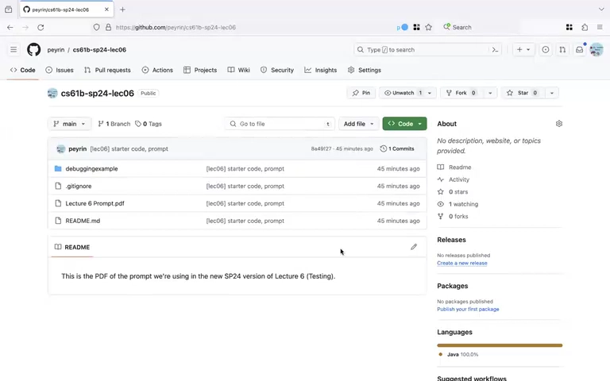 |
| [00:05](https://www.bilibili.com/video/BV1QP4y1u7jv/?p=9&t=5) 就像贾斯汀刚才说的对不起录音里的人，我忘了开始我们要谈谈测试所以让我们在CS 61 A中做到目前为止 | 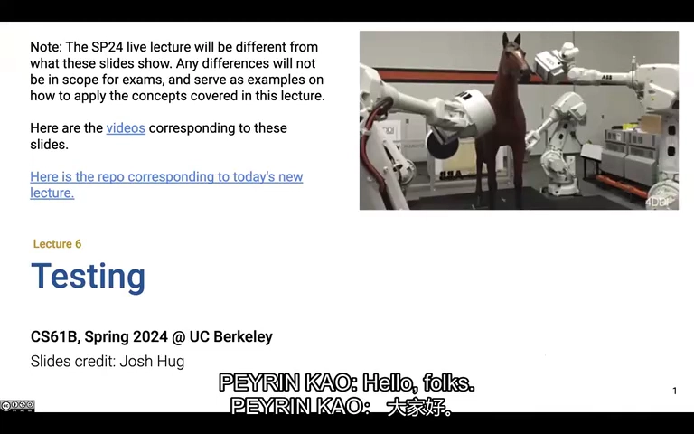 |
| [00:12](https://www.bilibili.com/video/BV1QP4y1u7jv/?p=9&t=12) （此区间无字幕） | 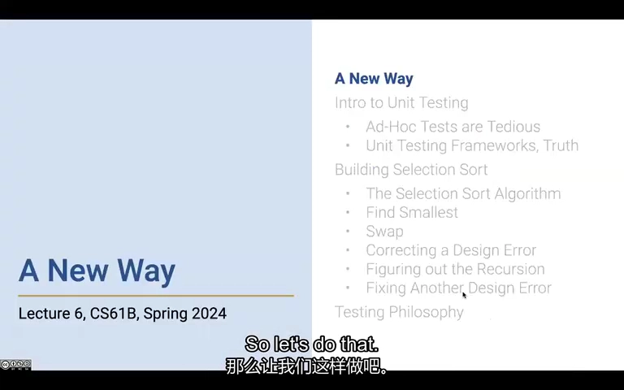 |
| [00:17](https://www.bilibili.com/video/BV1QP4y1u7jv/?p=9&t=17) 到目前为止在CS六二A和CS八十八以及编写代码时所学的其他课程你怎么知道代码运行良好可能你是怎么知道密码有效的是别人给你做了检查如果您的代码在项目零上如此工作我们给你做了检查如果你的代码在61 a工作他们给你做了一堆测试有一个神奇的自动平地机它会告诉你你是否得到了分数它会告诉你你的代码是否正确所以今天这是一个哲学讲座没有太多的语法需要记忆，也没有太多的新概念但今天的想法是给你力量弄清楚你的代码是否能自己工作不必依赖我们为您编写自动平地机 | 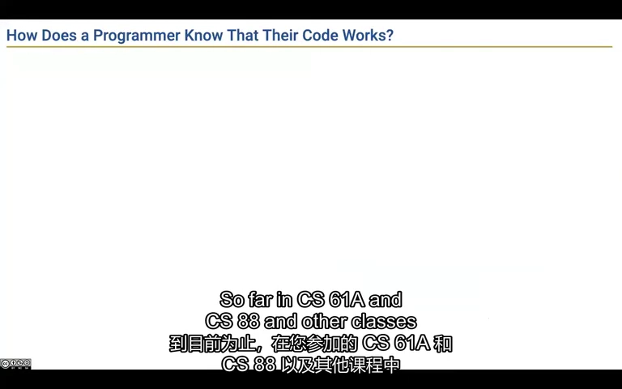 |
| [00:57](https://www.bilibili.com/video/BV1QP4y1u7jv/?p=9&t=57) 因为如果你在现实世界中进行行业研究外面没有自动平地机所以我们必须学习如何编写测试并检查我们的代码在没有自动平地机的情况下是否有效我会在前面说，这通常很难如果不是不可能检查如果您的代码百分之百完全正确在极少数情况下，这是可能的你可以写一些数学证明来检查如果您的代码是正确的但这是一种边缘情况大多数人不会这么做即使我们不能完全确定我们的代码是百分之百正确的我们可以给自己写一些测试，给我们非常有力的证据那是正确的这就是我们今天要讲的哲学我们会试着给你在你的第一个项目中走出去的技能 | 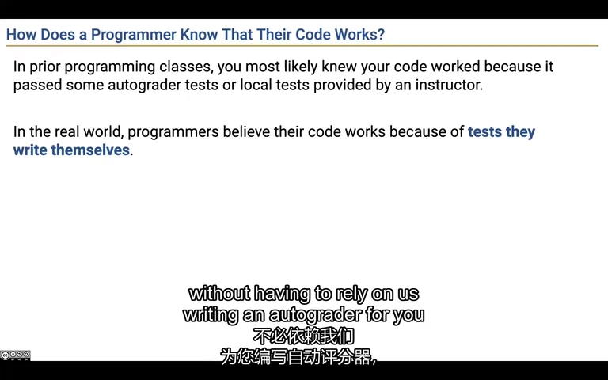 |
| [01:37](https://www.bilibili.com/video/BV1QP4y1u7jv/?p=9&t=97) 在这个世界上，用这一新的浪潮编码事物所以我暂时不放这部电影了 | 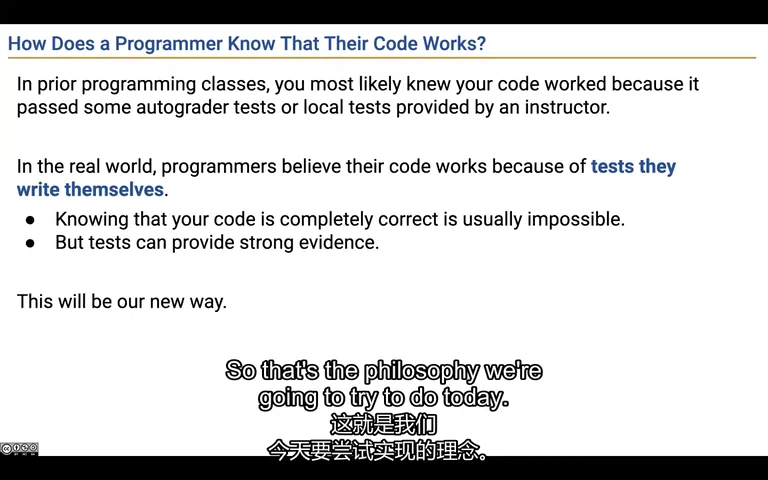 |
| [01:45](https://www.bilibili.com/video/BV1QP4y1u7jv/?p=9&t=105) 但是你知道乔希有一部他喜欢看的电影就像一个训练蒙太奇 | 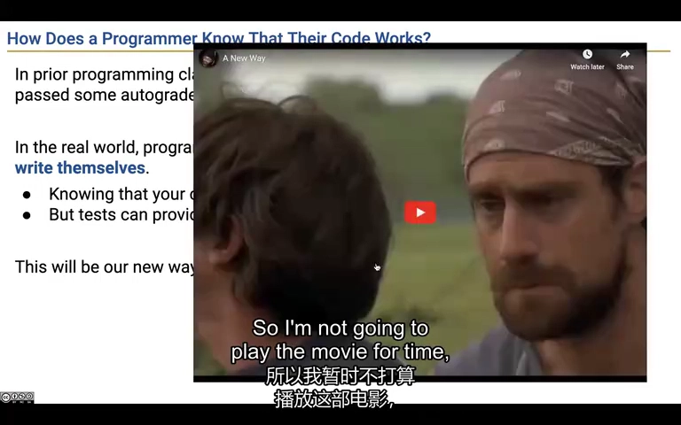 |
| [01:50](https://www.bilibili.com/video/BV1QP4y1u7jv/?p=9&t=110) 所以是的我们来玩好啦所以，看看这是你的权利 | 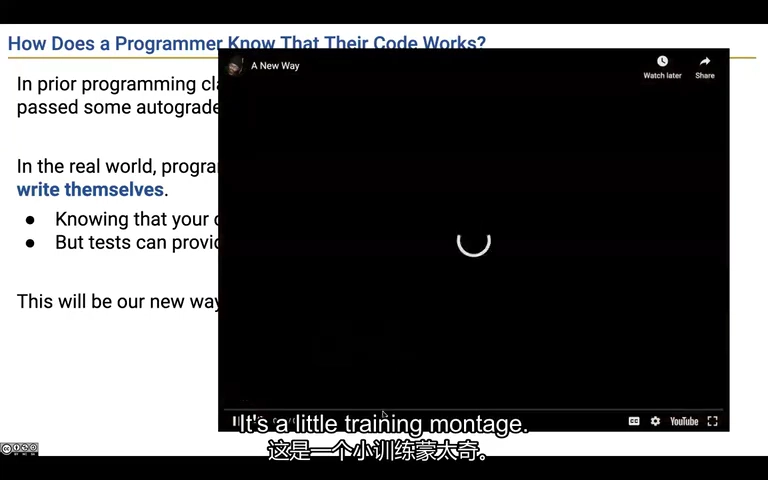 |
| [01:55](https://www.bilibili.com/video/BV1QP4y1u7jv/?p=9&t=115) 你在后面你第一次学习如何写测试这就是我们你知道我们在为你做训练蒙太奇 | 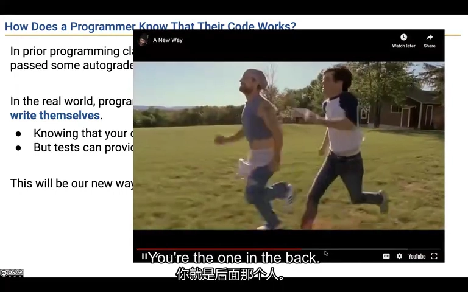 |
| [02:00](https://www.bilibili.com/video/BV1QP4y1u7jv/?p=9&t=120) 所以你还不能这么做但到今天结束时，你将能够你刚刚掌握了窍门 | 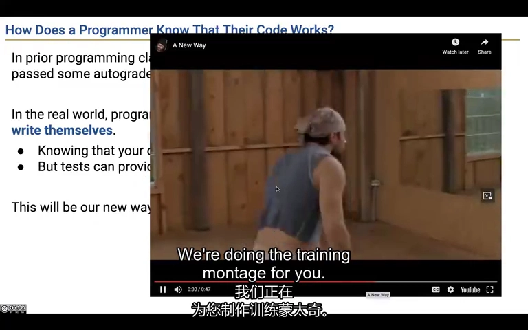 |
| [02:07](https://www.bilibili.com/video/BV1QP4y1u7jv/?p=9&t=127) 所以你明白了好啦所以要弄清楚如何编写测试以及如何自己调试我们的程序离不开神奇算子的帮助我们需要一个例子所以在过去的几个学期里乔希会用排序作为例子这学期告诉我们我们在做什么“你叫我受什么罪呢？你走吧好的所以这学期我们要尝试一些新的东西好啦所以说我们在做什么我写了一些代码，我写了一个问题你现在还没有意识到我从没见过所以我已经写了这个问题，我写了一些错误的代码 | 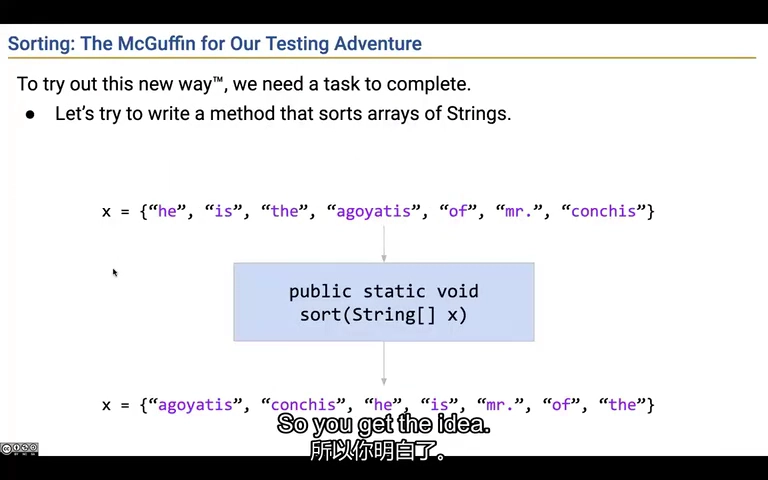 |
| [02:47](https://www.bilibili.com/video/BV1QP4y1u7jv/?p=9&t=167) 佩兰将利用你的帮助来调试代码 | 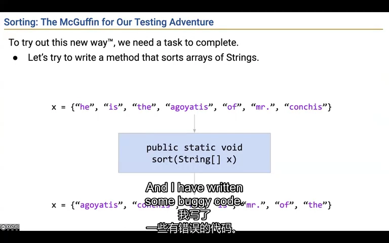 |
| [02:53](https://www.bilibili.com/video/BV1QP4y1u7jv/?p=9&t=173) （此区间无字幕） | 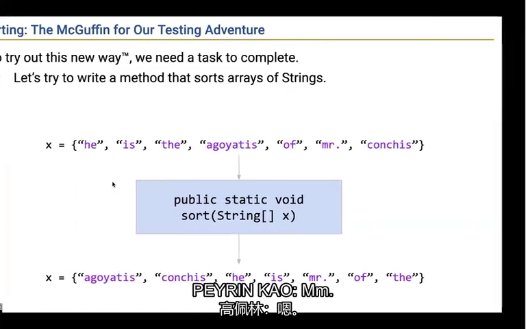 |
| [02:58](https://www.bilibili.com/video/BV1QP4y1u7jv/?p=9&t=178) 好啦所以我们现在应该看看道具吗我们要不要一起看提示符是呀好啦迅速好吧，去吧，通常当我在这里我有时会对你撒谎说哎呦这是我们第一次尝试但我以前做过五次我没有说谎我以前从没见过这个所以让我们一起读吧我需要一分钟来阅读这篇文章所以你也可以花一分钟读一下在第一张幻灯片里有一个链接它不在幻灯片上的原因是因为我不被允许看它所以它不可能出现在幻灯片上所以我会读的你可以和我一起读所以我们要读我需要计算方差所以我需要计算平均值好吧很公平 | 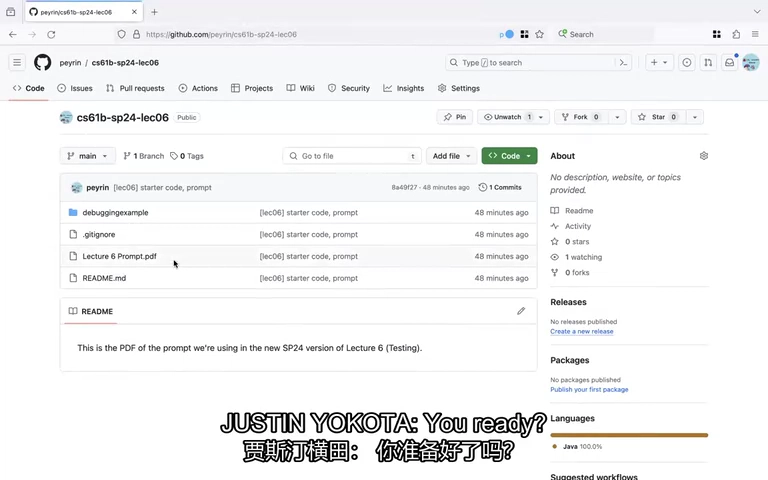 |
| [03:38](https://www.bilibili.com/video/BV1QP4y1u7jv/?p=9&t=218) 然后对于每一个项目，我计算x减去平均值当我把数字平方时然后我把所有的平方差的平均值谢天谢地，我得到了一个例子这很好所以一二三四的平均数是每个数字的2.5我减去两块五我平方了我得到这四个数字我平均一下我得了1.25分这我不是在计算但我相信你的话那是正确的答案所以这就是我们要写的函数人们对此很好吗你需要更多的时间读这个吗我觉得我有点明白了好啦好啦如果你需要更多的时间PDF还在那里 | 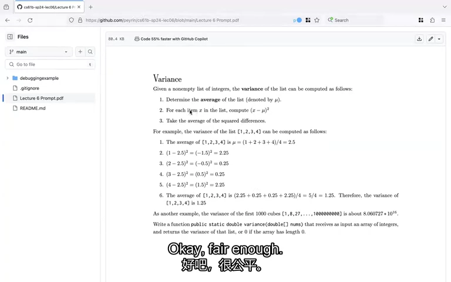 |
| [04:15](https://www.bilibili.com/video/BV1QP4y1u7jv/?p=9&t=255) 链接就在那里好啦所以我们不再排序了我们将第一次尝试这种新的方差 | 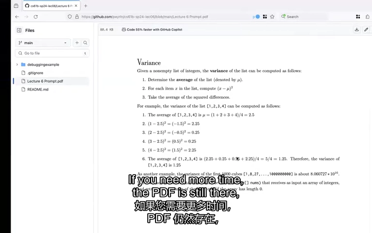 |
| [04:20](https://www.bilibili.com/video/BV1QP4y1u7jv/?p=9&t=260) 永远所以从哲学上来说我们会怎么做如果这是61 a或c 88 | 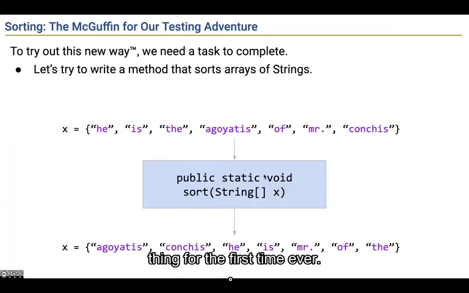 |
| [04:27](https://www.bilibili.com/video/BV1QP4y1u7jv/?p=9&t=267) 我们要做的是我们会立即开始写我们的方差函数假设这个方差我们会把它塞进神奇的自动平地机里自动平地机会给我们这个漂亮的输出，告诉我们我们的方法有什么问题，如何解决但在现实世界里这东西是不存在的所以我们得自己写测试检查我们的方差函数所以，假装这不是说排序 | 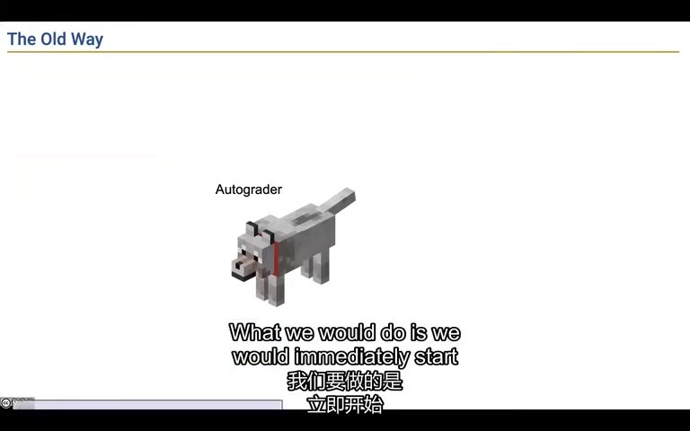 |
| [04:49](https://www.bilibili.com/video/BV1QP4y1u7jv/?p=9&t=289) 如果你想看排序版本乔希有一个视频但是我们今天要展示它所以如果你好奇你可以去看看但是今天我们要写我们自己的测试方差 | 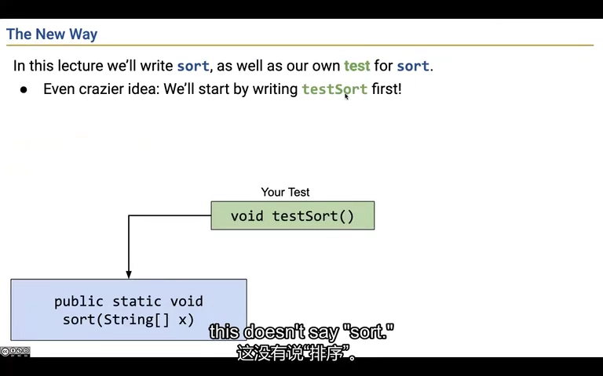 |
| [04:57](https://www.bilibili.com/video/BV1QP4y1u7jv/?p=9&t=297) 或测试方差测试来检查如果我们的代码有效 | 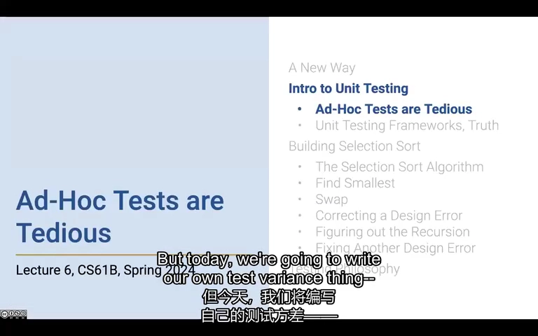 |
| [05:02](https://www.bilibili.com/video/BV1QP4y1u7jv/?p=9&t=302) 那么我们如何编写测试我再给你看几张幻灯片然后我们从头开始 | 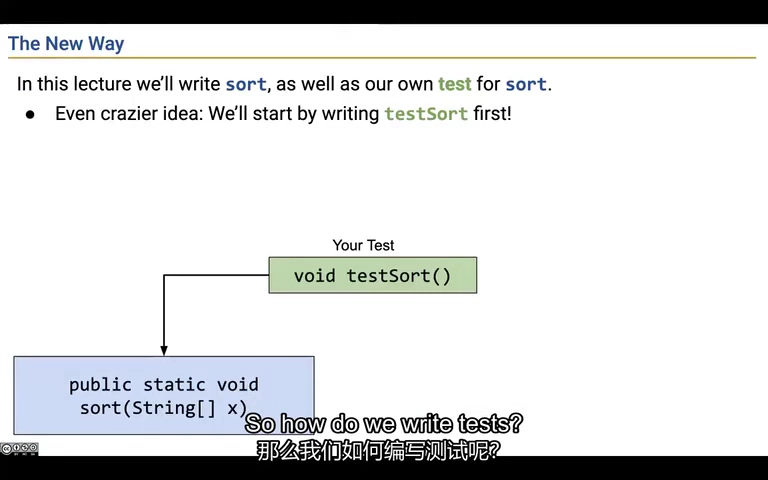 |
| [05:07](https://www.bilibili.com/video/BV1QP4y1u7jv/?p=9&t=307) 所以我们可以写它的一种方法我就把它烧了因为这不是我们通常做的我们可以先说这就是预期的输入这就是我们的输入这就是我希望的输出是如此如果我假设换做是我然后我们就拿着这个东西我们会把它分类的这将是预期的产出然后我不得不以某种方式比较如果期望的输出和我得到的一样当我调用排序时所以我得写一些可笑的代码也许我会写一个for循环，然后检查这两个数组相等吗你也知道如果他们不平等我必须写我自己的小错误信息所以不要看得太重不要盯得太紧因为这很烦人 | 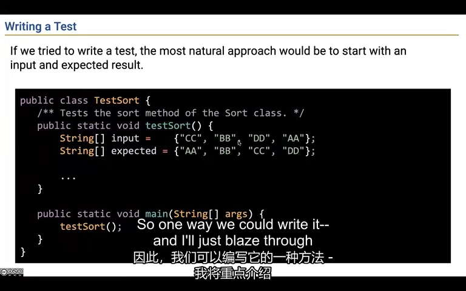 |
| [05:47](https://www.bilibili.com/video/BV1QP4y1u7jv/?p=9&t=347) 写起来很乏味如果测试是这样的你不会这么做的因为不好玩您必须编写这些特定的测试错误消息你得写这个循环这不好玩我不想这么幸运 | 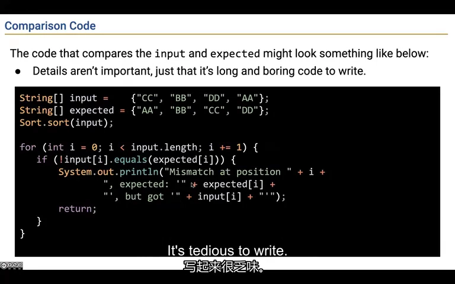 |
| [05:59](https://www.bilibili.com/video/BV1QP4y1u7jv/?p=9&t=359) 我们没必要这么做因为这种代码基本上出现在每一个测试中我们得写我们得检查一下如果期望的输出与调用函数得到的输出相同我不想一遍又一遍地写这个使用完全相同的错误消息那太乏味了 | 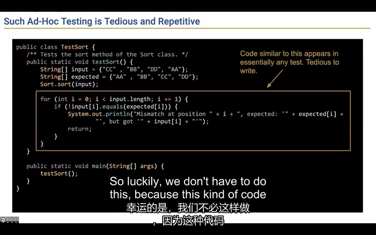 |
| [06:15](https://www.bilibili.com/video/BV1QP4y1u7jv/?p=9&t=375) 所以幸运的是，没有写这样的测试因为那不好玩没人会那么做 | 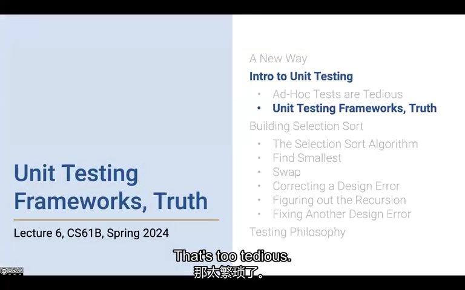 |
| [06:20](https://www.bilibili.com/video/BV1QP4y1u7jv/?p=9&t=380) 我们可以使用其他人写的库所以其他人写了单元测试库他们做了所有艰苦的工作来提出复杂的错误消息和检查数组的循环所以与其自己做这些我们只是要让别人来做有很多不同的库我们要用到的是真理它是由谷歌开发的所以我们要用这个也许在过去的学期里，人们使用不同的所以如果一个助教会产生一些旧的代码可能是但无论如何，让我们试一试 | 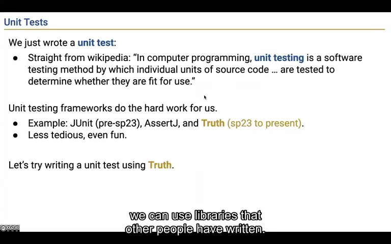 |
| [06:50](https://www.bilibili.com/video/BV1QP4y1u7jv/?p=9&t=410) 所以我们不打算再做分类了不幸的是，我们将跳转到这段代码中 | 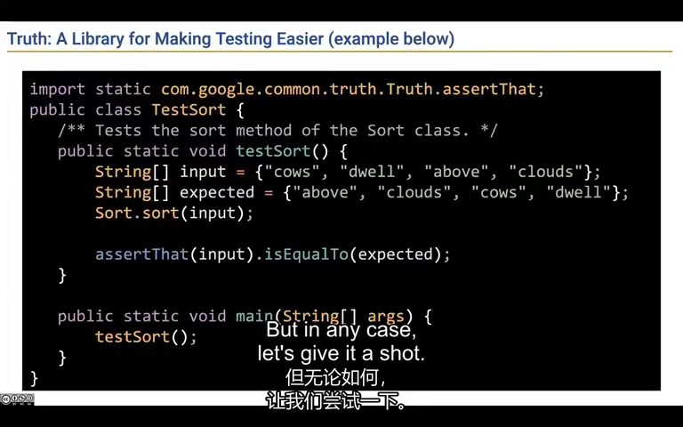 |
| [06:55](https://www.bilibili.com/video/BV1QP4y1u7jv/?p=9&t=415) 我从来没见过我们看看是怎么回事所以我不会打开正确的 | 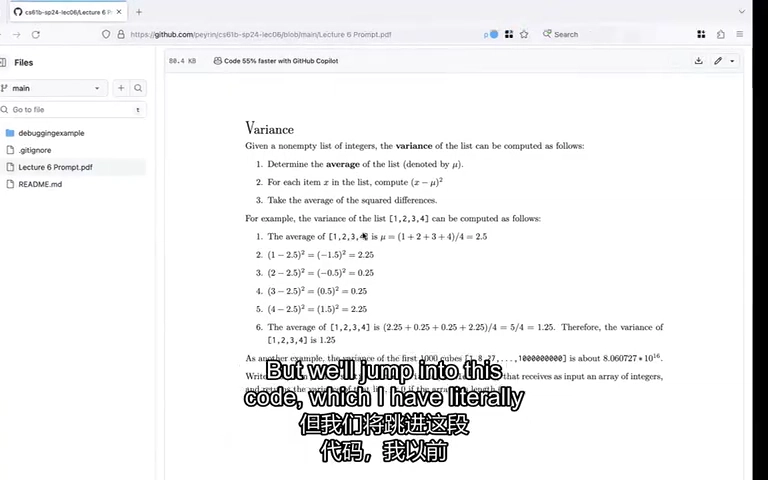 |
| [07:00](https://www.bilibili.com/video/BV1QP4y1u7jv/?p=9&t=420) 我要打开测试文件 | 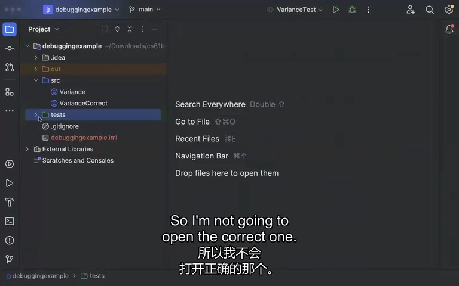 |
| [07:05](https://www.bilibili.com/video/BV1QP4y1u7jv/?p=9&t=425) 我想我也简单地提到了大家可以看到这次演讲将是完全混乱和杂乱无章的 | 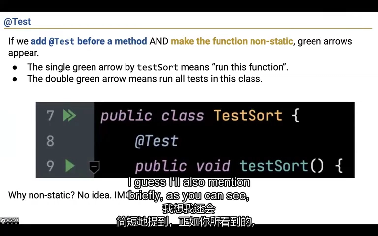 |
| [07:10](https://www.bilibili.com/video/BV1QP4y1u7jv/?p=9&t=430) 因为我不知道发生了什么不过，也许我们可以一起想办法所以有一件事我会在某个时候注意到 | 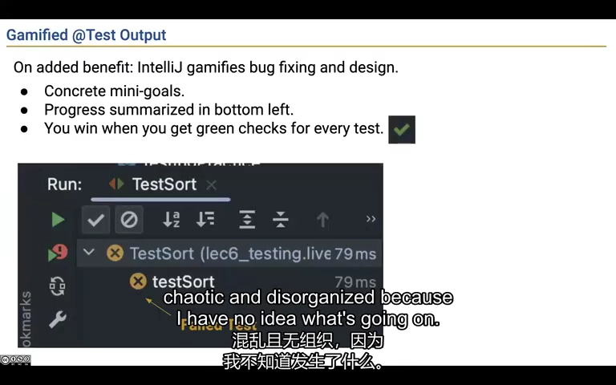 |
| [07:15](https://www.bilibili.com/video/BV1QP4y1u7jv/?p=9&t=435) 我想现在不是这样不是这样好吗也许不是滑梯 | 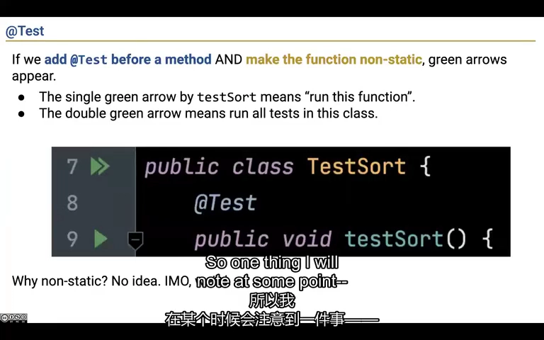 |
| [07:20](https://www.bilibili.com/video/BV1QP4y1u7jv/?p=9&t=440) 好啦那很好就像我说的，我们正在做我们是现场直播好啦所以我们在写完函数后不写测试 | 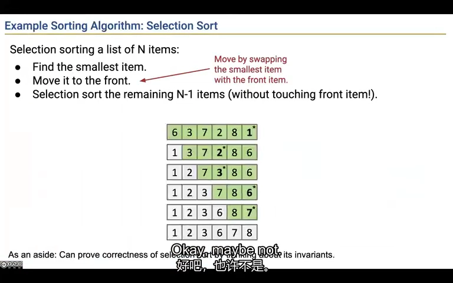 |
| [07:25](https://www.bilibili.com/video/BV1QP4y1u7jv/?p=9&t=445) 所以通常情况下，你可能希望你做的是，你写一个函数你就像这东西完全管用然后你会写你的测试，看看它们是否有效但是一个非常奇怪的想法我们以后再谈也许在最后如果我们有时间如果我能熬过这一切在我们写完代码之后不管有没有用我想做一些有点奇怪的事情实际上我要检查一下如果代码有效，在我写代码之前就写好测试就像哇，让人大吃一惊发生什么事了？所以这里的想法是，在我们写代码之前，代码就在那里了我们还没写呢我们实际上要从编写测试开始在我们做完测试之后然后我们要去写我们的代码 | 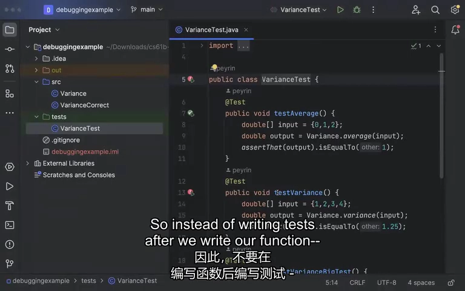 |
| [08:05](https://www.bilibili.com/video/BV1QP4y1u7jv/?p=9&t=485) 这是一种奇怪的倒退的想法但我们要试试好啦所以我希望我有一个幻灯片 | 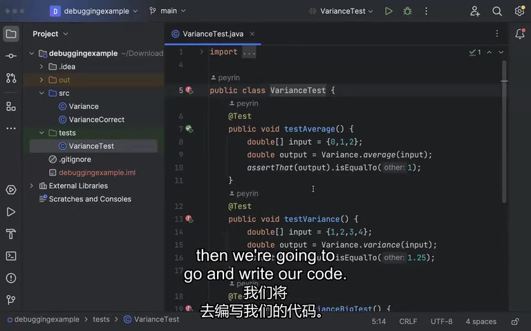 |
| [08:10](https://www.bilibili.com/video/BV1QP4y1u7jv/?p=9&t=490) 我发誓我做了可能是这个好啦 | 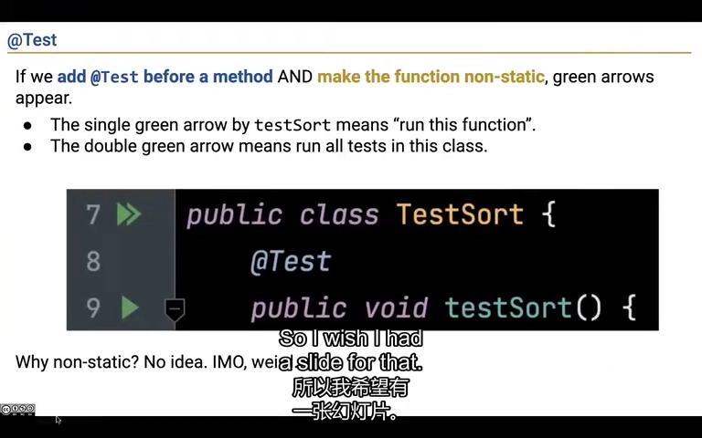 |
| [08:15](https://www.bilibili.com/video/BV1QP4y1u7jv/?p=9&t=495) 所以你能读到这个如果你有兴趣基本上，我们的想法是先编写测试 | 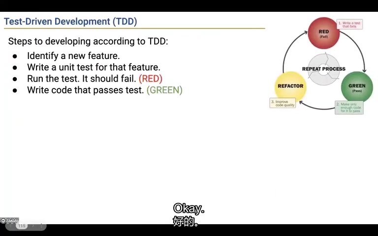 |
| [08:20](https://www.bilibili.com/video/BV1QP4y1u7jv/?p=9&t=500) 考试要失败了因为我们还没有写代码然后我们将尝试编写代码以使测试通过 | 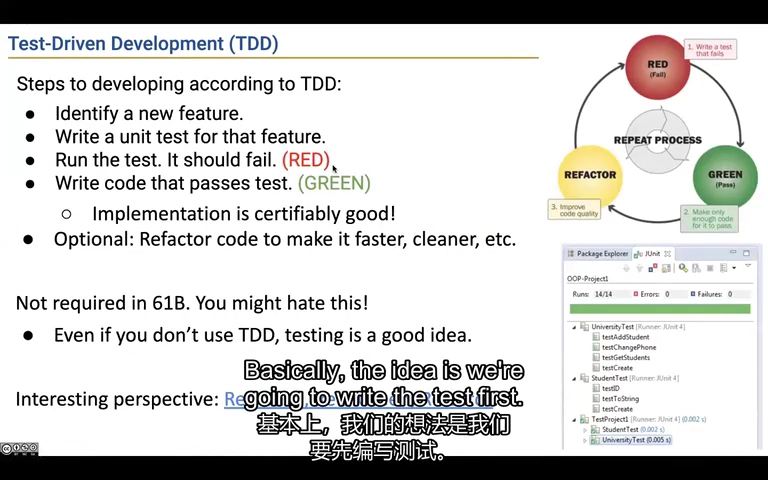 |
| [08:26](https://www.bilibili.com/video/BV1QP4y1u7jv/?p=9&t=506) 好啦就是这个意思我们首先如何写好测试我应该弄清楚函数是什么 | 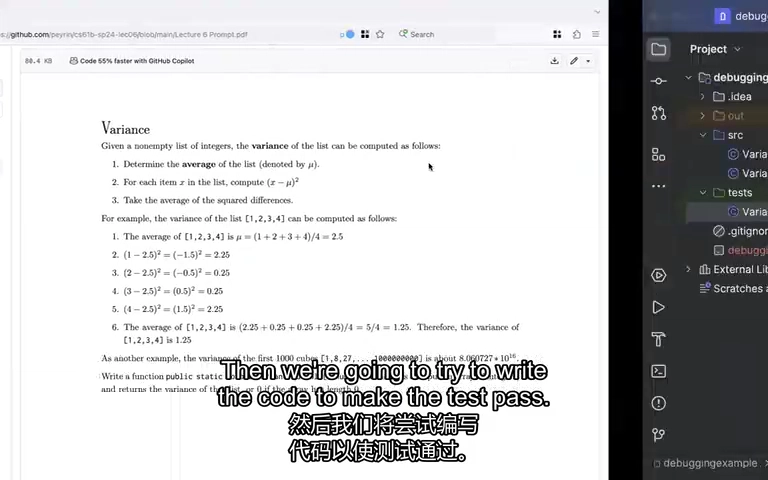 |
| [08:31](https://www.bilibili.com/video/BV1QP4y1u7jv/?p=9&t=511) 我可以打开这个文件吗方差井你应该弄清楚好啦因为我最想弄清楚的是签名是什么 | 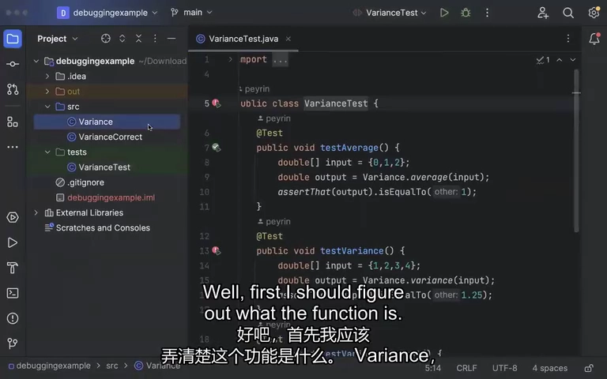 |
| [08:36](https://www.bilibili.com/video/BV1QP4y1u7jv/?p=9&t=516) 这是唯一一个是呀 | 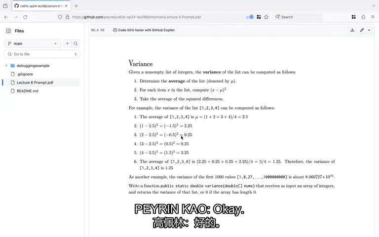 |
| [08:41](https://www.bilibili.com/video/BV1QP4y1u7jv/?p=9&t=521) 我放大你想让我在PDF上放大什么好啦所以我想首先 | 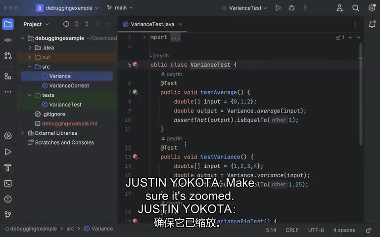 |
| [08:46](https://www.bilibili.com/video/BV1QP4y1u7jv/?p=9&t=526) 你打算怎么所以你想让我谈谈比如我的编码方法或者测试方法编码我的编码方法好吧，似乎有一个函数让我写在这里它是数组中的公共静态双方差我的意思是我想我会写一个帮助函数因为我不想每件事都用一种方法所以我可能会写一个方法来计算平均值也许是因为我的意思是你给了我三个步骤我想我会为第一个写一个助手方法也许我把这个放在帮助者的方法中比如减去平均值和平方它可能会进入一个助手方法然后我想我可以再次使用平均法在我的第三步你看我的眼神很奇怪就像发生了什么好啦 | 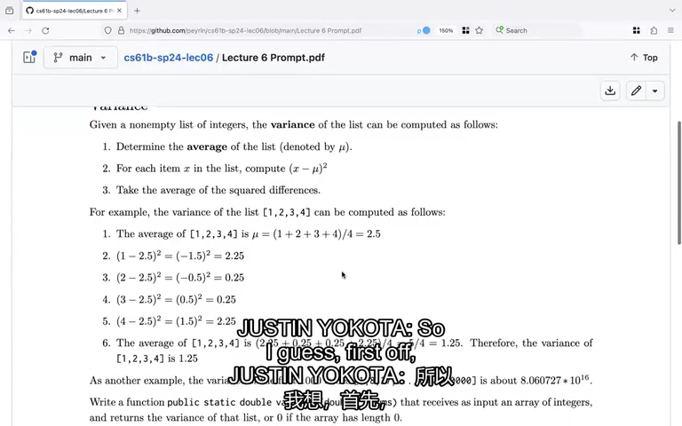 |
| [09:26](https://www.bilibili.com/video/BV1QP4y1u7jv/?p=9&t=566) 好吧那么好吧那是我想我无论如何都会这么做假设有一个方差函数 | 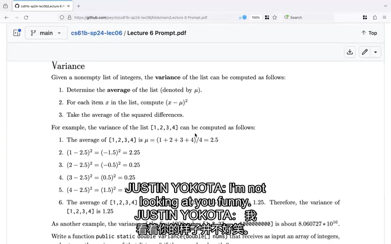 |
| [09:36](https://www.bilibili.com/video/BV1QP4y1u7jv/?p=9&t=576) 我想我要试着写一些测试那么我应该写好什么测试呢我本想写你给我的例子中的那个 | 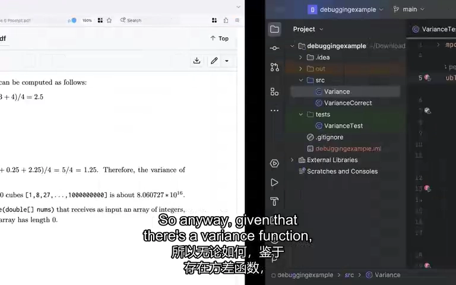 |
| [09:41](https://www.bilibili.com/video/BV1QP4y1u7jv/?p=9&t=581) 但你好像已经写好了所以也许我会我们就当不是你写的 | 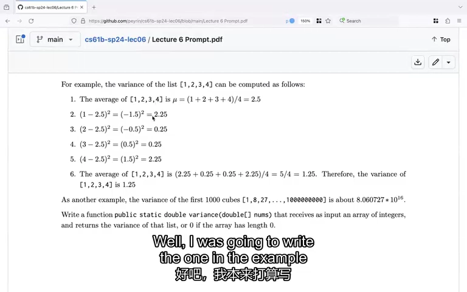 |
| [09:46](https://www.bilibili.com/video/BV1QP4y1u7jv/?p=9&t=586) 我会写下来啊把它放在那里所以你可以喜欢Fine好啦嗯，这还不够好啦我们会做新的好啦所以这里有一点语法我不管你背不背因为坦率地说，这不是很有趣所以我将向你们展示一点语法但就是没那么有趣所以好吧公共无效然后我会写下测试的名字所以我不知道试验让我们写一个测试那么我们的输入数组应该是什么我不知道我不知道别看我我不知道答案不要我们已经有一个了两个三四 | 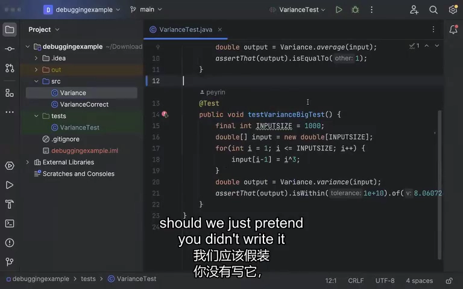 |
| [10:26](https://www.bilibili.com/video/BV1QP4y1u7jv/?p=9&t=626) 这就是我之前想用的十二三四十没问题好啦十二三十四好的很好所以通常当我们写测试时我们所做的是我们要做两件事所以首先我们要在不看代码的情况下思考自己正确答案是什么？然后我们将调用我们将要编写的方法然后看看我们的方法是否给出正确的答案所以好吧预期和实际我们看看是否吻合所以答案应该是双右好啦那么这里的预期答案是什么我也不知道好啦那么实际上一百二十五是呀你是真的吗还是这就像一个我们打算多放一些虫子，让生活更艰难 | 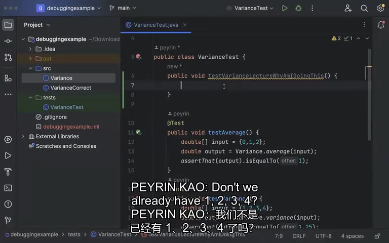 |
| [11:06](https://www.bilibili.com/video/BV1QP4y1u7jv/?p=9&t=666) 好啦所以我做得很好我相信你的话所以如果我没有在这里我会做的是我可能会去谷歌就像自己算过一样我可能会得到一百二十五好的很好这就是期望值所以说实际价值是多少嗯实际值是会发生什么如果我调用实际的方法这就是为什么我想知道方法实际上是什么样子的所以我猜一猜我猜它属于变异类不是正确的我猜是方差函数我想我给它一个输入好的，好的所以通常您可以打开这个文件，看看方法签名是什么 | 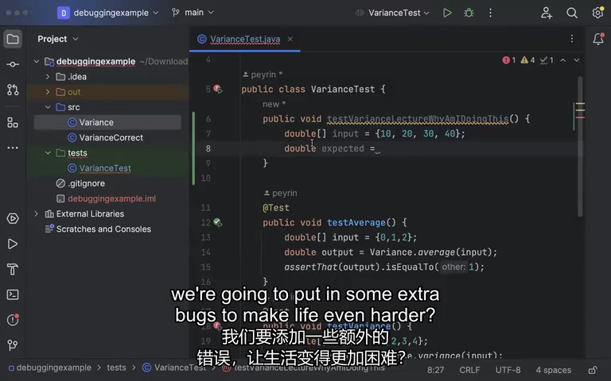 |
| [11:46](https://www.bilibili.com/video/BV1QP4y1u7jv/?p=9&t=706) 但我想我不被允许所以我不会很好最后我要检查值是否相等所以这就是问题所在我们将使用真相图书馆所以它已经帮我进口了我并不在乎进口结单你可以把它们放在上面所以我会写一些像你知道的断言这一点，谷歌真相的好处是我想我要简短地提一下，它读起来有点像英语所以这几乎就像我在写一个英语句子挺好的所以说即使你不记得确切的语法有时候你可以自己猜这是我经常做的所以我想检查一下实际和预期是否一样所以也许我会说某个t实际等于期望那真是太好了因为现在我不必手动写我自己的错误消息 | 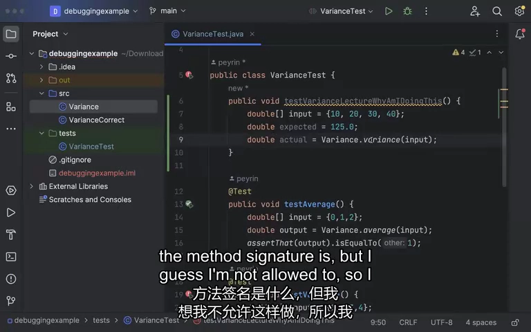 |
| [12:26](https://www.bilibili.com/video/BV1QP4y1u7jv/?p=9&t=746) 我不用手动检查它们是否相等所以这个声明将检查它们对我是否相等还可以打印出错误消息如果是错的挺好的一个小问题是似乎写的所有其他测试他们有这些小按钮这样我就可以进行测试就像你在零号计划里做的那样这里没有运行按钮那么我该怎么办所以一个可能的想法是我可以写一个主方法然后你知道在我的主要方法中我可以把我的测试方差那有点烦人这不是你在项目中所做的所以我不打算描述它是如何做到的或者这在引擎盖下是如何工作的你可以查看额外的视频如果你好奇的话但我要添加这个有趣的新语法正在测试中我想那就是我想要的 |  |
| [13:06](https://www.bilibili.com/video/BV1QP4y1u7jv/?p=9&t=786) 好啦也许不是在测试中有用吗好啦好极了所以这会做的是出于我没有解释的原因它会神奇地在这里放一个跑步符号这将让我运行这个测试这怎么行得通现在不是很重要但如果你把咒语你会有一个很好的小测试，你可以运行我们是否应该写更多的测试来自信也许我们应该也许我们不应该有人对我们在做什么有疑问吗？关于为什么我们为什么要这么做所以有多少像多少拿了投票点是啊，是啊这是个好问题不是一个 |  |
| [13:46](https://www.bilibili.com/video/BV1QP4y1u7jv/?p=9&t=826) 我没有答案因为我从没见过这个代码你想来自一个时代吗好啦有一个问题是关于什么如果数字稍微偏离了零点零点一显然谷歌真相有一些语法我不打算读那个但我想你可以断言产出在一点点你知道在这个大数字的某个范围内好的听起来不错令人兴奋所以是的谷歌地球有很多不同的功能你不会把它们都用完的只是今天的一小部分好像等于我们会做大部分的工作我们应该写更多的测试吗我们应该开始调试边缘情况吗这是一个很好的观点所以有时候当我们写函数的时候有些输入很奇怪 |  |
| [14:26](https://www.bilibili.com/video/BV1QP4y1u7jv/?p=9&t=866) 所以也许这就像一个正常的输入有什么奇怪的输入我们必须处理或许我们应该考虑一下对不起再说一次我不知道我们是不是说了什么空列表空列表好啦好啊就这么办所以也许我会给它起一个更有描述性的名字这次所以测试空列表我认为这是有效的语法空列表好啦所以期望值预期的行为是什么 |  |
| [14:53](https://www.bilibili.com/video/BV1QP4y1u7jv/?p=9&t=893) 我不知道我检查一下我的规格说明书告诉我该怎么做了吗？如果我得到一个空列表 |  |
| [14:58](https://www.bilibili.com/video/BV1QP4y1u7jv/?p=9&t=898) 是啊，是啊哈喽哈喽在最底层啊确实如此好啦所以我就是不识字所以它返回该列表的方差为零如果数组为零啊哈 |  |
| [15:07](https://www.bilibili.com/video/BV1QP4y1u7jv/?p=9&t=907) 所以这告诉我期望值应该是零这告诉我实际情况是什么实际情况是如果我调用方差函数然后我可以做和以前一样的陈述好的等于好啦预期很好在我之前我应该处理的任何其他奇怪的边缘案件数字重复我喜欢那个我们就这么做吧好啦我应该用什么号码大家可以看到我完全在即兴表演我也不知道发生什么事了？我应该用什么号码也许我只是复制粘贴因为我懒六十一好啦好吗是吗 |  |
| [15:47](https://www.bilibili.com/video/BV1QP4y1u7jv/?p=9&t=947) 方差是多少我想是零好吧，很好，如果我不知道该怎么办 |  |
| [15:53](https://www.bilibili.com/video/BV1QP4y1u7jv/?p=9&t=953) 我只是进入计算器做所有这些数学但我不会这么做但显然是零 |  |
| [15:58](https://www.bilibili.com/video/BV1QP4y1u7jv/?p=9&t=958) 你还想试试负数吗你现在真的在测试好啦所以你在测试功能哪个好好啦让我们做测试阴性我们应该用什么负数别看我我没有答案就像一场辩论好啦哦不结尾有一个情节转折好啦啊哈你现在就在现场离我而去你 |  |
| [16:34](https://www.bilibili.com/video/BV1QP4y1u7jv/?p=9&t=994) 计算快点快点否则我想打你91 |  |
| [16:40](https://www.bilibili.com/video/BV1QP4y1u7jv/?p=9&t=1000) 九十二我应该点击它吗我不知道是什么样品我不知道样本人口是什么我知道我什么都不记得了 |  |
| [16:51](https://www.bilibili.com/video/BV1QP4y1u7jv/?p=9&t=1011) 是减一吗这就是我想要的那是二九四我想是3号4号看那个好啦七点二五 |  |
| [17:00](https://www.bilibili.com/video/BV1QP4y1u7jv/?p=9&t=1020) （此区间无字幕） |  |
| [17:05](https://www.bilibili.com/video/BV1QP4y1u7jv/?p=9&t=1025) （此区间无字幕） |  |
| [17:10](https://www.bilibili.com/video/BV1QP4y1u7jv/?p=9&t=1030) 你作弊好啦那很好我也作弊了好啦如果我愿意，我甚至可以设置我的消息来源 |  |
| [17:15](https://www.bilibili.com/video/BV1QP4y1u7jv/?p=9&t=1035) （此区间无字幕） |  |
| [17:20](https://www.bilibili.com/video/BV1QP4y1u7jv/?p=9&t=1040) 是啊，是啊还有别的吗？但以防万一，你的平均测试怎么样我再做一个是啊，是啊这是一个很好的观点我不知道你有一个普通的方法所以我没有测试它但是如果你有一个平均的方法那我一定会试着测试一下那么我应该用平均值测试平均值呢我看你给了你暗示好啦那么我应该用任何边缘情况测试平均值思想所以我会做同样的事而且是的我想有时候有点乏味但你知道考试就是这样的所以只要它自己为零 |  |
| [18:00](https://www.bilibili.com/video/BV1QP4y1u7jv/?p=9&t=1080) 我想确认一下这就是你想要的好吧，预期等于零因为零的平均值是零好平均啊好吧平均所以我在看正确的答案当然可以好啦我会复制这个小相等的实际意外好吧好吧也许再来两个然后我们该走了因为我不知道这个调试要花多长时间你还要什么空的好啦我不知道一般的方法应该做什么当它是空的不过，你想要什么我不知道方法是你写的好啦当然我会假装它会回来如果它返回零 |  |
| [18:40](https://www.bilibili.com/video/BV1QP4y1u7jv/?p=9&t=1120) 我不知道我想我得回零因为我觉得我们看看会发生什么还有别的吗？不再有一个我们是不是应该把它写成你想要什么哦耶我重复了一遍当然我们该怎么做呢？好啦我希望平均你想让它变得困难好啦我应该加什么去算算你想要什么额外的五个实际上可以怎么可以 |  |
| [19:20](https://www.bilibili.com/video/BV1QP4y1u7jv/?p=9&t=1160) 你想改变它我去换把号码改成2 3 2 3好啦如果你这么说老板估计是七七好啦这是干净的好啦当然好的我喜欢好啦我们是不是应该检查一些替身因为我们检查过的所有替身都不是他们都是零点也许我们应该检查一下，当这不是零点是啊，是啊这些都可以因为也许有一个小错误喜欢整数而不是整数你偷偷溜进去但我看到你的游戏我不会让你检查的所以我不会让你逍遥法外如果这是二四呢这将不再是七点零右四五六七八九 |  |
| [20:00](https://www.bilibili.com/video/BV1QP4y1u7jv/?p=9&t=1200) 啊太多了好啦像这样怎么样？现在是七点一了２５２５３５２４５９９９８所以太远了那三个七五三个七五好啦当然，我想你是什么意思你觉得好吧我去查查心算 |  |
| [20:24](https://www.bilibili.com/video/BV1QP4y1u7jv/?p=9&t=1224) 我想那是真的好啦让我们看看是2-3-7-5好啦好极了所以好吧 |  |
| [20:29](https://www.bilibili.com/video/BV1QP4y1u7jv/?p=9&t=1229) 所以这也将测试不是我所有的数字都是零所以再一次这真的不像是一门科学没有正确的答案更像是一门艺术所以我们必须自己经历和思考边缘案例你想到了一些伟大的，比如空洞和重复我想到了一个，所有这些都以零点结束如果他们没有在零点结束呢有时想出这些有点棘手不过，看来我们之间都是我们可以开始了有一个是呀你想做什么没有输入有上这是一个很好的观点所以就像我们有一样我刚想出了一个不以零点结束的方法如果输入的终点不是零怎么办那是个好主意我们应该那样做所以说让我们同时计算平均值和方差 |  |
| [21:09](https://www.bilibili.com/video/BV1QP4y1u7jv/?p=9&t=1269) 好啦嗯这将是一些有趣的数学好啦所以您希望输入不是整数所以也许我们有五点五和六点五是啊，是啊不太复杂好啦我希望平均数是6也许我们也做一个方差好啦那么我该怎么办考试平均重复一遍好啦我想我要借这个其实呢一点五两点五三点九四点五你要一分五两点五三点五好啦当然可以让我们做吧我不想计算用力点当然可以好啦那么这个的方差是多少当你可能1点2分5秒 |  |
| [21:49](https://www.bilibili.com/video/BV1QP4y1u7jv/?p=9&t=1309) 好啦我们这样说吗好啦酷所以现在我们有一点点别叫它哦，我明白了好啦一定要把名字写对太真实了好啦好啦看起来不错所以我们写了一堆测试至关重要的是，我们在编写任何一行代码之前就这样做了 |  |
| [22:10](https://www.bilibili.com/video/BV1QP4y1u7jv/?p=9&t=1330) 所以这是关键的想法你不必用这个主意但我觉得这真的很好因为这意味着在你开始写代码之前 |  |
| [22:15](https://www.bilibili.com/video/BV1QP4y1u7jv/?p=9&t=1335) 你已经想了很久了你得非常小心因为这些可能不是整数，要非常小心，因为这些是整数哦通过写这些测试，我也意识到嘿也许我需要一个平均的方法所以通过在进入代码之前编写这些测试我对如何编写代码有了更好的想法那有点酷所以我相信现在是关键时刻我们应该用我们还没有编写的代码运行所有这些测试看看能不能用是呀我可以点击这个是呀我要爆炸了所以我想其中一个通行证好啦那很好但这个想法是，从技术上来说，代码是空白的我们什么都没做你我什么都没做所以我们要运行它然后呢 |  |
| [22:55](https://www.bilibili.com/video/BV1QP4y1u7jv/?p=9&t=1375) 不出所料我们写的大部分东西都没有通过不太奇怪 |  |
| [23:00](https://www.bilibili.com/video/BV1QP4y1u7jv/?p=9&t=1380) 好啦所以我也有一张幻灯片我只是不知道它在哪里了我的滑梯呢 |  |
| [23:09](https://www.bilibili.com/video/BV1QP4y1u7jv/?p=9&t=1389) 这就是我想告诉你的所以我们已经看到了添加单词test的语法神奇地让运行按钮在奖金视频中出现更多细节 |  |
| [23:17](https://www.bilibili.com/video/BV1QP4y1u7jv/?p=9&t=1397) 如果你在乎但在这一点上，我觉得有一件事很酷现在调试和使这个断开的代码工作的过程就像一个游戏因此，与你没有目标地编写代码相反作为人类我们喜欢有奋斗目标所以我发现一些很好的东西是关于智力的尤其是现在我们有了这个列表，看到所有这些像X |  |
| [23:36](https://www.bilibili.com/video/BV1QP4y1u7jv/?p=9&t=1416) 我就像我不想X消失当我改变我的代码 |  |
| [23:41](https://www.bilibili.com/video/BV1QP4y1u7jv/?p=9&t=1421) 我要慢慢的让这些X消失我知道如果他们都以支票的形式出现 |  |
| [23:46](https://www.bilibili.com/video/BV1QP4y1u7jv/?p=9&t=1426) 那我赢了从哲学上来说，这可能是一件小事但你知道这是我们可以用来 |  |
| [23:51](https://www.bilibili.com/video/BV1QP4y1u7jv/?p=9&t=1431) 我不知道激励自己给自己下一步该做什么的明确目标因为有时候想清楚下一步该做什么为什么人们有时会在测试中发现一个bug |  |
| [24:01](https://www.bilibili.com/video/BV1QP4y1u7jv/?p=9&t=1441) 去测试我觉得空列表空列表是呀我知道这个 |  |
| [24:06](https://www.bilibili.com/video/BV1QP4y1u7jv/?p=9&t=1446) 是呀或者去测试平均测试平均空是呀怎么样不要紧哇塞哇塞哦好吧 |  |
| [24:17](https://www.bilibili.com/video/BV1QP4y1u7jv/?p=9&t=1457) 哇塞非常感谢好啦他们说有一个方差的方差但公平地说，这应该是一个差异 |  |
| [24:22](https://www.bilibili.com/video/BV1QP4y1u7jv/?p=9&t=1462) 我经常换来换去所以我不能怪他们我看不出来没关系好吧，就像我说的我觉得很好现在有个小游戏你可以在哪里玩有很多X你得让他们都对勾，你就赢了也许这就是为什么我们也沉迷于你知道的就像电子游戏因为这就像我不知道什么什么这些天孩子们玩什么我不知道源氏冲击我不知道我不知道那是什么但只是人们告诉我这件事你现在不能开枪是呀所以如果人们就像哦你喜欢你知道你喜欢攻击巫师，你得到了魔法硬币或其他什么这是同样的想法 |  |
| [24:54](https://www.bilibili.com/video/BV1QP4y1u7jv/?p=9&t=1494) 你喜欢攻击这些小X你得到了神奇的对勾很明显吗 |  |
| [24:59](https://www.bilibili.com/video/BV1QP4y1u7jv/?p=9&t=1499) 我不知道怎么玩龙胆冲击好的好极了所以我不知道这些东西有什么超出了我的能力范围好的，好的好的，好的所以我们的想法是，我们想让所有这些X消失是时候实际运行我们的测试了我们已经看到他们失败了所以现在它实际上是试图进入并编写我们的方法所以请记住测试驱动开发背后的思想就像人们所说的那样我们按预期先编写测试他们大多失败然后我们进入我们的方法并编写它有了我们通常拥有的额外知识为了保持混乱，我会自己写的你知道你认识像烘焙这样的人游戏节目中的蛋糕 |  |
| [25:39](https://www.bilibili.com/video/BV1QP4y1u7jv/?p=9&t=1539) 或者像电视节目一样然后就像他们立即展示一个新出炉的蛋糕不是，不过还好所以它就像一个就像那些烘焙节目你只是在电视上看他们像他们展示的那样制作呈现给你的食物好啦把蛋糕糊然后你把它放在烤箱里三个小时我们没有三个小时所以这里有一个新的哦，其中一个是啊，是啊是啊，是啊是啊，是啊所以在那些烹饪节目中他们就像三个小时我们把它放在烤箱里然后我们就像那花了太长时间所以我们把新蛋糕拿出来好吧那么好吧所以这是新的代码好啦所以我以前从没见过这个我第一次看到它就像你一样所以我们要检查一下我们立刻看到大量的东西失败了所以我会试着谈谈我会尽力把它讲清楚有时我可能只是喜欢漫无目的地盯着它如果我真的被困住了但我要说一个我觉得有用的策略 |  |
| [26:19](https://www.bilibili.com/video/BV1QP4y1u7jv/?p=9&t=1579) 我喜欢一个接一个地解决这些问题吗所以有时候很容易哎呦有这么多前任我有太多的事情要处理所以也许与其一次做所有的事情我要挑一个我发现很容易我先解决简单的问题希望修复容易的那个导致所有更难的人修复自己这真的会发生吗我不知道不过，如果你能如果它这样做了让我们通过有没有什么测试看起来特别容易你愿意你知道的先打一针空名单似乎很容易让我们这样做，那么空列表做了什么它接受了一个空的列表我希望输出为零我们去看看所以说 |  |
| [26:59](https://www.bilibili.com/video/BV1QP4y1u7jv/?p=9&t=1619) 我该怎么做好呢？我可以盯着代码使劲看但为了完成今天的任务我将使用调试功能我们以前见过好啦所以我点击调试什么都没发生它仍然被零误差除为什么先打那口井？因为我还没有设置断点所以我可能应该这么做也许在设定断点之前我看着这个我就像等一下代码崩溃了如果代码崩溃了意思是我能追踪到追踪到的是什么告诉我它告诉我错误发生在哪里当我打电话给方差时就发生了然后这个方差叫做第13行所谓的平均那就是九号线这就是坠机的地方 |  |
| [27:39](https://www.bilibili.com/video/BV1QP4y1u7jv/?p=9&t=1659) 所以追溯已经告诉我你除以零就在这儿挺好的所以回溯告诉我这里出了问题所以我要在这里设一个断点因为回溯告诉我你的问题就在那里快去看看好啦所以让我们做吧让我们调试一下，程序传送到这里那么我在调试器中做什么与其说是科学，不如说是艺术我可以透过我路过的东西我注意到了什么我在传递一个空数组有道理这就是我在这里经过的是空的我发现和是零然后在这一点上，我试图除以修女莱恩啊哈那是零所以我想我要通过增加一个特例来解决这个问题 |  |
| [28:19](https://www.bilibili.com/video/BV1QP4y1u7jv/?p=9&t=1699) 也许有点好也许我会回来零似乎是合理的所以我做了改变我可以再调试一次我应该做什么我应该把它放在开头这真的有关系吗好吧好吧如果不重要的话我先走了因为我写得如此真实就像好啦所以我又试了一次所以我从及格或不及格到及格都得到了考试这很好太棒了但只有一个，我还有九个所以我会再做一次测试希望通过解决这个棘手的问题我击倒了一堆所以也许你还记得早些时候我经过了13个中的3个什么的现在我超过五岁了哪个好 |  |
| [28:59](https://www.bilibili.com/video/BV1QP4y1u7jv/?p=9&t=1739) 对呀我就像幻影我不知道是什么好啦嗯好的很好所以我有更多的失败要去所以我还是要继续玩这个游戏把这些X去掉下一个你想对付哪一个你得再选一个我喜欢挑容易的如果你想你可以去解决这个问题像一个可笑的但我不会那么做因为这似乎很难那么你下一次测试阴性想做什么我们就这么做吧好啦哪一个是阴性或者你不想你不想测试呈阴性好吧好吧那其实是个不错的主意可能在方差开始工作之前也许我们应该确保平均水平是好的因为记住我们为我们的助手方法平均写了很多测试 |  |
| [29:39](https://www.bilibili.com/video/BV1QP4y1u7jv/?p=9&t=1779) 我们知道方差依赖于平均值那是个好主意也许我们应该先做我们的平均测试因为其中一些平均值并不正确这是一个很好的观点那么我们应该做哪一个平均呢让我们不要做任何可笑的困难我们有多少平均数我们有这个不行了这个不行了偏好无偏好我来做输出不是整数因为我想再说一遍，没有正确的答案如果你做了另一个一切都会好起来的好啦所以我又一次发现自己在平均函数中或者我们发现自己是因为我们在一起所以在这一点上，我可以开始往里看记住调试是一种检查的艺术 |  |
| [30:19](https://www.bilibili.com/video/BV1QP4y1u7jv/?p=9&t=1819) 实际发生了什么你期望发生的事情所以我就停在这里，根据我对平均数和其他东西的了解我想有些应该是所有这些东西的总和我认为麻木应该有多长这是如此让我们检查一下如果他们符合我的期望我想我也可以检查这个数组是否与输入匹配我很有信心它确实做到了我有信心也许你喜欢钓我好啦它符合好啦谢谢你好啦这样我就可以很好地检查这里有多少东西一二三四五六七八是八一二三四我很难指望这里总数是多少？ |  |
| [30:59](https://www.bilibili.com/video/BV1QP4y1u7jv/?p=9&t=1859) 四十五五五九好啦有意思所以这告诉我这也是一个很好的调试技巧是因为我在设置断点我也可以把窃听器是在哪里发生的这是在发生了这些事情之后发生的吗现在的队伍或者在排队之前所以一开始我没有大声说出来因为我以为我会很聪明地找到它我以为你会把for循环搞砸啊哈这里好像有点偏这是我的第一个假设但我怎么能排除那个假设因为一开始我的猜测是啊你可能把这个循环弄错了，把我搞砸了你可以把这个做成一个什么的 |  |
| [31:39](https://www.bilibili.com/video/BV1QP4y1u7jv/?p=9&t=1899) 我不知道但我也是这么想的我之所以能排除这种可能性是因为我就停在这里而在这一点上代码NUM没有链接是正确的这个数组是正确的所以在这一点上一切都符合我的期望所以即使我不知道这个for循环在做什么我甚至看不懂这个代码我感觉很好，这样做是我所期望的挺好的好啦所以我很有信心总数是正确的我很有信心麻木长度是正确的所以错误要么发生在这条线上要么来自设置这条线的东西所以也许我会跨过这条线看看发生了什么这是一个想法另一个想法是也许如果我不想跨过这条线 |  |
| [32:19](https://www.bilibili.com/video/BV1QP4y1u7jv/?p=9&t=1939) 我可以把它写在盒子里所以记住这个盒子可以让你评估东西所以我可以评估嘿和的值是多少？和除以修女的值是多少七道所以这个函数将返回7这也与前面的错误消息匹配预期是什么这应该是什么不应该是七个应该是七点三七五啊哈所以写这个测试很有用，因为它是七个但实际上是七点三七五所以我看起来我其实不知道怎么我感觉我看到了我不知道有没有人看到但我不知道该怎么喜欢进一步说明另外 |  |
| [32:59](https://www.bilibili.com/video/BV1QP4y1u7jv/?p=9&t=1979) 就像停在这里，意识到现在是5点9分总数是正确的还有修女们长度是正确的但是除法输出是错误的所以我缩小了范围我觉得我们不是顺利通过就是马不停蹄是啊，是啊我想你有我想你也有同样的问题我所做的就是这是一个整数当我取一个整数再除以另一个整数我得到整数好啦所以你和我有同样的想法哪个好意思是我不会在这里发疯所以有几个想法一个想法是我可以就像嘿嘿Java请假装这是双份的我要试试也许像这样的东西如果我做双份呢我也觉得没关系好啦所以让我们试试好啦所以我会停止意外错误 |  |
| [33:39](https://www.bilibili.com/video/BV1QP4y1u7jv/?p=9&t=2019) 我没想到会发生这种事好啦它想要什么它说需要int但提供了双倍所以这是一个语法错误它甚至不让我运行代码在我看来发生的事情函数需要一个int但我想在那里返回双倍的语法所以我要下去这需要双倍好啦抓你的虫子好啦技术上来说他们是我自己的虫子如果我们假装这是我在编码不过没关系好啦所以我们要再做一次测试看看有没有什么变化我觉得我现在对平均水平感觉很好但我还是感觉不太好我不觉得谢谢你做得过火了顺便说一下掌声不管是谁抓到的好的 |  |
| [34:19](https://www.bilibili.com/video/BV1QP4y1u7jv/?p=9&t=2059) 我们正在取得进展我有多少时间16分钟好啦是呀我知道我必须继续前进好啦所以现在我们就像六分之七失败好啦所以我们还有更多的事情要做我想现在都是变异的好啦这也是为什么有时写实际的东西很好你知道呃变量名但不管怎样好吧还是真的像描述性测试随便啦好啦下一步该怎么办不要做大考还有别的吗？测试方差权这个好像很合理检验方差检验方差好啦所以我可以检查一下它是什么，以防你忘记测试方差我们说方差 |  |
| [34:59](https://www.bilibili.com/video/BV1QP4y1u7jv/?p=9&t=2099) 一个测试好吧没关系的所以这是我们从一开始就有的一个是一二三四我们认为产量应该是1.25我同意让我们测试一下这个所以我要走了让我们去解开平均断点因为我们现在对平均水平感觉很好为什么我们对平均感觉这么好即使我们没有自动平地机因为我们自己写了测试所以说让我们做方差测试这一次有点棘手我一点头绪都没有我以前甚至没有研究过方差所以我一点头绪都没有什么要去会出什么问题所以也许我会在测试方差中设置一个断点我会一行一行地检查，直到我找到一些东西也许我会找到一些东西也许我不会也许我会学到一些东西所以在这一点上，我在方差 |  |
| [35:39](https://www.bilibili.com/video/BV1QP4y1u7jv/?p=9&t=2139) 记住你的小调试按钮我可以跨过但如果我跨过我将跳过所有方差函数相反，我想进入方差函数，看看发生了什么所以我发现自己在方差函数中很棒我现在能做什么我可以进入平均函数看它运行但我对平均函数感觉很好所以也许我会大胆地跨过我会像一般人一样我不在乎你内心发生了什么我觉得我平均已经花了足够多的时间所以我会跳过你好的是调试器告诉我a等于2.5我现在甚至可以检查喜欢两点五匹配吗我期望的平均值是多少 |  |
| [36:19](https://www.bilibili.com/video/BV1QP4y1u7jv/?p=9&t=2179) 我不知道让我用我手边的内置计算器好啦所以我想把这个除以四好啦两点五谢谢你Java所以我感觉很好这是我想这是正确的号码好啦我们继续下一行是这个我走过去，我得到了这个新的数组调试器再次向我显示它它有一个数组它有数字点的长度我猜是四个要素那里他们是全都是零好的很好我们继续走这里有一个循环好啦所以也许我会加入所以双差等于num我加一个好的有区别的那么区别在哪里呢 |  |
| [36:59](https://www.bilibili.com/video/BV1QP4y1u7jv/?p=9&t=2219) 三点五好啦我觉得这个区别不是我所期望的有其他人也这么想吗顺便说一句，我可能完全错了所以我有点指望你在变焦时告诉我有人说为什么我们要增加那是我的问题我们在哪里添加简历我想我们是不是我不知道他们还在退货好啦就像不同的时代好啦磁带延迟好啦我觉得这应该不错因为你把两者的区别我觉得应该这样人们同意我的观点我不知道是的好啦我们会做减法如果我错了我怪你好啦所以让我们做减法 |  |
| [37:39](https://www.bilibili.com/video/BV1QP4y1u7jv/?p=9&t=2259) 所以说如果我觉得大胆我可以做个测试看看会发生什么也许输出会改变我也可以你知道的再次设置调试器也许我会那么做好啦所以让我们回去调试玩得开心吗好啦所以我会介入我介入我介入好啦所以在正负误差固定的情况下我们现在应该有这些数字每减一二这些数字中的每一个都要减去2.5 |  |
| [38:06](https://www.bilibili.com/video/BV1QP4y1u7jv/?p=9&t=2286) 是这样吗我觉得是的我的规格呢？顺便说一句，有时当我有疑问的时候 |  |
| [38:11](https://www.bilibili.com/video/BV1QP4y1u7jv/?p=9&t=2291) 阅读规范因为你可能会错过所以是的好像我们想把所有的号码一二三四减去两点五说明书希望能告诉我我应该能看到两点二五点二五点二五两点二五所以我甚至可以写下那些数字，然后像啊哈一样 |  |
| [38:24](https://www.bilibili.com/video/BV1QP4y1u7jv/?p=9&t=2304) 这些是我想从这个差异变量中弹出的数字所以实际上让我检查一下所以也许我要做的是在这里设置一个断点然后我会跨过破发点我会看看差异的价值是什么是阴性的一点五 |  |
| [38:39](https://www.bilibili.com/video/BV1QP4y1u7jv/?p=9&t=2319) 好啦这就是我想要的，对吧是负一点五这就是区别，因为我还没有平方 |  |
| [38:44](https://www.bilibili.com/video/BV1QP4y1u7jv/?p=9&t=2324) 如果我想回到这个断点呢我可以在我回来之前匹配步进按钮或者我可以用我神奇的小继续按钮继续运行这个程序直到它回到相同的断点这一次，当我回到这个断点我等于一个这是下一个循环迭代NUM潜艇我现在两岁了因为它是下一个数字我希望还是两点五是这样的，如果我跨过，差异是负的 |  |
| [39:08](https://www.bilibili.com/video/BV1QP4y1u7jv/?p=9&t=2348) 五点到了我可以再来一次我跨过分歧是第五点就是这样 |  |
| [39:13](https://www.bilibili.com/video/BV1QP4y1u7jv/?p=9&t=2353) 最后一个我想是1.5好的很好 |  |
| [39:18](https://www.bilibili.com/video/BV1QP4y1u7jv/?p=9&t=2358) 所以我对这种双重差异感觉很好不管它在做什么它似乎把这四个数字弄出来了 |  |
| [39:23](https://www.bilibili.com/video/BV1QP4y1u7jv/?p=9&t=2363) 所以再一次我有点喜欢如果你像时间线一样构建就像一部关于发生了什么的电影 |  |
| [39:28](https://www.bilibili.com/video/BV1QP4y1u7jv/?p=9&t=2368) 我觉得如果我在看电影在第19行之前一切都很好我还得检查后面的这些台词所以我感觉很好好吧嗯那么接下来会发生什么好了，现在似乎我在努力填补平方差异好啦我不打算撒谎我预计您将在这个函数中输入一个特定的bug，但不在那里现在我感到被背叛了好啦所以那很好我知道所以你是故意的好啦好啦那很好所以我以为这里会有一个特定的bug我会说啊我真聪明我抓到了但它不在那里好啦所以我想我得试试那么我该怎么办呢我觉得我对这些差异感觉很好 |  |
| [40:08](https://www.bilibili.com/video/BV1QP4y1u7jv/?p=9&t=2408) 所以也许我会重新开始也许我会再次开始调试差异好啦也许整件事都奏效了我只是不知道也许应该运行测试一定要我只有十分钟好啦也许我只是运行测试啊它们并不都起作用好啦但我们已经接近了，不幸的是，只有大测试是错误的我真的不想读的那本好啦我以为不同的东西不起作用好像是这样的但如果不成功我会做的是我会在这里设置一个断点我会检查这是否填写了正确的值幸运的是我不必但现在我有十分钟来解决这个问题我觉得这个会很烦人好啦让我们做吧那很好有时这是对的有时SD右只是在移动而且很难找到 |  |
| [40:48](https://www.bilibili.com/video/BV1QP4y1u7jv/?p=9&t=2448) 有时也可能如果您不想调试这个我们可以写更多的测试不是为了让它失败一个不像这个那么大的那也有可能别告诉我测试本身是错的我觉得可能是但可能不是好啦我该怎么办嗯哼有没有人想到帮我一把你就像把我一个人丢在外面晾干一样所以我想是因为我不知道发生了什么也许我只想在这里设置破发点我会通过如果有人有灵感请告诉我因为我现在什么都没有还剩十分钟好啦 |  |
| [41:28](https://www.bilibili.com/video/BV1QP4y1u7jv/?p=9&t=2488) 如果我得不到它我将不得不喜欢问你答案和羞耻我不想那样做好啦那么我该怎么办呢好啦强调一千我对此感觉很好我有一千个数组我对此感觉很好我等于1真的真的把我搞砸了虽然我不喜欢Eals一个 |  |
| [41:46](https://www.bilibili.com/video/BV1QP4y1u7jv/?p=9&t=2506) 让我看看但你想要前一千个立方体所以我知道前三个数字应该是1 8和2 7 |  |
| [41:51](https://www.bilibili.com/video/BV1QP4y1u7jv/?p=9&t=2511) 你在上课前告诉我这很好 |  |
| [41:56](https://www.bilibili.com/video/BV1QP4y1u7jv/?p=9&t=2516) 但我不相信这个我去看看所以输入是2等一下 |  |
| [42:01](https://www.bilibili.com/video/BV1QP4y1u7jv/?p=9&t=2521) 你告诉我这样很好搞什么好啦好啦所以这里应该是一个但两个 |  |
| [42:07](https://www.bilibili.com/video/BV1QP4y1u7jv/?p=9&t=2527) 所以我发现了预期和实际发生的事情之间的差异啊哈 |  |
| [42:14](https://www.bilibili.com/video/BV1QP4y1u7jv/?p=9&t=2534) 我现在知道你的把戏了好啦就在这里我被告知这个测试可能是对前一千个杯子做的 |  |
| [42:19](https://www.bilibili.com/video/BV1QP4y1u7jv/?p=9&t=2539) 在这里是1和2 7我看得出来他们不是，因为这个数字是二 |  |
| [42:24](https://www.bilibili.com/video/BV1QP4y1u7jv/?p=9&t=2544) 我打赌如果我继续去那里他们会好起来的那不是权利 |  |
| [42:30](https://www.bilibili.com/video/BV1QP4y1u7jv/?p=9&t=2550) 因为应该是八个好啦好啦 |  |
| [42:35](https://www.bilibili.com/video/BV1QP4y1u7jv/?p=9&t=2555) 这是不对的那是零那是七个因为这些都不对这些不是数字的立方体好吧，所以我感觉不太好好吧测试有问题不幸的是，这是发生的事情有时候你的功能很好但测试本身是错误的有时我们不得不面对而且有点烦人但至少我们把范围缩小了一点所以错误可能在这条线上哎呀，错误可能在这个断言行上吗它可以但我觉得如果我在看电影我觉得这里已经出了问题因为这里已经出了问题我真的不在乎不管这对不对可能是错的我待会再看但我已经发现这个循环出了问题 |  |
| [43:15](https://www.bilibili.com/video/BV1QP4y1u7jv/?p=9&t=2595) 所以我应该在这附近找找好吧，那我该怎么做我还是觉得不舒服就像我等于一然后这个i减去1这个我对我来说有点奇怪所以，也许我会检查人们还注意到了什么吗我不知道继续查因为数字还是完全不对也是好像它们不是立方体数字他们只是有点偏离好啦所以我走进这里你怎么用你想让我怎么用时间好啦坚持住所以这不是个坏主意也许只是时候我要检查一件事只是因为我不确定所以这个输入是零然后在0中i是1所以我感觉很好我怎么知道，因为我是一个 |  |
| [43:55](https://www.bilibili.com/video/BV1QP4y1u7jv/?p=9&t=2635) 我把一些东西放在输入零下一次我等于二我把一些东西放进一个所以我对索引感觉很好虽然一开始看起来有点奇怪，但有人说了一些关于权力之类的东西告诉我告诉我让我们谷歌一下你想让我谷歌一下 |  |
| [44:12](https://www.bilibili.com/video/BV1QP4y1u7jv/?p=9&t=2652) 好啦我会谷歌的我今天做了很多谷歌搜索但谷歌是你的朋友只要你说你的线人完全没问题 |  |
| [44:18](https://www.bilibili.com/video/BV1QP4y1u7jv/?p=9&t=2658) 我应该谷歌什么 |  |
| [44:23](https://www.bilibili.com/video/BV1QP4y1u7jv/?p=9&t=2663) Java中的运算符 |  |
| [44:32](https://www.bilibili.com/video/BV1QP4y1u7jv/?p=9&t=2672) 我禁用了广告拦截器我残疾了好啦坚持住 |  |
| [44:38](https://www.bilibili.com/video/BV1QP4y1u7jv/?p=9&t=2678) 那是哪儿？我不想支持你好啦所以这个东西 |  |
| [44:43](https://www.bilibili.com/video/BV1QP4y1u7jv/?p=9&t=2683) D和E没事我不知道这些东西是什么意思我不知道这是什么但绝对不是权力我不知道你怎么样我不觉得这是这就是力量这不是权力好啦好啦那么我下一步该怎么办如何供电好啦我不知道好啦数学小伙伴谢谢。谷歌好啦我甚至可以举出如果我想斯特拉瓦下一个怎么 |  |
| [45:14](https://www.bilibili.com/video/BV1QP4y1u7jv/?p=9&t=2714) 不不不好啦数学怎么样还好所以我利用了你 |  |
| [45:19](https://www.bilibili.com/video/BV1QP4y1u7jv/?p=9&t=2719) 我的线人呢？好啦我用了这个很棒的我引用了它我有五分钟来解决这个问题好啦 |  |
| [45:26](https://www.bilibili.com/video/BV1QP4y1u7jv/?p=9&t=2726) 我用什么数学点出来我其实不知道辩论顺序是什么是吗我猜 |  |
| [45:31](https://www.bilibili.com/video/BV1QP4y1u7jv/?p=9&t=2731) 这是基地这是指数所以是二比三这是三对二好啦所以我想退出三个 |  |
| [45:36](https://www.bilibili.com/video/BV1QP4y1u7jv/?p=9&t=2736) 所以我想我对此感觉很好好啦进口是我觉得很漂亮我想没有必要好啦我感觉好多了我将使用调试器再次检查让我们希望好啦如果这是错的我不得不请求你的原谅好啦所以这次我期待第一名出现在这里所以我跨过是一个这个时候感觉很好我在叫数学我等于2 2的立方最好是八个 |  |
| [46:13](https://www.bilibili.com/video/BV1QP4y1u7jv/?p=9&t=2773) 好啦是这样吗上来这里我什至不知道我的立方体数字了因为现在是八点 |  |
| [46:18](https://www.bilibili.com/video/BV1QP4y1u7jv/?p=9&t=2778) 下一个是二七下一个是六十四好啦我对此感觉很好嗯我也不知道如果这个数字是正确的经常相信你的话 |  |
| [46:27](https://www.bilibili.com/video/BV1QP4y1u7jv/?p=9&t=2787) 这个数字在那里是正确的八点六乘十的十六分好啦好啦 |  |
| [46:32](https://www.bilibili.com/video/BV1QP4y1u7jv/?p=9&t=2792) 所以在还剩四分钟的时候如果在这之后还有一个bug我完蛋了你甚至不知道好啦我的意思是你是你没有搞砸因为你有你没有多余的时间但你不能这样做就像一个小时的钟嗯是呀你一定是偏执狂当你投入好啦所以我不会得到一些好啦所以好吧大家交叉手指不要呼吸所有这些都起作用了哦好吧好的谢谢大家谢谢你接住了好啦但是等等那只是测试之一其他的我也要检查一下如果其他的都能用你可以提前三分钟回家所以每个人都祈祷好吧，回家好啦坚持住坚持住 |  |
| [47:11](https://www.bilibili.com/video/BV1QP4y1u7jv/?p=9&t=2831) 对不起我还有一张幻灯片所以也许你不相信它最后一张幻灯片很快 |  |
| [47:16](https://www.bilibili.com/video/BV1QP4y1u7jv/?p=9&t=2836) 如果你好奇的话他们在最后嗯，我不应该这么匆忙 |  |
| [47:21](https://www.bilibili.com/video/BV1QP4y1u7jv/?p=9&t=2841) 但也有一个额外的视频如果你好奇的话基本上我们不推荐的不要给自动平地机发垃圾邮件检查如果您的代码是正确的自动平地机是有限的它不会让你给自动平地机发垃圾邮件所以我们不建议这样做它很慢它不工作它不会让你明白发生了什么 |  |
| [47:37](https://www.bilibili.com/video/BV1QP4y1u7jv/?p=9&t=2857) 哎呀，试着做我们刚才做的就是提前写测试 |  |
| [47:42](https://www.bilibili.com/video/BV1QP4y1u7jv/?p=9&t=2862) 尽早投入时间从长远来看会节省你的时间哎呦我不应该让人在最后离开好啦嗯我们想通了这些就是视频好啦好再来一杯好啦不再我们再也不这样了好啦 |  |
