# 7. Lists IV: Arrays and Lists：画面与字幕对照

来源：[B 站第 21 集](https://www.bilibili.com/video/BV1QP4y1u7jv/?p=21)；Spring 2024，整理日期 2026-11-01。

[原始字幕](../subtitles/Lecture07.srt)。字幕来自 Kedou 对指定分 P 的解析，可能含识别或翻译错误；原文保留以便核查，学习笔记对术语和推导另作修正。

## 中文阅读导引

下表是按内容整理的阅读路标，时间定位到相关课堂画面；详细中文解释见[学习笔记](../notes/Lecture07_数组列表扩容与内存保留.md)。下面的原始字幕保留原貌，不能当作已校正的逐字稿。

| 时间 | 主要内容 |
|---|---|
| [02:00](https://www.bilibili.com/video/BV1QP4y1u7jv/?p=21&t=120) | 双向链表的两端快，不代表任意索引也快 |
| [11:00](https://www.bilibili.com/video/BV1QP4y1u7jv/?p=21&t=660) | size 表示有效元素数，length 表示容量 |
| [17:00](https://www.bilibili.com/video/BV1QP4y1u7jv/?p=21&t=1020) | 逻辑删除与物理清空不是同一个动作 |
| [29:00](https://www.bilibili.com/video/BV1QP4y1u7jv/?p=21&t=1740) | 扩容是新建数组、复制元素、改换引用 |
| [35:00](https://www.bilibili.com/video/BV1QP4y1u7jv/?p=21&t=2100) | 每次只多分配一个格子，总成本会平方增长 |
| [41:00](https://www.bilibili.com/video/BV1QP4y1u7jv/?p=21&t=2460) | 按倍数扩容让昂贵操作越来越少发生 |
| [44:00](https://www.bilibili.com/video/BV1QP4y1u7jv/?p=21&t=2640) | 泛型数组创建需要处理 Java 的类型限制 |
| [47:00](https://www.bilibili.com/video/BV1QP4y1u7jv/?p=21&t=2820) | 删除对象引用后应清空无效位置，避免保留对象 |

## 原始字幕与画面对照

| 时间与原始字幕 | 画面 |
|---|---|
| [00:00](https://www.bilibili.com/video/BV1QP4y1u7jv/?p=21&t=0) （此区间无字幕） | 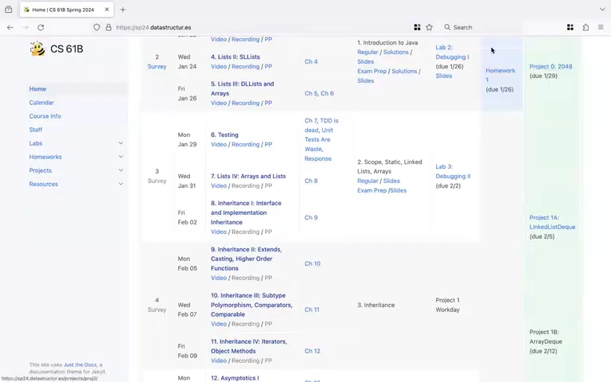 |
| [00:05](https://www.bilibili.com/video/BV1QP4y1u7jv/?p=21&t=5) 让我们谈谈比赛和名单在我谈论数组列表之前 | 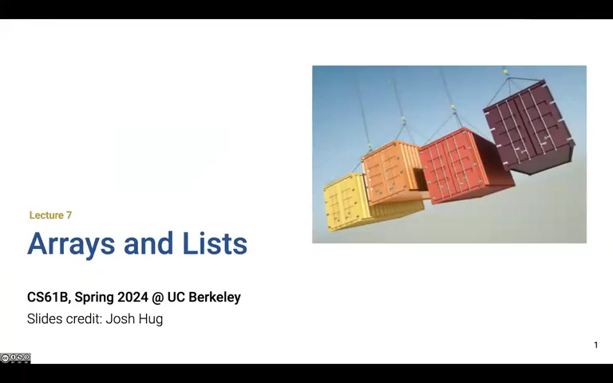 |
| [00:10](https://www.bilibili.com/video/BV1QP4y1u7jv/?p=21&t=10) 今天的主题是我们应该停下来问问为什么我们要把一整节课都花在射线清单上 | 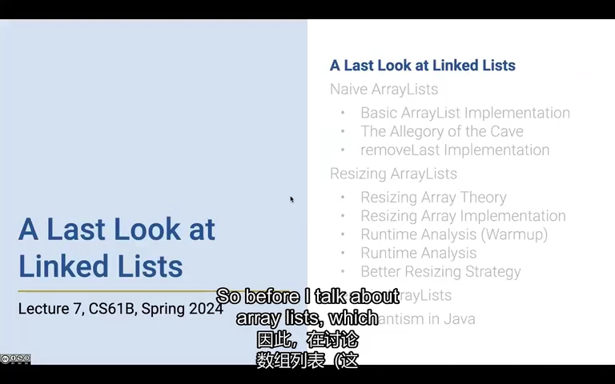 |
| [00:15](https://www.bilibili.com/video/BV1QP4y1u7jv/?p=21&t=15) 还记得上次我们构建了这个漂亮的双链表数据结构吗我在照片里给你看过你要在项目一中建立这个会很漂亮的它是最先进的我们有个中间人我们可以让中间人把东西加到单子上从列表中删除内容从清单上得到东西我们的列表是这个美丽的双链结构在那里我可以获得下一项的指针指向上一项的指针所有这些操作都非常快那么为什么我们要建立另一个数组基列表 | 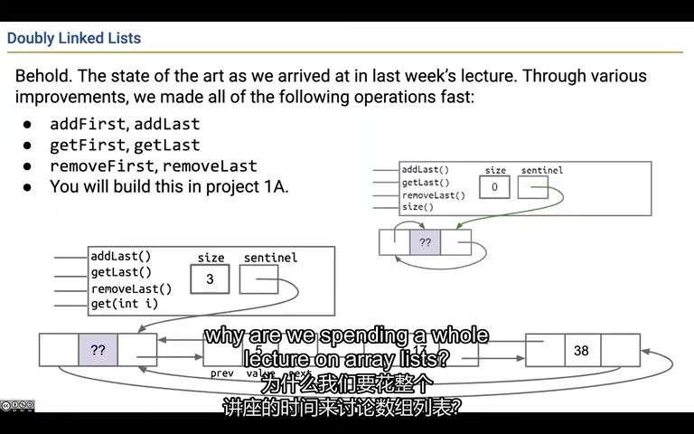 |
| [00:48](https://www.bilibili.com/video/BV1QP4y1u7jv/?p=21&t=48) 为什么我们不能一直用这个列表结果是，虽然这个列表对我们上次建立的那些有相当快的操作就像最后最后一个移除最后一个让我们考虑一下尝试得到一个任意的项目就像你想从列表中得到的任何项目一样如果我想得到我不知道清单上的第二项嗯我得从哨兵开始我得跟着链接到五个跟随链接到十七个这是我的东西一开始看起来很好那还不错但如果我的清单上有一百万件物品我想要一个50万的项目那么无论如何你都要从哨兵开始你得扫描五十万件物品在你找到你要找的东西之前 | 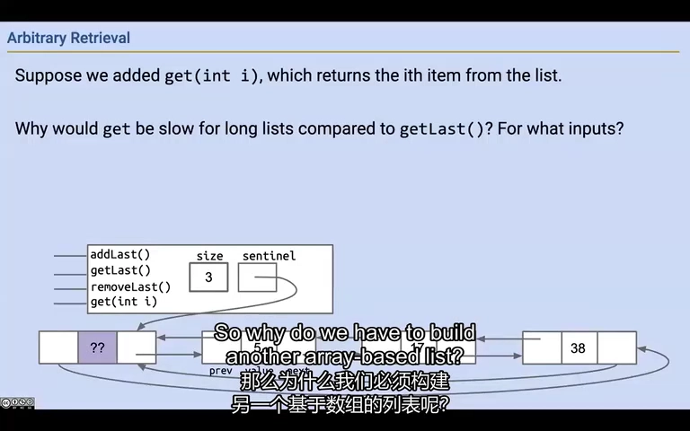 |
| [01:28](https://www.bilibili.com/video/BV1QP4y1u7jv/?p=21&t=88) 所以当你的清单变得非常非常大这个GET操作可能会变慢那么我们怎么把这口井修好呢 | 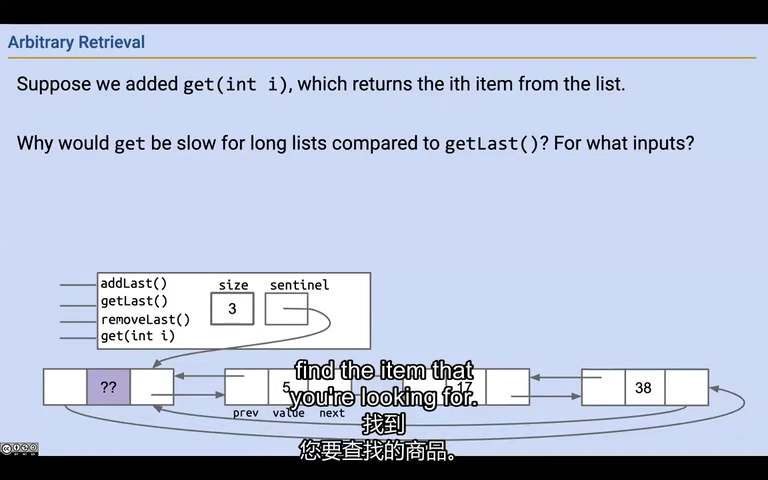 |
| [01:35](https://www.bilibili.com/video/BV1QP4y1u7jv/?p=21&t=95) 有几种方法所以后来在课堂上期中考试后我们再谈也许有办法我可以改变这些链接的设计方式找到我要找的东西要快得多那是在期中考试之后但今天我们要考虑我们不要再用这些链接了事实上让我们将数组或列表的项存储在后备数组中因为如果我们将列表存储在数组中那么我们就没有更多讨厌的链接要遵循了也许我们可以摆脱这个问题如果我想要第50万件东西我得浏览一半的名单因为那是超级慢的 | 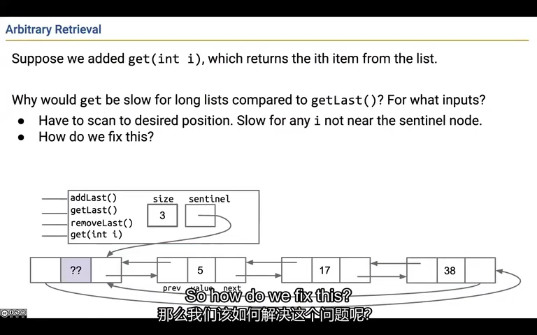 |
| [02:12](https://www.bilibili.com/video/BV1QP4y1u7jv/?p=21&t=132) 这就是链表每个人都很好告别链表我们再也见不到它了除了在项目一A好和考试 | 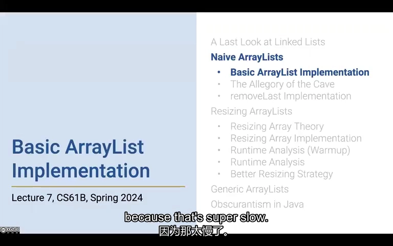 |
| [02:19](https://www.bilibili.com/video/BV1QP4y1u7jv/?p=21&t=139) 好啦对不起好啦好啦考试上有也是好啦所以我们将开始使用数组建立一个列表所以记住关于数组的几件事一件事是在数组中首先数组是什么它只是一堆并排放置的物品每个项目都有唯一的索引还有一件事我们还没谈过但我们要简单地提到的是，如果你有一个数组不管阵列有多大如果我请求数组中的项它很快立竿见影即使我的数组有一百万项长我说我想要50万Java会很快给你那么为什么是真的61 C会告诉你更多关于它的信息 | 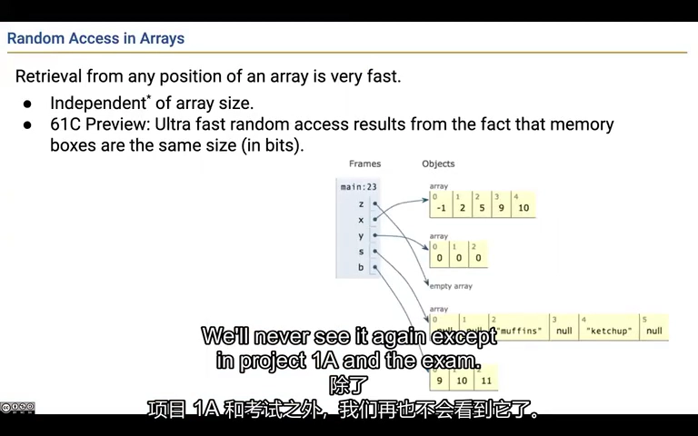 |
| [02:59](https://www.bilibili.com/video/BV1QP4y1u7jv/?p=21&t=179) 与比特如何存储在硬件中有关我们不谈这个但为了本课的目的您可以假设如果您有一个数组我要求数组中的一个项那个操作是即时的没关系你现在要立即得到那个项目的数组有多大在现实生活中，有几个例外但对这门课来说，这已经足够好了 | 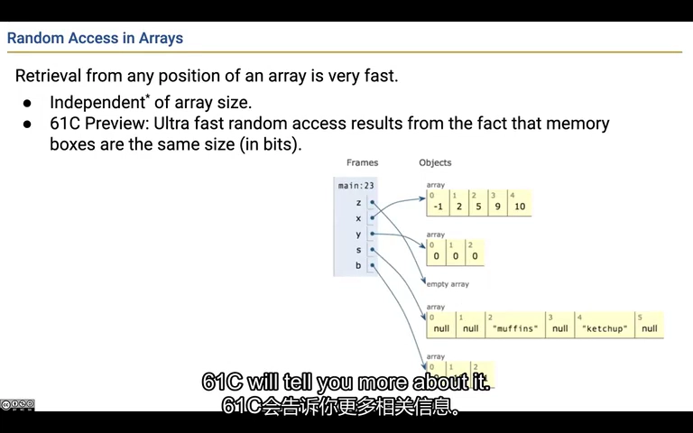 |
| [03:20](https://www.bilibili.com/video/BV1QP4y1u7jv/?p=21&t=200) （此区间无字幕） | 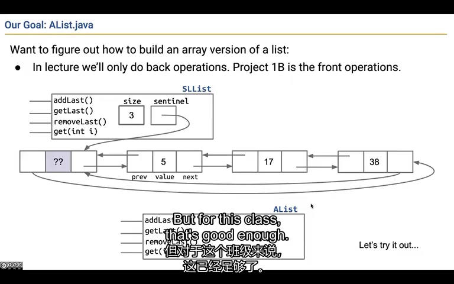 |
| [03:29](https://www.bilibili.com/video/BV1QP4y1u7jv/?p=21&t=209) 不会把我修好的如果我宣布我想要五个五个项目的数组Java为您提供了五个并排的内存盒来存储这五个项就这样了你没有更多的盒子你说不好最后我想要更多的盒子爪哇要说不了你跟我要五盒你得到五个就是这样所以我们必须使用数组来设计一个列表记住列表是无限扩展的用户可以尝试添加Last.fm到他们的心满意足就像我们上次建立的列表一样他们终于可以随心所欲地打电话了列表应该继续工作，直到内存不足或者世界末日之类的因此，我们希望使用数组，这是一个固定长度的数据结构来建立一个列表它是一种无限可扩展的数据结构 | 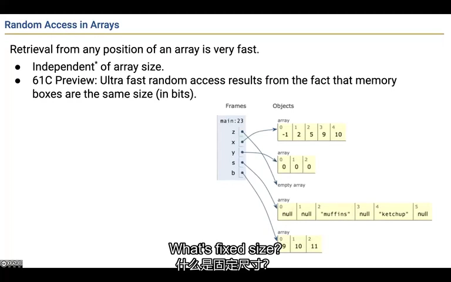 |
| [04:09](https://www.bilibili.com/video/BV1QP4y1u7jv/?p=21&t=249) 那么我们如何先把它做好呢？我们必须思考清单需要什么作为公共方法还记得上次我们讲的两节课吗我们谈了车的事它有公共运作像踏板和方向盘所有的隐私像油管和油箱列表结构需要哪些新的公共操作它们和S清单上的东西是一样的，对吧所以S列表是一个列表名单也是名单所以希望我的a列表有相同的公共方法用户与之交互的东西所以我应该可以走到我的清单上，在这个项目上说或者给我最后一项或者删除最后一项 | 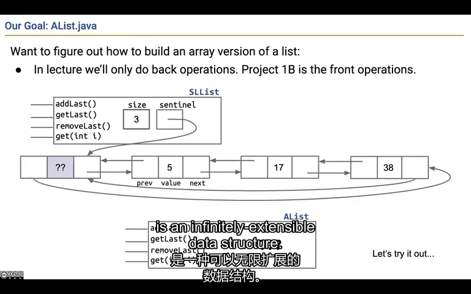 |
| [04:49](https://www.bilibili.com/video/BV1QP4y1u7jv/?p=21&t=289) 所以我们将实现这些但不同的是底层的实现所以这就像机械师把你的车就像拔掉油管再装上电池我们将采用底层实现以前是这种链表结构我们将用一些后备数组来代替它这就是我们今天的目标同样的操作但我们要用一种完全不同的方式来建造它即使用户体验最终会或多或少地相同好啦 | 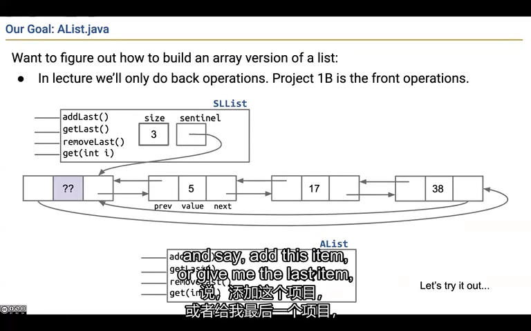 |
| [05:19](https://www.bilibili.com/video/BV1QP4y1u7jv/?p=21&t=319) 所以让我们建造它所以我要跳到英特尔你告诉我如果有什么是不可读的 | 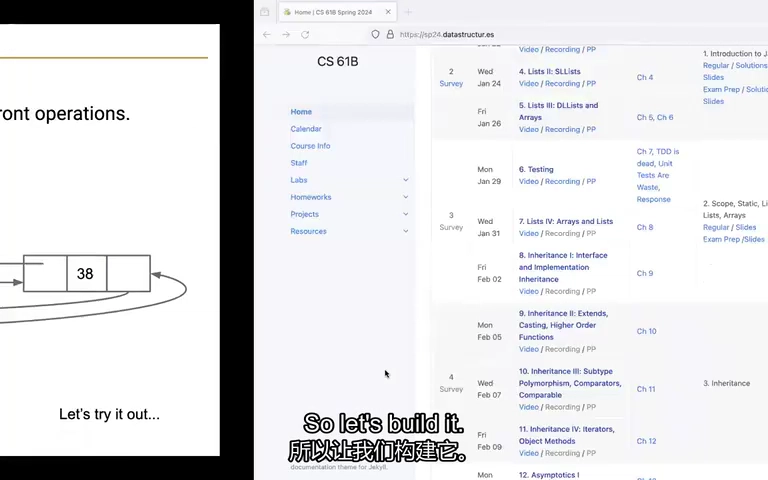 |
| [05:24](https://www.bilibili.com/video/BV1QP4y1u7jv/?p=21&t=324) 所以这次只是为了节省一点时间我们已经写好了方法签名和上次一样所以没什么新鲜事但只是节省了我们一点时间所以当我们建立一个列表时，我们将从这里开始我需要的实例变量是什么如果我在运行一个蓝图所有列表应该如何运行我需要清单中的什么我想我们已经讨论过列表是基于数组的所以我可能想要某种整数数组来存储我的项目所以也许我会把它叫做私人物品变成射线物品好啦很好，如果你想知道为什么是私人的那是因为记得这是一个实现细节外面的用户不在乎那个我用数组来表示他们所关心的 | 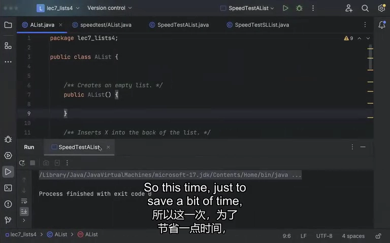 |
| [06:04](https://www.bilibili.com/video/BV1QP4y1u7jv/?p=21&t=364) 我可以用链接我可以用更奇怪的东西他们不在乎所以这是私人的我想我还可以加上尺寸只是为了跟踪数组有多大有点像我们在s列表中使用大小所以我现在宣布也许我以后可以回去换衣服如果我改变主意我已经声明了这些是所有列表都应该有一个列表的东西应该有一个整数数组来存储我的东西也应该跟踪大小所以现在当我创建一个空列表时我需要初始化这两个变量我宣布他们存在但我还没告诉你它们的价值我没有把它们分配给任何对象所以我要在这里做什么项目应该等于井可能是一个全新的整数数组 | 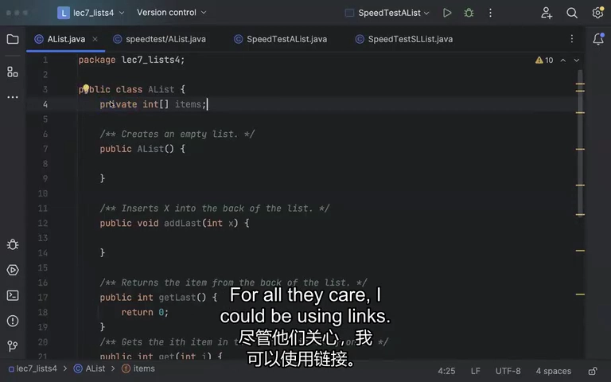 |
| [06:44](https://www.bilibili.com/video/BV1QP4y1u7jv/?p=21&t=404) 所以我会做一个全新的整数数组我现在希望这个利率有多大我要说一百如果你不喜欢你得继续关注但现在我会说你知道什么项目我觉得你可以穿一百码尺寸呢如果是一个空列表里面应该没有东西好啦为什么聪明的人抱怨我以后会让它消失的你不用担心好啦所以现在我终于要开始写作了我想知道你怎么把东西添加到这个列表或这个列表中所以我看起来我已经有点害怕了因为我想等待如果有一个错误如果我想把它放在这个地方呢 | 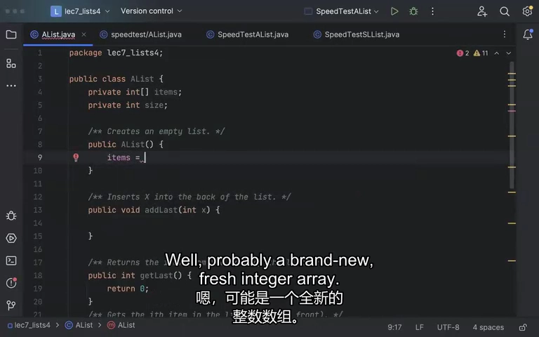 |
| [07:24](https://www.bilibili.com/video/BV1QP4y1u7jv/?p=21&t=444) 但就像我错过了一个所以我不太确定所以我要做的是因为我不太确定我要画一幅画你可以把这个画在纸上你可以把它输入智能就像我要做的你可以喜欢我不知道我不知道就写在上面地板上的粉笔由你决定但我要举一个小例子只是想让我的脑子运转起来，试着想想发生了什么所以当我创建A列表时我得到了一个很大的旧阵列所有的项目都是零这是我的新阵列100所有项都用默认值零填充每个项目都有一个索引所以这就像指数0索引一好的所以在这一点上，大小等于零 | 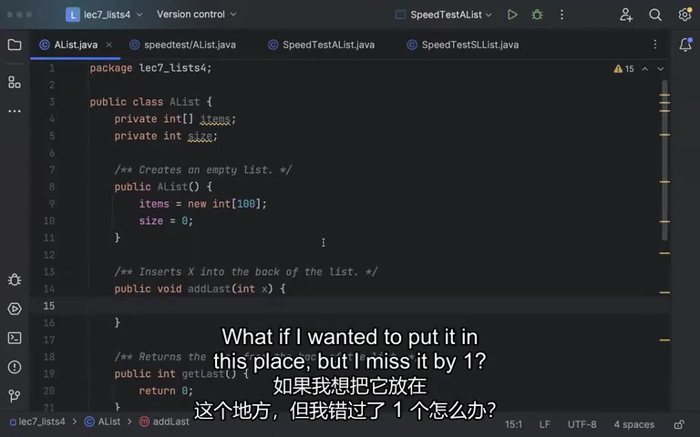 |
| [08:04](https://www.bilibili.com/video/BV1QP4y1u7jv/?p=21&t=484) 那么当我加上最后一口井时会发生什么我应该去数组，我应该把一些东西放在数组中所以假设我想加上最后五个也许我会把它放在那里，然后大小现在是一个因为数组中有一样东西如果我想再加最后一个怎么办现在我想加上最后两个我该怎么进入数组我应该在名单的末尾加上两个它现在就在那里2号，然后我再做一次好吧，如果我想加七个呢我把它放在那里大小等于三个如果我想加六个呢我把它放在那里大小等于四个那我为什么要这么做因为随着我越来越多地这样做我要开始发现一个模式每次我想最后加的时候 | 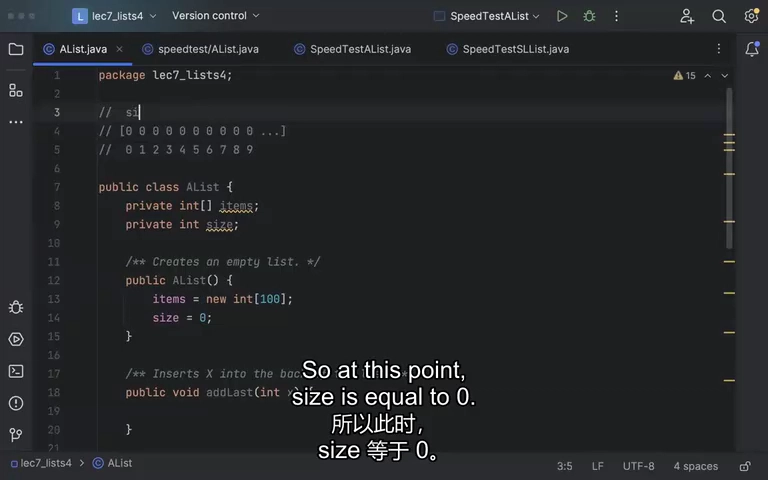 |
| [08:44](https://www.bilibili.com/video/BV1QP4y1u7jv/?p=21&t=524) 我把它放在哪里例如我再做一次直到你厌倦了我会加上我什么都不知道好啦所以我加了零大小等于五我补充说，我不知道两个尺寸等于六个所以每次我添加一个项目我把它放在这里但是那里的索引是什么所以我看这里指数是六啊哈尺寸也是6所以我学到了什么，似乎每次我想添加一些东西我有四个尺寸变大了我加两个我在哪里添加我在给它加一个位置大小所以喜欢尺寸的学生总是告诉我我需要添加下一项的地方所以你知道我有两个 | 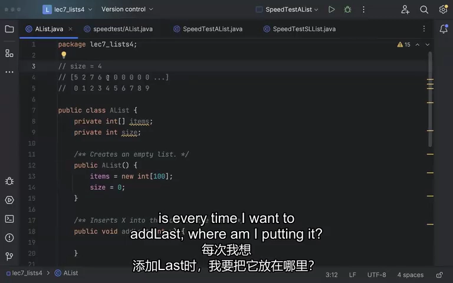 |
| [09:24](https://www.bilibili.com/video/BV1QP4y1u7jv/?p=21&t=564) 然后在位置上，大小，大小上升下次我想添加的时候我应该把它放在适当的位置现在是八个所以这告诉我啊哈好吧也许我甚至可以写下我学到的东西这太有趣了我想写下来所以我要写下我们要添加的下一项会在位置大小上好啦所以这告诉我，如果我想在结尾添加一些东西我把它放在哪里？我把它放在位置大小所以我把x项放在那里我认为这很好好啦所以这就是现在最后的地方让我们一次又一次地做最后一个我想我就像我应该使用大小是大小加一个尺码减一个 | 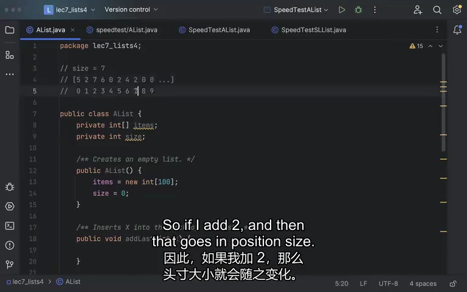 |
| [10:04](https://www.bilibili.com/video/BV1QP4y1u7jv/?p=21&t=604) 这完全是另一回事这样我就可以回到我的照片上我可以看，所以现在我有八个项目在那里他们是一二三四五六七八我想买最后一件最后一项在哪里？就在指数七处所以这一次，我似乎不想得到索引大小的东西我想让它的索引大小为负1那也很有趣我想写下来所以我要说我们要退货的东西或者我想我会说清单上的最后一项在位置上不是尺寸但是尺寸减1我怎么知道它不是 | 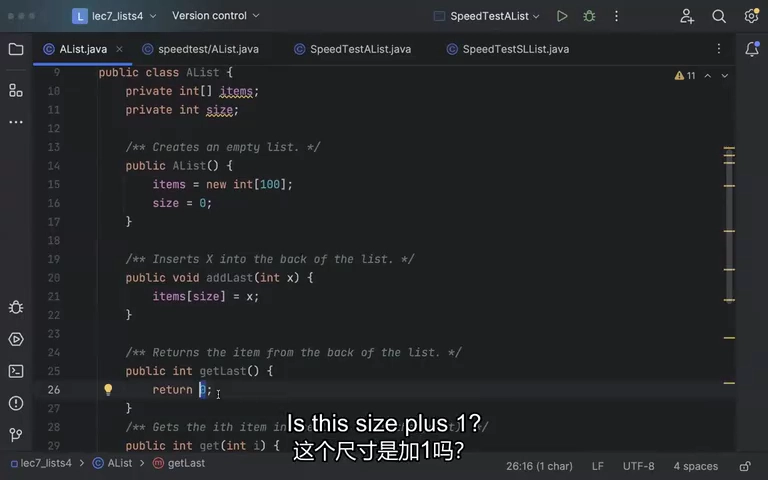 |
| [10:44](https://www.bilibili.com/video/BV1QP4y1u7jv/?p=21&t=644) 因为我盯着它看我不知何故想通了因为我画了这个例子这个例子告诉我啊哈我列出了八件事最后一件事是尺寸减1那么我该返回什么我可以退货尺寸减1我怎样才能做好这件事这个还不错我将索引到数组中去拿我觉得很美如何获得项目数嗯就是这个尺寸我想这也提醒了我，当我加上最后一个我应该把尺寸提高一个因为清单上有更多的东西太好了所以我们完成了一些基本的A列表操作我们和他们在一起开心吗你有抱怨问题吗 | 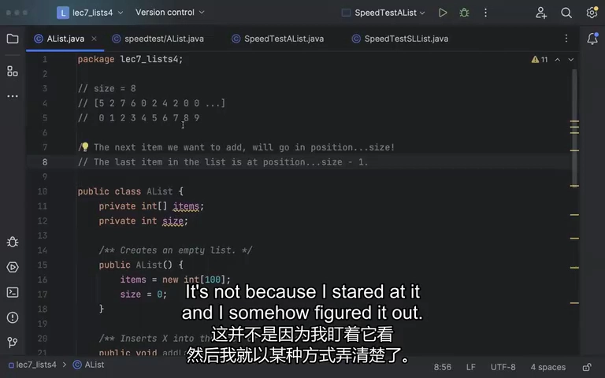 |
| [11:24](https://www.bilibili.com/video/BV1QP4y1u7jv/?p=21&t=684) 虫子任何关于变焦的东西好啦好啦 | 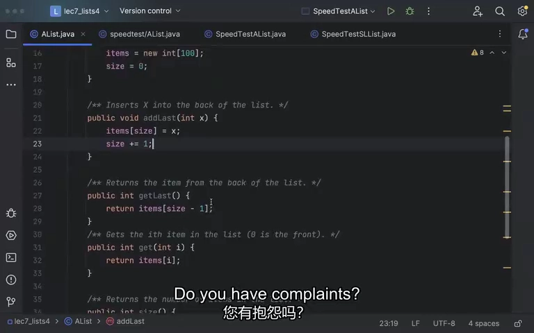 |
| [11:30](https://www.bilibili.com/video/BV1QP4y1u7jv/?p=21&t=690) 让我们反思一下所以我们建立了基本的A列表操作我写的那些东西是什么样的 | 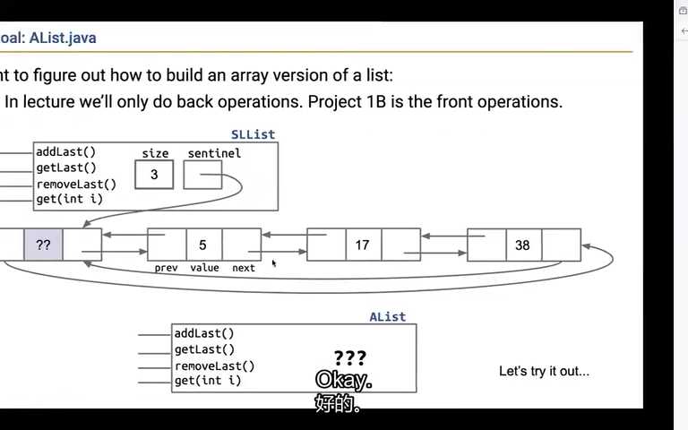 |
| [11:35](https://www.bilibili.com/video/BV1QP4y1u7jv/?p=21&t=695) 我给自己写了这些有用的小纸条事实上，这些都是不变量还记得两节课前的那个词吗你的代码总是正确的当它运行时事实证明，我在代码中写的东西这些是不变量例如当我说任何时候你有一个新的东西插入它在位置大小上或者如果你想得到最后一件事就是那个尺寸减去一这些是我代码的不变量有时把它们明确地写出来会有所帮助就像我刚刚做的那样我举了一个小例子写了我的不变性这使得编写我的代码变得非常容易因为如果我有东西说最后一件东西的大小是减1我想写《最后一口井》那么它的大小一定是负一 | 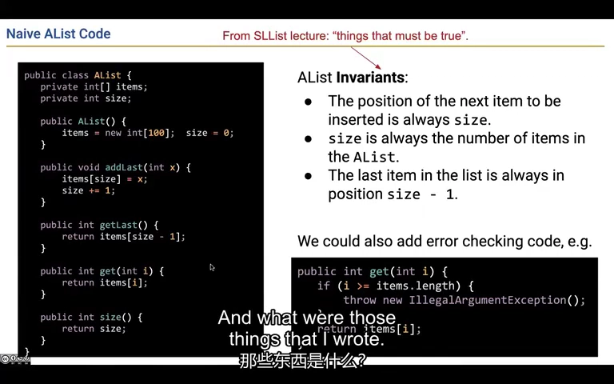 |
| [12:15](https://www.bilibili.com/video/BV1QP4y1u7jv/?p=21&t=735) 所以有不变量是非常好的就像现在这样如果您不想显式地编写这些你不必但有时想想不变性会有所帮助当你试图弄清楚这些事情的时候 | 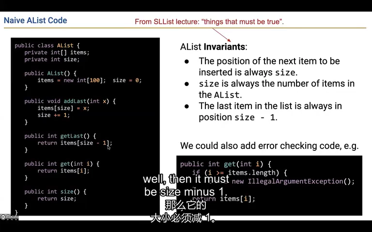 |
| [12:31](https://www.bilibili.com/video/BV1QP4y1u7jv/?p=21&t=751) 好戏来了所以现在我们得开始把清单上的东西去掉 | 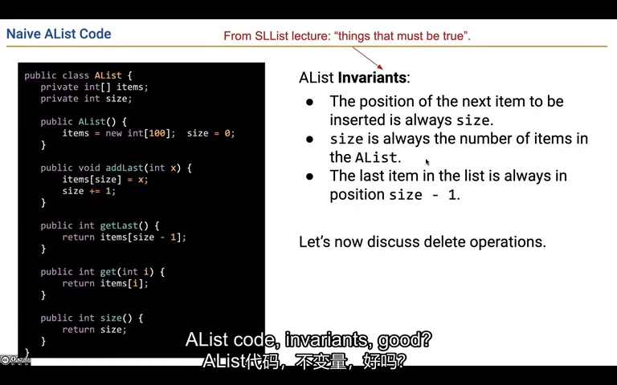 |
| [12:36](https://www.bilibili.com/video/BV1QP4y1u7jv/?p=21&t=756) 或支持删除操作所以为了弄清楚这是如何工作的 | 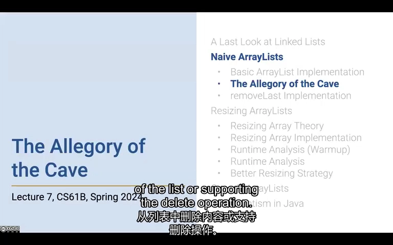 |
| [12:41](https://www.bilibili.com/video/BV1QP4y1u7jv/?p=21&t=761) 我要后退一步并思考用户的心智模型换句话说让我们想想有人用我们的A名单所以我写了我漂亮的列表代码我把它献给世界有人在用它所以记住记住当有人用我的你知道车他们没有考虑发动机是如何运行的燃料是如何从一个地方到另一个地方的他们只是在考虑货运快车不要走得太快他们就是这么想的所以以同样的方式当有人使用我的数组列表时他们没有考虑底层数组和喜欢哦，尺寸减去一个，新的东西必须要有尺寸他们想的都是我有张单子这堆东西前后如果他们想删除一些东西 | 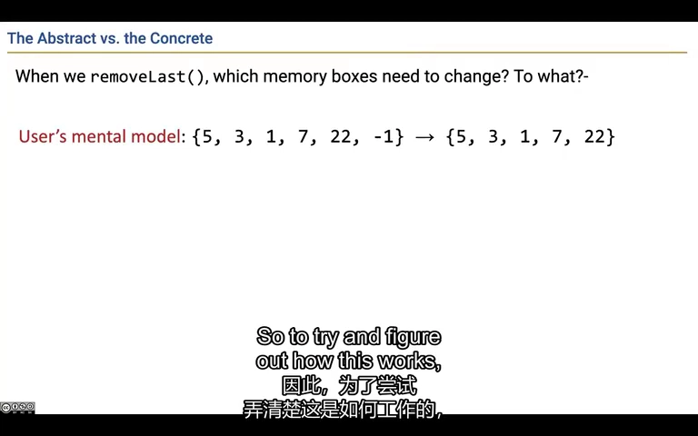 |
| [13:21](https://www.bilibili.com/video/BV1QP4y1u7jv/?p=21&t=801) 然后他们希望得到的数组看起来像一堆东西前面和后面但是负的已经没有了这就是用户所关心的他们不关心底层数组或者是下面的d列表还是s列表他们只关心看到这张照片然而，我们执行者我们知道真正的真相具体的现实是我们有这个后备阵列后备数组实际上有100个项目其中很多是零因为他们没有被利用然后当你把底片删掉的时候你很清楚也许我必须改变他们的具体现实来代表其他东西所以我们知道真正的真相 | 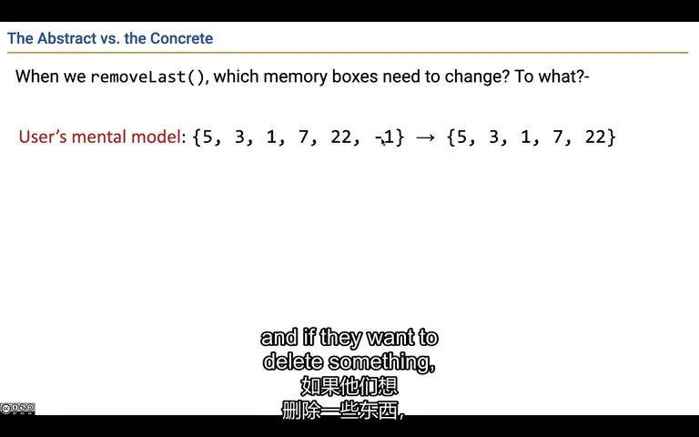 |
| [14:01](https://www.bilibili.com/video/BV1QP4y1u7jv/?p=21&t=841) 也就是说，清单上实际上有一百件事这就像我们是汽车设计师我们知道燃料和燃料喷射很明显吗我对汽车一窍不通这就是我们所知道的，具体的现实实施者但是用户他们不在乎这些东西他们只关心前面和后面有一堆东西 | 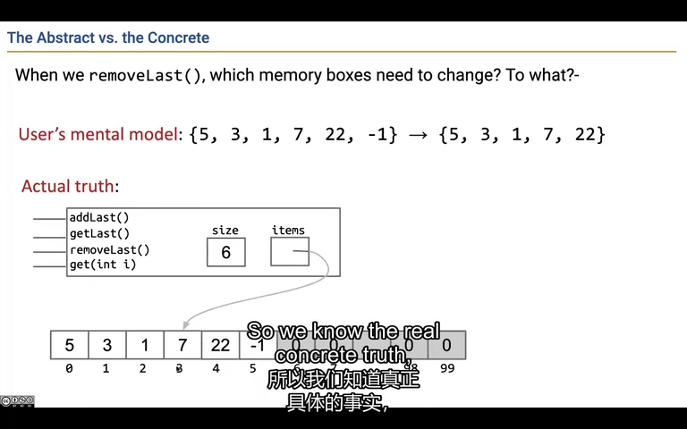 |
| [14:22](https://www.bilibili.com/video/BV1QP4y1u7jv/?p=21&t=862) 原来所有这些都有很有趣的联系到柏拉图的洞穴寓言古老的哲学东西所以我不打算告诉你整个故事但基本上是这样的你有这些坐在洞穴里的穴居人他们在看这个小木偶戏他们从来没有走出过洞穴所以对他们来说，这是现实，对吧他们在看木偶戏用老虎钳，马和鸟所以他们是我们列表的用户或者我们对象的用户他们在看向他们展示他们想法的节目他们的心智模式是什么相比之下我们是后面的和尚我们是执行者原来是我们在表演木偶戏向山顶洞人展示他们想看的东西如果穴居人像 | 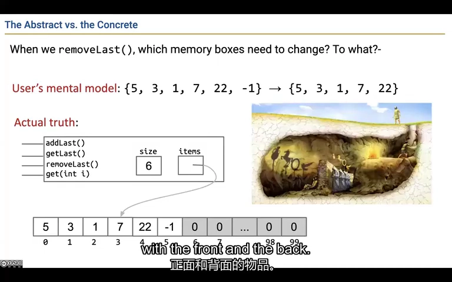 |
| [15:02](https://www.bilibili.com/video/BV1QP4y1u7jv/?p=21&t=902) 哎呦你知道的我会喜欢我要用手指射那只鸟那我们的工作就是换木偶这样鸟就像你知道失败或者是鸟中枪了或者你知道穴居人喜欢你知道的就像给马挠痒痒什么的你能为我弄出马的声音吗？所以穴居人就像给马挠痒痒一样好啦牛逼好极了我喜欢后面有一个福利男好的，好的所以是的你知道马的小滴答声或者别的什么然后我们作为实施者的工作就是让小马发出噪音即使没有真正的马我们只需要确保我们的具体现实代表了用户的心智模型我想有一件事我会说是在洞穴的真正寓言中 | 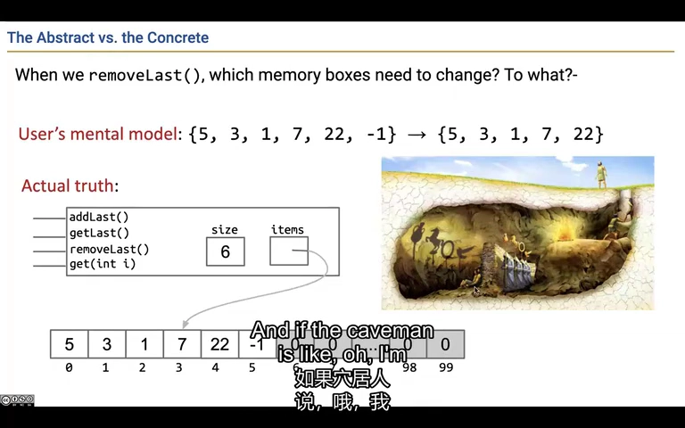 |
| [15:42](https://www.bilibili.com/video/BV1QP4y1u7jv/?p=21&t=942) 如果你熟悉这个故事真正的故事应该是我不认识穴居人就像发现现实的真实本质逃离洞穴或其他什么但事实证明，在我们的故事中，我们实际上会有这些穴居人待在山洞里这是一件美好的事情因为如果他们呆在山洞里他们不必担心所有的实现细节他们可以过他们想过的生活设计复杂的东西更简单如果你不用担心后面的这些和尚是如何经营木偶戏的这就是洞穴的寓言穴居人对木偶戏的看法他们更简单的心智模式和我们的具体实施他们不必在意 | 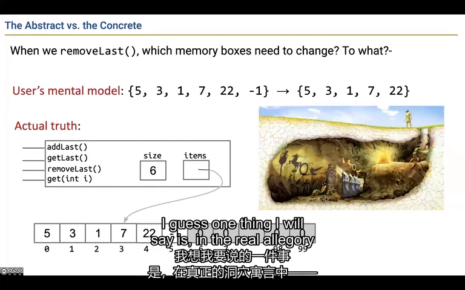 |
| [16:22](https://www.bilibili.com/video/BV1QP4y1u7jv/?p=21&t=982) 这在计算机科学中是一个很好的想法这就是我们如何建立真正大的程序把我们不关心的东西抽象出来 | 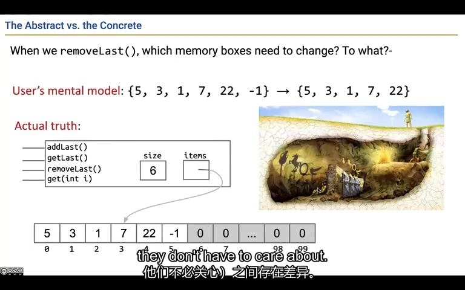 |
| [16:30](https://www.bilibili.com/video/BV1QP4y1u7jv/?p=21&t=990) 所以考虑到洞穴的寓言你脑子里还记得那马的声音我想问你关于从列表中删除项目需要做什么所以我们有这个中间人它有这些大小和项目的实例变量作为对这个大数组的引用您需要思考的问题是哪些内存盒需要更改当我最后调用删除时我如何改变它们例如我需要换尺寸吗我需要更改此项目的内存盒吗它是对这个数组的引用我需要更改数组中的一些元素吗我需要换很多吗或许能帮到你 | 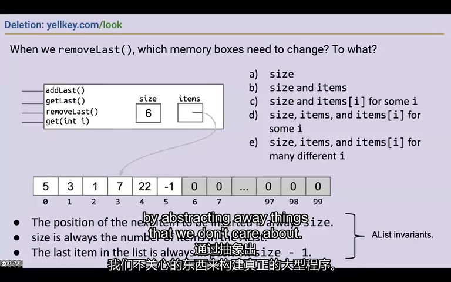 |
| [17:10](https://www.bilibili.com/video/BV1QP4y1u7jv/?p=21&t=1030) 当你工作的时候记住我们有这些不变量这些是我的代码中始终正确的事情无论发生什么只要这些不变量告诉然后呢我应该没事的所以我花了几秒钟思考我会试着喜欢谈谈我是怎么想的所以我很好尺寸一定要很好地改变吗只是看看答案的选择它们都有大小所以我觉得尺寸可能要改变这是有道理的因为嗯如果我把清单上的东西拿出来尺寸最好降下来所以我觉得我应该换一种方式我可以确认尺寸必须改变是好的它说大小总是A列表中项目的数量 | 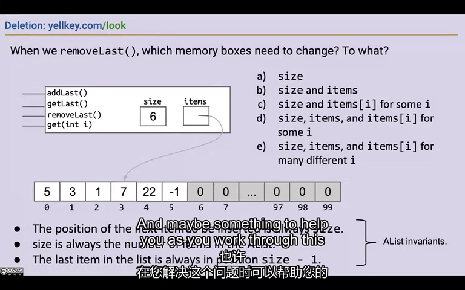 |
| [17:50](https://www.bilibili.com/video/BV1QP4y1u7jv/?p=21&t=1070) 所以如果我拿出一些东西基于这个不变的大小必须下降好啦就是这个尺寸项目呢这个有点奇怪里面装的是什么它保存访问我的数组的地址这是我在内存中的数组这告诉我去哪里参观那么我需要换项目吗嗯如果我更改项目我基本上是说这不再是数组我想去别的地方找我的数组这真的说不通如果我想删除一个项目我不必去别的地方找到我全新的阵列它仍然是相同的底层支持数组所以我想我也不必换项目项目呢I这是有趣的一个 | 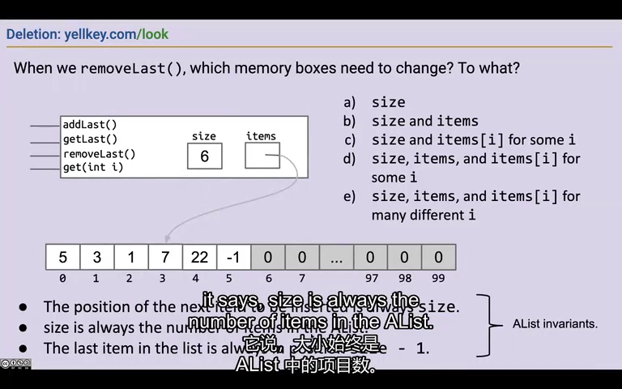 |
| [18:30](https://www.bilibili.com/video/BV1QP4y1u7jv/?p=21&t=1110) 所以问题是我需要把这个负面的以某种方式改变它当我想删除它的时候一开始看起来很好是啊，是啊我想删除它我想把它处理掉但请记住，用户并不关心这个底层图片他们不在乎木偶戏他们只关心无论他们看到什么墙上的影子符合他们的心智模式原来即使我离开这个消极的闲逛所有的不变量仍然保持如果我把尺寸改成5下一件物品的位置是五那是放置下一件物品的正确位置因为这五项的存在消极的那个消失了所以如果我以后想添加一些东西它应该在负一个盒子里 | 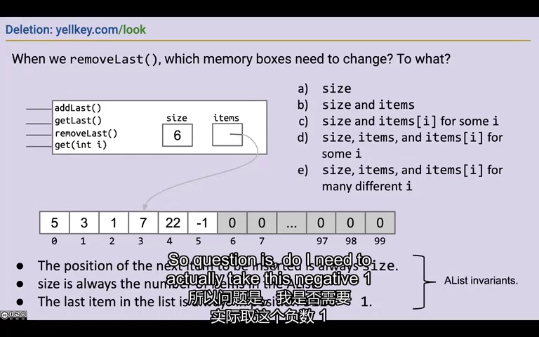 |
| [19:10](https://www.bilibili.com/video/BV1QP4y1u7jv/?p=21&t=1150) 此外，大小总是正确的项目数尺寸是五个删除项目后最后一项是位置大小减1五减一等于四这是最后一项所以事实证明，即使我把这个负面的留在身边没关系我所有的不变量仍然成立所以事实证明，即使这看起来有点棘手答案就是尺寸所以让我们去写吧 | 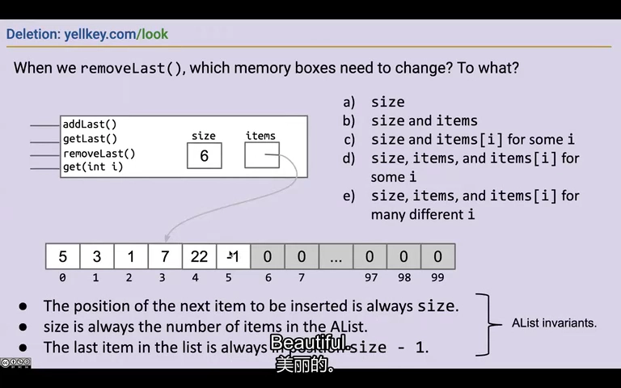 |
| [19:34](https://www.bilibili.com/video/BV1QP4y1u7jv/?p=21&t=1174) 所以答案是尺寸我们直接进去吧所以记住 | 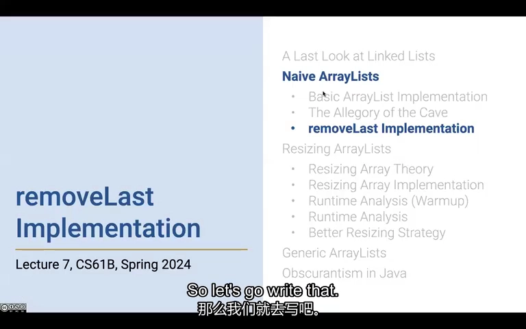 |
| [19:39](https://www.bilibili.com/video/BV1QP4y1u7jv/?p=21&t=1179) 我们必须做好什么它说我必须返回被删除的项目评论是这么说的所以说我如何获得我要退货的物品嗯我会叫最后一个那是我要退货的东西在这一点上，正如我们之前所说的我所要做的就是把它缩小一个然后退回我要退回的物品并注意我不必清除数组中的最后一项它还可以在那里闲逛没关系因为我们得到的图片仍然符合用户的心理模型 | 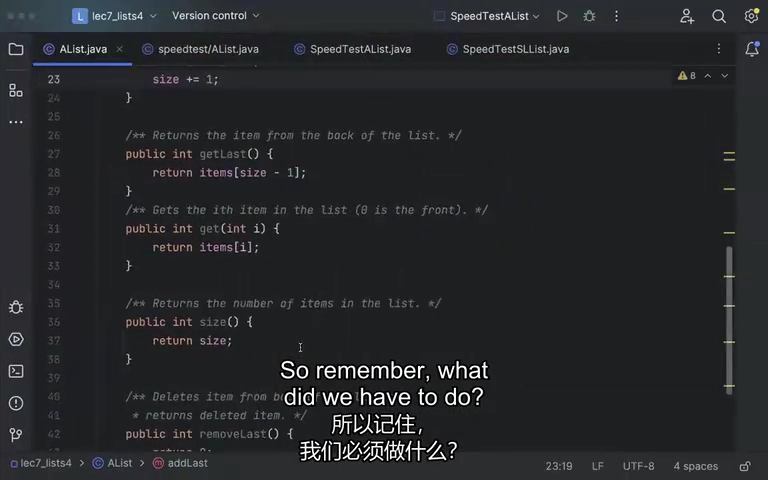 |
| [20:08](https://www.bilibili.com/video/BV1QP4y1u7jv/?p=21&t=1208) 好的反射所以在这里 | 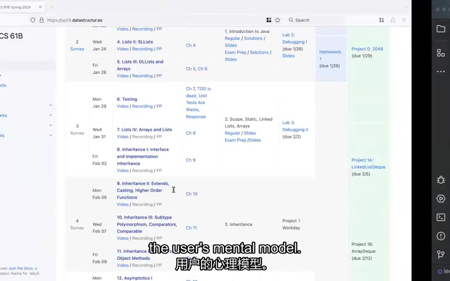 |
| [20:13](https://www.bilibili.com/video/BV1QP4y1u7jv/?p=21&t=1213) 如果你真的想进入数组并更改该项并没有什么坏处要删除的负面把它改成零也没关系如果你想但事实证明没有必要你的不变性仍然存在和你的具体现实你是什么东西你知道的建造它仍然是正确的代表列表的用户心智模型挺酷的我想如果你想把这个和木偶剧联系起来我能想到的最好的类比是你知道的如果有人真的这么做了你知道的拿起他们的手指，像手指一样射鸟把鸟从火里放下来是可以的所以他们再也看不到了你其实不必去破坏鸟木偶所以用同样的方法当有人想删除项目时 | 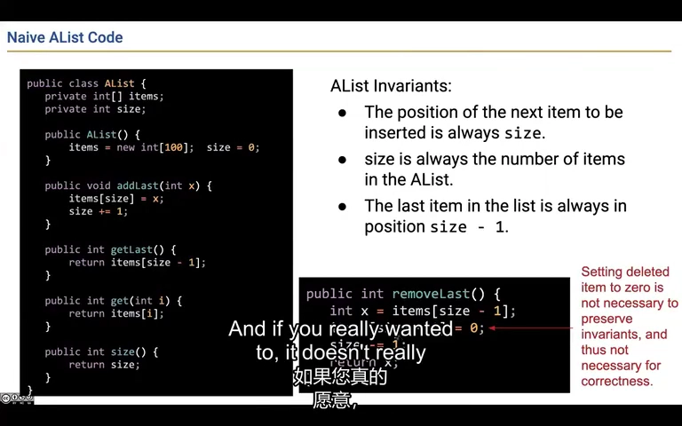 |
| [20:53](https://www.bilibili.com/video/BV1QP4y1u7jv/?p=21&t=1253) 你实际上不必销毁物品你可以把它挂在那里只要正确更新大小关于这个洞穴寓言的问题这是个很酷的主意所以记住我们是具体的执行者只要我们所做的一切与用户的心智模型相匹配那我们就没事了 | 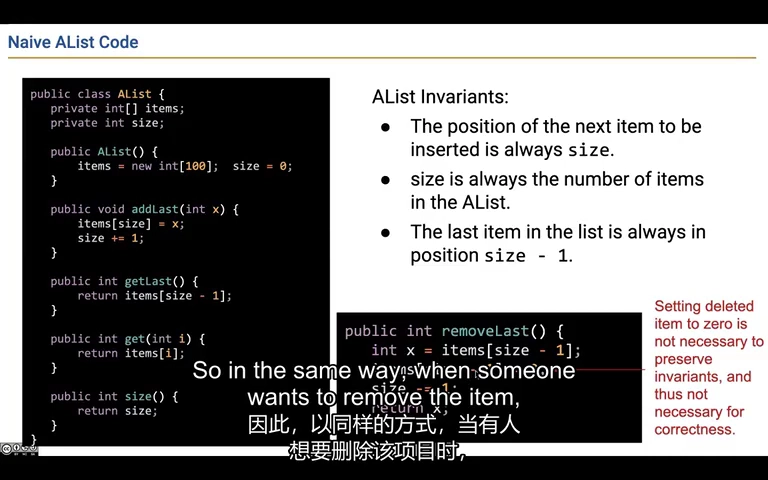 |
| [21:12](https://www.bilibili.com/video/BV1QP4y1u7jv/?p=21&t=1272) 所以我想我不会谈论太多细节但如果你好奇你可以读所以有时人们会问发生了什么如果你想把东西弄出界外我们的建议是让程序崩溃但这取决于你只要与用户沟通你的清单所做的那就没问题太好了 | 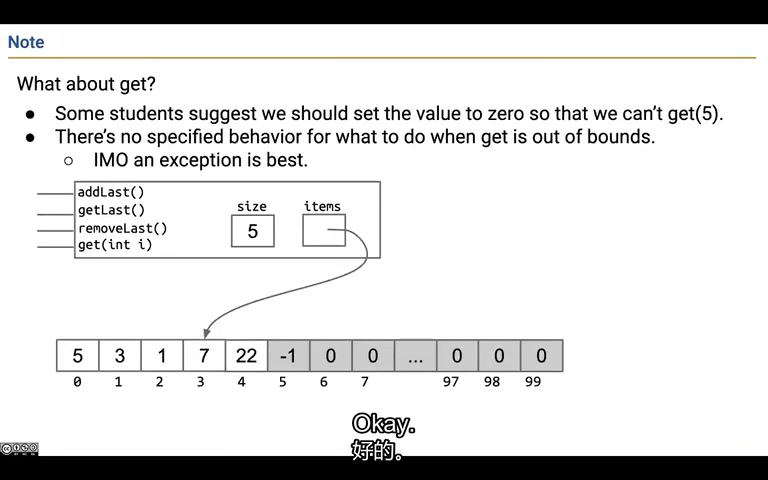 |
| [21:31](https://www.bilibili.com/video/BV1QP4y1u7jv/?p=21&t=1291) 所以有一个问题每学期每个人都叫我出来所以我现在就帮你解决 | 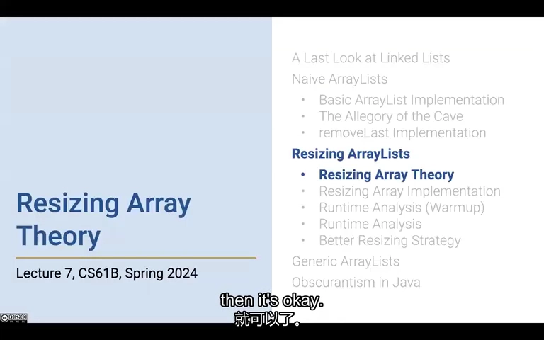 |
| [21:37](https://www.bilibili.com/video/BV1QP4y1u7jv/?p=21&t=1297) 到目前为止还不错我们已经建立了强大的名单真漂亮对呀我仍然有和上次一样的操作，我可以添加东西我可以移除东西我可以得到东西，它的工作方式是而不是使用链接我有一个漂亮的后备阵列当我添加东西时我删除东西大小变化我在数组中填写项真漂亮如果我有很多物品会发生什么 | 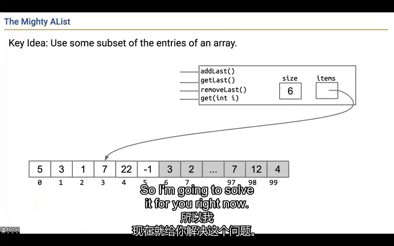 |
| [21:59](https://www.bilibili.com/video/BV1QP4y1u7jv/?p=21&t=1319) 如果我不断地添加最后如果我的清单上有一百个项目我的后备阵列有100个大小用户就像我想加更多的好现在我们有一个问题现在呢我们已经到了我们在幕后实施的具体现实实际上是一个完全完整的数组但是用户的心智模型不是他们不关心数组他们想要一个无限扩展的列表所以如果用户来找我说我想要更多我们不能去找用户说你可以有更多我们需要以某种方式让用户能够向他们的列表中添加更多 |  |
| [22:39](https://www.bilibili.com/video/BV1QP4y1u7jv/?p=21&t=1359) 只是我的数组已满我不能要求这个数组给我更多的空间记住在Java中数组是固定的那我们该怎么办我无法调整此数组的大小所以有点奇怪我将要给出的解决方案有点古怪但事实证明，人们在现实生活中的所作所为所以因为我无法调整数组的大小 |  |
| [22:55](https://www.bilibili.com/video/BV1QP4y1u7jv/?p=21&t=1375) 我将调整数组的大小，这听起来完全坚果结果当我说调整大小我们实际上要做一些有点古怪的事情但它最终会创建一个适当大小的数组所以我看这个数组我说这个数组太小了用户想要101项这个只能装一百个你对我来说太小了我不能要求数组提供更多空间创建数组时它是一个恒定的空间所以我要做的是我想说我想要一个新的数组，实际上有足够的空间所以请为我创建一个全新的阵列有足够的空间就像看有101个箱子 |  |
| [23:35](https://www.bilibili.com/video/BV1QP4y1u7jv/?p=21&t=1415) 现在呢这一个有足够的空间给我然后我要做的是我要把旧数组中的所有项把它们复制到这个全新的阵列中有足够的空间然后就来了，就像把戏一样这就是魔术也就是我想首先我将填写最后一项不那么神奇的内容现在我要说的是，你知道这个旧的利率是多少吗对我来说太小了我不再需要你了所以我要做的是我要拿记住这是一个地址的物品就像去参观你的阵列我要说我不想再指着这个旧数组了我要把这些东西的新数组的地址所以现在它将指向这个新数组a |  |
| [24:15](https://www.bilibili.com/video/BV1QP4y1u7jv/?p=21&t=1455) 哪个更大，有足够的空间放用户想要的物品然后我将把大小增加1神奇的是如果你看这个旧数组再也没有提到它了再也没有办法去了就像埋了宝藏，扔掉了哪里的纸条你把它放在哪里所以既然这个东西没有更多的引用垃圾回收员会来把它吃掉它消失了现在我只有一个大小合适的数组即使我们不得不创建一个新的数组并将项目复制到我们从技术上调整了阵列的大小所以我们把这个过程叫做调整规模即使这有点欺骗我们不是真的在调整数组的大小我们正在创造一个新的 |  |
| [24:55](https://www.bilibili.com/video/BV1QP4y1u7jv/?p=21&t=1495) 复制项目然后扔掉旧的对我们来说太小了是啊，是啊问题是这个斜坡你是对的，我要把它盖得像在几张幻灯片中这是个好问题虽然你破坏了讲座没关系的嗯很好 |  |
| [25:19](https://www.bilibili.com/video/BV1QP4y1u7jv/?p=21&t=1519) 那么我们如何实现这一点让我们跳跃和英特尔让我们写一些代码 |  |
| [25:24](https://www.bilibili.com/video/BV1QP4y1u7jv/?p=21&t=1524) 所以我终于要进去了因为这会导致我的数组太满如果有人试图添加东西所以我要说好如果尺寸大到等于物品点长度那意味着我完全没有空间了用户的心智模型是一个列表这是如此之大，不适合我的具体执行后备阵列就是这个意思很好很好那我该怎么办我要回到这里 |  |
| [25:51](https://www.bilibili.com/video/BV1QP4y1u7jv/?p=21&t=1551) 我甚至会回去看幻灯片因为记得我们在这里我要那样做也就是我要说有一个全新的阵列 |  |
| [25:56](https://www.bilibili.com/video/BV1QP4y1u7jv/?p=21&t=1556) 哪个是项目点的长度你也可以做尺寸我想再加上一个所以它是一个更大的数组不喜欢那样我忘了新这个词好啦那么我要做的是我要用那个花哨的系统阵列复制调用以获取旧数组中的所有项把它们放在全新的阵列里我总是忘记还记得上次我忘记这个语法是什么时候吗幸运的是情报很有帮助它给了我这个暗示上面写着来源好啦来源是什么它的项目和源位置我想从零开始我想去目的地这是一个全新的阵列从零开始我想复制大小项好的很好我做这个尺码加一个 |  |
| [26:36](https://www.bilibili.com/video/BV1QP4y1u7jv/?p=21&t=1596) 只是为了让它看起来更好看但他们是一样的好啦所以我做了一个新的数组我把所有的东西都抄了一遍好啦然后诀窍来了也就是我要说你知道那个项目数组对旧数组的引用我要把它扔掉我要让它指向新数组这就是项目等于它是否将内存盒积分带到旧的速率在全新的然后在最后我可以项目大小等于X因为现在数组更大了，我可以做大小加等于一 |  |
| [27:06](https://www.bilibili.com/video/BV1QP4y1u7jv/?p=21&t=1626) 这是这里的调整数组大小的实现它在左边 |  |
| [27:11](https://www.bilibili.com/video/BV1QP4y1u7jv/?p=21&t=1631) 但我要注意一件小事也就是说，这个代码有点长对于ad last方法来说，此方法有点长 |  |
| [27:18](https://www.bilibili.com/video/BV1QP4y1u7jv/?p=21&t=1638) 我要回去表演一个小把戏也就是你知道的我对这个回收过程的看法 |  |
| [27:23](https://www.bilibili.com/video/BV1QP4y1u7jv/?p=21&t=1643) 我想这不是增加更少东西的根本这可能是它自己的一种方法所以也许我想做一个帮手的方法而不是让这段代码生活在ad last方法中我想把它分成不同的方法我要说的是，我甚至有一个评论调整基础数组的大小OOPS数组到目标容量好啦所以我实际上可以把这个代码这次将其移动到其他方法，而不是将大小调整为或者做一个大小加一的新数组我会让用户选择他们喜欢的容量然后不是让这个代码住在这里我说调整大小加1那我为什么要做这个看似毫无意义的练习 |  |
| [28:03](https://www.bilibili.com/video/BV1QP4y1u7jv/?p=21&t=1683) 嗯这个不错因为现在我有两种不同的方法我可以分开测试所以如果你在做一个b项目，你会做得很好您可以分别测试这两个你可以说我可以检查我的大小是否有效然后我可以检查我的广告是否有效而以前一切都在一个巨大的功能中如果有东西坏了很难找到它在哪里但是现在如果有东西坏了您可以检查是否有断开的代码，并调整其大小最后这两个都变小了所以我喜欢这个虽然你不必同意如果你喜欢用同样的方法那也没关系我想最后的免责声明在这一点上我要注意这就是我一直在编程的方式吗 |  |
| [28:43](https://www.bilibili.com/video/BV1QP4y1u7jv/?p=21&t=1723) 这个讲座在某些方面是一个不好的例子所以你知道照我说的做，不要就像我一样因为我一直在做的是我一直在编写大量的代码，但从未运行或测试代码如果你在项目一b上做同样的事情你会有一段悲伤的时光因为你要写一大堆代码然后就不管用了你将不知道它在哪里失败了这对每个人来说都是可悲的所以记住上次的测试课我们喜欢逐步建立两个有效的项目所以每次你写东西你先写一个测试你检查它是否有效然后你继续往那边走你可以边走边检查你的工作如果出了什么问题你不是在盯着你知道50行代码就像这些代码中哪一个是错的所以我可以在不检查的情况下编写所有这些代码的原因 |  |
| [29:23](https://www.bilibili.com/video/BV1QP4y1u7jv/?p=21&t=1763) 因为我练习了这堂课你知道几百次我就像盯着一堵砖墙，像背诵以前的A清单一样所以你知道除非你以前也对着砖墙背诵过清单那么这可能不是理想的编码策略 |  |
| [29:39](https://www.bilibili.com/video/BV1QP4y1u7jv/?p=21&t=1779) 你知道吗，为了这个故事的讲座我告诉你这没关系我想如果我搞砸了 |  |
| [29:44](https://www.bilibili.com/video/BV1QP4y1u7jv/?p=21&t=1784) 那我就食言，我们得从头再来好的，好的这个管用这个更好如果你在写这个请边走边测试别像我一样写一大堆代码除非你练习一百遍好的很好 |  |
| [30:00](https://www.bilibili.com/video/BV1QP4y1u7jv/?p=21&t=1800) 所以就像之前有人提到的这个方法可能有点慢 |  |
| [30:05](https://www.bilibili.com/video/BV1QP4y1u7jv/?p=21&t=1805) 那么它有多慢呢所以把它带给你一点，让你考虑一下假设我们有一个大小为100的完整数组换句话说用户有一个大小为100的列表我下面的100号数组已经满了用户想最后打两次所以他们想再增加一项然后添加另一项所以你的问题是总共有多少数组内存盒我们是否需要创建和填充来添加这两个项并记住我们所说的创造和填充是什么意思你还记得吗当我们调整大小时我们想创建一个全新的阵列然后通过从旧数组复制到新数组来填充项那就是创建和填充那些数组内存盒 |  |
| [30:45](https://www.bilibili.com/video/BV1QP4y1u7jv/?p=21&t=1845) 所以如果你好奇的话你可以回家试试奖金题虽然时间我可能不会谈论它直播所以我可以考虑一下沉思所以我有一个比赛作为一百个井当我第一次打电话给ADAS时会发生什么嗯然后我得拿一个全新的101号的阵列然后填满所有的内存盒好啦那么第二次呢好吧，现在101阵列不够大所以我必须创建另一个大小为102的数组并将其填充那么我们在想什么C我听到一些C可能会看到好啦 |  |
| [31:24](https://www.bilibili.com/video/BV1QP4y1u7jv/?p=21&t=1884) 我们走着瞧所以让我们看看双关语不是故意的好啦所以调整两次大小答案是c 203为什么呢因为发生的事情我有100个大小的数组然后当我想添加一些东西的时候此数组不够大所以我必须创建一个大小为101个副本的新数组所有的项目都结束了然后填写我想添加的新项目那是101个创造填充我创建了101个记忆盒并填满了它们然后如果我想再加最后一个然后我得拿着这个数组说你不够大我想把你扔了我想做一个大小为102的新数组副本新的所有项目所以我总共要创造101个 |  |
| [32:04](https://www.bilibili.com/video/BV1QP4y1u7jv/?p=21&t=1924) 加上一百零二或者总共二百零三每次我这么做记住我在扔旧的方式旧数组消失了好啦 |  |
| [32:15](https://www.bilibili.com/video/BV1QP4y1u7jv/?p=21&t=1935) 所以现在还不错让我们做难一点的也就是我不知道为什么会有这些幻灯片 |  |
| [32:20](https://www.bilibili.com/video/BV1QP4y1u7jv/?p=21&t=1940) 好啦我可以穿我本来想早点做的我想我以后再做好啦 |  |
| [32:26](https://www.bilibili.com/video/BV1QP4y1u7jv/?p=21&t=1946) 没关系所以为了让你好好想想你知道更普遍的是如果我有一个100大小的数组，我调用添加最后一个直到大小等于一千所以我要打电话一遍又一遍地添加最后一个直到大小等于一千这一次，我们要创建和填充多少数组内存盒比上次用力一点因为现在我们要加很多次最后一个所以如果我仔细想想结果发现模式和上次差不多我们该如何处理这口井我想了想上次发生的事 |  |
| [33:06](https://www.bilibili.com/video/BV1QP4y1u7jv/?p=21&t=1986) 当我添加一项时我不得不创建101个记忆盒复制数组然后当我添加另一个项目时我必须创建一个大小为102的数组，然后填充这些然后呢如果我想再添加一次我必须创建一个大小为103的数组并将所有项复制到此数组然后我必须创建一个大小为104的数组有没有人发现就像这种模式 |  |
| [33:30](https://www.bilibili.com/video/BV1QP4y1u7jv/?p=21&t=2010) 所以当我添加一个项目时我必须调整到一百零一个创建了101个内存盒然后我得为下一个广告创建102个记忆盒然后我得创造你知道一千个记忆盒九个九九到一千因此，我创建的数组内存盒总数是101个加一百零二加一百零三加点点点点一直到一千原来这很接近一个加两个加三个一直到一千因为前100个术语比900个术语小得多我们正在谈论的我只想要一个粗略的估计所以我可以用这个方便的花花公子公式 |  |
| [34:10](https://www.bilibili.com/video/BV1QP4y1u7jv/?p=21&t=2050) 其中前n个数之和是n乘以n加1比2如果我计算一千次一千零一除以二我会得到大约五十万这就是我的答案你不相信我这是前n个正整数的和那样的话，我得证明给你看 |  |
| [34:30](https://www.bilibili.com/video/BV1QP4y1u7jv/?p=21&t=2070) 所以这是我的照片来证明给你看这很好我有从1到n的和我可以拿一个在N对他们我得到n加1我把2和n减去1我把他们配对n减去一加二等于多少？M加1我取3加N减2我总结了一下我得到m加1所以这个列表或总和中的所有项目我可以成双成对每一对的和都是n加1有多少双有N个项目，我把它们成对放在一起大约有n/两对所以我得到n除以两对每一个和都是n加一n乘n加1/2现在你相信我了 |  |
| [35:10](https://www.bilibili.com/video/BV1QP4y1u7jv/?p=21&t=2110) 如果你不相信我以后再说吧好啦所以我们即将看到的画面我想之后我也可以演示一下把十万件物品或在列表中插入项对于a列表比s列表要慢得多所以每次我在一个列表中添加项目每个进步的广告都变慢了对呀第一个广告花了一百零一下一个花了102然后下一个花了一百零三如果我把它们总结起来我看到一条很丑的抛物线我加的越多，花的越慢相比之下s列表添加了这一行你做的每一个广告都是恒定的时间 |  |
| [35:50](https://www.bilibili.com/video/BV1QP4y1u7jv/?p=21&t=2150) 所以不管名单有多大如果你想添加一些东西，你可以跳到最后你改变了几个指针然后你得到你的新项目原来一个s列表每个广告花的时间都一样所以我加的越多添加所花费的总时间是一致的然而在一个列表中加法所花费的总时间产生了这个总抛物线因为每一个连续的广告都需要越来越多的时间我得到了你知道一百零一加一百零二加上一百零三事实上，这甚至不是比例你看左图上的刻度是零点零什么的所以如果我把这些照片并排放看起来真的是那样名单就在那里这就是你的恶心可怕列表斜率 |  |
| [36:30](https://www.bilibili.com/video/BV1QP4y1u7jv/?p=21&t=2190) 所以调整大小是非常缓慢的那么我们怎么把这口井修好呢 |  |
| [36:35](https://www.bilibili.com/video/BV1QP4y1u7jv/?p=21&t=2195) 我想只是一个演示因为我本来要早点做的但也许幻灯片互换了位置，没有告诉我嗯我有一个小速度测试代码在那里我只是测试添加到s列表和添加到a列表所以我只是说当i等于巨数时添加一堆项目这样我就可以运行s列表测试在构建和编译之后，它是相当快的我再运行一次只是为了尽快证明相比之下A名单我得等一会儿我等待我等待我等待然后它就这样做了我们甚至可以在一百万大小的列表中看到A列表非常慢我甚至可以把它调大只是为了好玩所以我可以说什么如果有一千万件物品 |  |
| [37:15](https://www.bilibili.com/video/BV1QP4y1u7jv/?p=21&t=2235) 好啦嗯，在S名单上是相当快的不是最快的但它还是完成了然而，如果我在A列表上做同样的事情嗯让我们看看，我运行它，记住前面的抛物线，对吧每一个连续的广告都需要越来越长的时间因为我正在创建更大的数组好的，好的为了今天做任何其他事情我让他们在后面跑，然后我们再回来 |  |
| [37:42](https://www.bilibili.com/video/BV1QP4y1u7jv/?p=21&t=2262) 那么我们如何解决这个问题呢？结果这个bug有点烦人 |  |
| [37:47](https://www.bilibili.com/video/BV1QP4y1u7jv/?p=21&t=2267) 修复不会很明显即使在我揭露它之后 |  |
| [37:52](https://www.bilibili.com/video/BV1QP4y1u7jv/?p=21&t=2272) 对你来说可能不明显所以也许你想到的第一个解决方案是如果不是只添加一个项目每次有人要更多我没有空间了或者更确切地说，每次用户想添加到末尾时我没有空间了如果不是在新数组中只添加一个项所以它有一个额外的容量如果我调整到喜欢的大小加十呢所以每次我用完空间我创建了一个新的数组，它大了十个项然后当它用完时，我创建另一个数组，它比10个项目大 |  |
| [38:24](https://www.bilibili.com/video/BV1QP4y1u7jv/?p=21&t=2304) 这个行得通吗？一开始它似乎起作用了，因为我可以运行一个小速度测试就像在我计时之前需要多长时间只需要3秒所以也许这解决了我的问题但如果我把十万提高到一百万 |  |
| [38:37](https://www.bilibili.com/video/BV1QP4y1u7jv/?p=21&t=2317) 我仍然使用这个大小加10的策略问题再次出现我花了16秒钟在我的清单上添加了一百万个项目那是很多所以即使是这种规模加10的策略也不太奏效当你增加物品的数量问题再次出现从根本上说，我们仍然有问题是一个看起来很恶心的抛物线，每个连续的广告都需要更多的时间因为数组变大了 |  |
| [39:05](https://www.bilibili.com/video/BV1QP4y1u7jv/?p=21&t=2345) 这一点也不明显我们不会有工具来证明这是正确的答案直到期中考试之后而不是通过一个附加因素来使尺寸变大 |  |
| [39:14](https://www.bilibili.com/video/BV1QP4y1u7jv/?p=21&t=2354) 每次用完空间就添加十个项 |  |
| [39:19](https://www.bilibili.com/video/BV1QP4y1u7jv/?p=21&t=2359) 我们实际上要乘以2意味着每次数组满了用户的心理模型与我的底层支持数组的长度相同我将通过创建一个新数组来调整底层数组的大小它是原始数组的两倍大然后我会把我的原始数组 |  |
| [39:37](https://www.bilibili.com/video/BV1QP4y1u7jv/?p=21&t=2377) 现在这太神奇了如果我加上十万个项目快了点零六秒 |  |
| [39:43](https://www.bilibili.com/video/BV1QP4y1u7jv/?p=21&t=2383) 即使我把它调到一百万还是很快是0点1秒所以我们又做了一次这个修复应该一点也不明显 |  |
| [39:51](https://www.bilibili.com/video/BV1QP4y1u7jv/?p=21&t=2391) 我们要到以后才有工具谈论这件事但这就是解决办法 |  |
| [39:56](https://www.bilibili.com/video/BV1QP4y1u7jv/?p=21&t=2396) 这还没做完吗好啦所以我们不会让你说完取而代之的是我们要去，我们要改变这一切尺寸乘以2所以与其那样意识到我们会说每次你需要一个新的数组创建两倍的大小哪里是我的好不再是一百码了它的大小是两倍我记得以前我跑这个的时候，它从来没有完成得很好这次如果一切顺利它实际上应该完成它会告诉我我完成的过程，所以它完成了，它增加了1000万个项目 |  |
| [40:26](https://www.bilibili.com/video/BV1QP4y1u7jv/?p=21&t=2426) 太神奇了所以这又是修复一点也不明显 |  |
| [40:31](https://www.bilibili.com/video/BV1QP4y1u7jv/?p=21&t=2431) 如果你好奇的话你真的想看到并向前看，看看为什么这是真的这是一段视频你可以去看看我能给出的粗略直觉如果我必须给你一句台词答案是随着数组变大我们很少调整大小我不知道这是否有帮助但每次你翻倍调整大小变得越来越不频繁调整大小是昂贵的操作所以粗略地说这就是为什么这会快得多如果这没有意义无论如何现在把这个当作神奇的数学是可以的然后期中考试之后我们将讨论为什么添加一个因子是可怕的但是用乘法因子乘法和展开数组是很好的 |  |
| [41:11](https://www.bilibili.com/video/BV1QP4y1u7jv/?p=21&t=2471) （此区间无字幕） |  |
| [41:17](https://www.bilibili.com/video/BV1QP4y1u7jv/?p=21&t=2477) 还有一个小问题我想解决如果我有一个空的列表我加上十亿件物品会发生什么我将一遍又一遍地将数组的大小增加一倍我的阿里斯会变得很大然后如果后来我决定，你知道吗，我改变了主意我再也不要这些东西了我要删除其中的九亿九千万条所以我们的超速或者我们的速度测试会没事它会很好地运行的你知道速度但是还有一个问题它是我的底层支持数组我把它的大小调整得越来越大直到它有空间容纳数十亿件物品然后我去掉了大部分那么我的底层数组是什么样子的现在呢里面还有一些东西 |  |
| [41:57](https://www.bilibili.com/video/BV1QP4y1u7jv/?p=21&t=2517) 但是这个巨大的数组和成吨成吨的未使用的内存盒 |  |
| [42:03](https://www.bilibili.com/video/BV1QP4y1u7jv/?p=21&t=2523) 我不喜欢那样所以我要增加一点额外的改进也就是说，如果我的底层支持数组是巨大的有一百件物品但是我在总数组中只有四个项目是用户实际使用的所以用户的心智模型是有四件事但我的实际情况是，有100个项目数组我要说这个数组对我的目的来说太大了我在浪费所有的空间因为用户希望表示一个小列表我用一个巨大的数组来表示它所以我要做的是我将实际调整数组的大小它的工作原理基本相同我创建一个较小的数组把这些项目复制到扔掉较大的数组 |  |
| [42:43](https://www.bilibili.com/video/BV1QP4y1u7jv/?p=21&t=2563) 这很好因为这会节省我的空间我不会让数十亿个零躺在周围无缘无故期中考试后我们会再讨论空间效率和时间效率但就目前而言希望你觉得我们不想要一个由数十亿件物品组成的庞大阵列如果我只有用户想要跟踪的四件事这样我就可以调整大小如果我没有空间我可以缩小尺寸如果我的数组很大，而用户没有使用其中的大部分 |  |
| [43:12](https://www.bilibili.com/video/BV1QP4y1u7jv/?p=21&t=2592) 我还有一样东西要给你看还记得上次我们说过 |  |
| [43:17](https://www.bilibili.com/video/BV1QP4y1u7jv/?p=21&t=2597) 清单很棒但它们只对整数有效我们做了一个通用的权利我们有那些小支架我们把菠萝记住一个小演示所以你可以用列表做同样的事情 |  |
| [43:27](https://www.bilibili.com/video/BV1QP4y1u7jv/?p=21&t=2607) 我不打算做这件事但基本上是一样的所以我们在上面加一些小括号 |  |
| [43:32](https://www.bilibili.com/video/BV1QP4y1u7jv/?p=21&t=2612) 你选了菠萝切片显示翘曲所以这是类型的占位符术语你将要选择创建A列表时所以你要说我想要一个字符串列表然后我们就把这个词我们用绳子代替它代码中的每一个地方然后这个现在在一个列表上适用于弦的蓝图或者你可以说你知道我想要的是一份行星列表好的很好那我就用lerp这个词我把它换成行星然后你会得到一个列表，适用于行星物体如果就这些一个通用的清单，我甚至不必告诉你这些我们来这里的原因是因为Java没有非常奇怪的语法怪癖 |  |
| [44:12](https://www.bilibili.com/video/BV1QP4y1u7jv/?p=21&t=2652) 不允许实例化泛型类型的数组很奇怪 |  |
| [44:17](https://www.bilibili.com/video/BV1QP4y1u7jv/?p=21&t=2657) 我不会说太多会有一些神奇的语言，你可以用来让它发挥作用所以说如果我们像处理s列表一样我们会说这不再是一个整数数组这是一个菠萝数组，或者你上次选择的任何单词所以你可能会想这么做但是Java会抱怨说你不能这么做您不能有占位符单词 |  |
| [44:40](https://www.bilibili.com/video/BV1QP4y1u7jv/?p=21&t=2680) 如果要创建新数组而且这个细节也不太有趣也许我们以后再谈 |  |
| [44:45](https://www.bilibili.com/video/BV1QP4y1u7jv/?p=21&t=2685) 如果我们有时间但就目前而言相信我说出咒语神奇的词要说的是，而不是说新的咕噜声因为主这个词不能在这里不能在数组的声明中放置占位符或者数组的实例化你要说新对象好吧现在相信我如果你把新的物体放好 |  |
| [45:04](https://www.bilibili.com/video/BV1QP4y1u7jv/?p=21&t=2704) 那太好了但Java又要抱怨了它会说它会说什么 |  |
| [45:09](https://www.bilibili.com/video/BV1QP4y1u7jv/?p=21&t=2709) 所需菠萝我们发现物体没问题我就用另一个神秘的语法我把菠萝放在括号里好吧，我会得到这个奇怪的警告你对此无能为力不幸的是，警告将不得不保留 |  |
| [45:24](https://www.bilibili.com/video/BV1QP4y1u7jv/?p=21&t=2724) 所以这就是你必须使用的奇怪语法这是石膏如果你熟悉的话 |  |
| [45:29](https://www.bilibili.com/video/BV1QP4y1u7jv/?p=21&t=2729) 如果你不是我向你保证我们以后再谈但现在请相信我们，您将创建一个新对象不管那是什么然后把这些小圆括号放在周围说其实呢这是一个blurp坚持住 |  |
| [45:41](https://www.bilibili.com/video/BV1QP4y1u7jv/?p=21&t=2741) 我还有一件事要做如果你只是做一个新的ORP会敲门的它会向你抱怨的不要那样做现在只要跟着魔法的话走就行了说括号模糊新对象一切都会好起来的 |  |
| [45:52](https://www.bilibili.com/video/BV1QP4y1u7jv/?p=21&t=2752) 关于通用A列表，我想说的最后一件事是与整数A列表相反我们一整天都在建造你还记得这次当我们最后一次移除我们有一个小把戏在那里我们实际上不必归零我们要删除的项目因为它仍然符合用户的心理模型如果我要删除的项目真的在那里但现在我用的是仿制药任何类型的对象的列表我确实想清零，并将删除的项目更改为NULL我想这么做的原因是因为一种叫做闲逛的东西我不喜欢那么什么是闲逛好呢让我们假设我有一个数组不是整数的 |  |
| [46:32](https://www.bilibili.com/video/BV1QP4y1u7jv/?p=21&t=2792) 但是照片所以我有一个对Item数组和Item数组中每个内存框的引用它不能容纳图片但对这幅画有参考价值所以我参考了这张照片参考此图参考此图如果我们像今天早些时候那样我说你知道用户不想要这个红色的集合了他们想把这个项目从列表中删除如果我把这段记忆留在这里然后Java会好好思考您仍然有对此图像的引用有人以后可能还会想要这张照片Java不知道用户已经将其从列表中删除爪哇不知道所以Java会认为还有一个引用还有一个记忆盒拿着这个奇妙的红色闲逛标志的地址 |  |
| [47:12](https://www.bilibili.com/video/BV1QP4y1u7jv/?p=21&t=2832) 就像你还留着通往宝藏的纸条所以Java将保存内存垃圾收集器不能来销毁此项目然而因为你仍然有它的链接所以在一个通用的A列表中如果有人删除了索引号2的这张闲逛的照片我其实是想多说一句其中我将该项目的内存框设置为空因为这样我们就可以删除这个箭头并说没有更多的参考这个红色标志没人需要这个了垃圾回收员可以来破坏标志这很好因为如果用户想从列表中删除此项目他们不再需要了没有理由把这个列表保存在内存中或者周围的这张照片对不起 |  |
| [47:52](https://www.bilibili.com/video/BV1QP4y1u7jv/?p=21&t=2872) 这个图像可能是巨大的，我不想把它留在记忆中太浪费了所以对于一个通用的A列表我真的很想来将此链接更改为NULL所以这个游荡的标志消失了 |  |
| [48:01](https://www.bilibili.com/video/BV1QP4y1u7jv/?p=21&t=2881) 你看它不见了这样，内存就可以为其他图像释放或者你想要的任何东西尤其是如果这些物品很大所以不要闲逛如果这没有意义或者感觉有点神秘我在想为什么整型我们没有这个问题为什么我们会有这个问题我们使用泛型引用类型一个小谜题让你思考你可以回想海象的奥秘原始类型和参考类型如果你感兴趣的话但记住项目二或项目一不要闲逛建立射线列表最后一个问题给每个人的椅子吱吱作响 |  |
| [48:41](https://www.bilibili.com/video/BV1QP4y1u7jv/?p=21&t=2921) 好啦我们下期再见拜拜哇塞掌声我很荣幸好啦 |  |
