# 8. Inheritance I: Interface and Implementation Inheritance：画面与字幕对照

来源：[B 站第 25 集](https://www.bilibili.com/video/BV1QP4y1u7jv/?p=25)；Spring 2024，整理日期 2026-11-01。

[原始字幕](../subtitles/Lecture08.srt)。字幕来自 Kedou 对指定分 P 的解析，可能含识别或翻译错误；原文保留以便核查，学习笔记对术语和推导另作修正。

## 中文阅读导引

下表是按内容整理的阅读路标，时间定位到相关课堂画面；详细中文解释见[学习笔记](../notes/Lecture08_接口继承与动态方法选择.md)。下面的原始字幕保留原貌，不能当作已校正的逐字稿。

| 时间 | 主要内容 |
|---|---|
| [02:00](https://www.bilibili.com/video/BV1QP4y1u7jv/?p=25&t=120) | 参数绑定具体实现会让同一算法反复复制 |
| [11:00](https://www.bilibili.com/video/BV1QP4y1u7jv/?p=25&t=660) | 接口声明能做什么，省略内部存储方式 |
| [14:00](https://www.bilibili.com/video/BV1QP4y1u7jv/?p=25&t=840) | implements 使具体类成为接口类型的一种实现 |
| [23:00](https://www.bilibili.com/video/BV1QP4y1u7jv/?p=25&t=1380) | 重写和重载不同，Override 帮你检查意图 |
| [29:00](https://www.bilibili.com/video/BV1QP4y1u7jv/?p=25&t=1740) | 接口类型的变量可以保存具体实现的引用 |
| [35:00](https://www.bilibili.com/video/BV1QP4y1u7jv/?p=25&t=2100) | default 方法只靠接口承诺就能写出通用实现 |
| [41:00](https://www.bilibili.com/video/BV1QP4y1u7jv/?p=25&t=2460) | 相同默认方法可能在不同实现上有不同复杂度 |
| [47:00](https://www.bilibili.com/video/BV1QP4y1u7jv/?p=25&t=2820) | 先通过静态类型检查，再按对象类型选择重写实现 |

## 原始字幕与画面对照

| 时间与原始字幕 | 画面 |
|---|---|
| [00:00](https://www.bilibili.com/video/BV1QP4y1u7jv/?p=25&t=0) 嗨所以我们现在已经完成了列表，今天我们得到了一个全新的主题我觉得很酷这叫继承我们谈谈遗产好吗它是耶有点安静我想麦克风可能已经奄奄一息了好啦 | 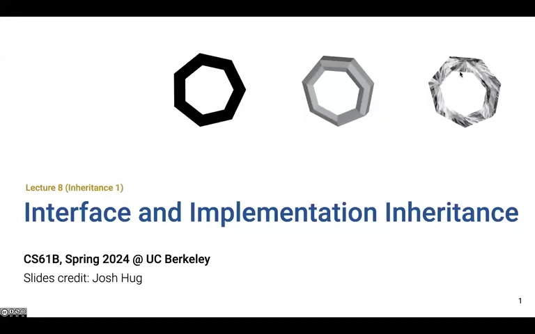 |
| [00:21](https://www.bilibili.com/video/BV1QP4y1u7jv/?p=25&t=21) 什么是遗产？我们为什么需要它为什么我们要在这件事上花四节课 | 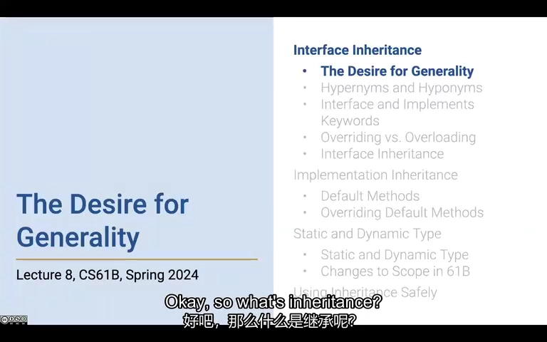 |
| [00:26](https://www.bilibili.com/video/BV1QP4y1u7jv/?p=25&t=26) 所以在过去的四节课中，我们建立了美丽的八个列表其中有这些方法，你可以添加到它你可以得到物品您可以删除项目我们还建立了美丽的名单其中有这些方法，您可以添加添加项您可以插入项您可以删除项目清单很美它有这些方法名单很美它有基本相同的方法所以让我们看看现实世界中的人是如何使用我们构建的这些类的 | 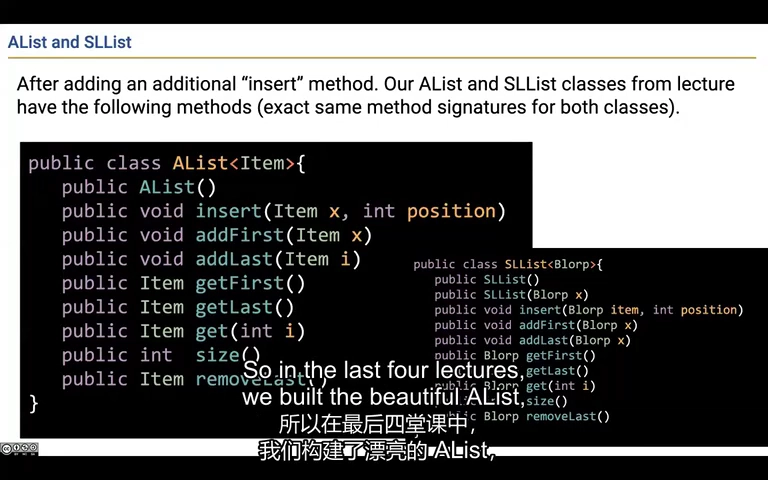 |
| [00:57](https://www.bilibili.com/video/BV1QP4y1u7jv/?p=25&t=57) 假设我想写一些代码在单词列表中找到最长的单词您不必阅读此代码并理解它的功能但不知何故，它在一个列表中包含了一个单词列表它遍历它们，试图找到列表中最长的单词例如如果我过去了 | 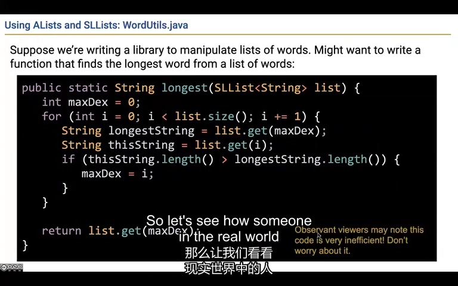 |
| [01:19](https://www.bilibili.com/video/BV1QP4y1u7jv/?p=25&t=79) 这是代码的副本如果我过去了你知道就像麋鹿在看然后我打印出字符串中最长的单词是什么那我该去看了因为那是单词列表中最长的单词我想它最终会建造我看着因为观看是最长的词 | 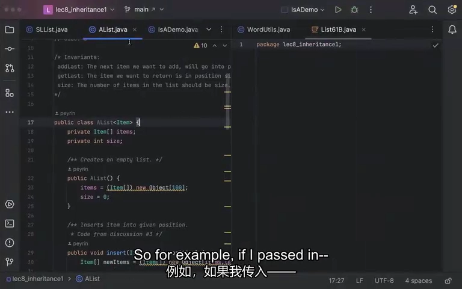 |
| [01:38](https://www.bilibili.com/video/BV1QP4y1u7jv/?p=25&t=98) 好的很好有个小问题 | 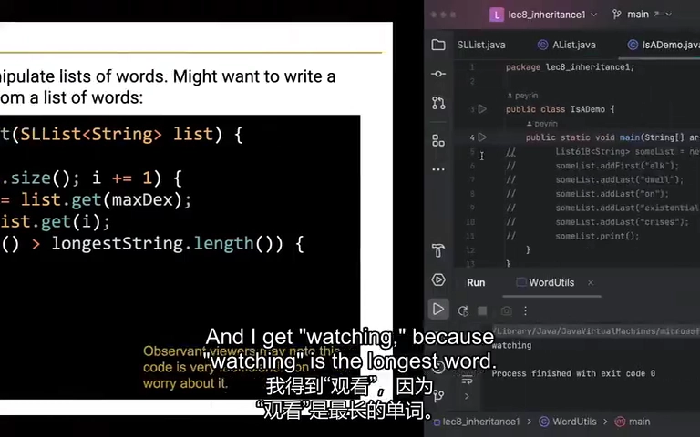 |
| [01:43](https://www.bilibili.com/video/BV1QP4y1u7jv/?p=25&t=103) 这一切都很好如果用户选择使用s列表然后把我的单词叫做Uti的最长方法 | 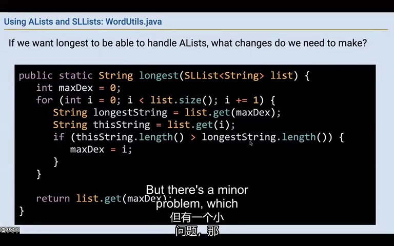 |
| [01:48](https://www.bilibili.com/video/BV1QP4y1u7jv/?p=25&t=108) 但如果用户真的说你知道吗我要把单词列在我的单子上不在S名单中但我要把我的话写在一个列表里好吧，现在我们有一个问题因为如果我把我的话读成一个列表这个最长的方法Java开始抱怨上面说我以为你会给我一份名单但你给了我一张清单相反，它们不匹配，类型也不匹配所以我不打算编译这个程序所以我们有一个问题 | 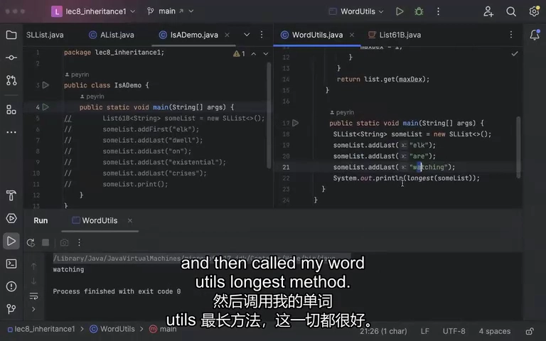 |
| [02:14](https://www.bilibili.com/video/BV1QP4y1u7jv/?p=25&t=134) 如果我想用这个方法做一个列表它不再起作用了那我们怎么解决这个问题我想我搞砸了因为我不小心撞到了下一张幻灯片但有一个可能的想法是也许我会复制最长的方法而不是接受一个s列表同样的方法不过，我会列个单子所以我可以这么做 | 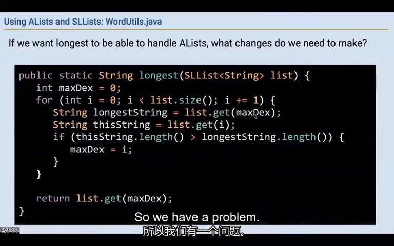 |
| [02:39](https://www.bilibili.com/video/BV1QP4y1u7jv/?p=25&t=159) 所以它看起来是这样的我有两个最长的方法他们中的一个接受了一个s列表其中一个拿着一张单子方法的主体将完全复制粘贴这样，如果有人用s列表打电话最长他们会用这种方法如果他们用一个列表打了最长的电话他们会用这种顶级的方法他们做同样的事情有时这被称为过度掠夺因为有两种不同签名的方法他们接受不同的论点所以这管用我可以复制粘贴的方法但我不喜欢这样你喜欢这个吗你不喜欢这样吗告诉我你喜欢什么告诉我你不喜欢我看到拇指朝下为什么有人对着什么东西大喊大叫 | 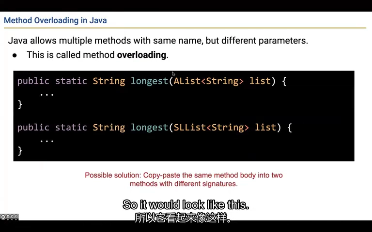 |
| [03:19](https://www.bilibili.com/video/BV1QP4y1u7jv/?p=25&t=199) 它我听到了十一点我不明白我喜欢它你喜欢它很多代码很多台词你说的对代码不是正确需要的两倍长事实上，它不仅是 | 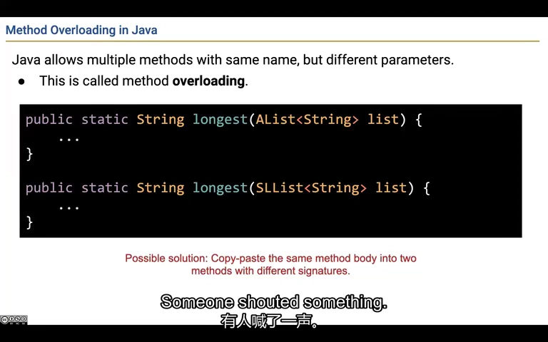 |
| [03:41](https://www.bilibili.com/video/BV1QP4y1u7jv/?p=25&t=221) 但就像反复两倍长从某种意义上说，这是相同的代码两次所以它不需要是一样的所以是相同的代码两次我觉得有点恶心如果您正在读取代码同样的代码出现两次那有点恶心另一个问题是什么如果您最终创建了更多的列表你就像实际上我不只是喜欢清单和清单我也喜欢d列表双链表嗯然后你得回去复制粘贴第三次获得处理D列表的最长方法或者如果你创建了一些奇怪的提示列表类您必须为q列表创建另一个最长的方法也很难维持这个有点意思因为代码不像汽车不需要维护 | 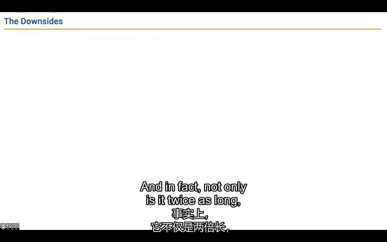 |
| [04:21](https://www.bilibili.com/video/BV1QP4y1u7jv/?p=25&t=261) 但也许您的代码依赖于我不知道其他图书馆你需要更新它时不时地或者你回去发现你知道最长的密码有点慢我想快点或者你回去发现一个窃听器你想把它修好现在呢如果您必须在其中一个方法中修复某些内容你还得记得回去修好它所有的复制粘贴版本如果你忘了这么做那你就惨了 | 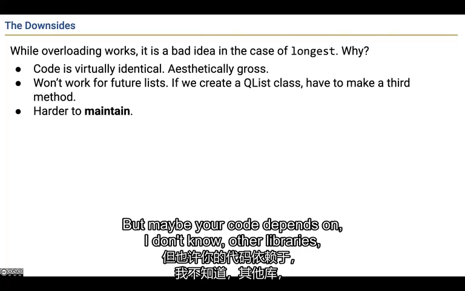 |
| [04:43](https://www.bilibili.com/video/BV1QP4y1u7jv/?p=25&t=283) 所以至少有一些原因为什么我觉得复制相同的代码三次 | 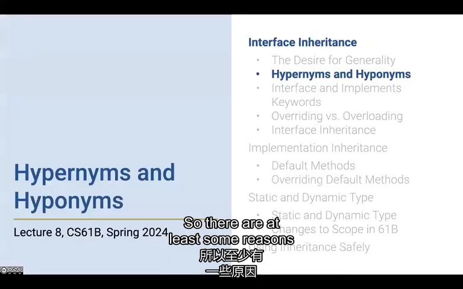 |
| [04:48](https://www.bilibili.com/video/BV1QP4y1u7jv/?p=25&t=288) 不是个好主意所以我们得找到更好的好啦所以为了找到更好的 | 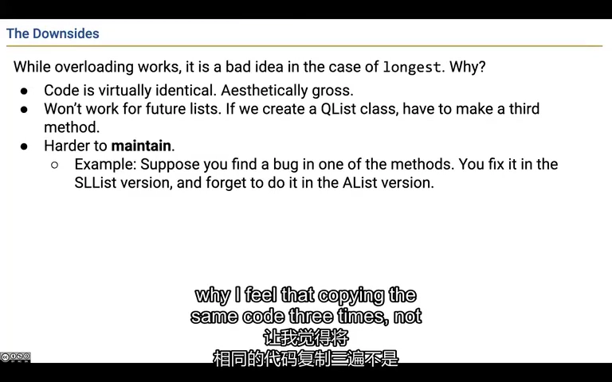 |
| [04:53](https://www.bilibili.com/video/BV1QP4y1u7jv/?p=25&t=293) 我得绕个近路给你上语法课然后我们再回来讨论为什么语法课是必要的 | 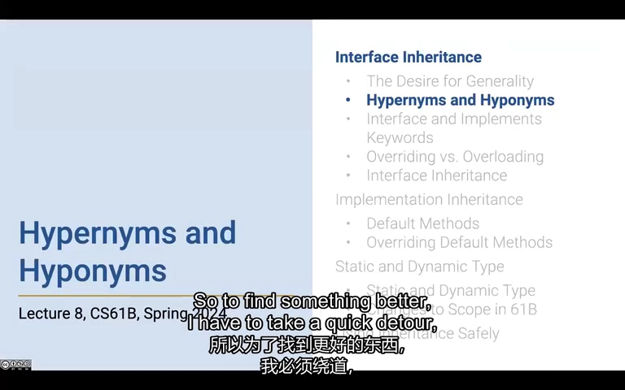 |
| [04:58](https://www.bilibili.com/video/BV1QP4y1u7jv/?p=25&t=298) 所以这里有一些关于如何洗贵宾犬的说明所以贵宾犬洗澡前的第一压力两个用温水三个用平静的声音和你的贵宾犬说话四用贵宾犬洗发水五个冲洗好六个风干和七个奖励是狮子狗，太棒了但如果我想看一只阿拉斯加呢相反，记住那些这就像大狗从哦狗从喜欢我不知道第二讲那么清洗马拉默德井的说明是什么呢 | 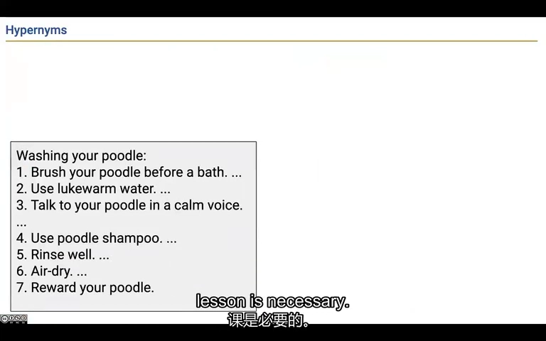 |
| [05:25](https://www.bilibili.com/video/BV1QP4y1u7jv/?p=25&t=325) 它是一个刷你的瓜就像洗澡前用温水一样三个用平静的声音和你说话，阿拉明四用马龙洗发水五个冲洗好六风干七赏你的雪橇犬好那基本上和我们刚才做的是一样的我们只是把狮子狗这个词换成了雪橇犬所以当我们在现实世界中面临这个问题时我们不会复制粘贴这套完全相同的洗狗说明适用于每只可能的狗我们可以为所有类型的狗写一个通用的指令所以我们知道贵宾犬是狗雪橇犬也是狗所以也许我们会想出一套说明 | 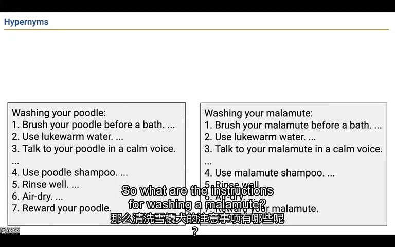 |
| [06:05](https://www.bilibili.com/video/BV1QP4y1u7jv/?p=25&t=365) 适用于所有类型的狗所以可能是这样的这是洗狗的说明给狗洗澡前刷一下使用液态水我不想再看了但你明白了所以我不指望你能记住但事实证明，在英语中有一个幻想词来形容这一点是上位词因为贵宾犬是一种狗雪橇犬是一种狗那么我们可以说狗是狮子狗和雪橇犬的超级组合等等所以它是一个更通用的词包括各种不同类型的狗好的很好 | 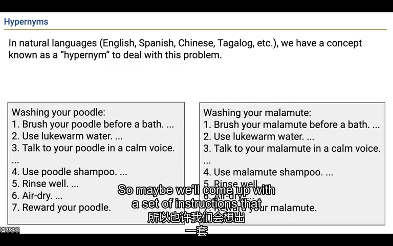 |
| [06:42](https://www.bilibili.com/video/BV1QP4y1u7jv/?p=25&t=402) 所以你也可以用另一个方向你可以说贵宾犬是一种很高的狗这基本上说明贵宾犬是一种更特殊的狗现在我又一次不打算用这个来测试你你可能会在项目2中看到一点但关键的想法是，在英语中，人们也有同样的问题你有不同类型的狗而不是写单独的指示你一概而论你可以说这里有洗任何类型狗的说明那么我们能把这个想法放在Java中吗 | 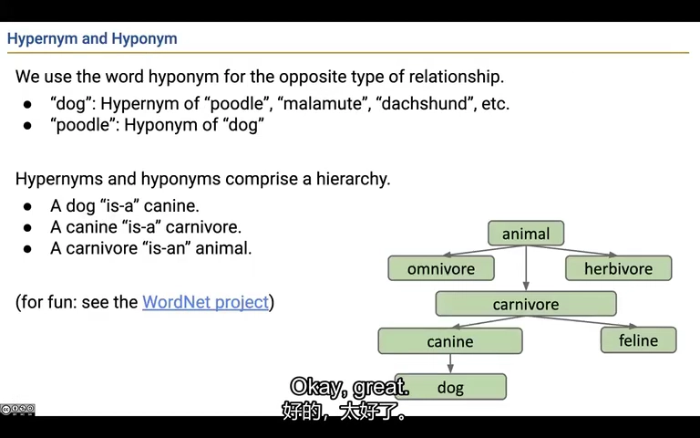 |
| [07:10](https://www.bilibili.com/video/BV1QP4y1u7jv/?p=25&t=430) 就像我们从狗的例子中看到的很明显，s列表和a列表显然都是某种列表 | 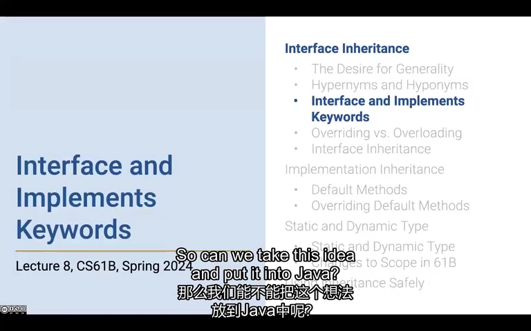 |
| [07:15](https://www.bilibili.com/video/BV1QP4y1u7jv/?p=25&t=435) 所以如果我们用我们花哨的语法词汇那么我们可以说list是一个上位词这就像s列表和a列表的更一般的版本另一种说法是s列表是一种特定类型的列表列表也是一种特定类型的列表我们知道这一点是因为它们有相同的界面供用户交互那么如何告诉Java这就是我如何告诉Java这两个列表所以我能做的一件事就是我可以先定义一个新的类型记住有一种原始类型其他都是引用类型所以我将为上位词定义一个引用类型 | 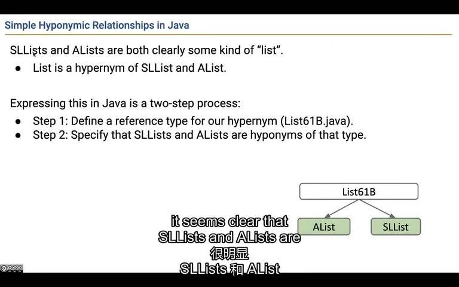 |
| [07:55](https://www.bilibili.com/video/BV1QP4y1u7jv/?p=25&t=475) 我叫它名单61 b你可以叫它其他的东西然后我会告诉Java，s列表实际上是一种特定类型的列表名单也是 | 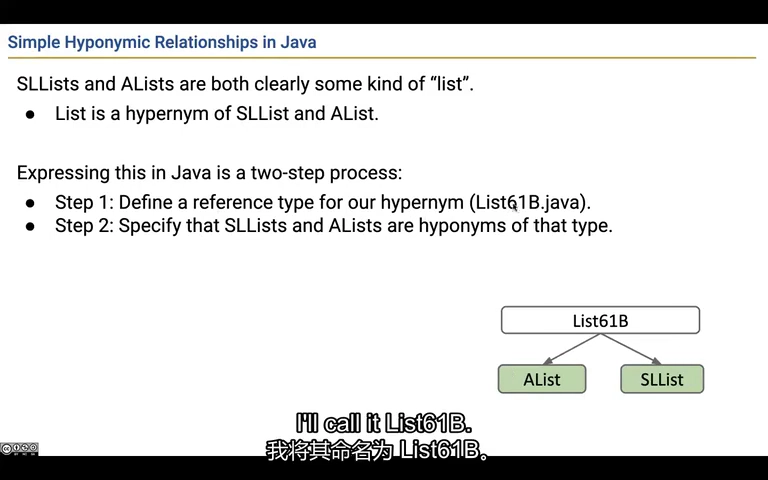 |
| [08:05](https://www.bilibili.com/video/BV1QP4y1u7jv/?p=25&t=485) 考虑到这一点我们要试着把它编码但有人抱怨黑暗模式太难阅读所以让我们把它带到地板上我们该怎么做呢？好啦我们想要的黑暗模式我们要亲自举手吗哪种暗光模式 | 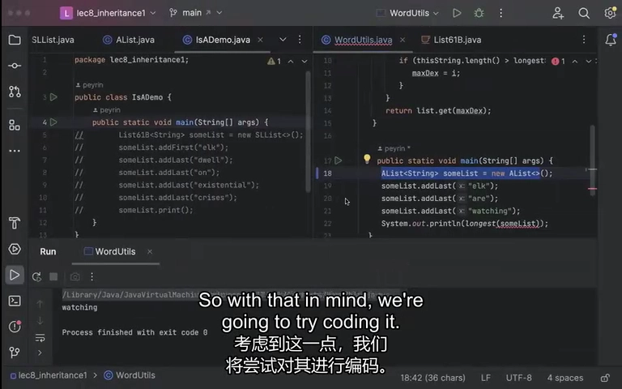 |
| [08:21](https://www.bilibili.com/video/BV1QP4y1u7jv/?p=25&t=501) 我该怎么做你会知道如何在这里做首选项 | 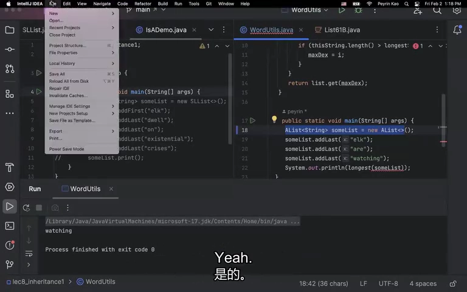 |
| [08:27](https://www.bilibili.com/video/BV1QP4y1u7jv/?p=25&t=507) 哦，那里我们去美丽好啦所以那是光 | 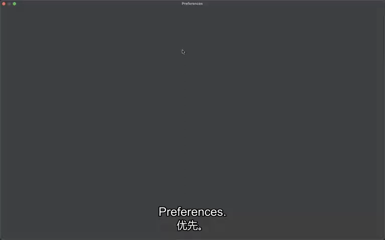 |
| [08:32](https://www.bilibili.com/video/BV1QP4y1u7jv/?p=25&t=512) 我不知道那是什么反应 | 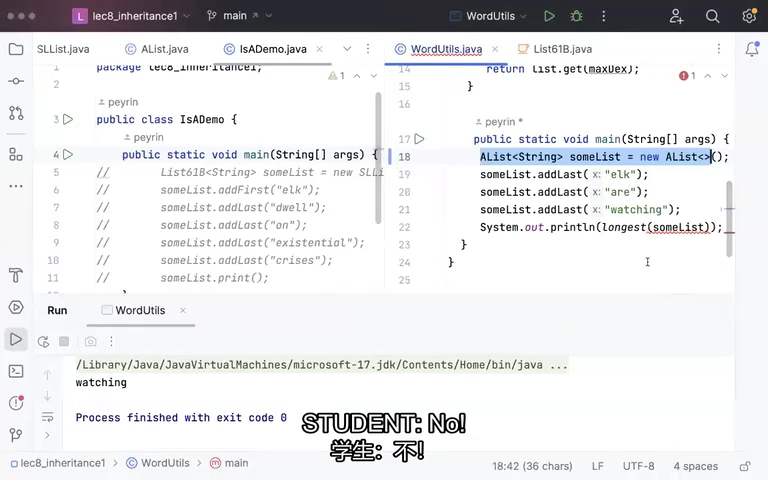 |
| [08:39](https://www.bilibili.com/video/BV1QP4y1u7jv/?p=25&t=519) （此区间无字幕） | 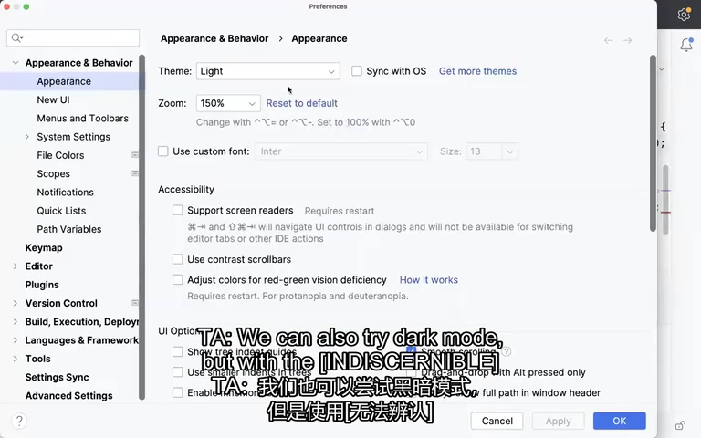 |
| [08:44](https://www.bilibili.com/video/BV1QP4y1u7jv/?p=25&t=524) （此区间无字幕） | 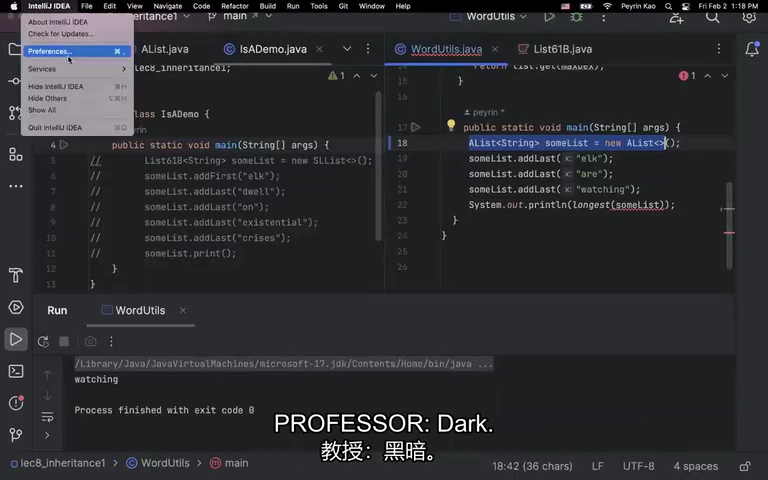 |
| [08:49](https://www.bilibili.com/video/BV1QP4y1u7jv/?p=25&t=529) 还有其他高对比度吗 | 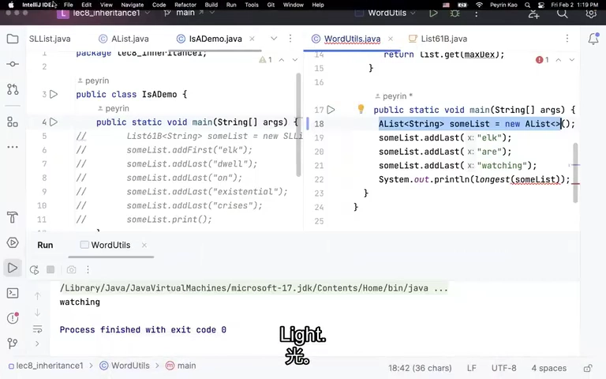 |
| [08:54](https://www.bilibili.com/video/BV1QP4y1u7jv/?p=25&t=534) 啊我不知道这是什么哎呦 | 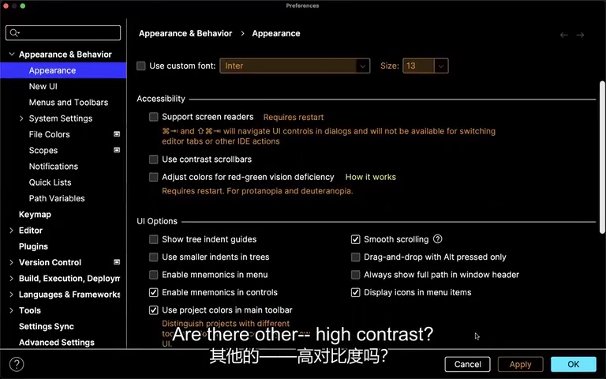 |
| [08:59](https://www.bilibili.com/video/BV1QP4y1u7jv/?p=25&t=539) （此区间无字幕） | 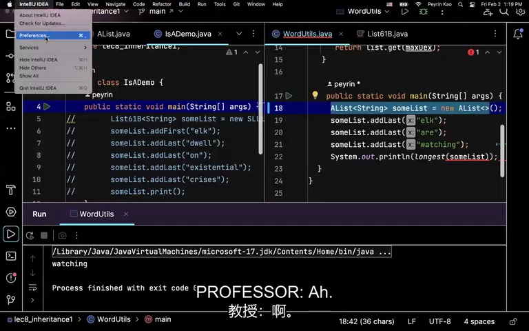 |
| [09:04](https://www.bilibili.com/video/BV1QP4y1u7jv/?p=25&t=544) 吊杆好啦我不知道我们在做什么在光模式下你想要什么好啦好像是黑暗模式高对比度我想要一个深色的乌拉 | 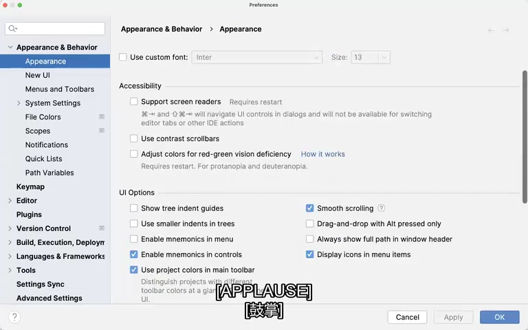 |
| [09:27](https://www.bilibili.com/video/BV1QP4y1u7jv/?p=25&t=567) 我想黑暗是默认的A我认为黑暗是默认的好啦那么人们想要什么对不起我没有跟踪高对比度 | 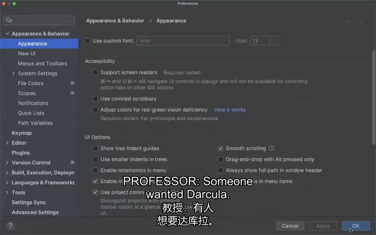 |
| [09:37](https://www.bilibili.com/video/BV1QP4y1u7jv/?p=25&t=577) 高对比度好啦异国情调好啦是啊，是啊也许我们会得到更多的主题下一次就会变成亮粉色 | 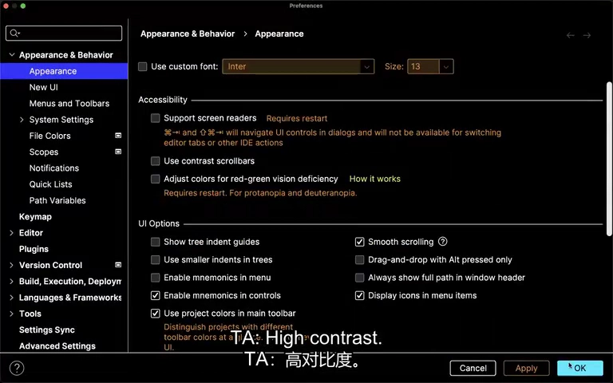 |
| [09:42](https://www.bilibili.com/video/BV1QP4y1u7jv/?p=25&t=582) 好吧关闭好啦就像看电影一样好的很好好啦所以我们在做高对比度好啦让我们照我们说的做吧 | 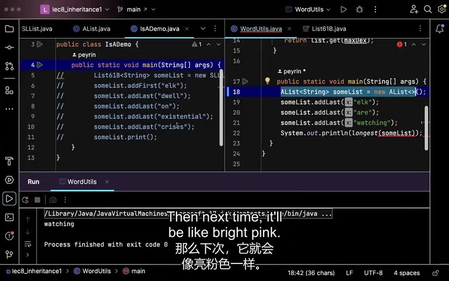 |
| [09:53](https://www.bilibili.com/video/BV1QP4y1u7jv/?p=25&t=593) 好啦喜欢就告诉我如果你不喜欢我们下次也换电池快没电了所以给我一个新的好啦所以好吧所以我们要做的就是我们必须定义一个引用类型然后指定是特定的列表 | 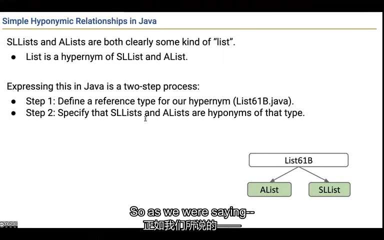 |
| [10:08](https://www.bilibili.com/video/BV1QP4y1u7jv/?p=25&t=608) 上次的名单就在美丽的徒步旅行中对比字体和A列表，我们需要指定这些是特定的列表所以让我们回去做吧所以我要说公开通常我会说一个类来定义新的引用类型但今天我要用一个稍微不同的词我们很快就会见到你的我会说界面然后我称之为列表这是我新引用类型的名字现在不是指定方法然后说是的以下是列表的蓝图六十一b做的事情我要做些不同的事我要看一下我的清单我要说你很清楚我的列表一开始有一个操作 | 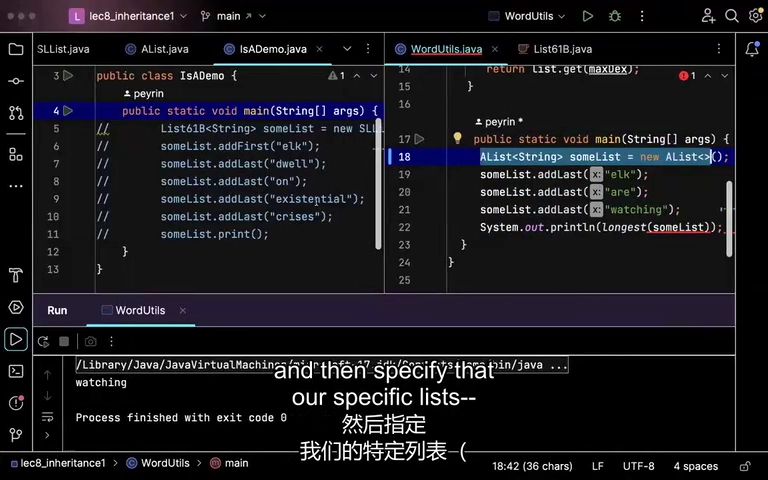 |
| [10:48](https://www.bilibili.com/video/BV1QP4y1u7jv/?p=25&t=648) 我先说公共无效哎呀哎呀我会把它变成通用的我会在第一项X上说而不是实际编写正文并告诉程序如何首先添加我实际上要加一个分号这是列出的语句61个B都需要有一个加法如何落实这是特定于每个列表的但是所有的名单都有一个广告所以这就像是一个蓝图所有列表都需要能够这样做我们可以继续公开无效添加最后一个也是第X项我不打算写怎么做我只想说这个列表必须能够添加到最后所以我可以通过并做到这一点但也许为了表达一个更有趣的观点 | 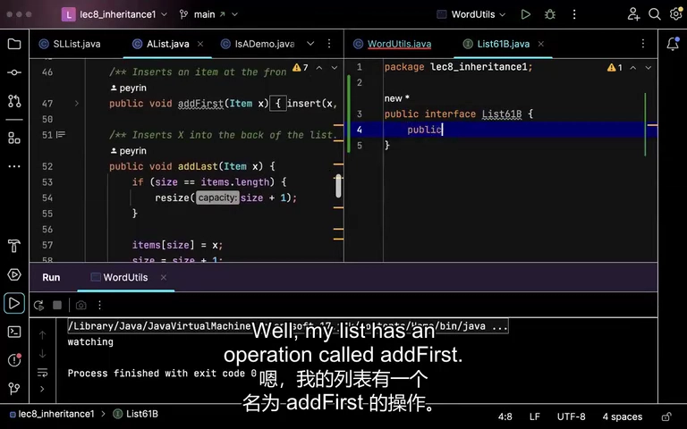 |
| [11:27](https://www.bilibili.com/video/BV1QP4y1u7jv/?p=25&t=687) 我实际上要把所有这些代码复制粘贴就可以了看看会发生什么所以我会拿着我的A清单我会复制粘贴它我冲过去，Java开始对我尖叫所以我们会试着解决一些问题所以首先它说这些实例变量嗯它们不是针对所有列表的它们是特定于一个列表的 | 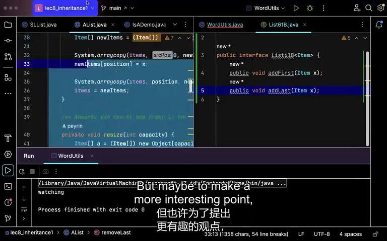 |
| [11:45](https://www.bilibili.com/video/BV1QP4y1u7jv/?p=25&t=705) 所以不是所有的列表都有数组事实上，列表没有后备数组在一些名单上也许连尺码都没有也许他们只是按需计算尺寸所以这些不是所有列表都有的所以我们要除掉他们我不想要构造函数不明显我不知道但如果你下次再来可能会更明显一点 | 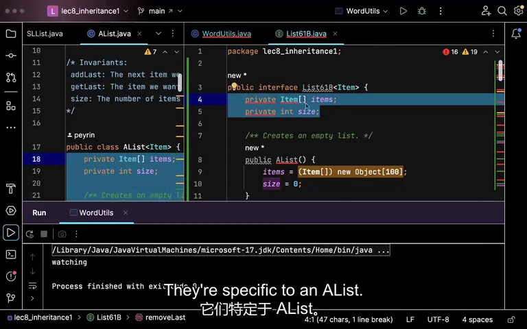 |
| [12:03](https://www.bilibili.com/video/BV1QP4y1u7jv/?p=25&t=723) 是啊，是啊我想所有的列表都应该能够插入这样而不是拥有尸体我只想声明，所有的列表都必须能够插入调整好大小怎么样 | 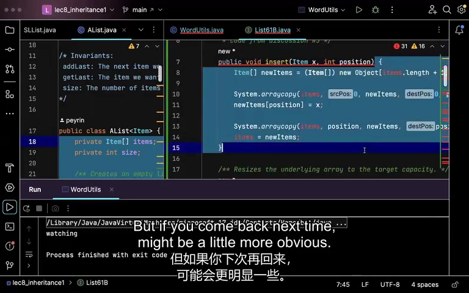 |
| [12:11](https://www.bilibili.com/video/BV1QP4y1u7jv/?p=25&t=731) 这不是名单的一部分对呀就像s列表d列表它们根本不调整大小所以实际上这个我们不需要另一种方法是你可以看出它不需要好像是私人的我们不需要私人方法这些是私人实现细节它们不是用户用来与列表交互的东西一开始呢我喜欢这样我想我们应该先加上最后呢我喜欢抢先怎么样这很好最后一个好的很好好好的玩得开心，尺寸好，最后移除也不错好的很好所以我在这里所做的是我指定了一种类型六十一B要做的事情的蓝图 | 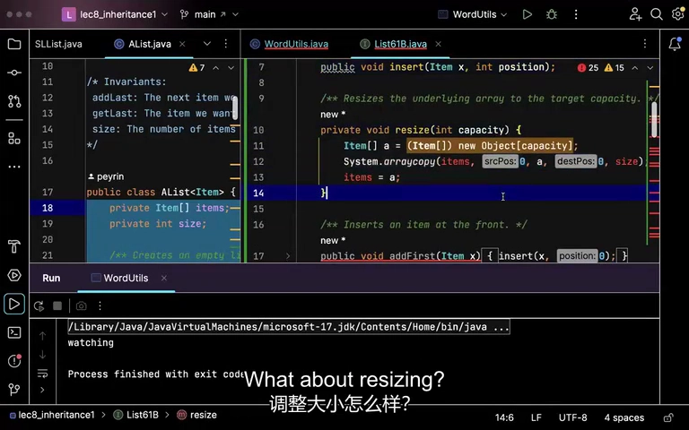 |
| [12:51](https://www.bilibili.com/video/BV1QP4y1u7jv/?p=25&t=771) 这是一个列表，列出了一个61 b必须做的所有事情一个由60和b组成的列表如果我给你一个名单61 b物体你可以确定它有所有这些方法 | 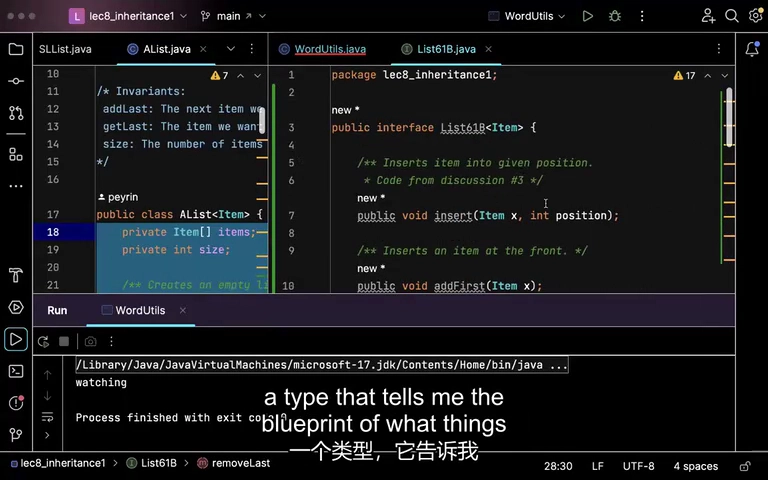 |
| [13:04](https://www.bilibili.com/video/BV1QP4y1u7jv/?p=25&t=784) 好的很好所以这是第一步我们用单词接口代替类 | 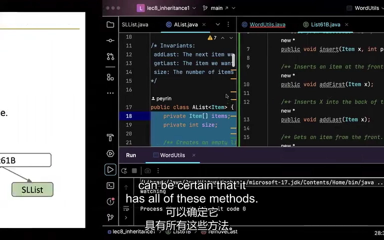 |
| [13:09](https://www.bilibili.com/video/BV1QP4y1u7jv/?p=25&t=789) 关键思想是这里我们没有告诉你列表是如何运作的你怎么终于你喜欢添加链接你改变数组了吗我们没有告诉你，我们只是告诉你一个清单，那个物体 | 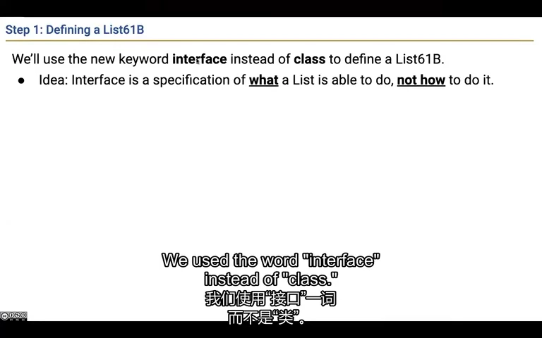 |
| [13:22](https://www.bilibili.com/video/BV1QP4y1u7jv/?p=25&t=802) 必须能够做到这一点这是界面而不是有方法他们都和分号下来这是第一步现在我们要完成第二步 | 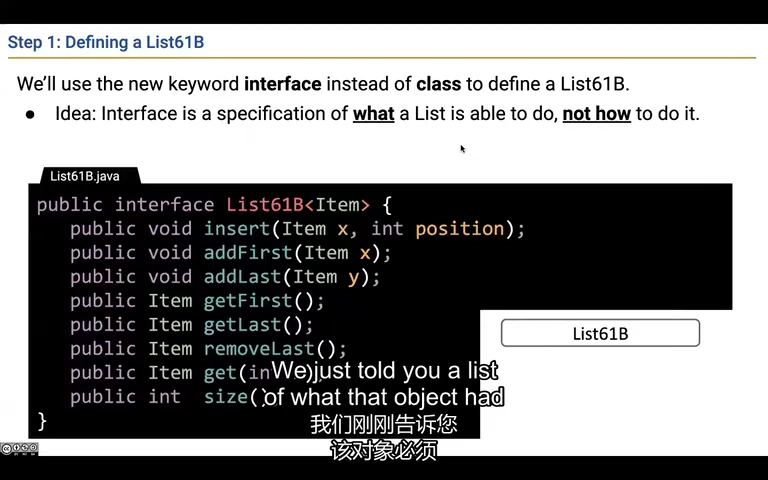 |
| [13:32](https://www.bilibili.com/video/BV1QP4y1u7jv/?p=25&t=812) 现在我们有了通用清单我们需要指定a list和s list它们是特定类型的列表因为现在可以启用一个列表类我需要告诉Java一个列表是一个特定类型的列表61 b所以我们就这么做吧所以我要用的魔法词我知道这些讲座有时会引入很多额外的单词但我要用的魔法词是工具我会说61 b的工具通过说我告诉Java这是一个列表，不仅仅是任何类型的对象这是一份具体的名单60和b我喜欢说雪橇犬它不仅仅是任何类型的物体它是一种特殊的狗所以我会说一个列表实现列表61和B和我将出现在名单上 | 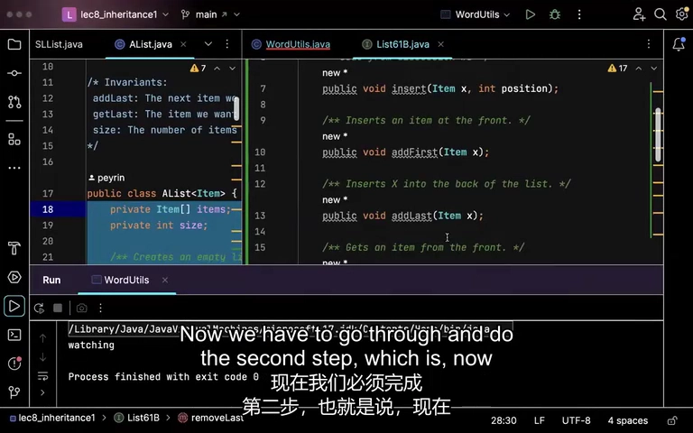 |
| [14:12](https://www.bilibili.com/video/BV1QP4y1u7jv/?p=25&t=852) 并说它实现了列表61 b所以这是我告诉Java这些都是特定类型的列表好啦我想这里的通用词是blurp | 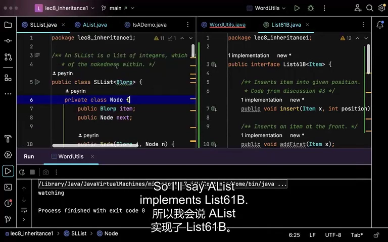 |
| [14:25](https://www.bilibili.com/video/BV1QP4y1u7jv/?p=25&t=865) 所以我告诉JavaA名单这是一张名单六十一B作为S名单 | 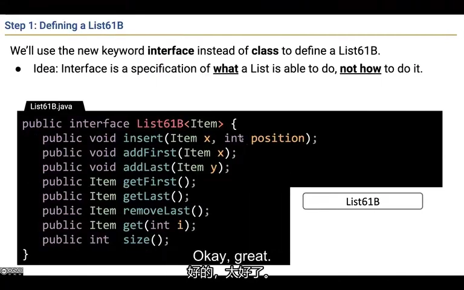 |
| [14:30](https://www.bilibili.com/video/BV1QP4y1u7jv/?p=25&t=870) 你也能60和B现在编译器知道这是我们想要的超高度关系 |  |
| [14:36](https://www.bilibili.com/video/BV1QP4y1u7jv/?p=25&t=876) 所以这很好那口井的全部意义 |  |
| [14:41](https://www.bilibili.com/video/BV1QP4y1u7jv/?p=25&t=881) 重点是这个因为现在我可以进来说我们要复制粘贴的这个最长的方法S列表和A列表的五次不同时间这将是可怕的嗯诀窍是这样的也就是这不一定是s列表不是列表如果这只是任何一种低60b啊然后当我来到这里如果我有一个名单，我把它传递进去没关系因为列表是一种特定类型的列表如果我有一个s列表呢嗯那也可以Java也没意见如果后来我过来，我喜欢啊让我们建立一个交易清单也是一种列表X和b那么这个最长的方法仍然有效 |  |
| [15:21](https://www.bilibili.com/video/BV1QP4y1u7jv/?p=25&t=921) 我仍然希望看到这个词高对比度观看 |  |
| [15:27](https://www.bilibili.com/video/BV1QP4y1u7jv/?p=25&t=927) 好啦蓝图是这样的 |  |
| [15:32](https://www.bilibili.com/video/BV1QP4y1u7jv/?p=25&t=932) 现在我们可以使用列表二，b是参数现在我们可以拿任何东西你想要一份清单S列表即使是尚未发明的列表挺酷的鸡蛋男孩我不知道那是什么 |  |
| [15:44](https://www.bilibili.com/video/BV1QP4y1u7jv/?p=25&t=944) 让我们谈谈发生了什么事它覆盖了我们之前看到的已经超载了 |  |
| [15:50](https://www.bilibili.com/video/BV1QP4y1u7jv/?p=25&t=950) 所以我们看到的是我们有这份名单最后调用了一个方法签名方法本身是空白的我们刚刚加了一个分号这里没有真正的代码所以这个签名表明，与61 b的接口有一个ad last操作我不打算告诉你是怎么做的这取决于每个特定的列表但我要告诉你，这种方法是存在的然后当我们来到这里的名单我们有一模一样的标志性表情他们终于是同样的公共空白因为这些方法的签名完全相同相同的名称和完全相同的参数然后我们可以说，子类中的参数和或函数 |  |
| [16:30](https://www.bilibili.com/video/BV1QP4y1u7jv/?p=25&t=990) 此广告最后方法它取代了61爆破法所以我们采取了这个空白的方法我们用这种方法代替了它它将包含关于如何将last添加到s列表的实际信息所以我们在这里所做的一个花哨的词是覆盖完全相同的函数参数所以我们称之为覆盖 |  |
| [16:52](https://www.bilibili.com/video/BV1QP4y1u7jv/?p=25&t=1012) 相比之下我们之前看到的你有相同的名字但他们有不同的参数其中一个拿了一张名单他们中的一个接受了一个叫做这两个一开始看起来有点相似这里有一张幻灯片试图把他们分开所以让我们来看看公共界面动物这是一个声明所有的动物都应该发出噪音它们发出的具体声音是什么那取决于动物然后我可以说猪是动物的一个亚类所以记住高钠关系猪你是一种特殊的动物你的制造噪音法它会打印出正确的点这凌驾于动物的方法之上因为这是子类 |  |
| [17:32](https://www.bilibili.com/video/BV1QP4y1u7jv/?p=25&t=1052) 同样的方法签署公共空隙制造噪音没有争论所以pig取代了make noise方法上面写着这个空白的我不喜欢我要写我自己的更具体的制造噪音的方法 |  |
| [17:45](https://www.bilibili.com/video/BV1QP4y1u7jv/?p=25&t=1065) 相比之下如果你看到这样的东西也许我有另一只班上的狗好吧，现在我得制造噪音但这并不是其中一个凌驾于另一个之上现在的情况是，这两个都在附近闲逛你用哪一个取决于你知道的用哪些参数调用函数所以你必须有相同的名字但他们都在附近闲逛如果你不通过一个论点然后我们可以用第二个就像狗一样对着墙叫或者对着树叫但也许如果一只狗看到另一只狗，想对着另一只狗吠叫也许用这个，所以这里做选择是超载的通常我们不会说你知道一种方法 |  |
| [18:19](https://www.bilibili.com/video/BV1QP4y1u7jv/?p=25&t=1099) 所以这里我们可以说猪重写会发出噪音这只是术语顺便说一句，这不是超级有趣但你可以说猪的管理费用制造噪音但通常说其中一个发出噪音是没有意义的重载另一个两者共存这就像如果电网开始走下坡路你不说你知道一个人超负荷另一个人你刚才说电网超载如果这有任何意义的话所以超载在现实世界中有一些用途像这样发出噪音一个还不错我也喜欢数学课上的这个我们有一个整数的绝对值方法然后我们还有一个双人的所以他们有相同的名字取决于你传递的是整数还是双数 |  |
| [18:59](https://www.bilibili.com/video/BV1QP4y1u7jv/?p=25&t=1139) 合适的人被称为这是另一个被过度掠夺的例子问题是啊，是啊所以对于那个有一个问题有人对这里的账单不满意额外的空间思想我个人不会补充说但你不会加好啦我们应该把它修好吗我是说一些私人时间 |  |
| [19:28](https://www.bilibili.com/video/BV1QP4y1u7jv/?p=25&t=1168) 好啦所以你会喜欢更像那样 |  |
| [19:33](https://www.bilibili.com/video/BV1QP4y1u7jv/?p=25&t=1173) 好啦它并不真的要求好啦也许下次会有人进来 |  |
| [19:38](https://www.bilibili.com/video/BV1QP4y1u7jv/?p=25&t=1178) 就像太空规格好啦所以我们还应该做一件事只是为了让我们的代码更有条理 |  |
| [19:43](https://www.bilibili.com/video/BV1QP4y1u7jv/?p=25&t=1183) 因此，在这一点上，我们的重写方法已经完全实现他们工作得很好但我要加一点额外的标签只是提醒自己我在做什么你也会这么做 |  |
| [19:56](https://www.bilibili.com/video/BV1QP4y1u7jv/?p=25&t=1196) 当你在做项目的时候或者其他什么，所以我要经历每当我有一个方法覆盖父类所做的事情我要加一个额外的标签所以我要说让我们看看我通过我不知道这些东西但是啊哈我覆盖的插入方法所以我将使用添加符号有点像我写测试时用的那个我要说超驰这实际上是做什么的原来它什么都不做所以即使我没有这个覆盖标签我还在压倒一切那么加这个有什么意义呢有点像评论这就像是在提醒我自己，这个插入方法它不仅仅是任何插入方法它特别是一个重写的插入方法 |  |
| [20:36](https://www.bilibili.com/video/BV1QP4y1u7jv/?p=25&t=1236) 因为我的父接口有一个空白的插入方法我把它换成了这个新的改进的不太具体的一个所以我要经历在这个覆盖标记处只是为了提醒我自己或读者我的代码嘿嘿这种一开始的方法它不只是来自任何地方实际上是父类的重写版本一开始和最后的广告一样抢先也一样我希望你玩得开心最后一个也一样啊也许不是这个这个是私人的所以我们不想结束那个没有覆盖所以你可以看到如果我试图声称Java嘿得到最后一个音符正在结束它Java说不这不是得到最后的音符不是来自61 B |  |
| [21:16](https://www.bilibili.com/video/BV1QP4y1u7jv/?p=25&t=1276) 你自己定义它没有从父类覆盖所以这个标签会提醒你没有没有被覆盖很好所以我会说得到重写这个版本的get也覆盖了但它没有，因为这个是私人的它接受了不同的论点所以它不会覆盖列表的大小我想重写删除上次重写好的很好多有趣啊那么这一件事的目的是什么呢我认为它使代码更容易阅读因为它清楚地表明，这个remove last不仅仅是任何旧的函数它是从父类重写的函数最后一个是空白的覆盖的另一个好处是它能捕捉错别字 |  |
| [21:56](https://www.bilibili.com/video/BV1QP4y1u7jv/?p=25&t=1316) 所以也许让我们先说我的在哪里我有个超驰标签也许代替你知道先打字当我在编码的时候我一开始是打字的好啦好吧，现在我们有一个问题所以一开始，有一个一开始的方法是完全可以的Java没有规则禁止一开始就拥有它但如果你一开始做得对您实际上并没有重写老板说的是所以你一开始说它您实际上并不是在第一次实现时替换空白那是在A 61 B接口和覆盖标记中它真正的好处是，如果你实际上没有覆盖 |  |
| [22:29](https://www.bilibili.com/video/BV1QP4y1u7jv/?p=25&t=1349) 如果你把这个标签这是对自己的提醒关于一种方法那实际上不是压倒一切的先喜欢广告吧它会抱怨说实际上你没有覆盖先没有广告坐在Listic MV里，我会看着这个，然后说啊我先拼错的 |  |
| [22:48](https://www.bilibili.com/video/BV1QP4y1u7jv/?p=25&t=1368) 好啦因此，捕捉错别字，在我看来，也使代码更容易阅读但你要知道 |  |
| [22:53](https://www.bilibili.com/video/BV1QP4y1u7jv/?p=25&t=1373) 即使我不把覆盖标签我还在压倒一切这只是对我自己的提醒也是一种捕捉的方法如果我声称要推翻一些我真的不好的事情 |  |
| [23:02](https://www.bilibili.com/video/BV1QP4y1u7jv/?p=25&t=1382) 我所说的一切现在都在幻灯片上所以如果你不写它仍然覆盖它是可选的但在这门课上，我们推荐它，因为它能捕捉错别字之类的东西一开始它在让我们问一个问题 |  |
| [23:23](https://www.bilibili.com/video/BV1QP4y1u7jv/?p=25&t=1403) 在更复杂的程序结构中你能指定覆盖的内容吗你能说得更具体些吗 |  |
| [23:28](https://www.bilibili.com/video/BV1QP4y1u7jv/?p=25&t=1408) 哦，我是说你想喜欢引用什么父类吗嗯我想你也许可以我想可能覆盖攻击没有包含更多信息的原因就是因为方法签名已经相同所以这个公共空白最终接纳了一个通用的东西公共无效添加采用通用的东西所以签名已经是一样的了所以我不知道如果我添加更多的信息只有一件事可能是啊，是啊只是想指出只有一件事可以被推翻它将是具有完全相同签名的方法所以我想因为这个原因我是说是啊，是啊你也许可以用另一个版本的Java就像那样做但这是多余的 |  |
| [24:08](https://www.bilibili.com/video/BV1QP4y1u7jv/?p=25&t=1448) 但在这个版本中，你只把超重好啦 |  |
| [24:13](https://www.bilibili.com/video/BV1QP4y1u7jv/?p=25&t=1453) 还有一个问题 |  |
| [24:18](https://www.bilibili.com/video/BV1QP4y1u7jv/?p=25&t=1458) 有一个问题我可以重写两次吗你可以试试我认为这是不可能的因为那就不是然后Java不知道该叫哪个对所以如果我在最后一圈再做一次这份工作会很好坚持住有两个你已经定义好了我想这个想法是如果有人最后打电话来Java会感到困惑他们会说你想要这个吗你要这个吗还不清楚所以这就完成了一个很好的问题虽然好啦 |  |
| [24:46](https://www.bilibili.com/video/BV1QP4y1u7jv/?p=25&t=1486) 我们得到了权利酷所以好吧所以我们所做的一切 |  |
| [24:51](https://www.bilibili.com/video/BV1QP4y1u7jv/?p=25&t=1491) 它还有一个花哨的名字所以当我们指定泛型类型或更通用的类型列表时62和b然后我们用这两个特定的列表来实现它这叫做接口继承把术语分解一下Word界面这是我的清单上必须能做的所有事情的清单所有列表必须能够首先添加最后加什么都行然后我所说的“继承”这个词有两个子类是x db的更特定类型他们实现了弹道1B接口和接口本身它只是指定类可以做什么但它没有说任何关于如何这就是为什么所有的方法都是空白的我会注意到，如果你有一个接口 |  |
| [25:31](https://www.bilibili.com/video/BV1QP4y1u7jv/?p=25&t=1531) 你有一些实现接口的东西像s列表实现列表x u和b那你一定要要求您必须覆盖所有空白方法您不能将任何方法保留为未覆盖和空白您需要准确地指定接口中的所有方法是如何实现的 |  |
| [25:50](https://www.bilibili.com/video/BV1QP4y1u7jv/?p=25&t=1550) 例如，在我的列表中，60分贝我有插入我一开始有我最后吃了广告所以任何声称是名单的东西它必须实现和覆盖列表60MB中列出的所有方法所以这有点像我不知道也许你有一张蓝图告诉你钥匙是这样工作的或者像锁一样工作它必须能够锁定它必须能够解锁所以你声称的任何东西都是一把锁它必须有一个锁操作它必须有一个解锁操作你可以用不同的方法来实现也许有些锁是用钥匙的有些锁使用组合有些锁是用指纹之类的但你建造的所有锁必须有一个锁定操作和一个解锁操作 |  |
| [26:30](https://www.bilibili.com/video/BV1QP4y1u7jv/?p=25&t=1590) 如果你建造一个锁也没有锁操作或者没有解锁操作那真的是一把锁吗我想哲学问题但至少Java会说不那不是锁它并不做锁必须做的所有事情任何时候您实现和接口您必须获取所有这些空白方法，并用实际实现覆盖它们 |  |
| [26:52](https://www.bilibili.com/video/BV1QP4y1u7jv/?p=25&t=1612) 否则Java将无法编译程序所以说例如如果我说你知道什么 |  |
| [26:58](https://www.bilibili.com/video/BV1QP4y1u7jv/?p=25&t=1618) 他们有一个新的额外行动我想所有的名单都应该能够证明我不知道那是什么但也许所有的名单都必须能够证明如果我添加这个额外的空白方法我说所有的六十年都必须证明然后您将看到s列表不再编译上面写着名单你不再算数了或者你不是一个现实的人因为你不能证明说任何你也不算的清单因为你不能证明如果不覆盖所有的方法，就会发生这种情况 |  |
| [27:25](https://www.bilibili.com/video/BV1QP4y1u7jv/?p=25&t=1645) 好极了所以这真的很强大 |  |
| [27:30](https://www.bilibili.com/video/BV1QP4y1u7jv/?p=25&t=1650) 这是幻灯片上的一张照片通常如果有一个接口是白色的有一堂课是绿色的所以万一你看到这些照片但这真的很酷从今天起我们的问题解决了以前最长的方法是复制粘贴如果我有少于一个列表现在它可以在任何类型的列表上工作A列表D列表即使20年后你发明了提示列表好吧，只要它遵循清单60b接口那么单词uti的最长方法可以在提示列表中接受作为一个论点，这是伟大的 |  |
| [28:04](https://www.bilibili.com/video/BV1QP4y1u7jv/?p=25&t=1684) 只是想说清楚我想还有最后一个小纸条有时人们会提起这个有时他们不会如果这对你来说毫无意义我想这是你唯一的突破但有时人们会抱怨他们说好等等，回到第三讲你跟我说过你知道海象的奥秘平等的黄金法则你说过当我在争论中通过时所以我在一个电话上打了最长的电话当我在这场争论中通过时输入列表变量的1你告诉我你只是复制你还告诉我这个输入较少的变量它被宣布为名单60和B但是你是从声明性的东西中复制的位键入列表字符串那么列表字符串的东西怎么能 |  |
| [28:44](https://www.bilibili.com/video/BV1QP4y1u7jv/?p=25&t=1724) 进入lix 2和b不知何故，这些类型似乎不匹配Java不抱怨吗Java怎么样好吧，这是一个地址或者对X和B的引用但是这个记忆盒我复制的片段有对A列表的引用那么为什么可以呢嗯使它起作用的语法技巧是如果我定义或我清除变量，说输入列表是类型列表和B此内存框可以保存对任何类型的lix d和b的引用所以它可以保存对A列表的引用它可以保存对s列表的引用没关系因为一个列表在一个列表中60和b这就是让这一切奏效的英语小技巧 |  |
| [29:24](https://www.bilibili.com/video/BV1QP4y1u7jv/?p=25&t=1764) 以防你觉得不舒服希望你现在没事 |  |
| [29:29](https://www.bilibili.com/video/BV1QP4y1u7jv/?p=25&t=1769) 为了节省时间因为我们做了一个黑暗模式的演示我不打算给你看这个但我们回家后我刚才在看这个这只是两行代码试着弄清楚如果这真的编译了它如果它只是为了让你这么做而起作用 |  |
| [29:40](https://www.bilibili.com/video/BV1QP4y1u7jv/?p=25&t=1780) 我将略过答案你看不到的 |  |
| [29:45](https://www.bilibili.com/video/BV1QP4y1u7jv/?p=25&t=1785) 但回家试试，让我知道你的想法所以我们讨论了接口继承 |  |
| [29:50](https://www.bilibili.com/video/BV1QP4y1u7jv/?p=25&t=1790) 我们说你继承了所有的签名你继承了列表要做的事情或者你喜欢继承所有必须锁定和解锁的锁的列表但是您不继承实现当你写接口的时候所有的方法都是空白的你必须覆盖所有空白的方法所以还有另一种类型的遗传虽然这个叫做实现继承所以这次你不只是继承空白签名说这是名单必须做的您实际上也将继承一些实现所以现在子类不仅得到空白签名它必须通过并覆盖它还得到一些实际的代码 |  |
| [30:30](https://www.bilibili.com/video/BV1QP4y1u7jv/?p=25&t=1830) 所以让我们去看看这是什么样子我要写一个实现然后让子类实现或继承该实现 |  |
| [30:39](https://www.bilibili.com/video/BV1QP4y1u7jv/?p=25&t=1839) 所以让我们做吧我要把x和b列出来我要说你知道吗我实际上认为所有的列表都应该能够打印 |  |
| [30:44](https://www.bilibili.com/video/BV1QP4y1u7jv/?p=25&t=1844) 所以我会说公共无效印刷我会说指纹指纹清单中的所有项目好的很好所以我想这一切现在应该都能很好地打印出来他们不打印所以他们在抱怨所以也许与其把空白打印方法给我所有的子类并说这里有一个空白打印方法，你处理它你覆盖了它我可以说我不仅把这个打印方法送给了我所有的子类我还提供了一个默认实现所以如果你很懒，你不想写打印方法我要给你一个，所以这样我不仅继承了签名我也继承了代码 |  |
| [31:24](https://www.bilibili.com/video/BV1QP4y1u7jv/?p=25&t=1884) 所以我可以首先试着写代码它抱怨它说不接口中不能有代码但是如果我现在把默认关键字我可以所以默认关键字说下面是给所有子类的默认实现所以一开始这似乎很奇怪如何为任何类型的列表编写打印方法60和B A列表少了提示列表我怎么可能写打印方法如果我连名单是什么类型都不知道你看没有实例变量因为这些都是私人的S列表或A列表没有数组没有哨兵我到底怎么才能把东西打印出来但事实证明，我确实有一些事情可以处理所以我没有实例变量 |  |
| [32:04](https://www.bilibili.com/video/BV1QP4y1u7jv/?p=25&t=1924) 我没有私人方法但我知道任何类型的名单即使是从未建造过的以后会有的我能建立的每一个名单实现列表x和b它将有一个插入方法会有一个不利的方法所以我可以用这些方法尽管我不知道具体是什么类型的名单那有点酷所以我会说也许我会从零开始我会说我比尺寸小为什么我可以使用大小什么允许我这么做因为每一个实现小六十的列表D和B保证有一个大小方法我的界面是这么说的所以我会从零到大小然后我会说一些像印刷品 |  |
| [32:44](https://www.bilibili.com/video/BV1QP4y1u7jv/?p=25&t=1964) 好的很好也许我会得到与项目再一次什么许可我使用得到的事实是，每一个名单60米B的名单A列表D列表Qua z列表他们都有一个get方法稍后将被重写所以即使我不知道get方法在做什么我可以放心地称之为因为我知道每一个名单都有一个get方法 |  |
| [33:06](https://www.bilibili.com/video/BV1QP4y1u7jv/?p=25&t=1986) 好啦也许我会在最后打印一行新的只是为了美观好啦所以这是我默认的打印方法我想我可以去上我的演示课那么这是做什么的它只是调用s列表上的print方法 |  |
| [33:19](https://www.bilibili.com/video/BV1QP4y1u7jv/?p=25&t=1999) 所以我会说我宣布有一个新的名单我把它放在一个类型列表的记忆盒里我们之前看到的61个b那很好我会让麋鹿专注于生存危机我会试着把它打印出来所以如果我运行它我将谈到所有生存危机最酷的是我出去得很好但真正酷的是，如果你看看s列表类列表 |  |
| [33:43](https://www.bilibili.com/video/BV1QP4y1u7jv/?p=25&t=2023) 类外观无打印权那不是打印方法那只是一些打印线呼叫所以即使我的s列表没有任何打印状态或打印方法无论如何，s列表仍然继承了我在列表六中写的默认方法2和B，同样的是一个列表没有打印方法但如果我有这些项目的清单我仍然可以打印出来 |  |
| [34:05](https://www.bilibili.com/video/BV1QP4y1u7jv/?p=25&t=2045) 挺酷的这是我写的默认方法我怎么能写这个 |  |
| [34:10](https://www.bilibili.com/video/BV1QP4y1u7jv/?p=25&t=2050) 尽管不知道什么类型的名单我利用了所有列表都有大小方法的知识所有列表都有一个get方法 |  |
| [34:17](https://www.bilibili.com/video/BV1QP4y1u7jv/?p=25&t=2057) 这样我就可以安全地使用这个然后我就能打印出居住在生存危机中即使我的列表没有打印方法因为它继承了我之前为你写的打印方法那我们谈完了吗？我们能不能把您可以使用我们提供给所有子类的默认方法也可能只是也许这个方法有点慢对于特定类型的列表或者可能两种类型的列表所以对于某些类型的列表来说，你认为它太慢了吗是不是有点快好吧，我想我可以从一个列表开始所以在一个很快变大的列表中 |  |
| [34:57](https://www.bilibili.com/video/BV1QP4y1u7jv/?p=25&t=2097) 记得我们有我们的大小变量你还给我把东西列到一个新的清单上怎么样那口井有多快我们必须在数组中得到一个项目但在一个列表中，从一个项目中快速得到一些东西所以我没意见那s列表呢s列表的大小方法是什么你只要得到尺寸它是一个实例变量挺快的你如何得到s列表中的东西从开始扫描开始哦好吧这就是问题所在这很好如果我遍历所有项目我试着打电话得到0得到1得到2然后我会打电话一遍又一遍S要做什么我要打电话从零扫描到零项目从一开始就开始 |  |
| [35:37](https://www.bilibili.com/video/BV1QP4y1u7jv/?p=25&t=2137) 不到第一项拿两百从开始扫描到项目200得到211从头开始扫描到211我一遍又一遍地扫描名单反复得到所有的项目如果我这么做了我得到五十万扫描项目五十万得到五十万和一我从头开始我扫描到五十万零一个我们就是这样写get方法的原来如果你仔细看这里发生了一个双嵌套的循环所以我不喜欢 |  |
| [36:11](https://www.bilibili.com/video/BV1QP4y1u7jv/?p=25&t=2171) 所以事实证明这个方法太慢了S少因为我一遍又一遍地扫描阵列 |  |
| [36:16](https://www.bilibili.com/video/BV1QP4y1u7jv/?p=25&t=2176) 这是在浪费时间那么我怎样才能让它变得更好呢 |  |
| [36:21](https://www.bilibili.com/video/BV1QP4y1u7jv/?p=25&t=2181) 事实证明，如果您不喜欢天赋给您的默认方法所以你现在知道我们是名单上的 |  |
| [36:26](https://www.bilibili.com/video/BV1QP4y1u7jv/?p=25&t=2186) 和我们的父母名单和B他们是天赐给我们的此默认方法，并表示您不必编写打印方法如果你不想但你知道吗我不喜欢给我的打印方法 |  |
| [36:38](https://www.bilibili.com/video/BV1QP4y1u7jv/?p=25&t=2198) 所以我要写一个更好的我是名单上的人3.我知道的东西比我父母的少总清单六十一乙不知道所以说我要说我其实知道你知道的比你知道的多我给B父母的名单我相信自己能写出一个更有效的打印方法吗所以让我们写一个更有效的打印方法所以我还是要写公开的无效印刷品这是完全相同的函数签名一模一样好的很好然后我要添加重写标记只是提醒自己，我实际上是压倒一切老板说的话而这一次，我真的真的压倒一切我得到了这个实现我说不我拒绝我要写我自己的 |  |
| [37:18](https://www.bilibili.com/video/BV1QP4y1u7jv/?p=25&t=2238) 因为我相信自己会写得更有效率为什么要添加此重写标记如果我不加我还在重写但通过添加它可以帮助我捕捉像这样的东西哦，如果我说烧焦了我想你知道有一个完美的方法是可以的但这实际上并不覆盖所以这就是为什么我喜欢有覆盖所以现在我们在名单上我们可以接触到所有这些美妙的东西少了这样我就可以写一个S非特定打印方法所以也许我会做一些也许与其像每次扫描一样一遍又一遍地打电话也许我会有一个小指针就像我们在以前的课上看到的所以我会说我接下来要从哨兵点开始我想我会一直到p不等于零 |  |
| [37:58](https://www.bilibili.com/video/BV1QP4y1u7jv/?p=25&t=2278) 我想每次我走一步，我都会下一步p=p点所以我会扫描阵列然后每次我拿到一个项目我将打印p点项目好的很好然后在最后我会出去到新的线只是为了让事情看起来很好所以我写了对不起高对比度把我搞糊涂了好啦所以我写了自己的自定义打印方法我改写了老板说的话我拒绝了给我的默认方法我自己写的，因为这样更有效率我相信自己会用一些不太具体的东西而默认的方法必须适用于所有60年代所以它不能那样做只是为了让你相信这是要执行的 |  |
| [38:38](https://www.bilibili.com/video/BV1QP4y1u7jv/?p=25&t=2318) 我要用更少的打印方法说老板不知道自己在做什么好的，好的所以现在如果我回到是一个演示分号有什么可抱怨的好的，好的所以如果我回到一个演示，我再运行一个这个演示好吧，现在超级真的很兴奋现在我们面临生存危机但我也明白老板不知道他在做什么我也想我有额外的在那里好吧所以现在我知道老板不知道他在外面做什么纠结于生存危机所以这告诉我，我没有执行默认的方法我实际上执行了这个重写的方法 |  |
| [39:18](https://www.bilibili.com/video/BV1QP4y1u7jv/?p=25&t=2358) 有这个额外打印声明的那个这很好因为这个更快，我们希望这个能执行只是为了让你相信覆盖标签仍然有效如果我没有覆盖标签所以即使我不标记我正在覆盖我仍然真的压倒一切因为我正在替换方法我还是明白老板不知道他在做什么但为什么我为什么我要添加重写如果不打印我说好好打印没关系的我有一个打印方法列表可以打印他们想要的一切但如果我添加打印并再次将其作为演示运行您会注意到我不再使用覆盖和打印方法没有更多的帕兹不知道他在做什么 |  |
| [39:58](https://www.bilibili.com/video/BV1QP4y1u7jv/?p=25&t=2398) 因为他们实际上没有覆盖打印但是如果我编辑覆盖标记然后java就会抱怨说啊你没有凌驾我会看起来像啊那不是印刷品 |  |
| [40:08](https://www.bilibili.com/video/BV1QP4y1u7jv/?p=25&t=2408) 这是印刷品好啦把超驰标记去掉以防你打印而不是打印 |  |
| [40:13](https://www.bilibili.com/video/BV1QP4y1u7jv/?p=25&t=2413) 如果你不喜欢默认的方法你可以覆盖它在本例中，您实际上删除了父类提供给您的内容并编写自己首选的打印方法 |  |
| [40:23](https://www.bilibili.com/video/BV1QP4y1u7jv/?p=25&t=2423) 好啦最后一个话题之前的问题嗯你想让我怎么做 |  |
| [40:31](https://www.bilibili.com/video/BV1QP4y1u7jv/?p=25&t=2431) 我可以覆盖覆盖吗我觉得我不明白您可以重写和重写如果你有喜欢哦，我看你想要像多代继承 |  |
| [40:41](https://www.bilibili.com/video/BV1QP4y1u7jv/?p=25&t=2441) 所以我们不打算谈论多代人你覆盖了装饰器 |  |
| [40:48](https://www.bilibili.com/video/BV1QP4y1u7jv/?p=25&t=2448) 我为什么要哦好吧所以你想让我喜欢覆盖覆盖我不知道我不知道如果这是可行的我想它只是开始抱怨和困惑 |  |
| [40:54](https://www.bilibili.com/video/BV1QP4y1u7jv/?p=25&t=2454) 我不知道也许之后我们可以试试就像 |  |
| [40:59](https://www.bilibili.com/video/BV1QP4y1u7jv/?p=25&t=2459) 但它更多的是函数上的函数某个图书馆的一部分是啊，是啊这有点像图书馆，之后再和我们谈谈我很好奇 |  |
| [41:08](https://www.bilibili.com/video/BV1QP4y1u7jv/?p=25&t=2468) 但为了让大家在讲座结束后准时出来好玩 |  |
| [41:13](https://www.bilibili.com/video/BV1QP4y1u7jv/?p=25&t=2473) 再问一个问题 |  |
| [41:21](https://www.bilibili.com/video/BV1QP4y1u7jv/?p=25&t=2481) 我可以访问接口和Sprint方法吗如果我在这个名单里我可以是的所以有一个关键字太棒了，下次再来所以你可以但所有这些都像这样哦，你想让我打电话给父母缅因州的方法其实我也不知道如果可能的话这是个好问题那么我可以将接口称为Sprint吗我觉得我不能因为我已经删除了父母给我的东西叫它是啊，是啊所以我的直觉是除非你做了什么超级奇怪的事你删除并改写了老板说的话所以你不能再接触它了这是个好问题虽然好啦 |  |
| [41:59](https://www.bilibili.com/video/BV1QP4y1u7jv/?p=25&t=2519) 所以我还有最后一个话题要和你谈也就是如果你看看这个也许你注意到了一些不太明显的东西 |  |
| [42:04](https://www.bilibili.com/video/BV1QP4y1u7jv/?p=25&t=2524) 我只是想说服你但让我们仔细看看我们看一下这条线上面说我有我宣布有某个列表的变量称为某个列表它的类型列表DB和我不只是把它分配给任何列表但特别是一个s列表所以问题是我有一个变量它被声明为一个列表X d和b然后我把它分配到一个s列表中所以当我调用一些列表打印哪种打印方法我是在给你打电话吗我是不是调用列表6来做B的默认慢动作有时通用冲刺法还是我打电话给S名单专门的老板不知道他在做什么 |  |
| [42:44](https://www.bilibili.com/video/BV1QP4y1u7jv/?p=25&t=2564) s列表特定打印方法所以一开始看起来并不完全明显也许它叫一个t和b的列表也许它把s列表称为1所以还不完全清楚顺便问一下，为什么写这一行代码是可以的因为用于某个列表的s的内存框类型列表六零和乙它可以容纳任何列表X和B包括S列表所以如果你对不匹配的类型感到不舒服没关系的因为S的列表是一个列表X和b就像贵宾犬是一只狗或者雪橇犬是狗那么为什么这种打印方法使用S少的一个就像我们之前看到的为什么这个打印出来老板不知道他在做什么为什么它没有使用列表60b的版本 |  |
| [43:24](https://www.bilibili.com/video/BV1QP4y1u7jv/?p=25&t=2604) 打印的默认版本所以要弄清楚为什么会发生这种情况 |  |
| [43:30](https://www.bilibili.com/video/BV1QP4y1u7jv/?p=25&t=2610) 我要介绍一个话题，这个话题在历史上一直很烦人 |  |
| [43:35](https://www.bilibili.com/video/BV1QP4y1u7jv/?p=25&t=2615) 我们会试着把它介绍得更干净一点这次是因为有点奇怪很容易深入杂草中谈论神秘拜占庭边缘病例但这学期我们会尽量简化所以这里的想法是，你在其中创建的每一个变量Java实际上不是一种类型，而是两种类型那么我是什么意思嗯每个变量都有一个编译时类型有时人们称之为静态类型意思完全一样这是您指定的类型当你像这样声明变量时看这条线就在这里我声明有一个变量叫做lt1它是一种类型的生物所以这意味着l t one有静态编译时间类型的活的东西 |  |
| [44:15](https://www.bilibili.com/video/BV1QP4y1u7jv/?p=25&t=2655) 这永远不会改变当你声明一个变量时，就是这样你不能重新申报，以后再改变主意所以这个L T有静态类型的生物就这样了它永远是有生命的东西好啦相比之下所有变量都有第二种类型称为运行时类型有时人们称之为动态型意思完全一样这是您指定的类型当您将当前为空的变量实际分配给实际对象时所以当我说1等于新狐狸当我使用new关键字时我喊出我的狐狸的位置我把它放在LT 1变量中我是说这个动态型的其实是狐狸型的 |  |
| [44:55](https://www.bilibili.com/video/BV1QP4y1u7jv/?p=25&t=2695) 所以在那里，静态类型是一个有生命的东西因为我宣布它是一个有生命的东西动态型是狐狸因为当我把它分配到一个实际的东西它指的不是一般的生物它是一只狐狸这就是运行时类型我可以做更多的盒子所以这里我有一个动物我声明有一个变量叫做one它是一种静态类型的动物因为我就是这么说的这就是我的盒子它有静态类型的动物，永远不会改变像外观就在盒子上不能改变这一点然后我把1中的片段复制到1中所以这样做是 |  |
| [45:35](https://www.bilibili.com/video/BV1QP4y1u7jv/?p=25&t=2735) 它会导致动物指向同一个盒子所以动态类型我在运行时实际指向的东西那是只狐狸但是静态类型这是动物我继续前进这里有一个我宣布有一只狐狸变量在那里然后我说新狐狸所以它指的是另一只狐狸所以动态类型是狐狸我甚至可以去第一间我可以说现在它正指着这只狐狸我不喜欢那样我想让它指向一只鱿鱼如果它指向一只乌贼动态类型变化因为现在它指的是乌贼而不是狐狸但是静态类型不变总是有生命的东西好的所以有两种类型来计算静态类型 |  |
| [46:15](https://www.bilibili.com/video/BV1QP4y1u7jv/?p=25&t=2775) 您可以查看变量是如何声明的，以确定运行时类型你看什么物体它现在正指向那我为什么要告诉你这些这是你必须知道的规则也就是说，如果我有一个对象它有两种不同的类型编译时类型和运行时类型是不同的就像我们之前看到的编译时类型为61 b但是运行时类型一的列表如果他们不一样运行时类型重写方法就像S列表被覆盖一样老板说的话那么规则是您将使用重写的方法因此，您将查看运行时类型并查看运行时类型是否重写该方法如果它确实使用了运行时类型 |  |
| [46:55](https://www.bilibili.com/video/BV1QP4y1u7jv/?p=25&t=2815) 重写的方法，就像我们在前面看到的那样 |  |
| [47:00](https://www.bilibili.com/video/BV1QP4y1u7jv/?p=25&t=2820) 什么是静态类型这是清单60b因为这就是我所宣布的什么是动态类型它较少是因为它当前指向一个s列表因为S列表覆盖了老板说的有自己定制的打印方法我们将使用动态类型重写方法 |  |
| [47:19](https://www.bilibili.com/video/BV1QP4y1u7jv/?p=25&t=2839) 所以这是你必须知道的规则有时人们称之为动态方法选择但这是规则，如果你重写和动态类型或者如果动态类型重写使用动态类型重写方法 |  |
| [47:31](https://www.bilibili.com/video/BV1QP4y1u7jv/?p=25&t=2851) 所以在你走之前我想快速指出我想首先你有关于动态方法选择的问题吗 |  |
| [47:39](https://www.bilibili.com/video/BV1QP4y1u7jv/?p=25&t=2859) 流对我们在这个类中使用的内容来说有点模糊只有一条规则你必须知道 |  |
| [47:45](https://www.bilibili.com/video/BV1QP4y1u7jv/?p=25&t=2865) 好啦在你走之前我想简短地提一下，在学期中 |  |
| [47:50](https://www.bilibili.com/video/BV1QP4y1u7jv/?p=25&t=2870) 我知道现在是二十八年前但就在上学期你得纠正我如果我错了我们以前有动态方法选择一些很荒谬的问题开始测试很多边缘情况所以我们想如果你同时超载和超载会发生什么或者，如果像你覆盖然后你超载然后你就像路过一样我不知道像子类作为一个论点所以我们有更复杂的模糊边缘情况但是说实话我们只是不觉得那些完全有趣它们更像是Java琐事数据结构的核心所以你可能会在过去的学期里看到问题有点晦涩难懂那可能不只是看起来很困惑 |  |
| [48:30](https://www.bilibili.com/video/BV1QP4y1u7jv/?p=25&t=2910) 就像等待为什么我有五个不同的制造噪音的方法，有不同的参数所以如果你看到这样的问题他们不在本学期的范围内所以这学期你们要知道的规则就是 |  |
| [48:39](https://www.bilibili.com/video/BV1QP4y1u7jv/?p=25&t=2919) 你要遵守这个规则如果动态类型重写使用被重写的方法我在范围讨论中错过了什么吗好吧，如果你不确定范围顺便说一下你也可以过来让我们等一下 |  |
| [48:52](https://www.bilibili.com/video/BV1QP4y1u7jv/?p=25&t=2932) 我还有一张幻灯片好吧，所以我想如果你必须去 |  |
| [48:57](https://www.bilibili.com/video/BV1QP4y1u7jv/?p=25&t=2937) 你可以走了但我想总结的最后一件事是，接口继承指定您继承的规则或者像一个列表可以做的事情的列表你没有继承如何使用它们你只是继承了列表可以做的事情，所有列表都必须能够最后添加但你没有继承相比之下，实现继承带有默认关键字的那个你继承了如何继承实际实现在这两种情况下，我们都必须指定一个关系所以就像s列表是一个列表狗是一种动物 |  |
| [49:33](https://www.bilibili.com/video/BV1QP4y1u7jv/?p=25&t=2973) 狮子狗就是狗所以实现继承有人喜欢有些人不会不过，既然你们都走了下次你得再来我会告诉你为什么有些人喜欢它为什么有些人不好啦我们下期再见 |  |
