# 9. Inheritance II: Extends, Casting, Higher Order Functions：画面与字幕对照

来源：[B 站第 28 集](https://www.bilibili.com/video/BV1QP4y1u7jv/?p=28)；Spring 2024，整理日期 2026-11-01。

[原始字幕](../subtitles/Lecture09.srt)。字幕来自 Kedou 对指定分 P 的解析，可能含识别或翻译错误；原文保留以便核查，学习笔记对术语和推导另作修正。

## 中文阅读导引

下表是按内容整理的阅读路标，时间定位到相关课堂画面；详细中文解释见[学习笔记](../notes/Lecture09_类继承组合与类型转换.md)。下面的原始字幕保留原貌，不能当作已校正的逐字稿。

| 时间 | 主要内容 |
|---|---|
| [08:00](https://www.bilibili.com/video/BV1QP4y1u7jv/?p=28&t=480) | 类继承能在已有行为上增加新操作 |
| [14:00](https://www.bilibili.com/video/BV1QP4y1u7jv/?p=28&t=840) | super 调用父类实现，适合在原行为前后扩展 |
| [20:00](https://www.bilibili.com/video/BV1QP4y1u7jv/?p=28&t=1200) | 子类构造函数必须初始化父类部分和自己的部分 |
| [23:00](https://www.bilibili.com/video/BV1QP4y1u7jv/?p=28&t=1380) | Object 提供共同基础，但基本类型不是它的子类 |
| [29:00](https://www.bilibili.com/video/BV1QP4y1u7jv/?p=28&t=1740) | 有一个列表与是一种列表，应使用不同设计 |
| [35:00](https://www.bilibili.com/video/BV1QP4y1u7jv/?p=28&t=2100) | 测试公开行为，可以避免绑定某一种内部表示 |
| [41:00](https://www.bilibili.com/video/BV1QP4y1u7jv/?p=28&t=2460) | 父类内部改写可能通过动态派发影响子类 |
| [44:00](https://www.bilibili.com/video/BV1QP4y1u7jv/?p=28&t=2640) | 编译器先按静态类型决定哪些操作合法 |
| [50:00](https://www.bilibili.com/video/BV1QP4y1u7jv/?p=28&t=3000) | 强制转换改变类型视角，不把一种对象变成另一种 |

## 原始字幕与画面对照

| 时间与原始字幕 | 画面 |
|---|---|
| [00:00](https://www.bilibili.com/video/BV1QP4y1u7jv/?p=28&t=0) 嗨让我们继续谈论遗产我希望你很兴奋好啦开始了这是上次的幻灯片还记得上次我们谈到的两种类型的继承吗我们谈到了接口继承这就是继承它所继承的东西每个列表61 b必须具有的所有方法的列表所以我们写了一个所有方法的列表，我们没有为它们编写任何实现然后所有的子类S列表D列出一个列表它们都继承了接口的签名然后我们用这些方法的实际实现覆盖这些签名 | 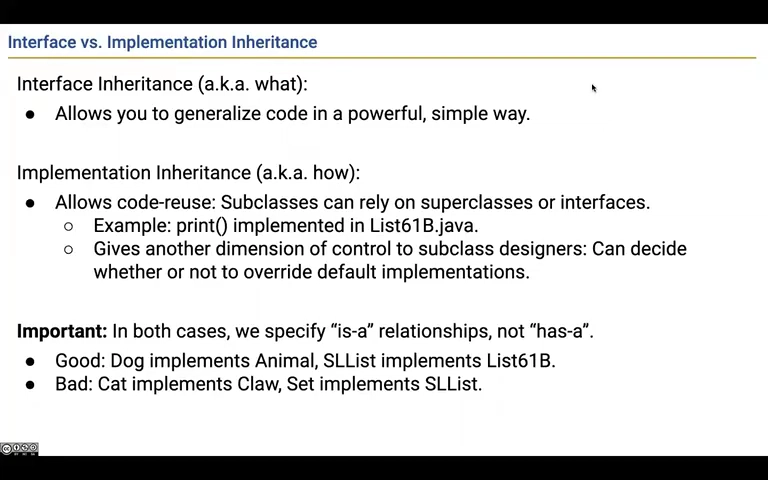 |
| [00:40](https://www.bilibili.com/video/BV1QP4y1u7jv/?p=28&t=40) 相比之下当我们添加默认关键字来编写默认打印方法时，该方法是实现继承所以我们要继承的是它告诉我们如何实现这个打印方法所以我们写了一个默认的打印方法，每个人都有s列表A名单他们都继承了打印方法所以这个打印方法被所有不同的类继承太棒了如果你愿意，你可以选择重写打印方法就像我们一样因为我们认为打印方法对s列表不是超级有效所以我们覆盖了它好啦这很重要今天晚些时候我会再给你看一点 | 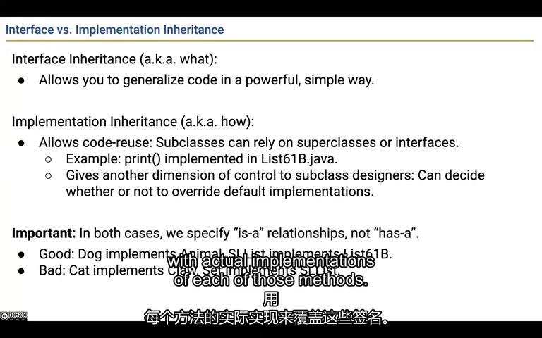 |
| [01:20](https://www.bilibili.com/video/BV1QP4y1u7jv/?p=28&t=80) 但上次就是这样所以今天我们继续谈论遗产 | 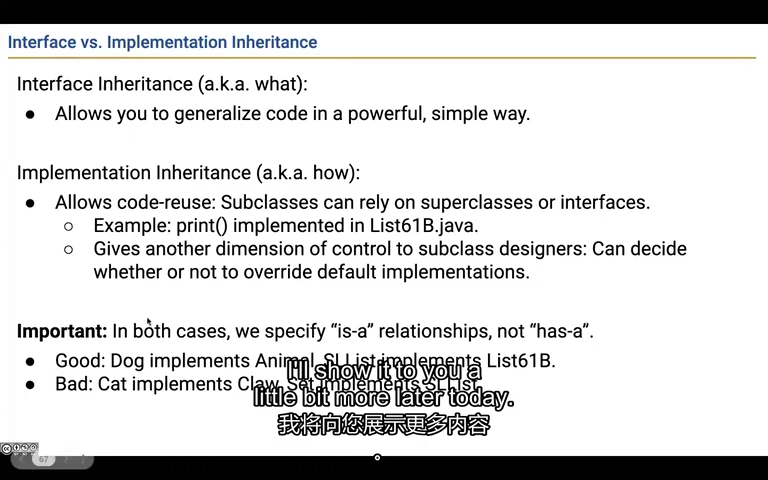 |
| [01:25](https://www.bilibili.com/video/BV1QP4y1u7jv/?p=28&t=85) 因此，我将首先向您展示第二个版本或不同版本的实现继承所以就像默认关键字一样从上次开始，我们将继承一个实现不仅仅是签名告诉我们名单应该做什么 | 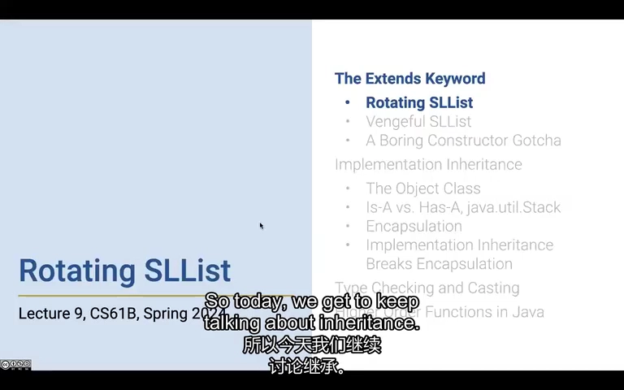 |
| [01:38](https://www.bilibili.com/video/BV1QP4y1u7jv/?p=28&t=98) 所以我们上次看到这个如果您有一个像listics db这样的接口它有所有这些方法签名告诉你列表应该可以先添加他们应该能够添加最后一个我说s列表实现列表x和b我要说的是S列表需要覆盖所有这些方法签署和实施清单61 b中的方法我们都在眨眼相比之下让我们试着建立一些不同的东西然后我会回来再解释这个光所以让我们试着建立一个叫做旋转s列表的东西什么是旋转的列表旋转的s列表就像s列表 | 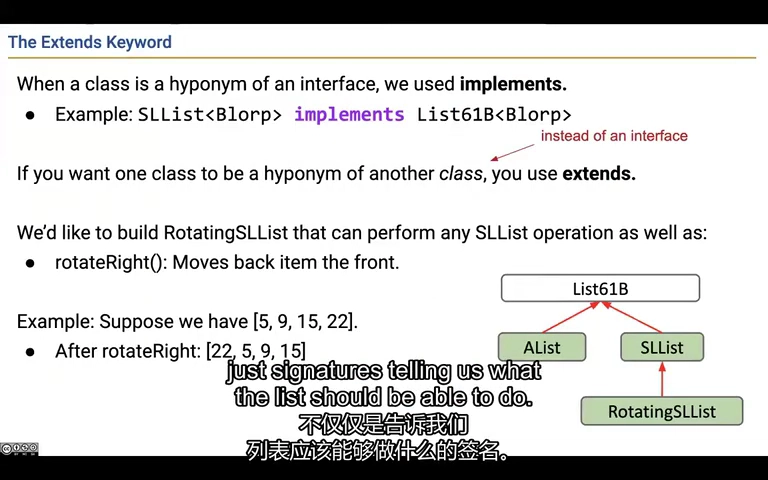 |
| [02:18](https://www.bilibili.com/video/BV1QP4y1u7jv/?p=28&t=138) 这是一张有正面和背面的物品清单它是可扩展的但不同的是旋转的列表它能做s列表能做的一切但它有一个额外的功能这就是所谓的向右旋转什么是正确的旋转意思是我拿一个清单，比如591522我把它向右旋转向右走五步右边的九级台阶右边的十五步然后22号一直旋转到前面这就是我想要的手术所以旋转的s列表就是s列表但它有一个额外的功能那么我如何实现这一点 | 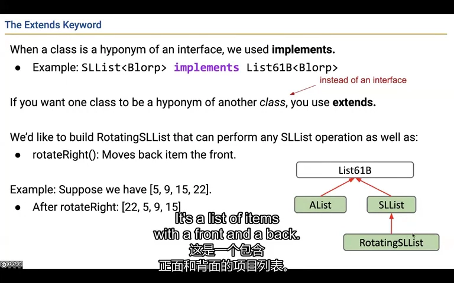 |
| [02:52](https://www.bilibili.com/video/BV1QP4y1u7jv/?p=28&t=172) 我可以把名单 | 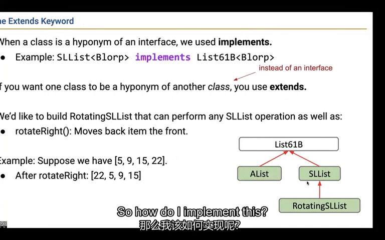 |
| [02:57](https://www.bilibili.com/video/BV1QP4y1u7jv/?p=28&t=177) 复制粘贴，然后添加新方法但这似乎有点恶心我不想复制粘贴所有的代码所以我要试着写一个新的类，叫做旋转列表并使用一点实现继承来看看我能做什么 | 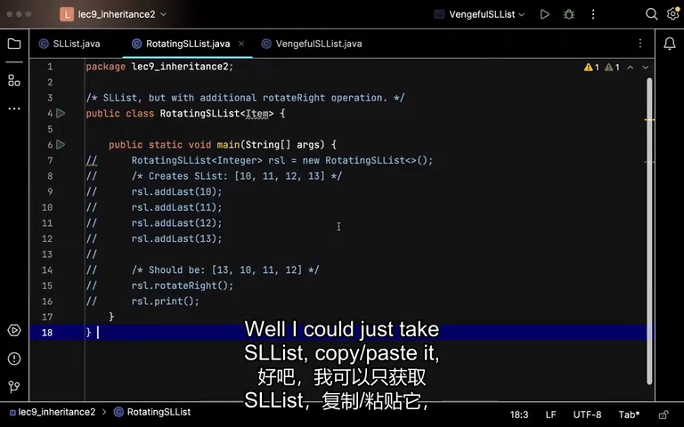 |
| [03:09](https://www.bilibili.com/video/BV1QP4y1u7jv/?p=28&t=189) 我不评论这个我马上就有了一些问题它说旋转的列表没有广告最后的方法 | 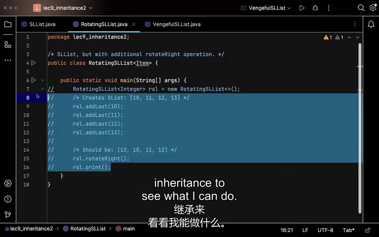 |
| [03:14](https://www.bilibili.com/video/BV1QP4y1u7jv/?p=28&t=194) 他们没有打印方法有点奇怪我以为旋转的单子是单子那么为什么他们没有这些方法呢？嗯原因是因为你我都知道轮流的名单但爪哇不知道所以我们得告诉爪哇所以要做到这一点我们要添加另一个神奇的关键字这次我们要写扩展然后我们要写旋转扩展列表很好所以现在我们已经告诉Java，旋转的s列表是s列表现在我们继承了s列表最后打印的所有方法其他的也是 | 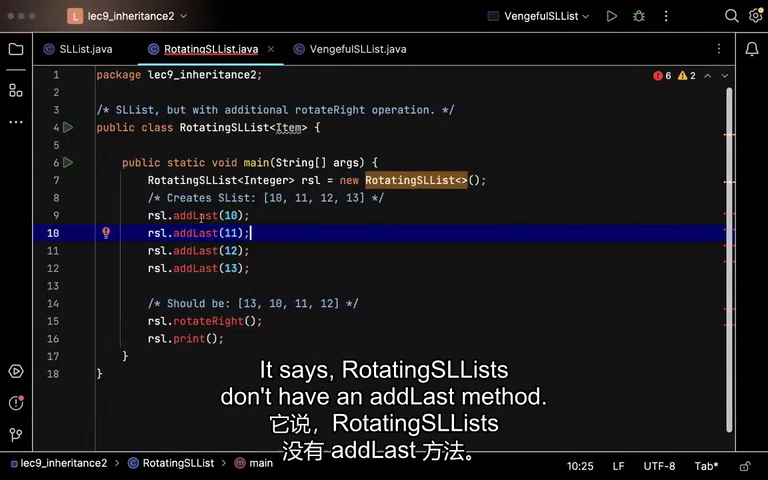 |
| [03:54](https://www.bilibili.com/video/BV1QP4y1u7jv/?p=28&t=234) 好的很好但Java仍在抱怨它说我不知道怎么旋转所以我们要写一个我们要写公共无效向右旋转好啦您可能会试图将重写就像我们上次做的那样但要小心但是向右旋转不覆盖来自父级的方法S名单没有旋转的权利这是新的所以我们要写一个新的旋转右方法所以我看起来你可以试着找到垫子这是一个有趣的小谜题那么我如何把这个列表我如何向右旋转盯着它什么似乎最快的解决办法是只要把最后的东西贴在前面就行了所以我要这么做我说x项等于最后一个什么允许我使用 | 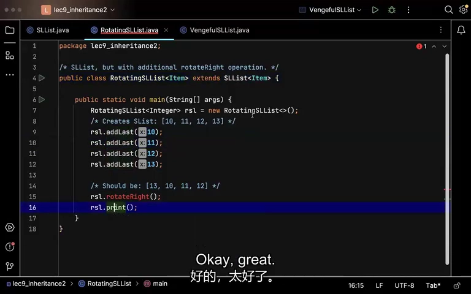 |
| [04:34](https://www.bilibili.com/video/BV1QP4y1u7jv/?p=28&t=274) 最后一个为什么没问题因为旋转的s列表是s列表它继承了s列表中的所有方法包括最后一名所以这没关系然后我先打电话也许在X上看起来不错所以我运行这个 | 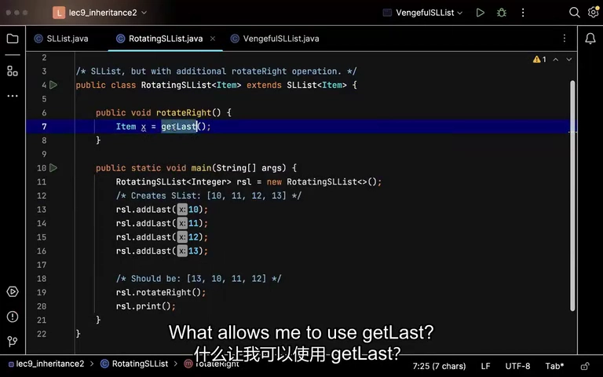 |
| [04:52](https://www.bilibili.com/video/BV1QP4y1u7jv/?p=28&t=292) 希望当我打印出旋转列表时我明白了，每个人都很高兴 | 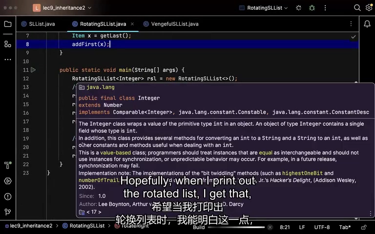 |
| [04:57](https://www.bilibili.com/video/BV1QP4y1u7jv/?p=28&t=297) 如果没有我们会有点头疼哼我该怎么办我应该打电话而不是最后一个但最后移除因为我想把最后的十三去掉好啦看现场调试美原来如此这是我的轮值名单 | 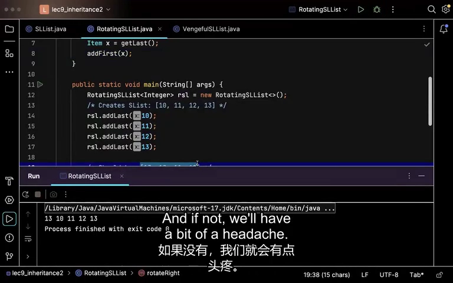 |
| [05:14](https://www.bilibili.com/video/BV1QP4y1u7jv/?p=28&t=314) 那么除了我不知道我的幻灯片去了哪里之外，我们还学到了什么好啦所以我们了解到，如果你想延长另一堂课 | 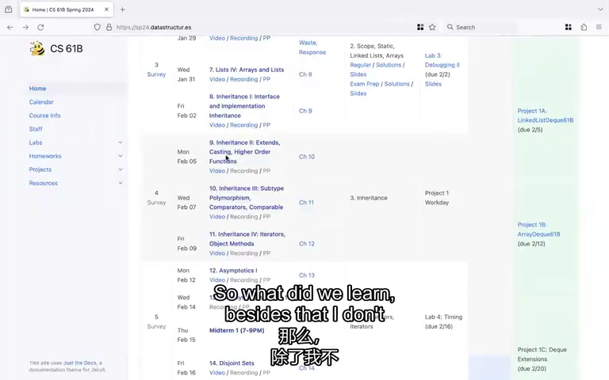 |
| [05:19](https://www.bilibili.com/video/BV1QP4y1u7jv/?p=28&t=319) 使用关键字extension那么这意味着什么呢为什么选择工具有时候你为什么选择扩展 | 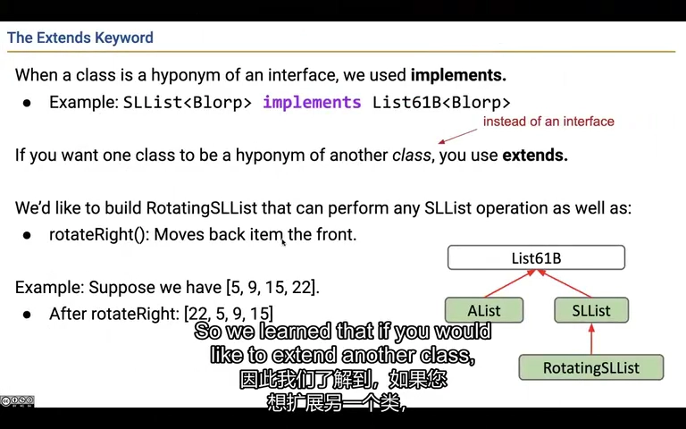 |
| [05:28](https://www.bilibili.com/video/BV1QP4y1u7jv/?p=28&t=328) 我的幻灯片在哪里好的那么如何判断何时要使用工具 | 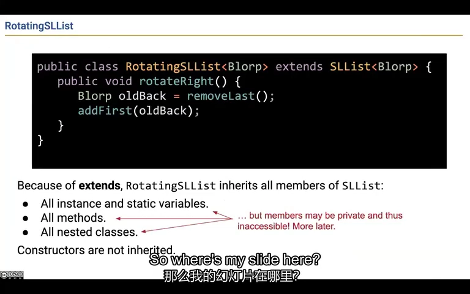 |
| [05:33](https://www.bilibili.com/video/BV1QP4y1u7jv/?p=28&t=333) 当您想使用扩展时事实证明，这不是一个真正的选择如果您有一个接口然后子类是类你得用工具这个词就像上次我们说过列表实现列表我们用工具这个词因为列表是一个接口所有那些空白的方法签名相比之下当我们说旋转的列表是列表的子类时这是一份名单S列表已经是一个类了所以我们用扩展这个词是超级有趣的吗不是真的但这是Java的琐事你想用哪一个所以你不必选择Java设计人员只是为这两种情况选择了不同的关键字但它们的意思是一样的也就是说你指定了这个超音节和次音节的关系 | 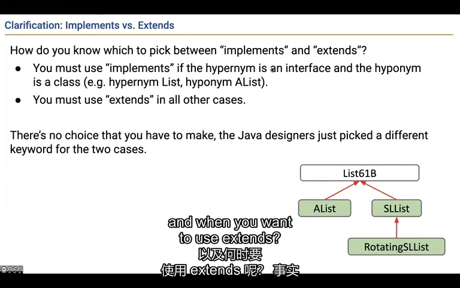 |
| [06:13](https://www.bilibili.com/video/BV1QP4y1u7jv/?p=28&t=373) 这就是我们的轮值名单 | 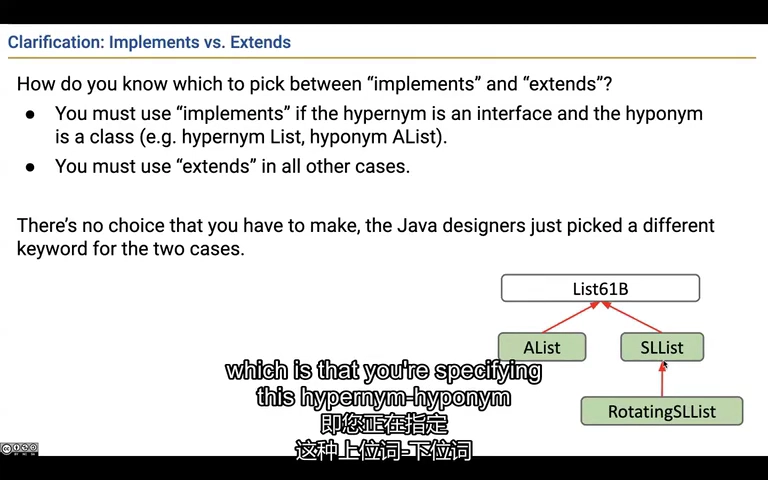 |
| [06:18](https://www.bilibili.com/video/BV1QP4y1u7jv/?p=28&t=378) 多亏了这个扩展关键字我们继承了s list的所有实现细节包括所有的实例变量，比如哨兵和我们继承的大小像这样的所有方法都将最后添加先移除不管我们继承了什么所有像Notes这样的嵌套类所以一切都继承了这是伟大的这意味着我们不必复制粘贴s列表中的所有内容问题 | 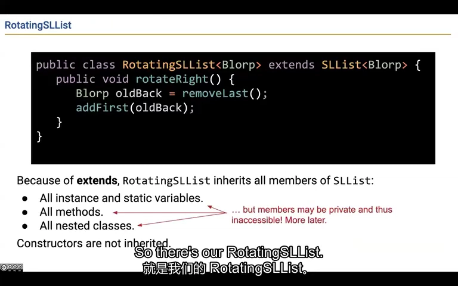 |
| [06:44](https://www.bilibili.com/video/BV1QP4y1u7jv/?p=28&t=404) 在我们做另一个问题之前，对旋转列表的思考 | 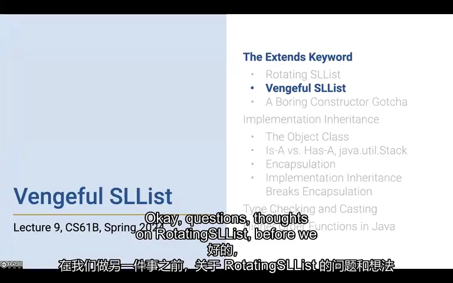 |
| [06:49](https://www.bilibili.com/video/BV1QP4y1u7jv/?p=28&t=409) 对不起你能说大声点吗是啊，是啊 | 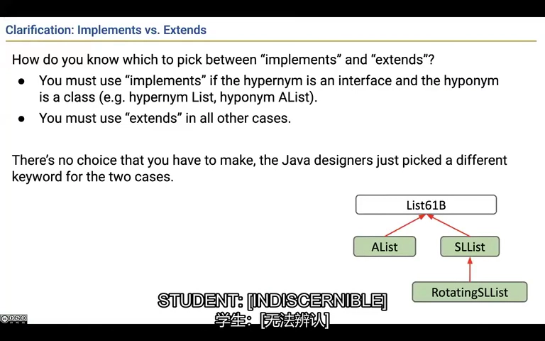 |
| [06:55](https://www.bilibili.com/video/BV1QP4y1u7jv/?p=28&t=415) 问题是嵌套类呢我想这是因为旋转的列表继承了节点嵌套类列表我说的问题就像你能把这个写在哦，我可以写这个吗 | 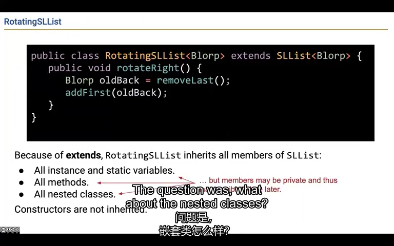 |
| [07:08](https://www.bilibili.com/video/BV1QP4y1u7jv/?p=28&t=428) 按列表旋转的类我相信答案是是呀好的好的所以我想你可以 | 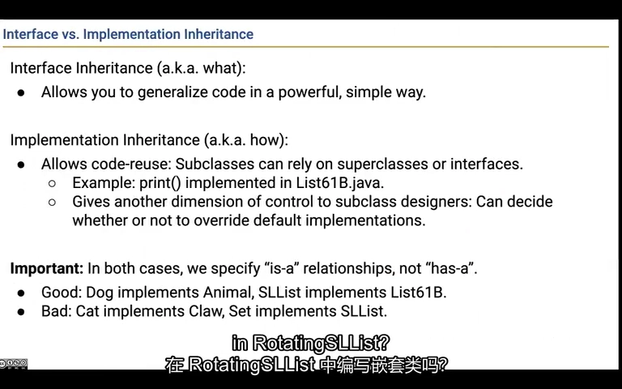 |
| [07:13](https://www.bilibili.com/video/BV1QP4y1u7jv/?p=28&t=433) 你以后可以试试如果你想但是哦在界面上我可以在接口中编写嵌套类吗我不知道我们以后再试试可能是因为是啊，是啊贾斯汀说你不应该因为它更像是一个实现细节接口应该指定什么但我不知道也许Java允许我们以后得试试这是个好问题尽管你难倒了我好啦再来一个我喜欢是啊，是啊这是个好问题所以问题是什么时候使用扩展和实现所以我不知道为什么Java设计人员选择有两个不同的关键字而不是一个 | 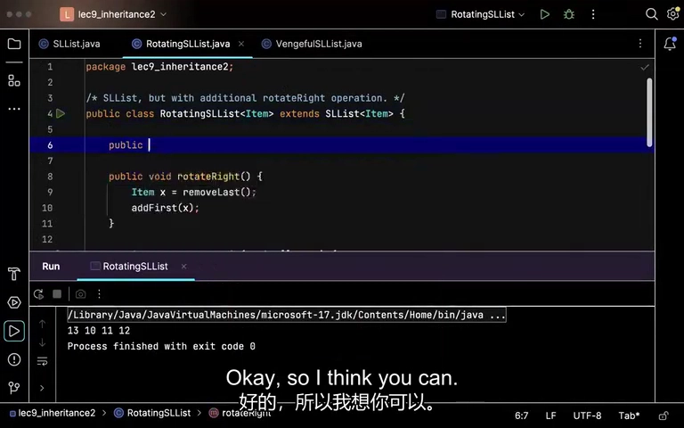 |
| [07:53](https://www.bilibili.com/video/BV1QP4y1u7jv/?p=28&t=473) 基本上，这个想法是，如果这里的东西是一个类然后写单词扩展如果这个东西是一个接口写工具这个词就是这样在这两种情况下，您都继承了父类问题中的内容是啊，是啊 | 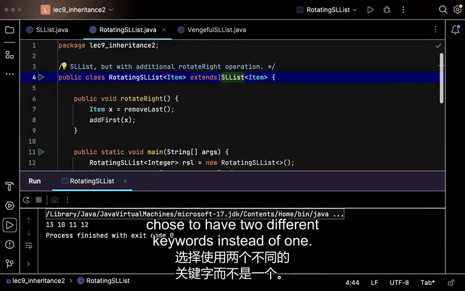 |
| [08:20](https://www.bilibili.com/video/BV1QP4y1u7jv/?p=28&t=500) 这是个好问题所以这是关于多代遗传很抱歉所有的标签所以问题是，因为旋转的s列表是一个s列表 | 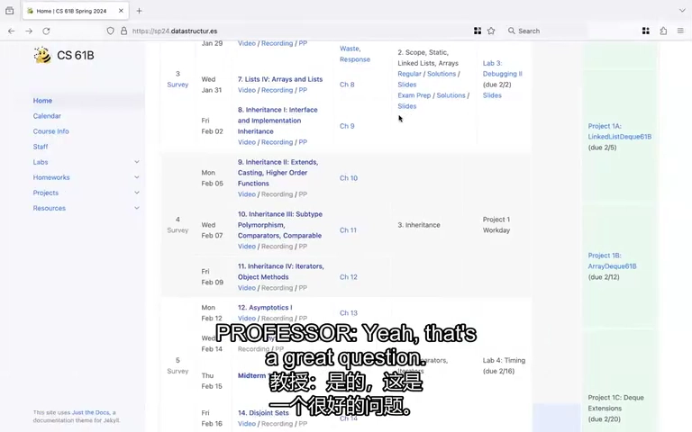 |
| [08:25](https://www.bilibili.com/video/BV1QP4y1u7jv/?p=28&t=505) 一份名单61 b你也得到了六二和B的方法吗我相信答案是肯定的事实上我认为我们使用的打印方法来自X和B很好的问题 | 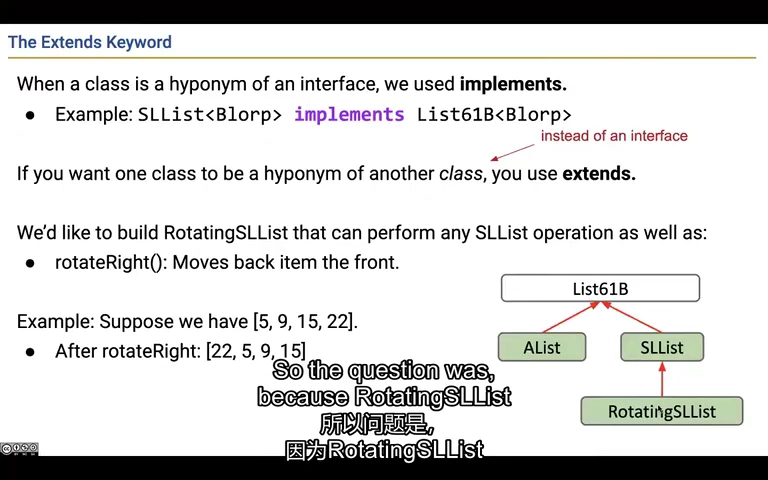 |
| [08:41](https://www.bilibili.com/video/BV1QP4y1u7jv/?p=28&t=521) 好玩这就是旋转的列表现在我想在这里再做一个 | 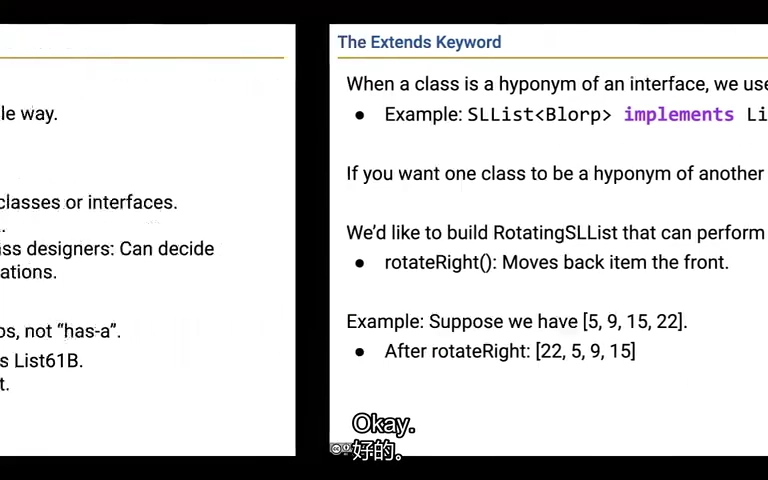 |
| [08:46](https://www.bilibili.com/video/BV1QP4y1u7jv/?p=28&t=526) 让我把这些拖来拖去所以我不喜欢一直在这些之间徘徊，让你头疼好啦 |  |
| [08:51](https://www.bilibili.com/video/BV1QP4y1u7jv/?p=28&t=531) 所以我们做了旋转列表我们再来一次这个将被称为复仇名单 | 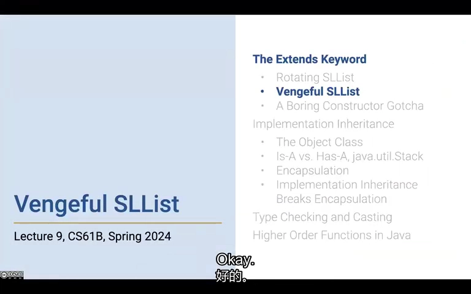 |
| [08:56](https://www.bilibili.com/video/BV1QP4y1u7jv/?p=28&t=536) 所以记住在一个常规的列表中如果从s列表中删除项S名单它真的不在乎它把物品扔掉再也见不到了但是发泄者的名单它记得你删除项目的任何时候腹侧列表将记住被删除的项目然后你可以让复仇清单打印所有丢失的物品它会告诉你删除了什么这是复仇者的名单它永远不会忘记这实际上并不有用但这是一个有趣的练习所以让我们做吧这是代码，就像以前一样 | 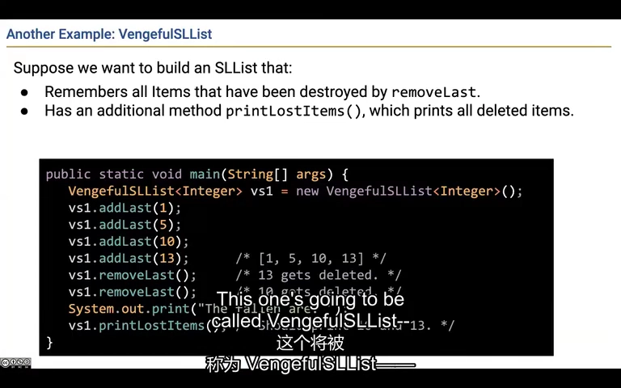 |
| [09:26](https://www.bilibili.com/video/BV1QP4y1u7jv/?p=28&t=566) 我们之前看到你在清单上添加了一堆东西如果你去掉十和十三丢失的东西是什么复仇名单应该告诉你我输了10次，输了13次 | 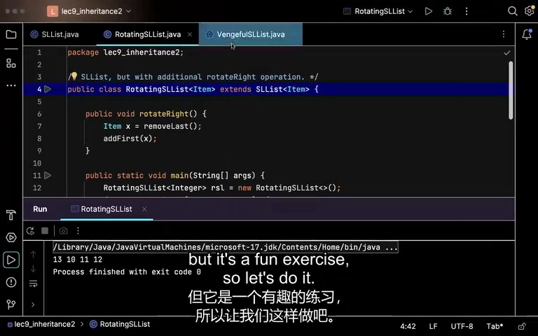 |
| [09:38](https://www.bilibili.com/video/BV1QP4y1u7jv/?p=28&t=578) 所以让我们试一试那不是我想要的 | 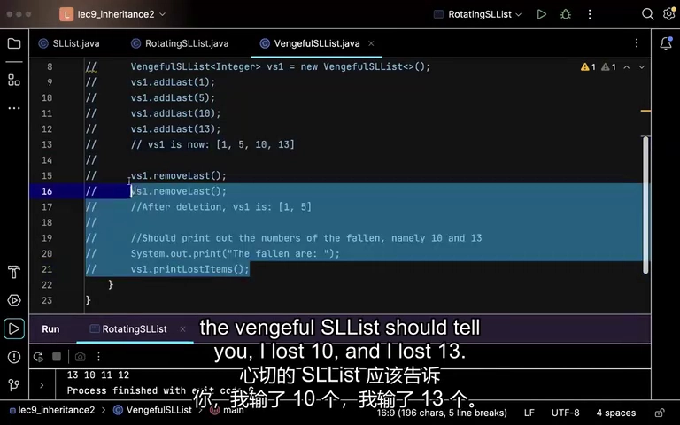 |
| [09:43](https://www.bilibili.com/video/BV1QP4y1u7jv/?p=28&t=583) 这也不是我想要发生的我再试一次 | 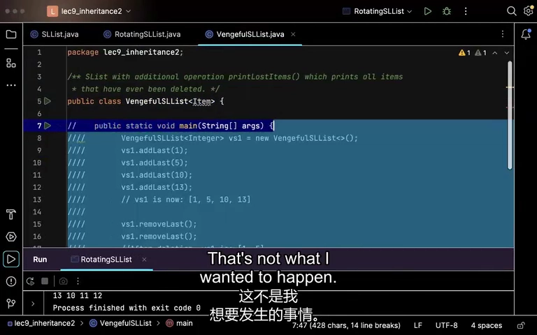 |
| [09:48](https://www.bilibili.com/video/BV1QP4y1u7jv/?p=28&t=588) 好啦那也不是我想要的好啦我们走吧所以我没有评论一切就像Java抱怨之前一样上面写着最终名单我不知道怎么加最后一个我不知道怎么一次又一次地移除同样的问题我们知道复仇清单是一种特殊类型的清单但爪哇不知道我们有关键字扩展我们说它扩展了一个s列表为什么我们要使用扩展因为s列表是一个类如果S更少是一个接口我会把工具这个词那是更多的琐事所以不要太担心所以不管怎样，到目前为止看起来不错但问题是我们不知道如何打印丢失的物品所以我们要写所以我会说公开无效 | 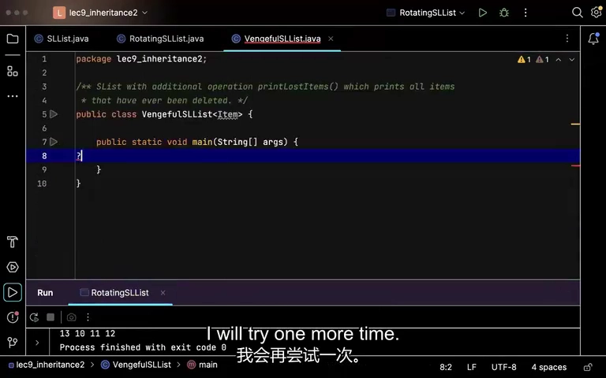 |
| [10:28](https://www.bilibili.com/video/BV1QP4y1u7jv/?p=28&t=628) 打印丢失的物品再一次你可能会想把我正在重写但记住这是新的我们不会推翻这一点那么我把什么这是个有趣的谜题所以一开始我想得很好我得有地方存放丢失的物品所以不知何故，每一个腹部的列表也许我要给腹侧的名单存放所有丢失物品的地方所以我会说丢失的物品每个复仇者的列表都有一个名为丢失物品的实例变量我要把所有丢失的东西都放在那里当有人让我打印丢失的物品时我把我的遗失物品清单我会把它打印出来 | 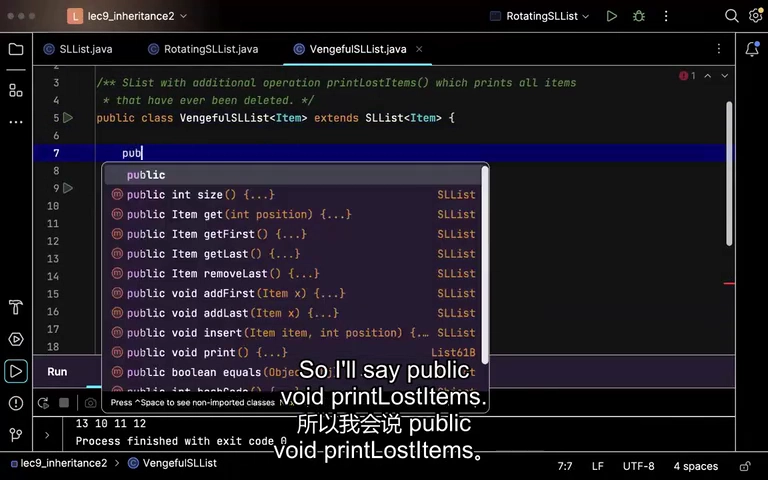 |
| [11:08](https://www.bilibili.com/video/BV1QP4y1u7jv/?p=28&t=668) 好的看起来不错但还有一个问题这就是我如何将东西添加到丢失物品列表中你可能会想你知道的开始在这里添加东西就像OV的一点定律集但请记住，我们希望复仇的名单自动记住每次你移除某样东西复仇的名单应该记住那么我该如何做好呢？也许我会做的是每次有人叫"最后行动"仅仅从列表中删除该项已经不够了我也想记住所以我要做的是我将重写前面的remove last方法的操作所以我会说超驰哎呀哎呀这也不是故意的我要覆盖什么 | 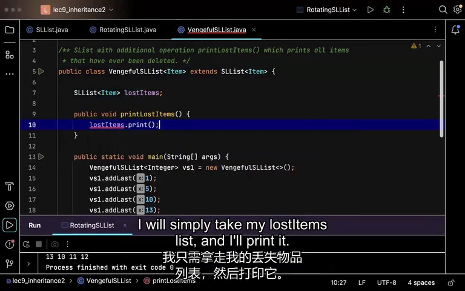 |
| [11:48](https://www.bilibili.com/video/BV1QP4y1u7jv/?p=28&t=708) 原来的删除最后一个方法是这样的我可以说最后移除是什么项目X，然后我可以重写但是啊哈什么是Java告诉我上面写着红色覆盖你没有凌驾为什么我没有凌驾因为那应该是项目所以重写这是一个很好的小提醒即使你在这里打错了字我帮你抓好了所以我要重写移除最后一个所以我看起来我想我怎么才能最后移除我如何覆盖它所以我不仅要移除一些东西但我也把它加到这个丢失物品列表中嗯让我试试如果我只是进入s列表呢我们上次写的 | 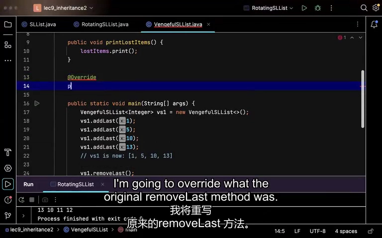 |
| [12:28](https://www.bilibili.com/video/BV1QP4y1u7jv/?p=28&t=748) 我去找最后一个好吧，那里你没事的我想我也错过了好啦现在它覆盖了很好所以也许我可以把这个 | 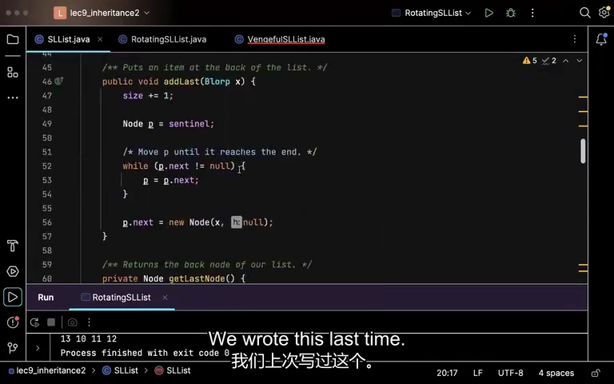 |
| [12:38](https://www.bilibili.com/video/BV1QP4y1u7jv/?p=28&t=758) 我就直接复制粘贴我会说好当我移除某样东西时我仍然希望所有这些事情发生 | 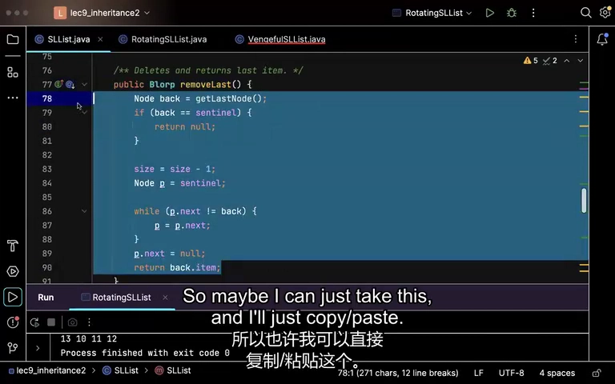 |
| [12:43](https://www.bilibili.com/video/BV1QP4y1u7jv/?p=28&t=763) 所以我就复制粘贴在这里然后添加更多的东西将新项目放入丢失项目列表但是Java在抱怨上面说哨兵可以大小有私人访问权限所以在Java中单词private的意思是非常私有，甚至您的子类都无法访问这些元素所以哨兵它定义了一个s列表即使复仇的名单是一个名单它有一个哨兵因为我们把它定义为私人的我们不能进入它大小也一样我们不能访问大小那我们该怎么办 | 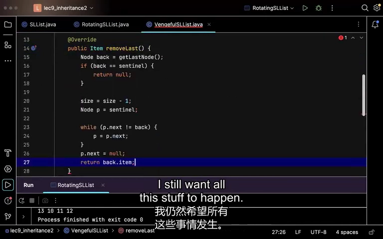 |
| [13:18](https://www.bilibili.com/video/BV1QP4y1u7jv/?p=28&t=798) 我还是希望所有这些代码都能运行但我不能复制粘贴因为很恶心私有关键字阻止您访问父类中的内容所以我要拿出另一个特殊的关键字也许你以前见过也许不是，我要把关键词拿出来 | 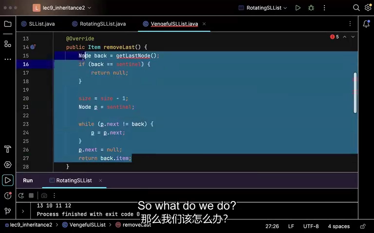 |
| [13:31](https://www.bilibili.com/video/BV1QP4y1u7jv/?p=28&t=811) 超级超级是做什么的它是对父对象的引用所以如果我说像超级点这样的东西，少移除然后我说去家长班 |  |
| [13:42](https://www.bilibili.com/video/BV1QP4y1u7jv/?p=28&t=822) 也就是S的名单有一个删除最后的方法在那里做那些事所以当我说超级点删除最后 | 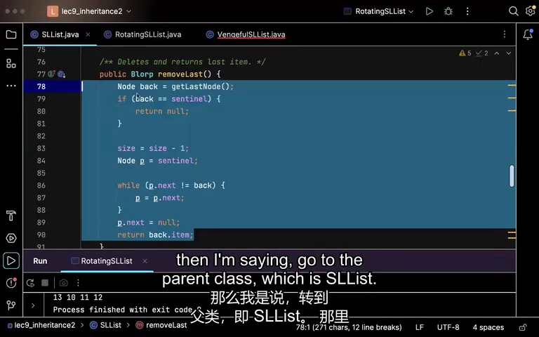 |
| [13:47](https://www.bilibili.com/video/BV1QP4y1u7jv/?p=28&t=827) 我要去家长班做这些事情那是一个特别的新关键字好吧，当我最后移除我还拿回了一件东西所以我会得到被移除的物品，我会去丢失的物品我会添加我刚刚删除的项目我还必须返回被删除的项目所以我也会这么做那是我最后一次搬家执行父类所做的一切还要多做一件事它是将删除的项目添加到丢失的项目列表中然后返回被删除的项好吧，看起来很好的问题思想也许我会运行它看会发生什么所以我期待着发现下面的项目是10和13 | 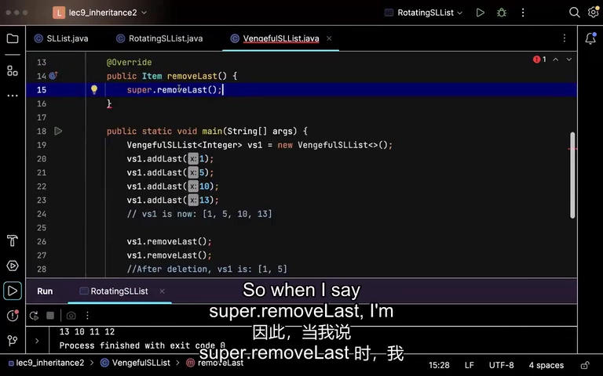 |
| [14:27](https://www.bilibili.com/video/BV1QP4y1u7jv/?p=28&t=867) 但是哈撞车了 | 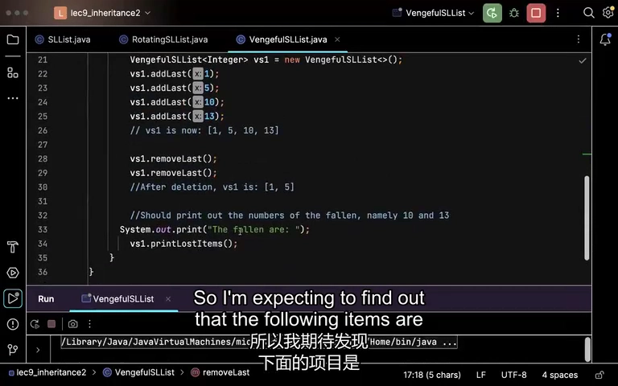 |
| [14:32](https://www.bilibili.com/video/BV1QP4y1u7jv/?p=28&t=872) 那么我该怎么做呢记住你知道专业61 B提示是当你看到像这样的错误消息时不要被诱惑只是立即复制粘贴在ED上，希望有人知道是对的也许我们应该通读一下，好好看看它说了一些关于空指针的东西所以也许在某个地方，我开始思考一些关于空的东西我一直在读上面写着啊丢失的物品无效为什么所有丢失的物品都是空的它甚至给了我一个链接上面写着到这里来第16行，我点击它上面写着丢失的物品为空您试图添加到一个从未实例化的列表中 | 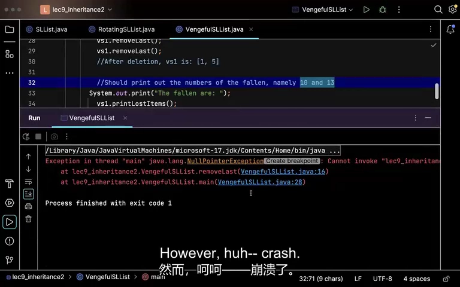 |
| [15:06](https://www.bilibili.com/video/BV1QP4y1u7jv/?p=28&t=906) 所以我看了错误信息，我就像啊尽管我在使用丢失的物品我从来没有真正创建过一个新的列表丢失的物品为空那里没有名单我需要使用new关键字创建一个实际的列表这样我就可以添加东西了那么我应该在哪里做呢在什么时候我应该创建一个全新的丢失物品列表嗯也许当我创建一个全新的复仇名单我还应该同时实例化丢失物品列表那么我在哪里做也许我会在构造函数中做还记得构造函数告诉我如何建立一个全新的复仇列表吗所以当我调用构造函数时我得到了一个全新的闪亮的复仇名单当我这么做的时候 | 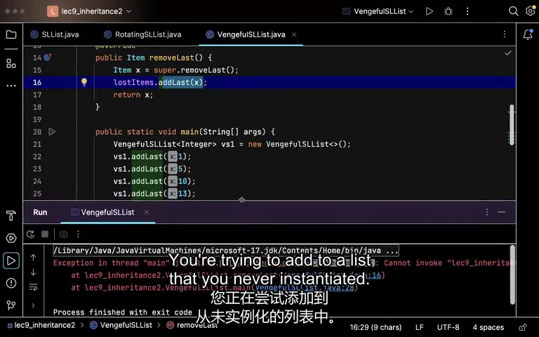 |
| [15:46](https://www.bilibili.com/video/BV1QP4y1u7jv/?p=28&t=946) 我实际上将实例化丢失的项目作为一个新的s列表好的很好我再试一次希望这次它能告诉我掉落的物品有十个它们是什么他们一个十岁，一个十三岁好啦十三岁和十岁够好了这是我的VS名单我重写了一个方法我用超级关键词 | 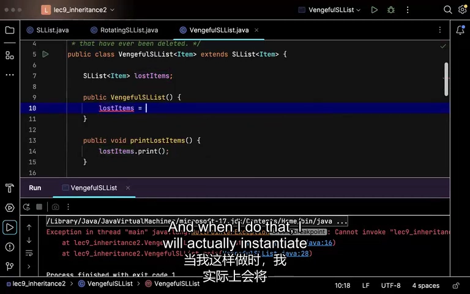 |
| [16:08](https://www.bilibili.com/video/BV1QP4y1u7jv/?p=28&t=968) 那不是我想要的好啦原来如此 | 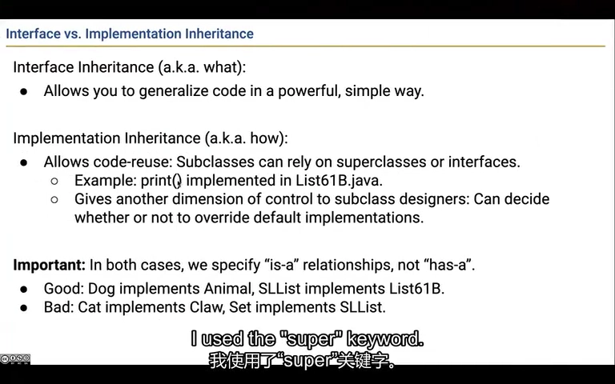 |
| [16:13](https://www.bilibili.com/video/BV1QP4y1u7jv/?p=28&t=973) 我用了特殊的关键字super这叫做超级班删除最后的s较少版本然后我做了一些额外的东西 | 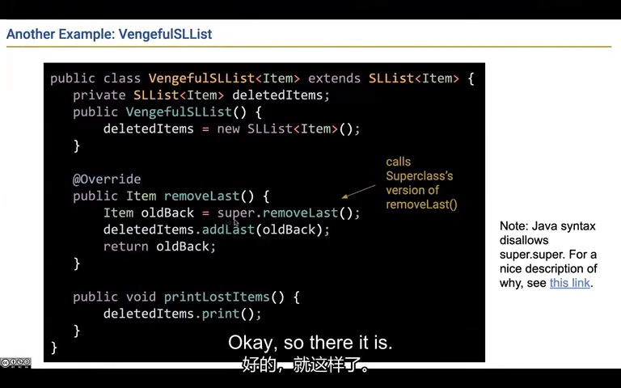 |
| [16:21](https://www.bilibili.com/video/BV1QP4y1u7jv/?p=28&t=981) 好极了所以根据乔希的说法谁做的幻灯片有点无聊 |  |
| [16:27](https://www.bilibili.com/video/BV1QP4y1u7jv/?p=28&t=987) 但它会把你弄得一团糟有时候所以我们得谈谈所以当你编写这样的构造函数时Java规则是，您还将调用超类构造函数 |  |
| [16:39](https://www.bilibili.com/video/BV1QP4y1u7jv/?p=28&t=999) 这到底是什么意思所以让我们做一些调试来弄清楚发生了什么所以我要在构造函数上设置一个断点我称之为新复仇名单因为我想看看会发生什么所以我要打电话我要运行调试器我就停在这条线上很好现在我可以跨过去了但如果我跨过我没机会看到里面有趣的东西复仇的列表构造函数我想看无聊的东西所以我要进入复仇列表构造函数在这里我们没有什么大惊喜我们在复仇的列表构造函数中但如果我再走一步下一部分可能有点令人惊讶你可能会期望很好我在这里如果我不应该 |  |
| [17:19](https://www.bilibili.com/video/BV1QP4y1u7jv/?p=28&t=1039) 我在下一条线上嗯也许，但如果我一步啊哈我发现自己在s列表构造函数中s列表构造函数是什么做它将大小设置为零它设置了哨兵然后它又回到了复仇的名单上在那里我完成了所有复仇的清单然后我完成了有趣的构造函数所以刚刚发生的是，每次调用复仇列表构造函数 |  |
| [17:41](https://www.bilibili.com/video/BV1QP4y1u7jv/?p=28&t=1061) （此区间无字幕） |  |
| [17:46](https://www.bilibili.com/video/BV1QP4y1u7jv/?p=28&t=1066) 您实际上还将调用超类的列表构造函数这是有道理的这是个好主意因为如果每一个复仇者的名单都是他们的名单那么每个复仇者的列表也应该有与s列表相同的设置那很好想象一下如果我们不调用s列表构造函数然后我们会忘记设置尺寸，这将是不好的我们会忘记设置哨兵，这也是不好的所以这是一件好事当我建立复仇名单时Java记得很清楚复仇的清单就是清单所以我最好也去把所有的东西都准备好你甚至可以把这一点说得很清楚 |  |
| [18:24](https://www.bilibili.com/video/BV1QP4y1u7jv/?p=28&t=1104) 因此，如果您真的想让代码的读者知道我正在调用超类构造函数 |  |
| [18:29](https://www.bilibili.com/video/BV1QP4y1u7jv/?p=28&t=1109) 然后您可以添加额外的行太棒了，这就是我们刚才看到的也就是它将调用超类构造函数所以这和以前一样我甚至可以给你看这样我就可以介入当我打电话给超级它把我带到s list构造函数一切都很好因为这是正确设置的然后我可以设置丢失的物品但即使我没有把超级关键字Java的棘手之处在于如果你不把这个关键字Java仍然会隐式调用父类构造函数，而不会告诉您即使我这里没有这条线我们还是要打电话给名单父类构造函数那是件好事我们想要那个 |  |
| [19:09](https://www.bilibili.com/video/BV1QP4y1u7jv/?p=28&t=1149) 这就是这张幻灯片哦，我一直搞砸了好啦我把这些调换一下 |  |
| [19:14](https://www.bilibili.com/video/BV1QP4y1u7jv/?p=28&t=1154) 就是这张幻灯片它基本上说这些是一样的不管你是否放了超级关键词好啦但这里有一个有点棘手的部分 |  |
| [19:21](https://www.bilibili.com/video/BV1QP4y1u7jv/?p=28&t=1161) 也就是说，你实际上可以有多个构造函数当我们建立S列表时我们看到了这个 |  |
| [19:26](https://www.bilibili.com/video/BV1QP4y1u7jv/?p=28&t=1166) 记住s列表有两个建造者其中一个没有争论做了一个空列表其中一个拿了一个论点 |  |
| [19:32](https://www.bilibili.com/video/BV1QP4y1u7jv/?p=28&t=1172) 用一个项目列了一个清单如果我想在复仇清单上做同样的事情呢我就像我要有第二个复仇清单构造函数 |  |
| [19:42](https://www.bilibili.com/video/BV1QP4y1u7jv/?p=28&t=1182) 这一个将接受一个单一的项目所以嘿也许我会加一个评论创建一个空的复仇者列表好吧，然后这个它是做什么的它创建了一个复仇清单也就是X看起来很棒所以我可以试着做同样的事情也就是啊也许我会把这个我只希望它隐式地调用父构造函数就像我们之前看到的也许如果我来到这里，我创建一个新的清单，里面有一些项目所以我希望调用正确的构造函数所以我会一遍又一遍地调试我知道这不是最令人兴奋的话题但它现在会把你搞砸的所以仔细检查一下是很好的 |  |
| [20:22](https://www.bilibili.com/video/BV1QP4y1u7jv/?p=28&t=1222) 所以我发现自己，我发现自己在新的构造器只有一件东西的那个因为我想用一个新项目建立一个S列表但这个过程有点奇怪当我走进去就像Java会自动为我调用构造函数一样对呀它将建立s列表但我一步和呃哎呦我在错误的构造器中这里的关键技巧是会把你搞得一团糟的是 |  |
| [20:45](https://www.bilibili.com/video/BV1QP4y1u7jv/?p=28&t=1245) 如果您不将呼叫写入Super Java将隐式调用默认构造函数哪一个是没有争论的所以如果你做了这样的事情你没有明确的说Super Java将假设您想要没有参数的构造函数在这种情况下，这是不好的 |  |
| [21:02](https://www.bilibili.com/video/BV1QP4y1u7jv/?p=28&t=1262) 我试着用一个项目来建立一个复仇清单但当我设置s列表时我正在使用糟糕的零项构造函数我不想要它，所以要修好它我需要明确地调用超级通过传递一个论点X现在java知道了啊您希望构造函数具有一个参数因为您想用一个参数设置一个s列表所以我介入我介入哎呀哎呀我再做一次我向你保证无聊的部分快结束了好啦所以我介入我踏入超级现在因为我用一个参数明确地调用了Super |  |
| [21:33](https://www.bilibili.com/video/BV1QP4y1u7jv/?p=28&t=1293) 我来对地方了好吧再来一次 |  |
| [21:38](https://www.bilibili.com/video/BV1QP4y1u7jv/?p=28&t=1298) 我知道这很无聊但它可能会撕裂你有时质疑那么为什么会这样呢为什么他们为什么的是啊，是啊问题是我为什么不能打电话为什么Java不能只是被设计这样它就会调用父级并用一个变量构造但问题是Java怎么知道你想做什么你看着我你还有什么要补充的吗好啦好啦只是在看书是啊，是啊所以这里的问题是Java不知道该调用哪一个也许在这种情况下，当我们写s列表的时候你我都能看出来但对于Java来说没有办法总是试图猜测程序员想要哪个构造函数 |  |
| [22:18](https://www.bilibili.com/video/BV1QP4y1u7jv/?p=28&t=1338) 所以它所能做的就是默认为no参数构造函数如果你想要一个不同的你得明明白白地说是啊，是啊这是个好问题有什么大问题吗任何关于变焦的东西 |  |
| [22:33](https://www.bilibili.com/video/BV1QP4y1u7jv/?p=28&t=1353) 好的，好的别再做无聊的事了所以我们讨论了扩展这是一种新型的实现继承所以在今天剩下的时间里，我们要变得富有哲理，开始谈论你如何您觉得实现继承怎么样你喜欢吗你不喜欢吗你对此有什么看法？所以让我们来反思一下 |  |
| [22:49](https://www.bilibili.com/video/BV1QP4y1u7jv/?p=28&t=1369) 并在此过程中讨论一些额外的继承特性一件很酷的事情是记住在第一节课中我们说过Java是一个非常面向对象的程序它真正关心对象和类，并迫使您面向对象嗯事实证明，对象在Java中是如此重要，以至于你定义的每一个类狗它少S名单海象您定义的每个类实际上都是对象类的子类这是烘焙成Java的它从Java一个零开始就在那里了所以即使你宣布了一个新的类，就像我们做的公共类一样 |  |
| [23:29](https://www.bilibili.com/video/BV1QP4y1u7jv/?p=28&t=1409) 早期讲座中的一只狗即使我们没有说狗扩展对象，它仍然扩展对象因此，您编写的每个类都将始终隐式地是对象的子类即使你不说延伸对象的话那么这意味着什么呢嗯这意味着因为每个人都是对象的后代或子类这意味着每个人都继承了对象定义的方法所以方法中的任何对象它们将被继承到我写的每一个类中那么对象的方法是什么呢 |  |
| [24:04](https://www.bilibili.com/video/BV1QP4y1u7jv/?p=28&t=1444) 我们去看看以下是对象的方法因为Object有所有这些方法对象的所有后代也将具有这些方法所以你做了一只狗即使你不定义任何方法它有所有这些方法你做了一只海象海象在这个类中有所有这些方法我们来谈谈其中的三个剩下的这些至少在这门课上我们不在乎但要知道他们的存在显然，其中一些也像滑稽过时但Java就是这样我想他们在里面，我们无法摆脱他们哦太好了 |  |
| [24:39](https://www.bilibili.com/video/BV1QP4y1u7jv/?p=28&t=1479) 这就是对象类所以现在我们要变得更有哲理一点记住我们一遍又一遍地说的话 |  |
| [24:44](https://www.bilibili.com/video/BV1QP4y1u7jv/?p=28&t=1484) 我甚至用滑稽夸张的方式说，让你记住每次我们使用扩展或工具我们创造了这些继承关系我们正在创造这是一种关系所以s列表是一个列表或者狗是动物那些很好我们喜欢那些这些是我们应该使用继承的方式但一个很常见的错误尤其是如果你是第一次看到这个尝试用继承来处理那是不好的所以您不想将继承用于有关系 |  |
| [25:18](https://www.bilibili.com/video/BV1QP4y1u7jv/?p=28&t=1518) 这就是我们之前看到的危险所以狗是一种很好的动物 |  |
| [25:23](https://www.bilibili.com/video/BV1QP4y1u7jv/?p=28&t=1523) 我们喜欢S列表是一个列表X mv那很好这些都是使用继承的好方法一个不好的例子就好了猫有爪子那倒是真的猫有爪子但猫不是爪子所以你不想说像猫具爪之类的话因为猫不是爪子，你看着这个，你就像我为什么要做像猫是爪子这样的事我为什么要说那样的话 |  |
| [25:47](https://www.bilibili.com/video/BV1QP4y1u7jv/?p=28&t=1547) 但这里有一个我认为更现实的例子以及人们经常陷入的那么这一套是什么呢我们还没有谈太多可能是在家庭作业里零B什么的但这是一套这是一个无序的项目集合所以这是一大堆东西他们没有命令而且里面没有复制品所以如果我创建一个集合我说加入土豆加入土豆加入土豆它只会有一份土豆这就是布景这是一堆有序的物品所以你可以说一个s列表有一个s或对不起集合有一个s列表那很好我们喜欢那样因为你可以说我如何做好一套 |  |
| [26:27](https://www.bilibili.com/video/BV1QP4y1u7jv/?p=28&t=1587) 我可以用一个列表来表示集合当我添加东西时我去查查有没有好的副本我可以使用列表来实现我的集合但如果你说集合就是列表你说集合扩展列表嗯突然间这有点糟糕现在你说一个集合就是一个列表因为集合是一个列表这意味着集合继承列表的所有方法那么名单上有什么它有像gei一样的东西来得到ith项目如果你说集合就是列表突然间，集合有了一个get方法这真的说不通你怎么能得到一套中的第五件事这是一套没有命令所以你知道要用强硬的话这是可憎的这不是您希望使用继承的方式 |  |
| [27:07](https://www.bilibili.com/video/BV1QP4y1u7jv/?p=28&t=1627) 它会导致您的代码非常奇怪因为现在记住它的集合对象是一堆无序的项目现在它突然有了这样的get item方法，这真的没有意义所以最好说一个集合被实现了使用s列表您完全可以使用s列表来构建集合但是说集合是s列表是没有意义的 |  |
| [27:30](https://www.bilibili.com/video/BV1QP4y1u7jv/?p=28&t=1650) 这里有另一个例子这个实际上出现在Java中所以我将向您展示另一个数据结构它叫做堆栈堆栈应该是超级简单的这是一个漂亮的数据结构它以许多有趣的方式融入了计算机科学理论我们不会谈论的但基本上堆栈背后的想法是从堆栈中只能做两件事你可以把东西推到堆栈的顶部例如，我在堆栈上按6我把两个推到堆栈上我也可以从堆栈的顶部弹出东西所以我可以弹出两个，它就不见了我可以弹出六个，它就不见了令人惊叹的动画好啦这就是堆栈的操作超级简单你推动事情你爆东西就这样了 |  |
| [28:10](https://www.bilibili.com/video/BV1QP4y1u7jv/?p=28&t=1690) 堆栈不应该做任何其他事情但是当Java设计者在Java库中编写默认堆栈实现时他们犯了一个大错误 |  |
| [28:19](https://www.bilibili.com/video/BV1QP4y1u7jv/?p=28&t=1699) 这很好他们说堆栈是一个列表所以他们说Stack扩展了一些实现列表的东西所以他们说的是一个堆栈就是一个列表这意味着列表最初得到的所有操作首先在最后插入特定项目列表中的所有方法它们都被继承到一个堆栈中即使堆栈被认为是一个超级简单的数据结构你推你爸爸但是因为我们说过堆栈是一个列表突然间，我们继承了所有这些我们真的不想要的方法 |  |
| [28:56](https://www.bilibili.com/video/BV1QP4y1u7jv/?p=28&t=1736) 这将是很好的如果您想说堆栈有一个列表真漂亮堆栈有一个列表所以这是我的堆栈我有一个私有实例变量调用项这是一张名单我可以用这个列表来存储我的物品当我推当我弹出这真漂亮很简单当用户尝试与堆栈交互时你所能做的就是推推搡搡在里面，我们秘密地使用一个完全没问题的列表堆栈有一个与数据的链表但是堆栈不是链表这太棒了这是我的一叠这是一个很好的小指甲剪，只有几种方法但这就是危险如果你说堆栈是一个链表您将继承列表的所有方法 |  |
| [29:36](https://www.bilibili.com/video/BV1QP4y1u7jv/?p=28&t=1776) 所以与其用这个漂亮的指甲剪你有这种可憎的东西 |  |
| [29:41](https://www.bilibili.com/video/BV1QP4y1u7jv/?p=28&t=1781) 突然间，堆栈有了推弹出但它也有类似的包含保险容量插入内容这不是一个有用的数据结构应该很简单的但你继承了所有这些你不想要的方法所以现在就像如果你在编码和智能智能自动完成要开始了暗示各种你可能不想要的东西它会说你有一堆你应该能推来推去但智能汽车会提示堆栈不应该有的各种东西这不再是一个很好的数据结构所以我觉得这种很讨厌如果您使用的是实现继承你得非常小心 |  |
| [30:21](https://www.bilibili.com/video/BV1QP4y1u7jv/?p=28&t=1821) 是一种关系而不是一种关系 |  |
| [30:26](https://www.bilibili.com/video/BV1QP4y1u7jv/?p=28&t=1826) 所以这是实现继承要注意的一个危险但这里还有一个这个也是非常哲学和高水平的所以我们将讨论一个叫做封装的想法然后我们将考虑它如何与实现继承交互以一种有趣的方式 |  |
| [30:42](https://www.bilibili.com/video/BV1QP4y1u7jv/?p=28&t=1842) 封装到底是什么所以说封装我得从这个小咆哮开始也就是说，在61年，或者在生活中，当你建立大型程序时敌人不是编程语言对吧不是Java中的分号使程序变得困难但它的复杂性换句话说你建立的更大的程序如果你必须同时把所有的事情都留在你的大脑里你会有一段悲伤的时光这对人类来说太多了所以为了有效地构建大型项目为了成为一名优秀的程序员我们真正希望你们从这门课上学到的是管理复杂性那么你是怎么做到的呢我们已经讨论了几个重要的想法 |  |
| [31:22](https://www.bilibili.com/video/BV1QP4y1u7jv/?p=28&t=1882) 所以我们谈到的一个是抽象层所以如果我是在车里操作的人我不必担心燃料如何从油箱到发动机我不在乎我在乎的是公众的方法花瓣方向盘所以我们讨论了抽象层我们实施了这些抽象障碍我们说如果你想与一个物体交互您与对象交互使用公共方法您并不关心实现实际设计的私人方式所以我们隐藏了人们不需要的信息这是件好事因为通过隐藏信息，它使这个对象更容易使用我们可以建立这个很好的模块化程序 |  |
| [32:02](https://www.bilibili.com/video/BV1QP4y1u7jv/?p=28&t=1922) 在那里我们可以拥有所有这些超级复杂的物体但它们都有这些简单的方式与它们互动所以我们可以用它们来构建大型复杂的系统，这些系统可以很好地相互作用这就是六十一的主题这就是如何有效地构建大型程序 |  |
| [32:17](https://www.bilibili.com/video/BV1QP4y1u7jv/?p=28&t=1937) 那么这如何很好地与封装的想法联系起来呢封装这个术语是说如果您有一个对象，并且实现是完全隐藏的这是您可以与此对象交互的唯一方法，即通过接口或者这组公开的方法然后我们说这个模块或这个对象被封装这个阵列甲板我不知道里面发生了什么了解数组甲板或与之交互的唯一方法是调用添加最后一个拆下鞋楦和尺寸就这样，我不能以任何其他方式与数组甲板交互形状或形式所以阵列甲板是封装的这是件好事 |  |
| [32:57](https://www.bilibili.com/video/BV1QP4y1u7jv/?p=28&t=1977) 我喜欢这样这里有一个例子 |  |
| [33:02](https://www.bilibili.com/video/BV1QP4y1u7jv/?p=28&t=1982) 也许这听起来很耳熟我想不再是额外的学分了任务有点变化但这里有一些学生过去常问的问题所以记得在项目一中你得测试你的甲板所以学生们会问一些事情就像我试图在调整大小的方法中找到一个bug但我不知道怎么看数组甲板的长度我试着调用数组甲板的长度但那不管用那么我如何知道底层数组有多大或者我想测试调整大小是否有效 |  |
| [33:27](https://www.bilibili.com/video/BV1QP4y1u7jv/?p=28&t=2007) 我想调用底层项目数组的长度但编译器对我大喊大叫，说这是私人的有什么办法可以解决这个问题吗？或者我们不应该测试它或者我可以假设数组甲板上的下一个战线是四个下一个最后一个是五个起始数组大小为8所以所有这些问题的问题他们在错误的抽象层次上工作记住，雷达板是封装的换句话说我们不在乎内部如何运作我们所关心的是，当我们一开始调用数组甲板的方法时先移除他们的行为方式符合我们的模型所以当你试图测试私有方法时看看里面发生了什么 |  |
| [34:07](https://www.bilibili.com/video/BV1QP4y1u7jv/?p=28&t=2047) 你在错误的抽象层次上工作例如当我们写自动分级器时我们不知道你是怎么写你的甲板的您可以使用一个数组出于某种原因，您可以使用五个数组但重要的是我们只是用公共的方法来检查你的阵列甲板是否在做它应该做的事情以符合我们期望的方式行事所以也许用一点类比也许如果你去看医生，医生正试图弄清楚如果你病了嗯医生是做什么的医生想问你问题比如你感觉怎么样你知道的有什么奇怪的吗你头痛吗？但医生不会走过去问你你能告诉我你知道 |  |
| [34:47](https://www.bilibili.com/video/BV1QP4y1u7jv/?p=28&t=2087) 你的心脏把血液输送到你的血管里对呀就像这是在较低的抽象层次上工作一样比你想象的要多否则医生不能去找你说“好”你知道的让我就像我不知道是你的你知道就像你手指里的骨头我不知道它有几个关节就像它在较低的抽象层次上工作一样我们并不真正关心人是如何被实施的我们只关心公共方法我们与人互动的方式对不起如果这有点奇怪所以无论如何所有这些都是说封装是一个很好的想法 |  |
| [35:21](https://www.bilibili.com/video/BV1QP4y1u7jv/?p=28&t=2121) 我要一次又一次地把这张照片带回来这个想法是，如果我们试图测试你的阵列甲板是否有效我们所关心的我们是山洞里的人我们所关心的是当我们与这些物体交互时就像我们应该射杀那只鸟或者像我们给马挠痒痒一样我们关心的是木偶戏我们所期待的我们可以翻过墙开始问僧侣们问题但这打破了抽象的障碍我们不想那样做我们希望这个类被封装就是这个意思这也是为什么Java是如此伟大的语言为了一堂课就像60和B因为您可以在类中使用封装或者用Python这样的语言但是Java的伟大之处在于Java只提供封装 |  |
| [36:01](https://www.bilibili.com/video/BV1QP4y1u7jv/?p=28&t=2161) 更多的牙齿因为如果你在Java中使用封装嗯Java有这个私有关键字，而私有关键字强制这面墙是绝对的如果声明变量为私有您无法访问它这是一件美好的事情意思是当有人试图使用你的数组时他们只需要担心这些方法太棒了好啦那我为什么要告诉你这些 |  |
| [36:22](https://www.bilibili.com/video/BV1QP4y1u7jv/?p=28&t=2182) 我们谈到了封装太棒了private关键字允许编译器真正强制封装 |  |
| [36:31](https://www.bilibili.com/video/BV1QP4y1u7jv/?p=28&t=2191) 但是这如何处理实现继承呢这两件事是如何相互作用的所以要演示这个 |  |
| [36:36](https://www.bilibili.com/video/BV1QP4y1u7jv/?p=28&t=2196) 我给你举个例子例如这是狗课所以也许有人实施了这个有一种叫的方法有一个树皮迷你方法所以树皮方法叫树皮，树皮迷你方法取决于用户在调用中传递的结束多次吠叫好的很好但是如果实施狗的人决定改变这些呢他们说其实呢我喜欢树皮在这里的想法当你叫巴克的时候你应该叫树皮小一号这工作完全一样的权利习惯了一样任何时候你叫巴克刹车马尼你应该得到同样的行为使用您的代码的人应该永远无法查看内部并查看您的实现 |  |
| [37:16](https://www.bilibili.com/video/BV1QP4y1u7jv/?p=28&t=2236) 因为这个狗类应该被封装他们应该能叫树皮，树皮很多事情应该是一样的 |  |
| [37:24](https://www.bilibili.com/video/BV1QP4y1u7jv/?p=28&t=2244) 谜题来了假设我有另一个类，叫做verbose dog这是狗的一个子类在子类中，我不覆盖树皮所以我保留了从父级继承的相同的树皮实现然而，我将覆盖树皮菜单方法我的唠叨狗会像狗一样说我说然后它就会叫树皮法所以假设我有一只冗长的狗我叫巴克马努这将输出什么来很好地解决这个问题我将不得不转向动态方法选择还记得上次我得好好思考一只冗长的狗吗动态类型是冗长的狗 |  |
| [38:04](https://www.bilibili.com/video/BV1QP4y1u7jv/?p=28&t=2284) 它其实是一只啰嗦的狗所以我要调用动态类中的重写方法动态类型类所以性病是一条冗长的狗就是这种动态类型所以我在动态类型类中寻找两只股票很多我发现它被覆盖了所以我要说作为一只狗我说我要叫巴克所以我是一个冗长的狗对象我叫树皮我在冗长的狗课上看看，没有树皮这意味着我要使用从狗那里继承的版本所以我要上去我要叫它树皮所以输出会像狗一样 |  |
| [38:38](https://www.bilibili.com/video/BV1QP4y1u7jv/?p=28&t=2318) 我说汪汪汪汪好棒现在来了扭曲的结局 |  |
| [38:44](https://www.bilibili.com/video/BV1QP4y1u7jv/?p=28&t=2324) 我希望你准备好了还记得我们说过，这段代码和这段代码在功能上应该是相同的，对吧 |  |
| [38:49](https://www.bilibili.com/video/BV1QP4y1u7jv/?p=28&t=2329) 所以养狗的人 |  |
| [38:54](https://www.bilibili.com/video/BV1QP4y1u7jv/?p=28&t=2334) 狗的CEO他们可以进去他们会说你知道我更喜欢这个版本吗记住封装背后的思想应该是任何人都不应该看到洋娃娃班的内部并关心其内部实施他们应该能够使用接口进行交互因此，有人改变了他们对dog的私人实现，不应该影响dog类的外部用户但也许只是也许在这种情况下发生了一些奇怪的事情所以让我们试试看我对啰嗦的狗狂吠不止动态类型是冗长的狗所以我上了冗长的狗课我寻找树皮迷你方法我找到一个重写的方法 |  |
| [39:34](https://www.bilibili.com/video/BV1QP4y1u7jv/?p=28&t=2374) 所以我以一只狗的身份说我说好现在是叫树皮的时候了所以我用了冗长的狗法我在冗长的狗类里看了看很抱歉用树皮的方法我也找不到所以我去上家长课我看它叫的方式我发现树皮有很多那么我该怎么办我去上冗长的狗课我寻找树皮菜单方法所以我来到这里像狗一样叫一个人的许多人我说好了，该叫巴克了我该怎么办冗长的狗没有吠声所以我要去上家长课叫很多好啦大罗嗦狗树皮马尼然后我叫树皮它叫树皮很多叫树皮的它叫树皮很多突然我陷入了一个无限的循环 |  |
| [40:13](https://www.bilibili.com/video/BV1QP4y1u7jv/?p=28&t=2413) 刚刚发生的事也许这个代码并不完全有意义但是外卖这个故事的寓意是抱歉实现继承破坏封装这个Dock类应该被漂亮地封装没有人能有没有看过里面，关心过狗的实现者是如何编写代码的但在这种情况下，对于实现继承封装的dog方法中的一些人改变了他们编写代码的方式 |  |
| [40:41](https://www.bilibili.com/video/BV1QP4y1u7jv/?p=28&t=2441) 它不应该影响任何事情但突然间一切都坏了即使这个点类应该被封装实现继承破坏封装任何人都不应该查看点类内部但突然看起来你可以所以是的这个例子有点奇怪但事实上，这甚至是可能的 |  |
| [41:03](https://www.bilibili.com/video/BV1QP4y1u7jv/?p=28&t=2463) 只是让实现继承感觉有点奇怪你对此有何感想？ |  |
| [41:08](https://www.bilibili.com/video/BV1QP4y1u7jv/?p=28&t=2468) 你得自己去试试，然后告诉我你的想法但这些都是实现继承的一些可能的危险好啦我还有一样东西要给你看 |  |
| [41:17](https://www.bilibili.com/video/BV1QP4y1u7jv/?p=28&t=2477) 然后我们离开这里所以为了搭建舞台我有个小谜题要给你我不会给你很多时间来解决它基本上，我们的想法是运行这个代码每当我们运行代码时两次传球往往有帮助为什么要记住每个变量都有一个静态类型这就是编译器的想法和动态类型这就是运行时的想法所以当我编译程序时当我检查所有类型以确保它们匹配时我使用静态类型编译时类型这就是声明中变量的类型当我声明有一个变量时我用静态类型检查那是静态类型编译器使用静态类型检查所有类型是否匹配 |  |
| [41:57](https://www.bilibili.com/video/BV1QP4y1u7jv/?p=28&t=2517) 如果是这样我编译程序否则编译器会出错并说不我拒绝编译你的程序然后在程序编译之后然后我们使用动态类型来确定要调用哪些方法所以我们使用静态类型来检查一切是否正常然后我们使用动态类型来实际运行程序，并找出要调用哪些方法所以让我们戴上编译器的帽子让我们用编译器来完成这整件事所以我们开始了我从这里开始我会说是一个最后是一个SL好的，什么变量类型是SL记住我们是编译器我们只是从静态类型的角度来考虑 |  |
| [42:37](https://www.bilibili.com/video/BV1QP4y1u7jv/?p=28&t=2557) 所以我看着SL SL被宣布为S名单我是编译器我其实不在乎SL是什么类型它被宣布为一个s列表所以我会说s l你是名单上的人做的清单最后有广告方法可以在最后列出是的，所以编译器检查并说这是好的我会让它通过然后我又去了SL它是静态类型的S列表它能最后移除吗是呀所以编译器让它通过这里来了扭转结束SL它是一个静态类型的s列表丢失的物品清单有时能打印好吗？但并不总是有些清单可以打印丢失的物品复仇的人 |  |
| [43:17](https://www.bilibili.com/video/BV1QP4y1u7jv/?p=28&t=2597) 一些名单他们没有报复心他们很和平，他们不打印丢失的物品有些估计就像旋转他们不会打印丢失的物品所以因为不是所有的S更少可以打印丢失的物品 |  |
| [43:26](https://www.bilibili.com/video/BV1QP4y1u7jv/?p=28&t=2606) 编译器实际上会停在这里说不我不打算编译程序不是所有的s列表有打印丢失物品的方法所以我对这一行代码感到不舒服为了安全起见，我不允许这个程序编译下一行也一样这就是下一行说它说什么是SL编译方称这是一个s列表好的很好我们要把s列表分配给什么根据这个等式算子我正试图将一个s列表分配给一个内存盒手里拿着复仇的名单我认为这是一个复仇的名单A s列表有时很好，但不总是对的对不起我想我说反了 |  |
| [44:06](https://www.bilibili.com/video/BV1QP4y1u7jv/?p=28&t=2646) 所以我在右手边有一个s列表我想把它分配到复仇女神的名单上问题是一个s列表报复心强的人但它并不总是可以旋转的可能是和平的所以出于同样的原因，一个人也将无法编译所以再一次这里的问题基本上是编译器只检查基于静态类型所以编译器你可以把它看作是超级保守和安全的就像一只胆小的猫每当它看到可能出错的事情就像这是一个s列表什么样的名单我不知道我不知道这是不是报复我不知道这是否和平所以我不能把它放在这个复仇的记忆盒里 |  |
| [44:46](https://www.bilibili.com/video/BV1QP4y1u7jv/?p=28&t=2686) 因为我不知道SL是不是复仇的和平旋转所以我太害怕了，不敢把它放在这个复仇中S少内存盒编译器超级保守如果出了什么问题它会惊慌失措，说不我不想编译这个程序 |  |
| [45:03](https://www.bilibili.com/video/BV1QP4y1u7jv/?p=28&t=2703) 你也可以想想如果希望作为具有编译时类型的表达式所以变量不仅有编译时间类型像SL有编译时间类型S列表如果你写一些新的复仇清单这也有一个编译器编译时类型编译器可以看着这个右手边说啊你在创造一个新的复仇名单这必须具有编译时类型复仇名单我可以把一个复仇的s列表放在一个s较少的内存盒里吗是呀因为复仇的清单总是一个清单那总是对的相比之下下面这条线这可不行因为编译器看右手边，说右手边 |  |
| [45:43](https://www.bilibili.com/video/BV1QP4y1u7jv/?p=28&t=2743) 编译时类型为s list左手边被宣布为复仇的s列表是s列表报复心强的人但并不总是这样，所以这也会编译他们的错误编译器超级小心上面写着啊但如果这不是为了报复如果是和平的呢如果它在旋转呢所以它不会把它放在复仇者的列表记忆盒里 |  |
| [46:07](https://www.bilibili.com/video/BV1QP4y1u7jv/?p=28&t=2767) 好啦这甚至延伸到像表达这样的事情所以如果你写函数调用如果你说你喜欢把东西加在一起您写入的任何表达式Java还有一个编译时类型所以作为一个例子假设我有两只贵宾犬弗兰克和小弗兰克我叫麦克斯狗弗兰克和小弗兰克好的很好那么编译器对此怎么看记住编译器它只考虑声明和静态类型它实际上并没有运行max dog来计算动态类型是什么它不在乎那个编译器所做的一切就是它看了看麦克斯狗的内部，说最大狗还什么啊它还狗它到底在做什么 |  |
| [46:47](https://www.bilibili.com/video/BV1QP4y1u7jv/?p=28&t=2807) 我不在乎我是编译器我是来查字的所以我看着这只麦克斯狗我往里面看，我看到啊哈麦克斯狗还狗所以右手边有编译时间类型的dog左手边较大的狗被宣布为狗所以编译器认为较大的狗是狗编译器问的问题是狗一只狗是呀狗是狗很棒所以可以将max dog分配给这个dog变量相比之下看下面这条线我叫麦克斯狗max dog的编译时类型是dog是那种谁知道谁知道马克斯·多伊会回来什么但是max dog的编译时类型是dog |  |
| [47:27](https://www.bilibili.com/video/BV1QP4y1u7jv/?p=28&t=2847) 左手边是狮子狗编译器问的问题是最大的狗是狮子狗或者狗有时是狮子狗但并不总是因此编译器将拒绝运行此在右手边写着我想把一只狗分配给一只贵宾犬不是所有的狗都是贵宾犬所以我不敢这么做但是让我们更仔细地看看这段代码因为如果我读了这个代码弗兰克好像是只贵宾犬小弗兰克是一只贵宾犬所以如果我要求弗兰克和小弗兰克的大一点我要去弄只贵宾犬所以你和我只要看代码就知道马克斯·多伊斯要归还一只贵宾犬但编译器不知道它不是在写代码它只是检查类型所以这里有一个编译器超级害怕的情况 |  |
| [48:07](https://www.bilibili.com/video/BV1QP4y1u7jv/?p=28&t=2887) 这就像哎呦但如果狗在给你发邮件呢如果它是一个我们都知道它是狮子狗那么我们如何解决这个问题呢我们知道马克斯·多伊会把一只贵宾犬但是编译器超级害怕我不喜欢这个任务来解决这个问题 |  |
| [48:23](https://www.bilibili.com/video/BV1QP4y1u7jv/?p=28&t=2903) 我们将添加一个额外的小语法片段，称为cast演员做什么演员它所做的只是改变编译时类型所以我们告诉编译器嘿嘿当您看到这个max锁表达式时我知道你以为是狗别担心，别担心相信我，是狮子狗所以我们告诉编译器我们在给它一个提示最大的狗应该是一个编译时间类型的贵宾犬通过这样做，现在编译器说好程序员告诉我max狗应该有编译器时间类型的狮子狗是狮子狗是呀所以现在这将编译所以当你投的时候您没有改变代码运行的方式--代码运行的方式完全相同 |  |
| [49:03](https://www.bilibili.com/video/BV1QP4y1u7jv/?p=28&t=2943) 但是我只是告诉编译器谁的工作是检查类型 |  |
| [49:08](https://www.bilibili.com/video/BV1QP4y1u7jv/?p=28&t=2948) 当你看到麦克斯狗请像对待贵宾犬一样对待它就像不要做你的工作别那么用力打支票别这么懦弱是狮子狗相信我好啦我要给你看最后一样东西 |  |
| [49:19](https://www.bilibili.com/video/BV1QP4y1u7jv/?p=28&t=2959) 这就是这里的代码因为铸造是强大的但这可能很危险如果我有弗兰克小贵宾犬和弗兰克老上次那个巨大的马莱德好吧，现在我们有一个问题因为我尝试了同样的小把戏我说好啦麦克斯狗编译器以为是狗但就像相信我是狮子狗别担心一切都会好起来的它有一个编译时类型的狮子狗所以编译器请像对待贵宾犬一样对待右手边但是如果我看这个代码谁的狗比较大？我是老弗兰克所以现在我们有一个问题马克斯狗在运行时返回老弗兰克我试着将它强制转换并分配给一个狮子狗变量代码在运行时崩溃 |  |
| [49:59](https://www.bilibili.com/video/BV1QP4y1u7jv/?p=28&t=2999) 它说不我不能指派老弗兰克雪橇犬到贵宾犬的记忆盒所以在选角时，你必须非常小心它可以是一个强大的工具 |  |
| [50:09](https://www.bilibili.com/video/BV1QP4y1u7jv/?p=28&t=3009) 有时候你我都知道是狮子狗但是编译器太害怕了，不敢确定但你得小心点 |  |
| [50:15](https://www.bilibili.com/video/BV1QP4y1u7jv/?p=28&t=3015) 因为如果你投了不该投的东西这是一只雪橇犬把它投给狮子狗编译器会崩溃并说不 |  |
| [50:22](https://www.bilibili.com/video/BV1QP4y1u7jv/?p=28&t=3022) 好啦现在是两点钟所以我们都可以回家了下次我们将讨论高阶函数 |  |
