# 19. Hashing：画面与字幕对照

来源：[B 站第 59 集](https://www.bilibili.com/video/BV1QP4y1u7jv/?p=59)；Spring 2024，整理日期 2026-11-01。

[原始字幕](../subtitles/Lecture19.srt)。字幕来自 Kedou 对指定分 P 的解析，可能含识别或翻译错误；原文保留以便核查，学习笔记对术语和推导另作修正。

## 中文阅读导引

下表是按内容整理的阅读路标，时间定位到相关课堂画面；详细中文解释见[学习笔记](../notes/Lecture19_哈希表从分桶到常数时间.md)。下面的原始字幕保留原貌，不能当作已校正的逐字稿。

| 时间 | 主要内容 |
|---|---|
| [02:00](https://www.bilibili.com/video/BV1QP4y1u7jv/?p=59&t=120) | 集合查找不必为了使用有序树而维护顺序 |
| [08:00](https://www.bilibili.com/video/BV1QP4y1u7jv/?p=59&t=480) | 写到墙上很快，找回来却仍要扫描 |
| [14:00](https://www.bilibili.com/video/BV1QP4y1u7jv/?p=59&t=840) | 按订单尾号分桶，可以缩小候选范围 |
| [20:00](https://www.bilibili.com/video/BV1QP4y1u7jv/?p=59&t=1200) | 桶内用链表存冲突，桶数必须随元素数增长 |
| [23:00](https://www.bilibili.com/video/BV1QP4y1u7jv/?p=59&t=1380) | 扩容后要重新分桶，不能只复制桶数组 |
| [29:00](https://www.bilibili.com/video/BV1QP4y1u7jv/?p=59&t=1740) | 对象编码与桶容量应该是两个独立问题 |
| [35:00](https://www.bilibili.com/video/BV1QP4y1u7jv/?p=59&t=2100) | 位置相关编码比长度或字母求和保留更多区别 |
| [41:00](https://www.bilibili.com/video/BV1QP4y1u7jv/?p=59&t=2460) | 有限哈希值必然冲突，31 也不能消除这一事实 |
| [44:00](https://www.bilibili.com/video/BV1QP4y1u7jv/?p=59&t=2640) | hashCode 与 equals 共同定义按键查找 |
| [47:00](https://www.bilibili.com/video/BV1QP4y1u7jv/?p=59&t=2820) | 期望摊还常数时间有明确前提 |

## 原始字幕与画面对照

| 时间与原始字幕 | 画面 |
|---|---|
| [00:00](https://www.bilibili.com/video/BV1QP4y1u7jv/?p=59&t=0) 记录让我记录那可能是个好主意 | 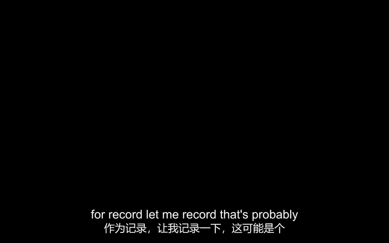 |
| [00:05](https://www.bilibili.com/video/BV1QP4y1u7jv/?p=59&t=5) 对于正在录音加入的人 | 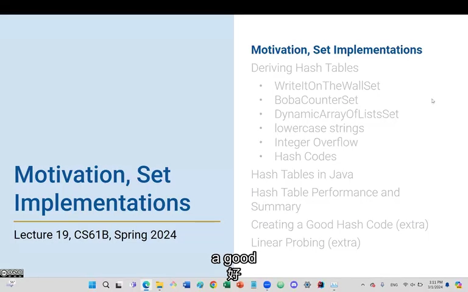 |
| [00:12](https://www.bilibili.com/video/BV1QP4y1u7jv/?p=59&t=12) 嗯今天讨论哈希表这是一个全新的数据结构从我们之前讨论的它与树没有直接联系所以如果你课程落后现在是重置的好时机嗯开始新单元好吧 | 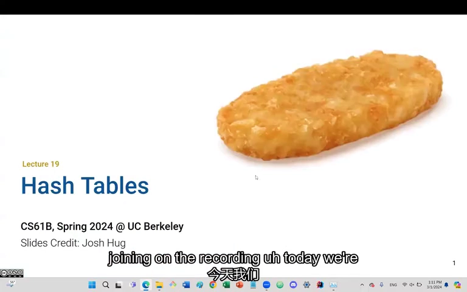 |
| [00:33](https://www.bilibili.com/video/BV1QP4y1u7jv/?p=59&t=33) 所以从让我们开始看我们迄今为止所做事情的动机 | 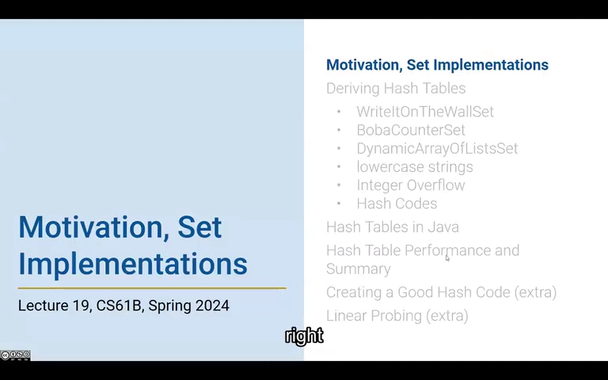 |
| [00:38](https://www.bilibili.com/video/BV1QP4y1u7jv/?p=59&t=38) 我们已经看到了一些集合或映射的实现集合有点像这个对象你可以检查如果包含某项或者你可以添加所以它有点像数学集合你可以添加东西你可以检查是否包含我们只需要担心这两个选项然后对于映射它有点像Python字典你添加一个键值对你可以检查键是否在里面如果，嗯所以对应的值是什么现在我们已经看到了一些选项我们看到了数组版本但那真的很糟糕 | 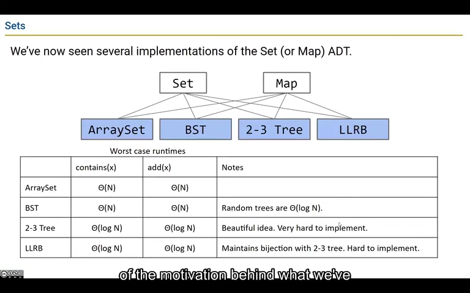 |
| [01:18](https://www.bilibili.com/video/BV1QP4y1u7jv/?p=59&t=78) 嗯在最坏情况下添加一项需要theta n时间在最坏情况下检查是否包含需要theta n时间在最坏情况下你可以稍微改进添加时间你可以得到theta 1平均但包含等待实际上你不能得到theta 1平均因为你仍然需要查看所有内容以确保每个单独的项嗯 不工作抱歉是的使用数组，你仍然需要theta n时间添加和包含对于二叉搜索树，添加仍然需要theta n时间我们能够在随机树和期望中将其降至theta log n | 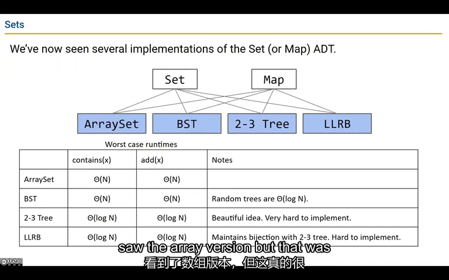 |
| [01:58](https://www.bilibili.com/video/BV1QP4y1u7jv/?p=59&t=118) 但即使那样，在最坏情况下这种瘦长树我们最终得到包含和添加操作的数和运行时我们能找到23棵树和lbs类似于二叉搜索树嗯但他们最终保证嗯稠密性这使我们能够获得theta log n嗯时间在这两个上现在我们问我们能做得更好吗你知道如果我们设法得到theta log n让我们看看我们能否做得更好这就是我们今天要做的 | 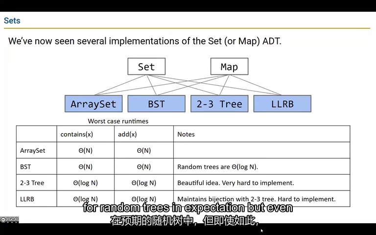 |
| [02:29](https://www.bilibili.com/video/BV1QP4y1u7jv/?p=59&t=149) 我们还遇到其他问题对这需要我们的东西需要有比较操作所以我们需要能够判断x是否小于y不是所有东西都是这样的例如我不能告诉你我将如何比较这些东西就像比较苹果和橙子就像你不能做嗯所以我们将尝试找出一种方法避免需要这些对象可比较嗯所以为了做到这一点 | 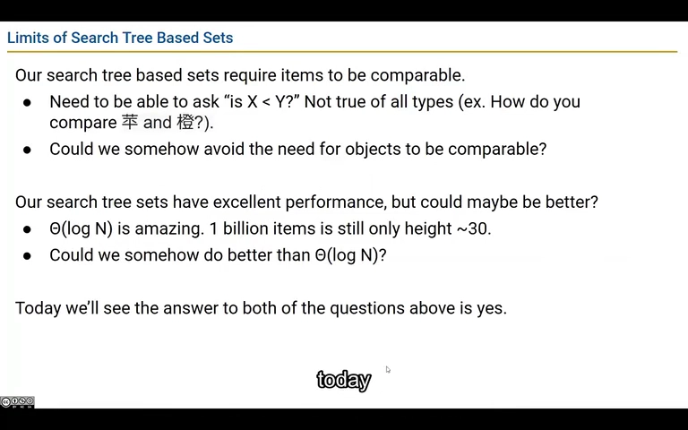 |
| [03:09](https://www.bilibili.com/video/BV1QP4y1u7jv/?p=59&t=189) 我们将看看这个你知道登录真的很棒但今天我们要尝试做得更好所以让我们试着找出一种方法来做这件事 | 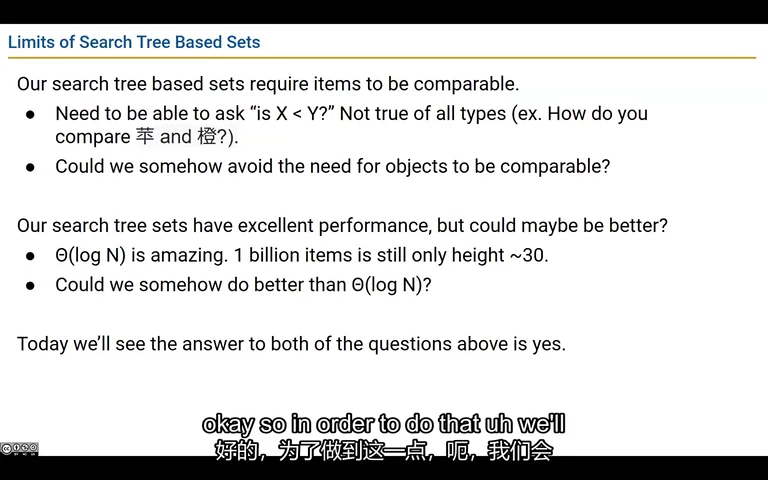 |
| [03:19](https://www.bilibili.com/video/BV1QP4y1u7jv/?p=59&t=199) 一般来说当我试图推导一个对象的新实现时我喜欢就想到的第一个想法进行尝试看看会发生什么看看是否有任何有用的颗粒 | 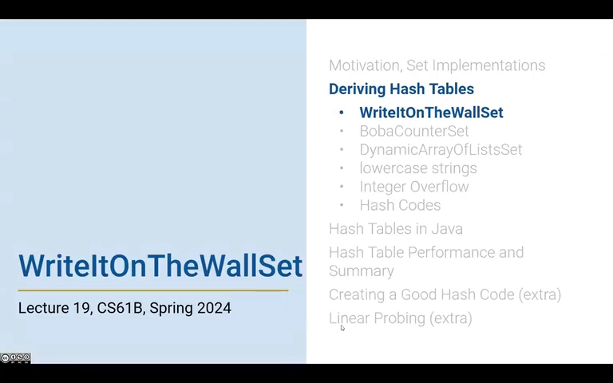 |
| [03:34](https://www.bilibili.com/video/BV1QP4y1u7jv/?p=59&t=214) 数据结构往往与现实生活中的事物相似扮演数据结构中的人类角色往往是有用的只是为了了解事情是如何运作的一般来说如果对人类来说很难那么对计算机来说也会很难如果很难如果对人类来说只是乏味那么对计算机来说可能很容易但如果对人类来说需要很多时间那么对计算机来说仍然需要很多时间所以让我们考虑一个只适用于整数的简化集合只需这两个操作加法操作，目前假设我们从不尝试添加已在集合中的东西包含操作，检查给定项是否在集合中 | 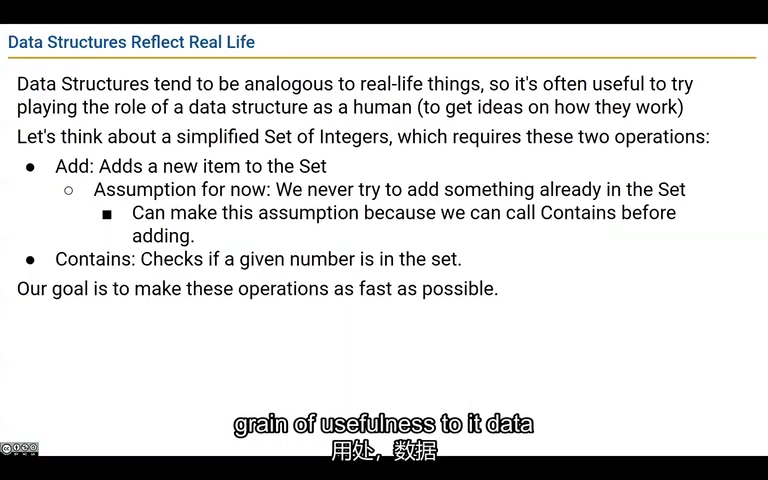 |
| [04:14](https://www.bilibili.com/video/BV1QP4y1u7jv/?p=59&t=254) 现在我们可以假设我们不会添加已经包含的东西原因是你可以先运行包含操作来检查如果那个项在集合中然后如果包含失败我们只添加该项目标使这两操作最快速我将做这套的人类版嗯我将称它为墙上集嗯将有墙和铅笔当你让我加数字嗯有人给我数字七 | 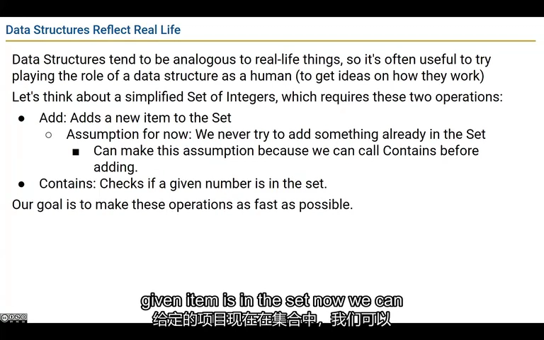 |
| [04:54](https://www.bilibili.com/video/BV1QP4y1u7jv/?p=59&t=294) 那是包含for嗯有人给我个1吗我要检查我墙上有1吗没有因此我将返回false所以我要问两个问题这是否快速添加是否快速它包含那么让我们开始 | 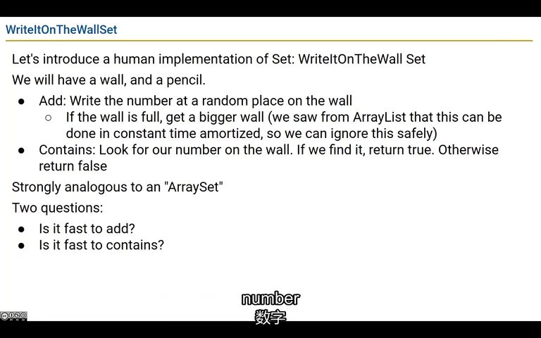 |
| [05:25](https://www.bilibili.com/video/BV1QP4y1u7jv/?p=59&t=325) 这是一堵墙对于Zoom上的各位我已启用注释在这墙上加5一五我做了我确实启用了 | 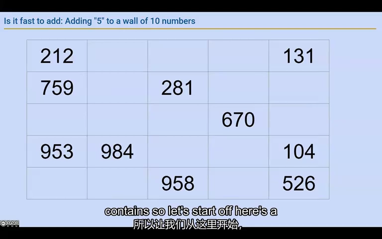 |
| [05:48](https://www.bilibili.com/video/BV1QP4y1u7jv/?p=59&t=348) 这个，对吧我没做我说过允许他人注释不学生能做到真有趣什么是网络研讨会啊上次效果很好好吧我们自己来做这里如何加5我要写个5 | 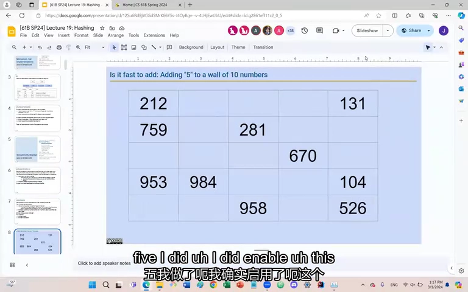 |
| [06:28](https://www.bilibili.com/video/BV1QP4y1u7jv/?p=59&t=388) 我们在这面墙上加了5好的 | 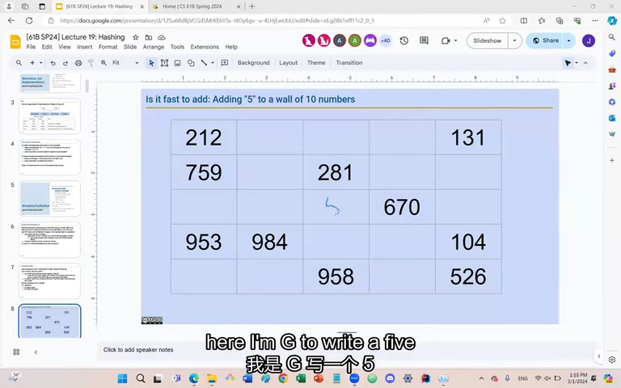 |
| [06:47](https://www.bilibili.com/video/BV1QP4y1u7jv/?p=59&t=407) 我们曾有5好的看看加5到百数墙要多久快吗嗯是的我能写5这里有效是的我能快速写5加法似乎很快不管墙上有多少东西看看运行contains操作有多快439在哪 | 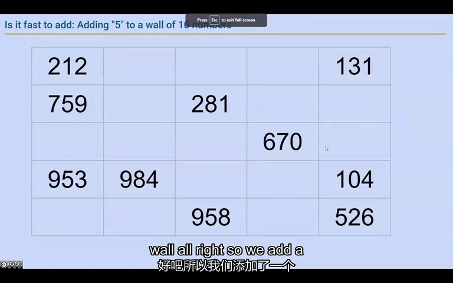 |
| [07:27](https://www.bilibili.com/video/BV1QP4y1u7jv/?p=59&t=447) 好的我们这样做嗯举手嗯墙上是否有439有或没有没有你怎么知道是的你大致浏览每个数字对好的嗯你认为我们能做更大的吗谁想做更大的谁不想做更大的我们无论如何都要做更大的搜索605 | 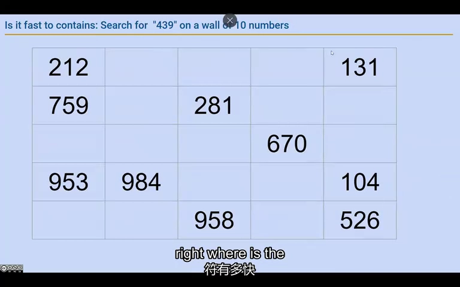 |
| [08:07](https://www.bilibili.com/video/BV1QP4y1u7jv/?p=59&t=487) 好的找到时举手它在哪第三行第四列就在这里是的好的你想更大吗太快了好的让我们更大胆这次我会给你一千样东西你知道我会给你两样东西其中一样会在墙上另一样不在墙上找到墙，那就在墙上你准备好了吗这是六百零五 | 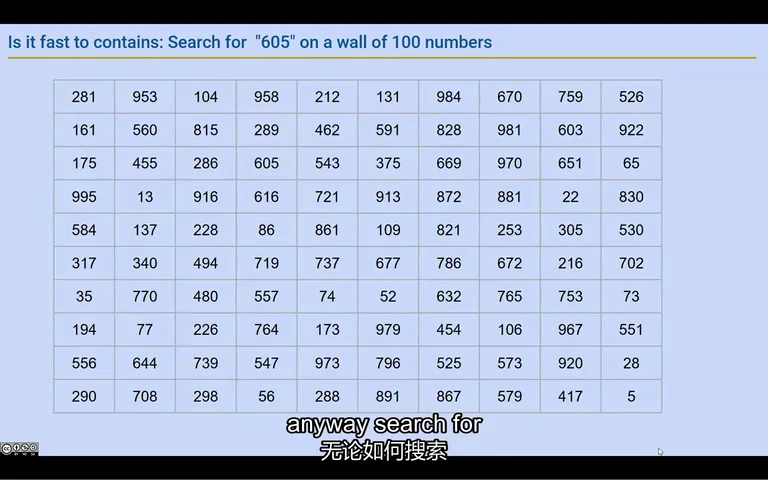 |
| [08:47](https://www.bilibili.com/video/BV1QP4y1u7jv/?p=59&t=527) 你准备好了吗一千样东西 | 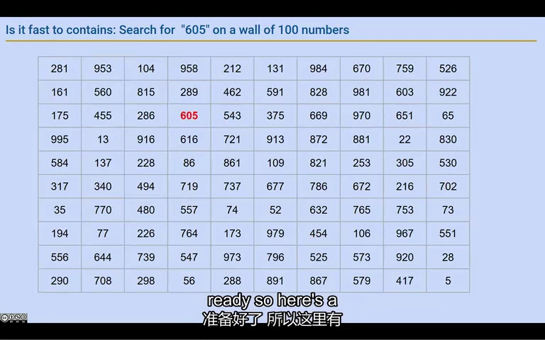 |
| [08:52](https://www.bilibili.com/video/BV1QP4y1u7jv/?p=59&t=532) 开始谢谢第二个在墙上的在哪里现在有人说第一个在墙上没人使用控制F缩放聊天这里不允许使用控制F | 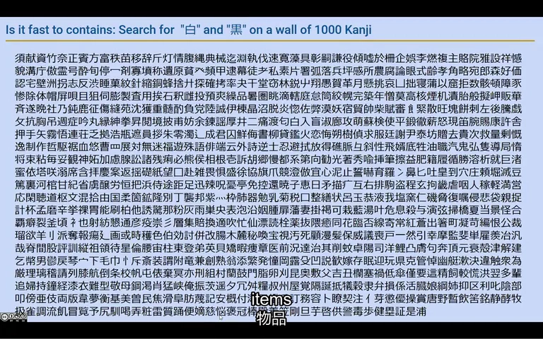 |
| [09:32](https://www.bilibili.com/video/BV1QP4y1u7jv/?p=59&t=572) 好吧我要画一条线告诉我我应该去哪里才能到达那个数字我应该去哪里对 | 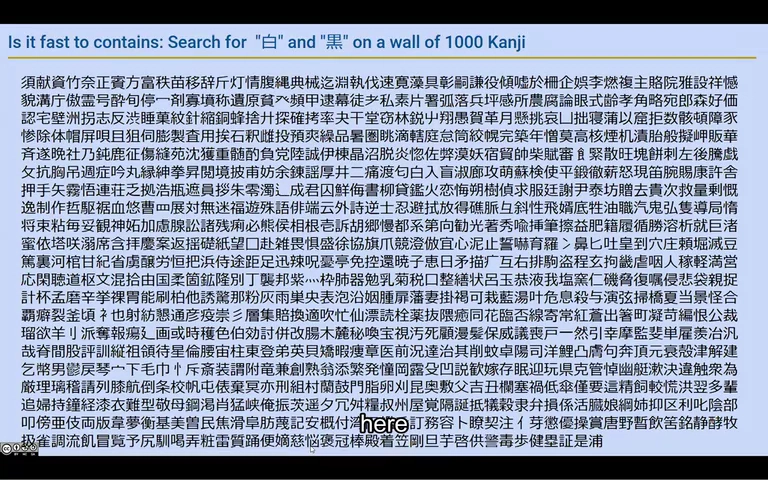 |
| [10:12](https://www.bilibili.com/video/BV1QP4y1u7jv/?p=59&t=612) 我们想要停止还要知道，你看到的是一秒钟的延迟这个有点早再来一个是的就在这里是的是的 | 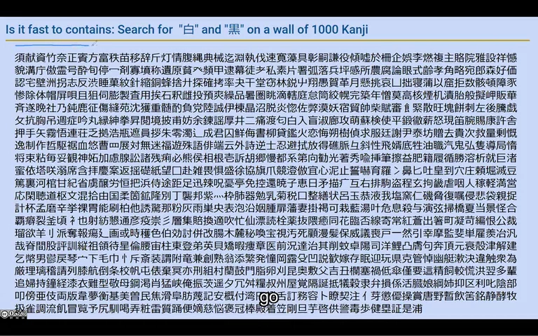 |
| [10:52](https://www.bilibili.com/video/BV1QP4y1u7jv/?p=59&t=652) 它就在那里正中间有这个角色呃对于你们这些双语人士这是白色的汉字我们在屏幕上没有找到黑色的汉字 | 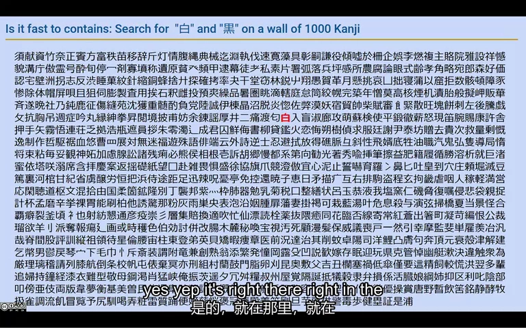 |
| [11:07](https://www.bilibili.com/video/BV1QP4y1u7jv/?p=59&t=667) 所以这个花了很长时间来检查包含 | 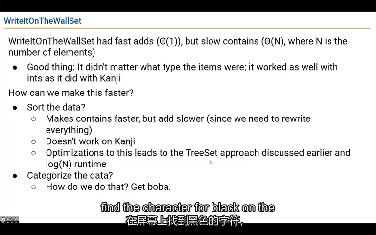 |
| [11:12](https://www.bilibili.com/video/BV1QP4y1u7jv/?p=59&t=672) 所以如果快速添加的话就好了 | 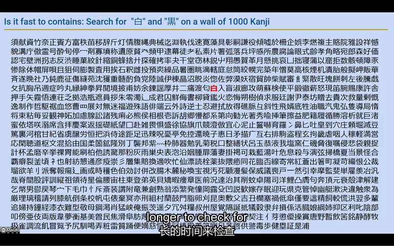 |
| [11:17](https://www.bilibili.com/video/BV1QP4y1u7jv/?p=59&t=677) 添加物品非常快无论墙上有多少物品但检查是否包含花了很长时间如果某物包含所以这不太好对检查花了theta(n)时间呃因为你必须查看每一个物品只是为了找到这个嗯现在找到正确的东西好事是数据类型不重要这种方法对整数和汉字同样有效至少我们得到了我们想要的东西我们不需要担心比较 | 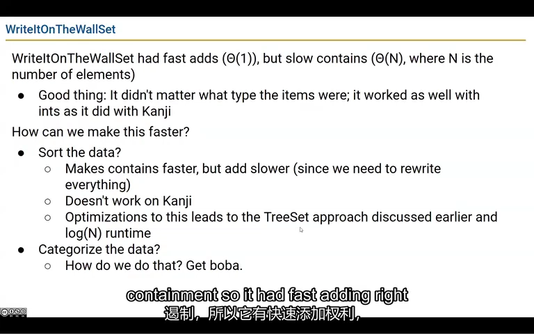 |
| [11:57](https://www.bilibili.com/video/BV1QP4y1u7jv/?p=59&t=717) 如何加快速度嗯一种选择是排序数据这会加快包含查询的速度但会使广告变慢因为需要不时重写所有内容而且对汉字不起作用嗯因为需要能够比较事物汉字不支持全部排序实际上最终导致我们之前讨论的树集方法我们能从那里得到最好的这些操作的运行时间为log n相当不错我们可以做得更好下一个选择是分类数据如何分类嗯我们去喝波霸吧 | 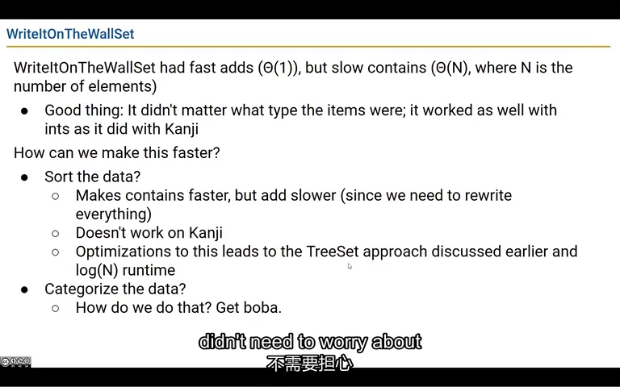 |
| [12:37](https://www.bilibili.com/video/BV1QP4y1u7jv/?p=59&t=757) 这里有多少人喜欢波霸所有人或大多数人有多少人讨厌波霸显然查理是...好吧对于喜欢波霸的你们有多少人去过很多次你们是否注意到桌子上有这个东西嗯他们桌子上有这个东西 | 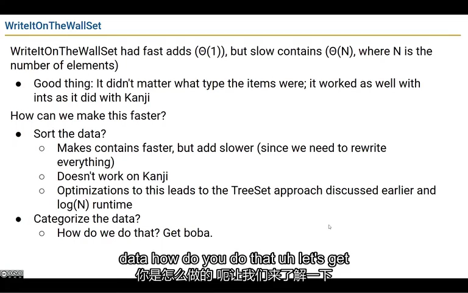 |
| [13:10](https://www.bilibili.com/video/BV1QP4y1u7jv/?p=59&t=790) 桌子上有这个东西上面有一个0到9的盒子 | 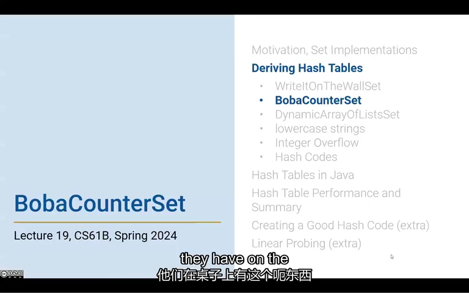 |
| [13:15](https://www.bilibili.com/video/BV1QP4y1u7jv/?p=59&t=795) 他们使用你的零食通行证订单根据零食通行证订单给你一个数字把你的饮料放在数字最后一位的位置如果你的号码是一百零七那么他们会把你的饮料放在标有7的盒子里而不是查看桌子上的所有波霸你只需要查看那个特定槽位的波霸通常情况下任何时候桌子上只有五到十杯波霸需要检查你只需要真正寻找那一个物品运行时间并不慢你可以很快找到你的物品 | 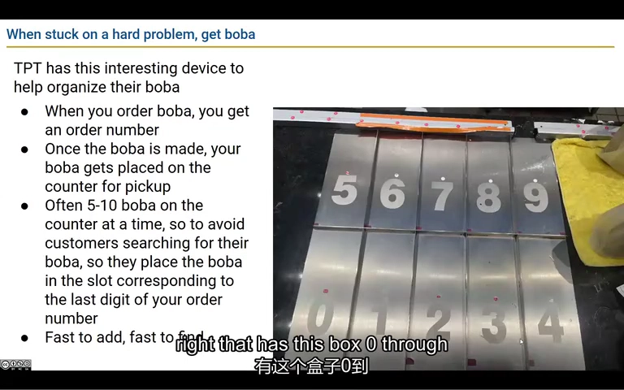 |
| [13:55](https://www.bilibili.com/video/BV1QP4y1u7jv/?p=59&t=835) 他们加槽很快因为他们有特定位置放弓你找起来也很快因为你不需要看每件物品只需看那个特定区域这实际上挺不错这是现实中的东西，似乎在做我们想要的事看看能否将其转化为实际算法 | 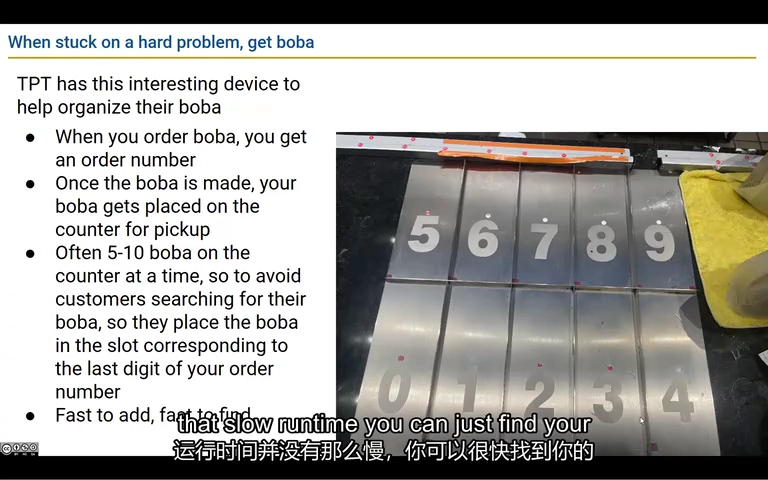 |
| [14:20](https://www.bilibili.com/video/BV1QP4y1u7jv/?p=59&t=860) 我要做个计数器套装我要一面墙分成十个槽从零槽到九槽得到数字时放入最后一位对应的位置一百九十三放入一百的三个槽放入零槽如果墙满了或任何墙满了就换个更大的墙把所有东西复制到更大的墙上从数组中看到这是如何在常数时间摊销中工作的所以这没问题，对于包含我们只会查看对应最后一位的槽如果找一百九十三只看三槽因为知道放三槽 | 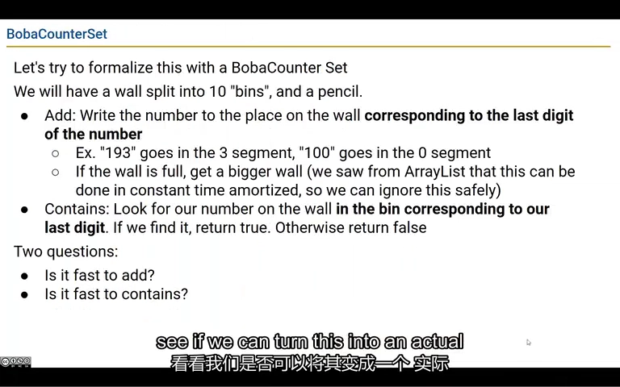 |
| [15:00](https://www.bilibili.com/video/BV1QP4y1u7jv/?p=59&t=900) 再检查两个问题添加快吗包含检查快吗用这个 | 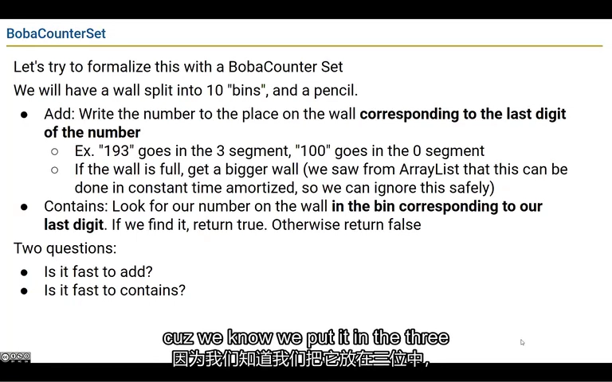 |
| [15:07](https://www.bilibili.com/video/BV1QP4y1u7jv/?p=59&t=907) 能快速向这墙加五吗能怎么加写个五在这包含检查是否更快这里有六百零五吗有你怎么知道只看五这比给你一堆一百数快吗随机是的为什么 | 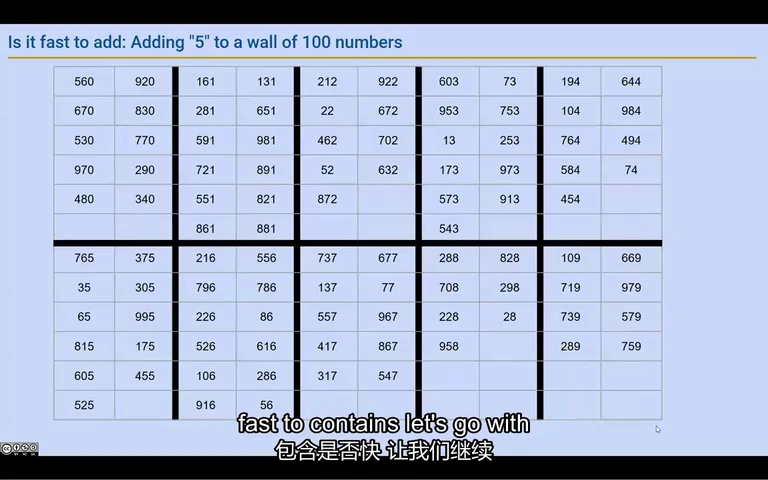 |
| [15:47](https://www.bilibili.com/video/BV1QP4y1u7jv/?p=59&t=947) 他只看了盒子这小角非常快 | 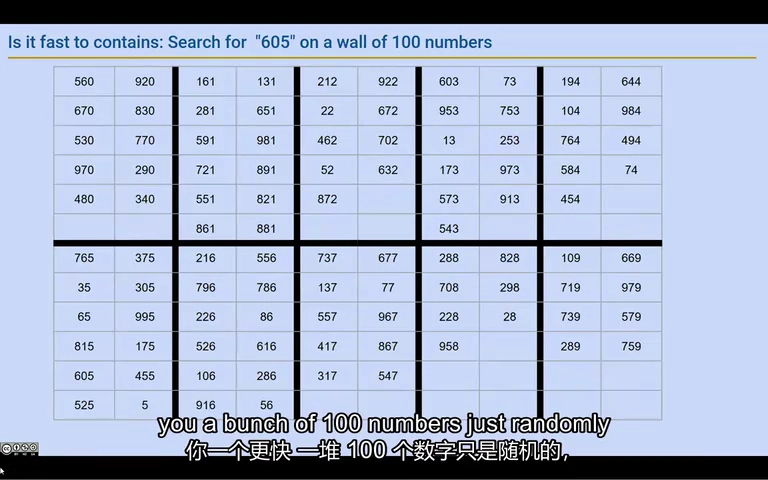 |
| [15:55](https://www.bilibili.com/video/BV1QP4y1u7jv/?p=59&t=955) 如果增加到一千项 | 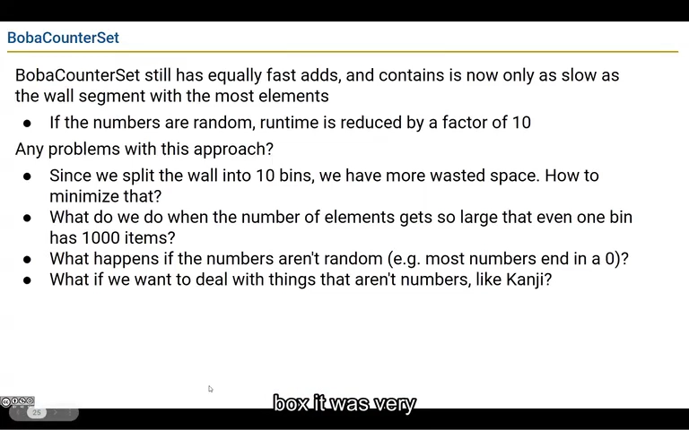 |
| [16:00](https://www.bilibili.com/video/BV1QP4y1u7jv/?p=59&t=960) 还有这十个盒子还会这么快吗不但还是会快十倍所以这是优势 | 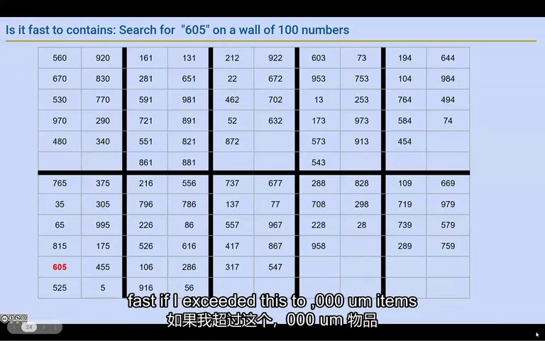 |
| [16:12](https://www.bilibili.com/video/BV1QP4y1u7jv/?p=59&t=972) 如果数字随机运行时间约减少十分之一嗯问题是最终会浪费更多空间 | 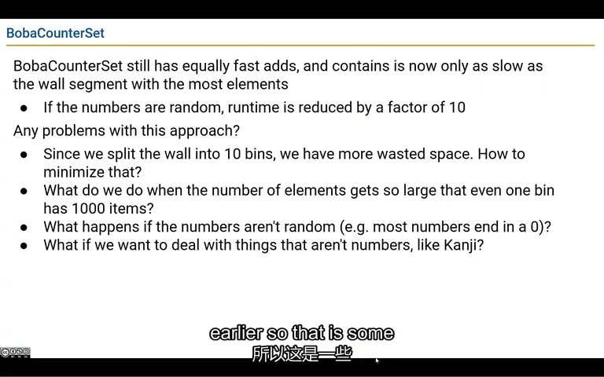 |
| [16:24](https://www.bilibili.com/video/BV1QP4y1u7jv/?p=59&t=984) 如果你愿意如果你注意到每个桶实际含12个数字而非10实际与之前墙相同有100项实际上浪费了约10%空间有问题吗是的如何处理日语汉字好问题 | 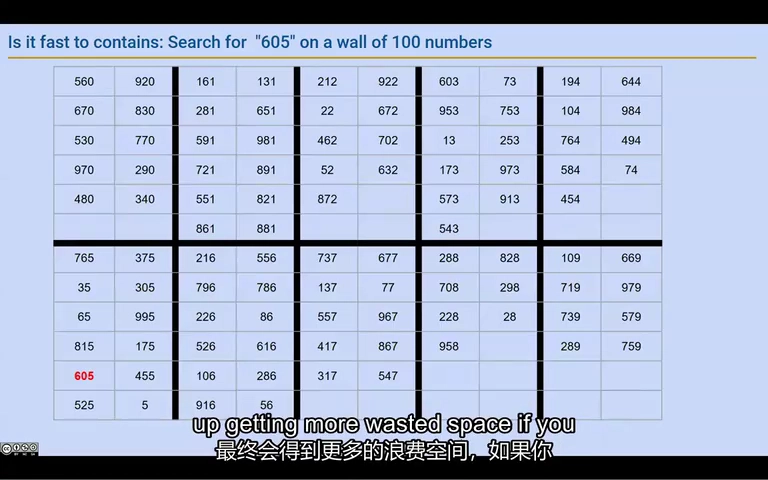 |
| [16:48](https://www.bilibili.com/video/BV1QP4y1u7jv/?p=59&t=1008) 比如处理非数字如日语汉字嗯还需担心什么如果元素数很大以致一个桶太多检查如果数字不随机如果选的数都以零结尾如处理十的倍数突然所有数都在零桶这没帮助 | 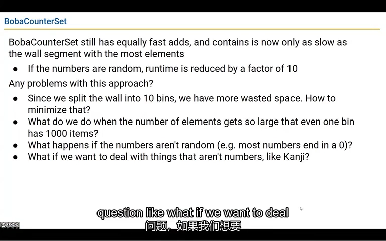 |
| [17:15](https://www.bilibili.com/video/BV1QP4y1u7jv/?p=59&t=1035) 好吧尝试解决这些问题嗯 | 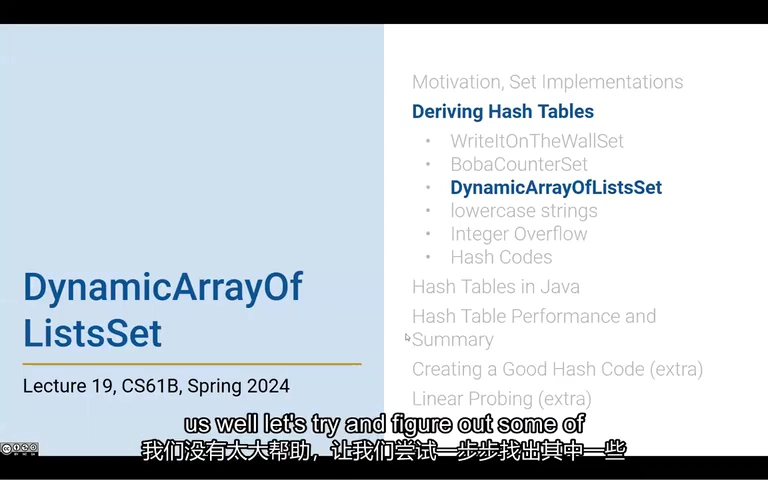 |
| [17:20](https://www.bilibili.com/video/BV1QP4y1u7jv/?p=59&t=1040) 逐步来最终达到目标 | 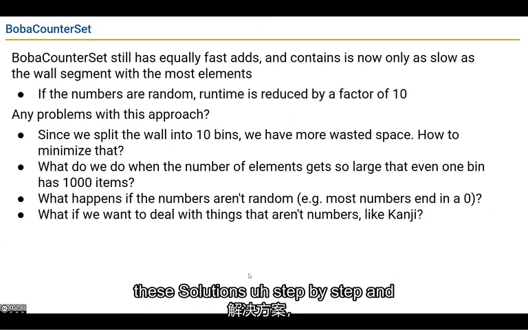 |
| [17:25](https://www.bilibili.com/video/BV1QP4y1u7jv/?p=59&t=1045) 一个选择是不均分墙空间动态增加每部分大小简单方法是使用链表嗯之前说链表嗯工业中不太常用因为它们不太直接有用这个情况恰好有点用因为可动态增加桶大小还有其他方案本课聚焦链表方法桶空时仍有一单位浪费 | 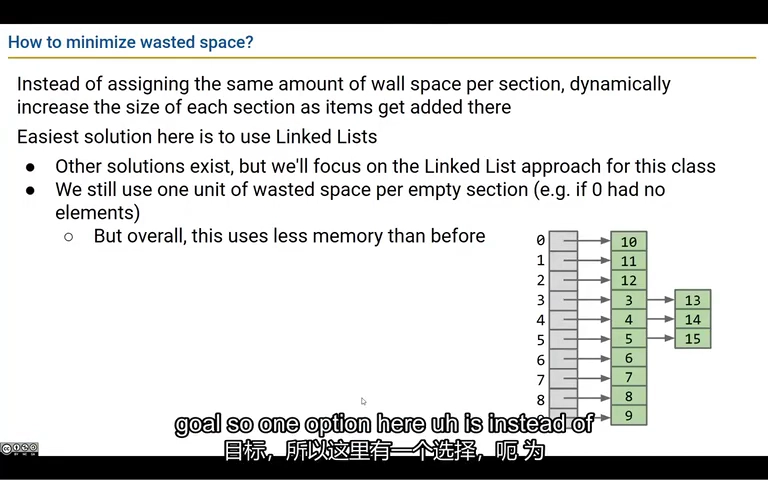 |
| [18:05](https://www.bilibili.com/video/BV1QP4y1u7jv/?p=59&t=1085) 但总体比之前省内存比之前节省很多内存 | 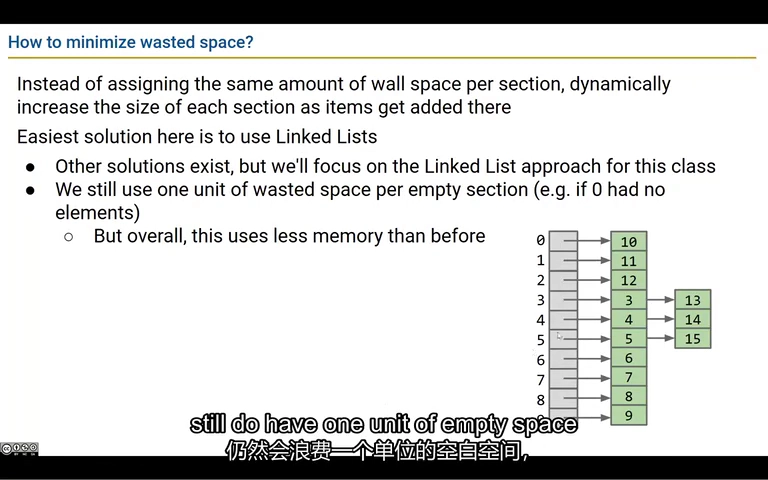 |
| [18:14](https://www.bilibili.com/video/BV1QP4y1u7jv/?p=59&t=1094) 让我们嗯现在想想如何处理大量物品所以如果你直接算一下假设n是箱子中物品的总数或原始案例中有100项m是波霸套装示例中的总箱数我们有10个箱子假设值均匀分布可以说每个箱子约有n除以m项因此在大O表示法中包含操作将在大O(n/m)时间内运行如果m是常数那只是减少了theta嗯我们什么都没改变 | 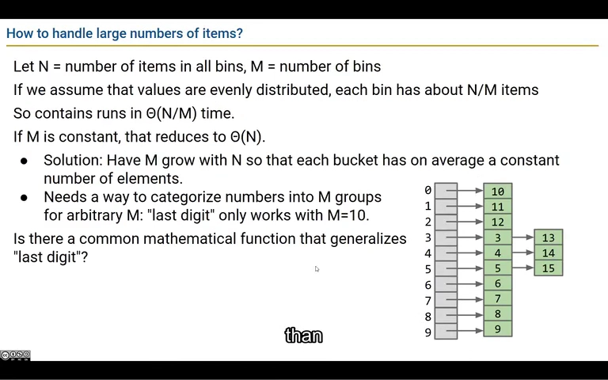 |
| [18:54](https://www.bilibili.com/video/BV1QP4y1u7jv/?p=59&t=1134) 所以不能只处理常数M我们需要随着n的增大稳步增加m只要m的增长速度与n相同我们应该没问题我们需要一种将数字分类为m组的方法对于足够大的M如果你给我一个m我应该能够根据该大小对数字进行分类或至少大于该大小的某个大小所以如果我仅说一个数字的最后一位，那仅适用于m等于10它只将事物分成10个不同的集合 | 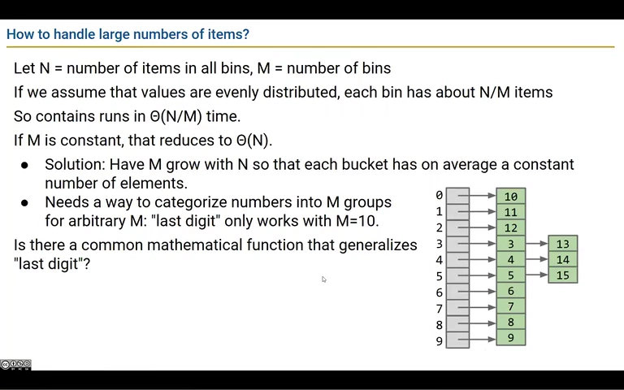 |
| [19:34](https://www.bilibili.com/video/BV1QP4y1u7jv/?p=59&t=1174) 嗯如果我说m等于100是否有简单的方法可以将数字分成100个不同的组有什么想法是的是的最后两位数字这是一个很好的方法我们能将其扩展到任意大的数字吗N等于1千N等于1万我们能将其扩展到n等于64吗如何将此扩展到n等于64有什么建议是的是的而不是只处理最后一位数字我们可以实际上将其泛化为模运算 | 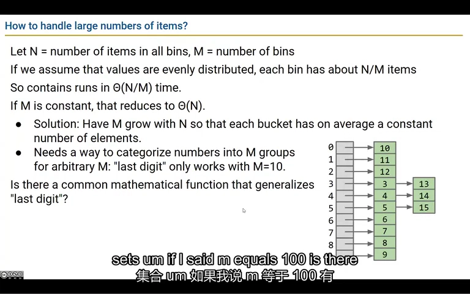 |
| [20:14](https://www.bilibili.com/video/BV1QP4y1u7jv/?p=59&t=1214) 现在这是伟大的这是一个简单解可应用于任何m值，随机数均匀分布啊实际上，如果模数互质最终得到统计独立值若保持质模数实际上得到统计随机性若m乘以整数嗯实际上将每个桶分成独立小桶若要并行，可实现复合模和质模均有优势优势完全不同 | 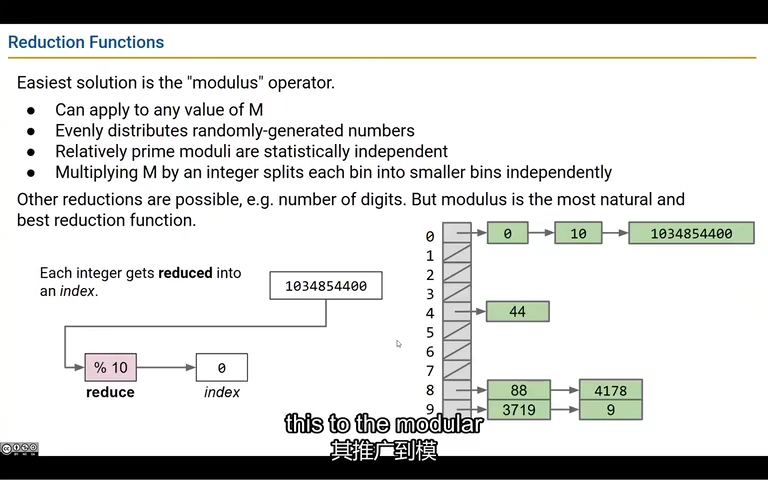 |
| [20:54](https://www.bilibili.com/video/BV1QP4y1u7jv/?p=59&t=1254) 数字位数可减少嗯模数最自然目前最佳缩减函数保持常数时间嗯包含操作确保m至少是常数倍嗯，关闭始终远离n我们可做的两种方法最大箱超过k时增加m这往往太慢最终添加太多箱我们不这样做相反，当平均箱大小 | 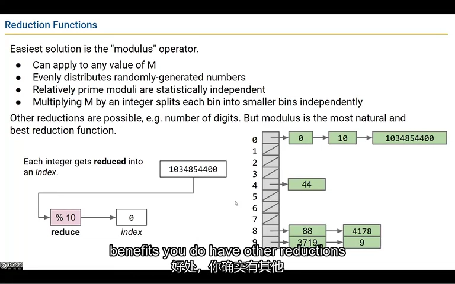 |
| [21:34](https://www.bilibili.com/video/BV1QP4y1u7jv/?p=59&t=1294) 它达到k，当我们添加足够项我们想要增加m多少嗯，好吧我们有两种选择每次都可以以固定量增加m或者我们可以以常数因子增加m所以我们要么翻倍，要么增加2这是两种主要选择举手有多少人想按算术增加每次加几何乘法有多少人想为什么我们做得少了是的但这不意味着我们会得到更多空箱 |  |
| [22:14](https://www.bilibili.com/video/BV1QP4y1u7jv/?p=59&t=1334) 但结果表明正如我们从射线中看到的贝塔1乘法调整运行时西塔和算术调整运行时是的但我们能做什么呢？为什么我们不能做更大的操作，比如平方它？我不确定我我们为什么不平方它？这是个好问题我们可以平方它嗯如果我们平方它我们仍然得到相同的常数摊销运行时间这并不比原始的双倍大小更好如果你反复平方它那就意味着你会得到更多的空位 |  |
| [22:54](https://www.bilibili.com/video/BV1QP4y1u7jv/?p=59&t=1374) 内存使用量增加了很多而运行时间不受影响所以没有真正的理由做超过双倍的事情是的所以如果我们这样做那么每次我们调整大小时，m都应该翻倍实际上这也与我们的想法相吻合，即当我们翻倍模数时最终每个桶被分成单独的组所以十的零模组分成零模二十和十模二十组 |  |
| [23:24](https://www.bilibili.com/video/BV1QP4y1u7jv/?p=59&t=1404) 让我们快速做个例子假设我们有这个规则其中n大于n除以n需要大于1.5才能调整大小所以首先我要添加数字七我会取七模三或七模四七模四三是什么？所以我把它放在三桶里里面只有一项所以我不会调整大小然后我要添加十六嗯十六模四是零所以我添加到零位三乘三四那是三所以我把它放在三桶里 |  |
| [24:04](https://www.bilibili.com/video/BV1QP4y1u7jv/?p=59&t=1444) 十一把它放在三桶里等等，我们添加二十现在下次我们添加时我们将达到六项这意味着我们需要调整大小所以我们添加十三，它放在一桶里因为十三模四是1然后我们将调整大小m太大了是时候翻倍了 |  |
| [24:28](https://www.bilibili.com/video/BV1QP4y1u7jv/?p=59&t=1468) 所以让我们画出这次之后发生的结果嗯16去哪0，20去哪，413去哪，57，73，3和11，3所以如果你这样做 |  |
| [24:50](https://www.bilibili.com/video/BV1QP4y1u7jv/?p=59&t=1490) 这就是所有数字的归宿所以调整大小后这是我们的嗯 |  |
| [24:55](https://www.bilibili.com/video/BV1QP4y1u7jv/?p=59&t=1495) 桌子现在可称动态数组列表集不如我们原想法直观我们原始想法但核心思想大体不变若有n项均匀分布每列表长度约n除以m平均为常数小于k故所有操作平均为常数稍后需更细想运行时目前看这方法合理我们成功将墙上涂鸦我在墙上写字变成可能常时算法 |  |
| [25:34](https://www.bilibili.com/video/BV1QP4y1u7jv/?p=59&t=1534) 关于处理汉字的问题谈谈这个 |  |
| [25:41](https://www.bilibili.com/video/BV1QP4y1u7jv/?p=59&t=1541) 先解决小写字符存储如英语字符 |  |
| [25:50](https://www.bilibili.com/video/BV1QP4y1u7jv/?p=59&t=1550) 假设我想添加cat单词我将处理的关键问题是如何决定猫桶是什么猫的最后一个数字是什么一个选择是我们可以使用单词的第一个字母，比如字母表中的位置所以a是0，b是1，c是2一直到z等于25所以猫放入桶2我们将从两个6桶开始调整后我们可能会看前两个字母所以aa到0，ab到1，c恰好是52桶 |  |
| [26:30](https://www.bilibili.com/video/BV1QP4y1u7jv/?p=59&t=1590) 嗯你能想到这种方法的问题吗 |  |
| [26:42](https://www.bilibili.com/video/BV1QP4y1u7jv/?p=59&t=1602) （此区间无字幕） |  |
| [26:47](https://www.bilibili.com/video/BV1QP4y1u7jv/?p=59&t=1607) 你认为如果我们采用这种方法可能会面临哪些问题？有什么建议 |  |
| [26:52](https://www.bilibili.com/video/BV1QP4y1u7jv/?p=59&t=1612) 是的嗯我们只会使用固定数量的桶这不一定正确如果我们加很多单词我们可能会用很多桶我确定字典里有一个词对应每一个呃对字母呃你开始于如果你包括像ci这样的东西呃任何东西是的这是一个随机分布 |  |
| [27:32](https://www.bilibili.com/video/BV1QP4y1u7jv/?p=59&t=1652) 呃S是英语单词中最常见的第一个字母E是最常见的字母所以我们会遇到这个问题是的单个字母的单词是的最终与a相同在调整大小后放置任何东西 |  |
| [28:12](https://www.bilibili.com/video/BV1QP4y1u7jv/?p=59&t=1692) 是的总的来说，你它扩展到嗯比如调整大小增长是的它是随机分布的一部分没有很多单词以a开头呃我想土豚就差不多了吧是的我们会得到很多常见的而不是很多不常见的 |  |
| [28:48](https://www.bilibili.com/video/BV1QP4y1u7jv/?p=59&t=1728) 这是我的看法短字符串放在哪里在调整大小之后 |  |
| [28:53](https://www.bilibili.com/video/BV1QP4y1u7jv/?p=59&t=1733) 你可能可以修复那个随机性是一个问题我实际上没有在这里写下来我个人感觉最大的问题是它几乎强迫我们的集合在26的每个幂次上调整大小676我并不想处理字符串集的事实影响我们的调整大小数字应该是什么我想要一个调整大小与对象无关因为我希望这个集合与任何对象都能工作每个对象类型不应定义如何直观调整大小调整应像集合操作 |  |
| [29:33](https://www.bilibili.com/video/BV1QP4y1u7jv/?p=59&t=1773) 非字符串操作 |  |
| [29:38](https://www.bilibili.com/video/BV1QP4y1u7jv/?p=59&t=1778) 之前方法的问题是集合负责如何分类字符串，当我们说字符串属于 |  |
| [29:47](https://www.bilibili.com/video/BV1QP4y1u7jv/?p=59&t=1787) 根据这个a等于0，c等于25那是一个分类方案集合的工作不是知道每个对象 |  |
| [29:55](https://www.bilibili.com/video/BV1QP4y1u7jv/?p=59&t=1795) 包括你尚未编写的集合的工作只是分配基于事物告诉它的类别所以字符串应决定集合何时调整但集合应决定字符串应放入哪个类别我们的解决方案将很有趣我们将设置集合仅处理整数因为那是最灵活的选项我们可以对任何想要的数字进行任意模所以我们可以选择对任何数字进行模的集合我们将为每个存在的类定义方法 |  |
| [30:35](https://www.bilibili.com/video/BV1QP4y1u7jv/?p=59&t=1835) 它们将该对象转换为整数所以对于字符串我们将找出将字符串转换为整数的方法并将字符串存储在对应f的桶中字符串决定如何分类集合决定如何调整大小大家都开心现在有一个新问题 |  |
| [30:57](https://www.bilibili.com/video/BV1QP4y1u7jv/?p=59&t=1857) 如何将cat转换为数字假设我们处理小写字母有人有任何想法吗啊Ascii是的我们稍后做还有其他想法吗但我没有提前阅读是的是的我们可以将每个字母的位置相加Ascii是编写的还有其他选项 |  |
| [31:26](https://www.bilibili.com/video/BV1QP4y1u7jv/?p=59&t=1886) （此区间无字幕） |  |
| [31:31](https://www.bilibili.com/video/BV1QP4y1u7jv/?p=59&t=1891) 还有其他建议吗是的Base二十六是的我们可以使用之前看到的Base二十六嗯还有什么呃嗯答案不一定是好选择如何将猫转换为数字是的 |  |
| [32:11](https://www.bilibili.com/video/BV1QP4y1u7jv/?p=59&t=1931) 等等你说什么是的ASCIIUnicode这实际上很合理嗯实际上还有一个我实际上是指向你是的字符数是的有很多选项嗯让我们试着找出哪些嗯，让我们试着选一个 |  |
| [32:35](https://www.bilibili.com/video/BV1QP4y1u7jv/?p=59&t=1955) 现在理想情况下，我们希望均匀分配字符串 |  |
| [32:40](https://www.bilibili.com/video/BV1QP4y1u7jv/?p=59&t=1960) 我们不想让任何整数有显著多于平均值的关联字符串嗯一般来说有很多六个五字母单词没有很多三个七字母单词所以我们可能不想只处理字符数之和每个字母同样不会那么好我们通常没有单词的总和是五千四百三十六因为大多数单词没有一百个字符所以这两个不会特别嗯擅长均匀分配字符串但让我们尝试将猫作为基数二十六个数字看看那是什么效果 |  |
| [33:20](https://www.bilibili.com/video/BV1QP4y1u7jv/?p=59&t=2000) 我要这样做每个单独的数字我将乘以二十六的幂所以猫将被转换为c即三乘以二十六的平方加上一乘以二十六的第一次方加上二十乘以二十六的零次方现在是二千零七十四，为什么我描绘这个特定模式如果你看数字在十进制中的表示我们有数字零到九当你想数字大于九时你只需使用数字序列所以七零九一实际是7乘10的立方加0乘10的平方加9乘10的一次方加1乘10的零次方 |  |
| [34:00](https://www.bilibili.com/video/BV1QP4y1u7jv/?p=59&t=2040) 当我们写7091我们指右边的数字符串系统基本相同但用字母代替数字所以十进制中只有小数点后00的区别零与零相同但字符串aaa与a不同因此，对于此我们没有零在我们的系统中我们只说a等于一不是零使用这个 |  |
| [34:26](https://www.bilibili.com/video/BV1QP4y1u7jv/?p=59&t=2066) 我们能够为每个单独的数字分配一个唯一的字符串所以测试这个嗯如果我们尝试做b嗯乘以26的平方嗯或者如果我们尝试将单词b转换为十进制数或小数好吧，如果我们做数学 |  |
| [34:51](https://www.bilibili.com/video/BV1QP4y1u7jv/?p=59&t=2091) 我们最终得到2乘以26的平方加5乘26加5乘1总计1千共487只要基数大于等于26算法保证每个小写英文单词对应唯一数字1千4百87不会有其他数字对应每个数字唯一每个数字对应唯一单词每个单词对应唯一整数 |  |
| [35:26](https://www.bilibili.com/video/BV1QP4y1u7jv/?p=59&t=2126) 使用这个我们可以将动态链表数组转换为处理字符串想法是我们将有这个整数化函数嗯它将任何对象转换为整数然后使用模数操作获取正确位这很常见我们实际上称之为哈希函数 |  |
| [35:49](https://www.bilibili.com/video/BV1QP4y1u7jv/?p=59&t=2149) 嗯实际上等一下稍后我会谈谈那个 |  |
| [35:54](https://www.bilibili.com/video/BV1QP4y1u7jv/?p=59&t=2154) 现在这个问题是嗯仅使用26个基本字符嗯我们并不总是只用26个基本字符和所有字符串有时我们使用数字或大写字母或感叹号若要为每个可能字符串分配唯一整数我们需要为每个可能字符分配整数嗯这需要时间我对应哪个整数？！是小于还是大于小写a？事实证明有人已经做了，它被称为ascii |  |
| [36:33](https://www.bilibili.com/video/BV1QP4y1u7jv/?p=59&t=2193) ascii被设计为大多数计算机使用的基本字符集每个字符都被分配一个0到127之间的数字这里有一张这样的表格你不需要记住这个它只是存在例如字符c um若写成大写D实际上与写数字68相同因为68内部视为大写D若要处理任何ASCII字符可用126为基数，这样转成数字B变成此数1百万56万8千675 |  |
| [37:13](https://www.bilibili.com/video/BV1QP4y1u7jv/?p=59&t=2233) 2包变1千01万稍改G为2亿3百万可得出每个数字嗯下面有简单实现将任何字符串转为数字嗯与之前处理类似 |  |
| [37:36](https://www.bilibili.com/video/BV1QP4y1u7jv/?p=59&t=2256) 若要使用非ASCII字符汉字时间 |  |
| [37:41](https://www.bilibili.com/video/BV1QP4y1u7jv/?p=59&t=2261) 汽车和Java也支持其他字符集嗯，语言嗯实际上我们有这些字符这种编码称为unicode它是ascii的扩展，包含更多项目表格太大，无法列出嗯有数千个字符 |  |
| [38:03](https://www.bilibili.com/video/BV1QP4y1u7jv/?p=59&t=2283) 嗯但如果您只想达到汉字那么我们需要四万九百五十九呃 数字所以例如如果你想写那个嗯 在呃 在我们的哈希东西里然后我们会把这个变成数字这让我们得到让我们看看 千 百万 十亿 兆 京一京八百六十七京五百七十一兆四百八十一亿三百六十一百万六百八十三千五百五十是个大数字我不想表示那个数字那对我来说太大了 无法在我的电脑里表示 |  |
| [38:43](https://www.bilibili.com/video/BV1QP4y1u7jv/?p=59&t=2323) 对那些好奇的人那实际上是我用日语写的名字 我们正在翱翔是的不只是贾斯汀是横田正治我有一个日本名字 |  |
| [38:57](https://www.bilibili.com/video/BV1QP4y1u7jv/?p=59&t=2337) 但问题是我不想存储这个京大小的数字 |  |
| [39:03](https://www.bilibili.com/video/BV1QP4y1u7jv/?p=59&t=2343) 只有有限多的数字存在所以如果你试图将这个名称映射到这个特定的数字我们不会在Java中得到存在的数字整数值会指数增长即使限制字符数到像十七个字符的俳句我们也会得到一个在京维京 十的七十八次方是个巨大的数字我们不需要处理它Python理论上可以做到Python允许你有无限大的数字但在实际的物理计算机上 你不会想要非常大的数字所以最终我们会在Java中进行整数溢出操作 |  |
| [39:37](https://www.bilibili.com/video/BV1QP4y1u7jv/?p=59&t=2377) 当你超过二十亿它实际上会下降到负二十亿这叫做溢出呃你加二十亿加一 那就变成负二十亿呃我们最终会在这里感受到同样的事情 |  |
| [39:57](https://www.bilibili.com/video/BV1QP4y1u7jv/?p=59&t=2397) 若将预兆转126进制，得280亿若直接转换将变为负10亿870668百万667万数字我们不会实际得到数字预期它们将转换至较小范围呃实际上不错呃因此我们得到固定范围只要数字足够大且随机我们应得到随机分布的数字此数字正式名称为散列码 |  |
| [40:37](https://www.bilibili.com/video/BV1QP4y1u7jv/?p=59&t=2437) 它将许多或无限项集合的值降至有限项集合在这种情况下为Java整数集仅40亿左右数字因此迭代函数实际称为散列码我们将无限字符串集转换为1至40亿间的单个数字 |  |
| [40:56](https://www.bilibili.com/video/BV1QP4y1u7jv/?p=59&t=2456) 我们使用因为散列码范围有限我们无法为每个字符串得到唯一值因此，而非处理4959在每一步使一切都有唯一数字我将使用较小数字如3131恰好是一个有效数字稍后可查看其有用属性但现在可以说31是我们的选择实际上产生完全随机数呃就像这样最终成为839百万 |  |
| [41:36](https://www.bilibili.com/video/BV1QP4y1u7jv/?p=59&t=2496) 用旧版本成为百万亿数字最终模至0至40亿间随机数因此尝试哪个版本不重要 |  |
| [41:44](https://www.bilibili.com/video/BV1QP4y1u7jv/?p=59&t=2504) 不幸的是因为这样因为我们使用较小基数将有无限其他字符串映射至相同数字呃这是我尝试想出一个合理呃合理数字以匹配我的名字大小写加减E小写RE w n或我们自己的结果就是这样哈希码恰好是相同的数字花了一段时间才找到这个虽然所以不太常见你会遇到这些碰撞 |  |
| [42:23](https://www.bilibili.com/video/BV1QP4y1u7jv/?p=59&t=2543) 但用这个我们可以将任何我们想要的数据转换成哈希值我们将其转换成哈希函数哈希码返回我们一个在负20亿到正20亿之间的数字然后我们使用模运算符将其转换成二进制使用这个我们可以放入东西现在这个版本使用了一个列表的数组这有时被称为分离链还有一些其他选项呃库克哈希实际上非常酷我强烈推荐你课后看看那些但我们不会在这里覆盖它们呃 |  |
| [43:03](https://www.bilibili.com/video/BV1QP4y1u7jv/?p=59&t=2583) 在Java中关于模运算符有一个警告我们很快就会看到 |  |
| [43:09](https://www.bilibili.com/video/BV1QP4y1u7jv/?p=59&t=2589) 呃但现在这似乎会工作得很好 |  |
| [43:14](https://www.bilibili.com/video/BV1QP4y1u7jv/?p=59&t=2594) 实际上这往往是集合和映射的最流行实现实践中表现出色它不需要项目是可比较的并且实现通常是简单的Python字典它们只是旅行的哈希表我们将使用称为哈希映射和哈希集的哈希映射如何知道如何实现哈希码嗯每一个单独的对象我们可以说它实现了哈希码实际上这不是你需要说的与可比较性不同，它们需要说能够比较某些东西哈希码是如此普遍 |  |
| [43:54](https://www.bilibili.com/video/BV1QP4y1u7jv/?p=59&t=2634) 以至于Java要求每个对象实现一个哈希码方法实际上Object本身操作一个哈希码方法呃那个哈希码方法只是嗯返回它目前所在的内存地址内存地址有点随机它实际上就是随机的并且每次你运行程序时它在不同的位置改变 |  |
| [44:16](https://www.bilibili.com/video/BV1QP4y1u7jv/?p=59&t=2656) 但没关系只需每次运行在同一机器上保持一致 |  |
| [44:23](https://www.bilibili.com/video/BV1QP4y1u7jv/?p=59&t=2663) 这是Java实际字符串哈希函数略有清理这实际上将这两个字符串Arun和yokoat seji um转换为相同数字8亿3千9百万6百11千4百22 |  |
| [44:40](https://www.bilibili.com/video/BV1QP4y1u7jv/?p=59&t=2680) 这里是Java哈希码运行的一些更多示例呃你只需放入这些得到这些值 |  |
| [44:50](https://www.bilibili.com/video/BV1QP4y1u7jv/?p=59&t=2690) 现在有个有趣的问题如果我有一个金苹果，哈希桶是-1你认为我应该放在哪里多少人说是0或12很多人说是3有些人说是1你为什么说是3有人吗是的是的想法是如果你倒着走，对吧-1如果你从4开始4减1变成3-1变成2 |  |
| [45:30](https://www.bilibili.com/video/BV1QP4y1u7jv/?p=59&t=2730) -1变成1-1变成0所以如果你再倒一次你应该回到3，同样方式 |  |
| [45:36](https://www.bilibili.com/video/BV1QP4y1u7jv/?p=59&t=2736) 所以使用相同想法我们最终会放置-1我们想做的3至少 |  |
| [45:46](https://www.bilibili.com/video/BV1QP4y1u7jv/?p=59&t=2746) 问题呃Java中-1模4是-1Java不喜欢负模数呃它会导致索引错误因此，我们需要使用这个math.floorMod函数它基本上做我们想要常规模做的相同事情除了实际上正确处理负数 |  |
| [46:08](https://www.bilibili.com/video/BV1QP4y1u7jv/?p=59&t=2768) 所以使用那个我们能够将哈希码减少到有效索引啊，使用这个floorMod操作 |  |
| [46:17](https://www.bilibili.com/video/BV1QP4y1u7jv/?p=59&t=2777) 现在我们可以看看无重新调整大小的性能 |  |
| [46:22](https://www.bilibili.com/video/BV1QP4y1u7jv/?p=59&t=2782) 嗯你认为这需要多久如果我们保持桶的数量为5不变这段代码的运行时间是？有人吗有什么建议吗那么每个子列表的平均长度是多少？n除以m但m将是常数所以将是n除以5我们的运行时间将是就像我们平均子列表的长度一样是的所以如果我们不增加M 嗯 |  |
| [47:02](https://www.bilibili.com/video/BV1QP4y1u7jv/?p=59&t=2822) 最终会发生什么即使项目被分开它将是n除以m如果m等于5那只是一个常数因子我们在theta边界中忽略它所以我们最终得到theta n运行时间，太慢了如果我们决定随着n增加m那么只要m等于theta n那么o(n/m)将是o(1)所以我们可以说列表将大约是n/n长所以我们平均得到theta n/m运行时间如果我们每次n变得太大时都加倍我们将确保重新调整也花费常数时间 |  |
| [47:42](https://www.bilibili.com/video/BV1QP4y1u7jv/?p=59&t=2862) 并且这些操作也花费o(1)时间因此，使用这种最坏情况运行时间可以等于theta(1)除非操作导致重新调整但重新调整发生的频率足够高，我们不需要担心并且再次假设项目分布均匀 |  |
| [48:03](https://www.bilibili.com/video/BV1QP4y1u7jv/?p=59&t=2883) 所以如果你有这个表在这里每个单独的项目恰好都在同一个桶里它将会显著更糟所以我们需要确保我们有均匀分布我们稍后在额外视频和幻灯片中讨论 |  |
| [48:17](https://www.bilibili.com/video/BV1QP4y1u7jv/?p=59&t=2897) 谈论如何使用一些伪随机性来获得均匀分布 |  |
| [48:22](https://www.bilibili.com/video/BV1QP4y1u7jv/?p=59&t=2902) 嗯但除此之外我认为这总体上可行 |  |
| [48:31](https://www.bilibili.com/video/BV1QP4y1u7jv/?p=59&t=2911) 我们获取数据我们将其转换为哈希码然后我们将其减少为索引并将它存储在该特定索引中如果我们进行重新调整并且项目分布得很好那有很多假设但这些都是我们可以做出的好猜测如果我们做出这些猜测我们得到theta1的平均运行时间我们成功击败了bst耶 |  |
| [48:56](https://www.bilibili.com/video/BV1QP4y1u7jv/?p=59&t=2936) 这里还有很多可以讨论的 |  |
| [49:06](https://www.bilibili.com/video/BV1QP4y1u7jv/?p=59&t=2946) 但我们先跳过这个我们稍后讨论 |  |
| [49:11](https://www.bilibili.com/video/BV1QP4y1u7jv/?p=59&t=2951) 嗯周一更多关于哈希码如何工作 |  |
| [49:16](https://www.bilibili.com/video/BV1QP4y1u7jv/?p=59&t=2956) （此区间无字幕） |  |
| [49:21](https://www.bilibili.com/video/BV1QP4y1u7jv/?p=59&t=2961) （此区间无字幕） |  |
| [49:26](https://www.bilibili.com/video/BV1QP4y1u7jv/?p=59&t=2966) （此区间无字幕） |  |
