# CS50x Lecture 1：用 C 把想法写成可以运行的程序

## 阅读说明与来源

- 本笔记对应 [Bilibili 第 3 集：Lecture 1 C](https://www.bilibili.com/video/BV1Lt6qBcExg/?p=3)，约 2 小时 30 分钟。分 P 编号 3 不等于 Lecture 3。
- 采用 video2blog 流程：获取视频 → 每秒抽帧 → 按画面变化去重 → 建立画面字幕对照稿 → 编写中文笔记。截图来自指定视频，保留原有字幕和水印。
- B站字幕接口未返回字幕，Kedou 返回解析失败。文本依据改用 [CS50 官方同讲英文时间轴字幕](https://cdn.cs50.net/2025/fall/lectures/1/lang/en/lecture1.srt)，并结合 [官方课堂源码](../source/src1/) 核对术语。已检查开头、中后段画面与字幕的时间对应；本文不是中文配音逐字稿。
- [完整画面与英文字幕对照稿](../transcripts/Lecture01_C_画面与官方字幕对照.md) 保留 909 个画面窗口，便于核查。下文时间链接均指向第 3 集。
- [官方课程 Week 1](https://cs50.harvard.edu/x/2026/weeks/1/)；[幻灯片](../slides/lecture1.pdf)。官方材料按 CC-BY-NC-SA 使用；B站配音和截图来源另行标注，官方授权不自动覆盖配音。

## 本讲的学习路径：先让程序运行，再让它正确处理输入

上一讲 Scratch 已经介绍了函数、变量、条件和循环。本讲换成 C，困难首先来自语法变了：要自己写括号、引号、分号和类型，而且源码需要编译后才能运行。

学习时沿着这条路径走：

```text
写源码 → 编译 → 运行 → 获取输入 → 保存变量
                                 ↓
                条件选择 → 循环重复 → 函数封装
                                 ↓
                检查正确性、设计、风格和数值边界
```

不用第一遍记住所有符号。先做到能运行一个小程序，再修改它、预测结果、观察错误，逐步理解每个构件的职责。

## 一、源码需要编译，修改后要重新生成程序

### 1.1 hello.c 是人写的源码，hello 是可执行程序

源码是程序员编写的文字；机器码是计算机处理的指令。编译器负责把 C 源码转换成可执行程序所需的机器码。

最小示例对应 [hello0.c](../source/src1/hello0.c)：

```c
#include <stdio.h>

int main(void)
{
    printf("hello, world\n");
}
```

| 代码 | 这一阶段需要理解的含义 |
|---|---|
| `#include <stdio.h>` | 引入标准输入输出函数的声明，使程序可以调用 printf |
| `int main(void)` | 程序的主要入口；int 是返回类型，void 表示无参数 |
| `{ ... }` | 界定一块代码的范围 |
| `printf(...)` | 按指定格式输出文字 |
| `"hello, world\n"` | 字符串；引号标记边界，\n 表示换行 |
| `;` | 结束这条语句 |

课堂在 CS50 云端环境中执行：

```bash
code hello.c
make hello
./hello
```

`code` 打开编辑器；`make hello` 根据 hello.c 构建 hello；`./hello` 运行当前目录的程序。**make 是构建工具，会调用编译器，不是编译器本身。**

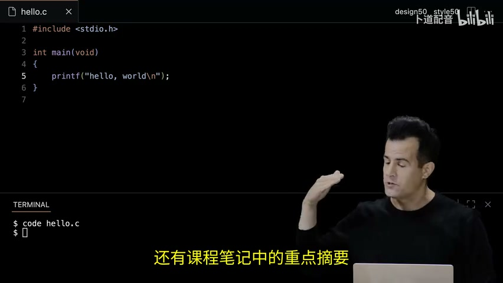

[查看演示 11:00](https://www.bilibili.com/video/BV1Lt6qBcExg/?p=3&t=660)

只修改 hello.c 再运行 ./hello，执行的仍是先前生成的程序。正确循环是：保存源码 → make hello → ./hello。这与 Git 的暂存类似：修改一个位置，不会自动更新另一个已经生成的版本。

### 1.2 报错应该从文件名、行号和第一条错误开始读

老师删除分号后，编译器提示类似 `expected ';' after expression`，并给出文件、行和列。不要因为报错比代码长就认为问题复杂；先找到第一条错误和对应位置。

没有编译错误不代表逻辑正确。例如把名字变量写在引号里，程序可以编译，却会打印字面文字。

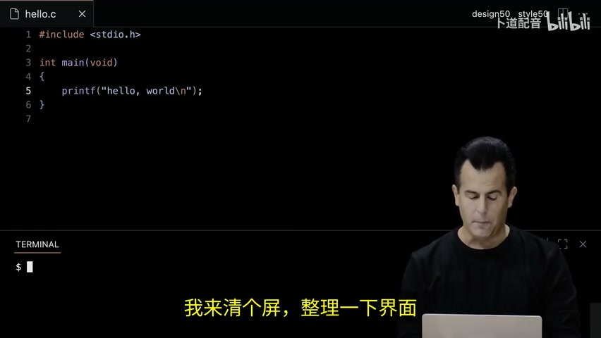

### 1.3 转义序列在字符串里表达换行和特殊字符

| 写法 | 含义 |
|---|---|
| `\n` | 换行 |
| `\r` | 回到行首；与换行不同 |
| `\"` | 在字符串中放一个双引号 |
| `\\` | 放一个反斜杠 |

在源码编辑器里按回车，并不等于在输出中插入换行。要让输出换行，需把 `\n` 放进字符串。课堂去掉它后，终端提示符紧接在 hello, world 后面。

不熟悉函数时查 [CS50 简化手册](https://manual.cs50.io/)，尤其是所需头文件、参数、返回值和示例。手册比凭记忆猜函数写法更可靠。

## 二、终端操作的是文件和目录，当前位置决定路径含义

VS Code 是图形界面（GUI），终端是命令行界面（CLI）。文件浏览器和终端操作的是同一套文件。CS50 的浏览器编辑器连接到云端 Linux；在自己的 Mac 上打开终端则通常操作本机。

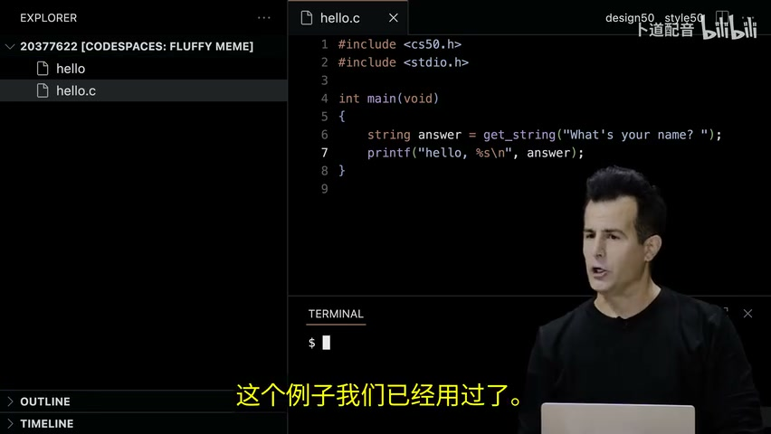

| 命令 | 含义 | 示例 |
|---|---|---|
| `ls` | 列出当前位置文件 | `ls` |
| `mkdir` | 建立目录 | `mkdir hello` |
| `cd` | 切换目录 | `cd hello` |
| `mv` | 移动或重命名 | `mv hello.c old.c` |
| `cp` | 复制文件 | `cp hello.c backup.c` |
| `rm` | 删除文件 | `rm backup.c` |
| `rmdir` | 删除空目录 | `rmdir hello` |

`.` 是当前目录，`..` 是父目录；`mv hello.c ..` 把文件移到上一级，`cd ..` 返回上一级。普通 shell 中不带参数的 cd 回到 HOME；CS50 的环境可能配置自己的起始位置。

课堂先删除可执行文件 hello，再创建同名目录 hello；同一目录不能同时有同名文件和目录。删除 hello 不会删除 hello.c，仍可重新编译。

Mac 上这些基础命令同样适用，但课堂的颜色、星号和删除确认可能来自 shell 配置，不能认为所有终端默认都会如此。`rm` 通常不送入废纸篓。Tab 可补全文件名，上下方向键可翻阅历史命令，clear 或 Ctrl+L 清理显示；它们不删除项目文件。

## 三、变量保存返回值，格式占位符把变量放入输出

### 3.1 函数的输入、返回值和副作用各有职责

函数是一项可以调用的操作。参数是给函数的输入；返回值是函数交还程序、可继续使用的数据；副作用是调用产生的其他效果，例如打印文字。

课堂从 Scratch 的 ask-and-wait 转换到 C：

```c
#include <cs50.h>
#include <stdio.h>

int main(void)
{
    string answer = get_string("What's your name? ");
    printf("hello, %s\n", answer);
}
```

`get_string` 显示问题并读取用户输入，返回一段文字；`answer` 保存结果。等号表示把右侧结果赋给左侧变量，不是数学等式。

**string 和 get_string 来自 CS50 库，不是标准 C 自带的这些名称。** 本例需包含 cs50.h 并链接 CS50 库；普通 Mac 环境不一定已经安装。

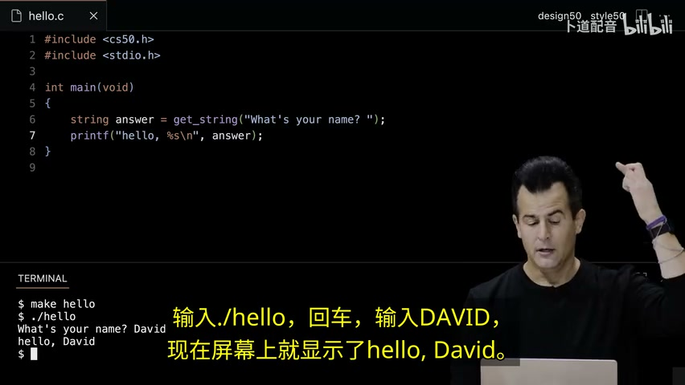

[查看演示 41:00](https://www.bilibili.com/video/BV1Lt6qBcExg/?p=3&t=2460)；源码：[hello2.c](../source/src1/hello2.c)。

`printf("hello, answer\n")` 会原样输出 answer。正确版本中，引号内的逗号是文字；引号外的逗号分隔函数参数。两个参数都叫“输入”，但一个由程序员写定，一个来自运行时的用户。

### 3.2 类型告诉程序怎样理解值，格式必须与类型匹配

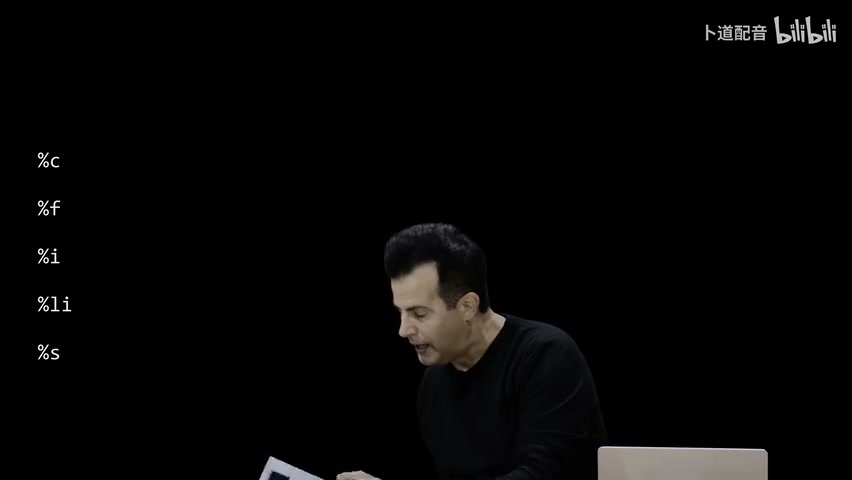

| 类型 | 保存什么 | 获取输入 | printf 格式 |
|---|---|---|---|
| `string`（CS50） | 文字串 | get_string | `%s` |
| `char` | 单个字符，例如 'y' | get_char | `%c` |
| `int` | 整数 | get_int | `%i` |
| `long` | 更大范围整数，范围依平台 | get_long | `%li` |
| `float` | 浮点近似值 | get_float | `%f` |
| `double` | 通常更高精度浮点值 | get_double | `%f` |
| `bool` | 真或假 | 本讲没有 get_bool | 依输出方式选择 |

字符用单引号 `'y'`，字符串用双引号 `"yes"`。CS50 的 get_char 拒绝多个字符，get_int 拒绝 dog 等非整数，但“是整数”不等于“符合业务要求”，例如负数也可以是整数。

## 四、条件判断决定执行哪条路径，赋值和比较不能混用

```c
if (x < y)
{
    printf("x is less than y\n");
}
else if (x > y)
{
    printf("x is greater than y\n");
}
else
{
    printf("x is equal to y\n");
}
```

布尔表达式是结果能判定为真或假的问题。对于本讲比较的整数，小于和大于都不成立时就相等，最后可以直接 else，不必重复检查。

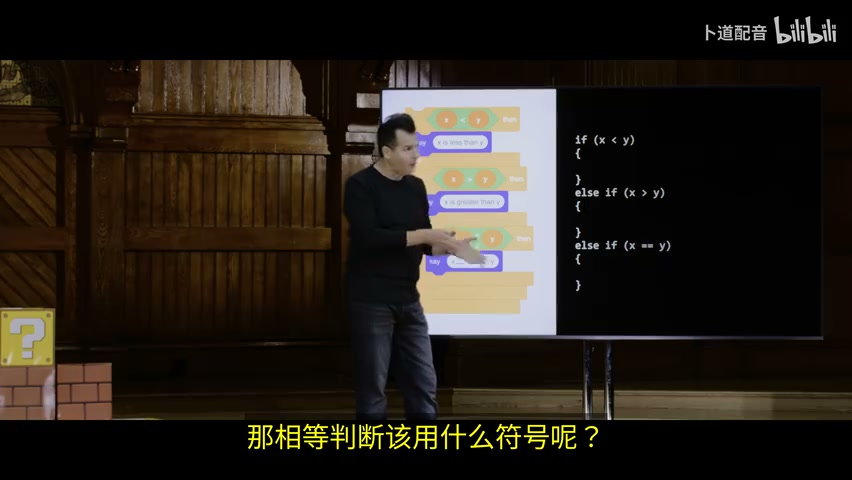

[查看条件讲解 60:00](https://www.bilibili.com/video/BV1Lt6qBcExg/?p=3&t=3600)；源码：[compare4.c](../source/src1/compare4.c)。

三个独立 if 会分别检查三个问题；if / else if / else 命中一个分支后就跳过其余分支。课堂用流程图展示这条路径差异。条件可能同时成立时应按实际需求选独立 if，不能机械替换。

| 运算符 | 含义 |
|---|---|
| `=` | 赋值 |
| `==`、`!=` | 相等、不等 |
| `<`、`>`、`<=`、`>=` | 比较大小 |
| `||` | 逻辑或，至少一项为真 |
| `&&` | 逻辑与，两项都为真 |
| `!` | 逻辑否定 |

同意条款的例子中，允许大小写：

```c
if (c == 'y' || c == 'Y')
{
    printf("Agreed.\n");
}
else
{
    printf("Not agreed.\n");
}
```

不能用 &&，因为一个字符不可能同时是小写 y 和大写 Y。也不能仅写 `c == 'y' || 'Y'`；两边都需完整比较。

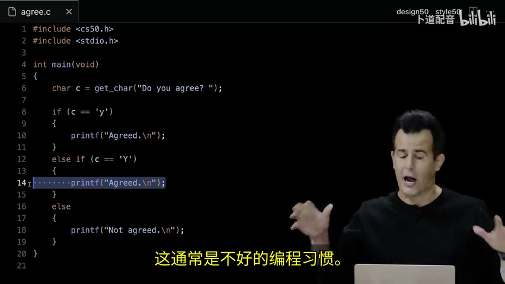

源码：[agree2.c](../source/src1/agree2.c)。

## 五、循环重复操作，输入校验需要重复到条件满足

### 5.1 for 把计数循环的三个部分放在一起

```c
for (int i = 0; i < 3; i++)
{
    printf("meow\n");
}
```

依次执行：初始化 i=0 → 检查 i<3 → 执行循环体 → i 加一 → 再检查。i 为 0、1、2 时各执行一次，到 3 时停止，总共三次。初始化只做一次。

`counter = counter + 1`、`counter += 1`、作为单独语句的 `counter++` 都可完成加一。`i--` 表示减一，没有用三个加号表达加三的语法。


也可以用 while：

```c
int i = 0;
while (i < 3)
{
    printf("meow\n");
    i++;
}
```

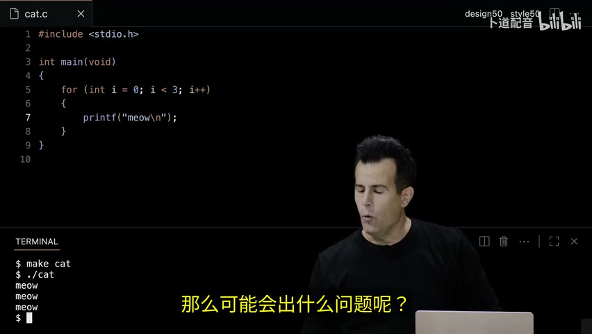

[查看循环演示 89:00](https://www.bilibili.com/video/BV1Lt6qBcExg/?p=3&t=5340)；源码：[cat4.c](../source/src1/cat4.c)。

### 5.2 无限循环要有退出机制，Ctrl+C可以中断当前程序

`while (true)` 的条件一直为真。课堂无限打印 meow，甚至出现云端 CPU 使用率警告。预期循环要有明确结束条件；意外跑不停时可在终端按 Ctrl+C 中断。

`break` 退出当前所在的最近一层循环；`continue` 跳过本轮剩余部分，进入下一轮。在 for 循环中 continue 后还会执行更新部分，不能一概理解为完全跳过它。

### 5.3 只问第二次不够，do-while适合至少输入一次

用户可能连续输入负数。用 if 只重新询问一次，并不能保证合法输入。课堂逐步改为重复检查：

```c
int n;
do
{
    n = get_int("What's n? ");
}
while (n < 0);
```

先询问，再检查；负数就重试，零或正数就结束。本例允许零次 meow。while 在循环前检查，do-while 在循环后检查，所以后者至少执行一次。最后的分号不能漏。

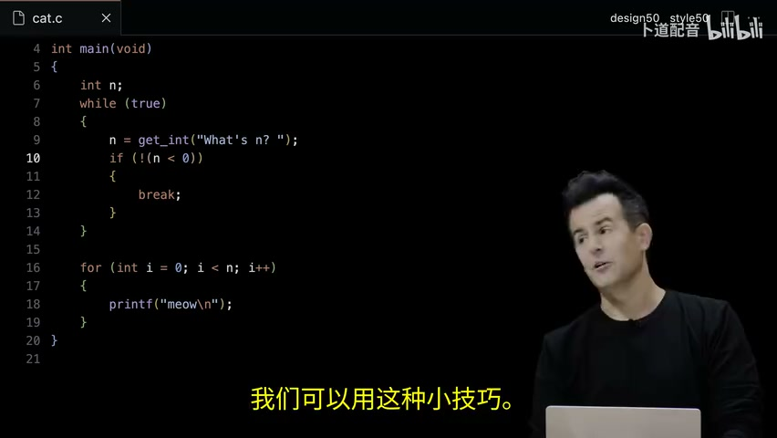

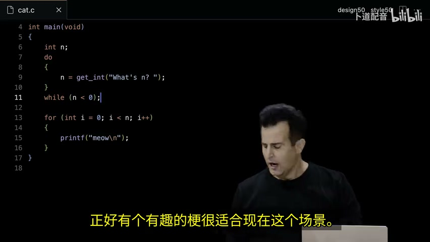

[查看 104:00](https://www.bilibili.com/video/BV1Lt6qBcExg/?p=3&t=6240)；源码：[cat10.c](../source/src1/cat10.c)。课堂用跑到悬崖后才检查的动画类比后检查；理解的是执行次序，不能把“至少执行一次”当成所有场景都更好的选择。

### 5.4 变量作用域决定哪些代码能访问它

在循环体的花括号内声明 `int n`，循环外的 for 不能直接访问它。于是课堂报 `use of undeclared identifier n`。把声明移到外层 main 中，再在循环内赋值，可以让后面的代码使用它。

`int n;` 只声明，不保证局部变量自动为零。要在读取它前赋值。另一函数也不能凭名字访问 main 内的 n，需要通过参数传递。

## 六、函数把已解决的步骤封装起来，参数和return传递数据

### 6.1 声明先告诉编译器接口，定义提供实际操作

```c
#include <stdio.h>

void meow(int times);

int main(void)
{
    meow(3);
}

void meow(int times)
{
    for (int i = 0; i < times; i++)
    {
        printf("meow\n");
    }
}
```

`void meow(int times);` 是函数原型，声明名字、参数和返回类型；下面带函数体的是定义。调用 meow 之前要有可见声明。这样 main 可以放在文件前面，让读者先看主要流程。

返回类型 void 表示不返回值；参数位置写 void 表示没有参数。`void meow(void)` 与 `void meow(int times)` 是两个不同接口。

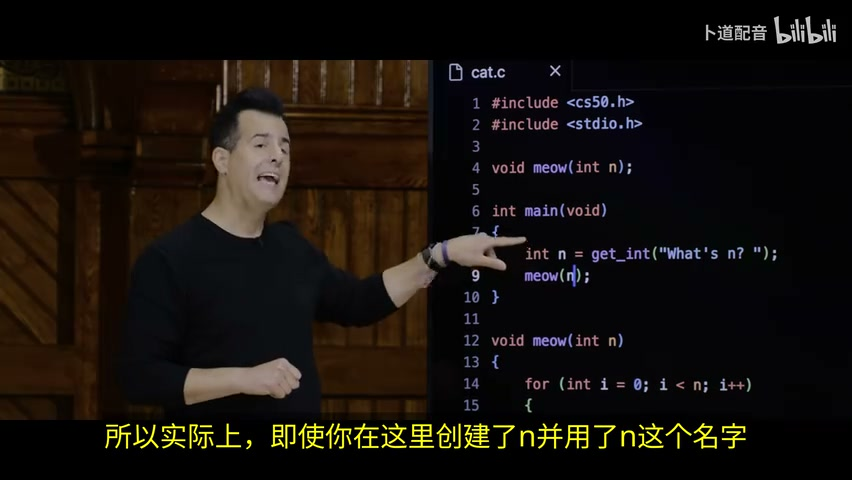

[查看函数演示 114:00](https://www.bilibili.com/video/BV1Lt6qBcExg/?p=3&t=6840)；源码：[cat12.c](../source/src1/cat12.c)。

main 中的 n 和 meow 中的 times 可以名字不同。对于这里的整数参数，调用时传入值；meow 得到自己的参数，不是直接访问 main 的局部变量。

### 6.2 return让调用者继续使用结果

课堂把“得到非负整数”的校验封装为 get_n：

```c
int get_n(void)
{
    int n;
    do
    {
        n = get_int("What's n? ");
    }
    while (n < 0);
    return n;
}
```

它无输入参数，返回 int。main 可写 `int n = get_n();`，再 `meow(n);`。需要在 main 之前加 `int get_n(void);` 的声明。

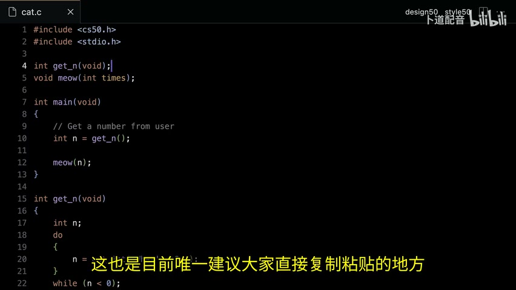

发布的 [cat15.c](../source/src1/cat15.c) 使用 get_positive_int 并要求 n ≥ 1，与课堂 get_n 允许零的演示略有不同；阅读时以各自条件为准。这就是抽象：给一段低层操作起名字，调用者使用接口，不必重复输入校验细节。get_n 也会显示提示，它既有返回值，也有交互副作用。

### 6.3 正确性、设计和风格是三个不同检查维度

| 维度 | 问题 | 课堂工具 |
|---|---|---|
| 正确性 | 行为是否符合要求，边界输入是否处理？ | check50 |
| 设计 | 是否重复代码、职责是否清楚？ | design50与人工反馈 |
| 风格 | 缩进、命名、注释是否便于读？ | style50 |

打印三次相同语句可以正确，却不如循环便于修改。三个互斥条件逐个检查可以正确，却可能做不必要的工作。命名 sum 比不解释的 z 更清楚；是否新增变量要看可读性，不能简单规定“只用一次的变量都不好”。

`//` 后是给人的注释，不执行。好的注释解释目的或约束。课程工具的命令与作业标识应从官方具体题目获取，不随意复制别的作业标识。

## 七、嵌套循环按行列输出，换行位置决定二维结构

输出一排四个问号：循环里 `printf("?");`，循环结束后 `printf("\n");`。每个字符后换行会变成一列；完全不换行则终端提示符会接在后面。

输出三行三列砖块：

```c
#include <stdio.h>

int main(void)
{
    const int n = 3;
    for (int row = 0; row < n; row++)
    {
        for (int column = 0; column < n; column++)
        {
            printf("#");
        }
        printf("\n");
    }
}
```

外层控制行，内层从左到右打印一行，每完成一行再换行。输出：

```text
###
###
###
```

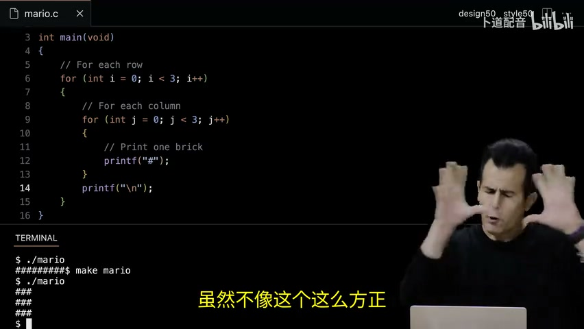

[查看 130:00](https://www.bilibili.com/video/BV1Lt6qBcExg/?p=3&t=7800)；源码：[mario5.c](../source/src1/mario5.c)。

row 和 column 比两个不解释的 i 更能表达职责。`const int n = 3` 把尺寸放在一个地方，并禁止通过这个变量直接重新赋值，避免只修改一处循环边界导致长方形。终端字符的宽高不同，逻辑上的3×3未必看起来是正方形。

## 八、有限位数限制数值范围，算术结果需要检查

### 8.1 算术运算符既能算数，也受类型约束

`+`、`-`、`*`、`/` 是加减乘除；`%` 是整数余数，例如 7 % 3 得到 1。printf 中的 `%i` 则是格式的一部分，与取余运算不是同一种用法。

课堂先做两数加法，再用“翻倍送给下个人”的例子展示 dollars *= 2。get_char 的提示也能接受类似 printf 的格式占位符。

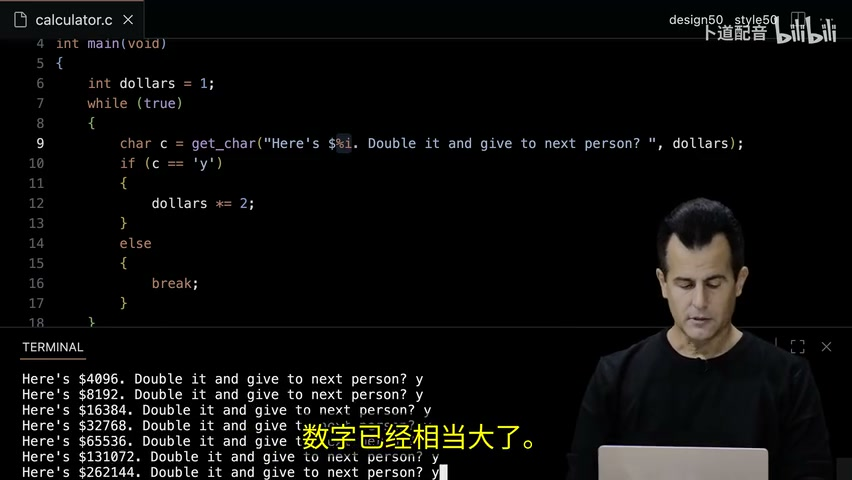

[查看 139:00](https://www.bilibili.com/video/BV1Lt6qBcExg/?p=3&t=8340)

### 8.2 更大整数类型只能推迟范围问题

常见32位有符号 int 的范围是 −2,147,483,648 到 2,147,483,647。课堂不断乘二，出现负值或零，再改 long，最终也超过范围。

**技术补充：C有符号整数溢出是未定义行为，不能写程序依赖它必然绕回负数或零。** 课堂观测用来说明有限范围，不是所有编译器的行为保证。long 在课堂 Linux 环境为64位，不能推断所有平台都如此。

课堂举了波音787控制单元计数器和吃豆人关卡异常作为真实世界案例。需要带走的结论是：长期累积的计数也会触及边界；换更大类型只能扩大范围，仍需根据最大输入和最长运行时间设计。这里不把课堂简化解释扩展为对航空事故的独立调查结论。

### 8.3 整数除法丢弃小数，浮点数也不是无限精度

两个 int 相除，`1 / 3` 的结果是整数 0；把这个结果再保存成 float，也不能找回已经丢掉的小数。课堂改用 float 输入和 `%f`，才能显示约0.333333。

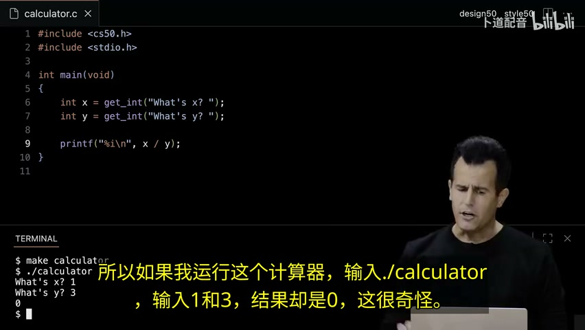

[查看 146:00](https://www.bilibili.com/video/BV1Lt6qBcExg/?p=3&t=8760)；源码：[calculator4.c](../source/src1/calculator4.c)、[calculator5.c](../source/src1/calculator5.c)、[calculator6.c](../source/src1/calculator6.c)。

打印 `%.50f` 只要求显示50位小数，不能增加内部存储精度。1/3无法在有限位数中精确表示，后面的数字暴露近似误差。double 通常提高精度，仍不是任意实数的精确表示。整数除法向零截断，不是四舍五入。

### 8.4 日期也是数字表示问题，表示范围要覆盖真实需求

课堂最后回顾 Y2K：只存两位年份，99之后的00无法自行区分1900与2000。又介绍2038问题：使用有符号32位 Unix 秒计数的系统，会在2038年触及表示上限。

这不是说所有2038年的计算机都会出问题，而是指出特定时间表示方式的边界。与翻倍、整数除法和浮点精度一样，程序正确性不仅依赖公式，也依赖数据表示。

## 实际学习时，每次只跑一个可解释的小实验

建议按下面次序练习，不一次复制所有示例：

1. hello：输出一行，去掉\n，重新编译，比较结果。
2. greeting：获取名字，用%s输出；故意把answer放进引号，区分语法正确和逻辑正确。
3. compare：输入1与2、2与1、1与1，覆盖三个分支。
4. meow：预测0、1、3次的输出，再验证负数重试。
5. function：把meow与get_n独立封装，解释参数和返回值。
6. grid：把n改成2和4，检查换行位置。
7. calculator：比较整数除法和浮点除法，解释为什么显示更多位不等于更精确。

以上示例是课堂练习，不是完整 Pset 1 答案。学习目标是能预测执行次序、解释错误、根据输入验证行为。

Mac 使用说明：标准 stdio 示例可在安装开发工具后用 `clang hello.c -o hello` 编译；涉及 cs50.h 的例子需配置 CS50 库，或使用课程 cs50.dev 环境。`code` 命令也需编辑器安装与PATH配置，不能因为课堂能运行就认定本机已具备。这里将这些作为环境补充，与视频讲解区分。

## 关键术语速查

| 术语 | 一句话解释 |
|---|---|
| source code | 人编写的程序源码 |
| compiler | 把源码转换为目标代码的编译器 |
| executable | 可以启动运行的程序文件 |
| argument | 调用函数时传入的值 |
| return value | 函数返回给调用者的值 |
| side effect | 输出、交互等其他可观察效果 |
| scope | 名字可以被访问的代码范围 |
| prototype | 函数接口的提前声明 |
| abstraction | 将低层步骤封装成可使用的接口 |
| truncation | 丢弃超出结果类型的小数部分 |
| integer overflow | 整数运算超出类型可表示范围 |
| floating-point imprecision | 有限表示引起的浮点近似误差 |

[返回CS50x目录](../README.md)
