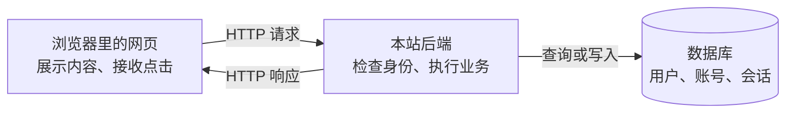

# 登录注册基础：用产品语言理解技术

[返回专题](README.md) · [下一篇：跟着一次 Google 登录走一遍](google-login.md)

## 1. 注册、登录、权限分别在解决什么

| 概念 | 产品语言 | 例子 |
| --- | --- | --- |
| 注册（Sign up） | 在本站建立一个账号 | 首次登录后创建本站用户记录 |
| 身份认证（Authentication） | 确认你是谁 | 验证密码，或验证 Google 提供的身份信息 |
| 登录（Sign in） | 认证成功后建立可持续使用的登录状态 | 建立本站 session |
| 授权（Authorization） | 决定你可以做什么 | 普通成员能阅读文档，管理员能删除成员 |

Google 已经有你的账号，不代表本站也有。很多产品把“Google 登录”和“Google 注册”合并成一个入口：第一次成功认证就创建本站账号，以后找到已有账号再登录。是否允许自动注册、是否必须受邀，是产品和后端共同决定的规则。

同一个邮箱通过密码和 Google 进入时，是否合并账号也需要明确策略，不能只因为前端看到两个邮箱相同就直接合并。

## 2. 常见的登录方式

| 方式 | 用户做什么 | 产品需要考虑什么 |
| --- | --- | --- |
| 邮箱或用户名 + 密码 | 输入账号密码 | 密码重置、凭据泄露与登录限流；后端保存密码哈希，不保存明文密码 |
| 短信或邮箱验证码 | 接收并输入一次性验证码 | 有效期、重试限制、发送成本、手机号或邮箱被盗的风险 |
| 邮箱链接（Magic link） | 点击邮件里的短期登录链接 | 链接过期、只能使用一次、跨设备体验 |
| 第三方登录 | 跳到 Google、Apple 等确认身份 | 授权失败、账号绑定、第三方不可用时如何恢复访问 |
| 通行密钥（Passkey） | 用指纹、面容或设备解锁 | 基于公钥的认证、设备支持和账号恢复；网站不接收指纹原始数据 |
| 企业单点登录（SSO） | 使用组织身份进入应用 | 组织归属、成员离职、账号开通与回收；常见协议是 OIDC、SAML |

SSO 描述的是“一次认证，在多个应用间复用身份”的体验与机制，不是一个独立协议。OAuth 2.0 主要解决授权访问；OpenID Connect（OIDC）在其上增加标准化的身份认证。本专题的 Google 登录使用 `openid` scope 来获取身份信息。

延伸阅读：[SSO 视频图文教程](sso.md)，进一步区分身份平台、业务应用、各自的会话，以及 OIDC、SAML 和 JWT 的关系。

## 3. 客户端、服务端与数据库



“客户端”和“服务端”是通信中的角色。在这里，浏览器是客户端，Node.js 运行的后端接收它的请求；后端向 Google 发请求时，又充当 Google 接口的客户端。

后端通常指处理请求的程序，以及它承担的业务逻辑，不等于“一台物理电脑”。一个后端可以运行多个进程或实例，一台电脑也可以运行多个服务。只看几个域名或几个 API 路径，不能准确数出有几台服务器。

## 4. 浏览器、标签页、页面与 session

- **浏览器**是应用，例如 Chrome、Safari。
- **标签页（tab）** 是浏览器里的一个浏览界面，可以先后加载不同页面。
- **页面**通常指当前展示的网页文档；单页应用也会在同一个文档里切换不同路由视图。
- **登录会话（session）** 是网站认可的一段登录状态，与标签页不是一一对应。

例如，同一浏览器配置文件里的两个标签页访问同一个网站，通常会共享符合域名、路径等规则的 Cookie，因此常常共享登录状态。隐身窗口、不同浏览器配置文件则通常使用独立的存储环境。具体行为仍取决于网站实现和浏览器存储限制。

从 `/home` 切到 `/settings`，可以由前端更新页面内容，也可以由浏览器重新请求整个文档。同一域名并不能决定采用哪一种方式。

## 5. Cookie、session 与 token

| 名称 | 是什么 | 本 Demo 中的用途 |
| --- | --- | --- |
| Cookie | 浏览器保存并按规则随请求发送的一小段数据 | 携带本站的会话凭据 |
| session | 本站维护的登录状态 | 后端检查用户身份和会话是否过期 |
| token | 令牌的统称，不是单一格式 | Google access token、ID token、本站 session token 各有职责 |

Cookie 不是 session 本身。在这个 Demo 中，数据库保存会话记录，Cookie 携带会话凭据；后端根据凭据检查记录。另一些系统会使用不同的会话存储方式。

`HttpOnly` 表示网页 JavaScript 不能通过 `document.cookie` 读取该 Cookie，浏览器仍能按规则发送它。它不代表 Cookie 自动具备所有安全保障。

后端返回 **401**，通常表示缺少有效身份凭据；返回 **403**，通常表示请求不被允许，原因可能是权限不足或来源校验失败。前端隐藏按钮不能替代后端检查。

## 6. JavaScript、Node.js、npm start

**JavaScript 是语言，Node.js 是运行 JavaScript 的环境。** 浏览器可以运行 JavaScript 来控制网页，Node.js 可以在电脑或服务器上运行 JavaScript 来接收请求、查询数据库、读写文件。两者提供的能力不同，例如 Node.js 默认没有浏览器的页面 DOM。

`npm` 是 Node.js 常用的包管理和任务运行工具。运行 `npm start`，就是执行项目 `package.json` 中配置的 `start` 任务。本例写的是：

```json
{
  "scripts": {
    "start": "node server.mjs"
  }
}
```

所以 `npm start` 在本例等同于 `node server.mjs`：启动提供网页和接口的后端程序。`.mjs` 表示使用 ES 模块语法的 JavaScript 文件。其他项目的 `npm start` 可能运行不同命令，并不是固定启动同一种服务器。

`npm ci` 按锁定文件安装依赖；`npm start` 启动程序。在启动它的终端按 Ctrl + C 可以停止。`localhost` 表示正在访问的这台电脑，`3000` 是本例服务监听的端口。

## 7. 产品设计时要问清楚什么

设计登录注册时，可以顺着用户旅程检查：首次成功登录是否创建账号？是否必须受邀？同一个人使用不同方式进入时如何绑定？会话多久过期？退出只影响当前设备还是所有设备？用户取消 Google 授权时回到哪里？无法使用原来的登录方式时如何恢复账号？

这些规则决定界面背后的真实行为。具体到本 Demo：允许首次 Google 登录建立账号；会话配置为 24 小时，并按库的更新机制续期；退出撤销当前会话，不会退出整个 Google 账号。

## 来源

- [MDN：HTTP Cookie](https://developer.mozilla.org/en-US/docs/Web/HTTP/Cookies)
- [Node.js：Introduction](https://nodejs.org/en/learn/getting-started/introduction-to-nodejs)
- [npm：npm start](https://docs.npmjs.com/cli/commands/npm-start)
- [Google：OpenID Connect](https://developers.google.com/identity/openid-connect/openid-connect)
- [Better Auth：Session management](https://www.better-auth.com/docs/concepts/session-management)
