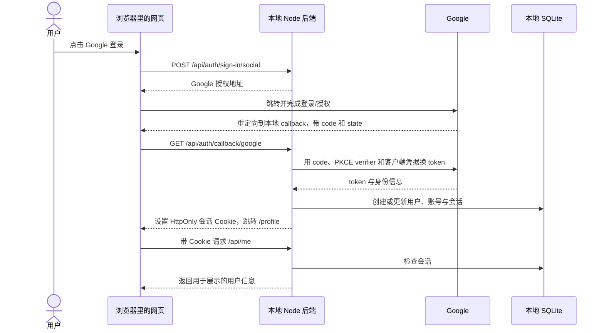

# Google 登录：一个能运行的学习 Demo

前端是 HTML、CSS 和 JavaScript，后端是 Node.js + Express，登录交给 Better Auth，用户和会话保存在本地 SQLite 数据库。一个后端进程同时提供网页和接口。

## 启动

需要 Node.js 22.18 或更高版本（本机已使用 Node.js 25.8.1 验证）。

```sh
cd AI-wiki/login-registration/demo
npm ci
npm start
```

打开 <http://localhost:3000>。首次启动自动创建 `.env` 并生成随机会话密钥。没有 Google 凭据时也能查看页面、配置指南，点击“测试受保护接口”观察真实的 HTTP 401。

## 配置 Google

启动后可打开排版版指南 <http://localhost:3000/setup.html>；不运行时也可以阅读本节步骤。

1. 打开 [Google Cloud Console](https://console.cloud.google.com/)，新建或选择项目。
2. 在 Google Auth Platform 配置应用品牌和受众；个人测试可以使用 External + Testing，并添加自己的 Google 邮箱作为测试用户。
3. 创建类型为 **Web application** 的 OAuth 客户端。
4. 在 Authorized JavaScript origins 填 `http://localhost:3000`，在 Authorized redirect URIs 填 `http://localhost:3000/api/auth/callback/google`。本例的服务端授权码流程关键是后者，必须完全匹配。
5. 打开本地 `.env`，填写 `GOOGLE_CLIENT_ID` 和 `GOOGLE_CLIENT_SECRET`，保留已经生成的 `BETTER_AUTH_SECRET`。
6. 停止并重新执行 `npm start`，点击 Google 登录，完成授权后应回到个人信息页。

不要把 Client Secret 发到聊天或放入前端代码。`.env`、数据库和依赖目录已被此目录的 `.gitignore` 排除。

## 一次登录发生了什么



这里有三种东西，职责不同：

| 名称 | 人话解释 | 在本例中的去向 |
| --- | --- | --- |
| Authorization code | Google 发出的临时兑换码 | 浏览器带回后端，后端拿去兑换 |
| Google token | Google 签发的令牌，用于身份验证或访问其接口 | Better Auth 在后端处理；可能持久化到账号表 |
| 本站 session | 本网站认可的登录状态 | 服务端保存会话记录，浏览器持有 HttpOnly Cookie |

刷新页面时，浏览器会自动带上本站 Cookie。后端检查它对应的会话是否有效，再决定是否返回个人信息。退出登录会撤销本站会话，不会退出整个 Google 账号。

## 对照代码看

| 文件 | 职责 |
| --- | --- |
| `server.mjs` | 读取配置、创建本地数据库、启动服务器 |
| `app.mjs` | 配置 Google 登录、挂载 Better Auth、检查会话、定义业务接口 |
| `public/index.html` | 登录页与接口体验入口 |
| `public/profile.html` | 登录后的个人信息页 |
| `public/setup.html` | Google 配置步骤与常见问题 |
| `public/app.js` | 按钮点击、调用接口、跳转、展示结果 |
| `public/style.css` | 页面样式 |
| `test/auth.test.mjs` | 用独立内存数据库验证认证边界 |

需要重点读的后端逻辑是 `requireSession`：前端隐藏按钮只影响显示，真正决定能否读取数据的是后端的会话检查。OAuth 协议细节由 Better Auth 依赖实现，因此本目录业务代码量不代表从零实现认证系统的代码量。

## 验证

```sh
npm test
```

5 组测试覆盖：未配置与未登录状态、Google 授权 URL 的 state/PKCE/回调地址、异常来源和站外跳转、会话访问与退出撤销、过期会话。测试凭据完全虚构，测试用户只存在于测试的内存数据库里，不会出现在实际页面。

**这些测试不包含真实 Google 授权、token 兑换或身份信息获取。** 配置完成后还需手动验证：登录 → 个人信息正确 → 刷新后仍登录 → 受保护接口 200 → 退出 → 接口 401。

## 网络和本地使用范围

浏览器能访问 Google，不一定表示 Node 后端也能访问。若需要 HTTP 代理，Node.js 24.5+ 可在启动时明确启用环境代理，例如代理端口为 7897：

```sh
NODE_USE_ENV_PROXY=1 HTTPS_PROXY=http://127.0.0.1:7897 NO_PROXY=localhost,127.0.0.1 npm start
```

端口需按自己的代理软件设置。代理软件必须运行。原始 Demo 验证时曾用此方式访问 Google discovery 接口并收到 200；这不等于真实登录测试通过，也不代表其他电脑的网络可用。

这是只绑定本机地址的学习 Demo。SQLite 包含身份与会话数据，应视作私密数据；这里没有额外实现数据库字段加密。正式上线还需 HTTPS、生产密钥与数据库管理、备份、限流、监控及部署迁移策略。不要直接把本地数据库放到公开服务器目录。

## 官方来源

- [Google：Web server OAuth 2.0](https://developers.google.com/identity/protocols/oauth2/web-server)
- [Google：OpenID Connect](https://developers.google.com/identity/openid-connect/openid-connect)
- [Better Auth：Google provider](https://www.better-auth.com/docs/authentication/google)
- [Better Auth：Express integration](https://www.better-auth.com/docs/integrations/express)
- [Better Auth：Database](https://www.better-auth.com/docs/concepts/database)
