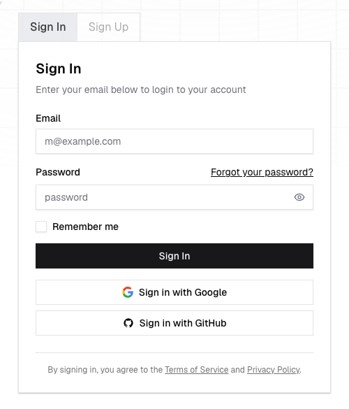
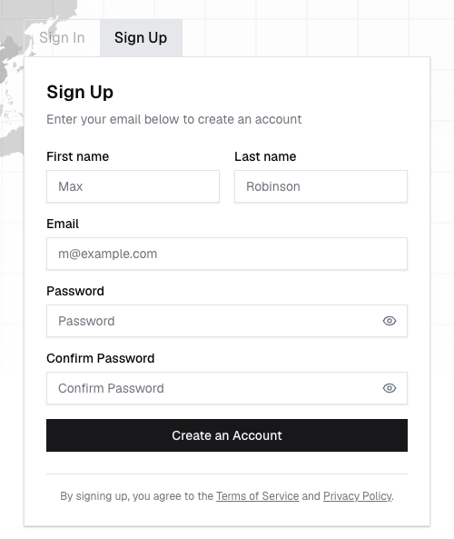
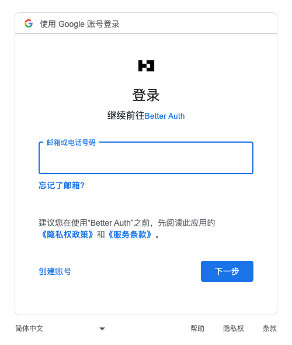
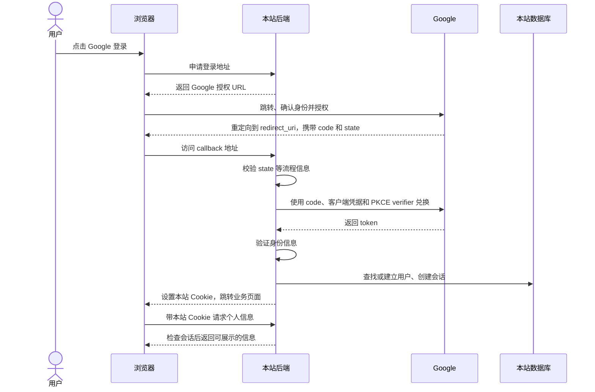

# 跟着一次 Google 登录，理解身份怎么传递

[返回专题](README.md) · [运行配套 Demo](demo/README.md)

案例是 [Better Auth Dashboard](https://dash.better-auth.com/sign-in)，截图与请求观察于 2026-10-25。下面先展示实际看到的部分，再解释按照标准流程通常会发生的后半程。

## 1. 用户看到的是一个登录入口



这一页由网站提供。点击 Google 登录后，网页向**自己的后端**发送请求，而不是在这个页面里收集 Google 密码。

观察到的请求：

```http
POST https://dash.better-auth.com/api/auth/sign-in/social
Content-Type: application/json

{"provider":"google","callbackURL":"/"}
```

这里的 `callbackURL` 是登录完成后的业务落点。Google 控制台中登记的 `redirect_uri` 是接收 Google 授权码的后端入口，两者不是同一个用途。

## 2. 登录和注册可以共用一个页面



观察时，点击 Sign Up 后 URL 仍是 `/sign-in`，界面在同一文档中更新。它证明“换了视图不一定换 URL”，但不能据此推断后台注册逻辑。

注册是否自动完成，需要看后端规则。配套 Demo 使用 Google 首次认证创建本站账号的方式。

## 3. 浏览器跳到 Google



这时用户是在 Google 的页面确认身份。观察到的授权地址包含这些参数，动态值已经从公开证据中移除：

| 参数 | 用产品语言理解 |
| --- | --- |
| `client_id` | 告诉 Google 是哪个已登记的应用发起登录，不是用户 ID |
| `redirect_uri` | Google 完成流程后把授权结果送回哪里 |
| `response_type=code` | 先发一个授权码，由后端继续兑换令牌 |
| `scope=email profile openid` | 请求基础资料、邮箱和 OIDC 身份信息 |
| `state` | 将回来的响应与发起的流程关联，帮助防止请求被串换 |
| `code_challenge`、`S256` | PKCE 校验的一部分，把授权码兑换和原始发起方关联起来 |

Google 密码只在 Google 页面输入。本站不需要取得 Google 密码，也不能把本站 Client Secret 发给浏览器。

## 4. 授权后通常怎样回到网站

以下是依据 Google/OIDC 文档和配套 Demo 实现解释的流程，**不是这次线上案例中实测完成的后半程**。



这条链路有两种通信：**浏览器带授权码回到本站**，以及**本站后端直接向 Google 换取令牌**。后者不会完整出现在浏览器的 Network 面板里。

## 5. 不要把三种凭据混在一起

| 凭据 | 谁发的 | 做什么 |
| --- | --- | --- |
| 授权码（Authorization code） | Google | 短期、一次性地兑换令牌 |
| ID token / Access token | Google | 前者承载可验证的身份声明，后者用于访问允许的 Google 资源 |
| 本站会话凭据 | 本站 | 让本站在后续请求中认出登录用户 |

浏览器之后访问本站，不必每点一个按钮都再去 Google 登录。本站使用自己的会话机制处理请求。退出本站也不等于让用户退出 Google。

## 6. 怎么在自己的代码里追这条链路

1. 从按钮点击处理函数开始，找到它请求的 URL、方法和数据。
2. 搜索对应的后端路由，查看由业务代码还是认证库接管。
3. 找到 Google provider 配置和 callback 路由，确认回调地址与控制台一致。
4. 查看用户、第三方账号、会话的存储位置，以及接口如何检查会话。
5. 查看退出接口如何删除或撤销会话。

在 [Demo](demo/README.md) 中，前端入口是 `public/app.js`；后端在 `app.mjs` 挂载 Better Auth；Google callback 的协议处理由依赖实现。业务接口通过 `requireSession` 检查身份。

浏览器里看到几个域名，只能帮你识别通信对象，不能直接得出后端有多少进程、机器或部署实例。

## 证据边界与来源

本次没有输入 Google 账号、没有完成授权，没有检查线上网站的数据库或部署。网络记录里的状态 `0` 是记录工具的值，不是真实 HTTP 状态；后续 Google 登录页确实观察到 HTTP 200。空的 Cookie 名称列表也不能证明服务没有设置 Cookie。

- [脱敏请求记录](tutorial/network-evidence.json)
- [离线交互教程与截图说明](tutorial/README.md)
- [Google：OAuth 2.0 Web server flow](https://developers.google.com/identity/protocols/oauth2/web-server)
- [Google：OpenID Connect](https://developers.google.com/identity/openid-connect/openid-connect)
- [Better Auth：Google](https://www.better-auth.com/docs/authentication/google)
- [PKCE：RFC 7636](https://www.rfc-editor.org/rfc/rfc7636#section-4)
