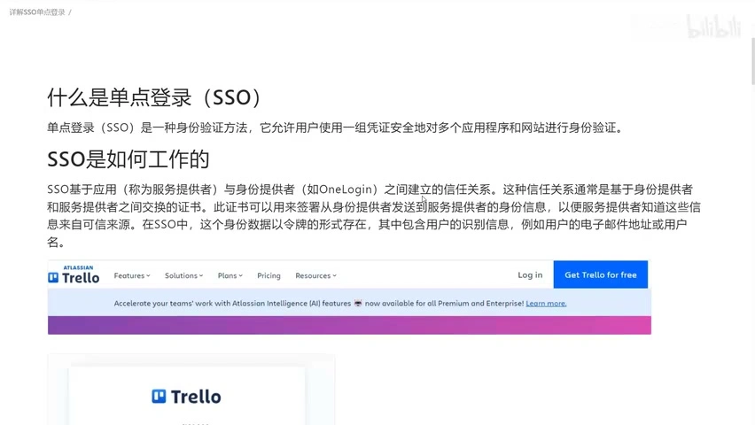
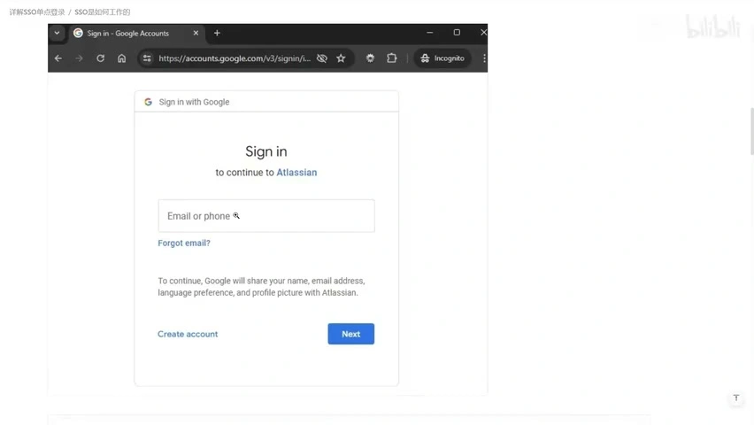
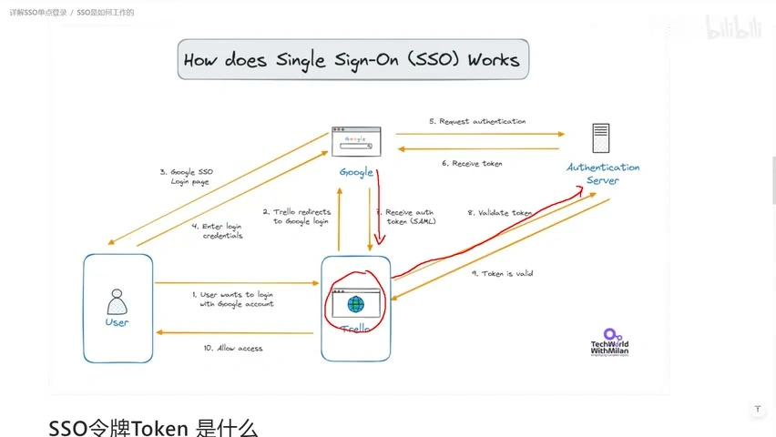
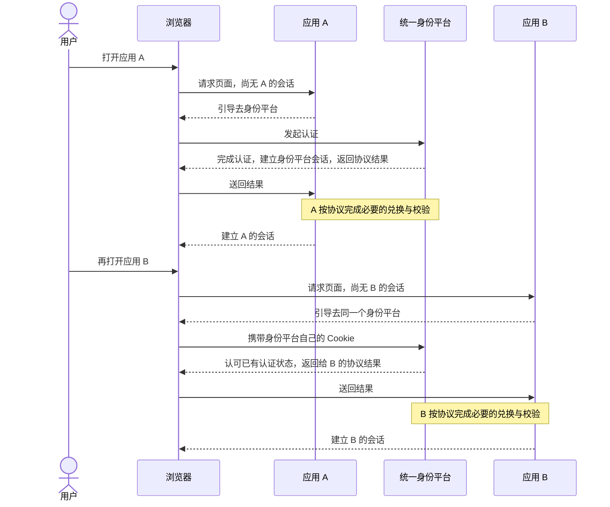
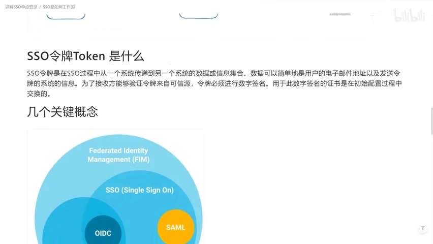
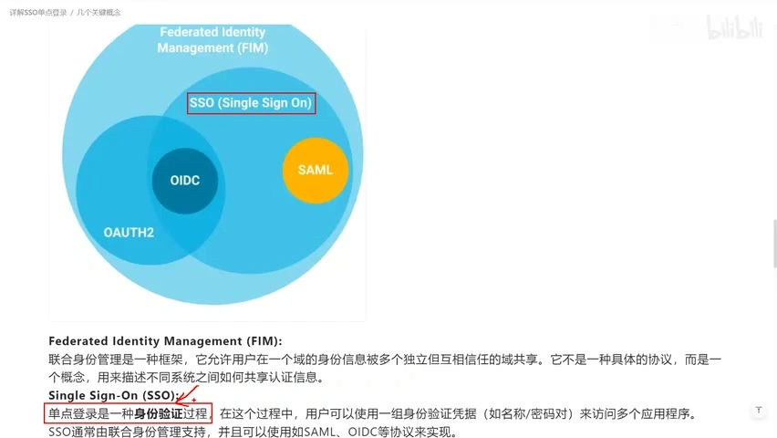
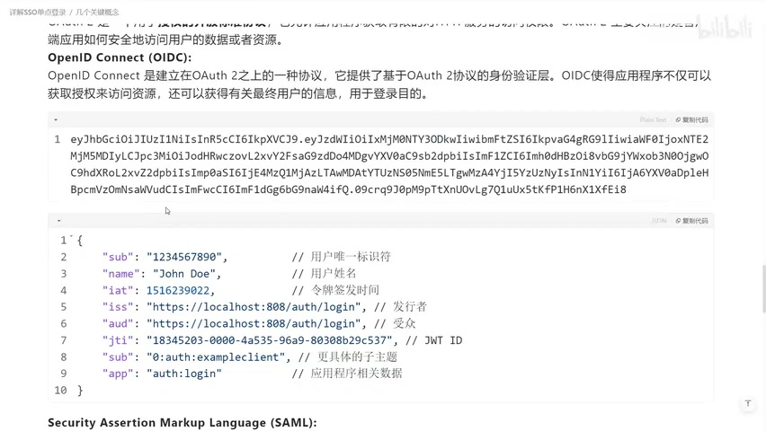
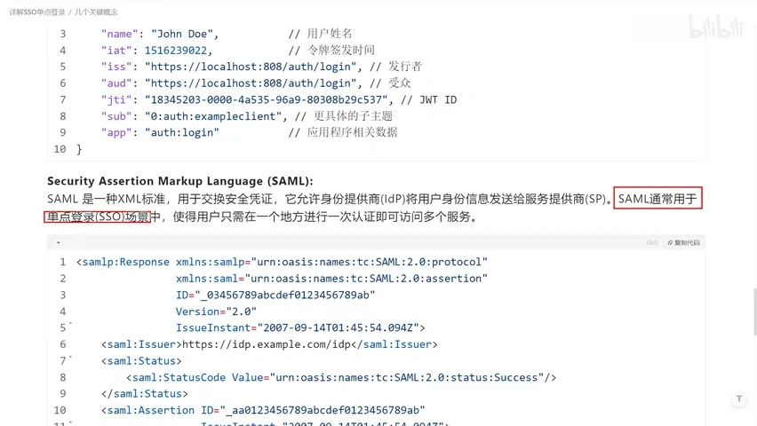
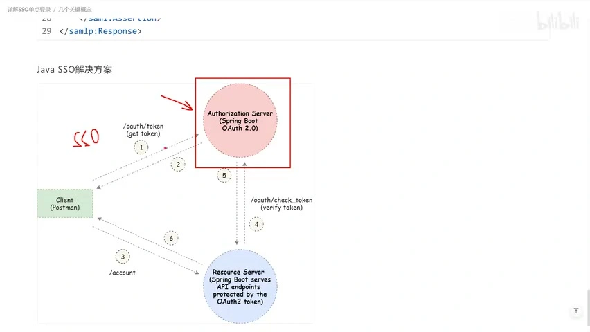

# SSO：为什么登录一次，就能进入多个系统？

[返回登录注册专题](README.md) · [前置：Google 登录图文教程](google-login.md) · [视频时间轴笔记](video-notes/BV11Kt5eVEBk.md)

**SSO（Single Sign-On，单点登录）让多个应用信任同一个身份提供方，从而复用已经完成的认证。** 用户通常不用在每个应用中重新输入密码，但各应用仍可以建立自己的会话、管理自己的账号和权限。

这篇补充笔记基于 IT老齐的 [《【IT老齐615】理解单点登录SSO》](https://www.bilibili.com/video/BV11Kt5eVEBk/)，视频约 9 分 42 秒。视频内容按时间点标注；“补充说明”用于解释实现差异或校正简化表述，不冒充作者原话。截图来自视频，保留画面中的原始署名。

## 1. 用户要的是少登录几次，系统需要的是可信的身份交接

假设一家公司有文档、报销、项目管理三个系统。如果各自维护一套登录，用户可能要记三组密码；即使把密码设成一样，也仍可能要分别登录三次。

SSO 希望达到的体验是：先在公司的身份平台完成一次认证，再进入其他已接入的系统时，通常不用重新输入凭据。能否免输密码，取决于身份平台的会话是否有效，以及应用是否要求重新认证或多因素认证。

视频从“多网站复用一套身份认证能力”讲起。[视频 00:29](https://www.bilibili.com/video/BV11Kt5eVEBk/?t=29)

**补充说明：同一个账号密码、第三方登录、SSO，不是完全相同的概念。**

| 现象 | 可以说明什么 | 还不能说明什么 |
| --- | --- | --- |
| 两个网站使用相同账号密码 | 凭据相同，或账号体系存在关联 | 不证明登录状态可以复用 |
| 网站有“使用 Google 登录”按钮 | 它把身份认证委托给 Google | 不证明其他业务网站已经登录，也不证明采用 SAML |
| 已登录身份平台，进入另一个应用无需重新输入凭据 | 可能正在复用身份平台的认证状态 | 不意味着两个应用共用一份 Cookie 或业务权限 |

## 2. 身份提供方确认“你是谁”，业务应用决定如何接纳你

视频以 Trello/Atlassian 的登录入口跳转 Google 为例。[视频 01:04](https://www.bilibili.com/video/BV11Kt5eVEBk/?t=64)

| 角色 | 技术名称 | 在例子中做什么 |
| --- | --- | --- |
| 身份提供方 | Identity Provider，IdP | 认证用户，并向接入的应用提供可信身份信息 |
| 业务应用 | SAML 中常称 Service Provider，SP；OIDC 中常称 Relying Party，RP | 接受认证结果，关联本站账号，提供业务功能 |
| 浏览器 | User Agent | 承载页面与重定向，按规则携带不同站点的 Cookie |

**术语校正：** 视频约 01:36 把集中管理身份的角色口述为“服务提供者”。为避免混淆，本笔记统一使用 **IdP 表示身份提供方，SP/RP 表示接入它的业务应用**。Google 负责其身份体系，并不意味着业务应用不再保存自己的用户记录。

所谓“信任”，不是收到一段写着邮箱的 JSON 就相信它。应用要配置可信的身份提供方，并依据协议校验签名、签发者、接收方、有效期及请求关联等信息；具体检查项目取决于协议和流程。

## 3. 第一次登录建立信任，后续访问靠会话衔接

视频约 01:53–03:33 用箭头图展示：进入业务网站、跳转身份平台、完成认证、传回凭据、校验后访问业务。[视频 01:53](https://www.bilibili.com/video/BV11Kt5eVEBk/?t=113)

可以先把第一次进入应用 A 理解为：

1. 应用 A 没有你的有效会话，把浏览器引导到身份平台。
2. 身份平台要求你认证，或检查已有的认证状态。
3. 身份平台按协议返回授权结果或身份断言。
4. 应用 A 完成必要的兑换与校验，关联用户，建立自己的会话。

**补充说明：视频这张图是概念示意，不是 Google 登录的抓包记录。** 图中写有 SAML，也画了令牌远程校验；这些步骤不能直接替代本专题 Google OIDC 授权码流程中的 `code → 后端兑换 → 校验 ID Token`。浏览器带回授权码，也不等于浏览器已经拿到了 Google access token。

### 第二个应用为什么能不再要求输入密码？

下面是补充的典型场景，前提是身份平台已有有效会话，且这次不要求再次认证：

**用户少输入了一次密码，但浏览器可能仍经历了重定向，应用 B 也仍需建立自己的会话。** 不同站点的 Cookie 各有作用域；并不是把应用 A 的 Cookie 发给应用 B。

### 后续业务请求不必每次重新找 Google 登录

视频约 03:33–04:48 讨论了这个问题：用户之后访问 `/doSomething`，业务网站怎样知道他是谁？作者给出的常见方案是服务端 Session：浏览器提交会话标识，后端找到会话及关联身份。[视频 03:58](https://www.bilibili.com/video/BV11Kt5eVEBk/?t=238)

在我们的 [Demo](demo/README.md) 中，浏览器携带本站 HttpOnly Cookie，后端通过 `requireSession` 检查本站会话。Google 凭据与本站会话凭据是不同东西。

## 4. Token 是凭据的统称，格式、用途与验证方式要分开看

视频约 04:48–05:01 展示了令牌说明：系统之间传递信息，接收方需要验证其可信性。[视频 04:48](https://www.bilibili.com/video/BV11Kt5eVEBk/?t=288)

可以把签名理解成“能够验证是谁签发、内容是否被改过的封印”。它不是简单在文本后面写个签名，也不等于把内容加密了。

**补充说明：视频对令牌的几处概括需要按实现区分。**

| 问题 | 更准确的理解 |
| --- | --- |
| Token 都含有相同用户资料吗？ | 不一定。ID Token、access token、会话凭据用途不同；有的令牌只是不透明字符串，接收方需查询其含义 |
| 浏览器一定看不到 Token 吗？ | 不一定。服务端保管令牌是一种方案；SPA、原生客户端及其他协议绑定的传递方式会不同。本 Demo 将 Google 凭据留在后端 |
| 校验一定要请求认证服务器吗？ | 不一定。JWT 等可基于可信密钥验签并检查声明；另一些方案会调用令牌内省接口查询状态。密钥更新、撤销等仍需设计 |
| 解析出用户 ID 就能放行吗？ | 不能。读取内容与验证真实性是两回事，身份有效也不等于具有目标资源的权限 |

## 5. FIM、SSO、OAuth、OIDC、SAML 和 JWT 位于不同层次

视频约 05:01 开始梳理这些术语。[视频 05:01](https://www.bilibili.com/video/BV11Kt5eVEBk/?t=301)

| 名称 | 属于什么 | 用一句产品语言理解 |
| --- | --- | --- |
| FIM：联邦身份管理 | 跨身份域协作的理念和体系 | 独立组织或系统约定如何信任彼此提供的身份 |
| SSO：单点登录 | 认证复用的机制与体验 | 尽量让一次认证服务于多个应用 |
| OAuth 2.0 | 委托授权框架 | 让应用获得访问指定资源的许可，不需要直接取得用户密码 |
| OIDC：OpenID Connect | 建立在 OAuth 2.0 上的身份认证协议 | 标准化地向应用证明用户身份，并提供身份声明 |
| SAML 2.0 | 基于 XML 的安全断言与协议体系 | 在身份提供方与业务应用间交换可信声明，常用于企业 SSO |
| JWT：JSON Web Token | 令牌表示格式 | 用结构化声明表达信息，可以配合签名或加密保护 |

**补充说明：OIDC 不是数学意义上的“SSO 与 OAuth 的交集”。** 这种图有助于入门，但标准定义是：OIDC 在 OAuth 2.0 之上增加身份认证能力。OAuth 也不会替业务应用自动决定“谁能删文档、谁能审批报销”；应用仍需设计自己的权限规则。

FIM 讨论跨身份域的信任，SSO 讨论认证复用；同一组织内部也可以有 SSO，不要求一定跨越多个独立组织。

### JWT 是格式，ID Token 是用途

视频约 07:29–07:54 展示 JWT 字符串及 JSON 声明。[视频 07:29](https://www.bilibili.com/video/BV11Kt5eVEBk/?t=449)

OIDC 的 ID Token 使用 JWT，其中 `iss` 表示签发者，`sub` 表示主体，`aud` 表示预期接收方，`exp` 表示过期时间等。身份关联通常需要结合签发者与主体标识，不能把邮箱当作永不变化的唯一键。

**不要直接复制截图作为令牌模板：** 画面中的 JSON 含重复的 `sub` 字段，也没有完整展示 ID Token 的必要声明；它只适合作为说明字段的教学样例。普通签名 JWT 的内容通常可解码查看，“Base64 编码”不是加密。ID Token 也不是可以拿去访问任意业务 API 的通行证。

### SAML 常用于企业 SSO，不应因为使用 XML 就认定过时

视频约 07:54–08:43 展示 SAML XML，与 JWT 作格式对照。[视频 07:54](https://www.bilibili.com/video/BV11Kt5eVEBk/?t=474)

**补充说明：** 视频关于 SAML 使用较少的说法是经验判断，不是本教程验证过的行业统计。SAML 仍是企业身份集成中的常见选项，其断言也不限于认证一种用途。选型时应优先看客户身份平台、已有应用支持、团队经验和维护成本，不能只比较 XML 与 JSON 的外观。

## 6. Java 例子强调分工，不能只复制示意图里的接口名

视频约 08:43–09:33 转向 Java、Spring Boot 和 Authorization Server。[视频 09:08](https://www.bilibili.com/video/BV11Kt5eVEBk/?t=548)

这张图最值得记住的是三个角色：客户端申请和使用凭据；授权服务负责授权与签发令牌；资源服务提供受保护 API，并检查访问许可。

**补充说明：** 图里的 `/oauth/token`、`/oauth/check_token` 是特定示例中的路径，不是所有实现都必须采用的路径。当前 Spring Authorization Server 文档列出可配置的协议端点，实际默认值与这张图也不完全相同。OAuth 授权服务要实现 OIDC 登录，还需相应的身份认证与 OIDC 配置；仅仅“能发 Token”不能证明已经完成 SSO。

## 7. 回到产品设计：接入 SSO 后，还要定义账号与退出行为

以下是结合视频与现有 Demo 的产品补充，不是视频原话。

| 要确认的规则 | 为什么影响用户体验 |
| --- | --- |
| 首次认证后自动注册，还是必须已有账号/邀请？ | Google 认识用户，不等于本站允许所有人进入 |
| 身份来自哪个组织，如何映射本站账号？ | 同邮箱、不同身份提供方可能造成错误合并 |
| 哪些操作要重新认证或 MFA？ | 登录过不代表敏感操作永远免验证 |
| 退出只影响本站，还是整个身份平台及其他应用？ | 本站退出后，身份平台会话可能仍在，再登录可能很快成功 |
| 成员离职或权限撤销后多久失效？ | 身份平台变化未必立刻撤销所有应用已建立的会话 |

我们的 Google Demo 展示的是**一个业务应用接入 Google 身份认证，并管理本站会话**。它没有实现多个业务应用、统一退出或企业成员回收，因此不能用它的单站测试结果证明完整的多应用 SSO 已经跑通。

## 来源与核对范围

- 视频：[IT老齐《理解单点登录 SSO》](https://www.bilibili.com/video/BV11Kt5eVEBk/)，发布时间 2024-09-18；本笔记整理于 2026-11-01。公共可下载视频为 852×480，图中文字清晰度受源视频限制。
- [视频时间轴笔记及素材说明](video-notes/BV11Kt5eVEBk.md)：本地语音识别后结合画面整理，不是官方字幕或逐字稿。
- [OpenID Connect Core 1.0](https://openid.net/specs/openid-connect-core-1_0.html)：身份层、ID Token 和验证要求。
- [OAuth 2.0，RFC 6749](https://www.rfc-editor.org/rfc/rfc6749)：授权框架、access token 与参与角色。
- [JWT，RFC 7519](https://www.rfc-editor.org/rfc/rfc7519)：声明格式及签名、加密的关系。
- [Token Introspection，RFC 7662](https://www.rfc-editor.org/rfc/rfc7662)：远程查询令牌有效状态的机制。
- [SAML 2.0 Core](https://docs.oasis-open.org/security/saml/v2.0/saml-core-2.0-os.pdf)：认证、属性及授权决策断言。
- [Spring Authorization Server：Protocol Endpoints](https://docs.spring.io/spring-authorization-server/reference/protocol-endpoints.html)：当前框架端点配置，以所用版本文档为准。
