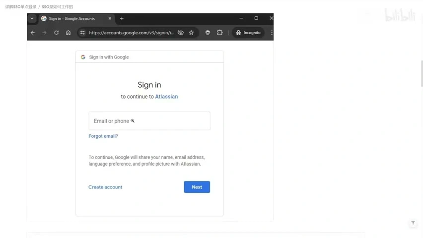
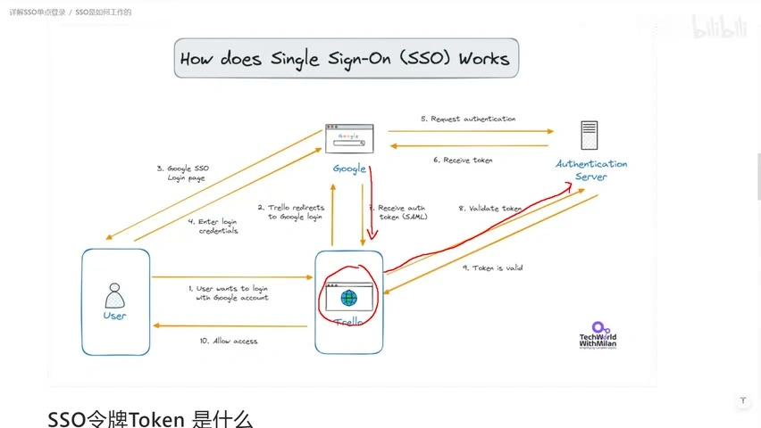
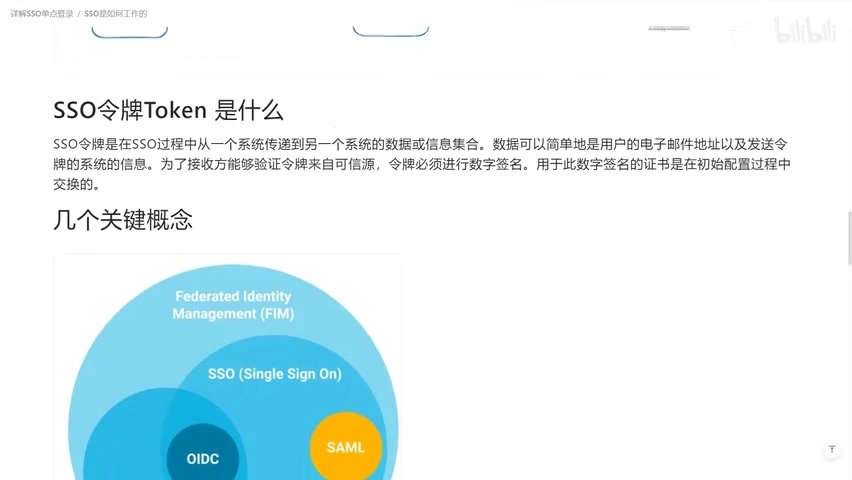
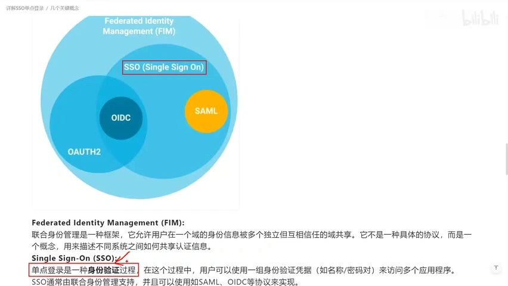
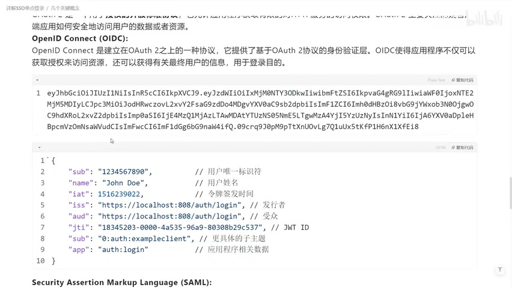
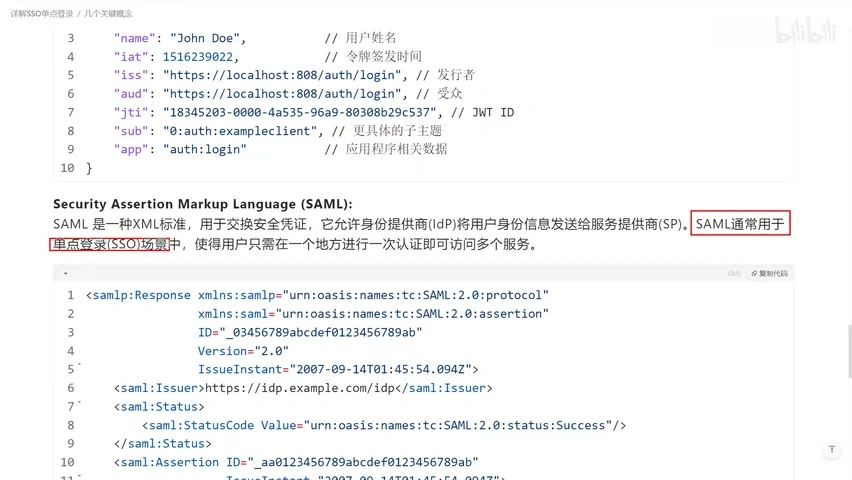
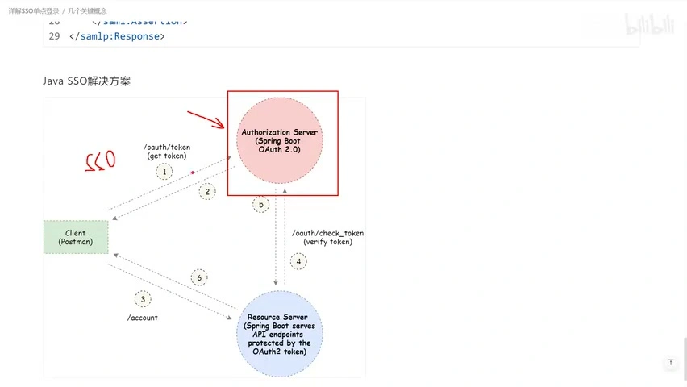

# 《理解单点登录 SSO》视频时间轴笔记

[阅读完整解释与概念校正](../sso.md) · [返回专题](../README.md)

来源：[IT老齐《【IT老齐615】理解单点登录SSO》](https://www.bilibili.com/video/BV11Kt5eVEBk/)，约 9 分 42 秒。以下按主题概括视频，供回看定位，**不是逐字转载**。主题段的链接指向起始时间，配图另标实际截图时刻。

## 00:00–00:29：开场与本期目标

作者先介绍个人课程和相关服务，然后提出本期主题：业务开发中的 SSO 是什么，如何执行。技术正文约从 [00:29](https://www.bilibili.com/video/BV11Kt5eVEBk/?t=29) 开始。

## 00:29–01:53：从网站的 Google 登录入口理解统一身份

作者使用 Trello/Atlassian 与 Google 登录页说明：业务应用可以把身份确认交给另一个平台。需要区分业务应用与集中认证身份的一方；正文对此使用 SP/RP 和 IdP 的规范术语。

[回看 00:29](https://www.bilibili.com/video/BV11Kt5eVEBk/?t=29)

## 01:53–03:33：用重定向、凭据返回和校验串起登录

示意图把过程拆成访问业务网站、跳转 Google、提交认证信息、取得令牌、校验并访问资源。它是概念讲解，不是对 Trello/Google 真实后端的审计；图中 SAML 标注也不能用来推断本专题 Google Demo 的协议。

[回看 01:53](https://www.bilibili.com/video/BV11Kt5eVEBk/?t=113)

## 03:33–04:48：后端通过本地会话衔接后续请求

作者提出 `/doSomething` 的例子，解释浏览器后续发请求时，业务后端可以通过 Session ID 找到会话和关联身份。将第三方令牌留在后端是其中一种实现，不是所有客户端架构的统一规则。

[回看 03:58](https://www.bilibili.com/video/BV11Kt5eVEBk/?t=238)

## 04:48–05:26：从 Token 转向 FIM 等概念

视频强调令牌的可信性，并列出 FIM、SSO、OAuth、OIDC、SAML。FIM 关注独立身份域之间的协作与信任，而不是某个单独接口或令牌格式。

[回看 05:01](https://www.bilibili.com/video/BV11Kt5eVEBk/?t=301)

## 05:26–06:59：区分身份认证、授权和 OIDC

作者用图解释 SSO 的认证目标与 OAuth 的授权用途，再引出 OIDC 的身份认证能力。正文补充了标准定义：OIDC 建立在 OAuth 2.0 上，图中的交集不能当作严格定义；业务权限也不会由 OAuth 自动全部解决。

[回看 05:26](https://www.bilibili.com/video/BV11Kt5eVEBk/?t=326)

## 06:59–07:54：从 JWT 样例观察身份声明

视频展示令牌字符串及解码后的 JSON 字段。正文区分 JWT 这一格式与 ID Token 这一用途，并说明解码不等于验签、签名不等于加密，样例也不应直接作为实现模板。

[回看 07:29](https://www.bilibili.com/video/BV11Kt5eVEBk/?t=449)

## 07:54–08:43：用 XML 安全断言介绍 SAML

作者展示 SAML 报文，与前面的 JWT 作对照。正文保留格式差异，也说明不能据个人使用经验推断 SAML 已过时，或认为协议差别只有格式。

[回看 07:54](https://www.bilibili.com/video/BV11Kt5eVEBk/?t=474)

## 08:43–09:42：Java 生态的实现方向与结束语

视频以 Spring Boot 相关架构图收尾，说明客户端、授权服务器和资源服务器的角色。图中的接口路径是示例，实际接入应使用对应版本框架文档，并明确是否启用 OIDC。09:33 后为结束语。

[回看 09:08](https://www.bilibili.com/video/BV11Kt5eVEBk/?t=548)

## 素材和核对方法

- 平台 API 标记时长 582 秒，下载媒体时长约 581.4 秒；时间轴按媒体定位，尾段存在取整差异。
- 字幕服务返回解析失败，直接提取也只发现弹幕轨道，未取得可用官方字幕。
- 使用本地 MLX Whisper small 多语言模型转写，得到 118 个片段；按每秒一帧抽取 581 张画面，合并成 37 个内部核对窗口，再整理为本页主题笔记。
- 已结合画面修正 OAuth、Session、Spring Boot 等识别错误；宣传部分不作逐字还原。语音识别仍可能有误，原视频是最终核对依据。
- 仓库仅保存学习笔记、来源信息和 8 张选图，不上传完整视频、音频、模型或全部抽帧。截图中 TechWorld with Milan 等原图署名保持可见；相关素材权利归原作者。
